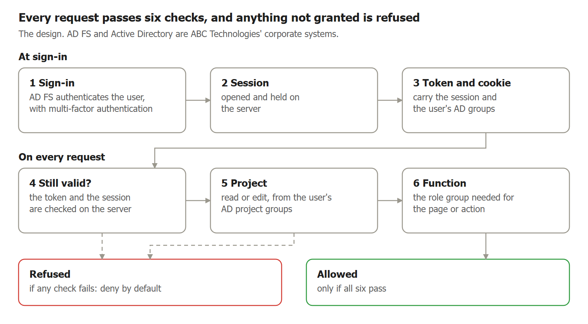
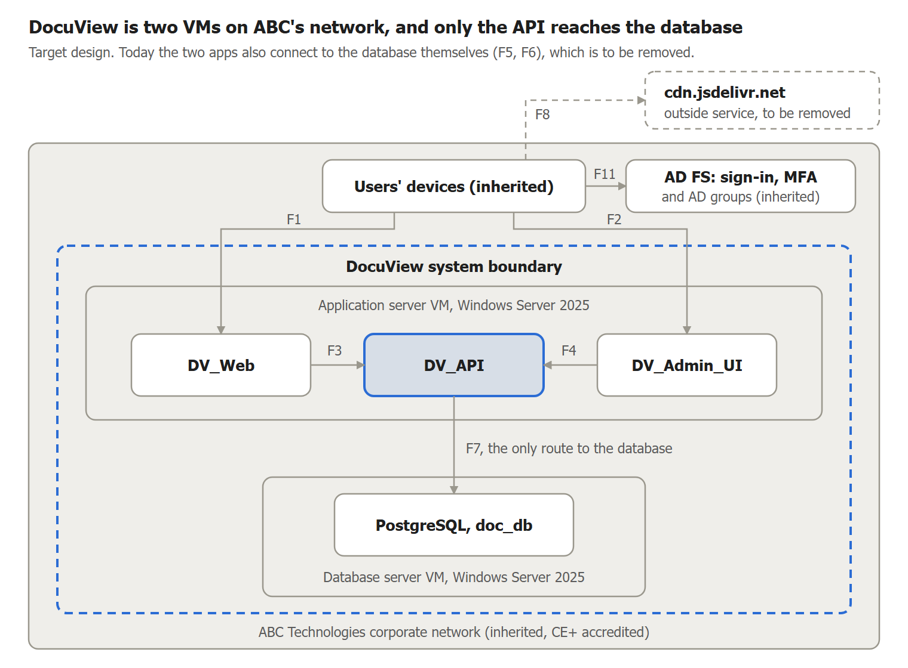
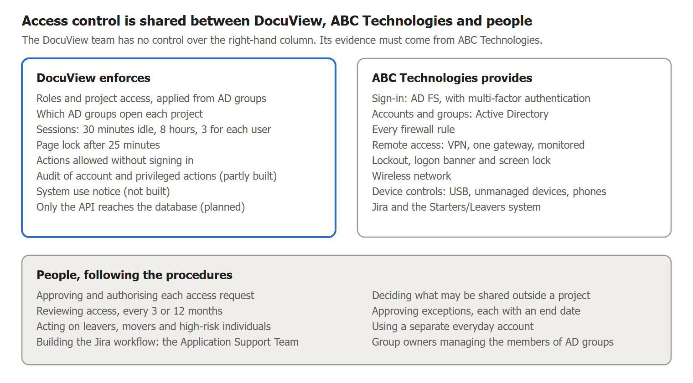
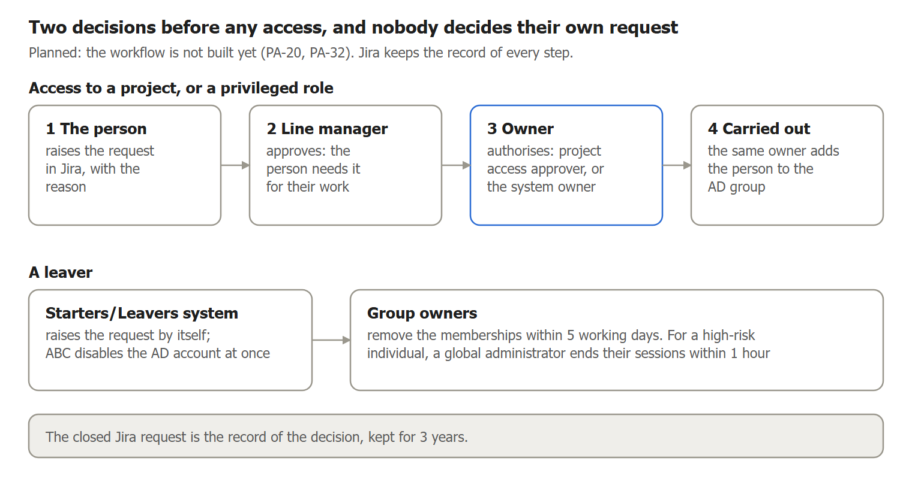

# \<DocuView\> Access Control Management

**\<ref\> | Version \<ver\> | Draft for the system owner's approval**

**Contents**

[1 Document control](#1-document-control)

[2 Purpose](#2-purpose)

[3 Summary](#3-summary)

[4 The access control model](#4-the-access-control-model)

[5 Each control and enhancement](#5-each-control-and-enhancement)

[Appendix A How it is built today](#appendix-a-how-it-is-built-today)

[Appendix B Parameter register](#appendix-b-parameter-register)

| **SECTION 1** |
| --- |

## 1 Document control

### 1.1 Document details

**Table 1: Document details**

| Item | Detail |
| --- | --- |
| Reference | \<ref\> |
| Title | \<DocuView\> Access Control Management |
| Version | \<ver\> |
| Status | Draft for the system owner's approval |
| Date | 12 November 2026 |
| Owner | System owner |
| Applies to | Access Control family |
| Classification | Restricted |
| Next review | Every 12 months, and after a significant change to access control |
| Format | \<Documentation Map\>, section 5 |

### 1.2 Approval

**Table 2: Approval**

| Role | Name | Decision | Date |
| --- | --- | --- | --- |
| System owner | Neil Ramsbottom | Pending | Pending |

### 1.3 Change history

**Table 3: Change history**

| Version | Date | Change |
| --- | --- | --- |
| \<ver\> | 12 November 2026 | Final pass after a full read: section 4.8 and the review schedule brought into line with sign-in through AD FS; the sign-in flow F11 added to the flows; the system use notice placed on each app's first page; who provides and is responsible corrected for six controls; records and test wording corrected; the parameter register dated; the earlier change history folded |
| \<ver\> | 12 November 2026 | Sign-in and authorisation are rewritten as the system owner stated them (D-AC-23): AD FS authenticates every user, with multi-factor authentication; roles and project access come from AD groups, as group claims; the system holds no accounts or passwords of its own. Sections 2, 4.1 to 4.7 and 4.13, eleven controls in section 5 and the appendices follow. The tests of the earlier build are marked for repeating |
| \<ver\> | 12 November 2026 | Version numbers are shown as a placeholder, as the system owner asked (D-GEN-28). No other change |
| \<ver\> | 12 November 2026 | The document number is replaced by a placeholder on the line under the title and in the details table, as the system owner asked (D-GEN-27). No other change |
| \<ver\> | 12 November 2026 | The name of the system is shown as a placeholder, as the system owner asked (D-GEN-26). No other change |
| \<ver\> to \<ver\> | 12 November 2026 | The earlier versions. Their history is kept in the change record (\<Documentation Map\>, section 5.1) |

| **SECTION 2** |
| --- |

## 2 Purpose

This document shows how \<DocuView\> is designed and configured for each of the 39 Access Control (AC) controls and enhancements in the NIST SP 800-53 Rev 5 Moderate baseline. Section 4 sets out the access control model: the account types, roles, permissions, separation of duties, access routes, settings, rules and the access request workflow. Section 5 takes each control in turn. Appendix A records how the system is built today, and appendix B every value NIST asks the organisation to define.

This is the only place the access control design is held. Other documents point here.

An assessor examines the design, the settings and the records, interviews the people named, and tests the mechanisms (NIST SP 800-53A). So for each control section 5 gives:

- **each part of the control**, as NIST letters them, with the design that meets it and what the system does today;
- **who provides it**: \<DocuView\> itself, people following the procedures, ABC Technologies, or a share of these;
- **what enforces it**: the mechanism and its settings;
- **the rules and procedures** that apply, and the tests run, with their results;
- **the records an assessor will ask for**, and whether they exist yet;
- **its status**, the risk decision, and what is still open, with the fix in \<Plan of Action and Milestones\>.

On 12 November 2026 the system owner stated how sign-in and authorisation work (D-AC-23): ABC Technologies' AD FS authenticates every user, with multi-factor authentication, and \<DocuView\> takes each user's roles and project access from their Active Directory groups, sent as group claims. \<DocuView\> holds no accounts or passwords of its own. Both are corporate systems that \<DocuView\> uses as they stand. The design in sections 4 and 5 is written on that basis.

\<DocuView\> is not yet built on its servers, so "today" means the tested v1.0 code in the Docker test environment. That build signed in with its own passwords and held its groups in its own database, so its tests do not yet show AD FS sign-in or AD groups working. Where that matters, the "Today" column and the "Tests" row say so. Test results are in `docs/evidence/ac`. Values that NIST asks the organisation to define are stated in the design and listed in full in appendix B.

**Table 4: Status values**

| Status | Meaning |
| --- | --- |
| Implemented | The design is in place and working |
| Partially implemented | Some of the design is in place; the open items say what is missing |
| Not implemented | None of the design is in place yet |
| Not applicable | The control does not apply to \<DocuView\>. The reason is in \<Tailoring Register\> |

No AC control is yet fully implemented. The policy is in \<Policy\> (AC), and the steps people follow are in \<Procedures\> (AC).

| **SECTION 3** |
| --- |

## 3 Summary

**Table 5: Status of each control**

| Control | Title | Status |
| --- | --- | --- |
| AC-1 | Policy and Procedures | Partially implemented |
| AC-2 | Account Management | Partially implemented |
| AC-2(1) | Automated System Account Management | Partially implemented |
| AC-2(2) | Automated Temporary and Emergency Account Management | Not applicable |
| AC-2(3) | Disable Accounts | Partially implemented |
| AC-2(4) | Automated Audit Actions | Partially implemented |
| AC-2(5) | Inactivity Logout | Partially implemented |
| AC-2(13) | Disable Accounts for High-risk Individuals | Partially implemented |
| AC-3 | Access Enforcement | Partially implemented |
| AC-4 | Information Flow Enforcement | Partially implemented |
| AC-5 | Separation of Duties | Partially implemented |
| AC-6 | Least Privilege | Partially implemented |
| AC-6(1) | Authorize Access to Security Functions | Partially implemented |
| AC-6(2) | Non-privileged Access for Nonsecurity Functions | Not implemented |
| AC-6(5) | Privileged Accounts | Partially implemented |
| AC-6(7) | Review of User Privileges | Not implemented |
| AC-6(9) | Log Use of Privileged Functions | Partially implemented |
| AC-6(10) | Prohibit Non-privileged Users from Executing Privileged Functions | Partially implemented |
| AC-7 | Unsuccessful Logon Attempts | Partially implemented |
| AC-8 | System Use Notification | Not implemented |
| AC-11 | Device Lock | Partially implemented |
| AC-11(1) | Pattern-hiding Displays | Partially implemented |
| AC-12 | Session Termination | Partially implemented |
| AC-14 | Permitted Actions Without Identification or Authentication | Partially implemented |
| AC-17 | Remote Access | Not implemented |
| AC-17(1) | Monitoring and Control | Not implemented |
| AC-17(2) | Protection of Confidentiality and Integrity Using Encryption | Not implemented |
| AC-17(3) | Managed Access Control Points | Not implemented |
| AC-17(4) | Privileged Commands and Access | Not applicable |
| AC-18 | Wireless Access | Not implemented |
| AC-18(1) | Authentication and Encryption | Not implemented |
| AC-18(3) | Disable Wireless Networking | Not implemented |
| AC-19 | Access Control for Mobile Devices | Not applicable |
| AC-19(5) | Full Device or Container-based Encryption | Not applicable |
| AC-20 | Use of External Systems | Not implemented |
| AC-20(1) | Limits on Authorized Use | Not applicable |
| AC-20(2) | Portable Storage Devices: Restricted Use | Not implemented |
| AC-21 | Information Sharing | Not implemented |
| AC-22 | Publicly Accessible Content | Not applicable |

In total: 0 implemented, 20 partially implemented, 13 not implemented and 6 not applicable. Most of those not implemented depend on ABC Technologies' evidence or on the servers being built.

| **SECTION 4** |
| --- |

## 4 The access control model

### 4.1 Principles

1. **Deny by default.** Nothing is allowed unless a role or group grants it. A project with no group is open only to global administrators.
2. **One person, one account.** Each person uses their own Active Directory account. Accounts are never shared, and \<DocuView\> holds no accounts or passwords of its own.
3. **Projects are the boundary.** Each project has a read group and an edit group. Edit includes read.
4. **AD groups decide everything.** A person's role groups set what they can do, and their project groups set which projects they can do it in. All are Active Directory groups, which reach \<DocuView\> as group claims when the person signs in.
5. **Application users have no server access.** Windows and database administration use separate accounts.
6. **Only the API reaches the database.** The user app and the admin portal get all their data through the API. The API connects with one service account that is not a database administrator and cannot change the schema (D-AC-18).
7. **ABC Technologies' single sign-on proves who the user is.** AD FS authenticates every user, with multi-factor authentication, and gives \<DocuView\> a signed token. \<DocuView\> never sees a password (D-AC-23).

Figure 1 shows the checks every request passes. They are described under AC-3 in section 5. Appendix A, section A.2, shows how the tested build made them.

**Figure 1: How an access decision is made**

### 4.2 Account types

Every person signs in with their Active Directory account, through AD FS. The types below are the kinds of access an account may hold.

**Table 6: Account types**

| Type | Held by | Allowed | Rules |
| --- | --- | --- | --- |
| Standard user | Readers | Yes | Their own AD account; member of a project's read group only |
| Project editor | Editors | Yes | Their own AD account; member of a project's edit group |
| Administrator | Administrators | Yes, privileged | Their own AD account; the system owner authorises and adds them to the group |
| Auditor | Auditors | Yes, privileged | Their own AD account; holds no administration role |
| Security officer | Security officers | Yes, privileged | Their own AD account; holds no administration role |
| Global administrator | Global administrators | Yes, privileged | Their own AD account; the system owner authorises and adds them to the group; a separate everyday account |
| Windows administrator | Windows server administrators | Yes, privileged | Named person, through ABC Technologies' approved route |
| Database administrator | Database administrators | Yes, privileged | Named person, for approved maintenance only |
| API service account | The API only | Yes, privileged | One headless database account, managed by the database administrator. Nobody signs in with it. Not a superuser, and cannot change the schema (section 4.6) |
| Local \<DocuView\> account | Nobody | No | \<DocuView\> holds no accounts or passwords of its own. The first global administrator is simply the first member of that AD group (D-AC-23) |
| Temporary and emergency | Nobody | No | Prohibited (P-AC-09) |
| Shared, guest, anonymous and demonstration | Nobody | No | Prohibited on the servers |

### 4.3 Roles

**Table 7: Roles**

| Role | Purpose | Granted through | Group owner, who authorises and manages its members |
| --- | --- | --- | --- |
| Reader | Read documents in a project | The project's read group, an AD group | The owner of the project's data: its project access approver |
| Editor | Add, manage and export documents in a project | The project's edit group, an AD group | The same |
| Administrator | Use the administration dashboard | AD group `DocViewer_Admins` | System owner |
| Auditor | Read audit logs | AD group `DocViewer_Auditors` | System owner |
| Security officer | Read security information | AD group `DocViewer_Security` | System owner |
| Global administrator | Manage projects, the AD groups each project uses, and sessions | AD group `DocViewer_GlobalAdmins` | System owner |

The people who hold each role are named in \<Roles and Responsibilities\>. The group names are those the tested build used, and are to be confirmed when the groups are created in Active Directory.

Each group's owner adds and removes its members in Active Directory, with ABC Technologies' AD tool, as the last step of an approved request (section 4.13). \<DocuView\> reads the groups from the sign-in token and cannot change them.

### 4.4 Permissions

**Table 8: Permissions by role**

| Function | Reader | Editor | Administrator | Auditor | Security officer | Global administrator |
| --- | --- | --- | --- | --- | --- | --- |
| Search and read documents | Own projects | Own projects | No | No | No | All projects |
| Report a bad file | Own projects | Own projects | No | No | No | All projects |
| Upload, manage and export documents | No | Own projects | No | No | No | All projects |
| Manage users, passwords and group membership | No | No | No | No | No | No: done in Active Directory, by each group's owner |
| Manage projects, and which AD groups open each | No | No | No | No | No | Yes |
| Grant global administrator | No | No | No | No | No | No: the system owner adds the member to the AD group |
| End another person's session | No | No | No | No | No | Yes |
| Use the administration dashboard | No | No | Yes | No | No | Yes |
| Read audit logs | No | No | No | Yes | No | No |
| Read security information | No | No | No | No | Yes | No |

### 4.5 Separation of duties

1. Nobody approves their own access or privilege.
2. Nobody reviews their own access or their own privileged actions.
3. Auditors and security officers hold no administration role.
4. Application, Windows and database administration use separate accounts, held by different people where staffing allows.
5. Developers hold no administrator access on the servers.
6. Where staffing cannot meet a rule, it is recorded as an exception, with a compensating check.

Table 9 shows each pair of duties that one person must not hold together, the roles that carry them, and what keeps them apart.

**Table 9: Duties kept apart**

| Duty | Must be separate from | Roles | Kept apart by | Today |
| --- | --- | --- | --- | --- |
| Asking for access | Approving and granting it | The person asks; their line manager approves; the group's owner authorises, and adds them to the AD group | The Jira workflow, in which nobody can decide their own request, and Active Directory, where only a group's owner can change its members (section 4.13) | The Jira workflow is not set up (PA-20). The tested build signed in with its own passwords and held its groups in its own database, so this is not yet tested with AD FS and Active Directory |
| Administering projects and sessions | Reviewing audit logs | Global administrator administers; auditor reviews | Separate access groups: only the auditor group opens the audit log pages, and it opens no administration page | In the tested build an auditor could not manage users (T74), but a global administrator could still read the audit logs (T75, PA-15) |
| Administering the system | Reading security information | Global administrator and administrator administer; security officer reads | Separate access groups | The security officer role has no test account, so this is not yet tested |
| Holding global administrator | Granting it | Global administrators; the system owner, who alone manages that AD group | Active Directory: a global administrator cannot add a member to the group | In the tested build a global administrator could grant it with no second person (PA-15) |
| Application administration | Windows administration and database administration | Global administrator; Windows server administrator; database administrator | Separate accounts on separate layers, held by three different people (\<Roles and Responsibilities\>) | Holders named. The servers are not built (PA-30) |
| Development | Production administration | Developers; Windows server and database administrators | Developers hold no administrator account on the servers | The servers are not built |
| Holding access | Reviewing that access | Each account holder; system owner, auditor and project access approvers review | Procedure: nobody reviews their own access (PRO-AC-7) | No review held yet (PA-16) |

**Today:** in the tested build a global administrator can do everything, including reading audit logs and security information and reviewing their own actions. This is accepted for 12 months as a Medium risk (PA-15).

### 4.6 Access routes

Figure 2 shows \<DocuView\>'s boundary and the routes into and inside it. It is the boundary figure of \<Security Architecture\>.

**Figure 2: System boundary and access routes**

**Table 10: Access routes**

| Route | Used by | Design | Today |
| --- | --- | --- | --- |
| Sign-in | Everyone | The browser is sent to ABC Technologies' AD FS, which authenticates the user with multi-factor authentication and returns a signed token carrying their AD groups. \<DocuView\> has no sign-in of its own | The tested build signed in with its own passwords and held its groups in its own database, so this is not yet tested with AD FS and Active Directory |
| Browser to the user app | Readers, editors, global administrators | HTTPS on ABC Technologies' network, after signing in | Plain HTTP in the test environment (PA-18) |
| Browser to the admin portal | Administration, audit and security roles | HTTPS, from approved administrator locations only | Plain HTTP, reachable on every interface (PA-18, PA-83) |
| Apps to the API | The apps only | Inside the application server; people do not connect directly | As designed, over plain HTTP |
| API to the database | The API's service account only | Application server to database server only, using TLS. The user app and the admin portal have no database connection | All three apps connect, with one shared superuser account and no TLS (PA-10, PA-18) |
| Windows administration | Windows server administrators | Named accounts, through ABC Technologies' approved route | Servers not yet built |
| Database administration | Database administrators | Named accounts, for approved maintenance only | Servers not yet built |
| Remote access | Approved users and administrators | ABC Technologies' remote access service, with multi-factor authentication | Stated by ABC Technologies, not evidenced |
| Without signing in | Anyone | Only the actions listed under AC-14 | Some extra functions are open (PA-03, PA-07) |
| Outside services | None | Browsers load all code from \<DocuView\> itself | Pages load code from an outside service (PA-34) |

**Table 11: Server and database access**

| Layer | Who | Rule |
| --- | --- | --- |
| Windows on both VMs | Windows server administrators | Named accounts, through ABC Technologies' approved route |
| PostgreSQL administration | Database administrators | Named accounts, for approved maintenance only |
| DV\_API to PostgreSQL | One service account | The rights in the table below. DV\_Web and DV\_Admin\_UI do not connect |
| App service accounts on Windows | One for each app | Group managed service accounts; cannot sign in interactively; not administrators (Table 13) |

The system owner decided on 12 November 2026 that only the API connects to the database (D-AC-18). This replaces the earlier design of one database account for each app.

**Table 12: Database accounts and their rights**

| Account | Used by | May | May not |
| --- | --- | --- | --- |
| API service account, \[name to be set at build\] | DV\_API only. Headless: no person signs in with it | Read and write application data. Add audit records | Be a superuser. Create, alter or drop tables. Change or delete audit records. Connect from anywhere but the application server |
| Schema owner account, \[name to be set at build\] | The database administrator, at a release, under an approved change | Create and alter the tables | Be used by any app, or for everyday work |
| Database administrators' own accounts | Each database administrator, by name | Administer PostgreSQL, for approved maintenance | Be shared |
| Built-in `postgres` superuser | Nobody, over the network | Be used on the database server itself, in an emergency, by a database administrator | Connect over the network |

These rules follow from it:

1. **No passwords.** \<DocuView\> stores no passwords or password hashes, because AD FS authenticates every user (D-AC-23).
2. **Documents and projects.** The user app asks the API for document data. The admin portal asks the API for projects, the groups each uses, sessions and audit records, and gets no document content.
3. **Audit log.** The service account can only add records. Nothing can change or delete them. They are read only through the admin portal's audit pages, by the auditor role.
4. **Schema changes.** Only the database administrator makes them, with the schema owner account.
5. **Connection.** The service account connects only from the application server, over TLS, and proves itself with a password held as a salted hash (SCRAM-SHA-256). Its password is kept out of the code repositories (PA-19).

**Today:** all three apps connect to the database themselves, with one shared account that is a superuser (T55). The change is tracked as PA-10.

#### 4.6.1 Windows service accounts

The system owner decided these on 12 November 2026 (D-AC-19). Each app runs under its own Windows account, so a fault in one app cannot reach another's files.

**Table 13: Windows service accounts**

| Account | Runs | Kind | May | May not |
| --- | --- | --- | --- | --- |
| \[name to be set at build\] | DV\_Web | Group managed service account in ABC Technologies' Active Directory. Windows sets and changes its password, and no person knows it | Log on as a service on the application server | Be an administrator. Sign in at the console or by remote desktop. Be used by a person |
| \[name to be set at build\] | DV\_Admin\_UI | The same | The same | The same |
| \[name to be set at build\] | DV\_API | The same | The same. It alone holds the database service account's password | The same |

ABC Technologies uses Active Directory. Its agreement to group managed service accounts for these servers is to be confirmed with its security contact; if it does not agree, ordinary service accounts with the same rights are used, with passwords the Windows server administrator changes every 12 months.

#### 4.6.2 Who may sign in to the servers

**Table 14: Sign-in to the servers**

| Server | May sign in | How | May not |
| --- | --- | --- | --- |
| Application server | The named Windows server administrators | Their own named administrator accounts, through ABC Technologies' approved route | Developers, application users, the service accounts, and any shared account |
| Database server | The named Windows server administrators, and the named database administrators | The same | The same |

The holders are named in \<Roles and Responsibilities\>. ABC Technologies creates and removes these accounts through its Jira process, with the system owner's approval (EV-AC-02).

#### 4.6.3 File permissions on the application server

**Table 15: File permissions**

| Files | Read | Write | Notes |
| --- | --- | --- | --- |
| Each app's program folder | That app's service account; Windows server administrators | Windows server administrators only, at a release | An app cannot change its own code |
| Each app's settings and secrets | That app's service account; Windows server administrators | Windows server administrators only | Secrets are kept out of the code repositories (PA-19). The other two apps cannot read them |
| Each app's sign-in key ring | That app's service account | That app's service account | Protected with Windows DPAPI (PA-93) |
| Each app's logs | Windows server administrators; the auditor | That app's service account | Kept for 30 days |
| The export working folder | DV\_API's service account | DV\_API's service account | Holds an export only until it is downloaded |

Document pages are held in the database, in a separate schema for each project. Some older TIFF pages may point to a file instead; any such folder is readable and writable only by DV\_API's service account.

**Today:** the servers are not built, so none of this exists. In the test environment the apps run as an ordinary user, not as root (PA-18, PA-30).

#### 4.6.4 Firewall rules

ABC Technologies' corporate network team writes, holds and changes every firewall rule, through its own change process. The \<DocuView\> team has no control over them and cannot see or change a rule (D-AC-20). So \<DocuView\> does not design the rules. It states the flows it needs, in Table 16, and asks ABC Technologies to allow those and nothing else. The rules themselves are ABC Technologies' evidence (EV-AC-03).

**Table 16: Flows \<DocuView\> asks ABC Technologies to allow**

| Flow | From | To | Service | Needed for |
| --- | --- | --- | --- | --- |
| F1 | Users' managed devices, in the office or on the VPN | Application server | HTTPS, TCP 443 | The user app |
| F2 | Administrators, over ABC Technologies' managed route | Application server | HTTPS, on a port or host name still to be set | The admin portal |
| F3, F4 | The user app and the admin portal | The API, on the application server's own loopback address | HTTPS | Needs no firewall rule: it never leaves the server |
| F7 | Application server | Database server | PostgreSQL with TLS, TCP 5432 | The API's database connection |
| F11 | Users' and administrators' browsers | ABC Technologies' AD FS | HTTPS | Signing in. Both ends are ABC Technologies', so this needs no rule for \<DocuView\>'s servers |
| AD FS certificate | Application server | ABC Technologies' AD FS | HTTPS | Fetching the certificate that checks sign-in tokens, if \<DocuView\> is set to fetch it; to be confirmed at build |
| Administration | Windows server and database administrators, over ABC Technologies' managed route | Both servers | Tool and protocol to be confirmed by ABC Technologies | Running the servers |
| Time | Both servers | ABC Technologies' time service | NTP, UDP 123 | Accurate audit times |

Everything else should be refused, in and out. \<DocuView\> needs no route to the internet once pages stop loading code from an outside service (PA-34).

What \<DocuView\> itself controls is limited to its own apps: the API listens only on the loopback address, each app accepts only HTTPS, and the API accepts requests only from the two apps' addresses.

**Today:** no rule exists, as the servers are not built, and the request has not been sent (PA-18).

#### 4.6.5 What ABC Technologies' corporate configuration provides

**Figure 3: Who provides each part of access control**

These are set by ABC Technologies as part of its corporate network, directory and device configuration. The \<DocuView\> team has no control over them (D-AC-21, D-AC-23). \<DocuView\> accepts ABC Technologies' corporate standard for each, and records the values once ABC Technologies supplies them. Table 17 says what \<DocuView\> relies on. What ABC Technologies has said so far is a statement by its security contacts, not evidence.

**Table 17: Provided by ABC Technologies' corporate configuration**

| Provided | Controls | What \<DocuView\> relies on | Said by ABC Technologies | Evidence asked |
| --- | --- | --- | --- | --- |
| Single sign-on: AD FS | AC-3, AC-7, AC-14, and the IA controls | Every user is authenticated by AD FS, with multi-factor authentication. Repeated failed sign-ins lock the account under the corporate standard. The token \<DocuView\> receives is signed, and carries the user's AD groups | Stated by the system owner on 12 November 2026 (D-AC-23); not yet by ABC Technologies | EV-IA-04 |
| Accounts and groups: Active Directory | AC-2 and its enhancements, AC-6(5), AC-6(7) | Each person has one AD account, created, changed and disabled by ABC Technologies' starters and leavers process. A disabled account can no longer sign in. Only a group's owner can change its members | The same | EV-AC-01 |
| Account lockout on the servers and on users' devices | AC-7 | Repeated failed Windows sign-ins lock the account | Group Policy sets the lockout | EV-AC-05 |
| Logon banner on the servers | AC-8 | A system use notice before an administrator signs in to Windows | Group Policy sets the banner | EV-AC-06 |
| Screen lock on the servers and on users' devices | AC-11, AC-11(1), AC-2(5) | An unattended screen locks, hides what was on it, and needs the password to unlock | Group Policy sets the lock, and it hides the display | EV-AC-07 |
| Remote access | AC-17, AC-17(1), AC-17(2), AC-17(3) | One route in from outside: the VPN, from a managed device, with multi-factor authentication, encrypted, logged and monitored, through one managed gateway | As described | EV-AC-08 to EV-AC-11 |
| No remote administration from outside | AC-17(4) | The servers' administration ports cannot be reached from external networks | Administration ports are blocked from external networks | EV-AC-12 |
| Wireless | AC-18, AC-18(1), AC-18(3) | Corporate wireless authenticates users and devices and is encrypted; the servers have no wireless | As described | EV-AC-13, EV-AC-14 |
| Device controls | AC-19, AC-20, AC-20(2) | Phones and tablets cannot reach \<DocuView\>; unmanaged devices are kept off the network; USB storage is blocked unless approved | As described | EV-AC-15 to EV-AC-17 |

\<DocuView\>'s own settings for the same controls, which it does control, are in section 4.7: its page lock, its session limits and its system use notice.

**Today:** none of the evidence has been requested (PA-18, PA-21, PA-30, PA-95).

### 4.7 Settings

The P-AC numbers are the access control settings used across the document set. P-AC-01 to P-AC-03 are in \<Policy\> (AC). Sign-in settings, such as lockout and multi-factor authentication, are AD FS's and are not set in \<DocuView\>.

**Table 18: Access control settings**

| No. | Control | Setting and approved value | Today |
| --- | --- | --- | --- |
| P-AC-04 | AC-2 | Allowed account types: as listed in Table 6 | Approved; a rule for people, nothing to build |
| P-AC-05 | AC-2 | Who decides access: the person's line manager approves, then the group's owner authorises and adds them to the AD group. The owner is the system owner for a role group, and the project access approver for a project group (section 4.13) | Approved; a rule for people, carried out in Active Directory |
| P-AC-06 | AC-2 | A leaver's AD account is disabled by ABC Technologies at once, which ends their access to \<DocuView\>. Each group's owner removes the membership within 5 working days. Owners are told of a role change within 1 working day | Approved; no notice from ABC Technologies yet (PA-32) |
| P-AC-07 | AC-2, AC-6(7) | Access review: global administrators and privileged groups every 3 months, all other accounts every 12 months | Approved; no review held yet (PA-16) |
| P-AC-08 | AC-2(3) | Unused AD accounts are disabled under ABC Technologies' corporate standard, which \<DocuView\> accepts. An account no longer required or in breach of policy is disabled by ABC Technologies on notice | ABC Technologies' standard is to be supplied |
| P-AC-09 | AC-2(2) | Temporary and emergency accounts: not allowed until the system can expire them | Approved; a rule for people, nothing to build |
| P-AC-10 | AC-2(5), AC-12 | Sign out after 30 minutes of inactivity | Approved; built |
| P-AC-11 | AC-12 | End every session after 8 hours, whatever the activity | Approved; built |
| P-AC-12 | AC-12 | At most 3 sessions per user; the least recently used ends first | Approved; built |
| P-AC-13 | AC-2(13) | Within 1 hour of notice: ABC Technologies disables the AD account of a high-risk individual, and a global administrator ends their \<DocuView\> sessions | Approved; a rule for people, not yet used |
| P-AC-14 | AC-7 | Failed sign-ins are counted and the account locked by AD FS and Active Directory, under ABC Technologies' corporate standard. \<DocuView\> has no sign-in of its own to lock | ABC Technologies' standard is to be supplied. The tested build locked after 5 failures, for 15 minutes |
| P-AC-15 | AC-11 | Lock the page after 25 minutes of inactivity, and require sign-in through AD FS to continue | Approved; locks after 25 minutes, but continues without signing in (PA-12) |
| P-AC-16 | AC-8 | System use notice wording: the wording in section 5.20 | Approved; not shown yet (PA-11) |
| P-AC-17 | AC-6(1), AC-6(10) | Privileged functions: managing projects and the AD groups each uses; session termination; audit log access; database maintenance; cache management. Security-relevant information: secrets and security settings, the certificates that check AD FS tokens, session records, access groups and project access rules, audit logs, firewall rules and certificates | Approved; a rule for people, nothing to build |
| P-AC-18 | AC-6(2) | Administrators use a separate non-privileged account for everyday document work | Approved; everyday accounts not issued (PA-17) |
| P-AC-19 | AC-6(9) | Privileged functions are logged: as P-AC-17 | Approved; partly built (PA-14) |
| P-AC-20 | AC-17 | Remote access route: ABC Technologies' remote access service, name to be confirmed | To be confirmed by ABC Technologies |
| P-AC-21 | AC-18, AC-19 | Wireless and mobile access: follows ABC Technologies' policies, to be confirmed | To be confirmed by ABC Technologies |
| P-AC-22 | AC-20 | External systems and portable storage with \<DocuView\> data: not allowed without system owner approval | Approved; a rule for people, nothing to build |
| P-AC-23 | AC-21 | Who decides on sharing information outside a project: the project access approver | Approved; a rule for people, nothing to build |
| P-AC-24 | AC-22 | Public content: none. \<DocuView\> must not hold or serve public content without system owner approval | Approved; a rule for people, nothing to build |
| P-AC-25 | AC-14 | Actions allowed without signing in: be sent to AD FS to sign in; see signed-out, session-expired and access-denied pages; load static files; check API health. Nothing else | Approved; other functions are also open (PA-03, PA-07) |

### 4.8 Privileged functions and security information

**Privileged functions:** managing projects and the AD groups each uses; ending sessions; reading audit logs; database maintenance; and cache management. Managing the members of \<DocuView\>'s AD groups is also privileged, and is done in Active Directory by each group's owner.

**Security-relevant information:** secrets and security settings, the certificates that check AD FS tokens, session records, access groups and project access rules, audit logs, firewall rules and certificates.

Only the privileged roles in Table 6 may use these. Their use must be logged.

### 4.9 Export and download rules

1. Only editors of a project and global administrators may bulk export its documents.
2. An export job can be seen, downloaded or cancelled only by the person who started it.
3. Exports are delivered as downloads. Writing exports to a server folder is not allowed (PA-26).
4. Exported documents stay under the project's access rules, and leaving ABC Technologies' systems needs approval under P-AC-22 and P-AC-23.
5. Every export is recorded in the audit log.

### 4.10 Information sharing rules

1. Sharing outside a project needs a decision by that project's access approver (P-AC-23).
2. The approver checks that the recipient is authorised for the information, and the decision is recorded.
3. External systems and portable storage may hold \<DocuView\> data only with system owner approval (P-AC-22).
4. \<DocuView\> holds no public content (P-AC-24).

### 4.11 Review schedules

**Table 19: Review schedules**

| Review | How often | By | Steps |
| --- | --- | --- | --- |
| The four role groups | Every 3 months | System owner, auditor; Head of Cyber as an extra check, for global administrators | PRO-AC-7 |
| Project groups | Every 12 months | Project access approvers | PRO-AC-7 |
| Members who no longer use \<DocuView\> | At each access review | Each group's owner, with last sign-in dates from the global administrator | PRO-AC-8 |
| Audit logs | Weekly | Auditor | \<Security Operating Procedures\> |
| Actions allowed without signing in | Every 12 months, and after a change | System owner | PRO-AC-14 |
| This document | Every 12 months, and after a significant change | System owner | PRO-AC-14 |

### 4.12 Exception rules

1. Every exception needs written system owner approval, a reason, an owner and an end date of no more than 12 months.
2. Each one needs a compensating check where possible, and an entry in \<Risk List\>.
3. Exceptions above the system owner's authority go to the authorising official.
4. Exceptions are checked at each access review and end on their end date unless renewed.
5. Steps are in PRO-AC-15.

### 4.13 Access request workflow

**Figure 4: Access request workflow**

Every change to a person's access goes through a request in Jira Service Desk. The system owner decided the workflow on 12 November 2026 (D-AC-22). Jira is ABC Technologies' corporate service. The Application Support Team builds and maintains the \<DocuView\> workflow in it.

**Table 20: Access request workflow**

| Request | Raised by | Approved by | Authorised by | Carried out by |
| --- | --- | --- | --- | --- |
| Access to a project, to read or to edit | The person who needs it | Their line manager | The owner of the project's data: its project access approver | The same owner, who adds the person to the project's AD group with ABC Technologies' AD tool |
| A privileged role | The person | Their line manager | The system owner, who cannot authorise their own | The system owner, who adds the person to the role's AD group |
| A change of role (mover) | The person's line manager, within 1 working day | Not needed for a removal; as above for any new access | As above for any new access | Each group's owner, who removes the old membership and adds any new one |
| Removal (leaver) | ABC Technologies' Starters/Leavers system, automatically | Not needed | Not needed | ABC Technologies disables the AD account at once, which ends access. Each group's owner removes the membership within 5 working days |

No \<DocuView\> account is ever created: a person's AD account is their account, and joining a group is what gives them access.

These rules apply:

1. **Two decisions before any access.** The line manager confirms the person needs it for their work. The owner of the data, or the system owner, decides whether to allow it, and only then adds the person to the AD group.
2. **Nobody decides their own request.** The person who raises a request cannot approve or authorise it. Jira is set to refuse it. An owner who needs access to their own group asks the system owner.
3. **What each request records:** the person; what is asked for; the business reason; who approved and who authorised it, and when; that the training is done and the rules are signed; and who carried it out, and when.
4. **The record.** The closed Jira request is the record of the access decision, in place of form TPL-2. It is kept for 3 years.
5. **Before the person is added to a group,** they complete security training and sign \<Security Operating Procedures\> (PRO-AC-1).
6. **A high-risk individual.** ABC Technologies disables the AD account, and a global administrator ends the person's \<DocuView\> sessions, both within 1 hour. Ending the sessions matters, because a session already open lasts until it is ended or times out.

**Today:** the workflow is not built, and no request has been raised (PA-20). The Starters/Leavers prompt is not set up (PA-32). The AD groups are not yet created.

| **SECTION 5** |
| --- |

## 5 Each control and enhancement

The controls are in NIST order. Each has two tables. The first takes each part of the control and gives what NIST requires, the design that meets it, and what the system does today. The second says who provides and is responsible for the control, what enforces it, the rules and procedures that apply, the tests run, the records an assessor will ask for, its status, the risk decision, and what is still open.

### 5.1 AC-1 Policy and Procedures

**Table 21: AC-1 design**

| Part | NIST requires | Design | Today |
| --- | --- | --- | --- |
| a.1 | An access control policy, shared with defined people, covering purpose, scope, roles, responsibilities, management commitment, coordination and compliance, and consistent with the law | \<Policy\> (AC): a system-level policy within ABC Technologies' organisational policies. Purpose and scope in section AC.1, responsibilities in AC.5, commitment, coordination and compliance in AC.6. Shared with everyone who uses or administers \<DocuView\>. The legal adviser reviews it | Approved by the Head of Cyber (D-AC-16). Legally reviewed on 12 November 2026. Not yet shared |
| a.2 | Procedures that carry out the policy, shared with defined people | \<Procedures\> (AC): 17 procedures, PRO-AC-1 to PRO-AC-17, each naming who acts, the time limit and the record. Shared with the same people | Approved by the system owner (D-AC-17). Not yet shared or walked through |
| b | A named official manages the policy and procedures | The system owner (P-AC-01) | Neil Ramsbottom is named in \<Roles and Responsibilities\> |
| c.1 | The policy is reviewed on a schedule and after set events | Every 12 months, and after a significant incident, audit finding or system change (P-AC-02, procedure PRO-AC-14) | Reviewed after the access control review of 8 November 2026. The first yearly review falls due in November 2027 |
| c.2 | The procedures are reviewed on a schedule and after set events | Every 12 months, and after a change to the steps (P-AC-03, procedure PRO-AC-14) | As the policy |

**Table 22: AC-1 responsibility and evidence**

| | |
| --- | --- |
| Provided by | People: the system owner and the Head of Cyber |
| Responsible | System owner, Head of Cyber |
| Enforced by | Not a system function. The documents are under version control, and each review is recorded in the change history and on TPL-4 |
| Rules and procedures | Policy rule R1 to R14 (\<Policy\>, section AC.4); PRO-AC-14, PRO-AC-15 (\<Procedures\> (AC)) |
| Tests | None. Examined from the documents and the code |
| Records an assessor will ask for | The policy and procedures with their approvals; proof they were shared; TPL-4 walk-through records; review records. Approvals exist; the rest do not yet |
| Status | Partially implemented |
| Risk decision | NC-01, rated Medium: approve |
| Open items | PA-20: share the policy and procedures, and walk through each procedure |

### 5.2 AC-2 Account Management

**Table 23: AC-2 design**

| Part | NIST requires | Design | Today |
| --- | --- | --- | --- |
| a | Define the account types allowed and prohibited | Table 6. Every account is a person's own Active Directory account. Temporary, emergency, shared, guest, anonymous, demonstration and local \<DocuView\> accounts are prohibited (P-AC-04) | Approved (D-AC-03, D-AC-23). The tested build signed in with its own passwords and held its groups in its own database, so this is not yet tested with AD FS and Active Directory |
| b | Assign account managers | ABC Technologies manages the AD accounts. Each AD group's owner manages its members: the system owner for the role groups, and each project access approver for their project's groups. The global administrator manages projects and sessions in \<DocuView\> | Holders are named in \<Roles and Responsibilities\>. The AD groups are not yet created |
| c | Set the conditions for group and role membership | A need confirmed by the line manager, authorisation by the group's owner, security training, and a signed acknowledgement of \<Security Operating Procedures\> (procedures PRO-AC-1, PRO-AC-5, PRO-AC-6) | Approved. They rely on the workflow, which is not yet built (PA-20) |
| d | Specify the authorised users, their group and role membership, and their access and attributes | The authorised users are the members of \<DocuView\>'s AD groups. Each person's groups are their access, and reach \<DocuView\> as group claims at sign-in. The approved source for each membership is its Jira request | No AD group or request exists yet |
| e | Require approval to create accounts | No \<DocuView\> account is created. Access is given by adding the person to an AD group, after their line manager approves and the group's owner authorises the request in Jira (P-AC-05, section 4.13) | Approved. The Jira workflow is not set up (PA-20) |
| f | Create, enable, change, disable and remove accounts under the procedures | ABC Technologies creates, changes, disables and removes AD accounts through its starters and leavers process. Group owners add and remove members with ABC Technologies' AD tool. \<DocuView\> cannot change an account or a group | ABC Technologies' process is not evidenced. The tested build signed in with its own passwords and held its groups in its own database, so this is not yet tested with AD FS and Active Directory |
| g | Monitor the use of accounts | \<DocuView\> audits every sign-in it accepts, with the person and the time. AD FS records every sign-in attempt. The auditor reviews privileged actions weekly (\<Security Operating Procedures\>, duty C3) | The tested build audited sign-ins (T39). No monitoring has been done, as \<DocuView\> is not live |
| h | Tell account managers within a set time when an account is no longer needed, a user leaves or moves, or their need changes | Within 1 working day in each case, to the owners of the groups the person belongs to and the system owner. The notice comes as a prompt from ABC Technologies' Starters/Leavers system (P-AC-06) | Approved. The route does not exist yet (PA-32) |
| i | Grant access only on a valid authorisation and intended use | Access comes only from membership of an AD group: a project's read or edit group, or a role group (Tables 7 and 8). Each membership traces to an approved request | The tested build took access from groups held in its own database (T11) |
| j | Review accounts on a schedule | Each group's owner reviews its members: role groups every 3 months, project groups every 12 months (P-AC-07, procedure PRO-AC-7, record TPL-3) | No review has been held (PA-16) |
| k | Change shared account passwords when someone leaves the group | Not applicable: shared and group accounts are prohibited (TR-AC-02), and \<DocuView\> holds no passwords to change | The only generic account, `admin`, was sample data in the tested build (D-AC-13) |
| l | Align account management with the leaver and transfer processes | Aligned by design: \<DocuView\> uses the same AD account that ABC Technologies' leaver and transfer processes act on. Disabling it ends access to \<DocuView\>. The Starters/Leavers system prompts the group owners to remove memberships (PRO-AC-2, PRO-AC-3) | ABC Technologies' processes are not evidenced, and the prompt is not set up (PA-32) |

**Table 24: AC-2 responsibility and evidence**

| | |
| --- | --- |
| Provided by | Shared: ABC Technologies provides the accounts, the groups and sign-in; group owners decide membership; \<DocuView\> applies the groups |
| Responsible | ABC Technologies; system owner; project access approvers; global administrator |
| Enforced by | Active Directory holds the accounts and the groups, and AD FS puts each user's groups in the sign-in token. \<DocuView\>'s admin portal sets which AD groups open each project. \<DocuView\> holds no accounts. Windows and PostgreSQL accounts are managed by their administrators through ABC Technologies' Jira process |
| Rules and procedures | Policy rule R1, R2, R3, R10 (\<Policy\>, section AC.4); PRO-AC-1, PRO-AC-2, PRO-AC-3, PRO-AC-6, PRO-AC-7, PRO-AC-12 (\<Procedures\> (AC)); \<Security Operating Procedures\>: A9; B5, B7; C3, C9, C15, C19, C36; section 5.4 |
| Tests | 1 check on the v1.0 code, 8 November 2026: 1 passed, 0 showed a gap. Passed: T10, a new account has no session until its temporary password is changed. These checks ran on a build that used its own passwords and groups. They are to be repeated with AD FS sign-in and AD groups (D-AC-23) |
| Evidence asked of ABC Technologies | EV-AC-01, EV-AC-02 (\<Evidence Requests\>). Not yet sent |
| Records an assessor will ask for | The members of each \<DocuView\> AD group; recently disabled AD accounts of \<DocuView\> users; the Jira requests and their approvals; leaver and mover records; review records (TPL-3). None exist yet |
| Status | Partially implemented |
| Risk decision | NC-02, rated Medium: remediate |
| Open items | PA-16: no access review exists. PA-20: the workflow and procedures are not yet in use. PA-32: the Starters/Leavers prompt is not set up. Evidence of AD FS and Active Directory is to be asked of ABC Technologies, and the tests repeated on the AD FS build (D-AC-23) |

### 5.3 AC-2(1) Automated System Account Management

**Table 25: AC-2(1) design**

| Part | NIST requires | Design | Today |
| --- | --- | --- | --- |
| All | Support account management with automated mechanisms | Automated by ABC Technologies: AD account creation, change and disabling through its starters and leavers process; sign-in, lockout and multi-factor authentication in AD FS. Automated by \<DocuView\>: applying the groups in the token at each sign-in, and ending every session of a user on request | ABC Technologies' mechanisms are not evidenced. The tested build signed in with its own passwords and held its groups in its own database, so this is not yet tested with AD FS and Active Directory. Accepted for 12 months as a Medium risk (NC-03) |

**Table 26: AC-2(1) responsibility and evidence**

| | |
| --- | --- |
| Provided by | Shared: ABC Technologies for accounts and sign-in; \<DocuView\> for applying the groups and ending sessions |
| Responsible | ABC Technologies; developers |
| Enforced by | Active Directory, AD FS and ABC Technologies' Starters/Leavers system; \<DocuView\>'s session service |
| Rules and procedures | Policy rule R3 (\<Policy\>, section AC.4) |
| Tests | None of its own. The checks under AC-2, AC-2(13) and AC-7 covered the tested build's own mechanisms, and are to be repeated with AD FS sign-in (D-AC-23) |
| Records an assessor will ask for | ABC Technologies' evidence of its starters and leavers process (EV-AC-01); \<DocuView\>'s audit records of sign-ins and ended sessions. None exist yet |
| Status | Partially implemented |
| Risk decision | NC-03, rated Medium: accepted |
| Open items | PA-16: no review. PA-32: the Starters/Leavers prompt is not set up. Evidence of AD FS and Active Directory is to be asked of ABC Technologies, and the tests repeated on the AD FS build (D-AC-23) |

### 5.4 AC-2(2) Automated Temporary and Emergency Account Management

**Table 27: AC-2(2) design**

| Part | NIST requires | Design | Today |
| --- | --- | --- | --- |
| All | Automatically remove or disable temporary and emergency accounts after a set time | Temporary and emergency accounts are prohibited (P-AC-09), so there is nothing to remove. Each access review confirms that none exists | None exists |

**Table 28: AC-2(2) responsibility and evidence**

| | |
| --- | --- |
| Provided by | Not applicable |
| Responsible | System owner, for the decision |
| Enforced by | A rule, checked at each access review (PRO-AC-7). If such accounts were ever needed, they would be Active Directory accounts with an end date, and the tailoring decision would be made again |
| Rules and procedures | Policy rule R4 (\<Policy\>, section AC.4) |
| Tests | None. Not applicable |
| Records an assessor will ask for | The tailoring decision (TR-AC-01), and each access review record confirming no such account |
| Status | Not applicable (TR-AC-01) |
| Risk decision | Tailored as not applicable (TR-AC-01); NC-04, rated Low: tailored |
| Open items | None |

### 5.5 AC-2(3) Disable Accounts

**Table 29: AC-2(3) design**

| Part | NIST requires | Design | Today |
| --- | --- | --- | --- |
| a | Disable accounts that have expired | AD accounts with an end date are disabled by Active Directory on that date | ABC Technologies' practice is not evidenced |
| b | Disable accounts no longer tied to a person | A leaver's AD account is disabled by ABC Technologies at once (P-AC-06) | Not evidenced (EV-AC-01) |
| c | Disable accounts that breach policy | ABC Technologies disables the AD account on notice: within 1 hour for a high-risk individual (PRO-AC-4) | Approved, not yet used |
| d | Disable accounts unused for a set period | Unused AD accounts are disabled under ABC Technologies' corporate standard, which \<DocuView\> accepts (P-AC-08) | ABC Technologies' standard is to be supplied. In the tested build an account unused for 400 days still worked (T43) |

**Table 30: AC-2(3) responsibility and evidence**

| | |
| --- | --- |
| Provided by | ABC Technologies |
| Responsible | ABC Technologies; global administrator, for ending sessions |
| Enforced by | Active Directory: a disabled account cannot sign in through AD FS, so it cannot reach \<DocuView\>. A session already open lasts until it times out or a global administrator ends it |
| Rules and procedures | Policy rule R3 (\<Policy\>, section AC.4); PRO-AC-3, PRO-AC-8 (\<Procedures\> (AC)) |
| Tests | 2 checks on the v1.0 code, 8 November 2026: 1 passed, 1 showed a gap. Passed: T42, a disabled account cannot sign in. Expected but not met: T43, an account unused for 400 days is disabled automatically. These checks ran on a build that used its own passwords and groups. They are to be repeated with AD FS sign-in and AD groups (D-AC-23) |
| Records an assessor will ask for | ABC Technologies' list of disabled Active Directory accounts of \<DocuView\> users, with dates (EV-AC-01); TPL-14 and TPL-3 records. None exist yet |
| Status | Partially implemented |
| Risk decision | NC-05, rated Medium: remediate |
| Open items | Evidence of AD FS and Active Directory is to be asked of ABC Technologies, and the tests repeated on the AD FS build (D-AC-23) |

### 5.6 AC-2(4) Automated Audit Actions

**Table 31: AC-2(4) design**

| Part | NIST requires | Design | Today |
| --- | --- | --- | --- |
| Creation | Automatically audit account creation | Active Directory audits the creation of every account | ABC Technologies' audit is not evidenced |
| Modification | Automatically audit account changes | Active Directory audits every change to an account and to the members of a group. \<DocuView\> audits changes to which AD groups open a project | Not evidenced. The tested build did not audit group or project changes (PA-14) |
| Enabling | Automatically audit enabling, including unlocking | Active Directory audits it | Not evidenced |
| Disabling | Automatically audit disabling | Active Directory audits it | Not evidenced |
| Removal | Automatically audit removal | Active Directory audits it | Not evidenced |

**Table 32: AC-2(4) responsibility and evidence**

| | |
| --- | --- |
| Provided by | Shared: ABC Technologies for accounts and groups; \<DocuView\> for its own project settings |
| Responsible | ABC Technologies; developers |
| Enforced by | Active Directory's audit of account and group changes, held by ABC Technologies. \<DocuView\>'s audit log, for changes to projects and the groups each uses, and for each sign-in it accepts |
| Rules and procedures | Policy rule R9 (\<Policy\>, section AC.4) |
| Tests | 1 check on the v1.0 code, 8 November 2026: 1 passed, 0 showed a gap. Passed: T39, sign-in and failed sign-in are audited. These checks ran on a build that used its own passwords and groups. They are to be repeated with AD FS sign-in and AD groups (D-AC-23) |
| Records an assessor will ask for | Audit records of each account event. Sign-in events only, in the test environment (T39) |
| Status | Partially implemented |
| Risk decision | NC-06, rated Medium: remediate |
| Open items | PA-14: audit every change made in \<DocuView\>. Evidence of AD FS and Active Directory is to be asked of ABC Technologies, and the tests repeated on the AD FS build (D-AC-23) |

### 5.7 AC-2(5) Inactivity Logout

**Table 33: AC-2(5) design**

| Part | NIST requires | Design | Today |
| --- | --- | --- | --- |
| All | Require users to log out after a set period of inactivity | The system signs the user out after 30 minutes without a request (P-AC-10). \<Security Operating Procedures\> also tells users to sign out when they finish. On the servers, administrator sessions are covered by the screen lock that ABC Technologies' Group Policy sets | Enforced in the apps: a session idle for 31 minutes stops working (T44). Server sessions are not assessed, as the servers are not built (PA-30) |

**Table 34: AC-2(5) responsibility and evidence**

| | |
| --- | --- |
| Provided by | \<DocuView\> itself |
| Responsible | Developers |
| Enforced by | The session idle limit, 30 minutes, in the session settings. The server checks it on every request, so it does not depend on the browser |
| Rules and procedures | Policy rule R11 (\<Policy\>, section AC.4) |
| Tests | 1 check on the v1.0 code, 8 November 2026: 1 passed, 0 showed a gap. Passed: T44, a session idle for 31 minutes stops working |
| Records an assessor will ask for | The session settings; a test result; the Group Policy report for the servers (EV-AC-05 to EV-AC-07) |
| Status | Partially implemented |
| Risk decision | NC-07, rated Low: approved |
| Open items | PA-30: the server settings, once the servers are built |

### 5.8 AC-2(13) Disable Accounts for High-risk Individuals

**Table 35: AC-2(13) design**

| Part | NIST requires | Design | Today |
| --- | --- | --- | --- |
| All | Disable the accounts of people posing a significant risk within a set time | Within 1 hour of notice from management or ABC Technologies' security contact of misconduct, compromised credentials or a hostile departure (P-AC-13): ABC Technologies disables the AD account, so the person cannot sign in again, and a global administrator ends their \<DocuView\> sessions, so access stops at once (procedure PRO-AC-4, record TPL-14; TPL-10 if it is an incident) | Ending sessions works in the tested build (T38). Disabling was tested on a local account (T40, T41), not on an AD account. The procedure is approved but not yet walked through |

**Table 36: AC-2(13) responsibility and evidence**

| | |
| --- | --- |
| Provided by | Shared: ABC Technologies disables the account; \<DocuView\> ends the sessions |
| Responsible | ABC Technologies' service desk; global administrator; security officer |
| Enforced by | Active Directory, for the account. \<DocuView\>'s session service, which a global administrator uses to end every session of a user |
| Rules and procedures | Policy rule R3 (\<Policy\>, section AC.4); PRO-AC-4 (\<Procedures\> (AC)) |
| Tests | 2 checks on the v1.0 code, 8 November 2026: 2 passed, 0 showed a gap. Passed: T40, disabling an account ends API access immediately; T41, disabling an account ends DV\_Web access immediately. These checks ran on a build that used its own passwords and groups. They are to be repeated with AD FS sign-in and AD groups (D-AC-23) |
| Evidence asked of ABC Technologies | EV-AC-01 (\<Evidence Requests\>). Not yet sent |
| Records an assessor will ask for | TPL-14 records showing the notice time and the times the account was disabled and the sessions ended; ABC Technologies' record of the disable; \<DocuView\>'s audit record of the ended sessions. None exist yet |
| Status | Partially implemented |
| Risk decision | NC-08, rated Low: approved |
| Open items | PA-20: walk through the procedure with ABC Technologies. Evidence of AD FS and Active Directory is to be asked of ABC Technologies, and the tests repeated on the AD FS build (D-AC-23) |

### 5.9 AC-3 Access Enforcement

**Table 37: AC-3 design**

| Part | NIST requires | Design | Today |
| --- | --- | --- | --- |
| All | Enforce approved authorisations for access to information and system resources | Every request passes six checks in order: sign-in through AD FS, which authenticates the user with multi-factor authentication; a server-side session; a signed token or cookie carrying that session and the user's AD groups; the session on each request; the project decision, read or edit, from the user's AD groups; and the role group needed for the page or function (Figure 1). Anything not granted is refused. A project with no group is closed to everyone but global administrators. Page addresses name the project, because page numbers restart in each project. An export job can be used only by the person who started it. Document content is sent so that it is not kept in shared caches | Project read and edit are enforced and tested for pages, image tiles, exports and bad file reports: 23 checks pass, including an outsider refused, an editor of one project refused in another, a forged token refused, and an unknown project refused before reaching the database. Gaps: any signed-in user can change another user's session role (PA-02); Export to Folder can write to any server folder (PA-26); an API address with no project may find the wrong document (PA-25); the apps share a database superuser, and secrets are in the repositories (PA-10, PA-19) |

**Table 38: AC-3 responsibility and evidence**

| | |
| --- | --- |
| Provided by | \<DocuView\> itself |
| Responsible | Developers |
| Enforced by | The access control library (access-control-toolkit 0.2.0), built into all three apps, makes the session and project decisions. Role policies on each page and controller make the function decisions. The user app and admin portal refuse anything not marked as open; the API has no such default, which is why some of its functions are open |
| Rules and procedures | Policy rule R5 (\<Policy\>, section AC.4); PRO-AC-5 (\<Procedures\> (AC)) |
| Tests | 23 checks on the v1.0 code, 8 November 2026: 23 passed, 0 showed a gap. Passed: T11, T12, T13, T14, T15, T16, T17, T18, T19, T20, T21, T56, T22, T57, T58, T59, T63, T64, T23, T60, T61, T62, T48. These checks ran on a build that used its own passwords and groups. They are to be repeated with AD FS sign-in and AD groups (D-AC-23). The project and function checks themselves do not depend on how the user signed in |
| Records an assessor will ask for | The list of approved authorisations (the AD groups and their members); the test results; audit records. On the servers: Windows and PostgreSQL permissions, not yet available |
| Status | Partially implemented |
| Risk decision | NC-09, rated High: remediate |
| Open items | PA-02: session functions open to any user. PA-19: secrets in the repositories. PA-25: some addresses can find the wrong document. PA-26: remove Export to Folder. Also, evidence of AD FS and Active Directory is to be asked of ABC Technologies, and the tests repeated on the AD FS build (D-AC-23) |

### 5.10 AC-4 Information Flow Enforcement

**Table 39: AC-4 design**

| Part | NIST requires | Design | Today |
| --- | --- | --- | --- |
| All | Enforce approved flows of information within the system and to connected systems | Only these flows are allowed: F11, browsers to AD FS to sign in; F1 and F2, browsers to the user app and the admin portal; F3 and F4, those apps to the API, on the application server's loopback address only; and F7, the API to PostgreSQL on the database server. The user app and the admin portal no longer connect to the database, so flows F5 and F6 are withdrawn (D-AC-18). All use TLS. The admin portal is reached only over ABC Technologies' managed route. ABC Technologies' corporate network team sets the firewall rules to allow these flows and nothing else; the \<DocuView\> team has no control over the rules (D-AC-20). Browsers load code only from \<DocuView\>. Documents leave only as downloads by a project's editors. The planned prompts from Jira and the Starters/Leavers system (F9, F10) carry no documents | The designed flows exist, but nothing enforces them. No firewall rules or TLS are set (PA-18). In the test environment the web, admin and API ports are open on every network interface. Every page loads scripts and styles from an outside service, flow F8, with no integrity check (PA-34). Export to Folder can write outside the approved route (PA-26). The API accepts cross-origin requests only from named origins |

**Table 40: AC-4 responsibility and evidence**

| | |
| --- | --- |
| Provided by | Shared: partly \<DocuView\>, partly people or ABC Technologies |
| Responsible | Developers, ABC Technologies |
| Enforced by | ABC Technologies' firewalls, whose rules its corporate network team alone controls (section 4.6.4). \<DocuView\>'s part is in its own apps: the API on the loopback address only, HTTPS on each listener, and the API's list of allowed origins. The flows are listed in \<Security Architecture\>, Table 5 |
| Rules and procedures | Policy rule R12 (\<Policy\>, section AC.4) |
| Tests | None. Examined from the documents and the code |
| Evidence asked of ABC Technologies | EV-AC-03 (\<Evidence Requests\>). Not yet sent |
| Records an assessor will ask for | The flow list (section 4.6.4); ABC Technologies' firewall rule sets for the two servers and its change process (EV-AC-03); \<DocuView\>'s TLS settings. Only the flow list exists |
| Status | Partially implemented |
| Risk decision | NC-10, rated High: remediate |
| Open items | PA-18: TLS, firewall rules and the remote access route. PA-26: Export to Folder. PA-34: code from an outside service |

### 5.11 AC-5 Separation of Duties

**Table 41: AC-5 design**

| Part | NIST requires | Design | Today |
| --- | --- | --- | --- |
| a | Identify and document the duties that must be separated | Section 4.5: approving and granting access; administering and auditing; application, Windows and database administration; and development and production administration. Six rules apply | Approved (D-AC-03). The named holders are all different people (\<Roles and Responsibilities\>) |
| b | Define access so that it supports the separation | Separate roles carry each duty (Table 8): only auditors read audit logs, only security officers read security information, and neither holds an administration role. Server and database administration use separate accounts. Developers have no administrator access on the servers | In the tested build an auditor can read audit logs and cannot manage users (T73, T74). But a global administrator can read the audit logs of their own actions (T75), and could grant global administrator with no second person. Accepted for 12 months as a Medium risk, with the Head of Cyber checking the global administrator's actions every 3 months (D-AC-07, NC-11) |

**Table 42: AC-5 responsibility and evidence**

| | |
| --- | --- |
| Provided by | Shared: partly \<DocuView\>, partly people or ABC Technologies |
| Responsible | System owner |
| Enforced by | The AD role groups: the administrator, auditor and security officer groups each open only their own pages, and only the system owner can change their members. In the tested build the global administrator setting opened all of those pages (PA-15) |
| Rules and procedures | Policy rule R8 (\<Policy\>, section AC.4); \<Security Operating Procedures\>: B6, B8 |
| Tests | 1 check on the v1.0 code, 8 November 2026: 0 passed, 1 showed a gap. Expected but not met: T75, a global administrator cannot read the audit logs they would review themselves |
| Records an assessor will ask for | The list of separated duties (section 4.5, Table 9); the role assignments (\<Roles and Responsibilities\>); the members of each AD group; the 3-monthly check record |
| Status | Partially implemented |
| Risk decision | NC-11, rated Medium: accepted |
| Open items | PA-15: limit what global administrators can do |

### 5.12 AC-6 Least Privilege

**Table 43: AC-6 design**

| Part | NIST requires | Design | Today |
| --- | --- | --- | --- |
| All | Give users, and processes acting for them, only the access their tasks need | People: access only through the roles and project groups in section 4, each approved for a stated need. Global administrators reach every project. Processes: only the API connects to PostgreSQL, with one service account that is not a superuser and cannot change the schema (section 4.6, D-AC-18). Each app runs under its own Windows service account, which is not an administrator, cannot sign in interactively, and can read only its own files (sections 4.6.1 and 4.6.3, D-AC-19). No maintenance, diagnostic or test page is present in production | Readers and editors are limited to their own projects and refused administration. The apps do not run as root in the test environment. Gaps: all three apps share one database superuser (T55, PA-10); a global administrator can read every project, including HR (PA-15); session, notification, cache and diagnostic functions are open to ordinary users (PA-02, PA-03, PA-06, PA-07, PA-29); five maintenance pages remain, one of which can delete every project (PA-31); Export to Folder (PA-26); secrets in the repositories (PA-19) |

**Table 44: AC-6 responsibility and evidence**

| | |
| --- | --- |
| Provided by | Shared: partly \<DocuView\>, partly people or ABC Technologies |
| Responsible | Developers, database administrator |
| Enforced by | Project groups and role policies for people. Database roles and Windows service accounts for processes |
| Rules and procedures | Policy rule R6 (\<Policy\>, section AC.4); PRO-AC-5 (\<Procedures\> (AC)); \<Security Operating Procedures\>: A17; B2, B3, B10; C3, C16 |
| Tests | None. Examined from the documents and the code |
| Records an assessor will ask for | The list of assigned access (access groups and members); the database roles and their rights; the service accounts on the servers. The last two do not exist yet |
| Status | Partially implemented |
| Risk decision | NC-12, rated High: remediate |
| Open items | PA-10: only the API to reach the database, with an account that is not a superuser. PA-19: secrets in the repositories. PA-26: Export to Folder. PA-31: remove the maintenance pages |

### 5.13 AC-6(1) Authorize Access to Security Functions

**Table 45: AC-6(1) design**

| Part | NIST requires | Design | Today |
| --- | --- | --- | --- |
| a | Authorise named people and roles to use security functions, in hardware, software and firmware | Software: the functions in section 4.8, open only to the privileged roles in Table 6. Hardware and firmware: the physical hosts, network equipment and host firmware, held by ABC Technologies' network and infrastructure teams | User, group, project, role, credential and schema functions are open only to global administrators (T26, T28, T29). A reader is refused the audit and security pages (T71, T72). But session roles, notification clean-up, the API cache and audit writes are open to others (PA-02, PA-03, PA-06, PA-29). Nobody is yet named for Windows, PostgreSQL, firewall rules, certificates or the hypervisor (PA-30) |
| b | Authorise named people and roles to see security-relevant information | The information in section 4.8, readable only by those roles. Secrets are kept out of the code repositories, and each app's secrets are readable only by that app's service account and the Windows server administrators (section 4.6.3) | Any signed-in user can see all users, their administrator settings and all projects on diagnostic pages (T30, T65, T70, PA-07). The signing key and database password are in the code repositories (PA-19). In the tested build all three apps could read password hashes and sessions through one database account (PA-10); the design holds no passwords |

**Table 46: AC-6(1) responsibility and evidence**

| | |
| --- | --- |
| Provided by | \<DocuView\> itself |
| Responsible | Developers |
| Enforced by | Role policies on the admin portal's pages; database rights; file permissions on the servers; ABC Technologies' own access lists for the hosts and network |
| Rules and procedures | Policy rule R6 (\<Policy\>, section AC.4) |
| Tests | 4 checks on the v1.0 code, 8 November 2026: 4 passed, 0 showed a gap. Passed: T71, ordinary user cannot open /sysadmin/audit-logs; T72, ordinary user cannot open /sysadmin/security-audit; T73, an auditor can open the audit logs; T74, an auditor cannot manage users |
| Evidence asked of ABC Technologies | EV-AC-04 (\<Evidence Requests\>). Not yet sent |
| Records an assessor will ask for | The list of security functions and information (section 4.8); who is authorised (\<Roles and Responsibilities\>); ABC Technologies' named roles and access lists (EV-AC-04) |
| Status | Partially implemented |
| Risk decision | NC-13, rated High: remediate |
| Open items | PA-07: debug and test pages. PA-15: global administrator rights. PA-19: secrets. PA-30: name who holds server security functions |

### 5.14 AC-6(2) Non-privileged Access for Nonsecurity Functions

**Table 47: AC-6(2) design**

| Part | NIST requires | Design | Today |
| --- | --- | --- | --- |
| All | People with access to security functions use a non-privileged account for other work | Each administrator and global administrator has two AD accounts: a privileged one for administration, and an everyday one for document work (P-AC-18; \<Security Operating Procedures\>, rules B2 and B3) | The rule is approved. No everyday accounts are issued, and nothing stops a global administrator reading documents with the privileged account (T18). Accepted as a Low risk (NC-14) |

**Table 48: AC-6(2) responsibility and evidence**

| | |
| --- | --- |
| Provided by | People, following the procedures |
| Responsible | System owner |
| Enforced by | A rule for people. The system does not enforce it |
| Rules and procedures | Policy rule R7 (\<Policy\>, section AC.4); \<Security Operating Procedures\>: B2, B3 |
| Tests | None. Examined from the documents and the code |
| Records an assessor will ask for | The account list showing two accounts for each privileged person. Not yet issued |
| Status | Not implemented |
| Risk decision | NC-14, rated Low: accepted |
| Open items | PA-17: issue everyday accounts |

### 5.15 AC-6(5) Privileged Accounts

**Table 49: AC-6(5) design**

| Part | NIST requires | Design | Today |
| --- | --- | --- | --- |
| All | Restrict privileged accounts to named people or roles | Only six roles hold privileged access: global administrator, administrator, auditor, security officer, Windows server administrator and database administrator. Each application role is an AD group whose only owner is the system owner, who authorises each member after role training and a signed Part B of \<Security Operating Procedures\> (PRO-AC-6). A global administrator cannot add anyone to a group. The API's database service account is privileged and headless, and is managed by the database administrator. Only the named Windows server and database administrators may sign in to the servers (section 4.6.2) | In the tested build, global administrator was a setting that another global administrator could give. The apps' database account is a superuser (T55, PA-10). Server administrator accounts do not exist yet (PA-30) |

**Table 50: AC-6(5) responsibility and evidence**

| | |
| --- | --- |
| Provided by | Shared: partly \<DocuView\>, partly people or ABC Technologies |
| Responsible | System owner, database administrator |
| Enforced by | Membership of the four privileged AD groups, which only the system owner can change; Windows administrator group membership and PostgreSQL roles on the servers |
| Rules and procedures | Policy rule R2, R6 (\<Policy\>, section AC.4); PRO-AC-6 (\<Procedures\> (AC)); \<Security Operating Procedures\>: B4, B7, B8 |
| Tests | 1 check on the v1.0 code, 8 November 2026: 0 passed, 1 showed a gap. Expected but not met: T55, apps use a database role without superuser rights |
| Evidence asked of ABC Technologies | EV-AC-02 (\<Evidence Requests\>). Not yet sent |
| Records an assessor will ask for | The members of the four privileged AD groups; the list of administrators (\<Roles and Responsibilities\>); the Jira requests that authorised them; the Windows administrator group for the servers (EV-AC-02) |
| Status | Partially implemented |
| Risk decision | NC-15, rated High: remediate |
| Open items | PA-10: the API's database account must not be a superuser. PA-30: name the server administrators |

### 5.16 AC-6(7) Review of User Privileges

**Table 51: AC-6(7) design**

| Part | NIST requires | Design | Today |
| --- | --- | --- | --- |
| a | Review the privileges of defined roles on a schedule | Each group's owner reviews its members against the Jira requests: the role groups every 3 months, by the system owner with the auditor, and the Head of Cyber as an extra check on global administrators; project groups every 12 months, by the project access approvers (P-AC-07, PRO-AC-7) | No review has been held (PA-16) |
| b | Remove or reassign privileges where needed | The owner removes a member who no longer needs the access, in Active Directory, and records it on TPL-3 | Not yet used |

**Table 52: AC-6(7) responsibility and evidence**

| | |
| --- | --- |
| Provided by | People, following the procedures |
| Responsible | System owner, auditor |
| Enforced by | A manual review of the members of each AD group, by its owner |
| Rules and procedures | Policy rule R10 (\<Policy\>, section AC.4); PRO-AC-7 (\<Procedures\> (AC)); \<Security Operating Procedures\>: C15, C19 |
| Tests | None. Examined from the documents and the code |
| Records an assessor will ask for | Completed TPL-3 forms, and Active Directory's record of any member removed. None exist yet |
| Status | Not implemented |
| Risk decision | NC-16, rated Medium: remediate |
| Open items | PA-16: hold the first review |

### 5.17 AC-6(9) Log Use of Privileged Functions

**Table 53: AC-6(9) design**

| Part | NIST requires | Design | Today |
| --- | --- | --- | --- |
| All | Log the use of privileged functions | Every use of a function in section 4.8 writes an audit record naming the person, the action, the target and the time. Only the system can write audit records | Logged: administrator password resets, and global administrator changes on one of the two pages that make them. Not logged: the other of those pages, ending a user's sessions (T37), creating or deactivating users, unlocking accounts, group, project and role changes, and the maintenance pages (PA-14, PA-31). The API records some events against "System". Ordinary users can add audit records through diagnostic pages, so the log cannot yet be fully relied on (PA-29) |

**Table 54: AC-6(9) responsibility and evidence**

| | |
| --- | --- |
| Provided by | \<DocuView\> itself |
| Responsible | Developers |
| Enforced by | The application audit log and its audit service. On the servers, Windows and PostgreSQL logging |
| Rules and procedures | Policy rule R9 (\<Policy\>, section AC.4); \<Security Operating Procedures\>: B12; C3, C16 |
| Tests | 1 check on the v1.0 code, 8 November 2026: 0 passed, 1 showed a gap. Expected but not met: T37, ending a user's sessions as admin is audited |
| Records an assessor will ask for | The list of privileged functions (section 4.8); the list of audited events; audit records. Partial, in the test environment |
| Status | Partially implemented |
| Risk decision | NC-17, rated Medium: remediate |
| Open items | PA-14: audit every privileged action. PA-29: stop ordinary users writing audit records. PA-31: maintenance pages |

### 5.18 AC-6(10) Prohibit Non-privileged Users from Executing Privileged Functions

**Table 55: AC-6(10) design**

| Part | NIST requires | Design | Today |
| --- | --- | --- | --- |
| All | Prevent ordinary users from running privileged functions | Each privileged function checks the caller's role where the function runs, not only in the menu. Table 8 says which role may run each. Everything else is refused | All 30 admin portal pages need a role, and a reader was refused each one tested, along with listing and ending other users' sessions (T24 to T29 pass). Gaps, 13 checks: a reader can change another user's session role and create session records (T33, T34, PA-02); send notifications to anyone and run clean-up (T35, T36, PA-06); and open eight diagnostic pages and a diagnostic address that show all users and projects (T30 to T32, T65 to T70, PA-07). In a browser, a reader also wrote audit records and pressed buttons that start database migrations (PA-29). The cache can be cleared without signing in (PA-03) |

**Table 56: AC-6(10) responsibility and evidence**

| | |
| --- | --- |
| Provided by | \<DocuView\> itself |
| Responsible | Developers |
| Enforced by | Role policies on every admin portal page and API controller. The diagnostic pages carry a build guard that does not work, so they are present in the release build |
| Rules and procedures | Policy rule R6 (\<Policy\>, section AC.4) |
| Tests | 19 checks on the v1.0 code, 8 November 2026: 6 passed, 13 showed a gap. Passed: T24, ordinary user cannot list all sessions; T25, ordinary user cannot end another user's sessions; T26, ordinary user cannot open user management in the admin portal; T27, ordinary user cannot open session administration in DV\_Web; T28, ordinary user cannot open /sysadmin/schema-migration in the admin portal; T29, ordinary user cannot open /sysadmin/blob-setup in the admin portal. Expected but not met: T30, T31, T32, T33, T34, T35, T36, T65, T66, T67, T68, T69, T70 |
| Records an assessor will ask for | The list of privileged functions and who may run each (section 4.8, Table 8); the test results |
| Status | Partially implemented |
| Risk decision | NC-18, rated High: remediate |
| Open items | PA-02: session functions. PA-03: cache functions. PA-06: notifications. PA-07: debug pages. PA-29: diagnostic pages |

### 5.19 AC-7 Unsuccessful Logon Attempts

**Table 57: AC-7 design**

| Part | NIST requires | Design | Today |
| --- | --- | --- | --- |
| a | Limit consecutive failed sign-ins in a set period | AD FS and Active Directory count failed sign-ins, under ABC Technologies' corporate standard, which \<DocuView\> accepts. \<DocuView\> has no sign-in of its own | ABC Technologies' values are to be supplied. The tested build enforced 5 failures at its own sign-in (T49) |
| b | Act automatically when the limit is reached | AD FS and Active Directory lock the account, under the same standard. The lock applies to every system the person uses, not only \<DocuView\> | To be supplied. The tested build locked for 15 minutes (T49, T50) |

**Table 58: AC-7 responsibility and evidence**

| | |
| --- | --- |
| Provided by | ABC Technologies |
| Responsible | ABC Technologies |
| Enforced by | AD FS and Active Directory, for users. ABC Technologies' Group Policy, for sign-in to the servers. PostgreSQL accepts connections only from the application server. All are ABC Technologies' corporate configuration, which \<DocuView\> accepts as it stands (section 4.6.5) |
| Rules and procedures | Policy rule R11 (\<Policy\>, section AC.4); PRO-AC-9 (\<Procedures\> (AC)); \<Security Operating Procedures\>: A14; C3 |
| Tests | 2 checks on the v1.0 code, 8 November 2026: 2 passed, 0 showed a gap. Passed: T49, after 5 failures the correct password is refused; T50, sign-in works again after the lockout ends. These checks ran on a build that used its own passwords and groups. They are to be repeated with AD FS sign-in and AD groups (D-AC-23) |
| Evidence asked of ABC Technologies | EV-AC-05 (\<Evidence Requests\>). Not yet sent |
| Records an assessor will ask for | ABC Technologies' lockout settings for AD FS and Active Directory, and for the servers (EV-AC-05); its records of lockouts |
| Status | Partially implemented |
| Risk decision | NC-19, rated Low: approved |
| Open items | PA-30: server settings. Evidence of AD FS and Active Directory is to be asked of ABC Technologies, and the tests repeated on the AD FS build (D-AC-23) |

### 5.20 AC-8 System Use Notification

**Table 59: AC-8 design**

| Part | NIST requires | Design | Today |
| --- | --- | --- | --- |
| a | Show a notice before access, stating that use is monitored and recorded, that unauthorised use is prohibited and may be penalised, and that use means consent | Each app shows the notice on its first page, before it sends the user to AD FS to sign in: "This system is for authorised use only. Activity is monitored and recorded. Unauthorised use may lead to disciplinary or legal action. By signing in you accept these terms." (P-AC-16). The notice names ABC Technologies, not the U.S. Government (TR-AC-03) | The tested build showed no notice on either sign-in page (T51, T52, PA-11). The wording is approved, with the legal adviser's review due by 20 November 2026 (D-AC-06) |
| b | Keep the notice on screen until the user accepts it | The notice stays until the user chooses to continue to sign-in, which is the acceptance | Not built (PA-11) |
| c | Further conditions for publicly accessible systems | Not applicable: \<DocuView\> is not public (TR-AC-04) | Not applicable |

**Table 60: AC-8 responsibility and evidence**

| | |
| --- | --- |
| Provided by | Shared: partly \<DocuView\>, partly people or ABC Technologies |
| Responsible | Developers, Windows server administrator |
| Enforced by | Text on the first page of the user app and of the admin portal, changed only through an approved change (PRO-AC-13). On the servers, the Windows logon banner, which is ABC Technologies' corporate configuration (section 4.6.5) |
| Rules and procedures | Policy rule R11 (\<Policy\>, section AC.4); PRO-AC-13 (\<Procedures\> (AC)); \<Security Operating Procedures\>: A6, A7, A8 |
| Tests | 2 checks on the v1.0 code, 8 November 2026: 0 passed, 2 showed a gap. Expected but not met: T51, DV\_Web sign-in page shows a system use notice; T52, admin portal sign-in page shows a system use notice |
| Evidence asked of ABC Technologies | EV-AC-06 (\<Evidence Requests\>). Not yet sent |
| Records an assessor will ask for | The approved wording and its approval; a screenshot of the first page of each app; the Windows banner setting (EV-AC-06) |
| Status | Not implemented |
| Risk decision | NC-20, rated Low: remediate |
| Open items | PA-11: show the notice on the first page of both apps |

### 5.21 AC-11 Device Lock

**Table 61: AC-11 design**

| Part | NIST requires | Design | Today |
| --- | --- | --- | --- |
| a | Prevent further access by locking after a period of inactivity | The page locks after 25 minutes without activity (P-AC-15), 5 minutes before the session ends. ABC Technologies' managed devices and the servers also lock, by Group Policy | The page shows a lock after 25 minutes. It runs in the browser only, so it does not stop a user reaching the page behind it (PA-12). Read from the code; the lock script is served (T53) |
| b | Keep the lock until the user signs in again | The user must sign in again through AD FS to continue | "Continue Session" removes the lock without signing in again (PA-12). Accepted for 12 months as a Medium risk (NC-21) |

**Table 62: AC-11 responsibility and evidence**

| | |
| --- | --- |
| Provided by | Shared: partly \<DocuView\>, partly people or ABC Technologies |
| Responsible | Developers, ABC Technologies |
| Enforced by | A session timeout script in both apps. The device lock is ABC Technologies' corporate configuration, set by Group Policy or device management (section 4.6.5) |
| Rules and procedures | Policy rule R11 (\<Policy\>, section AC.4); \<Security Operating Procedures\>: A36 |
| Tests | 1 check on the v1.0 code, 8 November 2026: 1 passed, 0 showed a gap. Passed: T53, the session lock script is served (behaviour read from code, not driven here) |
| Evidence asked of ABC Technologies | EV-AC-07 (\<Evidence Requests\>). Not yet sent |
| Records an assessor will ask for | The script and its settings; ABC Technologies' screen lock settings (EV-AC-07) |
| Status | Partially implemented |
| Risk decision | NC-21, rated Medium: accepted |
| Open items | PA-12: require sign-in to unlock. PA-21: ABC Technologies' evidence |

### 5.22 AC-11(1) Pattern-hiding Displays

**Table 63: AC-11(1) design**

| Part | NIST requires | Design | Today |
| --- | --- | --- | --- |
| All | Hide what was on screen while locked | The lock covers the whole page with a dark overlay. Device lock screens hide the display | The code draws an overlay at 92% opacity. It has not been seen on screen, so there is no evidence that it fully hides the page. Device locks are not evidenced (PA-21) |

**Table 64: AC-11(1) responsibility and evidence**

| | |
| --- | --- |
| Provided by | \<DocuView\> itself |
| Responsible | Developers |
| Enforced by | The same session timeout script; ABC Technologies' device lock |
| Rules and procedures | Policy rule R11 (\<Policy\>, section AC.4); \<Security Operating Procedures\>: A36 |
| Tests | None. Examined from the documents and the code |
| Evidence asked of ABC Technologies | EV-AC-07 (\<Evidence Requests\>). Not yet sent |
| Records an assessor will ask for | A screenshot of the locked page; ABC Technologies' settings (EV-AC-07) |
| Status | Partially implemented |
| Risk decision | NC-22, rated Low: obtain evidence |
| Open items | PA-21: ABC Technologies' evidence |

### 5.23 AC-12 Session Termination

**Table 65: AC-12 design**

| Part | NIST requires | Design | Today |
| --- | --- | --- | --- |
| All | End a user's session automatically under set conditions | A session ends: after 30 minutes idle (P-AC-10); after 8 hours in total, whatever the activity (P-AC-11); on sign-out; when a global administrator ends it; and when a fourth session starts, which ends the least recently used (P-AC-12). Disabling an AD account stops the next sign-in, but not a session already open, which is why a global administrator also ends the sessions of a high-risk individual. A change to a person's AD groups takes effect at their next sign-in, at most 8 hours later | All pass: an administrator ending sessions (T38), the idle limit (T44), the 8-hour limit (T45), sign-out (T46) and a revoked session (T47). T45 failed once on 5 November 2026 and was not reproduced in later runs; closed as not reproduced (PA-33). Server sessions are not assessed (PA-30) |

**Table 66: AC-12 responsibility and evidence**

| | |
| --- | --- |
| Provided by | \<DocuView\> itself |
| Responsible | Developers |
| Enforced by | Session settings: idle limit 30 minutes, total limit 8 hours, 3 sessions for each user. Sessions are held on the server, and each request checks the session, so a token cannot outlive it. The token itself lasts 480 minutes |
| Rules and procedures | Policy rule R11 (\<Policy\>, section AC.4); PRO-AC-11 (\<Procedures\> (AC)); \<Security Operating Procedures\>: A36 |
| Tests | 4 checks on the v1.0 code, 8 November 2026: 4 passed, 0 showed a gap. Passed: T38, an admin can end a user's sessions and the token stops working; T45, a session past its 8-hour limit stops working; T46, sign-out ends the session; T47, a revoked session's token stops working |
| Records an assessor will ask for | The session settings; the list of conditions; the test results; audit records of session ends |
| Status | Partially implemented |
| Risk decision | NC-23, rated Low: approved |
| Open items | PA-30: server settings |

### 5.24 AC-14 Permitted Actions Without Identification or Authentication

**Table 67: AC-14 design**

| Part | NIST requires | Design | Today |
| --- | --- | --- | --- |
| a | Identify the actions allowed without signing in | Only these (P-AC-25): be sent to AD FS to sign in; see the signed-out, session-expired and access-denied pages; load static files such as scripts, styles and images; and check that the API is running, which returns one status word. Reviewed every 12 months and after a change (PRO-AC-14) | Every route in both apps and 18 API addresses were requested without signing in. All others redirected to sign-in or were refused (T01 to T06 pass). Three gaps: cache statistics and clearing the cache (T07, T08, PA-03); a diagnostic address that returns the environment name; and a test page (T09, PA-07). Windows and PostgreSQL are not examined (PA-28) |
| b | Record them in the security plan, with the reason for each | Each is needed before a person can identify themselves, or shows the result of ending a session, and none returns business data. The API health check supports monitoring. The list and reasons are also stated in \<System Security Plan\> | The list and rationale are approved (D-AC-12) |

**Table 68: AC-14 responsibility and evidence**

| | |
| --- | --- |
| Provided by | \<DocuView\> itself |
| Responsible | Developers |
| Enforced by | The user app and admin portal refuse anything not marked as open. The API has no such default, so an unmarked function is open; this is the root cause of the gaps |
| Rules and procedures | Policy rule R5 (\<Policy\>, section AC.4) |
| Tests | 9 checks on the v1.0 code, 8 November 2026: 6 passed, 3 showed a gap. Passed: T01, sign-in page is available without signing in; T02, DV\_Web home redirects anonymous users to sign-in; T03, admin portal page redirects anonymous users to sign-in; T04, API refuses an anonymous session request; T05, API ignores a forged X-Forwarded-User header; T06, API /health is anonymous and reveals only a status word. Expected but not met: T07, anonymous user cannot read cache statistics; T08, anonymous user cannot clear the API cache; T09, no test page is reachable without signing in. These checks ran on a build that used its own passwords and groups. They are to be repeated with AD FS sign-in and AD groups (D-AC-23) |
| Records an assessor will ask for | The list (this section and appendix A, section A.6); the test results and the anonymous probe of 5 November 2026 |
| Status | Partially implemented |
| Risk decision | NC-24, rated Medium: remediate |
| Open items | PA-03: cache functions. PA-07: diagnostic pages. PA-28: the servers |

### 5.25 AC-17 Remote Access

**Table 69: AC-17 design**

| Part | NIST requires | Design | Today |
| --- | --- | --- | --- |
| a | Set usage restrictions, connection requirements and guidance for each type of remote access | One type only: ABC Technologies' VPN, from a managed device, with multi-factor authentication. Used by users working from home and by approved administrators. \<DocuView\> is not reachable from the internet. Rules for users are in \<Security Operating Procedures\> (rules A39 and A40) | ABC Technologies has stated this. The service is not yet named, and no restrictions are written down (PA-18) |
| b | Authorise each type before it is used | ABC Technologies authorises VPN access for each person through its own process | Not evidenced |

**Table 70: AC-17 responsibility and evidence**

| | |
| --- | --- |
| Provided by | ABC Technologies. \<DocuView\>'s part is the rules its users follow |
| Responsible | ABC Technologies |
| Enforced by | ABC Technologies' remote access service, part of its corporate network configuration, over which the \<DocuView\> team has no control (section 4.6.5). \<DocuView\> has no remote access function of its own |
| Rules and procedures | Policy rule R12 (\<Policy\>, section AC.4); \<Security Operating Procedures\>: A15, A39, A40; B20; section 5.7 |
| Tests | None. It depends on ABC Technologies' evidence |
| Evidence asked of ABC Technologies | EV-AC-08 (\<Evidence Requests\>). Not yet sent |
| Records an assessor will ask for | The service description, usage policy and authorisation route (EV-AC-08) |
| Status | Not implemented |
| Risk decision | NC-25, rated High, provisional: obtain evidence |
| Open items | PA-18: set up and evidence the route |

### 5.26 AC-17(1) Monitoring and Control

**Table 71: AC-17(1) design**

| Part | NIST requires | Design | Today |
| --- | --- | --- | --- |
| All | Monitor and control remote access automatically | ABC Technologies logs and monitors VPN sessions | Stated by ABC Technologies; not evidenced (PA-18, PA-21) |

**Table 72: AC-17(1) responsibility and evidence**

| | |
| --- | --- |
| Provided by | ABC Technologies |
| Responsible | ABC Technologies |
| Enforced by | ABC Technologies' remote access service |
| Rules and procedures | Policy rule R12 (\<Policy\>, section AC.4); \<Security Operating Procedures\>: A39 |
| Tests | None. It depends on ABC Technologies' evidence |
| Evidence asked of ABC Technologies | EV-AC-09 (\<Evidence Requests\>). Not yet sent |
| Records an assessor will ask for | The tool name and a sample log or report (EV-AC-09) |
| Status | Not implemented |
| Risk decision | NC-26, rated Medium, provisional: obtain evidence |
| Open items | PA-18, PA-21: ABC Technologies' evidence |

### 5.27 AC-17(2) Protection of Confidentiality and Integrity Using Encryption

**Table 73: AC-17(2) design**

| Part | NIST requires | Design | Today |
| --- | --- | --- | --- |
| All | Encrypt remote access sessions | The VPN is encrypted. Inside it, every \<DocuView\> flow uses TLS under NCSC's profiles: HTTPS to both apps, and TLS to PostgreSQL | The VPN is encrypted, as stated. \<DocuView\> uses plain HTTP in the test environment, and the database has no TLS (T54, PA-18). The apps include HTTPS redirection and HSTS settings, which are not in effect |

**Table 74: AC-17(2) responsibility and evidence**

| | |
| --- | --- |
| Provided by | Shared: partly \<DocuView\>, partly people or ABC Technologies |
| Responsible | ABC Technologies, Windows server administrator |
| Enforced by | ABC Technologies' VPN; the TLS settings of each app and of PostgreSQL (\<Control Implementation Register\> (SC)) |
| Rules and procedures | Policy rule R12 (\<Policy\>, section AC.4); \<Security Operating Procedures\>: A39, A40 |
| Tests | 1 check on the v1.0 code, 8 November 2026: 0 passed, 1 showed a gap. Expected but not met: T54, the stack as run in Docker encrypts traffic |
| Evidence asked of ABC Technologies | EV-AC-10 (\<Evidence Requests\>). Not yet sent |
| Records an assessor will ask for | The VPN's protocol and cipher settings (EV-AC-10); \<DocuView\>'s TLS settings once built |
| Status | Not implemented |
| Risk decision | NC-27, rated High: remediate |
| Open items | PA-18: HTTPS and database TLS |

### 5.28 AC-17(3) Managed Access Control Points

**Table 75: AC-17(3) design**

| Part | NIST requires | Design | Today |
| --- | --- | --- | --- |
| All | Route remote access through managed access control points | All remote access enters through ABC Technologies' one managed gateway | Stated by ABC Technologies; not evidenced (PA-18, PA-21) |

**Table 76: AC-17(3) responsibility and evidence**

| | |
| --- | --- |
| Provided by | ABC Technologies |
| Responsible | ABC Technologies |
| Enforced by | ABC Technologies' gateway |
| Rules and procedures | Policy rule R12 (\<Policy\>, section AC.4); \<Security Operating Procedures\>: A39 |
| Tests | None. It depends on ABC Technologies' evidence |
| Evidence asked of ABC Technologies | EV-AC-11 (\<Evidence Requests\>). Not yet sent |
| Records an assessor will ask for | A network diagram and the gateway list (EV-AC-11) |
| Status | Not implemented |
| Risk decision | NC-28, rated Medium, provisional: obtain evidence |
| Open items | PA-18, PA-21: ABC Technologies' evidence |

### 5.29 AC-17(4) Privileged Commands and Access

**Table 77: AC-17(4) design**

| Part | NIST requires | Design | Today |
| --- | --- | --- | --- |
| a | Allow privileged commands over remote access only for set needs, leaving evidence | Not applicable. NIST defines remote access as access through external networks. Administration takes place only from inside ABC Technologies' network, so no privileged remote access is allowed (D-AC-08) | ABC Technologies is to confirm the route, and that outside routes to the servers' administration ports are blocked (EV-AC-12) |
| b | Record the reason in the security plan | The reason is in \<Tailoring Register\> (TR-AC-05), approved by the authorising official | Recorded |

**Table 78: AC-17(4) responsibility and evidence**

| | |
| --- | --- |
| Provided by | Not applicable |
| Responsible | System owner, for the decision |
| Enforced by | ABC Technologies' firewall rules for the servers' administration ports |
| Rules and procedures | Policy rule R12 (\<Policy\>, section AC.4); \<Security Operating Procedures\>: B20 |
| Tests | None. It depends on ABC Technologies' evidence |
| Evidence asked of ABC Technologies | EV-AC-12 (\<Evidence Requests\>). Not yet sent |
| Records an assessor will ask for | The firewall rules and a written confirmation (EV-AC-12) |
| Status | Not applicable (TR-AC-05) |
| Risk decision | Tailored as not applicable (TR-AC-05); NC-29, rated Medium, provisional: tailored |
| Open items | None, provided ABC Technologies confirms the condition (EV-AC-12) |

### 5.30 AC-18 Wireless Access

**Table 79: AC-18 design**

| Part | NIST requires | Design | Today |
| --- | --- | --- | --- |
| a | Set configuration and connection requirements for each type of wireless access | \<DocuView\> has no wireless part. Users' devices may use ABC Technologies' corporate wireless network, under its wireless policy (P-AC-21). Users must not use public wireless without the VPN (\<Security Operating Procedures\>, rule A40) | No evidence from ABC Technologies yet (PA-21) |
| b | Authorise each type before it is used | ABC Technologies authorises wireless access | Not evidenced |

**Table 80: AC-18 responsibility and evidence**

| | |
| --- | --- |
| Provided by | ABC Technologies |
| Responsible | ABC Technologies |
| Enforced by | ABC Technologies' wireless network |
| Rules and procedures | Policy rule R13 (\<Policy\>, section AC.4); \<Security Operating Procedures\>: A35, A40 |
| Tests | None. It depends on ABC Technologies' evidence |
| Evidence asked of ABC Technologies | EV-AC-13 (\<Evidence Requests\>). Not yet sent |
| Records an assessor will ask for | The wireless policy and configuration (EV-AC-13) |
| Status | Not implemented |
| Risk decision | NC-30, rated Low, provisional: obtain evidence |
| Open items | PA-21: ABC Technologies' evidence |

### 5.31 AC-18(1) Authentication and Encryption

**Table 81: AC-18(1) design**

| Part | NIST requires | Design | Today |
| --- | --- | --- | --- |
| All | Protect wireless access with authentication and encryption | ABC Technologies' wireless network authenticates both users and devices, and is encrypted | Stated by ABC Technologies' security contact on 5 November 2026 (D-AC-P20); not evidenced (PA-21) |

**Table 82: AC-18(1) responsibility and evidence**

| | |
| --- | --- |
| Provided by | ABC Technologies |
| Responsible | ABC Technologies |
| Enforced by | ABC Technologies' wireless network |
| Rules and procedures | Policy rule R13 (\<Policy\>, section AC.4); \<Security Operating Procedures\>: A40 |
| Tests | None. It depends on ABC Technologies' evidence |
| Evidence asked of ABC Technologies | EV-AC-13 (\<Evidence Requests\>). Not yet sent |
| Records an assessor will ask for | The wireless configuration (EV-AC-13) |
| Status | Not implemented |
| Risk decision | NC-31, rated Low, provisional: obtain evidence |
| Open items | PA-21: ABC Technologies' evidence |

### 5.32 AC-18(3) Disable Wireless Networking

**Table 83: AC-18(3) design**

| Part | NIST requires | Design | Today |
| --- | --- | --- | --- |
| All | Turn off wireless networking not intended for use, before deployment | The two servers have no wireless adapter. ABC Technologies' build standard disables wireless where it is not needed | To be confirmed on the built servers (PA-21) |

**Table 84: AC-18(3) responsibility and evidence**

| | |
| --- | --- |
| Provided by | ABC Technologies |
| Responsible | ABC Technologies |
| Enforced by | ABC Technologies' server build |
| Rules and procedures | Policy rule R13 (\<Policy\>, section AC.4) |
| Tests | None. It depends on ABC Technologies' evidence |
| Evidence asked of ABC Technologies | EV-AC-14 (\<Evidence Requests\>). Not yet sent |
| Records an assessor will ask for | The build standard, and a check on the built servers (EV-AC-14) |
| Status | Not implemented |
| Risk decision | NC-32, rated Low, provisional: obtain evidence |
| Open items | PA-21: confirm when the servers are built |

### 5.33 AC-19 Access Control for Mobile Devices

**Table 85: AC-19 design**

| Part | NIST requires | Design | Today |
| --- | --- | --- | --- |
| a | Set requirements for mobile devices | Not applicable. Phones and tablets are not to be used with \<DocuView\> in the first release (D-AC-09) | \<DocuView\> cannot identify a device, so the rule depends on ABC Technologies' device controls, which are not evidenced (EV-AC-15) |
| b | Authorise mobile device connections | Not applicable: none is authorised | None authorised |

**Table 86: AC-19 responsibility and evidence**

| | |
| --- | --- |
| Provided by | Not applicable |
| Responsible | System owner, for the decision |
| Enforced by | ABC Technologies' device management and network access control |
| Rules and procedures | Policy rule R13 (\<Policy\>, section AC.4); \<Security Operating Procedures\>: A35 |
| Tests | None. Not applicable |
| Evidence asked of ABC Technologies | EV-AC-15 (\<Evidence Requests\>). Not yet sent |
| Records an assessor will ask for | The mobile policy and device management settings (EV-AC-15) |
| Status | Not applicable (TR-AC-06) |
| Risk decision | Tailored as not applicable (TR-AC-06); NC-33, rated Low, provisional: tailored |
| Open items | None, provided ABC Technologies evidences the condition (EV-AC-15) |

### 5.34 AC-19(5) Full Device or Container-based Encryption

**Table 87: AC-19(5) design**

| Part | NIST requires | Design | Today |
| --- | --- | --- | --- |
| All | Encrypt information on mobile devices | Not applicable: no mobile devices are used (TR-AC-06) | As AC-19 |

**Table 88: AC-19(5) responsibility and evidence**

| | |
| --- | --- |
| Provided by | Not applicable |
| Responsible | System owner, for the decision |
| Enforced by | None |
| Rules and procedures | Policy rule R13 (\<Policy\>, section AC.4); \<Security Operating Procedures\>: A35 |
| Tests | None. Not applicable |
| Evidence asked of ABC Technologies | EV-AC-15 (\<Evidence Requests\>). Not yet sent |
| Records an assessor will ask for | As AC-19 |
| Status | Not applicable (TR-AC-06) |
| Risk decision | Tailored as not applicable (TR-AC-06); NC-34, rated Low, provisional: tailored |
| Open items | None |

### 5.35 AC-20 Use of External Systems

**Table 89: AC-20 design**

| Part | NIST requires | Design | Today |
| --- | --- | --- | --- |
| a | Set the terms on which external systems may reach or hold the system's information | External systems may reach or hold \<DocuView\> data only with the system owner's written approval (P-AC-22). None is approved. Terms and conditions are used, not asserted controls (TR-AC-10) | Approved (D-AC-10) |
| b | Prohibit named types of external system | Personal devices, personal cloud storage and any unmanaged system are prohibited (\<Security Operating Procedures\>, rules A31, A35 and A45) | ABC Technologies states that unmanaged devices are blocked from its network. \<DocuView\> cannot recognise an approved device, and there is no evidence (PA-21) |

**Table 90: AC-20 responsibility and evidence**

| | |
| --- | --- |
| Provided by | People, following the procedures |
| Responsible | System owner, ABC Technologies |
| Enforced by | ABC Technologies' network access control, which keeps unmanaged devices off the network |
| Rules and procedures | Policy rule R13 (\<Policy\>, section AC.4); \<Security Operating Procedures\>: A31, A35, A45 |
| Tests | None. It depends on ABC Technologies' evidence |
| Evidence asked of ABC Technologies | EV-AC-16 (\<Evidence Requests\>). Not yet sent |
| Records an assessor will ask for | The terms (this section); how unmanaged devices are blocked (EV-AC-16) |
| Status | Not implemented |
| Risk decision | NC-35, rated Medium, provisional: approve |
| Open items | PA-21: ABC Technologies' evidence |

### 5.36 AC-20(1) Limits on Authorized Use

**Table 91: AC-20(1) design**

| Part | NIST requires | Design | Today |
| --- | --- | --- | --- |
| All | Allow external systems only after checking their controls, or under a retained agreement | Not applicable: no external system is allowed to reach or hold \<DocuView\> data, and none is proposed (TR-AC-07) | No approval has been given |

**Table 92: AC-20(1) responsibility and evidence**

| | |
| --- | --- |
| Provided by | Not applicable |
| Responsible | System owner, for the decision |
| Enforced by | None |
| Rules and procedures | Policy rule R13 (\<Policy\>, section AC.4); \<Security Operating Procedures\>: A45 |
| Tests | None. Not applicable |
| Records an assessor will ask for | The tailoring decision (TR-AC-07) |
| Status | Not applicable (TR-AC-07) |
| Risk decision | Tailored as not applicable (TR-AC-07); NC-36, rated Low: tailored |
| Open items | None |

### 5.37 AC-20(2) Portable Storage Devices: Restricted Use

**Table 93: AC-20(2) design**

| Part | NIST requires | Design | Today |
| --- | --- | --- | --- |
| All | Restrict the use of portable storage on external systems | USB and other portable storage may not hold \<DocuView\> data without the system owner's approval, recorded as a sharing decision (P-AC-22, PRO-AC-16; \<Security Operating Procedures\>, rule A32) | ABC Technologies states that USB storage is blocked unless approved; not evidenced (PA-21). Downloads and bulk export can still reach any device the user has |

**Table 94: AC-20(2) responsibility and evidence**

| | |
| --- | --- |
| Provided by | People, following the procedures |
| Responsible | ABC Technologies, users |
| Enforced by | ABC Technologies' device control on managed devices |
| Rules and procedures | Policy rule R13 (\<Policy\>, section AC.4); PRO-AC-16 (\<Procedures\> (AC)); \<Security Operating Procedures\>: A32 |
| Tests | None. It depends on ABC Technologies' evidence |
| Evidence asked of ABC Technologies | EV-AC-17 (\<Evidence Requests\>). Not yet sent |
| Records an assessor will ask for | The device control settings or policy (EV-AC-17); TPL-2 sharing decisions |
| Status | Not implemented |
| Risk decision | NC-37, rated Medium, provisional: obtain evidence |
| Open items | PA-21: ABC Technologies' evidence |

### 5.38 AC-21 Information Sharing

**Table 95: AC-21 design**

| Part | NIST requires | Design | Today |
| --- | --- | --- | --- |
| a | Let authorised users decide whether a sharing partner's access matches the restrictions on the information | Sharing outside a project needs a decision by that project's access approver, who checks that the recipient is authorised for the information (P-AC-23, PRO-AC-16, record TPL-2). Exported documents stay under the project's rules | Approved. Documents carry no record of their sharing restrictions (PA-22). Accepted as a Low risk (NC-38) |
| b | Use automated mechanisms or a manual process to assist the decision | A manual process: PRO-AC-16 | Not yet used. Nothing in the system assists (PA-22) |

**Table 96: AC-21 responsibility and evidence**

| | |
| --- | --- |
| Provided by | People, following the procedures |
| Responsible | Project access approvers |
| Enforced by | Project groups control sharing inside \<DocuView\>. Sharing outside is a manual decision |
| Rules and procedures | Policy rule R14 (\<Policy\>, section AC.4); PRO-AC-16 (\<Procedures\> (AC)); \<Security Operating Procedures\>: A22, A25 |
| Tests | None. Examined from the documents and the code |
| Records an assessor will ask for | The list of project access approvers (\<Roles and Responsibilities\>); TPL-2 sharing decisions. None exist yet |
| Status | Not implemented |
| Risk decision | NC-38, rated Low: accepted |
| Open items | PA-22: put the sharing process in place |

### 5.39 AC-22 Publicly Accessible Content

**Table 97: AC-22 design**

| Part | NIST requires | Design | Today |
| --- | --- | --- | --- |
| All | Control what is published on publicly accessible systems | Not applicable: \<DocuView\> holds and serves no public content (P-AC-24, D-AC-11). Every document needs sign-in | Documents need sign-in (T02, T03). The open functions under AC-14 return no documents |

**Table 98: AC-22 responsibility and evidence**

| | |
| --- | --- |
| Provided by | Not applicable |
| Responsible | System owner, for the decision |
| Enforced by | The sign-in requirement on every page that returns content |
| Rules and procedures | Policy rule R14 (\<Policy\>, section AC.4); \<Security Operating Procedures\>: A43 |
| Tests | None. Not applicable |
| Records an assessor will ask for | The tailoring decision (TR-AC-08); the test results |
| Status | Not applicable (TR-AC-08) |
| Risk decision | Tailored as not applicable (TR-AC-08); NC-39, rated Low: tailored |
| Open items | None, once the open endpoints under AC-14 are closed |

| **APPENDIX A** |
| --- |

## Appendix A How it is built today

This appendix records the v1.0 build as tested between 5 and 8 November 2026, for comparison with the design in section 4. That build signed in with its own passwords and held its groups in its own database. The design uses AD FS and AD groups (D-AC-23), so sections A.2 to A.4 and the sign-in rows of A.6 describe the tested build and not the design.

### A.1 Where today's system differs

**Table 99: Where today's system differs**

| Model | Today | Item |
| --- | --- | --- |
| Only auditors read audit logs, and only security officers read security information | Global administrators can read both | PA-15 |
| Ordinary users reach only their own functions | Some session, notification, audit-writing and diagnostic functions are open to them | PA-02, PA-06, PA-07, PA-29 |
| Nothing works without signing in, except the approved list | Cache and diagnostic endpoints are open | PA-03, PA-07, PA-28 |
| Only the API connects to the database, with an account that is not a superuser, and no destructive maintenance pages are in production | All three share one superuser, and maintenance pages remain | PA-10, PA-31 |
| Service accounts on Windows are limited | Not built; the VMs do not exist yet | PA-18 |
| Every user signs in through AD FS, and access comes from AD groups | The tested build signed in with its own passwords and held its accounts and groups in its own database | PA-95 |

The API's page upload address also differs: it needs the administrator role as well as project edit access, while the model gives upload to editors. Neither UI calls it, so it is recorded as unused under PA-25. The model also lets global administrators reach every project, and the system owner should decide whether their duties need that (PA-15).

Other differences: Export to Folder still exists (PA-26), browsers load code from an outside service (PA-34), and the sample data has a generic `admin` account and project roles such as `DataOwner` that are not in this catalogue.

### A.2 How an access decision is made

**Table 100: How an access decision is made**

| Step | What happens | Code |
| --- | --- | --- |
| 1. Password | DV\_API checks it against PBKDF2-SHA512 hashes, 600,000 iterations | `DV_API/Services/CredentialService.cs` |
| 2. Session | access-control-toolkit 0.2.0 opens a session in `ac.Sessions` | `DV_API/Controllers/TokenController.cs`, `DV_Shared/AccessControl/` |
| 3. Credentials issued | The API returns a JWT, and the UI makes a cookie with the same session ID and the user's roles | `DV_Web/Controllers/AuthController.cs`, `DV_Admin_UI/Controllers/AuthController.cs` |
| 4. Each request | The cookie or JWT is checked, then the toolkit session and the account's current state | `Program.cs` in each app, `AccessSessionValidator` |
| 5. Project decision | `HasProjectAccessAsync` and `HasProjectEditAccessAsync` call the toolkit's `AccessGuard` | `DV_Shared/AccessControl/ProjectAccessPolicyProvider.cs` |
| 6. Page decision | Role policies on pages and controllers, using roles set at sign-in | `@attribute [Authorize]`, `Program.cs` |

The toolkit makes the decisions in steps 2, 4 and 5 only. Document pages, tiles, exports and bad file reports now all reach step 5. Page addresses take the form page/{project schema}/{page number}, because page numbers restart in each project. Export jobs can only be used by their owner or a global administrator.

A user's roles are held in the cookie and JWT from sign-in. Changing a user's groups, status or password changes their security version, which ends their sessions, so old roles cannot carry on.

### A.3 Roles and groups

**Table 101: Roles and groups as built**

| Role or group | Source | Grants |
| --- | --- | --- |
| `DocViewer_GlobalAdmins` | `ApplicationUser.IsGlobalAdmin` | Every project (toolkit rule `global-admin`), and all `GlobalAdminOnly` pages |
| `DocViewer_Admins` | Access group of that name | `AdminPolicy` pages; `CanUploadDocuments` in the API |
| `DocViewer_Auditors` | Access group of that name | `AuditorPolicy` pages, including audit logs |
| `DocViewer_Security` | Access group of that name | `SecurityPolicy` pages |
| Project read group | Access group named in `Project.ReadPrincipal` | Read that project |
| Project edit group | Access group named in `Project.EditPrincipal` | Read and edit that project |
| Project roles | `UserProjectRole` | Active role choice in `RoleContextService` |

Seeded project groups: `Invoices_Read`, `Invoices_Edit`, `Correspondence_Read`, `Correspondence_Edit`, `HR_Read` and `HR_Edit`. Group names match regardless of upper or lower case.

### A.4 Settings

**Table 102: Settings as built**

| Setting | Value | Where |
| --- | --- | --- |
| Failed sign-ins before lockout | 5 consecutive | `CredentialService.MaxFailedAttempts` |
| Lockout length | 15 minutes | `CredentialService.LockoutMinutes` |
| Minimum password length | 12 | `CredentialService.MinPasswordLength` |
| Idle timeout | 30 minutes | `SessionConfig.IdleTimeoutMinutes` |
| Session limit | 8 hours | `SessionConfig.AbsoluteTimeoutHours` |
| Sessions per user | 3 | `SessionConfig.MaxConcurrentSessionsPerUser` |
| Screen lock | 25 minutes, warning at 25 | `wwwroot/js/session-timeout.js` |
| JWT lifetime | 480 minutes | `Jwt:ExpiryMinutes` |
| Policy cache | 5 seconds | `ProjectAccessPolicyProvider` |

### A.5 Database access

**Table 103: Database access as built**

| Item | Value |
| --- | --- |
| Database and engine | `doc_db`, PostgreSQL 18 |
| Role used by all three apps | `docuview`, a superuser in Docker (PA-10) |
| Application accounts | `dbo.ApplicationUser`, `dbo.UserCredential` |
| Groups | `dbo.AccessGroup`, `dbo.AccessGroupMember` |
| Toolkit sessions | `ac.Sessions` |
| Exposed port | `127.0.0.1:15433` on the host |

The committed `appsettings*.json` files still name a remote database at `185.249.75.32` and contain secrets (PA-19). Docker overrides them with environment variables.

### A.6 Endpoints reachable without signing in

**Table 104: Endpoints reachable without signing in**

| Endpoint | Purpose | Result | Item |
| --- | --- | --- | --- |
| `/auth/login`, `/auth/login-password` | Sign in | Expected |  |
| `/auth/change-password` | Forced password change; needs the temporary state from sign-in | Expected |  |
| `/auth/logged-out`, `/auth/session-expired`, `/logout` | Sign-out pages | Expected |  |
| `/access-denied` | Admin portal message | Expected |  |
| `POST /api/auth/token` | Sign in, for the UIs | Expected |  |
| API `/health` | Returns a status word only | Expected |  |
| API `/api/Cache/stats`, `clear-permissions`, `clear-all` | Cache management | **Should need sign-in** | PA-03 |
| API `/api/Test/auth` | Diagnostic | **Should be removed** | PA-07 |
| API `/api/SecurityTest`/health, which returns the environment name | Diagnostic | **Should be removed** | PA-07 |
| `/test-icons` in DV\_Web | Test page | **Should be removed** | PA-07 |

Static files in DV\_Web and the admin portal are also served without signing in. DV\_Web and the admin portal deny by default through a fallback policy. DV\_API does not have one, which is why missing attributes leave endpoints open.

### A.7 Service accounts

There are no service accounts in the application. The apps connect to the database with the role above. Setup jobs use the same role.

### A.8 Network flows

The tested build used flows F1 to F8 in \<Security Architecture\>. \<DocuView\> will run on an application server VM and a database server VM, both Windows Server 2025, on ABC Technologies' network. Firewall rules between them and the remote access route are not set up yet (PA-18).

### A.9 Evidence index

Results are in `DV_Workspace/docs/evidence/ac/ac-test-results-2026-11-05-after-ac3.csv`, from `DV_Workspace/tests/Test-AccessControl.ps1`. After the AC-3 fixes there are 64 checks: 48 passed and 16 showed a gap. The AC-6(10) and AC-6(1) assessments added 11 more, with no code changes, for 75 checks: 52 passed and 23 gaps, in ac-test-results-2026-11-05-ac6-1.csv. The baseline before any fixes was 55 checks, 34 passed and 21 gaps. The stack was a separate throwaway Docker project, removed afterwards.

On 8 November 2026 the tests were run again on the tagged v1.0 code, on a fresh throwaway stack: `ac-test-results-2026-11-08-v1.0.csv`, 75 checks, 52 passed and 23 gaps, the same as on 5 November. `MANIFEST.md` in the same folder records a SHA-256 hash for every evidence file, with the commits, containers and environment of that run. T45 passed in that run and in four repeats, and is closed as not reproduced; the folder's README explains why.

The tests for each control, with their results, are listed with the control in section 5.

### A.10 Known limits of this evidence

- Tests ran on one PC with sample data, not on the Windows Server 2025 VMs. Windows accounts and PostgreSQL on Windows are not covered yet.
- The lock screen was read from the code, not exercised in a browser.
- Disabling an account was tested by changing the database row, not by using the admin page.

| **APPENDIX B** |
| --- |

## Appendix B Parameter register

NIST SP 800-53A identifies the values an organisation must define for each control. This register records every such value for the 39 AC entries, using NIST's identifiers: 62 in total. "Proposed" means the value awaits approval. "As built, not approved" means the running system uses the value, but nobody has approved it. "Open" means someone must decide it. **The State before approval column shows the position before approval, and the State now column shows it on 12 November 2026, after the system owner stated how sign-in and authorisation work (D-AC-23). The system owner approved these values on 5 November 2026 (\<Decision Register\>). On the same day, ABC Technologies' security contact stated AC-06(01)\_ODP\[02\] and \[04\] (its network and infrastructure teams) and AC-18(01)\_ODP (users and devices). The values for AC-02(02), AC-17(04), AC-19(05) and AC-22 are not applicable under \<Tailoring Register\>.**

**Table 105: Parameter register**

| NIST identifier | What must be defined | Value | Source | State before approval | State now |
| --- | --- | --- | --- | --- | --- |
| AC-01\_ODP\[01\] | Who receives the policy | Everyone who uses or administers \<DocuView\> | \<Policy\>, section AC.6 | Proposed | Approved (D-AC-P01) |
| AC-01\_ODP\[02\] | Who receives the procedures | Everyone who uses or administers \<DocuView\> | \<Policy\>, section AC.6 | Proposed | Approved (D-AC-P01) |
| AC-01\_ODP\[03\] | Level of the policy | System level, within ABC Technologies' organisational policies | New in this register | Proposed | Approved (D-AC-P01) |
| AC-01\_ODP\[04\] | Official who manages them | System owner | P-AC-01 | Neil Ramsbottom, as system owner | Approved (D-AC-03) |
| AC-01\_ODP\[05\] | Policy review frequency | Every 12 months | P-AC-02 | Proposed | Approved (D-AC-P01) |
| AC-01\_ODP\[06\] | Events requiring policy review | Significant incident, audit finding or system change | P-AC-02 | Proposed | Approved (D-AC-P01) |
| AC-01\_ODP\[07\] | Procedures review frequency | Every 12 months | P-AC-03 | Proposed | Approved (D-AC-P01) |
| AC-01\_ODP\[08\] | Events requiring procedures review | A change to the steps | P-AC-03 | Proposed | Approved (D-AC-P01) |
| AC-02\_ODP\[01\] | Prerequisites for group and role membership | A confirmed need, approval by the approver in P-AC-05, and a signed SyOPS acknowledgement | PRO-AC-1, PRO-AC-5, PRO-AC-6 | Proposed | Approved (D-AC-P02) |
| AC-02\_ODP\[02\] | Attributes for each account | The attributes of the person's AD account, and their AD groups, which reach \<DocuView\> as claims | New in this register | Proposed; expiry not built (PA-13) | Stated by the system owner (D-AC-23) |
| AC-02\_ODP\[03\] | Who approves new accounts | No account is created in \<DocuView\>. Membership of a group: the person's line manager approves, then the group's owner authorises (D-AC-22, D-AC-23) | P-AC-05 | Proposed | Approved (D-AC-P02) |
| AC-02\_ODP\[04\] | Basis for account actions | \<Policy\> (AC) and PRO-AC-1 to PRO-AC-6 | Section 4.2 | Proposed | Approved (D-AC-P02) |
| AC-02\_ODP\[05\] | Others to be notified | System owner | New in this register | Proposed | Approved (D-AC-P02) |
| AC-02\_ODP\[06\] | Notice when an account is no longer required | Within 1 working day | P-AC-06 | Proposed; route not agreed (PA-32) | Approved (D-AC-P02); route not yet built (PA-32) |
| AC-02\_ODP\[07\] | Notice when a user leaves or transfers | Within 1 working day | P-AC-06 | Proposed; route not agreed (PA-32) | Approved (D-AC-P02); route not yet built (PA-32) |
| AC-02\_ODP\[08\] | Notice when need changes | Leaver: within 5 working days, on the condition in P-AC-06. Transfer: within 1 working day | P-AC-06 | Proposed; route not agreed (PA-32) | Approved (D-AC-P02); route not yet built (PA-32) |
| AC-02\_ODP\[09\] | Attributes that authorise access | Project read or edit group, and role, as in sections 4.3 and 4.4 | Section 4.4 | Proposed | Approved (D-AC-P02) |
| AC-02\_ODP\[10\] | Account review frequency | Privileged accounts every 3 months; all others every 12 months | P-AC-07 | Proposed, not built | Approved (D-AC-P02); no review yet held |
| AC-02(01)\_ODP | Automated mechanisms | Active Directory, AD FS and the Starters/Leavers system, for accounts and sign-in; \<DocuView\>, for applying AD groups and ending sessions | Appendix A | As built, not approved | Stated by the system owner (D-AC-23); to be evidenced |
| AC-02(02)\_ODP\[01\] | Remove or disable | Disable | P-AC-09 | Proposed | Not applicable (TR-AC-01) |
| AC-02(02)\_ODP\[02\] | Time before disabling | Not applicable while temporary and emergency accounts are prohibited | P-AC-09 | Proposed | Not applicable (TR-AC-01) |
| AC-02(03)\_ODP\[01\] | Time to disable an account | A leaver's Active Directory account: at once, by ABC Technologies; their group memberships within 5 working days. Otherwise within 1 working day of the condition being found | New in this register | Proposed | Stated by the system owner (D-AC-23) |
| AC-02(03)\_ODP\[02\] | Inactivity period | ABC Technologies' corporate standard for unused AD accounts, to be supplied | P-AC-08 | Proposed, not built (PA-13) | Corporate standard accepted (D-AC-23) |
| AC-02(05)\_ODP | When users must log out | After 30 minutes of inactivity | P-AC-10 | As built, not approved | Approved (D-AC-P06); built |
| AC-02(13)\_ODP\[01\] | Time to disable a high-risk individual | Within 1 hour of notice | P-AC-13 | Proposed | Approved (D-AC-P07) |
| AC-02(13)\_ODP\[02\] | Risks that trigger it | Notice from management or ABC Technologies' security contact of misconduct, compromised credentials or a hostile departure | New in this register | Proposed | Approved (D-AC-P07) |
| AC-04\_ODP | Information flow policies | Only flows F1 to F4 and F7 in \<Security Architecture\> and the routes in section 4.6. F5 and F6 were withdrawn on 12 November 2026 (D-AC-18) | Section 4.6 | Proposed | Approved (D-AC-P08) |
| AC-05\_ODP | Duties requiring separation | Approving and granting access; administering and auditing; application, Windows and database administration; development and production administration | Section 4.5 | Proposed | Approved (D-AC-P09) |
| AC-06(01)\_ODP\[01\] | Who may access security functions | The privileged roles in section 4.2 | Section 4.3 | Proposed; holders named | Approved (D-AC-P10) |
| AC-06(01)\_ODP\[02\] | Security functions in hardware | Physical hosts and network equipment, held by ABC Technologies | PA-30 | Open | Stated by ABC Technologies (D-AC-P10) |
| AC-06(01)\_ODP\[03\] | Security functions in software | As listed in P-AC-17 | P-AC-17 | Proposed | Approved (D-AC-P10) |
| AC-06(01)\_ODP\[04\] | Security functions in firmware | Host firmware, held by ABC Technologies | PA-30 | Open | Stated by ABC Technologies (D-AC-P10) |
| AC-06(01)\_ODP\[05\] | Security-relevant information | As listed in P-AC-17 | P-AC-17 | Proposed | Approved (D-AC-P10) |
| AC-06(02)\_ODP | Functions requiring a separate everyday account | As listed in P-AC-17 | P-AC-18 | Proposed, not built | Approved (D-AC-P11); accounts not yet issued (PA-17) |
| AC-06(05)\_ODP | Who may hold privileged accounts | Global administrator, administrator, auditor, security officer, Windows administrator and database administrator | Section 4.2 | Proposed; holders named | Approved (D-AC-P12) |
| AC-06(07)\_ODP\[01\] | Privilege review frequency | Privileged roles every 3 months; all others every 12 months | P-AC-07 | Proposed, not built | Approved (D-AC-P13); no review yet held (PA-16) |
| AC-06(07)\_ODP\[02\] | Roles to be reviewed | All roles in section 4.3 | Section 4.3 | Proposed | Approved (D-AC-P13) |
| AC-07\_ODP\[01\] | Number of failed attempts | Set by AD FS and Active Directory: ABC Technologies' corporate standard, to be supplied | P-AC-14 | As built, not approved | Corporate standard accepted (D-AC-21, D-AC-23) |
| AC-07\_ODP\[02\] | Period for those attempts | Set by AD FS and Active Directory: ABC Technologies' corporate standard, to be supplied | New in this register | As built, not approved | Corporate standard accepted (D-AC-21, D-AC-23) |
| AC-07\_ODP\[03\] | Action when exceeded | Lock the account for a period | P-AC-14 | As built, not approved | Corporate standard accepted (D-AC-21, D-AC-23) |
| AC-07\_ODP\[04\] | Lock period | Set by AD FS and Active Directory: ABC Technologies' corporate standard, to be supplied | P-AC-14 | As built, not approved | Corporate standard accepted (D-AC-21, D-AC-23) |
| AC-07\_ODP\[05\] | Delay algorithm | Not selected | New in this register | Proposed | Not selected |
| AC-07\_ODP\[06\] | Other action | Not selected | New in this register | Proposed | Not selected |
| AC-08\_ODP\[01\] | System use notice | The wording in section 5.20 | P-AC-16 | Proposed, not built (PA-11) | Approved (D-AC-P15); not yet built (PA-11); legal review due by 20 November 2026 |
| AC-08\_ODP\[02\] | Conditions for public systems | Not applicable while \<DocuView\> is not public | P-AC-24 | Proposed | Not selected |
| AC-11\_ODP\[01\] | How the lock starts | After a period of inactivity | P-AC-15 | As built, not approved | Approved (D-AC-P16); built |
| AC-11\_ODP\[02\] | Inactivity period | 25 minutes | P-AC-15 | As built, not approved | Approved (D-AC-P16); built |
| AC-12\_ODP | Conditions that end a session | 30 minutes idle; 8 hours in total; sign-out; revocation; a fourth session ending the least recently used | P-AC-10 to P-AC-12 | As built, not approved | Approved (D-AC-P17); built |
| AC-14\_ODP | Actions without sign-in | As listed in P-AC-25 | P-AC-25 | Proposed; other open endpoints exist | Approved (D-AC-P18); other open endpoints remain (PA-03, PA-07) |
| AC-17(04)\_ODP\[01\] | Needs for remote privileged commands | None, unless remote administration is approved | New in this register | Open | Not applicable (TR-AC-05) |
| AC-17(04)\_ODP\[02\] | Needs for remote access to security-relevant information | None, unless remote administration is approved | New in this register | Open | Not applicable (TR-AC-05) |
| AC-18(01)\_ODP | Authenticating users, devices or both | Users and devices, stated by ABC Technologies' security contact | P-AC-21 | Open | Approved (D-AC-P20) |
| AC-19(05)\_ODP\[01\] | Full-device or container encryption | To be set by ABC Technologies' mobile controls | P-AC-21 | Open | Not applicable (TR-AC-06) |
| AC-19(05)\_ODP\[02\] | Which mobile devices | To be set by ABC Technologies' mobile controls | P-AC-21 | Open | Not applicable (TR-AC-06) |
| AC-20\_ODP\[01\] | Terms or asserted controls | Establish terms and conditions | P-AC-22 | Proposed | Approved (D-AC-P22) |
| AC-20\_ODP\[02\] | Terms and conditions | External systems may hold or reach \<DocuView\> data only with the system owner's approval | P-AC-22 | Proposed | Approved (D-AC-P22) |
| AC-20\_ODP\[03\] | Asserted controls | Not selected | New in this register | Proposed | Not selected |
| AC-20\_ODP\[04\] | Prohibited external systems | Personal devices, personal cloud storage and any unmanaged system | New in this register | Proposed | Approved (D-AC-P22) |
| AC-20(02)\_ODP | Portable storage restrictions | Not allowed without the system owner's approval | P-AC-22 | Proposed | Approved (D-AC-P23) |
| AC-21\_ODP\[01\] | When users decide on sharing | Sharing outside a project, decided by the project access approver | P-AC-23 | Proposed | Approved (D-AC-P24) |
| AC-21\_ODP\[02\] | What assists the decision | The manual process in PRO-AC-16 | PRO-AC-16 | Proposed | Approved (D-AC-P24) |
| AC-22\_ODP | Public content review frequency | Not applicable while \<DocuView\> holds no public content | P-AC-24 | Proposed | Not applicable (TR-AC-08) |
