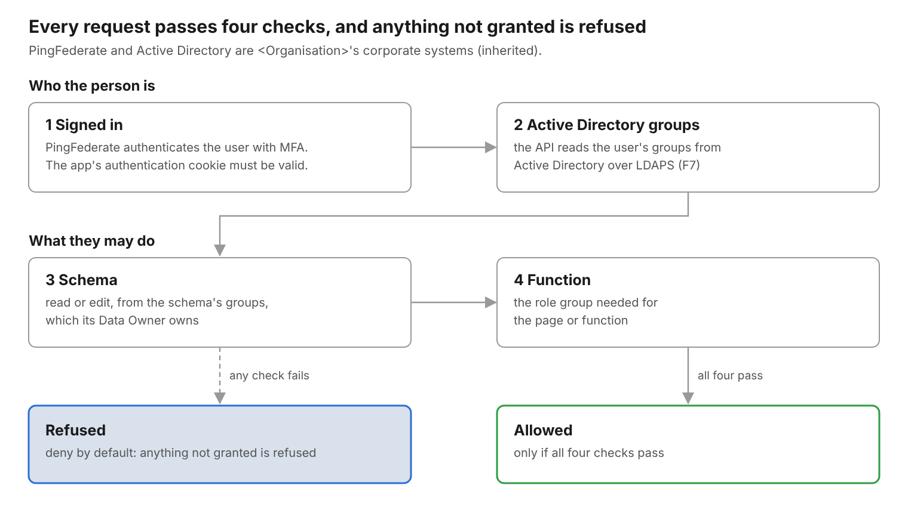
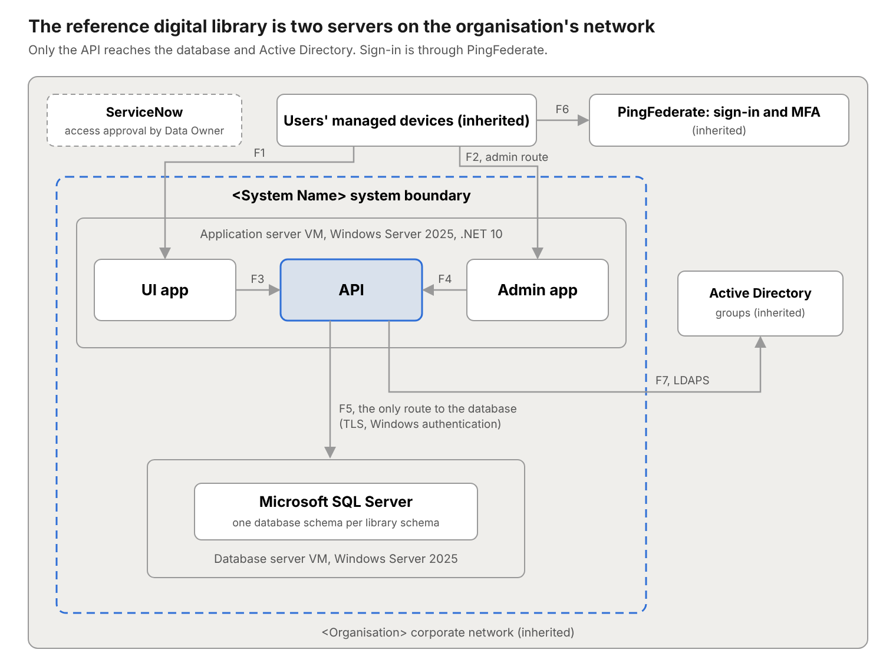
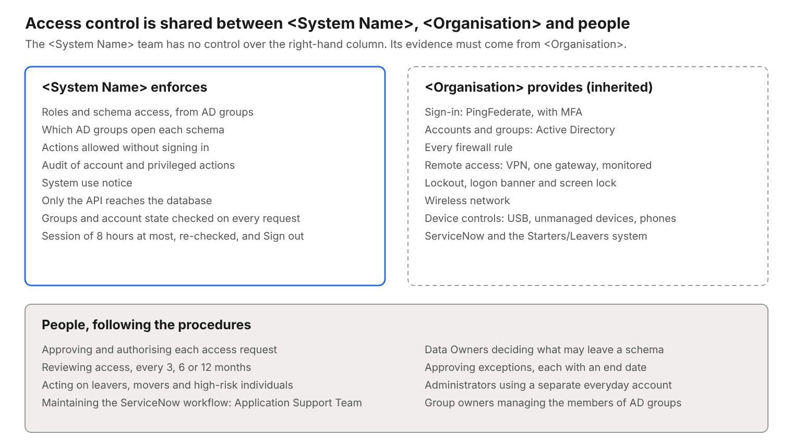

# \<System Name\> Access Control Management

## 1 Purpose

This document shows how \<System Name\> is designed and configured for each of the 39 Access Control (AC) controls and enhancements in the CSS Moderate baseline. Section 3 sets out the access control model: the account types, roles, permissions, separation of duties, access routes, settings, rules and the access request workflow. Section 4 takes each control in turn. Appendix A records how the system is built today, and appendix B every value CSS asks the organisation to define.

An assessor examines the design, the settings and the records, interviews the people named, and tests the mechanisms (CSS). So for each control section 4 gives:

- **each part of the control**, as CSS letters them, with the design that meets it and what the system does today;
- **who provides it**: \<System Name\> itself, people following the procedures, \<Organisation\>, or a share of these;
- **what enforces it**: the mechanism and its settings;
- **the rules and procedures** that apply, and the tests run, with their results;
- **the records an assessor will ask for**, and whether they exist yet;
- **its status**, the risk decision, and what is still open, with the fix in \<Plan of Action and Milestones\>.

As \<System Description\> sets out, \<Organisation\>'s PingFederate authenticates every user, with multi-factor authentication, and \<System Name\>'s API reads each user's Active Directory groups directly from Active Directory over LDAPS, to give their roles and schema access (D-AC-23). \<System Name\> holds no accounts or passwords of its own, and has no session management: how long a sign-in lasts is set by PingFederate, and an unattended screen is locked by \<Organisation\>'s managed devices. Both are corporate services that \<System Name\> uses as they stand. The design in sections 3 and 4 is written on that basis.

\<System Name\> is not yet built on its servers, so "today" means the tested v1.0 code in the test environment. That build signed in with its own passwords, held its groups and sessions in its own database and used PostgreSQL, so its tests do not show PingFederate sign-in, Active Directory groups or SQL Server working. Where that matters, the "Today" column and the "Tests" row say so. Its findings are kept where they still apply to the reference design. Test results are in the AC evidence. Values that CSS asks the organisation to define are in Appendix B.

**Table 1: Status values**

| Status | Meaning |
| --- | --- |
| Implemented | The design is in place and working |
| Partially implemented | Some of the design is in place; the open items say what is missing |
| Not implemented | None of the design is in place yet |
| Not applicable | The control does not apply to \<System Name\>. The reason is in \<Tailoring Register\> |

No AC control is yet fully implemented. The policy is in \<Policy\> (AC), and the steps people follow are in \<Procedures\> (AC).

## 2 Summary

The implementation status of each control, how it is met, who is responsible, its assessment result and the risk and plan entries for its gaps are recorded once, in \<System Security Plan\>, section 7.1 (Table 10).

## 3 The access control model

### 3.1 Principles

1. **Deny by default.** Nothing is allowed unless a role or group grants it. A schema with no group is open only to administrators.
2. **One person, one account.** Each person uses their own Active Directory account. Accounts are never shared, and \<System Name\> holds no accounts or passwords of its own.
3. **Schemas are the boundary.** Each schema has a read group and an edit group, owned by its Data Owner. Edit includes read.
4. **AD groups decide everything.** A person's role groups set what they can do, and their schema groups set which schemas they can do it in. All are Active Directory groups, which the API reads from Active Directory over LDAPS when the person signs in.
5. **Application users have no server access.** Windows and SQL Server administration use separate accounts.
6. **Only the API reaches the database.** The UI app and the Admin app get all their data through the API. The API connects with Windows authentication under its own managed service account, which is not a sysadmin and cannot change the schema (D-AC-18).
7. **\<Organisation\>'s single sign-on proves who the user is.** PingFederate authenticates every user, with multi-factor authentication, and gives \<System Name\> a signed OpenID Connect response that names them. \<System Name\> never sees a password (D-AC-23).
8. **No session management in the application.** \<System Name\> holds no session records and has no idle lock, idle timeout, session limit, sign-out or screen for ending sessions. The sign-in lasts as long as PingFederate allows, and the device screen lock hides an unattended screen.

Figure 1 shows the checks every request passes. They are described under AC-3 in section 4. Appendix A, section A.2, shows how the tested build made them.

**Figure 1: How an access decision is made**

### 3.2 Account types

Every person signs in with their Active Directory account, through PingFederate. The types below are the kinds of access an account may hold.

**Table 2: Account types**

| Type | Held by | Allowed | Rules |
| --- | --- | --- | --- |
| Standard user | Readers | Yes | Their own AD account; member of a schema's read group only |
| Schema editor | Editors | Yes | Their own AD account; member of a schema's edit group |
| Auditor | Auditors | Yes, privileged | Their own AD account; holds no administration role |
| Security officer | Security officers | Yes, privileged | Their own AD account; holds no administration role |
| Administrator | Administrators | Yes, privileged | Their own AD account; the system owner authorises and adds them to the group; a separate everyday account |
| Windows administrator | Windows server administrators | Yes, privileged | Named person, through \<Organisation\>'s approved route |
| Database administrator | SQL Server database administrators | Yes, privileged | Named person, for approved maintenance only |
| API service account | The API only | Yes, privileged | The API's group managed service account, which signs in to SQL Server with Windows authentication and reads group membership from Active Directory over LDAPS. Nobody signs in with it. Not a sysadmin, and cannot change the schema (section 3.6) |
| Local \<System Name\> account | Nobody | No | \<System Name\> holds no accounts or passwords of its own. The first administrator is simply the first member of that AD group (D-AC-23) |
| Temporary and emergency | Nobody | No | Prohibited (P-AC-09) |
| Shared, guest, anonymous and demonstration | Nobody | No | Prohibited on the servers |

### 3.3 Roles

**Table 3: Roles**

| Role | Purpose | Granted through | Group owner, who authorises and manages its members |
| --- | --- | --- | --- |
| Reader | Read items in a schema | The schema's read group, an AD group | The schema's Data Owner |
| Editor | Add, manage and export items in a schema | The schema's edit group, an AD group | The same |
| Administrator | Manage schemas, the AD groups each schema uses, and settings; use the administration dashboard | AD group \<Code\>\_Admins | System owner |
| Auditor | Read audit logs | AD group \<Code\>\_Auditors | System owner |
| Security officer | Read security information | AD group \<Code\>\_Security | System owner |

The people who hold each role are named in \<Roles and Responsibilities\>. The group names use the application's short code, and are confirmed when the groups are created in Active Directory.

Each group's owner adds and removes its members in Active Directory, with \<Organisation\>'s AD tool, as the last step of an approved request (section 3.13). \<System Name\>'s API reads each person's groups from Active Directory over LDAPS, with read-only rights, and cannot change them.

### 3.4 Permissions

**Table 4: Permissions by role**

| Function | Reader | Editor | Administrator | Auditor | Security officer |
| --- | --- | --- | --- | --- | --- |
| Search and read items | Own schemas | Own schemas | All schemas | No | No |
| Report a faulty item | Own schemas | Own schemas | All schemas | No | No |
| Upload, manage and export items | No | Own schemas | All schemas | No | No |
| Manage users, passwords and group membership | No | No | No: done in Active Directory, by each group's owner | No | No |
| Manage schemas, and which AD groups open each | No | No | Yes | No | No |
| Grant administrator | No | No | No: the system owner adds the member to the AD group | No | No |
| Use the administration dashboard and settings | No | No | Yes | No | No |
| Read audit logs | No | No | No | Yes | No |
| Read security information | No | No | No | No | Yes |

### 3.5 Separation of duties

1. Nobody approves their own access or privilege.
2. Nobody reviews their own access or their own privileged actions.
3. Auditors and security officers hold no administration role.
4. Application, Windows and database administration use separate accounts, held by different people where staffing allows.
5. Developers hold no administrator access on the servers.
6. Where staffing cannot meet a rule, it is recorded as an exception, with a compensating check.

Table 5 shows each pair of duties that one person must not hold together, the roles that carry them, and what keeps them apart.

**Table 5: Duties kept apart**

| Duty | Must be separate from | Roles | Kept apart by | Today |
| --- | --- | --- | --- | --- |
| Asking for access | Approving and granting it | The person asks; their line manager approves; the group's owner authorises, and adds them to the AD group | The ServiceNow workflow, in which nobody can decide their own request, and Active Directory, where only a group's owner can change its members (section 3.13) | The ServiceNow workflow is not set up (PA-20). The tested build signed in with its own passwords and held its groups in its own database, so this is not yet tested with PingFederate and Active Directory |
| Administering schemas and settings | Reviewing audit logs | Administrator administers; auditor reviews | Separate access groups: only the auditor group opens the audit log pages, and it opens no administration page | In the tested build an auditor could not manage users (T74), but an administrator could still read the audit logs (T75, PA-15) |
| Administering the system | Reading security information | Administrator administers; security officer reads | Separate access groups | The security officer role has no test account, so this is not yet tested |
| Holding administrator | Granting it | Administrators; the system owner, who alone manages that AD group | Active Directory: an administrator cannot add a member to the group | In the tested build an administrator could grant it with no second person (PA-15) |
| Application administration | Windows administration and database administration | Administrator; Windows server administrator; SQL Server database administrator | Separate accounts on separate layers, held by three different people (\<Roles and Responsibilities\>) | Holders to be named. The servers are not built (PA-30) |
| Development | Production administration | Developers; Windows server and database administrators | Developers hold no administrator account on the servers | The servers are not built |
| Holding access | Reviewing that access | Each account holder; system owner, auditor and Data Owners review | Procedure: nobody reviews their own access (PRO-AC-7) | No review held yet (PA-16) |

**Today:** in the tested build an administrator can do everything, including reading audit logs and security information and reviewing their own actions. This is proposed for acceptance for 12 months as a Medium risk (PA-15).

### 3.6 Access routes

Figure 2 shows \<System Name\>'s boundary and the routes into and inside it. It is the boundary figure of \<Security Architecture\>.

**Figure 2: System boundary and access routes**

**Table 6: Access routes**

| Route | Used by | Design | Today |
| --- | --- | --- | --- |
| Sign-in | Everyone | The browser is sent to \<Organisation\>'s PingFederate, which authenticates the user with multi-factor authentication and returns a signed OpenID Connect response naming them. The API then reads their groups from Active Directory over LDAPS. \<System Name\> has no sign-in of its own | The tested build signed in with its own passwords and held its groups in its own database, so this is not yet tested with PingFederate and Active Directory |
| Browser to the UI app | Readers, editors, administrators | HTTPS on \<Organisation\>'s network, after signing in | Plain HTTP in the test environment (PA-18) |
| Browser to the Admin app | Administration, audit and security roles | HTTPS, over \<Organisation\>'s managed administration route only | Plain HTTP, reachable on every interface (PA-18, PA-83) |
| Apps to the API | The apps only | Inside the application server; people do not connect directly | As designed, over plain HTTP |
| API to the database | The API's service account only | Application server to database server only, using TLS with strict encryption and Windows authentication. The UI app and the Admin app have no database connection | All three apps connect, with one shared database administrator account and no TLS (PA-10, PA-18) |
| Windows administration | Windows server administrators | Named accounts, through \<Organisation\>'s approved route | Servers not yet built |
| Database administration | Database administrators | Named accounts, for approved maintenance only | Servers not yet built |
| Remote access | Approved users and administrators | \<Organisation\>'s remote access service, with multi-factor authentication | Stated by \<Organisation\>, not evidenced |
| Without signing in | Anyone | Only the actions listed under AC-14 | Some extra functions are open (PA-03, PA-07) |
| API to Active Directory | The API's service account only | LDAPS, TCP 636, read-only, to read the signed-in person's group memberships | Not in the tested build, which held its groups in its own database |
| Outside services | None | Browsers load all code from \<System Name\> itself | Pages load code from an outside service (PA-34) |

**Table 7: Server and database access**

| Layer | Who | Rule |
| --- | --- | --- |
| Windows on both VMs | Windows server administrators | Named accounts, through \<Organisation\>'s approved route |
| SQL Server administration | Database administrators | Named accounts, for approved maintenance only |
| API to SQL Server | The API's managed service account | Windows authentication; the rights in the table below. The UI app and the Admin app do not connect |
| App service accounts on Windows | One for each app | Group managed service accounts; cannot sign in interactively; not administrators (Table 9) |

Only the API connects to the database (D-AC-18).

**Table 8: Database accounts and their rights**

| Account | Used by | May | May not |
| --- | --- | --- | --- |
| API's managed service account, \[name to be set at build\] | API only. Headless: no person signs in with it | Read and write application data. Add audit records | Be a sysadmin. Create, alter or drop tables. Change or delete audit records. Connect from anywhere but the application server |
| Schema change account, \[name to be set at build\] | The database administrator, at a release, under an approved change | Create and alter the tables | Be used by any app, or for everyday work |
| Database administrators' own accounts | Each database administrator, by name | Administer SQL Server, for approved maintenance | Be shared |
| Built-in sa login | Nobody, over the network | Be used on the database server itself, in an emergency, by a database administrator | Connect over the network |

These rules follow from it:

1. **No passwords.** \<System Name\> stores no passwords or password hashes, because PingFederate authenticates every user (D-AC-23).
2. **Items and schemas.** The UI app asks the API for item data. The Admin app asks the API for schemas, the groups each uses, settings and audit records, and gets no item content.
3. **Audit log.** The service account can only add records. Nothing can change or delete them. They are read only through the Admin application's audit pages, by the auditor role.
4. **Changes to the database structure.** Only the database administrator makes them, with the schema change account.
5. **Connection.** The API connects only from the application server, over TLS with strict encryption, using Windows authentication under its managed service account. There is no database password to store (D-AC-18).

**Today:** all three apps connect to the database themselves, with one shared account that has full administrative rights, and its password is in the code repositories (T55, PA-10, PA-19).

#### 3.6.1 Windows service accounts

Each app runs under its own Windows account (D-AC-19), so a fault in one app cannot reach another's files.

**Table 9: Windows service accounts**

| Account | Runs | Kind | May | May not |
| --- | --- | --- | --- | --- |
| \[name to be set at build\] | UI application | Group managed service account in \<Organisation\>'s Active Directory. Windows sets and changes its password, and no person knows it | Log on as a service on the application server | Be an administrator. Sign in at the console or by remote desktop. Be used by a person |
| \[name to be set at build\] | Admin application | The same | The same | The same |
| \[name to be set at build\] | API | The same | The same. It signs in to SQL Server with Windows authentication and reads Active Directory over LDAPS, so it holds no database password | The same |

\<Organisation\> uses Active Directory. Its agreement to group managed service accounts for these servers is to be confirmed with its security contact; if it does not agree, ordinary service accounts with the same rights are used, with passwords the Windows server administrator changes every 12 months.

#### 3.6.2 Who may sign in to the servers

**Table 10: Sign-in to the servers**

| Server | May sign in | How | May not |
| --- | --- | --- | --- |
| Application server | The named Windows server administrators | Their own named administrator accounts, through \<Organisation\>'s approved route | Developers, application users, the service accounts, and any shared account |
| Database server | The named Windows server administrators, and the named database administrators | The same | The same |

The holders are named in \<Roles and Responsibilities\>. \<Organisation\> creates and removes these accounts through its ServiceNow process, with the system owner's approval (EV-AC-02).

#### 3.6.3 File permissions on the application server

**Table 11: File permissions**

| Files | Read | Write | Notes |
| --- | --- | --- | --- |
| Each app's program folder | That app's service account; Windows server administrators | Windows server administrators only, at a release | An app cannot change its own code |
| Each app's settings and secrets | That app's service account; Windows server administrators | Windows server administrators only | Secrets are kept out of the code repositories (PA-19). The other two apps cannot read them |
| Each app's key ring, which protects its authentication cookie | That app's service account | That app's service account | Protected with Windows DPAPI (PA-93) |
| Each app's logs | Windows server administrators; the auditor | That app's service account | Kept for 30 days |
| The export working folder | API's service account | API's service account | Holds an export only until it is downloaded |

Item files are held in the SQL Server database, each schema in its own database schema. No item is held as a file on a share.

**Today:** the servers are not built, so none of this exists. In the test environment the apps run as an ordinary user, not as root (PA-18, PA-30).

#### 3.6.4 Firewall rules

\<Organisation\>'s corporate network team writes, holds and changes every firewall rule, through its own change process. The \<System Name\> team has no control over them and cannot see or change a rule (D-AC-20). So \<System Name\> does not design the rules. It states the flows it needs, in Table 12, and asks \<Organisation\> to allow those and nothing else. The rules themselves are \<Organisation\>'s evidence (EV-AC-03).

**Table 12: Flows \<System Name\> asks \<Organisation\> to allow**

| Flow | From | To | Service | Needed for |
| --- | --- | --- | --- | --- |
| F1 | Users' managed devices, in the office or on the VPN | Application server | HTTPS, TCP 443 | The UI app |
| F2 | Administrators, over \<Organisation\>'s managed route | Application server | HTTPS, on a port or host name still to be set | The Admin app |
| F3, F4 | The UI app and the Admin app | The API, on the application server's own loopback address | HTTPS | Needs no firewall rule: it never leaves the server |
| F5 | Application server | Database server | SQL Server with TLS, TCP 1433 | The API's database connection |
| F6 | Users' and administrators' browsers | \<Organisation\>'s PingFederate | HTTPS | Signing in. Both ends are \<Organisation\>'s, so this needs no rule for \<System Name\>'s servers |
| F7 | Application server | \<Organisation\>'s Active Directory domain controllers | LDAPS, TCP 636 | The API reading each signed-in person's group memberships |
| PingFederate metadata | Application server | \<Organisation\>'s PingFederate | HTTPS | Fetching PingFederate's OpenID Connect metadata and signing keys, which check its sign-in responses |
| Administration | Windows server and database administrators, over \<Organisation\>'s managed route | Both servers | Tool and protocol to be confirmed by \<Organisation\> | Running the servers |
| F8 (time) | Both servers | \<Organisation\>'s time service | NTP, UDP 123 | Accurate audit times |

Everything else should be refused, in and out. \<System Name\> needs no route to the internet once pages stop loading code from an outside service (PA-34).

What \<System Name\> itself controls is limited to its own apps: the API listens only on the loopback address, each app accepts only HTTPS, and the API accepts requests only from the two apps' addresses.

**Today:** no rule exists, as the servers are not built, and the request has not been sent (PA-18).

#### 3.6.5 What \<Organisation\>'s corporate configuration provides

**Figure 3: Who provides each part of access control**

These are set by \<Organisation\> as part of its corporate network, directory and device configuration. The \<System Name\> team has no control over them (D-AC-21, D-AC-23). \<System Name\> accepts \<Organisation\>'s corporate standard for each, and records the values once \<Organisation\> supplies them. Table 13 says what \<System Name\> relies on. What \<Organisation\> has said so far is a statement by its security contacts, not evidence.

**Table 13: Provided by \<Organisation\>'s corporate configuration**

| Provided | Controls | What \<System Name\> relies on | Said by \<Organisation\> | Evidence asked |
| --- | --- | --- | --- | --- |
| Single sign-on: PingFederate | AC-3, AC-7, AC-12, AC-14, and the IA controls | Every user is authenticated by PingFederate, with multi-factor authentication. Repeated failed sign-ins lock the account under the corporate standard. The OpenID Connect response \<System Name\> receives is signed. PingFederate's sign-in lifetime is the only limit on how long a sign-in lasts (AC-12) | Stated by the system owner (D-AC-23); not yet by \<Organisation\> | EV-IA-04 |
| Accounts and groups: Active Directory | AC-2 and its enhancements, AC-6(5), AC-6(7) | Each person has one AD account, created, changed and disabled by \<Organisation\>'s starters and leavers process. A disabled account can no longer sign in. Only a group's owner can change its members. The API reads group membership over LDAPS | The same | EV-AC-01 |
| Account lockout on the servers and on users' devices | AC-7 | Repeated failed Windows sign-ins lock the account | Group Policy sets the lockout | EV-AC-05 |
| Logon banner on the servers | AC-8 | A system use notice before an administrator signs in to Windows | Group Policy sets the banner | EV-AC-06 |
| Screen lock on the servers and on users' devices | AC-11, AC-11(1), AC-2(5) | An unattended screen locks after the time in P-AC-15, hides what was on it, and needs the password to unlock. As \<System Name\> has no page lock of its own, this is the only session lock | Group Policy sets the lock, and it hides the display | EV-AC-07 |
| Remote access | AC-17, AC-17(1), AC-17(2), AC-17(3) | One route in from outside: the VPN, from a managed device, with multi-factor authentication, encrypted, logged and monitored, through one managed gateway | As described | EV-AC-08 to EV-AC-11 |
| No remote administration from outside | AC-17(4) | The servers' administration ports cannot be reached from external networks | Administration ports are blocked from external networks | EV-AC-12 |
| Wireless | AC-18, AC-18(1), AC-18(3) | Corporate wireless authenticates users and devices and is encrypted; the servers have no wireless | As described | EV-AC-13, EV-AC-14 |
| Device controls | AC-19, AC-20, AC-20(2) | Phones and tablets cannot reach \<System Name\>; unmanaged devices are kept off the network; USB storage is blocked unless approved | As described | EV-AC-15 to EV-AC-17 |

The only \<System Name\> setting for the same controls is its system use notice (section 3.7). \<System Name\> has no page lock or session limits of its own.

**Today:** none of the evidence has been requested (PA-18, PA-21, PA-30, PA-95).

### 3.7 Settings

The P-AC numbers are the access control settings used across the document set. P-AC-01 to P-AC-03 are in \<Policy\> (AC). Sign-in settings, such as lockout, multi-factor authentication and the sign-in lifetime, are PingFederate's and are not set in \<System Name\>.

**Table 14: Access control settings**

| No. | Control | Setting and approved value | Today |
| --- | --- | --- | --- |
| P-AC-04 | AC-2 | Allowed account types: as listed in Table 2 | Not yet approved; a rule for people, nothing to build |
| P-AC-05 | AC-2 | Who decides access: the person's line manager approves in ServiceNow, then the group's owner authorises and adds them to the AD group. The owner is the system owner for a role group, and the Data Owner for a schema group (section 3.13) | Not yet approved; a rule for people, carried out in ServiceNow and Active Directory |
| P-AC-06 | AC-2 | A leaver's AD account is disabled by \<Organisation\> at once, which ends their access to \<System Name\>. Each group's owner removes the membership within 5 working days. Owners are told of a role change within 1 working day | Not yet approved; no notice from \<Organisation\> yet (PA-32) |
| P-AC-07 | AC-2, AC-6(7) | Access review: administrators and the other privileged groups every 3 months, all other accounts every 12 months | Not yet approved; no review held yet (PA-16) |
| P-AC-08 | AC-2(3) | Unused AD accounts are disabled under \<Organisation\>'s corporate standard, which \<System Name\> accepts. An account no longer required or in breach of policy is disabled by \<Organisation\> on notice. In addition, each month, the owner of each group removes any member who has not signed in to \<System Name\> for 90 days, from the sign-in dates in the audit records that an administrator provides (D-PS-11) | \<Organisation\>'s standard is to be supplied |
| P-AC-09 | AC-2(2) | Temporary and emergency accounts: not allowed until the system can expire them | Not yet approved; a rule for people, nothing to build |
| P-AC-10 | AC-2(5), AC-12 | Sign-in lifetime: as set in PingFederate for \<System Name\> (\<System Description\>, P-02). \<System Name\> has no idle sign-out of its own | Value to be supplied by \<Organisation\>. The tested build signed users out after 30 minutes idle, which the reference design does not have |
| P-AC-11 | AC-12 | No session limit in \<System Name\>. The PingFederate sign-in lifetime in P-AC-10 is the only limit | Not yet approved. The tested build ended sessions after 8 hours, which the reference design does not have |
| P-AC-12 | AC-12 | No limit on sign-ins at once in \<System Name\> | Not yet approved. The tested build allowed 3 sessions per user, which the reference design does not have |
| P-AC-13 | AC-2(13) | Within 1 hour of notice: \<Organisation\> disables the AD account of a high-risk individual and ends their PingFederate sign-in. \<System Name\> reads groups from Active Directory, so a disabled account or a removed membership is refused at the next group lookup | Not yet approved; a rule for people, not yet used |
| P-AC-14 | AC-7 | Failed sign-ins are counted and the account locked by PingFederate and Active Directory, under \<Organisation\>'s corporate standard. \<System Name\> has no sign-in of its own to lock | \<Organisation\>'s standard is to be supplied. The tested build locked after 5 failures, for 15 minutes |
| P-AC-15 | AC-11 | Device screen lock after inactivity, set by \<Organisation\> on its managed devices and the servers (\<System Description\>, P-03). \<System Name\> has no page lock of its own | Value to be supplied by \<Organisation\>. The tested build had a page lock after 25 minutes, which the reference design does not have |
| P-AC-16 | AC-8 | System use notice wording: the wording in section 4.20 | Not yet approved; not shown yet (PA-11) |
| P-AC-17 | AC-6(1), AC-6(10) | Privileged functions: managing schemas and the AD groups each uses; settings; audit log access; database maintenance; cache management. Security-relevant information: secrets and security settings, PingFederate's signing keys, access groups and schema access rules, audit logs, firewall rules and certificates | Not yet approved; a rule for people, nothing to build |
| P-AC-18 | AC-6(2) | Administrators use a separate non-privileged account for everyday item work | Not yet approved; everyday accounts not issued (PA-17) |
| P-AC-19 | AC-6(9) | Privileged functions are logged: as P-AC-17 | Not yet approved; partly built (PA-14) |
| P-AC-20 | AC-17 | Remote access route: \<Organisation\>'s remote access service, name to be confirmed | To be confirmed by \<Organisation\> |
| P-AC-21 | AC-18, AC-19 | Wireless and mobile access: follows \<Organisation\>'s policies, to be confirmed | To be confirmed by \<Organisation\> |
| P-AC-22 | AC-20 | External systems and portable storage with \<System Name\> data: not allowed without system owner approval | Not yet approved; a rule for people, nothing to build |
| P-AC-23 | AC-21 | Who decides on sharing information outside a schema: the Data Owner | Not yet approved; a rule for people, nothing to build |
| P-AC-24 | AC-22 | Public content: none. \<System Name\> must not hold or serve public content without system owner approval | Not yet approved; a rule for people, nothing to build |
| P-AC-25 | AC-14 | Actions allowed without signing in: be sent to PingFederate to sign in; see the access-denied page; load static files; check API health. Nothing else | Not yet approved; other functions are also open (PA-03, PA-07) |

### 3.8 Privileged functions and security information

**Privileged functions:** managing schemas and the AD groups each uses; changing settings; reading audit logs; database maintenance; and cache management. Managing the members of \<System Name\>'s AD groups is also privileged, and is done in Active Directory by each group's owner.

**Security-relevant information:** secrets and security settings, PingFederate's signing keys, access groups and schema access rules, audit logs, firewall rules and certificates.

Only the privileged roles in Table 2 may use these. Their use must be logged.

### 3.9 Export and download rules

1. Only editors of a schema and administrators may bulk export its items.
2. An export job can be seen, downloaded or cancelled only by the person who started it.
3. Exports are delivered as downloads. Writing exports to a server folder is not allowed (PA-26).
4. Exported items stay under the schema's access rules, and leaving \<Organisation\>'s systems needs approval under P-AC-22 and P-AC-23.
5. Every export is recorded in the audit log.

### 3.10 Information sharing rules

1. Sharing outside a schema needs a decision by that schema's access approver (P-AC-23).
2. The approver checks that the recipient is authorised for the information, and the decision is recorded.
3. External systems and portable storage may hold \<System Name\> data only with system owner approval (P-AC-22).
4. \<System Name\> holds no public content (P-AC-24).

### 3.11 Review schedules

**Table 15: Review schedules**

| Review | How often | By | Steps |
| --- | --- | --- | --- |
| The three role groups | Every 3 months | System owner, auditor; Head of Cyber as an extra check, for administrators | PRO-AC-7 |
| Schema groups | Every 12 months | Data Owners | PRO-AC-7 |
| Members who have not signed in for 90 days | Monthly | Each group's owner, with the sign-in dates an administrator provides | PRO-AC-8 |
| Audit logs | Weekly | Auditor | \<Security Operating Procedures\> |
| Actions allowed without signing in | Every 12 months, and after a change | System owner | PRO-AC-14 |
| This document | Every 12 months, and after a significant change | System owner | PRO-AC-14 |

### 3.12 Exception rules

1. Every exception needs written system owner approval, a reason, an owner and an end date of no more than 12 months.
2. Each one needs a compensating check where possible, and an entry in \<Risk List\>.
3. Exceptions above the system owner's authority go to the authorising official.
4. Exceptions are checked at each access review and end on their end date unless renewed.
5. Steps are in PRO-AC-15.

### 3.13 Access request workflow

**Figure 4: Access request workflow**

Every change to a person's access goes through a request in ServiceNow (D-AC-22). ServiceNow is \<Organisation\>'s corporate service. The Application Support Team builds and maintains the \<System Name\> workflow in it.

**Table 16: Access request workflow**

| Request | Raised by | Approved by | Authorised by | Carried out by |
| --- | --- | --- | --- | --- |
| Access to a schema, to read or to edit | The person who needs it, in ServiceNow | Their line manager | The schema's Data Owner | The Data Owner, who adds the person to the schema's AD group with \<Organisation\>'s AD tool |
| A privileged role | The person | Their line manager | The system owner, who cannot authorise their own | The system owner, who adds the person to the role's AD group |
| A change of role (mover) | The person's line manager, within 1 working day | Not needed for a removal; as above for any new access | As above for any new access | Each group's owner, who removes the old membership and adds any new one |
| Removal (leaver) | \<Organisation\>'s Starters/Leavers system, automatically | Not needed | Not needed | \<Organisation\> disables the AD account at once, which ends access. Each group's owner removes the membership within 5 working days |

No \<System Name\> account is ever created: a person's AD account is their account, and joining a group is what gives them access.

These rules apply:

1. **Two decisions before any access.** The line manager confirms the person needs it for their work. The owner of the data, or the system owner, decides whether to allow it, and only then adds the person to the AD group.
2. **Nobody decides their own request.** The person who raises a request cannot approve or authorise it. ServiceNow is set to refuse it. An owner who needs access to their own group asks the system owner.
3. **What each request records:** the person; what is asked for; the business reason; who approved and who authorised it, and when; that the training is done and the rules are signed; and who carried it out, and when.
4. **The record.** The closed ServiceNow request is the record of the access decision, in place of form TPL-2. It is kept for 3 years.
5. **Before the person is added to a group,** they complete security training and sign \<Security Operating Procedures\> (PRO-AC-1).
6. **A high-risk individual.** \<Organisation\> disables the AD account and ends the person's PingFederate sign-in, within 1 hour. \<System Name\> reads group membership from Active Directory at sign-in, so a disabled account cannot sign in again. \<System Name\> has no sessions of its own to end.

**Today:** the workflow is not built, and no request has been raised (PA-20). The Starters/Leavers prompt is not set up (PA-32). The AD groups are not yet created.

## 4 Each control and enhancement

The controls are in CSS order. Each has two tables. The first takes each part of the control and gives what CSS requires, the design that meets it, and what the system does today. The second says who provides and is responsible for the control, what enforces it, the rules and procedures that apply, the tests run, the records an assessor will ask for, its status, the risk decision, and what is still open.

### 4.1 AC-1 Policy and Procedures

**Table 17: AC-1 design**

| Part | CSS requires | Design | Today |
| --- | --- | --- | --- |
| a.1 | An access control policy, shared with defined people, covering purpose, scope, roles, responsibilities, management commitment, coordination and compliance, and consistent with the law | \<Policy\> (AC): a system-level policy within \<Organisation\>'s organisational policies. Purpose and scope in section AC.1, responsibilities in AC.5, commitment, coordination and compliance in AC.6. Shared with everyone who uses or administers \<System Name\>. The legal adviser reviews it | Not yet approved by the Head of Cyber, legally reviewed or shared |
| a.2 | Procedures that carry out the policy, shared with defined people | \<Procedures\> (AC): 17 procedures, PRO-AC-1 to PRO-AC-17, each naming who acts, the time limit and the record. Shared with the same people | Not yet approved, shared or walked through |
| b | A named official manages the policy and procedures | The system owner (P-AC-01) | \[Name\] is named in \<Roles and Responsibilities\> |
| c.1 | The policy is reviewed on a schedule and after set events | Every 12 months, and after a significant incident, audit finding or system change (P-AC-02, procedure PRO-AC-14) | Not yet reviewed. The first review falls due 12 months after the policy is approved |
| c.2 | The procedures are reviewed on a schedule and after set events | Every 12 months, and after a change to the steps (P-AC-03, procedure PRO-AC-14) | As the policy |

**Table 18: AC-1 responsibility and evidence**

| | |
| --- | --- |
| Provided by | People: the system owner and the Head of Cyber |
| Responsible | System owner, Head of Cyber |
| Enforced by | Not a system function. The documents are under version control, and each review is recorded in the change record and on TPL-4 |
| Rules and procedures | Policy rule R1 to R14 (\<Policy\>, section AC.4); PRO-AC-14, PRO-AC-15 (\<Procedures\> (AC)) |
| Tests | None. Found by examining the documents and the v1.0 build |
| Records an assessor will ask for | The policy and procedures with their approvals; proof they were shared; TPL-4 walk-through records; review records. None exist yet |
| Status | Partially implemented |
| Risk decision | NC-01, rated Medium: approve the policy and procedures |
| Open items | PA-20: share the policy and procedures, and walk through each procedure |

### 4.2 AC-2 Account Management

**Table 19: AC-2 design**

| Part | CSS requires | Design | Today |
| --- | --- | --- | --- |
| a | Define the account types allowed and prohibited | Table 2. Every account is a person's own Active Directory account. Temporary, emergency, shared, guest, anonymous, demonstration and local \<System Name\> accounts are prohibited (P-AC-04) | Proposed (D-AC-03, D-AC-23), not yet approved. The tested build signed in with its own passwords and held its groups in its own database, so this is not yet tested with PingFederate and Active Directory |
| b | Assign account managers | \<Organisation\> manages the AD accounts. Each AD group's owner manages its members: the system owner for the role groups, and each Data Owner for their schema's groups. The administrator manages schemas and the groups that open them in \<System Name\> | Holders are to be named in \<Roles and Responsibilities\>. The AD groups are not yet created |
| c | Set the conditions for group and role membership | A need confirmed by the line manager, authorisation by the group's owner, security training, and a signed acknowledgement of \<Security Operating Procedures\> (procedures PRO-AC-1, PRO-AC-5, PRO-AC-6) | Not yet approved. They rely on the workflow, which is not yet built (PA-20) |
| d | Specify the authorised users, their group and role membership, and their access and attributes | The authorised users are the members of \<System Name\>'s AD groups. Each person's groups are their access, and the API reads them from Active Directory over LDAPS at sign-in. The approved source for each membership is its ServiceNow request | No AD group or request exists yet |
| e | Require approval to create accounts | No \<System Name\> account is created. Access is given by adding the person to an AD group, after their line manager approves and the group's owner authorises the request in ServiceNow (P-AC-05, section 3.13) | Not yet approved. The ServiceNow workflow is not set up (PA-20) |
| f | Create, enable, change, disable and remove accounts under the procedures | \<Organisation\> creates, changes, disables and removes AD accounts through its starters and leavers process. Group owners add and remove members with \<Organisation\>'s AD tool. \<System Name\> cannot change an account or a group | \<Organisation\>'s process is not evidenced. The tested build signed in with its own passwords and held its groups in its own database, so this is not yet tested with PingFederate and Active Directory |
| g | Monitor the use of accounts | \<System Name\> audits every sign-in it accepts, with the person and the time. PingFederate records every sign-in attempt. The auditor reviews privileged actions weekly (\<Security Operating Procedures\>, duty C3) | The tested build audited sign-ins (T39). No monitoring has been done, as \<System Name\> is not live |
| h | Tell account managers within a set time when an account is no longer needed, a user leaves or moves, or their need changes | Within 1 working day in each case, to the owners of the groups the person belongs to and the system owner. The notice comes as a prompt from \<Organisation\>'s Starters/Leavers system (P-AC-06) | Not yet approved. The route does not exist yet (PA-32) |
| i | Grant access only on a valid authorisation and intended use | Access comes only from membership of an AD group: a schema's read or edit group, or a role group (Tables 3 and 4). Each membership traces to an approved request | The tested build took access from groups held in its own database (T11) |
| j | Review accounts on a schedule | Each group's owner reviews its members: role groups every 3 months, schema groups every 12 months (P-AC-07, procedure PRO-AC-7, record TPL-3) | No review has been held (PA-16) |
| k | Change shared account passwords when someone leaves the group | Not applicable: shared and group accounts are prohibited (TR-AC-02), and \<System Name\> holds no passwords to change | The only generic account, admin, was sample data in the tested build (D-AC-13) |
| l | Align account management with the leaver and transfer processes | Aligned by design: \<System Name\> uses the same AD account that \<Organisation\>'s leaver and transfer processes act on. Disabling it ends access to \<System Name\>. The Starters/Leavers system prompts the group owners to remove memberships (PRO-AC-2, PRO-AC-3) | \<Organisation\>'s processes are not evidenced, and the prompt is not set up (PA-32) |

**Table 20: AC-2 responsibility and evidence**

| | |
| --- | --- |
| Provided by | Shared: \<Organisation\> provides the accounts, the groups and sign-in; group owners decide membership; \<System Name\> applies the groups |
| Responsible | \<Organisation\>; system owner; Data Owners; administrator |
| Enforced by | Active Directory holds the accounts and the groups, and \<System Name\>'s API reads each user's groups from it over LDAPS. \<System Name\>'s Admin app sets which AD groups open each schema. \<System Name\> holds no accounts. Windows and SQL Server accounts are managed by their administrators through \<Organisation\>'s ServiceNow process |
| Rules and procedures | Policy rule R1, R2, R3, R10 (\<Policy\>, section AC.4); PRO-AC-1, PRO-AC-2, PRO-AC-3, PRO-AC-6, PRO-AC-7, PRO-AC-12 (\<Procedures\> (AC)); \<Security Operating Procedures\>: A9; B5, B7; C3, C9, C15, C19, C36; section 4.4 |
| Tests | 1 check on the v1.0 build, 8 November 2026: 1 passed, 0 showed a gap. Passed: T10, a new account has no access until its temporary password is changed. These checks ran on a build that used its own passwords and groups. They are to be repeated with PingFederate sign-in and AD groups (D-AC-23) |
| Evidence asked of \<Organisation\> | EV-AC-01, EV-AC-02 (\<Evidence Requests\>). Not yet sent |
| Records an assessor will ask for | The members of each \<System Name\> AD group; recently disabled AD accounts of \<System Name\> users; the ServiceNow requests and their approvals; leaver and mover records; review records (TPL-3). None exist yet |
| Status | Partially implemented |
| Risk decision | NC-02, rated Medium: remediate |
| Open items | PA-16: no access review exists. PA-20: the workflow and procedures are not yet in use. PA-32: the Starters/Leavers prompt is not set up. Evidence of PingFederate and Active Directory is to be asked of \<Organisation\>, and the tests repeated on the PingFederate build (D-AC-23) |

### 4.3 AC-2(1) Automated System Account Management

**Table 21: AC-2(1) design**

| Part | CSS requires | Design | Today |
| --- | --- | --- | --- |
| All | Support account management with automated mechanisms | Automated by \<Organisation\>: AD account creation, change and disabling through its starters and leavers process; sign-in, lockout and multi-factor authentication in PingFederate. Automated by \<System Name\>: reading each user's groups from Active Directory at sign-in and applying them | \<Organisation\>'s mechanisms are not evidenced. The tested build signed in with its own passwords and held its groups in its own database, so this is not yet tested with PingFederate and Active Directory. Proposed for acceptance for 12 months as a Medium risk (NC-03) |

**Table 22: AC-2(1) responsibility and evidence**

| | |
| --- | --- |
| Provided by | Shared: \<Organisation\> for accounts and sign-in; \<System Name\> for reading and applying the groups |
| Responsible | \<Organisation\>; developers |
| Enforced by | Active Directory, PingFederate and \<Organisation\>'s Starters/Leavers system; \<System Name\>'s Active Directory group lookup |
| Rules and procedures | Policy rule R3 (\<Policy\>, section AC.4) |
| Tests | None of its own. The checks under AC-2, AC-2(13) and AC-7 covered the tested build's own mechanisms, and are to be repeated with PingFederate sign-in (D-AC-23) |
| Records an assessor will ask for | \<Organisation\>'s evidence of its starters and leavers process (EV-AC-01); \<System Name\>'s audit records of sign-ins. None exist yet |
| Status | Partially implemented |
| Risk decision | NC-03, rated Medium: acceptance proposed, not yet decided |
| Open items | PA-16: no review. PA-32: the Starters/Leavers prompt is not set up. Evidence of PingFederate and Active Directory is to be asked of \<Organisation\>, and the tests repeated on the PingFederate build (D-AC-23) |

### 4.4 AC-2(2) Automated Temporary and Emergency Account Management

**Table 23: AC-2(2) design**

| Part | CSS requires | Design | Today |
| --- | --- | --- | --- |
| All | Automatically remove or disable temporary and emergency accounts after a set time | Temporary and emergency accounts are prohibited (P-AC-09), so there is nothing to remove. Each access review confirms that none exists | None exists |

**Table 24: AC-2(2) responsibility and evidence**

| | |
| --- | --- |
| Provided by | Not applicable |
| Responsible | System owner, for the decision |
| Enforced by | A rule, checked at each access review (PRO-AC-7). If such accounts were ever needed, they would be Active Directory accounts with an end date, and the tailoring decision would be made again |
| Rules and procedures | Policy rule R4 (\<Policy\>, section AC.4) |
| Tests | None. Not applicable |
| Records an assessor will ask for | The tailoring decision (TR-AC-01), and each access review record confirming no such account |
| Status | Not applicable (TR-AC-01) |
| Risk decision | Tailored as not applicable (TR-AC-01); NC-04, rated Low: tailored |
| Open items | None |

### 4.5 AC-2(3) Disable Accounts

**Table 25: AC-2(3) design**

| Part | CSS requires | Design | Today |
| --- | --- | --- | --- |
| a | Disable accounts that have expired | AD accounts with an end date are disabled by Active Directory on that date | \<Organisation\>'s practice is not evidenced |
| b | Disable accounts no longer tied to a person | A leaver's AD account is disabled by \<Organisation\> at once (P-AC-06) | Not evidenced (EV-AC-01) |
| c | Disable accounts that breach policy | \<Organisation\> disables the AD account on notice: within 1 hour for a high-risk individual (PRO-AC-4) | Not yet approved, not yet used |
| d | Disable accounts unused for a set period | Unused AD accounts are disabled under \<Organisation\>'s corporate standard, which \<System Name\> accepts (P-AC-08). In addition, each month, the owner of each group removes any member who has not signed in to \<System Name\> for 90 days, from the sign-in dates in the audit records that an administrator provides, so that an unused membership ends even while the Active Directory account stays in use for other work (D-PS-11) | \<Organisation\>'s standard is to be supplied. In the tested build an account unused for 400 days still worked (T43). The monthly removal is not yet in use |

**Table 26: AC-2(3) responsibility and evidence**

| | |
| --- | --- |
| Provided by | \<Organisation\> |
| Responsible | \<Organisation\>; group owners |
| Enforced by | Active Directory: a disabled account cannot sign in through PingFederate, so it cannot reach \<System Name\>. A sign-in already open lasts until PingFederate's sign-in lifetime ends, but any removed group membership is refused at the next Active Directory lookup |
| Rules and procedures | Policy rule R3 (\<Policy\>, section AC.4); PRO-AC-3, PRO-AC-8 (\<Procedures\> (AC)) |
| Tests | 2 checks on the v1.0 build, 8 November 2026: 1 passed, 1 showed a gap. Passed: T42, a disabled account cannot sign in. Expected but not met: T43, an account unused for 400 days is disabled automatically. These checks ran on a build that used its own passwords and groups. They are to be repeated with PingFederate sign-in and AD groups (D-AC-23) |
| Records an assessor will ask for | \<Organisation\>'s list of disabled Active Directory accounts of \<System Name\> users, with dates (EV-AC-01); TPL-14 and TPL-3 records. None exist yet |
| Status | Partially implemented |
| Risk decision | NC-05, rated Medium: remediate |
| Open items | Evidence of PingFederate and Active Directory is to be asked of \<Organisation\>, and the tests repeated on the PingFederate build (D-AC-23) |

### 4.6 AC-2(4) Automated Audit Actions

**Table 27: AC-2(4) design**

| Part | CSS requires | Design | Today |
| --- | --- | --- | --- |
| Creation | Automatically audit account creation | Active Directory audits the creation of every account | \<Organisation\>'s audit is not evidenced |
| Modification | Automatically audit account changes | Active Directory audits every change to an account and to the members of a group. \<System Name\> audits changes to which AD groups open a schema | Not evidenced. The tested build did not audit group or schema changes (PA-14) |
| Enabling | Automatically audit enabling, including unlocking | Active Directory audits it | Not evidenced |
| Disabling | Automatically audit disabling | Active Directory audits it | Not evidenced |
| Removal | Automatically audit removal | Active Directory audits it | Not evidenced |

**Table 28: AC-2(4) responsibility and evidence**

| | |
| --- | --- |
| Provided by | Shared: \<Organisation\> for accounts and groups; \<System Name\> for its own schema settings |
| Responsible | \<Organisation\>; developers |
| Enforced by | Active Directory's audit of account and group changes, held by \<Organisation\>. \<System Name\>'s audit log, for changes to schemas and the groups each uses, and for each sign-in it accepts |
| Rules and procedures | Policy rule R9 (\<Policy\>, section AC.4) |
| Tests | 1 check on the v1.0 build, 8 November 2026: 1 passed, 0 showed a gap. Passed: T39, sign-in and failed sign-in are audited. These checks ran on a build that used its own passwords and groups. They are to be repeated with PingFederate sign-in and AD groups (D-AC-23) |
| Records an assessor will ask for | Audit records of each account event. Sign-in events only, in the test environment (T39) |
| Status | Partially implemented |
| Risk decision | NC-06, rated Medium: remediate |
| Open items | PA-14: audit every change made in \<System Name\>. Evidence of PingFederate and Active Directory is to be asked of \<Organisation\>, and the tests repeated on the PingFederate build (D-AC-23) |

### 4.7 AC-2(5) Inactivity Logout

**Table 29: AC-2(5) design**

| Part | CSS requires | Design | Today |
| --- | --- | --- | --- |
| All | Require users to log out after a set period of inactivity | \<System Name\> has no session management, so it does not sign users out itself. A user's sign-in ends when PingFederate's sign-in lifetime ends (P-AC-10), and an unattended screen is locked by the screen lock on \<Organisation\>'s managed devices and the servers (P-AC-15). \<Security Operating Procedures\> tells users to close the browser and lock their device when they finish | The tested build signed users out after 30 minutes idle (T44), which the reference design does not have. PingFederate's sign-in lifetime and the device screen lock are not evidenced (PA-21, PA-30) |

**Table 30: AC-2(5) responsibility and evidence**

| | |
| --- | --- |
| Provided by | Inherited from \<Organisation\>: PingFederate and its managed devices |
| Responsible | \<Organisation\> |
| Enforced by | PingFederate's sign-in lifetime for \<System Name\>, and the screen lock set by Group Policy or device management (section 3.6.5) |
| Rules and procedures | Policy rule R11 (\<Policy\>, section AC.4); \<Security Operating Procedures\>: A36 |
| Tests | None of the reference design. T44 tested the tested build's own idle sign-out, which the reference design does not have |
| Evidence asked of \<Organisation\> | EV-IA-04 and EV-AC-07 (\<Evidence Requests\>). Not yet sent |
| Records an assessor will ask for | PingFederate's sign-in lifetime for \<System Name\>; the Group Policy report for the screen lock (EV-AC-05 to EV-AC-07) |
| Status | Partially implemented |
| Risk decision | NC-07, rated Low: obtain evidence |
| Open items | PA-21: \<Organisation\>'s evidence of the screen lock. PA-30: the server settings, once the servers are built. The PingFederate sign-in lifetime is to be supplied |

### 4.8 AC-2(13) Disable Accounts for High-risk Individuals

**Table 31: AC-2(13) design**

| Part | CSS requires | Design | Today |
| --- | --- | --- | --- |
| All | Disable the accounts of people posing a significant risk within a set time | Within 1 hour of notice from management or \<Organisation\>'s security contact of misconduct, compromised credentials or a hostile departure (P-AC-13): \<Organisation\> disables the AD account and ends their PingFederate sign-in, so the person cannot sign in again, and any group lookup for them fails (procedure PRO-AC-4, record TPL-14; TPL-10 if it is an incident). \<System Name\> has no sessions of its own to end | The tested build could end a user's sessions (T38), which the reference design does not need. Disabling was tested on a local account (T40, T41), not on an AD account. The procedure is approved but not yet walked through |

**Table 32: AC-2(13) responsibility and evidence**

| | |
| --- | --- |
| Provided by | \<Organisation\>: it disables the account and ends the PingFederate sign-in |
| Responsible | \<Organisation\>'s service desk; security officer |
| Enforced by | Active Directory, for the account; PingFederate, for the sign-in. \<System Name\>'s API refuses a person whose account is disabled or whose groups cannot be read |
| Rules and procedures | Policy rule R3 (\<Policy\>, section AC.4); PRO-AC-4 (\<Procedures\> (AC)) |
| Tests | 2 checks on the v1.0 build, 8 November 2026: 2 passed, 0 showed a gap. Passed: T40, disabling an account ends API access immediately; T41, disabling an account ends UI application access immediately. These checks ran on a build that used its own passwords and groups. They are to be repeated with PingFederate sign-in and AD groups (D-AC-23) |
| Evidence asked of \<Organisation\> | EV-AC-01 (\<Evidence Requests\>). Not yet sent |
| Records an assessor will ask for | TPL-14 records showing the notice time and the times the account was disabled and the PingFederate sign-in ended; \<Organisation\>'s record of the disable; \<System Name\>'s audit record of any refused request. None exist yet |
| Status | Partially implemented |
| Risk decision | NC-08, rated Low: acceptance proposed, not yet decided |
| Open items | PA-20: walk through the procedure with \<Organisation\>. Evidence of PingFederate and Active Directory is to be asked of \<Organisation\>, and the tests repeated on the PingFederate build (D-AC-23) |

### 4.9 AC-3 Access Enforcement

**Table 33: AC-3 design**

| Part | CSS requires | Design | Today |
| --- | --- | --- | --- |
| All | Enforce approved authorisations for access to information and system resources | Every request passes four checks in order: sign-in through PingFederate, which authenticates the user with multi-factor authentication, shown by the app's valid authentication cookie; the user's AD groups, read from Active Directory by the API over LDAPS; the schema decision, read or edit, from those groups; and the role group needed for the page or function (Figure 1). Anything not granted is refused. A schema with no group is closed to everyone but administrators. Page addresses name the schema, because page numbers restart in each schema. An export job can be used only by the person who started it. Item content is sent so that it is not kept in shared caches | Schema read and edit are enforced and tested for pages, image tiles, exports and bad file reports: 23 checks pass, including an outsider refused, an editor of one schema refused in another, a forged token refused, and an unknown schema refused before reaching the database. Gaps: any signed-in user can change another user's session role (PA-02); Export to Folder can write to any server folder (PA-26); an API address with no schema may find the wrong document (PA-25); the apps share a database sysadmin, and secrets are in the repositories (PA-10, PA-19) |

**Table 34: AC-3 responsibility and evidence**

| | |
| --- | --- |
| Provided by | \<System Name\> itself |
| Responsible | Developers |
| Enforced by | The access control library, built into all three apps, makes the schema decisions. Role policies on each page and controller make the function decisions. The UI app and Admin application refuse anything not marked as open; the API has no such default, which is why some of its functions are open |
| Rules and procedures | Policy rule R5 (\<Policy\>, section AC.4); PRO-AC-5 (\<Procedures\> (AC)) |
| Tests | 23 checks on the v1.0 build, 8 November 2026: 23 passed, 0 showed a gap. Passed: T11, T12, T13, T14, T15, T16, T17, T18, T19, T20, T21, T56, T22, T57, T58, T59, T63, T64, T23, T60, T61, T62, T48. These checks ran on a build that used its own passwords and groups. They are to be repeated with PingFederate sign-in and AD groups (D-AC-23). The schema and function checks themselves do not depend on how the user signed in |
| Records an assessor will ask for | The list of approved authorisations (the AD groups and their members); the test results; audit records. On the servers: Windows and SQL Server permissions, not yet available |
| Status | Partially implemented |
| Risk decision | NC-09, rated High: remediate |
| Open items | PA-02: role-changing functions open to any user in the tested build, which the reference design does not have. PA-19: secrets in the repositories. PA-25: some addresses can find the wrong document. PA-26: remove Export to Folder. Also, evidence of PingFederate and Active Directory is to be asked of \<Organisation\>, and the tests repeated on the PingFederate build (D-AC-23) |

### 4.10 AC-4 Information Flow Enforcement

**Table 35: AC-4 design**

| Part | CSS requires | Design | Today |
| --- | --- | --- | --- |
| All | Enforce approved flows of information within the system and to connected systems | Only these flows are allowed, as numbered in \<System Description\>: F6, browsers to PingFederate to sign in; F1 and F2, browsers to the UI app and the Admin app; F3 and F4, those apps to the API, on the application server's loopback address only; F5, the API to SQL Server on the database server; and F7, the API to Active Directory over LDAPS. The UI app and the Admin app have no database connection (D-AC-18). All use TLS. The Admin app is reached only over \<Organisation\>'s managed route. \<Organisation\>'s corporate network team sets the firewall rules to allow these flows and nothing else; the \<System Name\> team has no control over the rules (D-AC-20). Browsers load code only from \<System Name\>. Items leave only as downloads by a schema's editors. ServiceNow and the Starters/Leavers system (F9) have no connection to \<System Name\> | The designed flows exist, but nothing enforces them. No firewall rules or TLS are set (PA-18). In the test environment the web, admin and API ports are open on every network interface. Every page loads scripts and styles from an outside service, with no integrity check (PA-34). Export to Folder can write outside the approved route (PA-26). The API accepts cross-origin requests only from named origins |

**Table 36: AC-4 responsibility and evidence**

| | |
| --- | --- |
| Provided by | Shared: partly \<System Name\>, partly people or \<Organisation\> |
| Responsible | Developers, \<Organisation\> |
| Enforced by | \<Organisation\>'s firewalls, whose rules its corporate network team alone controls (section 3.6.4). \<System Name\>'s part is in its own apps: the API on the loopback address only, HTTPS on each listener, and the API's list of allowed origins. The flows are listed in \<Security Architecture\>, Table 2 |
| Rules and procedures | Policy rule R12 (\<Policy\>, section AC.4) |
| Tests | None. Found by review of the documents and the v1.0 build |
| Evidence asked of \<Organisation\> | EV-AC-03 (\<Evidence Requests\>). Not yet sent |
| Records an assessor will ask for | The flow list (section 3.6.4); \<Organisation\>'s firewall rule sets for the two servers and its change process (EV-AC-03); \<System Name\>'s TLS settings. Only the flow list exists |
| Status | Partially implemented |
| Risk decision | NC-10, rated High: remediate |
| Open items | PA-18: TLS, firewall rules and the remote access route. PA-26: Export to Folder. PA-34: code from an outside service |

### 4.11 AC-5 Separation of Duties

**Table 37: AC-5 design**

| Part | CSS requires | Design | Today |
| --- | --- | --- | --- |
| a | Identify and document the duties that must be separated | Section 3.5: approving and granting access; administering and auditing; application, Windows and database administration; and development and production administration. Six rules apply | Proposed (D-AC-03), not yet approved. The named holders are all different people (\<Roles and Responsibilities\>) |
| b | Define access so that it supports the separation | Separate roles carry each duty (Table 4): only auditors read audit logs, only security officers read security information, and neither holds an administration role. Server and database administration use separate accounts. Developers have no administrator access on the servers | In the tested build an auditor can read audit logs and cannot manage users (T73, T74). But an administrator can read the audit logs of their own actions (T75), and could grant administrator with no second person. Proposed for acceptance for 12 months as a Medium risk, with the Head of Cyber checking the administrator's actions every 3 months (D-AC-07, NC-11) |

**Table 38: AC-5 responsibility and evidence**

| | |
| --- | --- |
| Provided by | Shared: partly \<System Name\>, partly people or \<Organisation\> |
| Responsible | System owner |
| Enforced by | The AD role groups: the administrator, auditor and security officer groups each open only their own pages, and only the system owner can change their members. In the tested build the administrator setting opened all of those pages (PA-15) |
| Rules and procedures | Policy rule R8 (\<Policy\>, section AC.4); \<Security Operating Procedures\>: B6, B8 |
| Tests | 1 check on the v1.0 build, 8 November 2026: 0 passed, 1 showed a gap. Expected but not met: T75, an administrator cannot read the audit logs they would review themselves |
| Records an assessor will ask for | The list of separated duties (section 3.5, Table 5); the role assignments (\<Roles and Responsibilities\>); the members of each AD group; the 3-monthly check record |
| Status | Partially implemented |
| Risk decision | NC-11, rated Medium: acceptance proposed, not yet decided |
| Open items | PA-15: limit what administrators can do |

### 4.12 AC-6 Least Privilege

**Table 39: AC-6 design**

| Part | CSS requires | Design | Today |
| --- | --- | --- | --- |
| All | Give users, and processes acting for them, only the access their tasks need | People: access only through the roles and schema groups in section 3, each approved for a stated need. Administrators reach every schema. Processes: only the API connects to SQL Server, with one service account that is not a sysadmin and cannot change the schema (section 3.6, D-AC-18). Each app runs under its own Windows service account, which is not an administrator, cannot sign in interactively, and can read only its own files (sections 3.6.1 and 3.6.3, D-AC-19). No maintenance, diagnostic or test page is present in production | Readers and editors are limited to their own schemas and refused administration. The apps do not run as root in the test environment. Gaps: all three apps share one database sysadmin (T55, PA-10); an administrator can read every schema, including HR (PA-15); session, notification, cache and diagnostic functions are open to ordinary users (PA-02, PA-03, PA-06, PA-07, PA-29); five maintenance pages remain, one of which can delete every schema (PA-31); Export to Folder (PA-26); secrets in the repositories (PA-19) |

**Table 40: AC-6 responsibility and evidence**

| | |
| --- | --- |
| Provided by | Shared: partly \<System Name\>, partly people or \<Organisation\> |
| Responsible | Developers, database administrator |
| Enforced by | Schema groups and role policies for people. Database roles and Windows service accounts for processes |
| Rules and procedures | Policy rule R6 (\<Policy\>, section AC.4); PRO-AC-5 (\<Procedures\> (AC)); \<Security Operating Procedures\>: A17; B2, B3, B10; C3, C16 |
| Tests | None. Found by review of the documents and the v1.0 build |
| Records an assessor will ask for | The list of assigned access (access groups and members); the database roles and their rights; the service accounts on the servers. The last two do not exist yet |
| Status | Partially implemented |
| Risk decision | NC-12, rated High: remediate |
| Open items | PA-10: only the API to reach the database, with an account that is not a sysadmin. PA-19: secrets in the repositories. PA-26: Export to Folder. PA-31: remove the maintenance pages |

### 4.13 AC-6(1) Authorize Access to Security Functions

**Table 41: AC-6(1) design**

| Part | CSS requires | Design | Today |
| --- | --- | --- | --- |
| a | Authorise named people and roles to use security functions, in hardware, software and firmware | Software: the functions in section 3.8, open only to the privileged roles in Table 2. Hardware and firmware: the physical hosts, network equipment and host firmware, held by \<Organisation\>'s network and infrastructure teams | User, group, schema, role, credential and schema functions are open only to administrators (T26, T28, T29). A reader is refused the audit and security pages (T71, T72). But session roles, notification clean-up, the API cache and audit writes are open to others (PA-02, PA-03, PA-06, PA-29). Nobody is yet named for Windows, SQL Server, firewall rules, certificates or the hypervisor (PA-30) |
| b | Authorise named people and roles to see security-relevant information | The information in section 3.8, readable only by those roles. Secrets are kept out of the code repositories, and each app's secrets are readable only by that app's service account and the Windows server administrators (section 3.6.3) | Any signed-in user can see all users, their administrator settings and all schemas on diagnostic pages (T30, T65, T70, PA-07). The signing key and database password are in the code repositories (PA-19). In the tested build all three apps could read password hashes and sessions through one database account (PA-10); the design holds no passwords |

**Table 42: AC-6(1) responsibility and evidence**

| | |
| --- | --- |
| Provided by | \<System Name\> itself |
| Responsible | Developers |
| Enforced by | Role policies on the Admin application's pages; database rights; file permissions on the servers; \<Organisation\>'s own access lists for the hosts and network |
| Rules and procedures | Policy rule R6 (\<Policy\>, section AC.4) |
| Tests | 4 checks on the v1.0 build, 8 November 2026: 4 passed, 0 showed a gap. Passed: T71, ordinary user cannot open the audit log page; T72, ordinary user cannot open the security audit page; T73, an auditor can open the audit logs; T74, an auditor cannot manage users |
| Evidence asked of \<Organisation\> | EV-AC-04 (\<Evidence Requests\>). Not yet sent |
| Records an assessor will ask for | The list of security functions and information (section 3.8); who is authorised (\<Roles and Responsibilities\>); \<Organisation\>'s named roles and access lists (EV-AC-04) |
| Status | Partially implemented |
| Risk decision | NC-13, rated High: remediate |
| Open items | PA-07: debug and test pages. PA-15: administrator rights. PA-19: secrets. PA-30: name who holds server security functions |

### 4.14 AC-6(2) Non-privileged Access for Nonsecurity Functions

**Table 43: AC-6(2) design**

| Part | CSS requires | Design | Today |
| --- | --- | --- | --- |
| All | People with access to security functions use a non-privileged account for other work | Each administrator has two AD accounts: a privileged one for administration, and an everyday one for item work (P-AC-18; \<Security Operating Procedures\>, rules B2 and B3) | The rule is approved. No everyday accounts are issued, and nothing stops an administrator reading documents with the privileged account (T18). Accepted as a Low risk (NC-14) |

**Table 44: AC-6(2) responsibility and evidence**

| | |
| --- | --- |
| Provided by | People, following the procedures |
| Responsible | System owner |
| Enforced by | A rule for people. The system does not enforce it |
| Rules and procedures | Policy rule R7 (\<Policy\>, section AC.4); \<Security Operating Procedures\>: B2, B3 |
| Tests | None. Found by review of the documents and the v1.0 build |
| Records an assessor will ask for | The account list showing two accounts for each privileged person. Not yet issued |
| Status | Not implemented |
| Risk decision | NC-14, rated Low: acceptance proposed, not yet decided |
| Open items | PA-17: issue everyday accounts |

### 4.15 AC-6(5) Privileged Accounts

**Table 45: AC-6(5) design**

| Part | CSS requires | Design | Today |
| --- | --- | --- | --- |
| All | Restrict privileged accounts to named people or roles | Only six roles hold privileged access: administrator, administrator, auditor, security officer, Windows server administrator and database administrator. Each application role is an AD group whose only owner is the system owner, who authorises each member after role training and a signed Part B of \<Security Operating Procedures\> (PRO-AC-6). An administrator cannot add anyone to a group. The API's database service account is privileged and headless, and is managed by the database administrator. Only the named Windows server and database administrators may sign in to the servers (section 3.6.2) | In the tested build, administrator was a setting that another administrator could give. The apps' database account is a sysadmin (T55, PA-10). Server administrator accounts do not exist yet (PA-30) |

**Table 46: AC-6(5) responsibility and evidence**

| | |
| --- | --- |
| Provided by | Shared: partly \<System Name\>, partly people or \<Organisation\> |
| Responsible | System owner, database administrator |
| Enforced by | Membership of the four privileged AD groups, which only the system owner can change; Windows administrator group membership and SQL Server roles on the servers |
| Rules and procedures | Policy rule R2, R6 (\<Policy\>, section AC.4); PRO-AC-6 (\<Procedures\> (AC)); \<Security Operating Procedures\>: B4, B7, B8 |
| Tests | 1 check on the v1.0 build, 8 November 2026: 0 passed, 1 showed a gap. Expected but not met: T55, apps use a database role without sysadmin rights |
| Evidence asked of \<Organisation\> | EV-AC-02 (\<Evidence Requests\>). Not yet sent |
| Records an assessor will ask for | The members of the four privileged AD groups; the list of administrators (\<Roles and Responsibilities\>); the ServiceNow requests that authorised them; the Windows administrator group for the servers (EV-AC-02) |
| Status | Partially implemented |
| Risk decision | NC-15, rated High: remediate |
| Open items | PA-10: the API's database account must not be a sysadmin. PA-30: name the server administrators |

### 4.16 AC-6(7) Review of User Privileges

**Table 47: AC-6(7) design**

| Part | CSS requires | Design | Today |
| --- | --- | --- | --- |
| a | Review the privileges of defined roles on a schedule | Each group's owner reviews its members against the ServiceNow requests: the role groups every 3 months, by the system owner with the auditor, and the Head of Cyber as an extra check on administrators; schema groups every 12 months, by the Data Owners (P-AC-07, PRO-AC-7) | No review has been held (PA-16) |
| b | Remove or reassign privileges where needed | The owner removes a member who no longer needs the access, in Active Directory, and records it on TPL-3 | Not yet used |

**Table 48: AC-6(7) responsibility and evidence**

| | |
| --- | --- |
| Provided by | People, following the procedures |
| Responsible | System owner, auditor |
| Enforced by | A manual review of the members of each AD group, by its owner |
| Rules and procedures | Policy rule R10 (\<Policy\>, section AC.4); PRO-AC-7 (\<Procedures\> (AC)); \<Security Operating Procedures\>: C15, C19 |
| Tests | None. Found by review of the documents and the v1.0 build |
| Records an assessor will ask for | Completed TPL-3 forms, and Active Directory's record of any member removed. None exist yet |
| Status | Not implemented |
| Risk decision | NC-16, rated Medium: remediate |
| Open items | PA-16: hold the first review |

### 4.17 AC-6(9) Log Use of Privileged Functions

**Table 49: AC-6(9) design**

| Part | CSS requires | Design | Today |
| --- | --- | --- | --- |
| All | Log the use of privileged functions | Every use of a function in section 3.8 writes an audit record naming the person, the action, the target and the time. Only the system can write audit records | Logged: administrator password resets, and administrator changes on one of the two pages that make them. Not logged: the other of those pages, ending a user's sessions (T37), creating or deactivating users, unlocking accounts, group, schema and role changes, and the maintenance pages (PA-14, PA-31). The API records some events against "System". Ordinary users can add audit records through diagnostic pages, so the log cannot yet be fully relied on (PA-29) |

**Table 50: AC-6(9) responsibility and evidence**

| | |
| --- | --- |
| Provided by | \<System Name\> itself |
| Responsible | Developers |
| Enforced by | The application audit log and its audit service. On the servers, Windows and SQL Server logging |
| Rules and procedures | Policy rule R9 (\<Policy\>, section AC.4); \<Security Operating Procedures\>: B12; C3, C16 |
| Tests | 1 check on the v1.0 build, 8 November 2026: 0 passed, 1 showed a gap. Expected but not met: T37, ending a user's sessions as admin is audited |
| Records an assessor will ask for | The list of privileged functions (section 3.8); the list of audited events; audit records. Partial, in the test environment |
| Status | Partially implemented |
| Risk decision | NC-17, rated Medium: remediate |
| Open items | PA-14: audit every privileged action. PA-29: stop ordinary users writing audit records. PA-31: maintenance pages |

### 4.18 AC-6(10) Prohibit Non-privileged Users from Executing Privileged Functions

**Table 51: AC-6(10) design**

| Part | CSS requires | Design | Today |
| --- | --- | --- | --- |
| All | Prevent ordinary users from running privileged functions | Each privileged function checks the caller's role where the function runs, not only in the menu. Table 4 says which role may run each. Everything else is refused | All 30 Admin application pages need a role, and a reader was refused each one tested, along with listing and ending other users' sessions (T24 to T29 pass). Gaps, 13 checks: a reader can change another user's session role and create session records (T33, T34, PA-02); send notifications to anyone and run clean-up (T35, T36, PA-06); and open eight diagnostic pages and a diagnostic address that show all users and schemas (T30 to T32, T65 to T70, PA-07). In a browser, a reader also wrote audit records and pressed buttons that start database migrations (PA-29). The cache can be cleared without signing in (PA-03) |

**Table 52: AC-6(10) responsibility and evidence**

| | |
| --- | --- |
| Provided by | \<System Name\> itself |
| Responsible | Developers |
| Enforced by | Role policies on every Admin application page and API controller. The diagnostic pages carry a build guard that does not work, so they are present in the release build |
| Rules and procedures | Policy rule R6 (\<Policy\>, section AC.4) |
| Tests | 19 checks on the v1.0 build, 8 November 2026: 6 passed, 13 showed a gap. Passed: T24, ordinary user cannot list all sessions; T25, ordinary user cannot end another user's sessions; T26, ordinary user cannot open user management in the Admin application; T27, ordinary user cannot open session administration in UI application; T28, ordinary user cannot open the schema migration page in the Admin application; T29, ordinary user cannot open the storage set-up page in the Admin application. Expected but not met: T30, T31, T32, T33, T34, T35, T36, T65, T66, T67, T68, T69, T70 |
| Records an assessor will ask for | The list of privileged functions and who may run each (section 3.8, Table 4); the test results |
| Status | Partially implemented |
| Risk decision | NC-18, rated High: remediate |
| Open items | PA-02: session functions. PA-03: cache functions. PA-06: notifications. PA-07: debug pages. PA-29: diagnostic pages |

### 4.19 AC-7 Unsuccessful Logon Attempts

**Table 53: AC-7 design**

| Part | CSS requires | Design | Today |
| --- | --- | --- | --- |
| a | Limit consecutive failed sign-ins in a set period | PingFederate and Active Directory count failed sign-ins, under \<Organisation\>'s corporate standard, which \<System Name\> accepts. \<System Name\> has no sign-in of its own | \<Organisation\>'s values are to be supplied. The tested build enforced 5 failures at its own sign-in (T49) |
| b | Act automatically when the limit is reached | PingFederate and Active Directory lock the account, under the same standard. The lock applies to every system the person uses, not only \<System Name\> | To be supplied. The tested build locked for 15 minutes (T49, T50) |

**Table 54: AC-7 responsibility and evidence**

| | |
| --- | --- |
| Provided by | \<Organisation\> |
| Responsible | \<Organisation\> |
| Enforced by | PingFederate and Active Directory, for users. \<Organisation\>'s Group Policy, for sign-in to the servers. SQL Server accepts connections only from the application server. All are \<Organisation\>'s corporate configuration, which \<System Name\> accepts as it stands (section 3.6.5) |
| Rules and procedures | Policy rule R11 (\<Policy\>, section AC.4); PRO-AC-9 (\<Procedures\> (AC)); \<Security Operating Procedures\>: A14; C3 |
| Tests | 2 checks on the v1.0 build, 8 November 2026: 2 passed, 0 showed a gap. Passed: T49, after 5 failures the correct password is refused; T50, sign-in works again after the lockout ends. These checks ran on a build that used its own passwords and groups. They are to be repeated with PingFederate sign-in and AD groups (D-AC-23) |
| Evidence asked of \<Organisation\> | EV-AC-05 (\<Evidence Requests\>). Not yet sent |
| Records an assessor will ask for | \<Organisation\>'s lockout settings for PingFederate and Active Directory, and for the servers (EV-AC-05); its records of lockouts |
| Status | Partially implemented |
| Risk decision | NC-19, rated Low: acceptance proposed, not yet decided |
| Open items | PA-30: server settings. Evidence of PingFederate and Active Directory is to be asked of \<Organisation\>, and the tests repeated on the PingFederate build (D-AC-23) |

### 4.20 AC-8 System Use Notification

**Table 55: AC-8 design**

| Part | CSS requires | Design | Today |
| --- | --- | --- | --- |
| a | Show a notice before access, stating that use is monitored and recorded, that unauthorised use is prohibited and may be penalised, and that use means consent | Each app shows the notice on its first page, before it sends the user to PingFederate to sign in: "This system is for authorised use only. Activity is monitored and recorded. Unauthorised use may lead to disciplinary or legal action. By signing in you accept these terms." (P-AC-16). The notice names \<Organisation\>, not the U.S. Government (TR-AC-03) | The tested build showed no notice on either sign-in page (T51, T52, PA-11). The wording is approved, with the legal adviser's review due by 20 November 2026 (D-AC-06) |
| b | Keep the notice on screen until the user accepts it | The notice stays until the user chooses to continue to sign-in, which is the acceptance | Not built (PA-11) |
| c | Further conditions for publicly accessible systems | Not applicable: \<System Name\> is not public (TR-AC-04) | Not applicable |

**Table 56: AC-8 responsibility and evidence**

| | |
| --- | --- |
| Provided by | Shared: partly \<System Name\>, partly people or \<Organisation\> |
| Responsible | Developers, Windows server administrator |
| Enforced by | Text on the first page of the UI app and of the Admin application, changed only through an approved change (PRO-AC-13). On the servers, the Windows logon banner, which is \<Organisation\>'s corporate configuration (section 3.6.5) |
| Rules and procedures | Policy rule R11 (\<Policy\>, section AC.4); PRO-AC-13 (\<Procedures\> (AC)); \<Security Operating Procedures\>: A6, A7, A8 |
| Tests | 2 checks on the v1.0 build, 8 November 2026: 0 passed, 2 showed a gap. Expected but not met: T51, UI application sign-in page shows a system use notice; T52, Admin application sign-in page shows a system use notice |
| Evidence asked of \<Organisation\> | EV-AC-06 (\<Evidence Requests\>). Not yet sent |
| Records an assessor will ask for | The approved wording and its approval; a screenshot of the first page of each app; the Windows banner setting (EV-AC-06) |
| Status | Not implemented |
| Risk decision | NC-20, rated Low: remediate |
| Open items | PA-11: show the notice on the first page of both apps |

### 4.21 AC-11 Device Lock

**Table 57: AC-11 design**

| Part | CSS requires | Design | Today |
| --- | --- | --- | --- |
| a | Prevent further access by locking after a period of inactivity | \<System Name\> has no page lock of its own. \<Organisation\>'s managed devices and the servers lock the screen after the inactivity period in P-AC-15, by Group Policy or device management | The tested build had a page lock after 25 minutes (T53), which the reference design does not have. \<Organisation\>'s screen lock is not evidenced (PA-21) |
| b | Keep the lock until the user signs in again | The device lock stays until the user unlocks the device with their own credentials | Not evidenced (PA-21) |

**Table 58: AC-11 responsibility and evidence**

| | |
| --- | --- |
| Provided by | Inherited from \<Organisation\>: its managed devices and servers |
| Responsible | \<Organisation\> |
| Enforced by | The device lock in \<Organisation\>'s corporate configuration, set by Group Policy or device management (section 3.6.5) |
| Rules and procedures | Policy rule R11 (\<Policy\>, section AC.4); \<Security Operating Procedures\>: A36 |
| Tests | None of the reference design. T53 tested the tested build's page lock, which the reference design does not have |
| Evidence asked of \<Organisation\> | EV-AC-07 (\<Evidence Requests\>). Not yet sent |
| Records an assessor will ask for | \<Organisation\>'s screen lock settings (EV-AC-07) |
| Status | Partially implemented |
| Risk decision | NC-21, rated Medium: obtain evidence |
| Open items | PA-21: \<Organisation\>'s evidence |

### 4.22 AC-11(1) Pattern-hiding Displays

**Table 59: AC-11(1) design**

| Part | CSS requires | Design | Today |
| --- | --- | --- | --- |
| All | Hide what was on screen while locked | The lock screen of \<Organisation\>'s managed devices and servers hides the display | Device locks are not evidenced (PA-21). The tested build's page overlay is not part of the reference design |

**Table 60: AC-11(1) responsibility and evidence**

| | |
| --- | --- |
| Provided by | Inherited from \<Organisation\> |
| Responsible | \<Organisation\> |
| Enforced by | \<Organisation\>'s device lock |
| Rules and procedures | Policy rule R11 (\<Policy\>, section AC.4); \<Security Operating Procedures\>: A36 |
| Tests | None |
| Evidence asked of \<Organisation\> | EV-AC-07 (\<Evidence Requests\>). Not yet sent |
| Records an assessor will ask for | \<Organisation\>'s settings (EV-AC-07) |
| Status | Partially implemented |
| Risk decision | NC-22, rated Low: obtain evidence |
| Open items | PA-21: \<Organisation\>'s evidence |

### 4.23 AC-12 Session Termination

**Table 61: AC-12 design**

| Part | CSS requires | Design | Today |
| --- | --- | --- | --- |
| All | End a user's session automatically under set conditions | \<System Name\> has no session management. A user's sign-in ends when PingFederate's sign-in lifetime for \<System Name\> ends (P-AC-10), or when \<Organisation\> ends their PingFederate sign-in or disables their account. \<System Name\> holds the sign-in only in its authentication cookie, whose lifetime is no longer than PingFederate's, and reads the person's groups from Active Directory at sign-in, so a change to their groups takes effect at their next sign-in | The tested build ended sessions itself after 30 minutes idle and 8 hours, on sign-out and when an administrator ended them (T38, T44, T45, T46, T47), which the reference design does not have. PingFederate's sign-in lifetime is not yet supplied or evidenced |

**Table 62: AC-12 responsibility and evidence**

| | |
| --- | --- |
| Provided by | Shared: \<Organisation\>'s PingFederate sets the sign-in lifetime; \<System Name\> keeps its cookie lifetime within it |
| Responsible | \<Organisation\>; developers |
| Enforced by | PingFederate's sign-in lifetime; the lifetime of \<System Name\>'s authentication cookie |
| Rules and procedures | Policy rule R11 (\<Policy\>, section AC.4); PRO-AC-11 (\<Procedures\> (AC)); \<Security Operating Procedures\>: A36 |
| Tests | None of the reference design. T38, T44, T45, T46 and T47 tested the tested build's own sessions, which the reference design does not have |
| Evidence asked of \<Organisation\> | EV-IA-04 (\<Evidence Requests\>). Not yet sent |
| Records an assessor will ask for | PingFederate's sign-in lifetime for \<System Name\>; the cookie lifetime setting |
| Status | Partially implemented |
| Risk decision | NC-23, rated Low: obtain evidence |
| Open items | The PingFederate sign-in lifetime is to be supplied by \<Organisation\> and evidenced. PA-30: server settings |

### 4.24 AC-14 Permitted Actions Without Identification or Authentication

**Table 63: AC-14 design**

| Part | CSS requires | Design | Today |
| --- | --- | --- | --- |
| a | Identify the actions allowed without signing in | Only these (P-AC-25): be sent to PingFederate to sign in; see the access-denied page; load static files such as scripts, styles and images; and check that the API is running, which returns one status word. Reviewed every 12 months and after a change (PRO-AC-14) | Every route in both apps and 18 API addresses were requested without signing in. All others redirected to sign-in or were refused (T01 to T06 pass). Three gaps: cache statistics and clearing the cache (T07, T08, PA-03); a diagnostic address that returns the environment name; and a test page (T09, PA-07). Windows and SQL Server are not examined (PA-28) |
| b | Record them in the security plan, with the reason for each | Each is needed before a person can identify themselves, and none returns business data. The API health check supports monitoring. The list and reasons are also stated in \<System Security Plan\> | The list and rationale are approved (D-AC-12) |

**Table 64: AC-14 responsibility and evidence**

| | |
| --- | --- |
| Provided by | \<System Name\> itself |
| Responsible | Developers |
| Enforced by | The UI app and Admin application refuse anything not marked as open. The API has no such default, so an unmarked function is open; this is the root cause of the gaps |
| Rules and procedures | Policy rule R5 (\<Policy\>, section AC.4) |
| Tests | 9 checks on the v1.0 build, 8 November 2026: 6 passed, 3 showed a gap. Passed: T01, sign-in page is available without signing in; T02, UI application home redirects anonymous users to sign-in; T03, Admin application page redirects anonymous users to sign-in; T04, API refuses an anonymous session request; T05, API ignores a forged X-Forwarded-User header; T06, API /health is anonymous and reveals only a status word. Expected but not met: T07, anonymous user cannot read cache statistics; T08, anonymous user cannot clear the API cache; T09, no test page is reachable without signing in. These checks ran on a build that used its own passwords and groups. They are to be repeated with PingFederate sign-in and AD groups (D-AC-23) |
| Records an assessor will ask for | The list (this section and appendix A, section A.6); the test results and the anonymous probe of 5 November 2026 |
| Status | Partially implemented |
| Risk decision | NC-24, rated Medium: remediate |
| Open items | PA-03: cache functions. PA-07: diagnostic pages. PA-28: the servers |

### 4.25 AC-17 Remote Access

**Table 65: AC-17 design**

| Part | CSS requires | Design | Today |
| --- | --- | --- | --- |
| a | Set usage restrictions, connection requirements and guidance for each type of remote access | One type only: \<Organisation\>'s VPN, from a managed device, with multi-factor authentication. Used by users working from home and by approved administrators. \<System Name\> is not reachable from the internet. Rules for users are in \<Security Operating Procedures\> (rules A39 and A40) | \<Organisation\> has stated this. The service is not yet named, and no restrictions are written down (PA-18) |
| b | Authorise each type before it is used | \<Organisation\> authorises VPN access for each person through its own process | Not evidenced |

**Table 66: AC-17 responsibility and evidence**

| | |
| --- | --- |
| Provided by | \<Organisation\>. \<System Name\>'s part is the rules its users follow |
| Responsible | \<Organisation\> |
| Enforced by | \<Organisation\>'s remote access service, part of its corporate network configuration, over which the \<System Name\> team has no control (section 3.6.5). \<System Name\> has no remote access function of its own |
| Rules and procedures | Policy rule R12 (\<Policy\>, section AC.4); \<Security Operating Procedures\>: A15, A39, A40; B20; section 4.7 |
| Tests | None. It depends on \<Organisation\>'s evidence |
| Evidence asked of \<Organisation\> | EV-AC-08 (\<Evidence Requests\>). Not yet sent |
| Records an assessor will ask for | The service description, usage policy and authorisation route (EV-AC-08) |
| Status | Not implemented |
| Risk decision | NC-25, rated High, provisional: obtain evidence |
| Open items | PA-18: set up and evidence the route |

### 4.26 AC-17(1) Monitoring and Control

**Table 67: AC-17(1) design**

| Part | CSS requires | Design | Today |
| --- | --- | --- | --- |
| All | Monitor and control remote access automatically | \<Organisation\> logs and monitors VPN sessions | Stated by \<Organisation\>; not evidenced (PA-18, PA-21) |

**Table 68: AC-17(1) responsibility and evidence**

| | |
| --- | --- |
| Provided by | \<Organisation\> |
| Responsible | \<Organisation\> |
| Enforced by | \<Organisation\>'s remote access service |
| Rules and procedures | Policy rule R12 (\<Policy\>, section AC.4); \<Security Operating Procedures\>: A39 |
| Tests | None. It depends on \<Organisation\>'s evidence |
| Evidence asked of \<Organisation\> | EV-AC-09 (\<Evidence Requests\>). Not yet sent |
| Records an assessor will ask for | The tool name and a sample log or report (EV-AC-09) |
| Status | Not implemented |
| Risk decision | NC-26, rated Medium, provisional: obtain evidence |
| Open items | PA-18, PA-21: \<Organisation\>'s evidence |

### 4.27 AC-17(2) Protection of Confidentiality and Integrity Using Encryption

**Table 69: AC-17(2) design**

| Part | CSS requires | Design | Today |
| --- | --- | --- | --- |
| All | Encrypt remote access sessions | The VPN is encrypted. Inside it, every \<System Name\> flow uses TLS under NCSC's profiles: HTTPS to both apps, and TLS to SQL Server | The VPN is encrypted, as stated. \<System Name\> uses plain HTTP in the test environment, and the database has no TLS (T54, PA-18). The apps include HTTPS redirection and HSTS settings, which are not in effect |

**Table 70: AC-17(2) responsibility and evidence**

| | |
| --- | --- |
| Provided by | Shared: partly \<System Name\>, partly people or \<Organisation\> |
| Responsible | \<Organisation\>, Windows server administrator |
| Enforced by | \<Organisation\>'s VPN; the TLS settings of each app and of SQL Server (\<System and Communications Protection Management\>) |
| Rules and procedures | Policy rule R12 (\<Policy\>, section AC.4); \<Security Operating Procedures\>: A39, A40 |
| Tests | 1 check on the v1.0 build, 8 November 2026: 0 passed, 1 showed a gap. Expected but not met: T54, the stack as run in Docker encrypts traffic |
| Evidence asked of \<Organisation\> | EV-AC-10 (\<Evidence Requests\>). Not yet sent |
| Records an assessor will ask for | The VPN's protocol and cipher settings (EV-AC-10); \<System Name\>'s TLS settings once built |
| Status | Not implemented |
| Risk decision | NC-27, rated High: remediate |
| Open items | PA-18: HTTPS and database TLS |

### 4.28 AC-17(3) Managed Access Control Points

**Table 71: AC-17(3) design**

| Part | CSS requires | Design | Today |
| --- | --- | --- | --- |
| All | Route remote access through managed access control points | All remote access enters through \<Organisation\>'s one managed gateway | Stated by \<Organisation\>; not evidenced (PA-18, PA-21) |

**Table 72: AC-17(3) responsibility and evidence**

| | |
| --- | --- |
| Provided by | \<Organisation\> |
| Responsible | \<Organisation\> |
| Enforced by | \<Organisation\>'s gateway |
| Rules and procedures | Policy rule R12 (\<Policy\>, section AC.4); \<Security Operating Procedures\>: A39 |
| Tests | None. It depends on \<Organisation\>'s evidence |
| Evidence asked of \<Organisation\> | EV-AC-11 (\<Evidence Requests\>). Not yet sent |
| Records an assessor will ask for | A network diagram and the gateway list (EV-AC-11) |
| Status | Not implemented |
| Risk decision | NC-28, rated Medium, provisional: obtain evidence |
| Open items | PA-18, PA-21: \<Organisation\>'s evidence |

### 4.29 AC-17(4) Privileged Commands and Access

**Table 73: AC-17(4) design**

| Part | CSS requires | Design | Today |
| --- | --- | --- | --- |
| a | Allow privileged commands over remote access only for set needs, leaving evidence | Not applicable. CSS defines remote access as access through external networks. Administration takes place only from inside \<Organisation\>'s network, so no privileged remote access is allowed (D-AC-08) | \<Organisation\> is to confirm the route, and that outside routes to the servers' administration ports are blocked (EV-AC-12) |
| b | Record the reason in the security plan | The reason is in \<Tailoring Register\> (TR-AC-05), for the authorising official's approval | Recorded, not yet approved |

**Table 74: AC-17(4) responsibility and evidence**

| | |
| --- | --- |
| Provided by | Not applicable |
| Responsible | System owner, for the decision |
| Enforced by | \<Organisation\>'s firewall rules for the servers' administration ports |
| Rules and procedures | Policy rule R12 (\<Policy\>, section AC.4); \<Security Operating Procedures\>: B20 |
| Tests | None. It depends on \<Organisation\>'s evidence |
| Evidence asked of \<Organisation\> | EV-AC-12 (\<Evidence Requests\>). Not yet sent |
| Records an assessor will ask for | The firewall rules and a written confirmation (EV-AC-12) |
| Status | Not applicable (TR-AC-05) |
| Risk decision | Tailored as not applicable (TR-AC-05); NC-29, rated Medium, provisional: tailored |
| Open items | None, provided \<Organisation\> confirms the condition (EV-AC-12) |

### 4.30 AC-18 Wireless Access

**Table 75: AC-18 design**

| Part | CSS requires | Design | Today |
| --- | --- | --- | --- |
| a | Set configuration and connection requirements for each type of wireless access | \<System Name\> has no wireless part. Users' devices may use \<Organisation\>'s corporate wireless network, under its wireless policy (P-AC-21). Users must not use public wireless without the VPN (\<Security Operating Procedures\>, rule A40) | No evidence from \<Organisation\> yet (PA-21) |
| b | Authorise each type before it is used | \<Organisation\> authorises wireless access | Not evidenced |

**Table 76: AC-18 responsibility and evidence**

| | |
| --- | --- |
| Provided by | \<Organisation\> |
| Responsible | \<Organisation\> |
| Enforced by | \<Organisation\>'s wireless network |
| Rules and procedures | Policy rule R13 (\<Policy\>, section AC.4); \<Security Operating Procedures\>: A35, A40 |
| Tests | None. It depends on \<Organisation\>'s evidence |
| Evidence asked of \<Organisation\> | EV-AC-13 (\<Evidence Requests\>). Not yet sent |
| Records an assessor will ask for | The wireless policy and configuration (EV-AC-13) |
| Status | Not implemented |
| Risk decision | NC-30, rated Low, provisional: obtain evidence |
| Open items | PA-21: \<Organisation\>'s evidence |

### 4.31 AC-18(1) Authentication and Encryption

**Table 77: AC-18(1) design**

| Part | CSS requires | Design | Today |
| --- | --- | --- | --- |
| All | Protect wireless access with authentication and encryption | \<Organisation\>'s wireless network authenticates both users and devices, and is encrypted | Stated by \<Organisation\>'s security contact on 5 November 2026 (D-AC-P20); not evidenced (PA-21) |

**Table 78: AC-18(1) responsibility and evidence**

| | |
| --- | --- |
| Provided by | \<Organisation\> |
| Responsible | \<Organisation\> |
| Enforced by | \<Organisation\>'s wireless network |
| Rules and procedures | Policy rule R13 (\<Policy\>, section AC.4); \<Security Operating Procedures\>: A40 |
| Tests | None. It depends on \<Organisation\>'s evidence |
| Evidence asked of \<Organisation\> | EV-AC-13 (\<Evidence Requests\>). Not yet sent |
| Records an assessor will ask for | The wireless configuration (EV-AC-13) |
| Status | Not implemented |
| Risk decision | NC-31, rated Low, provisional: obtain evidence |
| Open items | PA-21: \<Organisation\>'s evidence |

### 4.32 AC-18(3) Disable Wireless Networking

**Table 79: AC-18(3) design**

| Part | CSS requires | Design | Today |
| --- | --- | --- | --- |
| All | Turn off wireless networking not intended for use, before deployment | The two servers have no wireless adapter. \<Organisation\>'s build standard disables wireless where it is not needed | To be confirmed on the built servers (PA-21) |

**Table 80: AC-18(3) responsibility and evidence**

| | |
| --- | --- |
| Provided by | \<Organisation\> |
| Responsible | \<Organisation\> |
| Enforced by | \<Organisation\>'s server build |
| Rules and procedures | Policy rule R13 (\<Policy\>, section AC.4) |
| Tests | None. It depends on \<Organisation\>'s evidence |
| Evidence asked of \<Organisation\> | EV-AC-14 (\<Evidence Requests\>). Not yet sent |
| Records an assessor will ask for | The build standard, and a check on the built servers (EV-AC-14) |
| Status | Not implemented |
| Risk decision | NC-32, rated Low, provisional: obtain evidence |
| Open items | PA-21: confirm when the servers are built |

### 4.33 AC-19 Access Control for Mobile Devices

**Table 81: AC-19 design**

| Part | CSS requires | Design | Today |
| --- | --- | --- | --- |
| a | Set requirements for mobile devices | Not applicable. Phones and tablets are not to be used with \<System Name\> in the first release (D-AC-09) | \<System Name\> cannot identify a device, so the rule depends on \<Organisation\>'s device controls, which are not evidenced (EV-AC-15) |
| b | Authorise mobile device connections | Not applicable: none is authorised | None authorised |

**Table 82: AC-19 responsibility and evidence**

| | |
| --- | --- |
| Provided by | Not applicable |
| Responsible | System owner, for the decision |
| Enforced by | \<Organisation\>'s device management and network access control |
| Rules and procedures | Policy rule R13 (\<Policy\>, section AC.4); \<Security Operating Procedures\>: A35 |
| Tests | None. Not applicable |
| Evidence asked of \<Organisation\> | EV-AC-15 (\<Evidence Requests\>). Not yet sent |
| Records an assessor will ask for | The mobile policy and device management settings (EV-AC-15) |
| Status | Not applicable (TR-AC-06) |
| Risk decision | Tailored as not applicable (TR-AC-06); NC-33, rated Low, provisional: tailored |
| Open items | None, provided \<Organisation\> evidences the condition (EV-AC-15) |

### 4.34 AC-19(5) Full Device or Container-based Encryption

**Table 83: AC-19(5) design**

| Part | CSS requires | Design | Today |
| --- | --- | --- | --- |
| All | Encrypt information on mobile devices | Not applicable: no mobile devices are used (TR-AC-06) | As AC-19 |

**Table 84: AC-19(5) responsibility and evidence**

| | |
| --- | --- |
| Provided by | Not applicable |
| Responsible | System owner, for the decision |
| Enforced by | None |
| Rules and procedures | Policy rule R13 (\<Policy\>, section AC.4); \<Security Operating Procedures\>: A35 |
| Tests | None. Not applicable |
| Evidence asked of \<Organisation\> | EV-AC-15 (\<Evidence Requests\>). Not yet sent |
| Records an assessor will ask for | As AC-19 |
| Status | Not applicable (TR-AC-06) |
| Risk decision | Tailored as not applicable (TR-AC-06); NC-34, rated Low, provisional: tailored |
| Open items | None |

### 4.35 AC-20 Use of External Systems

**Table 85: AC-20 design**

| Part | CSS requires | Design | Today |
| --- | --- | --- | --- |
| a | Set the terms on which external systems may reach or hold the system's information | External systems may reach or hold \<System Name\> data only with the system owner's written approval (P-AC-22). None is approved. Terms and conditions are used, not asserted controls (TR-AC-10) | Proposed (D-AC-10), not yet approved |
| b | Prohibit named types of external system | Personal devices, personal cloud storage and any unmanaged system are prohibited (\<Security Operating Procedures\>, rules A31, A35 and A45) | \<Organisation\> states that unmanaged devices are blocked from its network. \<System Name\> cannot recognise an approved device, and there is no evidence (PA-21) |

**Table 86: AC-20 responsibility and evidence**

| | |
| --- | --- |
| Provided by | People, following the procedures |
| Responsible | System owner, \<Organisation\> |
| Enforced by | \<Organisation\>'s network access control, which keeps unmanaged devices off the network |
| Rules and procedures | Policy rule R13 (\<Policy\>, section AC.4); \<Security Operating Procedures\>: A31, A35, A45 |
| Tests | None. It depends on \<Organisation\>'s evidence |
| Evidence asked of \<Organisation\> | EV-AC-16 (\<Evidence Requests\>). Not yet sent |
| Records an assessor will ask for | The terms (this section); how unmanaged devices are blocked (EV-AC-16) |
| Status | Not implemented |
| Risk decision | NC-35, rated Medium, provisional: approve |
| Open items | PA-21: \<Organisation\>'s evidence |

### 4.36 AC-20(1) Limits on Authorized Use

**Table 87: AC-20(1) design**

| Part | CSS requires | Design | Today |
| --- | --- | --- | --- |
| All | Allow external systems only after checking their controls, or under a retained agreement | Not applicable: no external system is allowed to reach or hold \<System Name\> data, and none is proposed (TR-AC-07) | No approval has been given |

**Table 88: AC-20(1) responsibility and evidence**

| | |
| --- | --- |
| Provided by | Not applicable |
| Responsible | System owner, for the decision |
| Enforced by | None |
| Rules and procedures | Policy rule R13 (\<Policy\>, section AC.4); \<Security Operating Procedures\>: A45 |
| Tests | None. Not applicable |
| Records an assessor will ask for | The tailoring decision (TR-AC-07) |
| Status | Not applicable (TR-AC-07) |
| Risk decision | Tailored as not applicable (TR-AC-07); NC-36, rated Low: tailored |
| Open items | None |

### 4.37 AC-20(2) Portable Storage Devices: Restricted Use

**Table 89: AC-20(2) design**

| Part | CSS requires | Design | Today |
| --- | --- | --- | --- |
| All | Restrict the use of portable storage on external systems | USB and other portable storage may not hold \<System Name\> data without the system owner's approval, recorded as a sharing decision (P-AC-22, PRO-AC-16; \<Security Operating Procedures\>, rule A32) | \<Organisation\> states that USB storage is blocked unless approved; not evidenced (PA-21). Downloads and bulk export can still reach any device the user has |

**Table 90: AC-20(2) responsibility and evidence**

| | |
| --- | --- |
| Provided by | People, following the procedures |
| Responsible | \<Organisation\>, users |
| Enforced by | \<Organisation\>'s device control on managed devices |
| Rules and procedures | Policy rule R13 (\<Policy\>, section AC.4); PRO-AC-16 (\<Procedures\> (AC)); \<Security Operating Procedures\>: A32 |
| Tests | None. It depends on \<Organisation\>'s evidence |
| Evidence asked of \<Organisation\> | EV-AC-17 (\<Evidence Requests\>). Not yet sent |
| Records an assessor will ask for | The device control settings or policy (EV-AC-17); TPL-2 sharing decisions |
| Status | Not implemented |
| Risk decision | NC-37, rated Medium, provisional: obtain evidence |
| Open items | PA-21: \<Organisation\>'s evidence |

### 4.38 AC-21 Information Sharing

**Table 91: AC-21 design**

| Part | CSS requires | Design | Today |
| --- | --- | --- | --- |
| a | Let authorised users decide whether a sharing partner's access matches the restrictions on the information | Sharing outside a schema needs a decision by that schema's Data Owner, who checks that the recipient is authorised for the information (P-AC-23, PRO-AC-16, record TPL-2). Exported documents stay under the schema's rules | Not yet approved. Documents carry no record of their sharing restrictions (PA-22). Accepted as a Low risk (NC-38) |
| b | Use automated mechanisms or a manual process to assist the decision | A manual process: PRO-AC-16 | Not yet used. Nothing in the system assists (PA-22) |

**Table 92: AC-21 responsibility and evidence**

| | |
| --- | --- |
| Provided by | People, following the procedures |
| Responsible | Data Owners |
| Enforced by | Schema groups control sharing inside \<System Name\>. Sharing outside is a manual decision |
| Rules and procedures | Policy rule R14 (\<Policy\>, section AC.4); PRO-AC-16 (\<Procedures\> (AC)); \<Security Operating Procedures\>: A22, A25 |
| Tests | None. Found by review of the documents and the v1.0 build |
| Records an assessor will ask for | The list of Data Owners (\<Roles and Responsibilities\>); TPL-2 sharing decisions. None exist yet |
| Status | Not implemented |
| Risk decision | NC-38, rated Low: acceptance proposed, not yet decided |
| Open items | PA-22: put the sharing process in place |

### 4.39 AC-22 Publicly Accessible Content

**Table 93: AC-22 design**

| Part | CSS requires | Design | Today |
| --- | --- | --- | --- |
| All | Control what is published on publicly accessible systems | Not applicable: \<System Name\> holds and serves no public content (P-AC-24, D-AC-11). Every document needs sign-in | Documents need sign-in (T02, T03). The open functions under AC-14 return no documents |

**Table 94: AC-22 responsibility and evidence**

| | |
| --- | --- |
| Provided by | Not applicable |
| Responsible | System owner, for the decision |
| Enforced by | The sign-in requirement on every page that returns content |
| Rules and procedures | Policy rule R14 (\<Policy\>, section AC.4); \<Security Operating Procedures\>: A43 |
| Tests | None. Not applicable |
| Records an assessor will ask for | The tailoring decision (TR-AC-08); the test results |
| Status | Not applicable (TR-AC-08) |
| Risk decision | Tailored as not applicable (TR-AC-08); NC-39, rated Low: tailored |
| Open items | None, once the open endpoints under AC-14 are closed |

## Appendix A How it is built today

This appendix records the v1.0 build as tested between 5 and 8 November 2026, for comparison with the design in section 3. That build signed in with its own passwords, held its groups and sessions in its own database, and ran on PostgreSQL in containers. The reference design in \<System Description\> uses PingFederate, groups read from Active Directory, SQL Server 2022 and no session management, so sections A.2 to A.5 and the sign-in and session rows of A.6 describe the tested build and not the design.

### A.1 Where today's system differs

**Table 95: Where today's system differs**

| Model | Today | Item |
| --- | --- | --- |
| Only auditors read audit logs, and only security officers read security information | Administrators can read both | PA-15 |
| Ordinary users reach only their own functions | Some session, notification, audit-writing and diagnostic functions are open to them | PA-02, PA-06, PA-07, PA-29 |
| Nothing works without signing in, except the approved list | Cache and diagnostic endpoints are open | PA-03, PA-07, PA-28 |
| Only the API connects to the database, with an account that is not a sysadmin, and no destructive maintenance pages are in production | All three share one sysadmin, and maintenance pages remain | PA-10, PA-31 |
| Service accounts on Windows are limited | Not built; the VMs do not exist yet | PA-18 |
| Every user signs in through PingFederate, and access comes from AD groups | The tested build signed in with its own passwords and held its accounts and groups in its own database | PA-95 |

The API's page upload address also differs: it needs the administrator role as well as schema edit access, while the model gives upload to editors. Neither UI calls it, so it is recorded as unused under PA-25. The model also lets administrators reach every schema, and the system owner should decide whether their duties need that (PA-15).

Other differences: Export to Folder still exists (PA-26), browsers load code from an outside service (PA-34), and the sample data has a generic admin account and schema roles such as DataOwner that are not in this catalogue.

### A.2 How an access decision is made

**Table 96: How an access decision is made**

| Step | What happens | Part of the system |
| --- | --- | --- |
| 1. Password | API checks it against PBKDF2-SHA512 hashes, 600,000 iterations | The API's password service |
| 2. Session | The access control component, version 0.2.0, opens a session record | The API's sign-in service |
| 3. Credentials issued | The API returns a signed token, and the UI makes a cookie with the same session ID and the user's roles | The sign-in service of each UI |
| 4. Each request | The cookie or token is checked, then the session and the account's current state | Each app, on every request |
| 5. Schema decision | The schema read check and the schema edit check ask the access control component for a decision | The shared schema access component |
| 6. Page decision | A role requirement on each page and API function, using the roles set at sign-in | Each page and API function |

The access control component makes the decisions in steps 2, 4 and 5 only. Document pages, tiles, exports and bad file reports now all reach step 5. Page addresses take the form page/{schema}/{page number}, because page numbers restart in each schema. Export jobs can only be used by their owner or an administrator.

A user's roles are held in the cookie and token from sign-in. Changing a user's groups, status or password changes their security version, which ends their sessions, so old roles cannot carry on.

### A.3 Roles and groups

**Table 97: Roles and groups as built**

| Role or group | Source | Grants |
| --- | --- | --- |
| \<Code\>\_GlobalAdmins | An administrator flag on the user's account | Every schema, and all pages reserved for administrators |
| \<Code\>\_Admins | Access group of that name | The administrator pages; uploading documents through the API |
| \<Code\>\_Auditors | Access group of that name | The auditor pages, including audit logs |
| \<Code\>\_Security | Access group of that name | The security officer pages |
| Schema read group | The access group named as the schema's read group | Read that schema |
| Schema edit group | The access group named as the schema's edit group | Read and edit that schema |
| Schema roles | A schema role record for each user | The role the user has chosen to act in |

Seeded schema groups: Invoices\_Read, Invoices\_Edit, Correspondence\_Read, Correspondence\_Edit, HR\_Read and HR\_Edit. Group names match regardless of upper or lower case.

### A.4 Settings

**Table 98: Settings as built**

| Setting | Value | Where it is set |
| --- | --- | --- |
| Failed sign-ins before lockout | 5 consecutive | Built into the API's password service |
| Lockout length | 15 minutes | Built into the API's password service |
| Minimum password length | 12 | Built into the API's password service |
| Idle timeout | 30 minutes | Each app's session settings |
| Session limit | 8 hours | Each app's session settings |
| Sessions per user | 3 | Each app's session settings |
| Screen lock | 25 minutes, warning at 25 | A script served with each page |
| Token lifetime | 480 minutes | The API's token settings |
| Policy cache | 5 seconds | Built into the shared schema access component |

### A.5 Database access

**Table 99: Database access as built**

| Item | Value |
| --- | --- |
| Database and engine | the \<System Name\> database, SQL Server 2022 |
| Role used by all three apps | docuview, a sysadmin in Docker (PA-10) |
| Application accounts | The user account table and the credential table |
| Groups | The access group table and the group member table |
| Sessions | The session table |
| Exposed port | A local address on the test PC only on the host |

The applications' committed settings files still name a remote database at a public address and contain secrets (PA-19). Docker overrides them with environment variables.

### A.6 Endpoints reachable without signing in

**Table 100: Endpoints reachable without signing in**

| Endpoint | Purpose | Result | Item |
| --- | --- | --- | --- |
| The sign-in pages of the tested build | Sign in | Expected |  |
| The change password page of the tested build | Forced password change; needs the temporary state from sign-in | Expected |  |
| The signed-out, session expired and sign-out pages | Sign-out pages | Expected |  |
| The access denied page | Admin application message | Expected |  |
| The API's sign-in function | Sign in, for the UIs | Expected |  |
| The API's health check | Returns a status word only | Expected |  |
| The API's cache statistics and cache clearing functions | Cache management | **Should need sign-in** | PA-03 |
| The API's test sign-in function | Diagnostic | **Should be removed** | PA-07 |
| The API's security test health function, which returns the environment name | Diagnostic | **Should be removed** | PA-07 |
| The icon test page in UI application | Test page | **Should be removed** | PA-07 |

Static files in UI application and the Admin application are also served without signing in. UI application and the Admin application deny by default through a fallback policy. API does not have one, which is why missing attributes leave endpoints open.

### A.7 Service accounts

There are no service accounts in the application. The apps connect to the database with the role above. Setup jobs use the same role.

### A.8 Network flows

The tested build used flows F1 to F8 in \<Security Architecture\>. \<System Name\> will run on an application server VM and a database server VM, both Windows Server 2025, on \<Organisation\>'s network. Firewall rules between them and the remote access route are not set up yet (PA-18).

### A.9 Evidence index

Results are in ac-test-results-2026-11-05-after-ac3.csv, in the AC evidence, from Test-AccessControl.ps1. After the AC-3 fixes there are 64 checks: 48 passed and 16 showed a gap. The AC-6(10) and AC-6(1) assessments added 11 more, with no code changes, for 75 checks: 52 passed and 23 gaps, in ac-test-results-2026-11-05-ac6-1.csv. The baseline before any fixes was 55 checks, 34 passed and 21 gaps. The stack was a separate throwaway Docker schema, removed afterwards.

On 8 November 2026 the tests were run again on the tagged v1.0 build, on a fresh throwaway stack: ac-test-results-2026-11-08-v1.0.csv, 75 checks, 52 passed and 23 gaps, the same as on 5 November. MANIFEST.md in the same folder records a SHA-256 hash for every evidence file, with the commits, containers and environment of that run. T45 passed in that run and in four repeats, and is closed as not reproduced; the folder's README explains why.

The tests for each control, with their results, are listed with the control in section 4.

### A.10 Known limits of this evidence

- Tests ran on one PC with sample data, not on the Windows Server 2025 VMs. Windows accounts and SQL Server on Windows are not covered yet.
- The lock screen was found by code review, not exercised in a browser.
- Disabling an account was tested by changing the database row, not by using the admin page.

## Appendix B Parameter register

CSS identifies the values an organisation must define for each control. This register records every such value for the 39 AC entries, using the CSS identifiers: 62 in total. "Proposed" means the value awaits approval. "As built, not approved" means the running system uses the value, but nobody has approved it. "Open" means someone must decide it. **The State before approval column shows the position of the tested build, and the State now column shows it against the reference design in \<System Description\>. None of the values has yet been approved. \<Organisation\>'s security contact is asked to confirm AC-06(01)\_ODP\[02\] and \[04\] (its network and infrastructure teams) and AC-18(01)\_ODP (users and devices). The values for AC-02(02), AC-17(04), AC-19(05) and AC-22 are not applicable under \<Tailoring Register\>.**

**Table 101: Parameter register**

| CSS identifier | What must be defined | Value | Source | State before approval | State now |
| --- | --- | --- | --- | --- | --- |
| AC-01\_ODP\[01\] | Who receives the policy | Everyone who uses or administers \<System Name\> | \<Policy\>, section AC.6 | Proposed | Proposed (D-AC-P01), not yet approved |
| AC-01\_ODP\[02\] | Who receives the procedures | Everyone who uses or administers \<System Name\> | \<Policy\>, section AC.6 | Proposed | Proposed (D-AC-P01), not yet approved |
| AC-01\_ODP\[03\] | Level of the policy | System level, within \<Organisation\>'s organisational policies | New in this register | Proposed | Proposed (D-AC-P01), not yet approved |
| AC-01\_ODP\[04\] | Official who manages them | System owner | P-AC-01 | \[Name\], as system owner | Proposed (D-AC-03), not yet approved |
| AC-01\_ODP\[05\] | Policy review frequency | Every 12 months | P-AC-02 | Proposed | Proposed (D-AC-P01), not yet approved |
| AC-01\_ODP\[06\] | Events requiring policy review | Significant incident, audit finding or system change | P-AC-02 | Proposed | Proposed (D-AC-P01), not yet approved |
| AC-01\_ODP\[07\] | Procedures review frequency | Every 12 months | P-AC-03 | Proposed | Proposed (D-AC-P01), not yet approved |
| AC-01\_ODP\[08\] | Events requiring procedures review | A change to the steps | P-AC-03 | Proposed | Proposed (D-AC-P01), not yet approved |
| AC-02\_ODP\[01\] | Prerequisites for group and role membership | A confirmed need, approval by the approver in P-AC-05, and a signed SyOPS acknowledgement | PRO-AC-1, PRO-AC-5, PRO-AC-6 | Proposed | Proposed (D-AC-P02), not yet approved |
| AC-02\_ODP\[02\] | Attributes for each account | The attributes of the person's AD account, and their AD groups, which the API reads from Active Directory over LDAPS | New in this register | Proposed; expiry not built (PA-13) | Stated by the system owner (D-AC-23), not yet approved |
| AC-02\_ODP\[03\] | Who approves new accounts | No account is created in \<System Name\>. Membership of a group: the person's line manager approves, then the group's owner authorises (D-AC-22, D-AC-23) | P-AC-05 | Proposed | Proposed (D-AC-P02), not yet approved |
| AC-02\_ODP\[04\] | Basis for account actions | \<Policy\> (AC) and PRO-AC-1 to PRO-AC-6 | Section 3.2 | Proposed | Proposed (D-AC-P02), not yet approved |
| AC-02\_ODP\[05\] | Others to be notified | System owner | New in this register | Proposed | Proposed (D-AC-P02), not yet approved |
| AC-02\_ODP\[06\] | Notice when an account is no longer required | Within 1 working day | P-AC-06 | Proposed; route not agreed (PA-32) | Proposed (D-AC-P02), not yet approved; route not yet built (PA-32) |
| AC-02\_ODP\[07\] | Notice when a user leaves or transfers | Within 1 working day | P-AC-06 | Proposed; route not agreed (PA-32) | Proposed (D-AC-P02), not yet approved; route not yet built (PA-32) |
| AC-02\_ODP\[08\] | Notice when need changes | Leaver: within 5 working days, on the condition in P-AC-06. Transfer: within 1 working day | P-AC-06 | Proposed; route not agreed (PA-32) | Proposed (D-AC-P02), not yet approved; route not yet built (PA-32) |
| AC-02\_ODP\[09\] | Attributes that authorise access | Schema read or edit group, and role, as in sections 3.3 and 3.4 | Section 3.4 | Proposed | Proposed (D-AC-P02), not yet approved |
| AC-02\_ODP\[10\] | Account review frequency | Privileged accounts every 3 months; all others every 12 months | P-AC-07 | Proposed, not built | Proposed (D-AC-P02), not yet approved; no review yet held |
| AC-02(01)\_ODP | Automated mechanisms | Active Directory, PingFederate and the Starters/Leavers system, for accounts and sign-in; \<System Name\>'s API, for reading and applying AD groups | Appendix A | As built, not approved | Proposed, not yet approved |
| AC-02(02)\_ODP\[01\] | Remove or disable | Disable | P-AC-09 | Proposed | Not applicable (TR-AC-01) |
| AC-02(02)\_ODP\[02\] | Time before disabling | Not applicable while temporary and emergency accounts are prohibited | P-AC-09 | Proposed | Not applicable (TR-AC-01) |
| AC-02(03)\_ODP\[01\] | Time to disable an account | A leaver's Active Directory account: at once, by \<Organisation\>; their group memberships within 5 working days. Otherwise within 1 working day of the condition being found | New in this register | Proposed | Stated by the system owner (D-AC-23) |
| AC-02(03)\_ODP\[02\] | Inactivity period | \<Organisation\>'s corporate standard for unused AD accounts, to be supplied. In addition, 90 days without signing in to \<System Name\>: the person is removed from \<System Name\>'s groups | P-AC-08 | Proposed, not built (PA-13) | Corporate standard accepted (D-AC-23); 90 days in \<System Name\>'s groups added (D-PS-11) |
| AC-02(05)\_ODP | When users must log out | When PingFederate's sign-in lifetime for \<System Name\> ends; the device screen lock covers an unattended screen | P-AC-10 | As built, not approved: 30 minutes of inactivity in the tested build | Proposed (D-AC-P06), not yet approved; lifetime to be supplied by \<Organisation\> |
| AC-02(13)\_ODP\[01\] | Time to disable a high-risk individual | Within 1 hour of notice | P-AC-13 | Proposed | Proposed (D-AC-P07), not yet approved |
| AC-02(13)\_ODP\[02\] | Risks that trigger it | Notice from management or \<Organisation\>'s security contact of misconduct, compromised credentials or a hostile departure | New in this register | Proposed | Proposed (D-AC-P07), not yet approved |
| AC-04\_ODP | Information flow policies | Only flows F1 to F9 in \<System Description\>, section 6.5, and the routes in section 3.6. The UI app and the Admin app have no database connection (D-AC-18) | Section 3.6 | Proposed | Proposed (D-AC-P08), not yet approved |
| AC-05\_ODP | Duties requiring separation | Approving and granting access; administering and auditing; application, Windows and database administration; development and production administration | Section 3.5 | Proposed | Proposed (D-AC-P09), not yet approved |
| AC-06(01)\_ODP\[01\] | Who may access security functions | The privileged roles in section 3.2 | Section 3.3 | Proposed; holders named | Proposed (D-AC-P10), not yet approved |
| AC-06(01)\_ODP\[02\] | Security functions in hardware | Physical hosts and network equipment, held by \<Organisation\> | PA-30 | Open | Stated by \<Organisation\> (D-AC-P10) |
| AC-06(01)\_ODP\[03\] | Security functions in software | As listed in P-AC-17 | P-AC-17 | Proposed | Proposed (D-AC-P10), not yet approved |
| AC-06(01)\_ODP\[04\] | Security functions in firmware | Host firmware, held by \<Organisation\> | PA-30 | Open | Stated by \<Organisation\> (D-AC-P10) |
| AC-06(01)\_ODP\[05\] | Security-relevant information | As listed in P-AC-17 | P-AC-17 | Proposed | Proposed (D-AC-P10), not yet approved |
| AC-06(02)\_ODP | Functions requiring a separate everyday account | As listed in P-AC-17 | P-AC-18 | Proposed, not built | Proposed (D-AC-P11), not yet approved; accounts not yet issued (PA-17) |
| AC-06(05)\_ODP | Who may hold privileged accounts | Administrator, auditor, security officer, Windows administrator and database administrator | Section 3.2 | Proposed; holders named | Proposed (D-AC-P12), not yet approved |
| AC-06(07)\_ODP\[01\] | Privilege review frequency | Privileged roles every 3 months; all others every 12 months | P-AC-07 | Proposed, not built | Proposed (D-AC-P13), not yet approved; no review yet held (PA-16) |
| AC-06(07)\_ODP\[02\] | Roles to be reviewed | All roles in section 3.3 | Section 3.3 | Proposed | Proposed (D-AC-P13), not yet approved |
| AC-07\_ODP\[01\] | Number of failed attempts | Set by PingFederate and Active Directory: \<Organisation\>'s corporate standard, to be supplied | P-AC-14 | As built, not approved | Corporate standard proposed (D-AC-21, D-AC-23), not yet approved |
| AC-07\_ODP\[02\] | Period for those attempts | Set by PingFederate and Active Directory: \<Organisation\>'s corporate standard, to be supplied | New in this register | As built, not approved | Corporate standard proposed (D-AC-21, D-AC-23), not yet approved |
| AC-07\_ODP\[03\] | Action when exceeded | Lock the account for a period | P-AC-14 | As built, not approved | Corporate standard proposed (D-AC-21, D-AC-23), not yet approved |
| AC-07\_ODP\[04\] | Lock period | Set by PingFederate and Active Directory: \<Organisation\>'s corporate standard, to be supplied | P-AC-14 | As built, not approved | Corporate standard proposed (D-AC-21, D-AC-23), not yet approved |
| AC-07\_ODP\[05\] | Delay algorithm | Not selected | New in this register | Proposed | Not selected |
| AC-07\_ODP\[06\] | Other action | Not selected | New in this register | Proposed | Not selected |
| AC-08\_ODP\[01\] | System use notice | The wording in section 4.20 | P-AC-16 | Proposed, not built (PA-11) | Proposed (D-AC-P15), not yet approved; not yet built (PA-11); not yet legally reviewed |
| AC-08\_ODP\[02\] | Conditions for public systems | Not applicable while \<System Name\> is not public | P-AC-24 | Proposed | Not selected |
| AC-11\_ODP\[01\] | How the lock starts | After a period of inactivity, by the device screen lock | P-AC-15 | As built, not approved | Proposed (D-AC-P16), not yet approved; provided by \<Organisation\>'s devices |
| AC-11\_ODP\[02\] | Inactivity period | \<Organisation\>'s device standard, to be supplied | P-AC-15 | As built, not approved: 25 minutes in the tested build | To be supplied by \<Organisation\> |
| AC-12\_ODP | Conditions that end a session | The end of PingFederate's sign-in lifetime for \<System Name\>; \<Organisation\> ending the PingFederate sign-in or disabling the account | P-AC-10 to P-AC-12 | As built, not approved: 30 minutes idle, 8 hours, sign-out, revocation and 3 sessions in the tested build | Proposed (D-AC-P17), not yet approved; lifetime to be supplied by \<Organisation\> |
| AC-14\_ODP | Actions without sign-in | As listed in P-AC-25 | P-AC-25 | Proposed; other open endpoints exist | Proposed (D-AC-P18), not yet approved; other open endpoints remain (PA-03, PA-07) |
| AC-17(04)\_ODP\[01\] | Needs for remote privileged commands | None, unless remote administration is approved | New in this register | Open | Not applicable (TR-AC-05) |
| AC-17(04)\_ODP\[02\] | Needs for remote access to security-relevant information | None, unless remote administration is approved | New in this register | Open | Not applicable (TR-AC-05) |
| AC-18(01)\_ODP | Authenticating users, devices or both | Users and devices, stated by \<Organisation\>'s security contact | P-AC-21 | Open | Proposed (D-AC-P20), not yet approved |
| AC-19(05)\_ODP\[01\] | Full-device or container encryption | To be set by \<Organisation\>'s mobile controls | P-AC-21 | Open | Not applicable (TR-AC-06) |
| AC-19(05)\_ODP\[02\] | Which mobile devices | To be set by \<Organisation\>'s mobile controls | P-AC-21 | Open | Not applicable (TR-AC-06) |
| AC-20\_ODP\[01\] | Terms or asserted controls | Establish terms and conditions | P-AC-22 | Proposed | Proposed (D-AC-P22), not yet approved |
| AC-20\_ODP\[02\] | Terms and conditions | External systems may hold or reach \<System Name\> data only with the system owner's approval | P-AC-22 | Proposed | Proposed (D-AC-P22), not yet approved |
| AC-20\_ODP\[03\] | Asserted controls | Not selected | New in this register | Proposed | Not selected |
| AC-20\_ODP\[04\] | Prohibited external systems | Personal devices, personal cloud storage and any unmanaged system | New in this register | Proposed | Proposed (D-AC-P22), not yet approved |
| AC-20(02)\_ODP | Portable storage restrictions | Not allowed without the system owner's approval | P-AC-22 | Proposed | Proposed (D-AC-P23), not yet approved |
| AC-21\_ODP\[01\] | When users decide on sharing | Sharing outside a schema, decided by the Data Owner | P-AC-23 | Proposed | Proposed (D-AC-P24), not yet approved |
| AC-21\_ODP\[02\] | What assists the decision | The manual process in PRO-AC-16 | PRO-AC-16 | Proposed | Proposed (D-AC-P24), not yet approved |
| AC-22\_ODP | Public content review frequency | Not applicable while \<System Name\> holds no public content | P-AC-24 | Proposed | Not applicable (TR-AC-08) |
