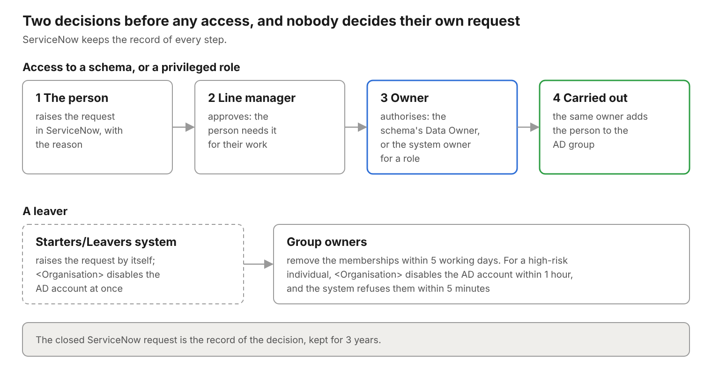

# \<System Name\> Access Control Management

## 1 Purpose

This document sets out how \<System Name\> is designed and configured to meet the 39 Access Control (AC) controls and enhancements in the CSS Moderate baseline.

Section 3 is the design: the account types, roles, permissions, separation of duties, access routes, settings and rules, the access request workflow, and the design for ending access, sign-in lifetime and device lock, the system use notice, actions allowed without signing in, audit, remote, wireless and mobile access, and the policy and procedures. Each subsection names the controls it helps to meet, and the settings table in section 3.7 names the control each setting serves.

As \<System Description\> sets out, \<Organisation\>'s PingFederate authenticates every user, with multi-factor authentication, and \<System Name\>'s API reads each user's groups directly from Active Directory over LDAPS, to give their roles and schema access. \<System Name\> holds no accounts or passwords of its own, and has no session management: how long a sign-in lasts is set by PingFederate, and an unattended screen is locked by \<Organisation\>'s managed devices. Both are corporate services that \<System Name\> uses as they stand.

## 2 Related documents

Who provides and is responsible for each control, and its status, are in \<System Security Plan\>, section 7.1 (Table 10). The tests, their results and the records an assessor will ask for are in \<Control Assessment Record\> (AC). Each control's risk is in \<Risk List\>, and what is still open is in \<Plan of Action and Milestones\>. The policy is in \<Policy\> (AC), and the steps people follow are in \<Procedures\> (AC).

## 3 The access control model

### 3.1 Principles

Controls met here: AC-2, AC-2(1), AC-3.

1. **Deny by default.** Nothing is allowed unless a role or group grants it. A schema with no group is open only to administrators.
2. **One person, one account.** Each person uses their own Active Directory account. Accounts are never shared, and \<System Name\> holds no accounts or passwords of its own.
3. **Schemas are the boundary.** Each schema has a read group and an edit group, owned by its Data Owner. Edit includes read.
4. **AD groups decide everything.** A person's role groups set what they can do, and their schema groups set which schemas they can do it in. All are Active Directory groups, which the API reads from Active Directory over LDAPS when the person signs in.
5. **Application users have no server access.** Windows and SQL Server administration use separate accounts.
6. **Only the API reaches the database.** The UI app and the Admin app get all their data through the API. The API connects with Windows authentication under its own managed service account, which is not a sysadmin and cannot change the schema.
7. **\<Organisation\>'s single sign-on proves who the user is.** PingFederate authenticates every user, with multi-factor authentication, and gives \<System Name\> a signed OpenID Connect response that names them. \<System Name\> never sees a password.
8. **No session management in the application.** \<System Name\> holds no session records and has no idle lock, idle timeout, session limit, sign-out or screen for ending sessions. The sign-in lasts as long as PingFederate allows, and the device screen lock hides an unattended screen.

Figure 1 shows the checks every request passes. Every request passes four checks in order: sign-in through PingFederate, which authenticates the user with multi-factor authentication, shown by the app's valid authentication cookie; the user's AD groups, read from Active Directory by the API over LDAPS; the schema decision, read or edit, from those groups; and the role group needed for the page or function. Anything not granted is refused.

The access control library, built into all three apps, makes the schema decisions. Role policies on each page and controller make the function decisions. All three apps, the API included, apply a default rule that requires a signed-in person, and refuse any page or function that states no access rule; only the actions in section 3.17 are open. Every item and file address names the schema, and no address works without it. Item content is sent so that it is not kept in shared caches.

**Figure 1: How an access decision is made**

### 3.2 Account types

Controls met here: AC-2, AC-2(2), AC-6(5).

Every person signs in with their Active Directory account, through PingFederate. The types below are the kinds of access an account may hold.

**Table 1: Account types**

| Type | Held by | Allowed | Rules |
| --- | --- | --- | --- |
| Standard user | Readers | Yes | Their own AD account; member of a schema's read group only |
| Schema editor | Editors | Yes | Their own AD account; member of a schema's edit group |
| Auditor | Auditors | Yes, privileged | Their own AD account; holds no administration role |
| Security officer | Security officers | Yes, privileged | Their own AD account; holds no administration role |
| Business owner | The business owner | Yes, privileged | Their own AD account; approves the disposal of items due under the retention schedule (FR-074) |
| Legal adviser's delegate | The person the legal adviser names | Yes, privileged | Their own AD account; holds no other role |
| Administrator | Administrators | Yes, privileged | Their own AD account; the system owner authorises and adds them to the group; a separate everyday account |
| Windows administrator | Windows server administrators | Yes, privileged | Named person, only over \<Organisation\>'s managed administration route, with multi-factor authentication (F11) |
| Database administrator | SQL Server database administrators | Yes, privileged | Named person, only over \<Organisation\>'s managed administration route, with multi-factor authentication (F11), for approved maintenance only |
| API service account | The API only | Yes, privileged | The API's group managed service account, which signs in to SQL Server with Windows authentication and reads group membership from Active Directory over LDAPS. Nobody signs in with it. Not a sysadmin, and cannot change the schema (section 3.6) |
| Local \<System Name\> account | Nobody | No | \<System Name\> holds no accounts or passwords of its own. The first administrator is simply the first member of that AD group |
| Temporary and emergency | Nobody | No | Prohibited (P-39) |
| Shared, guest, anonymous and demonstration | Nobody | No | Prohibited on the servers |

Temporary and emergency accounts are prohibited (P-39), so there is nothing to remove or disable automatically. Each access review confirms that none exists (PRO-AC-7). If such accounts were ever needed, they would be Active Directory accounts with an end date, and the tailoring decision would be made again.

Shared and group accounts are prohibited (TR-AC-02), and \<System Name\> holds no passwords, so there is no shared password to change when someone leaves a group.

### 3.3 Roles

Controls met here: AC-2, AC-3, AC-6, AC-6(5).

**Table 2: Roles**

| Role | Purpose | Granted through | Group owner, who authorises and manages its members |
| --- | --- | --- | --- |
| Reader | Read items in a schema | The schema's read group, an AD group | The schema's Data Owner |
| Editor | Add, manage and export items in a schema | The schema's edit group, an AD group | The same |
| Administrator | Manage schemas, the AD groups each schema uses, and settings; use the administration dashboard | AD group \<Code\>\_Admins | System owner |
| Auditor | Read the audit log and review it weekly (P-08) | AD group \<Code\>\_Auditors | System owner |
| Security officer | Read security information. Does not read the audit log | AD group \<Code\>\_Security | System owner |
| Business owner | Approve the disposal of items due under the retention schedule (FR-074) | AD group \<Code\>\_BusinessOwners | System owner |
| Legal adviser's delegate | Search every schema for one person's items to answer a request under data protection law (FR-073). Holds no other role | AD group \<Code\>\_LegalSearch, whose member the legal adviser names | System owner |

The people who hold each role are named in \<Roles and Responsibilities\>. The group names use the application's short code, and are confirmed when the groups are created in Active Directory.

Each group's owner adds and removes its members in Active Directory, with \<Organisation\>'s AD tool, as the last step of an approved request (section 3.13). \<System Name\>'s API reads each person's groups from Active Directory over LDAPS, with read-only rights, and cannot change them.

The authorised users of \<System Name\> are the members of its AD groups. Each person's groups are their access, and the approved source for each membership is its ServiceNow request. \<Organisation\> manages the AD accounts themselves. The administrator manages schemas, and which AD groups open each, in \<System Name\>'s Admin app.

The five role groups, for administrators, auditors, the security officer, the business owner and the legal adviser's delegate, are privileged. The system owner is their only owner, and authorises each member after role training and a signed Part B of \<Security Operating Procedures\> (PRO-AC-6). An administrator cannot add anyone to a group. On the servers, privileged access is held through Windows administrator group membership and SQL Server roles, and only the named Windows server and database administrators may sign in (section 3.6.2). The API's database service account is privileged and headless, and is managed by the database administrator.

### 3.4 Permissions

Controls met here: AC-2, AC-3, AC-5, AC-6, AC-6(10).

**Table 3: Permissions by role**

| Function | Reader | Editor | Administrator | Auditor | Security officer | Business owner | Legal adviser's delegate |
| --- | --- | --- | --- | --- | --- | --- | --- |
| Search and read items | Own schemas | Own schemas | All schemas | No | No | No | No |
| Report a faulty item | Own schemas | Own schemas | All schemas | No | No | No | No |
| Upload, manage and export items | No | Own schemas | All schemas | No | No | No | No |
| Manage users, passwords and group membership | No | No | No: done in Active Directory, by each group's owner | No | No | No | No |
| Manage schemas, and which AD groups open each | No | No | Yes | No | No | No | No |
| Grant administrator | No | No | No: the system owner adds the member to the AD group | No | No | No | No |
| Use the administration dashboard and settings | No | No | Yes | No | No | No | No |
| Read audit logs | No | No | No | Yes | No | No | No |
| Read security information | No | No | No | No | Yes | No | No |
| Approve the disposal of items due under the retention schedule (FR-074) | No | No | No | No | No | Yes | No |
| Search every schema for one person's items, for a request under data protection law (FR-073) | No | No | No | No | No | No | Yes |

### 3.5 Separation of duties

Controls met here: AC-5.

1. Nobody approves their own access or privilege.
2. Nobody reviews their own access or their own privileged actions.
3. Auditors and security officers hold no administration role, and the legal adviser's delegate holds no other role.
4. Application, Windows and database administration use separate accounts, held by different people where staffing allows.
5. Developers hold no administrator access on the servers.
6. Where staffing cannot meet a rule, it is recorded as an exception, with a compensating check.

Table 4 shows each pair of duties that one person must not hold together, the roles that carry them, and what keeps them apart.

**Table 4: Duties kept apart**

| Duty | Must be separate from | Roles | Kept apart by |
| --- | --- | --- | --- |
| Asking for access | Approving and granting it | The person asks; their line manager approves; the group's owner authorises, and adds them to the AD group | The ServiceNow workflow, in which nobody can decide their own request, and Active Directory, where only a group's owner can change its members (section 3.13) |
| Administering schemas and settings | Reviewing audit logs | Administrator administers; auditor reviews | Separate access groups: only the auditor group opens the audit log pages, and it opens no administration page |
| Administering the system | Reading security information | Administrator administers; security officer reads | Separate access groups |
| Searching every schema for one person's items | Any other role | Legal adviser's delegate | A separate access group, whose member the legal adviser names; the delegate holds no other role |
| Holding administrator | Granting it | Administrators; the system owner, who alone manages that AD group | Active Directory: an administrator cannot add a member to the group |
| Application administration | Windows administration and database administration | Administrator; Windows server administrator; SQL Server database administrator | Separate accounts on separate layers, held by three different people (\<Roles and Responsibilities\>) |
| Development | Production administration | Developers; Windows server and database administrators | Developers hold no administrator account on the servers |
| Holding access | Reviewing that access | Each account holder; system owner, auditor and Data Owners review | Procedure: nobody reviews their own access (PRO-AC-7) |

### 3.6 Access routes

Controls met here: AC-4, AC-6.

Figure 2 shows \<System Name\>'s boundary and the routes into and inside it. It is the boundary figure of \<System Description\>.

**Figure 2: System boundary and access routes**

**Table 5: Access routes**

| Route | Used by | Design |
| --- | --- | --- |
| Sign-in | Everyone | The browser is sent to \<Organisation\>'s PingFederate (F6), which authenticates the user with multi-factor authentication and returns a signed OpenID Connect response naming them. The app completes the sign-in with PingFederate from the application server (F10). The API then reads their groups from Active Directory over LDAPS. \<System Name\> has no sign-in of its own |
| Browser to the UI app | Readers, editors, administrators | HTTPS on \<Organisation\>'s network, after signing in |
| Browser to the Admin app | Administration, audit, security, business owner and legal search roles | HTTPS, over \<Organisation\>'s managed administration route only |
| Apps to the API | The apps only | Inside the application server; people do not connect directly |
| API to the database | The API's service account only | Application server to database server only, using TLS with strict encryption and Windows authentication. The UI app and the Admin app have no database connection |
| Windows administration (F11) | Windows server administrators | Named accounts, from managed devices, only over \<Organisation\>'s managed administration route, with multi-factor authentication |
| Database administration (F11) | Database administrators | Named accounts, from managed devices, only over \<Organisation\>'s managed administration route, with multi-factor authentication, for approved maintenance only |
| Remote access | Approved users and administrators | \<Organisation\>'s remote access service, with multi-factor authentication |
| Without signing in | Anyone | Only the actions listed in section 3.17 |
| API to Active Directory | The API's service account only | LDAPS, TCP 636, read-only, to read the signed-in person's group memberships |
| Outside services | None | Browsers load all code from \<System Name\> itself |

**Table 6: Server and database access**

| Layer | Who | Rule |
| --- | --- | --- |
| Windows on both VMs | Windows server administrators | Named accounts, only over \<Organisation\>'s managed administration route, with multi-factor authentication (F11) |
| SQL Server administration | Database administrators | Named accounts, only over \<Organisation\>'s managed administration route, with multi-factor authentication (F11), for approved maintenance only |
| API to SQL Server | The API's managed service account | Windows authentication; the rights in the table below. The UI app and the Admin app do not connect |
| App service accounts on Windows | One for each app | Group managed service accounts; cannot sign in interactively; not administrators (Table 8) |

Only the API connects to the database.

**Table 7: Database accounts and their rights**

| Account | Used by | May | May not |
| --- | --- | --- | --- |
| API's managed service account, \[name to be set at build\] | API only. Headless: no person signs in with it | Read and write application data. Add audit records | Be a sysadmin. Create, alter or drop tables. Change or delete audit records. Connect from anywhere but the application server |
| Schema change account, \[name to be set at build\] | The database administrator, at a release, under an approved change | Create and alter the tables | Be used by any app, or for everyday work |
| Database administrators' own accounts | Each database administrator, by name | Administer SQL Server, for approved maintenance | Be shared |
| Built-in sa login | Nobody | Nothing: it is disabled, and SQL Server accepts Windows authentication only | Be enabled, or used by any person or app |

These rules follow from it:

1. **No passwords.** \<System Name\> stores no passwords or password hashes, because PingFederate authenticates every user.
2. **Items and schemas.** The UI app asks the API for item data. The Admin app asks the API for schemas, the groups each uses, settings and audit records, and gets no item content.
3. **Audit log.** The service account can only add records. Nothing can change or delete them. They are read only through the Admin application's audit pages, by the auditor role.
4. **Changes to the database structure.** Only the database administrator makes them, with the schema change account.
5. **Connection.** The API connects only from the application server, over TLS with strict encryption, using Windows authentication under its managed service account. There is no database password to store.

#### 3.6.1 Windows service accounts

Controls met here: AC-6.

Each app runs under its own Windows account, so a fault in one app cannot reach another's files.

**Table 8: Windows service accounts**

| Account | Runs | Kind | May | May not |
| --- | --- | --- | --- | --- |
| \[name to be set at build\] | UI application | Group managed service account in \<Organisation\>'s Active Directory. Windows sets and changes its password, and no person knows it | Log on as a service on the application server | Be an administrator. Sign in at the console or by remote desktop. Be used by a person |
| \[name to be set at build\] | Admin application | The same | The same | The same |
| \[name to be set at build\] | API | The same | The same. It signs in to SQL Server with Windows authentication and reads Active Directory over LDAPS, so it holds no database password | The same |

Each is a managed service account in \<Organisation\>'s Active Directory, with no interactive sign-in, whose password Windows sets and changes.

#### 3.6.2 Who may sign in to the servers

Controls met here: AC-2, AC-6(5).

**Table 9: Sign-in to the servers**

| Server | May sign in | How | May not |
| --- | --- | --- | --- |
| Application server | The named Windows server administrators | Their own named administrator accounts, only over \<Organisation\>'s managed administration route, with multi-factor authentication (F11) | Developers, application users, the service accounts, and any shared account |
| Database server | The named Windows server administrators, and the named database administrators | The same | The same |

The holders are named in \<Roles and Responsibilities\>. \<Organisation\> creates and removes these accounts through its ServiceNow process, with the system owner's approval (EV-AC-02).

#### 3.6.3 File permissions on the application server

Controls met here: AC-6, AC-6(1).

**Table 10: File permissions**

| Files | Read | Write | Notes |
| --- | --- | --- | --- |
| Each app's program folder | That app's service account; Windows server administrators | Windows server administrators only, at a release | An app cannot change its own code |
| Each app's settings and secrets | That app's service account; Windows server administrators | Windows server administrators only | Secrets are kept out of the code repositories. The other two apps cannot read them |
| Each app's key ring, which protects its authentication cookie | That app's service account | That app's service account | Protected with Windows DPAPI |
| Each app's logs | Windows server administrators; the auditor | That app's service account | Kept for 30 days |
| The export working folder | API's service account | API's service account | Holds an export only until it is downloaded |

Item files are held in the SQL Server database, each schema in its own database schema. No item is held as a file on a share.

#### 3.6.4 Firewall rules

Controls met here: AC-4.

\<Organisation\>'s corporate network team writes, holds and changes every firewall rule, through its own change process. The \<System Name\> team has no control over them and cannot see or change a rule. So \<System Name\> does not design the rules. It states the flows it needs, in Table 11, and asks \<Organisation\> to allow those and nothing else. The rules themselves are \<Organisation\>'s evidence (EV-AC-03).

**Table 11: Flows \<System Name\> asks \<Organisation\> to allow**

| Flow | From | To | Service | Needed for |
| --- | --- | --- | --- | --- |
| F1 | Users' managed devices, in the office or on the VPN | Application server | HTTPS, TCP 443 | The UI app |
| F2 | Administrators, over \<Organisation\>'s managed route | Application server | HTTPS, on a port or host name still to be set | The Admin app |
| F3, F4 | The UI app and the Admin app | The API, on the application server's own loopback address | HTTPS | Needs no firewall rule: it never leaves the server |
| F5 | Application server | Database server | SQL Server over TLS 1.2 or later with strict encryption, TCP 1433 | The API's database connection |
| F6 | Users' and administrators' browsers | \<Organisation\>'s PingFederate | HTTPS | Signing in. Both ends are \<Organisation\>'s, so this needs no rule for \<System Name\>'s servers |
| F7 | Application server | \<Organisation\>'s Active Directory domain controllers | LDAPS, TCP 636 | The API reading each signed-in person's group memberships |
| F8 | Both servers | \<Organisation\>'s time service, central logging, proxy and backup site | As \<Organisation\> sets, encrypted | Accurate audit times, log forwarding, updates and backups |
| F10 | Application server | \<Organisation\>'s PingFederate | HTTPS, TCP 443 | The UI app and the Admin app fetching PingFederate's OpenID Connect metadata and signing certificate, and completing each sign-in |
| F11 | Server and database administrators' managed devices, over \<Organisation\>'s managed administration route, with multi-factor authentication | Both servers | Tool and protocol to be supplied by \<Organisation\> | Server and database administration, using named accounts |

Everything else should be refused, in and out. \<System Name\> needs no route to the internet, as browsers load all code from \<System Name\> itself. The applications fetch PingFederate's OpenID Connect metadata and signing certificate, which checks its sign-in responses, from \<Organisation\>'s PingFederate (F10), and fetch nothing from an outside host. ServiceNow and the starters and leavers process (F9) have no connection to \<System Name\>.

What \<System Name\> itself controls is limited to its own apps: the API listens only on the loopback address, each app accepts only HTTPS, and the API accepts requests only from the two apps' addresses.

#### 3.6.5 What \<Organisation\>'s corporate configuration provides

Controls met here: AC-2, AC-2(1), AC-2(5), AC-7, AC-11, AC-11(1), AC-17, AC-17(1), AC-17(2), AC-17(3), AC-17(4), AC-18(1), AC-18(3), AC-19, AC-20, AC-20(2).

**Figure 3: Who provides each part of access control**

These are set by \<Organisation\> as part of its corporate network, directory and device configuration. The \<System Name\> team has no control over them. \<System Name\> accepts \<Organisation\>'s corporate standard for each, and records the values once \<Organisation\> supplies them. Table 12 says what \<System Name\> relies on.

**Table 12: Provided by \<Organisation\>'s corporate configuration**

| Provided | Controls | What \<System Name\> relies on | Evidence asked |
| --- | --- | --- | --- |
| Single sign-on: PingFederate | AC-2(5), AC-3, AC-7, AC-12, AC-14, and the IA controls | Every user is authenticated by PingFederate, with multi-factor authentication. Repeated failed sign-ins lock the account under the corporate standard. The OpenID Connect response \<System Name\> receives is signed. PingFederate's sign-in lifetime is the only limit on how long a sign-in lasts (AC-2(5), AC-12) | EV-IA-04 |
| Accounts and groups: Active Directory | AC-2 and its enhancements, AC-6(5), AC-6(7) | Each person has one AD account, created, changed and disabled by \<Organisation\>'s starters and leavers process. A disabled account can no longer sign in. Only a group's owner can change its members. The API reads group membership over LDAPS | EV-AC-01 |
| Account lockout on the servers and on users' devices | AC-7 | Repeated failed Windows sign-ins lock the account | EV-AC-05 |
| Logon banner on the servers | AC-8 | A system use notice before an administrator signs in to Windows | EV-AC-06 |
| Screen lock on the servers and on users' devices | AC-11, AC-11(1) | An unattended screen locks after the time in P-03, hides what was on it, and needs the password to unlock. As \<System Name\> has no page lock of its own, this is the only session lock | EV-AC-07 |
| Remote access | AC-17, AC-17(1), AC-17(2), AC-17(3) | One route in from outside: the VPN, from a managed device, with multi-factor authentication, encrypted, logged and monitored, through one managed gateway | EV-AC-08 to EV-AC-11 |
| No remote administration from outside | AC-17(4) | The servers' administration ports cannot be reached from external networks | EV-AC-12 |
| Wireless | AC-18, AC-18(1), AC-18(3) | Corporate wireless authenticates users and devices and is encrypted; the servers have no wireless | EV-AC-13, EV-AC-14 |
| Device controls | AC-19, AC-20, AC-20(2) | Phones and tablets cannot reach \<System Name\>; unmanaged devices are kept off the network; USB storage is blocked unless approved | EV-AC-15 to EV-AC-17 |

The only \<System Name\> setting for the same controls is its system use notice (section 3.7). \<System Name\> has no page lock or session limits of its own.

### 3.7 Settings

The values the access controls depend on are parameters in \<System Description\>, section 4, and are not repeated here. Table 13 lists them by control. Sign-in settings, such as lockout, multi-factor authentication and the sign-in lifetime, are PingFederate's and are not set in \<System Name\>. The policy review and ownership values are in \<Policy\>, section 1.1.

**Table 13: Access control parameters**

| Control | Parameters |
| --- | --- |
| AC-2 | P-36 account types; P-37 who decides access; P-06 leavers and movers; P-04 and P-05 access reviews |
| AC-2(2) | P-39 temporary and emergency accounts |
| AC-2(3) | P-38 unused accounts |
| AC-2(5), AC-11, AC-12 | P-02 sign-in lifetime; P-03 device screen lock |
| AC-2(13) | P-41 disabling a high-risk individual |
| AC-6(1), AC-6(9), AC-6(10) | P-44 privileged functions and security-relevant information |
| AC-6(2) | P-45 separate account for everyday work |
| AC-6(7) | P-04 review of role group members |
| AC-7 | P-42 failed sign-ins |
| AC-8 | P-43 system use notice wording |
| AC-10 | P-40 sign-ins at once |
| AC-14 | P-51 actions allowed without signing in |
| AC-17 | P-46 remote access route |
| AC-18, AC-19 | P-47 wireless and mobile access |
| AC-20 | P-48 external systems and portable storage |
| AC-21 | P-49 who decides on sharing outside a schema |
| AC-22 | P-50 public content |

### 3.8 Privileged functions and security information

Controls met here: AC-6, AC-6(1), AC-6(2), AC-6(9), AC-6(10).

**Privileged functions:** managing schemas and the AD groups each uses; changing settings; running diagnostics; reading audit logs; approving the disposal of items due under the retention schedule; searching every schema for one person's items; and database maintenance. Managing the members of \<System Name\>'s AD groups is also privileged, and is done in Active Directory by each group's owner.

**Security-relevant information:** secrets and security settings, PingFederate's signing certificate, access groups and schema access rules, audit logs, firewall rules and certificates.

Only the privileged roles in Table 1 may use these. Their use must be logged (section 3.18).

Security functions in hardware and firmware, namely the physical hosts, the network equipment and the host firmware, are held by \<Organisation\>'s network and infrastructure teams, under \<Organisation\>'s own access lists.

These rules apply:

1. **Checked where it runs.** Each privileged function checks the caller's role where the function runs, not only in the menu, through the role policies on every Admin application page and API controller. Table 3 says which role may run each. Everything else is refused.
2. **Information kept to the roles.** Role policies on the Admin application's pages, database rights and file permissions on the servers keep the security information to the roles that need it. Secrets are kept out of the code repositories, and each app's secrets are readable only by that app's service account and the Windows server administrators (section 3.6.3).
3. **A separate everyday account.** Each administrator has two AD accounts: a privileged one for administration, and an everyday one for item work (P-45; \<Security Operating Procedures\>, rules B2 and B3). This is a rule for people. The system does not enforce it.
4. **Nothing extra in production.** No test page, and no diagnostic beyond the fixed checks that read no item content, is present in production.

### 3.9 Export and download rules

Controls met here: AC-3, AC-4, AC-21.

1. Only editors of a schema and administrators may bulk export its items.
2. An export job can be seen, downloaded or cancelled only by the person who started it.
3. Exports are delivered as downloads. Writing exports to a server folder is not allowed.
4. Exported items stay under the schema's access rules, and leaving \<Organisation\>'s systems needs approval under P-48 and P-49.
5. Every export is recorded in the audit log.

### 3.10 Information sharing rules

Controls met here: AC-20, AC-20(1), AC-20(2), AC-21, AC-22.

1. Sharing outside a schema needs a decision by that schema's access approver, its Data Owner (P-49), through the manual process in PRO-AC-16.
2. The approver checks that the recipient is authorised for the information, and the decision is recorded on TPL-2. Exported items stay under the schema's rules.
3. Inside \<System Name\>, the schema groups control sharing. Sharing outside is a manual decision.
4. External systems and portable storage may hold \<System Name\> data only with system owner approval (P-48). External systems may reach or hold it only with the system owner's written approval (TR-AC-07). Terms and conditions are used, not asserted controls (TR-AC-10).
5. Personal devices, personal cloud storage and any unmanaged system are prohibited (\<Security Operating Procedures\>, rules A31, A35 and A45). \<Organisation\>'s network access control keeps unmanaged devices off the network.
6. USB and other portable storage may not hold \<System Name\> data without the system owner's approval, recorded as a sharing decision (P-48, PRO-AC-16; \<Security Operating Procedures\>, rule A32). \<Organisation\>'s device control on managed devices enforces this.
7. \<System Name\> holds and serves no public content (P-50). Every item needs sign-in, and the sign-in requirement on every page that returns content enforces this.

### 3.11 Review schedules

Controls met here: AC-2, AC-2(3), AC-6(7), AC-14.

**Table 14: Review schedules**

| Review | How often | By | Steps |
| --- | --- | --- | --- |
| The five role groups | Every 3 months | System owner, auditor; Head of Cyber as an extra check, for administrators | PRO-AC-7 |
| Schema groups | Every 12 months | Data Owners | PRO-AC-7 |
| Members who have not signed in for 90 days | Monthly | Each group's owner, with the sign-in dates an administrator provides | PRO-AC-8 |
| Audit logs | Weekly (\<System Description\>, P-08) | Auditor, for the application audit log; security officer, for the logs in central logging | \<Security Operating Procedures\> |
| Actions allowed without signing in | Every 12 months, and after a change | System owner | PRO-AC-14 |
| This document | Every 12 months, and after a significant change | System owner | PRO-AC-14 |

In each access review, the group's owner checks its members against the ServiceNow requests, and removes in Active Directory any member who no longer needs the access. Each review is recorded on TPL-3 (P-AC-07, PRO-AC-7). The review is manual.

### 3.12 Exception rules

1. Every exception needs written system owner approval, a reason, an owner and an end date of no more than 12 months.
2. Each one needs a compensating check where possible, and an entry in \<Risk List\>.
3. Exceptions above the system owner's authority go to the authorising official.
4. Exceptions are checked at each access review and end on their end date unless renewed.
5. Steps are in PRO-AC-15.

### 3.13 Access request workflow

Controls met here: AC-2, AC-2(1), AC-2(13).

**Figure 4: Access request workflow**

Every change to a person's access goes through a request in ServiceNow. ServiceNow is \<Organisation\>'s corporate service. The Application Support Team builds and maintains the \<System Name\> workflow in it.

**Table 15: Access request workflow**

| Request | Raised by | Approved by | Authorised by | Carried out by |
| --- | --- | --- | --- | --- |
| Access to a schema, to read or to edit | The person who needs it, in ServiceNow | Their line manager | The schema's Data Owner | The Data Owner, who adds the person to the schema's AD group with \<Organisation\>'s AD tool |
| A privileged role | The person | Their line manager | The system owner, who cannot authorise their own | The system owner, who adds the person to the role's AD group |
| A change of role (mover) | The person's line manager, within 1 working day | Not needed for a removal; as above for any new access | As above for any new access | Each group's owner, who removes the old membership and adds any new one |
| Removal (leaver) | \<Organisation\>'s starters and leavers process, automatically | Not needed | Not needed | \<Organisation\> disables the AD account at once, which ends access. Each group's owner removes the membership within 5 working days |

No \<System Name\> account is ever created: a person's AD account is their account, and joining a group is what gives them access.

These rules apply:

1. **Two decisions before any access.** The line manager confirms the person needs it for their work. The owner of the data, or the system owner, decides whether to allow it, and only then adds the person to the AD group.
2. **Nobody decides their own request.** The person who raises a request cannot approve or authorise it. ServiceNow is set to refuse it. An owner who needs access to their own group asks the system owner.
3. **What each request records:** the person; what is asked for; the business reason; who approved and who authorised it, and when; that the training is done and the rules are signed; and who carried it out, and when.
4. **The record.** The closed ServiceNow request is the record of the access decision, in place of form TPL-2. It is kept for 3 years.
5. **Before the person is added to a group,** they complete security training and sign \<Security Operating Procedures\> (PRO-AC-1).
6. **A high-risk individual.** \<Organisation\> disables the AD account and ends the person's PingFederate sign-in, within 1 hour. \<System Name\> reads group membership from Active Directory at sign-in, so a disabled account cannot sign in again. \<System Name\> has no sessions of its own to end (section 3.14).
7. **Conditions for membership.** A need confirmed by the line manager, authorisation by the group's owner, security training, and a signed acknowledgement of \<Security Operating Procedures\> are the conditions for membership of any group (PRO-AC-1, PRO-AC-5, PRO-AC-6).
8. **Notice of a change.** When an account is no longer needed, a user leaves or moves, or their need changes, the owners of the groups the person belongs to and the system owner are told within 1 working day in each case. The notice comes as a prompt from \<Organisation\>'s starters and leavers process (P-06).
9. **Aligned with leavers and movers.** \<System Name\> uses the same AD account that \<Organisation\>'s leaver and transfer processes act on, so disabling it ends access to \<System Name\>. The starters and leavers process prompts the group owners to remove memberships (PRO-AC-2, PRO-AC-3).

### 3.14 Disabling accounts and ending access

Controls met here: AC-2, AC-2(3), AC-2(13).

\<Organisation\> disables Active Directory accounts. A disabled account cannot sign in through PingFederate, so it cannot reach \<System Name\>. A sign-in already open lasts until PingFederate's sign-in lifetime ends, but any removed group membership is refused at the next Active Directory lookup. \<System Name\>'s API refuses a person whose account is disabled or whose groups cannot be read. Table 16 shows when access is ended.

**Table 16: When access is ended**

| Condition | What happens | Setting |
| --- | --- | --- |
| The account has expired | AD accounts with an end date are disabled by Active Directory on that date | None |
| The person leaves | \<Organisation\> disables the leaver's AD account at once. Each group's owner removes the membership within 5 working days | P-06 |
| The account breaches policy | \<Organisation\> disables the AD account on notice (PRO-AC-4) | P-38 |
| A high-risk individual | Within 1 hour of notice from management or \<Organisation\>'s security contact of misconduct, compromised credentials or a hostile departure, \<Organisation\> disables the AD account and ends the person's PingFederate sign-in, so the person cannot sign in again, and any group lookup for them fails (PRO-AC-4, record TPL-14; TPL-10 if it is an incident). \<System Name\> has no sessions of its own to end | P-41 |
| The account is unused | Unused AD accounts are disabled under \<Organisation\>'s corporate standard, which \<System Name\> accepts. In addition, each month, the owner of each group removes any member who has not signed in to \<System Name\> for 90 days, from the sign-in dates in the audit records that an administrator provides, so that an unused membership ends even while the Active Directory account stays in use for other work (PRO-AC-8) | P-38 |

### 3.15 Sign-in lifetime, failed sign-ins and device lock

Controls met here: AC-2(5), AC-7, AC-11, AC-11(1), AC-12.

\<System Name\> has no session management (section 3.1), so it does not sign users out, lock a page or limit sessions itself. These are \<Organisation\>'s corporate configuration, which \<System Name\> accepts as it stands (section 3.6.5).

1. **Sign-in lifetime.** A user's sign-in ends when PingFederate's sign-in lifetime for \<System Name\> ends (P-02), or when \<Organisation\> ends their PingFederate sign-in or disables their account. \<System Name\> holds the sign-in only in its authentication cookie, whose lifetime is no longer than PingFederate's. It reads the person's groups from Active Directory at sign-in, so a change to their groups takes effect at their next sign-in.
2. **Failed sign-ins.** PingFederate and Active Directory count failed sign-ins and lock the account, under \<Organisation\>'s corporate standard, which \<System Name\> accepts (P-42). \<System Name\> has no sign-in of its own. The lock applies to every system the person uses, not only \<System Name\>. \<Organisation\>'s Group Policy locks sign-in to the servers. SQL Server accepts connections only from the application server.
3. **Device lock.** \<Organisation\>'s managed devices and the servers lock the screen after the inactivity period in P-03, by Group Policy or device management. The lock screen hides the display, and the lock stays until the user unlocks the device with their own credentials.
4. **What users do.** \<Security Operating Procedures\> tells users to close the browser and lock their device when they finish.

### 3.16 System use notice

Controls met here: AC-8.

Each app shows the notice on a page straight after the user signs in through PingFederate, before they can go further. The wording is: "This system is for authorised use only. Activity is monitored and recorded. Unauthorised use may lead to disciplinary or legal action. By continuing you accept these terms." (P-43). The notice names \<Organisation\>, not the U.S. Government (TR-AC-03).

The notice stays until the user accepts it, and the acceptance is written to the audit log. It is text on a page of the UI app and of the Admin application, changed only through an approved change (PRO-AC-13). \<System Name\> is not public, so no conditions for public systems apply (TR-AC-04). On the servers, the Windows logon banner, which is \<Organisation\>'s corporate configuration, gives a system use notice before an administrator signs in (section 3.6.5).

### 3.17 Actions allowed without signing in

Controls met here: AC-14.

Only these actions are allowed without signing in (P-51):

1. be sent to PingFederate to sign in;
2. see the access-denied page;
3. load static files, such as scripts, styles and images;
4. check that the API is running, which returns one status word.

Each is needed before a person can identify themselves, and none returns business data. The API health check supports monitoring. The list and the reasons are also stated in \<System Security Plan\>. The list is reviewed every 12 months and after a change (PRO-AC-14).

The UI app, the Admin application and the API each refuse anything not marked as open, so a page or function that states no access rule is refused.

### 3.18 Audit of accounts and privileged actions

Controls met here: AC-2, AC-2(4), AC-6(9).

1. **Account events.** Active Directory audits the creation of every account, every change to an account and to the members of a group, and enabling, including unlocking, disabling and removal. \<Organisation\> holds these records.
2. **Sign-ins.** \<System Name\> audits every sign-in it accepts, every sign-in response it refuses, every failed group lookup and every acceptance of the system use notice, with the person and the time. PingFederate records every sign-in attempt.
3. **Schema settings.** \<System Name\>'s audit log records changes to schemas and to which AD groups open each schema.
4. **Privileged functions.** Every use of a function in section 3.8 writes an audit record naming the person, the action, the target and the time (P-44). The application audit log and the audit service in the API hold these records. Only the API writes audit records. On the servers, Windows and SQL Server logging record their use.
5. **Review.** The auditor reviews privileged actions weekly (\<Security Operating Procedures\>, duty C3; Table 14).

### 3.19 Remote, wireless and mobile access

Controls met here: AC-17, AC-17(1), AC-17(2), AC-17(3), AC-17(4), AC-18, AC-18(1), AC-18(3), AC-19, AC-19(5).

These are provided by \<Organisation\>'s corporate network and device configuration, over which the \<System Name\> team has no control (section 3.6.5). \<System Name\> has no remote access or wireless function of its own.

**Remote access.** One type only: \<Organisation\>'s VPN, from a managed device, with multi-factor authentication (P-46). It is used by users working from home and by approved administrators. \<Organisation\> authorises VPN access for each person through its own process, and logs and monitors VPN sessions. All remote access enters through \<Organisation\>'s one managed gateway. \<System Name\> is not reachable from the internet. Rules for users are in \<Security Operating Procedures\> (rules A39 and A40).

**Encryption.** The VPN is encrypted. Inside it, every \<System Name\> flow uses TLS under NCSC's profiles: HTTPS to both apps, and TLS to SQL Server. The TLS settings of each app and of SQL Server are in \<System and Communications Protection Management\>.

**Remote administration.** CSS defines remote access as access through external networks. Administration takes place only from inside \<Organisation\>'s network, so no privileged remote access is allowed. \<Organisation\>'s firewall rules block the servers' administration ports from external networks. The reason privileged remote access does not apply is in \<Tailoring Register\> (TR-AC-05), for the authorising official's approval.

**Wireless.** \<System Name\> has no wireless part. Users' devices may use \<Organisation\>'s corporate wireless network, under its wireless policy (P-47). \<Organisation\> authorises wireless access, and its wireless network authenticates both users and devices, and is encrypted. Users must not use public wireless without the VPN (\<Security Operating Procedures\>, rule A40). The two servers have no wireless adapter, and \<Organisation\>'s build standard disables wireless where it is not needed.

**Mobile devices.** Phones and tablets are not used with \<System Name\>, and none is authorised. \<Organisation\>'s device management and network access control enforce this. As no mobile devices are used, full device or container-based encryption does not apply (TR-AC-06).

### 3.20 Policy and procedures

Controls met here: AC-1.

\<Policy\> (AC) and \<Procedures\> (AC) meet AC-1. Who they are shared with is in \<Policy\>, section AC.6. Their ownership, approval, review and records follow the rules common to every policy in \<Policy\>, section 1.1.

