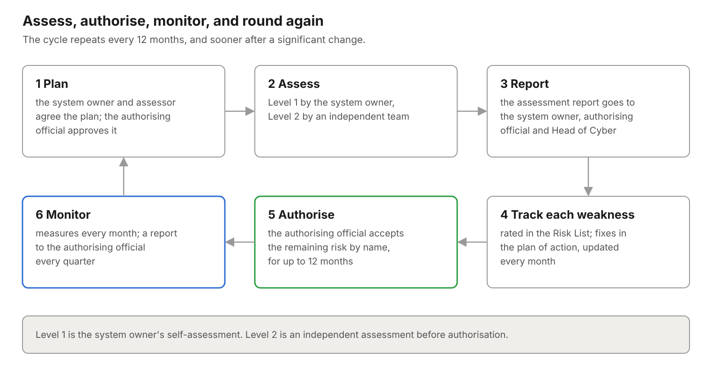

# \<System Name\> Assessment, Authorization, and Monitoring Management

## 1 Purpose

This document sets out how \<System Name\> is assessed, authorised to operate and monitored afterwards, and how its connections to other systems are approved, to meet the 10 Assessment, Authorization, and Monitoring (CA) controls and enhancements in the CSS Moderate baseline.

Section 3 is the design: the cycle, assessment, the plan of action, authorisation, inherited controls, information exchanges and internal connections, continuous monitoring, significant change, what \<Organisation\> provides, and the policy and procedures. Each subsection names the controls it helps to meet.

Other documents hold the rest. Who provides and is responsible for each control, its status and its assessment result are in \<System Security Plan\>, section 7.4 (Table 13). The tests, their results and the records an assessor will ask for are in \<Control Assessment Record\> (CA). Each control's risk is in \<Risk List\>, and what is still open is in \<Plan of Action and Milestones\>. The policy is in \<Policy\> (CA), and the steps people follow are in \<Procedures\> (CA).

Values that CSS asks the organisation to define are set at corporate level by \<Organisation\>. The settings in section 3 should match those corporate values. Where one does not, it is changed in this document.

Appendix A lists the CA controls CSS does not select at Moderate.

## 2 Summary

The implementation status of each control, how it is met, who is responsible, its assessment result and the risk and plan entries for its gaps are recorded in \<System Security Plan\>, section 7.4 (Table 13).

## 3 The design

### 3.1 Principles

Controls met here: CA-2, CA-2(1), CA-3, CA-5, CA-6, CA-7, CA-9.

1. **Two levels of assessment.** The system owner self-assesses at Level 1. An independent team assesses at Level 2.
2. **Authorise knowingly.** The authorising official accepts the remaining risk by name, in writing, for no more than 12 months at a time.
3. **Nothing in production before authorisation.** \<System Name\> holds no production documents until it is authorised.
4. **Track what is open.** Every weakness stays on the plan of action until its fix is tested.
5. **Know the connections.** Each connection to another system is recorded and approved before it is used.
6. **Keep watching.** After authorisation, measures are collected and reported, and a significant change sends \<System Name\> back to the authorising official.

These carry out the principles and rules of \<Policy\>, sections CA.3 and CA.4.

### 3.2 The cycle

Controls met here: CA-2, CA-5, CA-6, CA-7, CA-7(1).

**Figure 1: From assessment to authorisation to monitoring**

**Table 1: Who does what in the cycle**

| Step | Who | Record | How often |
| --- | --- | --- | --- |
| Plan the assessment, and approve the plan | System owner and assessor; the authorising official approves | The plan in each chapter of \<Control Assessment Record\> | Every 12 months, and after a significant change |
| Assess the controls | Level 1: the system owner. Level 2: the independent team | \<Control Assessment Record\> | The same |
| Report | The assessor | \<Security Assessment Report\> | After each assessment |
| Record and track each weakness | System owner | \<Risk List\> and \<Plan of Action and Milestones\> | Monthly |
| Authorise | Authorising official | TPL-18 | Before operation; every 12 months; after a significant change |
| Monitor and report | Security officer; system owner | TPL-8 | Monthly to the system owner; quarterly to the authorising official |
| Check the monitoring independently | Independent assessor | The assessor's report; TPL-19 | Every 12 months |

### 3.3 Assessment

Controls met here: CA-2, CA-2(1), CA-7(1).

**Levels.** Level 1 is the system owner's self-assessment, carried out by Claude, an AI assistant, for the system owner. It is not independent: the same assistant drafted the documents and assessed them. It shows the system owner where \<System Name\> stands, and prepares the ground for Level 2. Level 2 is the independent assessment by \[Name\]'s team, which also makes the yearly independent check of monitoring.

**Independence.** A member of the team counts as independent once they have completed TPL-19, confirming that they have had no part in designing, building, running or administering \<System Name\>, that they report to no one responsible for it, and declaring any other interest. The authorising official accepts each statement before the assessment starts.

**Method.** Each control is assessed with the procedures of CSS: every determination statement is given a finding of satisfied or other than satisfied, with the basis for it. The methods are examine, interview and test.

**Plan.** Each family's chapter of \<Control Assessment Record\> has a plan: scope, procedures, assessor, dates, site, what is examined, tested and whom is interviewed, with depth and coverage, the boundary, and what is needed from \<Organisation\>. The authorising official approves it before the assessment (PRO-CA-1, step 1).

**Report and results.** The findings are brought together in \<Security Assessment Report\>, which goes to the system owner, the authorising official and the Head of Cyber. No authorisation is given without an approved plan and a report (PRO-CA-4).

**Frequency.** Every 12 months, and after a significant change (section 3.9).

**Between assessments.** The developers repeat the security tests at each release and after a significant change, on a separate test environment (\<Security Operating Procedures\>, duty C40). The results feed the next assessment and the plan of action.

### 3.4 Plan of action and milestones

Controls met here: CA-5.

Every weakness that needs a fix has one item in \<Plan of Action and Milestones\>, with its control, source, fix, owner, resources, milestone, due time and state. The Risk List rates the weakness and records the decision; only those to be fixed, or to be evidenced, go to the plan.

**Table 2: Time allowed to fix an item**

| Rating | Fixed within | Decided by |
| --- | --- | --- |
| High | The time the authorising official has set for the item | Authorising official |
| Medium | 180 days of go-live | Authorising official (D-CA-07) |
| Low | 365 days of go-live | Authorising official (D-CA-07) |

1. The system owner updates the plan each month, from assessments, monitoring and audits.
2. Once the development phase is scheduled, each open item is given a calendar date within its time limit.
3. An item is closed only when the fix has been tested, the evidence is recorded against the item, and the system owner agrees. An item fixed in the test environment is tested again on the servers before it closes.
4. Each quarter the system owner reports overdue items, with the reason for each, to the authorising official.

A consistency test checks that every item named in the Risk List exists in the plan, and that \<Security Assessment Report\> gives the plan's counts.

The steps are in \<Procedures\>, PRO-CA-3.

### 3.5 Authorisation

Controls met here: CA-6.

**Table 3: Who authorises**

| Role | Who | Decides |
| --- | --- | --- |
| Authorising official for \<System Name\> | \[Name\] | Whether \<System Name\> may operate; which remaining risks are accepted; whether a significant change needs a new assessment or authorisation |
| Authorising official for \<Organisation\>'s common controls | \[Organisation common control official\] | That the controls \<System Name\> inherits are authorised for use |
| System owner | \[Name\] | Puts the package to the authorising official, and keeps it current |

**Table 4: Authorisation package**

| Item | Document |
| --- | --- |
| System security plan | \<System Security Plan\> |
| Privacy plan and impact assessment | \<Privacy Plan\> and \<Data Protection Impact Assessment\> |
| Security assessment report | \<Security Assessment Report\> at Level 1, replaced by the Level 2 report. Its section 2 is the executive summary |
| Plan of action and milestones | \<Plan of Action and Milestones\> |
| Risks and decisions | \<Risk List\> and \<Decision Register\> |
| Family assessments | \<Control Assessment Record\> (AC) to \<Control Assessment Record\> (SR) |
| Evidence | The test results and records in the evidence store, each with a hash manifest |
| Assessor independence | TPL-19 |
| Decision | TPL-18, with terms, conditions, accepted risks, inherited controls accepted and an end date no more than 12 months away |

**Privacy review.** \<System Name\> holds HR records, so before the decision the legal adviser reviews the privacy plan and the impact assessment, and their view goes to the authorising official with the package (D-CA-13).

**The decision.** The authorising official records the decision on TPL-18. It is one of three types: a first authorisation, a re-authorisation, or the withdrawal of an authorisation. The record gives the package received, with versions; the decision, to authorise or not; the terms and conditions, such as items to fix by a date or limits on use; each remaining risk accepted, by its Risk List entry; the inherited controls accepted; and an end date no more than 12 months away (PRO-CA-4). It is copied to the system owner and the Head of Cyber. \<System Name\> holds no production documents until the authorising official has authorised it. The authorisation is reviewed every 12 months and after a significant change.

**Current state.** \<System Name\> is not authorised and holds no production documents. \<Security Assessment Report\>, section 6, lists the conditions to meet first.

### 3.6 Inherited controls

Controls met here: CA-6.

These 65 entries are provided wholly by \<Organisation\>, and the system owner relies on them (\<System Security Plan\>, section 7). The authorising official accepts them on TPL-18 before \<System Name\> operates, once \<Organisation\>'s evidence has been received (\<Evidence Requests\>). The system owner reviews the list every 12 months with \<Organisation\>'s security contact (PRO-CA-7). \<Organisation\>'s authorising official for its common controls authorises them for use, and \<System Name\> holds the record of that authorisation.

**Table 5: Inherited controls**

| Family | Entries | Controls |
| --- | --- | --- |
| AC | 6 | AC-2(3), AC-7, AC-17(3), AC-18, AC-18(1), AC-18(3) |
| IA | 8 | IA-3, IA-5(1), IA-6, IA-7, IA-12, IA-12(2), IA-12(3), IA-12(5) |
| SC | 10 | SC-4, SC-7(3), SC-7(4), SC-7(7), SC-7(8), SC-17, SC-20, SC-21, SC-22, SC-39 |
| CM | 2 | CM-8(3), CM-12(1) |
| SI | 1 | SI-4(4) |
| CP | 10 | CP-6, CP-6(1), CP-6(3), CP-7, CP-7(1), CP-7(2), CP-7(3), CP-8, CP-8(1), CP-8(2) |
| MA | 1 | MA-6 |
| MP | 2 | MP-5, MP-7 |
| PE | 16 | PE-2, PE-3, PE-4, PE-6, PE-6(1), PE-8, PE-8(3), PE-9, PE-10, PE-11, PE-12, PE-13, PE-13(1), PE-14, PE-15, PE-16 |
| PS | 2 | PS-3, PS-8 |
| PT | 1 | PT-5 |
| SA | 2 | SA-4, SA-9(2) |
| SR | 4 | SR-8, SR-11(1), SR-11(2), SR-12 |
| **Total** | **65** |  |

The system owner puts the list of 65 to the authorising official for acceptance as a list, with the other proposed ratings, and for acceptance for operation with the authorisation package, once \<Organisation\>'s evidence is in (D-CA-08, D-AC-23, D-CA-12, PA-107).

### 3.7 Information exchanges and internal connections

Controls met here: CA-3, CA-9.

This is the single record of \<System Name\>'s connections. Each has an agreement type chosen under CSS. None is in use yet. The system owner approves each before it is built, reviews each every 12 months with the owner of the other system, and records the date a connection ends (PRO-CA-2). Each agreement repeats what the interface record holds for its exchange: the interface, the security and privacy needs, the controls, the responsibilities and the impact level.

**Table 6: Interface record**

| Connection | Type | Information | Security and privacy needs | Responsibilities | Impact | Agreement | Agreed, review and end | State |
| --- | --- | --- | --- | --- | --- | --- | --- | --- |
| UI application and Admin application to API | Internal (CA-9) | Every request the two user-facing apps make, including document content and audit events | HTTPS on the application server's own loopback address; the API accepts requests only from the two apps | Developers; Windows server administrator | Moderate | None needed: inside the boundary | Reviewed every 12 months; ends when a component is retired | Planned (PA-18) |
| Application VM to database VM | Internal (CA-9) | Documents, accounts and audit records, including personal data in HR documents | TLS; allowed only between these VMs | Windows server and database administrators | Moderate | None needed: inside the boundary | Reviewed every 12 months; ends when a VM is rebuilt | Planned (PA-18) |
| \<Organisation\>'s PingFederate and Active Directory | External (CA-3) | PingFederate's signed OpenID Connect response, which names the person and carries no groups, and the certificate that checks it; each person's group membership, read by the API from Active Directory over LDAPS (F7) | The response is signed and sent over TLS, and the groups are read over LDAPS; \<System Name\> trusts only \<Organisation\>'s PingFederate | \<Organisation\>, for authentication and the directory; system owner, for which groups \<System Name\> uses | Moderate | \<Organisation\>'s hosting and services agreement | \[agreement name and date, asked for with EV-CA-02\]; reviewed every 12 months; ends if sign-in moves to another service | Stated by the system owner (D-AC-23); not evidenced (EV-IA-04, PA-95) |
| ServiceNow | External (CA-3) | Access and change requests and approvals; names of requesters | TLS; approved accounts only | System owner; \<Organisation\>'s IT service desk | Moderate | Information exchange agreement with \<Organisation\>'s IT service desk | \[date agreed\]; reviewed every 12 months; ends if the workflow moves | Planned (PA-63) |
| Starters/Leavers system | External (CA-3) | Prompts to add or remove access; staff names and leaving dates | TLS; approved accounts only | System owner; \<Organisation\> | Moderate | Information exchange agreement with \<Organisation\> | \[date agreed\]; reviewed every 12 months; ends if the process changes | Planned (PA-63) |
| \<Organisation\>'s central logging | External (CA-3) | Windows and application security logs | Protected in transit; access limited to \<Organisation\>'s security team | \<Organisation\>; Windows server administrator | Moderate | \<Organisation\>'s hosting and services agreement | \[agreement name and date\]; reviewed every 12 months | Not evidenced (EV-AU-01) |
| \<Organisation\>'s time service | External (CA-3) | Time | Authenticated NTP where available | \<Organisation\> | Low | \<Organisation\>'s hosting and services agreement | As above | Stated, not evidenced (EV-AU-02) |
| \<Organisation\>'s backup site | External (CA-3) | Encrypted database backups | Encrypted before leaving the database VM | Database administrator; \<Organisation\> | Moderate | \<Organisation\>'s hosting and services agreement | As above | Planned (PA-64, PA-66) |

Every connection uses TLS. A connection ends when it is no longer needed, or when a server is rebuilt: the Windows server administrator removes it, and the system owner records the end date (PRO-CA-2, step 3). The API listens only on the loopback address and accepts only the two apps, and the database accepts only the application server (\<Access Control Management\>, section 3.6). A new or changed external exchange is a significant change (section 3.9), so the authorising official weighs its risk before it is built.

Users' and administrators' devices are outside the boundary. They connect by browser, as a class and not one by one: \<Organisation\>'s managed devices, over HTTPS, in the office or on the VPN (\<Access Control Management\>, section 3.6). \<Organisation\>'s firewall allows only the flows \<System Name\> has asked for (\<Access Control Management\>, section 3.6.4).

### 3.8 Continuous monitoring

Controls met here: CA-7, CA-7(1), CA-7(4).

This strategy follows CSS. Monitoring starts at go-live. Nothing below is running yet.

**How often controls are checked.** Each control is checked at the frequency of its duty in the \<Security Operating Procedures\> operating calendar: daily, weekly, monthly, quarterly or yearly. Controls with no duty there are checked at the yearly assessment.

**What is measured.** The measures cover effectiveness (do the controls work), compliance (are the procedures followed) and change (has the system changed), with two for privacy.

**Table 7: Monitoring measures**

| Measure | Kind | Target | Threshold for action | Source | Frequency | Owner |
| --- | --- | --- | --- | --- | --- | --- |
| POA&M items past their date | Compliance | None | Any | \<Plan of Action and Milestones\> | Monthly | System owner |
| Security updates applied within the limits in \<Security Operating Procedures\>, Table 4 | Effectiveness | All | Any late critical or high update | TPL-7 | Monthly | Windows server administrator |
| Failed sign-ins and lockouts | Effectiveness | Reviewed every week | More than 10 failures for one account in a day, or any for a disabled account | \<Organisation\>'s PingFederate record, and \<System Name\>'s audit log for refused sign-in responses; TPL-8 | Weekly | Auditor |
| Weekly audit reviews completed | Compliance | All | Any missed week | TPL-8 | Monthly | Security officer |
| Audit logging failures | Effectiveness | None | Any | PRO-AU-3; TPL-8 | Monthly | Windows server administrator |
| Backup jobs succeeded, and restore tested in the last 6 months | Effectiveness | All | Any failed job, or a restore test overdue | Backup logs; TPL-11 | Weekly | Database administrator |
| Access and privileged access reviews on time | Compliance | All | Any overdue | TPL-3 | Quarterly | System owner |
| Members of \<System Name\>'s AD groups who have not signed in for 90 days | Compliance | None | Any | C9; TPL-3 | Monthly | System owner |
| Significant changes made since the last report | Change | Each assessed before it was made | Any not assessed | TPL-6 | Monthly | System owner |
| Requests from individuals about their data answered within one month | Privacy | All | Any late | TPL-15 | Monthly | Legal adviser |
| Personal data incidents | Privacy | None | Any | TPL-10 | Monthly | Security officer |
| Configuration drift from the baseline | Change | None unapproved | Any | PRO-CM-7; TPL-8 | Monthly | Windows server administrator |
| Security incidents open past their time limit | Effectiveness | None | Any | TPL-10 | Monthly | Security officer |
| Vulnerabilities past their fix time | Effectiveness | None | Any Critical or High past its time | TPL-7; the timetable in \<Risk Assessment Management\>, section 3.6 | Monthly | Windows server administrator, developers |

The measures on open incidents and on vulnerabilities past their fix time are set under D-CA-13.

**Table 8: The strategy against CSS**

| Step in CSS | Where it is met |
| --- | --- |
| Define the strategy | This section (D-CA-03, D-CA-10) |
| Establish the programme: measures and frequencies | The measures above, and the \<Security Operating Procedures\> operating calendar |
| Implement: collect the data | The duties in the operating calendar, each with its record |
| Analyse and report | Analysis and Reporting, below |
| Respond | Response, below; \<Plan of Action and Milestones\> |
| Review and update | Review of this strategy, below |

**Analysis.** The analysis and response steps are in PRO-CA-5 (D-CA-12). Each month the security officer reads the measures together with the audit review findings, the vulnerability results and the incident records, and looks for a trend across three months. The system owner also reviews the Risk List each month for new or changed risks.

**Response.** A measure past its threshold is acted on in the month, and the action is recorded on TPL-8. One not put right in the month becomes an item in \<Plan of Action and Milestones\>.

**Reporting.** The security officer reports the measures monthly to the system owner on TPL-8. Each quarter the system owner reports them to the authorising official, with overdue POA&M items, changes in risk, significant changes and incidents.

**Independent check.** Each year an independent assessor, who has completed TPL-19, checks a sample of the monitoring: that the measures were collected, are accurate, and were acted on (PRO-CA-5, step 3).

**What forces a re-assessment.** A significant change (section 3.9), a measure past its threshold for three months running, a serious incident, or a new High risk. The authorising official then decides whether \<System Name\> must be re-authorised.

**Review of this strategy.** Every 12 months with the policy, and after a re-authorisation.

### 3.9 Significant change

Controls met here: CA-2, CA-3, CA-6, CA-7.

A significant change is one likely to alter \<System Name\>'s security or privacy risk. It must be assessed before it is made (PRO-CA-6), and the authorising official decides whether \<System Name\> must be re-assessed or re-authorised. These always count as significant:

1. A new or changed external connection, or a change to an agreement in section 3.7.
2. A new hosting site, or a new major version of Windows Server, PostgreSQL or .NET.
3. A change to how people sign in, or to the access control model in \<Access Control Management\>.
4. A new type of information, or a higher impact level for any information type.
5. A change to the boundary in \<System Security Plan\>.
6. A new High risk in \<Risk List\>.
7. A serious security incident or personal data breach.

Routine patches within the time limits of \<Security Operating Procedures\>, and changes to content or users, are not significant.

### 3.10 What \<Organisation\> provides

Controls met here: CA-3, CA-6.

**Table 9: Asked of \<Organisation\>**

| Provided | Controls | What \<System Name\> relies on | Evidence asked | State |
| --- | --- | --- | --- | --- |
| An authorising official for its common controls, and their authorisation | CA-6 | The 65 inherited controls are authorised and working | EV-CA-01 | Not sent. To go in the first batch of requests to \<Organisation\> (D-CA-12) |
| The agreements for the exchanges | CA-3 | A hosting and services agreement covering PingFederate, central logging, the time service and the backup site; information exchange agreements for ServiceNow and the Starters/Leavers system | EV-CA-02 | Not sent. To go in the first batch |
| Evidence for each inherited control | CA-6, and each control's own family | Each control's evidence request in \<Evidence Requests\> | By family | None sent |

### 3.11 Policy and procedures

Controls met here: CA-1.

1. **Policy.** \<Policy\> (CA) is a system-level policy. Its purpose and scope are in section CA.1, responsibilities in CA.5, and commitment, coordination and compliance in CA.6. It is shared with everyone who administers \<System Name\>. The legal adviser reviews it.
2. **Procedures.** \<Procedures\> (CA) holds seven procedures, PRO-CA-1 to PRO-CA-7, each naming who acts, how often and the record. They are shared with the same people.
3. **Owner.** The system owner manages the policy and procedures.
4. **Review.** The policy is reviewed every 12 months, and after a significant incident, audit finding or system change. The procedures are reviewed every 12 months, and after a change to the steps.
5. **Records.** The documents are under version control, and each review is recorded in the change record. Each procedure is walked through, and the walk-through recorded on TPL-4.

## Appendix A CA controls outside the Moderate baseline

CSS does not select these at Moderate, so they are not assessed.

**Table 10: CA controls not selected at Moderate**

| Control | What it adds | \<System Name\>'s position |
| --- | --- | --- |
| CA-2(2) Specialized Assessments | In-depth monitoring, scanning and testing as part of assessment | Not required. Vulnerability scanning is done under RA-5 |
| CA-2(3) Leveraging Results from External Organizations | Accepting another organisation's assessment | Not required. \<Organisation\>'s evidence is examined, not accepted unseen |
| CA-3(6), CA-3(7) Transfer Authorizations; Transitive Information Exchanges | Checks on what the other system may do with the information | Not required, and not done |
| CA-7(3) Trend Analyses | Using trends to adjust monitoring | Not required. Done in part: the monthly analysis looks across three months |
| CA-7(5), CA-7(6) Consistency Analysis; Automation Support | Further assurance and automation of monitoring | Not required, and not done |
| CA-8 Penetration Testing | Penetration testing of the system | Selected only at High, so not required. One is commissioned anyway, before go-live: by a tester independent of the build, on the servers, covering the two user-facing apps, the API and sign-in through PingFederate, with each finding rated in the Risk List (D-CA-12, PA-109). Tester and date: \[to be set\] |
| CA-9(1) Compliance Checks | Security checks on a component before it connects | Not required, and not done |
