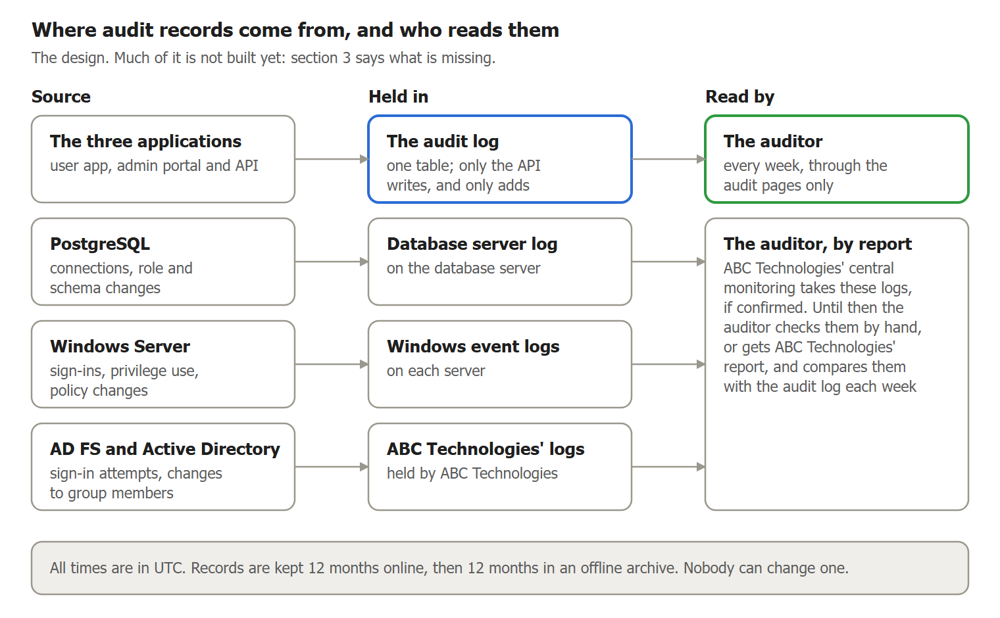

# \<System Name\> Audit and Accountability Management

## 1 Purpose

This document sets out how \<System Name\> is designed and configured to meet the 16 Audit and Accountability (AU) controls and enhancements in the CSS Moderate baseline.

Section 3 is the design: where audit records come from, which events are logged and why, what a record holds, how records are stored and protected, time, retention and capacity, review, analysis and reporting, failures and alerts, the application logs, what \<Organisation\> provides, and the policy and procedures. Each subsection names the controls it helps to meet. The design follows the good practice in CSS.

## 2 Related documents

Who provides and is responsible for each control, and its status, are in \<System Security Plan\>, section 7.3 (Table 12). The tests, their results and the records an assessor will ask for are in \<Control Assessment Record\> (AU). Each control's risk is in \<Risk List\>, and what is still open is in \<Plan of Action and Milestones\>. The policy is in \<Policy\> (AU), and the steps people follow are in \<Procedures\> (AU) and \<Security Operating Procedures\>, section 4.2.

## 3 The audit design

### 3.1 Principles

Controls met here: AU-2, AU-3, AU-6, AU-9, AU-11, AU-12.

1. **Complete.** The agreed events are recorded every time they occur.
2. **Attributable.** Each record shows what happened, when, where, from where, the outcome and who was involved. The person is the one PingFederate authenticated.
3. **Protected.** Nobody can change a record, and nobody deletes one except to remove it from the database once it is archived (section 3.7). Only auditors read them, with two exceptions: the last sign-in report (FR-085), which shows the security officer each member's username and last sign-in date, and nothing else; and the database administrator, who reaches the table only to archive it.
4. **Reviewed.** Records are examined every week (P-08) by someone who does not administer the system.
5. **Retained.** Records are kept for 12 months online and 12 months in an offline archive (P-07): long enough to investigate an incident found late.
6. **No secrets.** Records never hold a password, key, token or authentication cookie, and hold only the personal data an investigation needs.
7. **One audit log.** \<System Name\> has one application audit log, written only by the API. Any other log that repeats its content is protected as audit information.

These carry out the principles and rules of \<Policy\>, sections AU.3 and AU.4.

### 3.2 Where audit records come from

Controls met here: AU-2, AU-12.

An investigation must be able to follow an action from the network to the database. So records come from six sources. \<System Name\>'s team controls the first three. \<Organisation\> controls the rest, as part of its corporate configuration.

**Figure 1: Where audit records come from, and who reads them**

**Table 1: Sources of audit records**

| Source | Events to log | Held in | Set by |
| --- | --- | --- | --- |
| UI application, Admin application and API | The events in Table 2 | The audit log: the audit table in the \<System Name\> database on SQL Server 2022 | The system owner, in Table 2; built by \<System Name\>'s developers through a release |
| The three applications' own logs | Errors, start-up and shut-down, and logging failures; and the short security events in section 3.10, for the events that raise an alert, each read or export of the audit log, a failed chain check and the daily copy of the newest chain hash | Log files on the application server, kept 30 days and forwarded to \<Organisation\>'s central logging | \<System Name\>'s developers |
| SQL Server 2022 | Successful and failed logins; changes to logins, roles and permissions; changes to the database structure; any change to or deletion of audit records; changes to the audit settings; any read of the item tables by a login other than the API's, which the auditor reviews weekly through central logging | SQL Server Audit files and the SQL Server error log on the database server, forwarded to \<Organisation\>'s central logging | Database administrator |
| Windows Server 2025, both servers | Sign-ins and failed sign-ins (events 4624, 4625); account and group changes (4720, 4722 to 4726, 4728, 4732, 4756); use of special privileges (4672); audit policy changes (4719); security log cleared (1102); services installed (7045); system time changed (4616) | The Windows Security and System logs on each server, forwarded to \<Organisation\>'s central logging | \<Organisation\>'s Group Policy. \<System Name\> states the events it needs (EV-AU-04) |
| PingFederate and Active Directory | Every sign-in attempt, failed sign-in, lockout and second-factor result for \<System Name\>; every change to an account; every change to the members of \<System Name\>'s groups | \<Organisation\>'s own logs | \<Organisation\> |
| \<Organisation\>'s network services | Firewall and VPN events, and the time service | \<Organisation\>'s central monitoring | \<Organisation\> |

Each source logs at every occurrence. The system owner selects the events for the sources \<System Name\> controls: the application events in Table 2 and the SQL Server settings in appendix A. Developers make application changes through a release, and the database administrator applies SQL Server changes through a recorded change. The Windows, PingFederate and Active Directory events are agreed with \<Organisation\> (section 3.11). The system owner reviews the list every 12 months (P-62) and on any change, and records the decision in \<Decision Register\> (PRO-AU-5).

### 3.3 Application events

Controls met here: AU-2, AU-12.

Table 2 lists every event type \<System Name\>'s applications log, the actions recorded under each, and what an investigator learns from it. That is the reason each is selected (AU-2, part d). Together they answer who signed in, what they saw or changed, what they were refused, who changed access or settings, and when nothing could be logged.

**Table 2: Application events logged**

| Event type | Actions recorded | What is covered | Why it is needed to investigate an incident |
| --- | --- | --- | --- |
| Sign-in | Sign-in accepted; sign-in response from PingFederate refused; Active Directory group lookup failed; account found disabled; system use notice accepted; signed out | Sign-ins and sign-outs. \<System Name\> records each sign-in it accepts, each sign-in response it refuses, each failed group lookup, each disabled account it refuses, and each use of Sign out (FR-084). Its session is the authentication cookie (\<System Description\>, section 7.3): an accepted sign-in starts it and Sign out ends it. The cookie's expiry after 8 hours is not logged, as nothing reaches the server when it lapses. Failed passwords, second factors and lockouts are recorded by PingFederate and Active Directory (Table 1) | Shows who entered the system and when they left, and any attempt to enter without the right |
| Schema and group administration | Schema created, changed, deactivated, reactivated or deleted; a schema's read or edit group changed; each with the reference of the change record the Data Owner approved | Changes to schemas and to the AD groups each schema uses (FR-058 to FR-060) | Shows who was given a route to information, by whom, and on whose approval. Changes to the members of a group are recorded by Active Directory (Table 1) |
| Access decision | Access to a page, function or schema refused | Denied access | Shows attempts to reach restricted information |
| Item access and export | Item viewed; file downloaded; schema searched; items exported, with the schema and the number of items; a list of results saved | Item views, downloads, searches and exports | Shows who saw which information |
| Data change | Item created; file uploaded; upload refused, with the reason, including malware found; item corrected; file replaced; item deleted, each with the old and new values | Creation, correction, replacement and deletion of items, and uploads refused (FR-034) | Shows who changed or removed a record about a person |
| Privileged function | Settings changed; diagnostics run; last sign-in report run | Use of privileged functions in the Admin application (\<Access Control Management\>, section 3.8) | Shows what each administrator, and the security officer, did with their extra rights (AC-6(9)) |
| Privacy and retention | Disposal approved; items disposed of; search across every schema run, with the request's reference number and not the person's name | Disposal under the retention schedule (FR-074) and the search for one person's items (FR-073) | Shows that items were disposed of, or found across schemas, only by the roles allowed and for a recorded reason |
| Configuration change | A security setting changed | Configuration changes | Shows changes to security settings |
| Audit | Audit log read or exported; chain check passed; chain check failed | Reading or exporting the audit log, and audit chain check results. Each of these is also written as a security event (section 3.10) | Shows who looked at audit records, which AU-9 protects, and any attempt to hide a change |
| System | Application started; application stopped | Start-up and shut-down of each application | Shows periods when nothing could be logged |
| Logging failure | An audit record could not be written | Logging failures. Written to the application log at the time, since the audit log could not take it, and to the audit log once logging is restored, with the period it covers | Shows periods without records |
| Fault report | A report of a faulty item created; a report's state changed | Reports of faulty items, and their corrective action | Shows who reported what, as these reports name items |

This table is the full list of event types and actions that \<System Name\>'s applications must be able to log (AU-2, part a). It is the design: a release may add to it only after the system owner has changed this table (PRO-AU-5). Application events are built into each release, so developers make any change to them through a release. A release is reviewed, tested and recorded, so nobody can switch an event off quietly.

\<System Name\> holds no passwords, so it logs no password change or reset. Those are recorded in Active Directory.

### 3.4 What a record holds

Controls met here: AU-3, AU-3(1), AU-3(3), AU-8, AU-9, AU-12.

Every application record has the same fields, in one record format, held in the shared library and filled in by the audit service in the API. Every event in sections 3.2 and 3.3 writes a record with this content. Table 3 shows which part of AU-3 each meets.

**Table 3: Audit record content**

| Field | Holds | Meets |
| --- | --- | --- |
| Event type, Action | What happened | AU-3, part a |
| Time | When, in UTC | AU-3, part b; AU-8 |
| Application | Which application raised the event | AU-3, part c |
| IP address, Browser | Where the person came from | AU-3, part d; AU-3(1) |
| Result | Success, failure or refused | AU-3, part e |
| Username, User ID | Who acted: the person PingFederate authenticated | AU-3, part f |
| Schema, Item | What was acted on | AU-3, part f; AU-3(1) |
| Details | Fixed-form free text for the event, built from fixed wording and identifiers | Supports investigation |
| Chain hash | A value calculated from the record and the one before it | AU-9 |

**Records from the servers.** SQL Server and Windows records must hold the same six kinds of content. Windows events do so by design. SQL Server Audit records carry the time, the login, the database, the client address and the result once the audit is set as appendix A sets out.

**Limits on content (rule R8; AU-3(3)).** A record never holds a password, key, token or cookie. It holds only the personal data an investigation needs: the named fields above. The free text holds no further personal data.

### 3.5 How records are stored and protected

Controls met here: AU-9, AU-9(4).

**Table 4: Where audit information is held, and who can reach it**

| Store | Written by | Read by | Changed or deleted by |
| --- | --- | --- | --- |
| The audit log | API only, through its database service account, which may add and read records, with update and delete denied. UI application and Admin application send their events to the API, which accepts them only from those two applications and never from a user's browser | The auditor group, through the Admin application's audit pages. The security officer sees only each member's username and last sign-in date, through the last sign-in report (FR-085). The database administrator can reach the table to archive it, under rule B12 | Nobody changes a record. The database administrator removes records only once they are archived (PRO-AU-4); SQL Server Audit records each removal, and the auditor checks it against TPL-8 |
| The offline archive, held at \[archive location, to be agreed with \<Organisation\> with its storage (EV-AU-03)\], encrypted, and off the database server | The database administrator, each month, for records older than 12 months | The auditor, on request to the system owner | Nobody, until 24 months; then only with the system owner's recorded approval |
| The newest chain hash, copied daily | The API, as a security event in its application log, forwarded to central logging | The auditor and security officer, in central logging | Nobody in \<System Name\>'s team: the copy in central logging is held by \<Organisation\> |
| Application logs | Each application's Windows service account | The Windows server administrators on the server; the auditor and the security officer in central logging | Removed from the server after 30 days; the copy in central logging is kept as \<Organisation\> sets |
| SQL Server Audit files and error log | SQL Server | The database administrator on the server; the auditor in central logging | Nobody. They are forwarded to central logging as they are written, and the copy there is the protected record. The database administrator may not change or delete the files, and stopping or changing the audit is itself recorded (appendix A) |
| Windows logs | Windows | The Windows server administrators; the auditor through \<Organisation\>'s report or monitoring | Clearing the log is itself logged (event 1102) |

**The chain hash.** Each record holds a hash of its own fields and the previous record's hash, so a changed or removed record breaks the chain. The design uses a keyed hash, HMAC-SHA-256, with the key held outside the database, readable only by the API's account (key K11 in \<System and Communications Protection Management\>, section 3.4). The time is hashed at the precision at which it is stored, so that a stored hash can be recomputed.

**Who holds the key.** The Windows server administrator generates K11 and places it in the key store. They hold no rights in SQL Server, and the database administrator never holds the key, so nobody who can change rows can also recompute the chain. Each record names the version of the key that hashed it. When K11 is changed, the retired version stays in the key store for checking only, for the retention period in P-07, so that older records, and archived ones, can still be checked.

**The daily copy.** Each day the API writes the number and hash of the newest record as a security event to its application log, which is forwarded to central logging. That copy is out of reach of the applications, the database and their administrators. Removing the newest records, or rebuilding the chain, no longer matches it.

**The chain check.** The API checks the chain every day and at each start-up, and the auditor or security officer can run it from the Admin application (PRO-AU-2, PRO-SI-6). It starts from the hash recorded when records were last archived (section 3.7). Each week the auditor also compares the daily copies in central logging with the audit log. A failed check is written to the audit log and as a security event, so central logging alerts the security officer and the auditor (detection use case U2), who preserve the evidence before anything is changed and raise an incident.

**Table 5: Who may manage audit logging**

| Function | Who | How it is limited |
| --- | --- | --- |
| Read and search audit records | Auditors | AD group \<Code\>\_Auditors, the only group that opens the audit pages. It is owned by the system owner, who alone adds members. An auditor holds no administration role (PRO-AU-6) |
| See each member's last sign-in date | Security officer | The last sign-in report (FR-085) in the Admin application, limited to the \<Code\>\_Security group. The API returns only the username and date, nothing else from the audit log, and audits each run |
| Change or delete an audit record | Nobody | The database account cannot; rule B12 forbids it. The only removal is of archived records (PRO-AU-4) |
| Hold the audit chain key | Windows server administrator | Generates K11 and places it in the key store; holds no rights in SQL Server |
| Select which application events and SQL Server settings are logged | System owner | Decided on the record; made by developers through a release, or applied by the database administrator through a recorded change (PRO-AU-5) |
| Apply SQL Server audit settings | Database administrator | Only as the system owner decided, through a recorded change (\<Configuration Management\>); SQL Server Audit records the change |
| Change the Windows audit policy | \<Organisation\> | Its Group Policy and change process |
| Archive records, and delete them after 24 months | Database administrator | Deletion only with the system owner's recorded approval (PRO-AU-4) |
| Run the chain check and receive its alerts | Auditor and security officer | PRO-AU-2 |

Administrators have none of these functions. They are the people whose actions the auditor reviews (\<Access Control Management\>, section 3.5). Rule B12 of \<Security Operating Procedures\> forbids anyone to alter, delete or disable audit records or logging.

### 3.6 Time

Controls met here: AU-6(3), AU-8.

1. Each record takes its time from the clock of the server that writes it. Every record's time is in UTC, to the nearest second or finer.
2. Each server takes its time from \<Organisation\>'s time service, \[Organisation time source\], and stays within 1 second of UTC (P-09).
3. Each month the Windows server administrator checks both servers, records the result on TPL-8, and reports any drift over 5 seconds to the security officer (PRO-AU-4).
4. A change to a server's clock is itself a Windows event (4616).

One time source across the applications, the servers, PingFederate and the network is what lets the auditor line records up from different stores (AU-6(3)).

CSS no longer asks for clock synchronisation under AU-8. In Revision 5 it moved to SC-45(1), which is not in the Moderate baseline. \<System Name\> keeps the rule of 1 second anyway, because the weekly comparison across stores depends on it.

### 3.7 Retention and capacity

Controls met here: AU-4, AU-11.

**Table 6: Retention**

| Information | Kept | Then |
| --- | --- | --- |
| Audit records | 12 months in the database (P-07) | Copied to the offline archive, with the archive's SHA-256 hash and the hash of the last record archived recorded on TPL-8, then removed from the database. The chain check starts from that hash |
| Archived audit records | A further 12 months, offline (P-07) | May be deleted, only with the system owner's recorded approval |
| Application logs | 30 days | Deleted |
| Records held as incident evidence | Until the incident is closed | As the incident record says (\<Incident Response Management\>) |
| Records under a legal hold: a claim, a tribunal, a regulator's enquiry or a person's request for their data | Until the legal adviser releases them | The legal adviser tells the system owner and the database administrator, who list the hold on TPL-8. Held records stay in the archive, even past 24 months, until the hold is released (PRO-AU-4) |
| Backup copies of the database, which include the audit log | As the backup schedule in P-15: 14 daily, 8 weekly and 12 monthly copies | Encrypted, and protected as audit information (\<Contingency Planning Management\>) |
| Windows, PingFederate and Active Directory logs | As \<Organisation\> sets; 12 months is expected | \<Organisation\>'s process (EV-AU-04, EV-AU-05) |

Storage is sized for the full 24 months when the servers are built, from the numbers in P-33: 12 months in the database, and the same again for the archive. The size is the number of records each day, \[records per day, to be measured\], times the average size of a record, \[bytes per record, to be measured\], times 365 days, plus half as much again for growth. Both figures are measured in the test environment before the request goes to \<Organisation\>, and again in the first month of use. A disk-space alert on the database server warns the database administrator before storage fills. The database administrator also checks free space and the size of the audit table each month, and asks for more before records are at risk (PRO-AU-4). The audit log is backed up with the database (\<Contingency Planning Management\>).

The periods are those of \<System Name\>'s retention schedule (\<System and Information Integrity Management\>, section 3.7, and \<PII Processing Management\>, section 3.7). The database administrator archives records each month, and applies the rules for incident evidence and legal holds (PRO-AU-4, PRO-AU-7).

### 3.8 Review, analysis and reporting

Controls met here: AU-6, AU-6(1), AU-6(3), AU-7, AU-7(1).

1. **Weekly review.** As P-08 sets, the auditor, the only role that reads the application audit log, reviews the records since the last review, following \<Security Operating Procedures\>, section 4.2, which lists the unusual activity to look for (PRO-AU-1; duty C3). The auditor judges what each finding could lead to. The auditor holds no administration role, so nobody reviews their own actions.
2. **Across stores.** The auditor compares the application records with the SQL Server and Windows logs and \<Organisation\>'s PingFederate and Active Directory records of sign-ins and group changes, lining them up by UTC time and username. This is done by hand, which is proportionate for one system.
3. **Against requests.** Every change to access is checked against its approved ServiceNow request (\<Access Control Management\>, section 3.13).
4. **Report.** Findings go to the security officer and system owner on TPL-8, with the date, the period covered, the reviewer and the result. Anything unexplained is raised as a security incident.
5. **More review when risk rises.** After an incident or new threat information, the system owner sets a more frequent or closer review (PRO-AU-1, step 5).
6. **A second look at the most powerful.** Each quarter the auditor reports the administrators' actions to the Head of Cyber, who checks them (PRO-AU-1, step 6; \<Security Operating Procedures\>, duty C16).
7. **A look at the auditor.** Each read or export of the audit log is also a security event in central logging. The security officer reviews these with the central logs each week, and reports anything unexplained to the Head of Cyber, so the auditor's own use of the log is reviewed by someone else.
8. **Automated support.** Two means join up review, analysis and reporting. The Admin application's audit page filters and summarises the records for the auditor. \<Organisation\>'s central logging, which receives the application, Windows and SQL Server logs, raises the alerts in the detection use cases U1 to U9 (\<System and Information Integrity Management\>, section 3.4), and the security officer reviews those logs as P-08 sets.
9. **Reports and exports.** The audit page, open only to the auditor group, filters the records and shows a summary. An export gives the auditor the filtered records as a file, for a report or an investigation. Records are always shown with their stored time.

**Table 7: Search and sort on the audit page**

| Field | Design |
| --- | --- |
| Date | Search and sort |
| Event type | Search and sort |
| Result | Search and sort |
| Username | Search and sort |
| Schema | Search and sort |
| Item | Search and sort |
| Export of the filtered records | Yes |

The page only reads. It cannot change a record or its order, and an export is a copy.

### 3.9 Failures and alerts

Controls met here: AU-5, AU-6(1), AU-9.

**Table 8: Alerts**

| Event | Alert to | Within | Then |
| --- | --- | --- | --- |
| A logging failure: an audit record cannot be written | Security officer, Windows server administrator, through central monitoring | 1 hour | \<System Name\> keeps running, so that a logging fault cannot stop the service. Logging is restored, and the period without records is recorded (PRO-AU-3) |
| A break in the audit chain, or other sign of tampering | Security officer, auditor, through central monitoring (U2) | At once | Evidence is preserved, and an incident is raised (PRO-AU-2) |
| A server clock more than 5 seconds from UTC | Security officer | At the monthly check | The Windows server administrator corrects it with \<Organisation\> |
| Audit storage running low | Database administrator | When the disk-space alert fires, and at the monthly check | More storage is raised before records are at risk (PRO-AU-4) |

The audit service reports a failed write to \<Organisation\>'s central monitoring, which raises the logging failure alert and does not depend on \<System Name\> itself being healthy.

\<System Name\> keeps running when logging fails, because staff must still be able to reach their items, a stop would let a logging fault take the whole service down, and the failure is alerted within 1 hour and the gap recorded. The Windows server and database administrators find the cause and restore logging. The security officer records the period with no records and tells the system owner. If records may be lost or changed, the evidence is preserved first (PRO-AU-3).

A full disk is a logging failure like any other: if the audit log cannot be written because storage has run out, the first alert in Table 8 applies. The CSS separate warning before storage fills, AU-5(1), is not in the Moderate baseline; the disk-space alert in section 3.7 gives one anyway.

Alerts are raised by the detection use cases in \<System and Information Integrity Management\>, section 3.4, of which U2 and U7 concern audit.

### 3.10 The application logs

Controls met here: AU-9, AU-11.

Each application also keeps its own log of errors, start-up and shut-down. The API also writes to it a short security event for each event that raises an alert (\<System and Information Integrity Management\>, section 3.4), each read or export of the audit log, each failed chain check, and once a day the newest chain hash. A security event holds the event type, the time, the username, the schema and a count, or the hash. It holds no item details and no other personal data. These rules apply to the application logs:

1. The application logs are audit information. On the server only the Windows server administrators may read them; the auditor and the security officer read them in central logging.
2. They are kept for 30 days and then deleted.
3. They are forwarded to \<Organisation\>'s central logging, and are not otherwise copied off the servers, except as incident evidence.
4. Each month the Windows server administrator checks who can read them and how old they are (PRO-AU-7).

### 3.11 What \<Organisation\> provides

Controls met here: AU-2, AU-4, AU-5, AU-6, AU-6(1), AU-6(3), AU-8, AU-11, AU-12.

\<Organisation\> sets these as part of its corporate configuration. The \<System Name\> team has no control over them. \<System Name\> states what it relies on, and asks for the evidence.

**Table 9: Provided by \<Organisation\>**

| Provided | Controls | What \<System Name\> relies on | Evidence asked |
| --- | --- | --- | --- |
| Central logging and monitoring | AU-6(1), AU-6(3), AU-5 | It takes the application, Windows and SQL Server logs, and \<System Name\>'s alerts, and tells the security officer | EV-AU-01 |
| Time service | AU-8 | Both servers stay within 1 second of UTC | EV-AU-02 |
| Storage and backup | AU-4, AU-11 | Room for 12 months of records online, backed up daily, and somewhere to hold the offline archive | EV-AU-03 |
| Windows audit policy | AU-2, AU-12 | The Windows events in Table 1 are logged on both servers and kept | EV-AU-04 |
| PingFederate and Active Directory audit | AU-2, AU-6, AU-6(3), AU-12 | Every sign-in attempt for \<System Name\>, and every change to \<System Name\>'s groups and their members, is recorded, kept for at least 12 months, and sent to \<System Name\>'s auditor as a weekly report, by \[route to be agreed with \<Organisation\>\]. Read access for the auditor would also meet this | EV-AU-05 |

The system owner agrees two things with \<Organisation\>'s security contact, and records them: which logs \<Organisation\>'s monitoring needs from \<System Name\> and its servers; and which of \<Organisation\>'s own records, of PingFederate, Active Directory, the network and the VPN, \<System Name\>'s auditor receives. The five requests, EV-AU-01 to EV-AU-05, are sent together, and central monitoring is settled with \<Organisation\>'s security contact before the servers are built.

### 3.12 Policy and procedures

Controls met here: AU-1.

\<Policy\> (AU) and \<Procedures\> (AU) meet AU-1. Who they are shared with is in \<Policy\>, section AU.6. Their ownership, approval, review and records follow the rules common to every policy in \<Policy\>, section 1.1.

## Appendix A Server logging settings

These are the settings for SQL Server 2022 on the database server, so that it logs the events in Table 1 with the content AU-3 requires. They are the design. The database administrator applies them at build and records any value that has to differ, with the reason. The Windows audit policy is \<Organisation\>'s Group Policy, and its settings are asked for under EV-AU-04.

**Table 10: SQL Server logging settings**

| Setting | Value | What it gives |
| --- | --- | --- |
| Server audit (SQL Server Audit) | On, writing to files on the database server | Audit files on the database server, forwarded to \<Organisation\>'s central logging |
| Login auditing | Successful and failed logins | Every login, by the API's managed service account or a named administrator, and every refused one |
| Server audit specification | Login, logout, server role member, server permission, server principal and audit change groups | Every change to a login, role or permission, and every change to the audit itself |
| Database audit specification on the \<System Name\> database | Database role member, database permission, database principal and schema object change groups; SELECT, INSERT, UPDATE and DELETE on the database by public, which covers every item schema, including any created later (FR-058), and the audit table | Every change to a table, role or permission; every read or change of items by any login; and every change to or deletion of audit records |
| Server audit filter | Leaves out only the reads and writes of the API's managed service account on the item and schema tables, and its reads and inserts on the audit table. Everything else is kept | Every read of the item tables by a login other than the API's, which the auditor reviews weekly (R-AC-01), without the API's own work, which the audit log already records |
| Record content | Event time, login name, database, client address, application name and result, which SQL Server Audit holds on every record | The content AU-3 requires |
| Time | UTC, as SQL Server Audit records it | Times that line up with the audit log |
| On audit failure | Continue, and report the failure to central monitoring | \<System Name\> keeps running, as section 3.9 sets out, and the failure is alerted |
| Audit file permissions | Written by the SQL Server service account; readable by the database administrator; changed or deleted by nobody. The auditor reads the copies in central logging | Protection as audit information (AU-9) |
| Audit file retention on the server | \[to be set at build\], then forwarded or archived | Kept as the Windows logs are |

Changing any of these is itself a change to logging: it is made through a recorded change (\<Configuration Management\>), and SQL Server Audit records the change.

## Appendix B Logging that other controls require

The CSS guidance on AU-2 points out that other controls ask for particular events to be logged. Table 11 shows where each of those in the Moderate baseline is met.

**Table 11: Logging required by other controls**

| Control | What it asks to be logged | Met by |
| --- | --- | --- |
| AC-2(4) Automated Audit Actions | Creating, changing, enabling, disabling and removing accounts | Active Directory, for accounts and group members (EV-AU-05). \<System Name\>'s audit log, for schemas and the groups each uses |
| AC-6(9) Log Use of Privileged Functions | Each use of a privileged function | The privileged functions row of Table 2 |
| AC-17(1) Monitoring and Control | Remote access sessions | \<Organisation\>'s VPN and gateway logs (EV-AC-08 to EV-AC-11) |
| CM-3, CM-5 Change Control and Access Restrictions | Changes to the system, and who made them | The change record in ServiceNow; Windows events for installed services and policy changes; SQL Server Audit records of changes to the database structure |
| MA-4 Nonlocal Maintenance | Remote maintenance sessions | Windows sign-in events on the servers; \<Organisation\>'s record of the administration route |
| PE-3 Physical Access Control | Entry to the rooms that hold the servers | \<Organisation\>'s physical access logs, inherited (\<Physical and Environmental Protection Management\>) |
| SI-4 System Monitoring | Events that show an attack or misuse | The detection use cases U1 to U9 (\<System and Information Integrity Management\>, section 3.4) |
| PM-21 Accounting of Disclosures | Disclosures of personal data | The export and download records of Table 2 |
