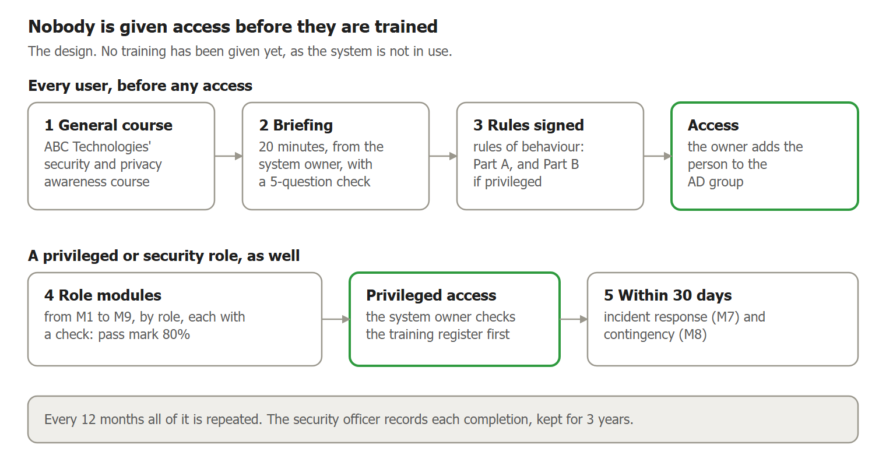

# \<DocuView\> Awareness and Training Management

**\<ref\> | Version \<ver\> | Draft for the system owner's approval**

**Contents**

[1 Document control](#1-document-control)

[2 Purpose](#2-purpose)

[3 Summary](#3-summary)

[4 The training programme](#4-the-training-programme)

[5 Each control and enhancement](#5-each-control-and-enhancement)

[Appendix A Parameter register](#appendix-a-parameter-register)

| **SECTION 1** |
| --- |

## 1 Document control

### 1.1 Document details

**Table 1: Document details**

| Item | Detail |
| --- | --- |
| Reference | \<ref\> |
| Title | \<DocuView\> Awareness and Training Management |
| Version | \<ver\> |
| Status | Draft for the system owner's approval |
| Date | 12 November 2026 |
| Owner | System owner |
| Applies to | Awareness and Training family |
| Classification | Restricted |
| Next review | Every 12 months, and after a significant incident, exercise or change |
| Format | \<Documentation Map\>, section 5 |

### 1.2 Approval

**Table 2: Approval**

| Role | Name | Decision | Date |
| --- | --- | --- | --- |
| System owner | Neil Ramsbottom | Pending | Pending |

### 1.3 Change history

**Table 3: Change history**

| Version | Date | Change |
| --- | --- | --- |
| \<ver\> | 12 November 2026 | Cross-check against NIST's guidance for the family: the status table states what is missing for each control and where it is registered (PA-96 to PA-100); privacy training (M9) goes to every administrator, as policy rule R5 requires; the briefing covers the forms of social engineering, social mining and NIST's insider threat signs, with a view for line managers; the audience table matches the matrix; and the roles with no role modules are stated as a gap |
| \<ver\> | 12 November 2026 | The system owner's answers to the review (D-AT-10): every privileged user is trained for the role, so the system owner joins the training matrix and register; the briefing gains part B7 for line managers; and the live register moves to the records store when that exists |
| \<ver\> | 12 November 2026 | Issued with the set: no change to the content |
| \<ver\> | 12 November 2026 | First draft, at the system owner's request (D-AT-09). The awareness and training chapter of \<Control Implementation Register\> moved here in full, so that the training design is held only in this document, and each control is set out part by part. The wording follows sign-in through AD FS (D-AC-23). No value is changed |

| **SECTION 2** |
| --- |

## 2 Purpose

This document shows how security and privacy awareness and training are designed for \<DocuView\>, for each of the 6 Awareness and Training (AT) controls and enhancements in the NIST SP 800-53 Rev 5 Moderate baseline. It is \<DocuView\>'s learning programme plan in the sense of NIST SP 800-50 Rev 1, and follows that publication's cycle: plan the programme, write the content, give the training, then measure and improve it (sections 4.7 and 4.9). Section 4 sets out the programme: who needs what, the briefing, the role curriculum, the training matrix, the register and the measures. Section 5 takes each control in turn. Appendix A lists every value NIST asks the organisation to define.

This is the only place the training design is held. Other documents point here. The policy is in \<Policy\> (AT), and the steps people follow are in \<Procedures\> (AT).

An assessor examines the curriculum, the materials and the training records, and interviews the people who give and receive the training (NIST SP 800-53A). So for each control section 5 gives:

- **each part of the control**, as NIST letters them, with the design that meets it and the position today;
- **who provides it**, and who is responsible;
- **what enforces it**, the rules and procedures that apply, and any test;
- **the records an assessor will ask for**, and whether they exist yet;
- **its status**, the risk decision, and what is still open.

Training is carried out by people, not by the system, so nothing here is built into \<DocuView\>. No training has yet been given, because \<DocuView\> is not in use and no one has been given access.

**Table 4: Status values**

| Status | Meaning |
| --- | --- |
| Implemented | The design is in place and working |
| Partially implemented | Some of the design is in place; the open items say what is missing |
| Not implemented | None of the design is in place yet |

| **SECTION 3** |
| --- |

## 3 Summary

**Table 5: Status of each control**

| Control | Title | Status | What is missing | Registered as |
| --- | --- | --- | --- | --- |
| AT-1 | Policy and Procedures | Partially implemented | The policy awaits the Head of Cyber's re-approval. The policy and procedures are not yet shared with the people they apply to | NC-AT-01; PA-20 |
| AT-2 | Literacy Training and Awareness | Not implemented | The briefing material and its check are not written. Nobody has been briefed. The quarterly security note has not started. ABC Technologies' course has not been seen | NC-AT-02; PA-96, PA-99; EV-AT-01 |
| AT-2(2) | Insider Threat | Not implemented | Briefing part B4 is an outline only, and is not given. ABC Technologies' content has not been seen | NC-AT-03; PA-96, PA-99; EV-AT-01 |
| AT-2(3) | Social Engineering and Mining | Not implemented | Briefing part B3 is an outline only, and is not given. ABC Technologies' content has not been seen | NC-AT-04; PA-96, PA-99; EV-AT-01 |
| AT-3 | Role-based Training | Not implemented | None of the nine modules is written, and nobody is trained. The training of ABC Technologies' own server administrators is not evidenced. The Head of Cyber, legal adviser and authorising official have no role training (section 4.5) | NC-AT-05; PA-97, PA-99, PA-100; EV-AT-01 |
| AT-4 | Training Records | Not implemented | No training record exists. The register is a layout only, and the records store is not set up | NC-AT-06; PA-98 |

Three training controls outside this family rest on the same curriculum, and are assessed in their own families: privacy training, AT-3(5) (module M9; NC-PT-08, PA-97); incident response training, IR-2 (module M7; NC-IR-02, PA-81); and contingency training, CP-3 (module M8; NC-CP-06, PA-81).

The programme is fully defined, and no control in the family is missing from it. What remains is writing the briefing and module content, giving the training, starting the records, and ABC Technologies' evidence of its own course. Every gap above is registered in the Risk List (\<Risk List\>) and the Plan of Action and Milestones (\<Plan of Action and Milestones\>).

| **SECTION 4** |
| --- |

## 4 The training programme

### 4.1 Principles

1. **Trained before access.** Nobody is given access to \<DocuView\> until they have completed awareness training, the \<DocuView\> briefing and the rules of behaviour.
2. **Every privileged user is trained for the role.** Anyone who is not a standard user completes the modules for their role before the access is given. That includes the system owner, who authorises privileged roles and manages the role groups (D-AT-10).
3. **Repeated every 12 months.** All training is repeated yearly, and after a significant incident or change.
4. **Kept current.** Content is reviewed every 12 months, and each lesson from an incident or exercise is added within 30 days.
5. **Checked and recorded.** Every module ends with a check, and every completion is recorded and kept for 3 years.
6. **No blame.** Reporting is thanked, never blamed. No phishing simulation is run without the agreement of HR and the legal adviser.

Figure 1 shows the path a person follows.

**Figure 1: Training before and after access**

### 4.2 Who needs what

**Table 6: What each audience needs to know and do**

| Audience | Main risk they can cause or stop | Behaviours needed | Met by |
| --- | --- | --- | --- |
| All users | Disclosing an HR document to the wrong person; falling for a request that looks genuine | Check who is asking; export only when needed; report anything odd at once | ABC Technologies' course; the \<DocuView\> briefing |
| Project access approvers and the system owner | Granting access no one needs | Authorise least access; add and remove group members correctly; review access when due | Modules M2, M9, M7; M8 for the system owner |
| Line managers | Approving a request the person does not need; missing the signs of an insider threat in their team | Confirm the need before approving; report movers and leavers at once; raise a concern early | The \<DocuView\> briefing, part B7 |
| Global administrator and administrator | Misusing powerful accounts; weak account changes | Use privileged accounts only for privileged work; follow the joiner, mover and leaver steps | Modules M1, M3, M9, M7, M8 |
| Windows server and database administrators | Unpatched or misconfigured servers; lost backups or keys | Follow the patch timetable, hardening and backup steps; protect keys | Modules M4, M3, M9, M7, M8 |
| Developers | Vulnerable code or components; secrets in code | Secure coding; checked components; changes reviewed | Modules M5, M3, M7 |
| Security officer and auditor | Missing an attack or a misuse | Review logs and alerts; respond to incidents | Modules M6, M7; M8 and M9 for the security officer |
| Everyone who handles HR documents | Using personal data unlawfully | Use it only for its purpose; handle requests and complaints properly | Module M9 |

### 4.3 Awareness and the \<DocuView\> briefing

Awareness has two parts: ABC Technologies' general security and privacy course, and the \<DocuView\> briefing. The system owner gives this 20-minute briefing to every user before they are given access, together with the signature of \<Security Operating Procedures\>. It ends with a 5-question check, which the person must pass in full; a wrong answer is talked through and asked again. The briefing material and the check are not yet written (PA-96).

**Table 7: Briefing outline**

| Part | Content |
| --- | --- |
| B1 What \<DocuView\> holds | Restricted HR documents; who may see what; why projects and roles matter |
| B2 Handling and export | When export is allowed; never forwarding or storing copies outside \<DocuView\>; locking the screen |
| B3 Social engineering and social mining | The forms an attempt takes: phishing and targeted phishing, a false story or false identity (pretexting and impersonation), a reply inside a genuine email thread, bait such as a free download or a found USB stick, an offer of help in return for access, a contact through social media, and following someone through a door. Scenario: an email or call asking for an employee's file "for a tribunal" from someone you don't know. Scenario: an emailed sign-in link that looks like \<DocuView\>. Social mining: people gather facts about ABC Technologies, its staff and \<DocuView\> from social media, job adverts, out-of-office replies and casual calls, to make a later request convincing. Do not say what \<DocuView\> holds, who uses it or how it is reached. Check with the person through a known route, and report it |
| B4 Insider threat | Scenario: a colleague exporting many files before leaving. Signs to notice, as NIST lists them: long-lasting and strong dissatisfaction with the job; trying to reach information the person does not need for their work; unexplained access to money; bullying or harassment of colleagues; violence at work; and other serious breaches of policy or rules. Seeing a sign is a reason to report through the route in B5, not to accuse. Access is recorded and monitored, as the SyOps explains |
| B5 Reporting | How to report a suspicious message, a mistake or a lost device; reporting is thanked, never blamed |
| B6 Privacy | Using personal data only for its purpose; where the privacy notice is |
| B7 For line managers | Every access request from your people comes to you first. Approve it only if the person needs it for their work. Tell the group's owner at once when someone moves or leaves. The insider threat signs in B4 show first to a manager: raise a concern early with the security officer or HR |

Between courses, awareness is kept up by the system use notice shown before sign-in, ABC Technologies' security messages, and a \<DocuView\> security note each quarter.

### 4.4 Role curriculum

Each module ends with a short check of at least 10 questions, with a pass mark of 80%. Anyone below it repeats the module. The security officer writes the content, and the Head of Cyber delivers the modules for the security officer and auditor.

**Table 8: Role modules**

| Module | Learning outcomes | Built on | Length | Delivered by |
| --- | --- | --- | --- | --- |
| M1 Privileged access | Use privileged accounts only for privileged tasks; manage projects, the groups each uses, and sessions safely; recognise misuse | \<Procedures\> (AC); \<Security Operating Procedures\>, Part B | 60 minutes | Security officer |
| M2 Approving access | Authorise least access; add and remove members of an AD group correctly; carry out access reviews | \<Procedures\>, PRO-AC-1, PRO-AC-5 to PRO-AC-7; \<Access Control Management\>, section 4.13 | 30 minutes | Security officer |
| M3 Configuration and change | Make changes only through change control; keep to the baseline | \<Procedures\> (CM); \<Configuration Management Plan\> | 45 minutes | Security officer |
| M4 Servers and database | Harden, patch to the timetable, scan, back up and protect keys | \<Procedures\>, PRO-SI-1; \<Control Implementation Register\>, section RA.3; \<Procedures\> (CP); \<Control Implementation Register\> (SC) | 90 minutes | Security officer |
| M5 Secure development | Secure coding to ASVS 5.0 Level 2; bring components in through PRO-SR-1; keep secrets out of code; review changes | \<Control Implementation Register\> (SA); \<Procedures\> (SA); \<Procedures\> (SR) | 90 minutes | Security officer |
| M6 Monitoring and audit review | Review audit records and alerts; use the detection use cases | \<Control Implementation Register\> (AU); \<Control Implementation Register\>, section SI.5 | 60 minutes | Head of Cyber |
| M7 Incident response (IR-2) | Recognise, report, contain and record an incident; know your part in the playbooks | \<Incident Response Plan\>; \<Procedures\> (IR) | 60 minutes | Security officer |
| M8 Contingency (CP-3) | Know your part in recovery; restore from backup | \<Contingency Plan\>; \<Procedures\> (CP) | 45 minutes | System owner |
| M9 Personal data (AT-3(5)) | Lawful use of HR data; requests and complaints; breaches | \<Control Implementation Register\> (PT); \<Procedures\> (PT) | 45 minutes | Legal adviser |

### 4.5 Training matrix

Every role must complete awareness, the briefing and the SyOps signature before access. Role modules come before privileged access; M7 and M8 within 30 days of taking the role. All are repeated every 12 months.

**Table 9: Training matrix**

| Role | Awareness and briefing | SyOps | Role modules | Within 30 days |
| --- | --- | --- | --- | --- |
| All users | Yes | Part A | None | None |
| System owner | Yes | Parts A and B | M2, M9 | M7, M8 |
| Project access approver | Yes | Part A | M2, M9 | M7 |
| Global administrator | Yes | Parts A and B | M1, M3, M9 | M7, M8 |
| Administrator | Yes | Parts A and B | M1, M3, M9 | M7, M8 |
| Windows server administrator | Yes | Parts A and B | M4, M3, M9 | M7, M8 |
| Database administrator | Yes | Parts A and B | M4, M3, M9 | M7, M8 |
| Developers | Yes | Parts A and B | M5, M3 | M7 |
| Security officer | Yes | Parts A and B | M6, M9 | M7, M8 |
| Auditor | Yes | Parts A and B | M6 | M7 |
| Everyone who handles HR documents | Yes | Part A | M9 | None |

The matrix carries out AT-2, AT-3, AT-3(5) (\<Control Implementation Register\> (PT)), IR-2 (\<Procedures\>, PRO-IR-3), CP-3 (\<Procedures\>, PRO-CP-4) and PL-4 (\<Security Operating Procedures\>).

**Roles with no role modules.** Role training is for privileged users, meaning everyone who is not a standard user (D-AT-10). The Head of Cyber, the legal adviser and the authorising official have no access to \<DocuView\>, so they are not in the matrix, although each has a security or privacy duty: approving the policy, delivering modules M6 and M9, and deciding risk. NIST's guidance on AT-3 names senior security and privacy officers, authorising officials and system owners among those who may need role training. The system owner is in the matrix. For the other three, the design relies on ABC Technologies' own training and their professional standing, and neither is evidenced. This is registered as a gap (PA-100).

### 4.6 When training happens

**Table 10: Training timetable**

| When | What | Who checks |
| --- | --- | --- |
| Before any access | ABC Technologies' course, the \<DocuView\> briefing and its check, and the signature of \<Security Operating Procedures\> | The security officer records it; the group's owner adds no one before it is recorded |
| Before privileged access | The role modules in the matrix, each with its check | The system owner checks the training register before authorising the role |
| Within 30 days of taking a role | Incident response (M7) and contingency (M8) | Security officer |
| Every 12 months | All of the above, repeated | Security officer, who asks each person |
| After a significant incident, exercise or change | The updated briefing or module, for those it affects | Security officer |
| More than 30 days overdue | Privileged access is suspended until the training is complete | System owner |

### 4.7 Keeping content current

1. Every 12 months, the security officer reviews the briefing and each module against the curriculum, recent incidents, exercise reports and changes.
2. After a significant incident, exercise or change, the lesson is added within 30 days.
3. The legal adviser reviews the privacy content.
4. Each change is recorded, and the content version goes up. Each training record names the version given.

The steps are in \<Procedures\>, PRO-AT-3.

### 4.8 Training register

The security officer keeps this register from the TPL-9 records. The system owner checks it before authorising a role. Records are kept for 3 years. NIST leaves the period to the organisation, and 3 years lets an assessor see each person's last three yearly completions. Each record (TPL-9) names the person, the role, the training and its content version, the date, the result of the check and who gave it. The layout stays here. Once the records store is set up, the live register, with its names and dates, is kept there (D-AT-10).

**Table 11: Training register**

| Person | Role | Awareness and briefing | Role modules | Within 30 days | Next due | State now |
| --- | --- | --- | --- | --- | --- | --- |
| Talha Chris | Global administrator | \[date\] | \[dates\] | \[dates\] | \[date\] | Not started |
| Alan Craig | Administrator | \[date\] | \[dates\] | \[dates\] | \[date\] | Not started |
| Jake Howard | Windows server administrator | \[date\] | \[dates\] | \[dates\] | \[date\] | Not started |
| Richard McCaron | Database administrator | \[date\] | \[dates\] | \[dates\] | \[date\] | Not started |
| Lee Martin, Ryan Giggs, Joe Allen | Developers | \[dates\] | \[dates\] | \[dates\] | \[date\] | Not started |
| James Preston | Security officer | \[date\] | \[dates\] | \[dates\] | \[date\] | Not started |
| Terry Hard | Auditor | \[date\] | \[dates\] | \[dates\] | \[date\] | Not started |
| Neil Ramsbottom | System owner | \[date\] | \[dates\] | \[dates\] | \[date\] | Not started |
| Tony Tilley | Project access approver | \[date\] | \[dates\] | \[dates\] | \[date\] | Not started |

### 4.9 Measures

The security officer reports these monthly with the continuous monitoring measures on TPL-8 (PRO-AT-5).

**Table 12: Training measures**

| Measure | Target | Today |
| --- | --- | --- |
| People trained before access | 100% | No one trained; \<DocuView\> not in use |
| First-attempt pass rate on checks | 90% | No checks yet |
| People overdue for a refresher | 0 | None due |
| Suspicious messages reported each month | Rising; reports, not clicks, are counted | No reports yet |
| Content reviewed within 12 months and after each significant incident | 100% | Reviewed 12 November 2026 |

| **SECTION 5** |
| --- |

## 5 Each control and enhancement

The controls are in NIST order. Each has two tables. The first takes each part of the control and gives what NIST requires, the design that meets it, and the position today. The second says who provides and is responsible for the control, what enforces it, the rules and procedures that apply, the records an assessor will ask for, its status, the risk decision, and what is still open.

### 5.1 AT-1 Policy and Procedures

**Table 13: AT-1 design**

| Part | NIST requires | Design | Today |
| --- | --- | --- | --- |
| a.1 | An awareness and training policy, shared with defined people, covering purpose, scope, roles, responsibilities, management commitment, coordination and compliance, and consistent with the law | \<Policy\> (AT): a system-level policy. It is shared with everyone who uses or administers \<DocuView\>. The legal adviser reviews it | Legally reviewed on 12 November 2026. Awaits the Head of Cyber's re-approval (D-AT-07). Not yet shared |
| a.2 | Procedures that carry out the policy, shared with defined people | \<Procedures\> (AT): five procedures, PRO-AT-1 to PRO-AT-5, each naming who acts and the record. Shared with everyone who uses, administers or develops \<DocuView\> | Approved by the system owner. Not yet shared or walked through |
| b | A named official manages the policy and procedures | The system owner | Neil Ramsbottom is named in \<Roles and Responsibilities\> |
| c.1 | The policy is reviewed on a schedule and after set events | Every 12 months, and after a significant incident, audit finding or system change | Reviewed after the AT review of 12 November 2026. The first yearly review falls due in November 2027 |
| c.2 | The procedures are reviewed on a schedule and after set events | Every 12 months, and after a change to the steps | As the policy |

**Table 14: AT-1 responsibility and evidence**

| | |
| --- | --- |
| Provided by | People, following the procedures |
| Responsible | System owner, Head of Cyber |
| Enforced by | Not a system function. The documents are under version control, and each review is recorded in the change history |
| Rules and procedures | The whole policy (\<Policy\>, section AT.4); all five procedures (\<Procedures\> (AT)) |
| Tests | None: there is no system mechanism to test |
| Records an assessor will ask for | The policy and procedures with their approvals; proof they were shared; review records. The approvals exist in part; the rest do not yet |
| Status | Partially implemented |
| Risk decision | NC-AT-01, rated Low: approve |
| Open items | PA-20: share the policy and procedures. The Head of Cyber's re-approval of the policy (D-AT-07) |

### 5.2 AT-2 Literacy Training and Awareness

**Table 15: AT-2 design**

| Part | NIST requires | Design | Today |
| --- | --- | --- | --- |
| a.1 | Give security and privacy awareness training to every user, including managers and contractors, when they start and at a set frequency | Before anyone is given access, they complete ABC Technologies' security and privacy awareness course and the 20-minute \<DocuView\> briefing, which ends with a 5-question check (section 4.3). Both are repeated every 12 months. This covers every user, whatever their grade, and contractors | Nobody is trained yet, as \<DocuView\> is not in use. ABC Technologies' course has not been seen (EV-AT-01) |
| a.2 | Give it again when the system changes or after set events | After a significant incident or change, the briefing is updated and given again to those it affects (PRO-AT-3) | Not yet used |
| b | Use defined techniques to raise awareness | Four techniques: the \<DocuView\> briefing; the system use notice shown before sign-in; ABC Technologies' security messages; and a \<DocuView\> security note every quarter, written by the security officer from recent advisories and reports | The briefing is outlined but not yet given. The notice is not yet shown (PA-11). ABC Technologies' messages have not been seen |
| c | Update the content at a set frequency and after set events | The security officer reviews the briefing every 12 months, and within 30 days of a significant incident, exercise or change. Each change is recorded and the content version goes up (PRO-AT-3) | The outline was reviewed on 12 November 2026 |
| d | Build lessons from incidents and breaches into the content | The yearly review reads the incident records and exercise reports of the year, inside and outside ABC Technologies, and adds each lesson (PRO-AT-3) | Not yet used: no incident lesson has yet been added |

**Table 16: AT-2 responsibility and evidence**

| | |
| --- | --- |
| Provided by | Shared: ABC Technologies gives its general course; the system owner gives the \<DocuView\> briefing |
| Responsible | ABC Technologies, system owner |
| Enforced by | Not a system function. The system owner gives the briefing, and no one is added to a \<DocuView\> group until the security officer has recorded it (PRO-AC-1) |
| Rules and procedures | Policy rules R1, R2, R6 (\<Policy\>, section AT.4); PRO-AT-1, PRO-AT-3 (\<Procedures\> (AT)) |
| Tests | None: there is no system mechanism to test. Check L14 of the consistency test confirms that every operating role has its training in the matrix, and passes |
| Evidence asked of ABC Technologies | EV-AT-01 (\<Evidence Requests\>). Not yet sent |
| Records an assessor will ask for | The briefing outline and materials; ABC Technologies' course content; completion records for each user (TPL-9); the quarterly security notes. Only the outline exists |
| Status | Not implemented |
| Risk decision | NC-AT-02, rated Low: obtain evidence |
| Open items | PA-96: write the briefing material and its check, give the briefing to the first users, and start the quarterly note. PA-99: obtain ABC Technologies' course content and records (EV-AT-01) |

### 5.3 AT-2(2) Insider Threat

**Table 17: AT-2(2) design**

| Part | NIST requires | Design | Today |
| --- | --- | --- | --- |
| All | Train users to recognise and report signs of insider threat | Briefing part B4: a scenario of a colleague exporting many files before leaving; the signs to notice, as NIST lists them; that a sign is a reason to report and not to accuse; and that access is recorded and monitored. Part B5 says how to report. Part B7 gives line managers their own view, as NIST advises that this training can be tailored for managers. ABC Technologies' course is expected to cover the general case | The outline exists. Not yet given. ABC Technologies' content has not been seen (EV-AT-01) |

**Table 18: AT-2(2) responsibility and evidence**

| | |
| --- | --- |
| Provided by | Shared: ABC Technologies gives its general course; the system owner gives the \<DocuView\> briefing |
| Responsible | ABC Technologies, system owner |
| Enforced by | Not a system function |
| Rules and procedures | Policy rules R2 (\<Policy\>, section AT.4); PRO-AT-1 (\<Procedures\> (AT)) |
| Tests | None: there is no system mechanism to test |
| Evidence asked of ABC Technologies | EV-AT-01 (\<Evidence Requests\>). Not yet sent |
| Records an assessor will ask for | The briefing material for part B4; ABC Technologies' course content; completion records (TPL-9) |
| Status | Not implemented |
| Risk decision | NC-AT-03, rated Low: obtain evidence |
| Open items | PA-96: write and give briefing part B4. PA-99: obtain ABC Technologies' content (EV-AT-01) |

### 5.4 AT-2(3) Social Engineering and Mining

**Table 19: AT-2(3) design**

| Part | NIST requires | Design | Today |
| --- | --- | --- | --- |
| All | Train users to recognise and report social engineering and social mining | Briefing part B3: the forms an attempt takes, from phishing and pretexting to tailgating; how social mining gathers facts about ABC Technologies and \<DocuView\>, and what not to disclose; and two scenarios, a request for an employee's file from someone unknown, and an emailed sign-in link that looks like \<DocuView\>. Users check with the person through a known route, and report it. No phishing simulation is run unless HR and the legal adviser agree, and then nobody is penalised for clicking: reports are counted, not clicks | The outline exists. Not yet given. ABC Technologies' content has not been seen (EV-AT-01) |

**Table 20: AT-2(3) responsibility and evidence**

| | |
| --- | --- |
| Provided by | Shared: ABC Technologies gives its general course; the system owner gives the \<DocuView\> briefing |
| Responsible | ABC Technologies, system owner |
| Enforced by | Not a system function |
| Rules and procedures | Policy rules R2, R8 (\<Policy\>, section AT.4); PRO-AT-1 (\<Procedures\> (AT)) |
| Tests | None: there is no system mechanism to test |
| Evidence asked of ABC Technologies | EV-AT-01 (\<Evidence Requests\>). Not yet sent |
| Records an assessor will ask for | The briefing material for part B3; ABC Technologies' course content; completion records (TPL-9); any agreement to a phishing simulation |
| Status | Not implemented |
| Risk decision | NC-AT-04, rated Low: obtain evidence |
| Open items | PA-96: write and give briefing part B3. PA-99: obtain ABC Technologies' content (EV-AT-01) |

### 5.5 AT-3 Role-based Training

**Table 21: AT-3 design**

| Part | NIST requires | Design | Today |
| --- | --- | --- | --- |
| a.1 | Give role-based security and privacy training to people in defined roles, before they are given access or start their duties, and at a set frequency | The roles are those in the training matrix (section 4.5): every privileged user, meaning everyone who is not a standard user, including the system owner. Each completes its modules from the curriculum of nine, M1 to M9 (section 4.4), before privileged access is given. The incident response and contingency modules, M7 and M8, are completed within 30 days of taking the role. All are repeated every 12 months. Each module ends with a check of at least 10 questions, with a pass mark of 80%. Privacy training, M9, goes to administrators and to everyone who handles HR documents | The curriculum and the matrix are set. No module content is written yet, as the system owner confirmed on 12 November 2026, and nobody is trained |
| a.2 | Give it again when the system changes | After a significant change, the affected module is updated and given again to those it affects (PRO-AT-3) | Not yet used |
| b | Update the content at a set frequency and after set events | The security officer reviews each module every 12 months, and within 30 days of a significant incident, exercise or change. The legal adviser reviews the privacy content | The curriculum was set on 12 November 2026 |
| c | Build lessons from incidents and breaches into the content | As AT-2 part d: each lesson from the year's incidents and exercises is added to the module it concerns | Not yet used |

**Table 22: AT-3 responsibility and evidence**

| | |
| --- | --- |
| Provided by | People, following the procedures |
| Responsible | Security officer, Head of Cyber |
| Enforced by | Not a system function. The system owner checks the training register before authorising a privileged role, and adds nobody to a role group until its modules are complete (PRO-AC-6, PRO-AT-4) |
| Rules and procedures | Policy rules R4, R5, R6 (\<Policy\>, section AT.4); PRO-AT-2, PRO-AT-3 (\<Procedures\> (AT)) |
| Tests | None: there is no system mechanism to test. Check L14 of the consistency test confirms that every operating role has its training in the matrix, and passes |
| Evidence asked of ABC Technologies | EV-AT-01 (\<Evidence Requests\>). Not yet sent |
| Records an assessor will ask for | The curriculum and module materials; the checks and their results; completion records for each role holder (TPL-9); the training register. The curriculum and an empty register exist |
| Status | Not implemented |
| Risk decision | NC-AT-05, rated Low: approve |
| Open items | PA-97: the security officer writes the nine modules from the curriculum (PRO-AT-2), and each role holder completes theirs. PA-99: ABC Technologies evidences the training of its administrators of the servers (EV-AT-01). PA-100: evidence, or give, training for the Head of Cyber, legal adviser and authorising official |

### 5.6 AT-4 Training Records

**Table 23: AT-4 design**

| Part | NIST requires | Design | Today |
| --- | --- | --- | --- |
| a | Record and monitor training, both awareness and role-based | The security officer records each completion on TPL-9, with the content version, the check result and the next due date, and adds it to the training register (section 4.8). The measures in section 4.9 are reported every month. Anyone overdue is reminded, and privileged access is suspended after 30 days overdue (PRO-AT-5) | The register is set up, with every role holder named. No record exists yet |
| b | Keep each person's training records for a set time | 3 years. ABC Technologies keeps its own course records and provides them on request | No records yet |

**Table 24: AT-4 responsibility and evidence**

| | |
| --- | --- |
| Provided by | People, following the procedures |
| Responsible | Security officer |
| Enforced by | Not a system function. The register is kept by the security officer, in this document until the records store is set up |
| Rules and procedures | Policy rules R9 (\<Policy\>, section AT.4); PRO-AT-4 (\<Procedures\> (AT)) |
| Tests | None: there is no system mechanism to test |
| Evidence asked of ABC Technologies | EV-AT-01 (\<Evidence Requests\>). Not yet sent |
| Records an assessor will ask for | TPL-9 records; the training register; the monthly measures on TPL-8; ABC Technologies' course records (EV-AT-01). None exist yet |
| Status | Not implemented |
| Risk decision | NC-AT-06, rated Low: approve |
| Open items | PA-98: bring the TPL-9 record and the training register into use, in the records store, from the first briefing |

| **APPENDIX A** |
| --- |

## Appendix A Parameter register

These are NIST's organisation-defined values for the 6 AT entries: 21 in total. State now says how far each is in place on 12 November 2026. The values were agreed on 6 November 2026 and revised on 12 November 2026 (D-AT-P02).

**Table 25: AT parameter register**

| NIST identifier | What must be defined | Value | State now |
| --- | --- | --- | --- |
| AT-01\_ODP\[01\] | Who receives the policy | Everyone who uses or administers \<DocuView\> | Not yet shared |
| AT-01\_ODP\[02\] | Who receives the procedures | Everyone who uses, administers or develops \<DocuView\> | Not yet shared |
| AT-01\_ODP\[03\] | Level of the policy | System level | In place |
| AT-01\_ODP\[04\] | Official who manages them | System owner | In place |
| AT-01\_ODP\[05\] | Policy review frequency | Every 12 months | First review due November 2027 |
| AT-01\_ODP\[06\] | Events requiring policy review | Significant incident, audit finding or system change | Reviewed after the AT pack review, 12 November 2026 |
| AT-01\_ODP\[07\] | Procedures review frequency | Every 12 months | First review due November 2027 |
| AT-01\_ODP\[08\] | Events requiring procedures review | A change to the steps | Reviewed after the AT pack review, 12 November 2026 |
| AT-02\_ODP\[01\] | Security training frequency | Every 12 months | No one trained yet |
| AT-02\_ODP\[02\] | Privacy training frequency | Every 12 months | No one trained yet |
| AT-02\_ODP\[03\] | Events requiring security training | A significant incident or change | Not yet used |
| AT-02\_ODP\[04\] | Events requiring privacy training | A significant incident or change | Not yet used |
| AT-02\_ODP\[05\] | Awareness techniques | The \<DocuView\> briefing, the system use notice, ABC Technologies' security messages and a quarterly \<DocuView\> security note | Briefing outlined (section 4.3); not yet given; ABC Technologies' messages not seen (EV-AT-01) |
| AT-02\_ODP\[06\] | Content update frequency | Every 12 months | Content reviewed 12 November 2026 |
| AT-02\_ODP\[07\] | Events requiring content update | A significant incident, exercise or change | Not yet used |
| AT-03\_ODP\[01\] | Roles trained for security | The roles in the training matrix (section 4.5): system owner, global administrator, administrator, Windows server administrator, database administrator, developers, security officer, auditor and project access approvers | Curriculum set (section 4.4); module content not yet written |
| AT-03\_ODP\[02\] | Roles trained for privacy | The same roles, and everyone who handles HR documents (\<Control Implementation Register\> (PT), AT-3(5)) | Curriculum set; not yet given |
| AT-03\_ODP\[03\] | Training frequency | Every 12 months | No one trained yet |
| AT-03\_ODP\[04\] | Content update frequency | Every 12 months | Curriculum set 12 November 2026 |
| AT-03\_ODP\[05\] | Events requiring content update | A significant incident, exercise or change | Not yet used |
| AT-04\_ODP | How long records are kept | 3 years | Register set (section 4.8); no records yet |
