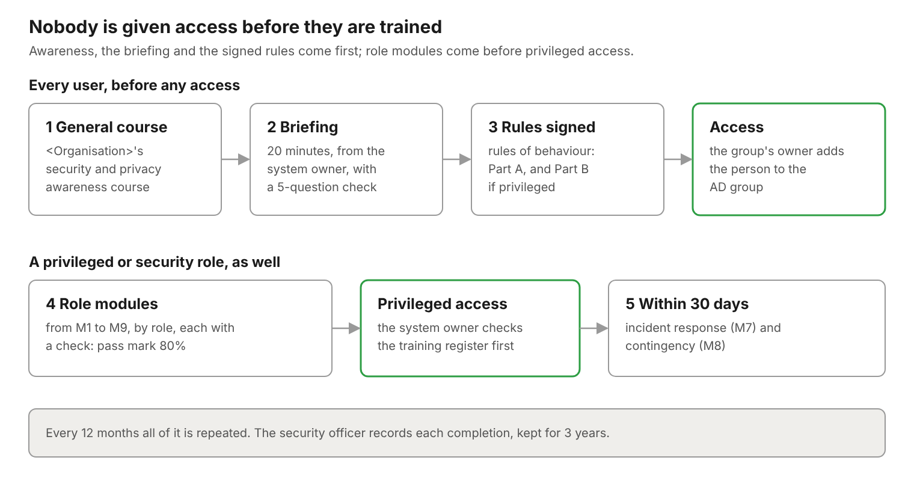

# \<System Name\> Awareness and Training Management

## 1 Purpose

This document sets out \<System Name\>'s security and privacy awareness and training programme, its learning programme plan in the sense of CSS, which meets the 6 Awareness and Training (AT) controls and enhancements in the CSS Moderate baseline.

Section 3 is the design: who needs what, the awareness briefing, the role curriculum, the training matrix and timetable, keeping content current, the training register, the measures, and the policy and procedures. It follows the CSS cycle: plan the programme, write the content, give the training, then measure and improve it (sections 3.7 and 3.9). Each subsection names the controls it helps to meet.

Training is carried out by people, not by the system, so nothing here is built into \<System Name\>.

## 2 Related documents

Who provides and is responsible for each control, and its status, are in \<System Security Plan\>, section 7.2 (Table 11). The tests, their results and the records an assessor will ask for are in \<Control Assessment Record\> (AT). Each control's risk is in \<Risk List\>, and what is still open is in \<Plan of Action and Milestones\>. The policy is in \<Policy\> (AT), and the steps people follow are in \<Procedures\> (AT).

## 3 The training programme

### 3.1 Principles

Controls met here: AT-2, AT-2(3), AT-3, AT-4.

1. **Trained before access.** Nobody is given access to \<System Name\> until they have completed awareness training, the \<System Name\> briefing and the rules of behaviour.
2. **Every privileged user is trained for the role.** Anyone who is not a standard user completes the modules for their role before the access is given. That includes the system owner, who authorises privileged roles and manages the role groups.
3. **Repeated every 12 months.** All training is repeated yearly, and after a significant incident or change.
4. **Kept current.** Content is reviewed every 12 months, and each lesson from an incident or exercise is added within 30 days.
5. **Checked and recorded.** Every module ends with a check, and every completion is recorded and kept for 3 years.
6. **No blame.** Reporting is thanked, never blamed. No phishing simulation is run without the agreement of HR and the legal adviser, and then nobody is penalised for clicking: reports are counted, not clicks.

Figure 1 shows the path a person follows.

**Figure 1: Training before and after access**

### 3.2 Who needs what

Controls met here: AT-2, AT-3.

**Table 1: What each audience needs to know and do**

| Audience | Main risk they can cause or stop | Behaviours needed | Met by |
| --- | --- | --- | --- |
| All users | Disclosing an item to the wrong person; falling for a request that looks genuine | Check who is asking; export only when needed; report anything odd at once | \<Organisation\>'s course; the \<System Name\> briefing |
| Data Owners and the system owner | Granting access no one needs | Authorise least access in ServiceNow; add and remove group members correctly; review access when due | Modules M2, M9, M7; M8 for the system owner |
| Line managers | Approving a request the person does not need; missing the signs of an insider threat in their team | Confirm the need before approving; report movers and leavers at once; raise a concern early | The \<System Name\> briefing, part B7, given on its own before their first approval if they are not \<System Name\> users |
| Administrators | Misusing the power to change which groups open a schema; careless changes to schemas, their groups or settings | Use the administrator role only for administration; change a schema's groups only with its Data Owner's approval in a change record; follow the joiner, mover and leaver steps | Modules M1, M3, M9, M7, M8 |
| Windows server and database administrators | Unpatched or misconfigured servers; lost backups or keys | Follow the patch timetable, hardening and backup steps; protect keys | Modules M4, M3, M9, M7, M8 |
| Developers | Vulnerable code or components; secrets in code | Secure coding; checked components; changes reviewed | Modules M5, M3, M7 |
| Security officer and auditor | Missing an attack or a misuse | The auditor reviews the audit log weekly and reports anything suspicious to the security officer; the security officer reviews alerts and the central logs, does not read the audit log, and leads incident response | Modules M6, M7, M9; M8 for the security officer |
| Business owners | Approving the disposal of items that should be kept, or keeping items too long | Approve disposal only of items due under the retention schedule (\<System Description\>, FR-074) | The \<System Name\> briefing; module M9 |
| Legal adviser's delegate | Searching or disclosing more than a request needs | Search every schema only for the one person named in a request under data protection law (\<System Description\>, FR-073), and handle the results as the legal adviser directs | Module M9 |
| Everyone who handles personal data in \<System Name\> | Using personal data unlawfully; missing or not reporting a breach | Use it only for its purpose; report a breach within 1 hour; pass requests about a person's data to the legal adviser | The \<System Name\> briefing, part B6 |
| Legal adviser | Deciding late or wrongly whether to report a breach to the ICO and the people affected | Know their part in the incident playbooks and the breach steps, and the 72-hour limit | Module M7 |
| Authorising official | Making a risk decision in an incident or recovery without knowing what it rests on | Know when they will be called, the decisions that are theirs, and the information each needs | Module M10 |
| Information owner | Rating information too low, or letting personal data into a schema that should not hold it | Categorise information correctly; decide what personal data each schema holds | The \<System Name\> briefing; module M9 |

### 3.3 Awareness and the \<System Name\> briefing

Controls met here: AT-2, AT-2(2), AT-2(3).

Awareness has two parts: \<Organisation\>'s general security and privacy course, and the \<System Name\> briefing. \<Organisation\>'s course is expected to cover the general case, including insider threat and social engineering. The system owner gives this 25-minute briefing to every user, whatever their grade, including managers and contractors, before they are given access, together with the signature of \<Security Operating Procedures\>. It ends with a 5-question check, which the person must pass in full; a wrong answer is talked through and asked again.

**Table 2: Briefing outline**

| Part | Content |
| --- | --- |
| B1 What \<System Name\> holds | The items in its schemas, marked \<Classification\>; who may see what; why schemas, their read and edit groups, and roles matter |
| B2 Handling and export | When export is allowed; never forwarding or storing copies outside \<System Name\>; locking the screen |
| B3 Social engineering and social mining | The forms an attempt takes: phishing and targeted phishing, a false story or false identity (pretexting and impersonation), a reply inside a genuine email thread, bait such as a free download or a found USB stick, an offer of help in return for access, a contact through social media, and following someone through a door. Scenario: an email or call asking for an item "for a tribunal" from someone you don't know. Scenario: an emailed sign-in link that looks like \<System Name\>. Social mining: people gather facts about \<Organisation\>, its staff and \<System Name\> from social media, job adverts, out-of-office replies and casual calls, to make a later request convincing. Do not say what \<System Name\> holds, who uses it or how it is reached. Check with the person through a known route, and report it |
| B4 Insider threat | Scenario: a colleague exporting many files before leaving. Signs to notice, as CSS lists them: long-lasting and strong dissatisfaction with the job; trying to reach information the person does not need for their work; unexplained access to money; bullying or harassment of colleagues; violence at work; and other serious breaches of policy or rules. Seeing a sign is a reason to report through the route in B5, not to accuse. Access is recorded and monitored, as the SyOps explains |
| B5 Reporting | How to report a suspicious message, a mistake or a lost device; reporting is thanked, never blamed |
| B6 Privacy | The privacy training for every user (AT-3(5)), about 10 minutes. Which schemas hold personal data, and special category data; using it only for the purpose the schema states, and never exporting or copying it outside \<System Name\> without need; recognising a personal data breach, such as an item sent to the wrong person or a lost export, and reporting it to the security officer within 1 hour (\<System Description\>, P-21); passing any request from a person about their data to the legal adviser, without answering it yourself; and where the privacy notice is. The check includes a question on reporting a breach |
| B7 For line managers | Every access request from your people is raised in ServiceNow. Support it only if the person needs it for their work; the schema's Data Owner authorises it. Tell the group's owner at once when someone moves or leaves. The insider threat signs in B4 show first to a manager: raise a concern early with the security officer or HR |

Between courses, awareness is kept up by the system use notice shown at sign-in, \<Organisation\>'s security messages, and a \<System Name\> security note each quarter, written by the security officer from recent advisories and reports.

### 3.4 Role curriculum

Controls met here: AT-3.

Each module ends with a short check of at least 10 questions, with a pass mark of 80%. Anyone below it repeats the module. The security officer writes the content, and Table 3 names who delivers each module. Nobody delivers training to themselves: the Head of Cyber delivers M7 to the security officer, and the security officer gives the system owner the briefing and M8.

**Table 3: Role modules**

| Module | Learning outcomes | Built on | Length | Delivered by |
| --- | --- | --- | --- | --- |
| M1 Privileged access | Use the administrator role only for administration; manage schemas, the read and edit group of each, and system settings safely; recognise misuse | \<Procedures\> (AC); \<Security Operating Procedures\>, Part B | 60 minutes | Security officer |
| M2 Approving access | Authorise least access in the ServiceNow workflow; add and remove members of an Active Directory group correctly; carry out access reviews | \<Procedures\>, PRO-AC-1, PRO-AC-5 to PRO-AC-7; \<Access Control Management\>, section 3.13 | 30 minutes | Security officer |
| M3 Configuration and change | Make changes only through change control; keep to the baseline | \<Procedures\> (CM); \<Configuration Management\> | 45 minutes | Security officer |
| M4 Servers and database | Harden, patch to the timetable, scan, back up and protect keys | \<Procedures\>, PRO-SI-1; \<Risk Assessment Management\>, section 3.6; \<Procedures\> (CP); \<System and Communications Protection Management\> | 90 minutes | Security officer |
| M5 Secure development | Secure coding to ASVS 5.0 Level 2; bring components in through PRO-SR-1; keep secrets out of code; review changes | \<System and Services Acquisition Management\>; \<Procedures\> (SA); \<Procedures\> (SR) | 90 minutes | Security officer |
| M6 Monitoring and audit review | Auditors: read and review the audit log weekly, compare it with the server, database, PingFederate and Active Directory records, record the review, and report anything suspicious to the security officer. Security officers: review the alerts and the central logs, and use the detection use cases; they do not read the audit log | \<Audit and Accountability Management\>; \<System and Information Integrity Management\>, section 3.4 | 60 minutes | Head of Cyber |
| M7 Incident response (IR-2) | Recognise, report, contain and record an incident; know your part in the playbooks | \<Incident Response Management\>; \<Procedures\> (IR) | 60 minutes | Security officer |
| M8 Contingency (CP-3) | Know your part in recovery; restore from backup | \<Contingency Planning Management\>; \<Procedures\> (CP) | 45 minutes | System owner |
| M9 Personal data (AT-3(5)), for the roles in Table 4 | Lawful use of personal data; requests and complaints; breaches | \<PII Processing Management\>; \<Procedures\> (PT) | 45 minutes | Legal adviser |
| M10 Risk decisions in incidents and recovery (IR-2, CP-3) | For the authorising official: when they are called in an incident or a recovery; the severity levels; the decisions that are theirs (running in a reduced state, going beyond the recovery time objective, the risk arising from an incident); and what each decision needs | \<Incident Response Management\>, sections 3.3 and 3.6; \<Contingency Planning Management\>, sections 3.4 and 3.5 | 20 minutes | Security officer |

### 3.5 Training matrix

Controls met here: AT-2, AT-3.

Every role with access must complete awareness, the briefing and signing \<Security Operating Procedures\> before access; roles without access take what their row sets. Role modules come before privileged access, or for developers before they first work on the code. M7, M8 and M10 are the incident response and contingency training of IR-2 and CP-3, and are taken within 30 days of taking the role, as those controls allow. The security officer, the system owner and their deputies take M7 and M8 before taking the role, because they lead the response and the recovery from the first day. All are repeated every 12 months.

**Table 4: Training matrix**

| Role | Awareness and briefing | \<Security Operating Procedures\> | Role modules | Within 30 days |
| --- | --- | --- | --- | --- |
| All users | Yes | Part A | None | None |
| System owner | Yes | Parts A and B | M2, M9 | M7, M8 |
| Data Owner | Yes | Part A | M2, M9 | M7 |
| Administrator | Yes | Parts A and B | M1, M3, M9 | M7, M8 |
| Windows server administrator | Yes | Parts A and B | M4, M3, M9 | M7, M8 |
| Database administrator | Yes | Parts A and B | M4, M3, M9 | M7, M8 |
| Developers | Yes | Part A; Part B only if given access to a live system, which the design does not allow | M5, M3 | M7 |
| Security officer | Yes | Parts A and B | M6, M9 | M7, M8 |
| Auditor | Yes | Parts A and B | M6, M9 | M7 |
| Business owner | Yes | Parts A and B | M9 | None |
| Legal adviser's delegate | Yes | Parts A and B | M9 | None |
| Information owner | Yes | Part A, if they are a \<System Name\> user | M9 | None |
| Legal adviser | \<Organisation\>'s course | None: no access | None (delivers M9) | M7 |
| Authorising official | \<Organisation\>'s course | None: no access | None | M10 |
| Line managers who are not \<System Name\> users | Briefing part B7 only, before their first approval | None: no access | None | None |

The matrix carries out AT-2, AT-3, AT-3(5) (\<PII Processing Management\>), IR-2 (\<Procedures\>, PRO-IR-3), CP-3 (\<Procedures\>, PRO-CP-4) and PL-4 (\<Security Operating Procedures\>).

**Privacy training.** Every user's privacy training is briefing part B6, given before access and every 12 months. Module M9 is for the roles that make decisions about personal data or can reach it across schemas or outside the application: the system owner, Data Owners, the information owner, administrators, Windows server and database administrators, the security officer, the auditor, the business owner and the legal adviser's delegate. Together they meet AT-3(5).

**Deputies.** A deputy holds the same training as the role they cover (\<Roles and Responsibilities\>, section 5), follows that role's row, and is in the register under it.

**Roles without access.** Role training is for everyone with a security or privacy duty for \<System Name\>, not only those with access to it. The CSS guidance on AT-3 names senior security and privacy officers, authorising officials and system owners among those who may need it. So the legal adviser, the authorising official, the information owner and line managers are in the matrix for the duties they hold, though most have no access: the legal adviser's part in incident response, the authorising official's risk decisions in an incident or a recovery, the information owner's categorisation, and the line manager's approval of access requests. Two roles stay out of the matrix and rely on \<Organisation\>'s own training, evidenced through EV-AT-02: the Head of Cyber, who approves the policies, delivers module M6 and reviews the administrators' group, and the data protection officer, who leads \<Organisation\>'s privacy programme.

### 3.6 When training happens

Controls met here: AT-2, AT-3, AT-4.

**Table 5: Training timetable**

| When | What | Who checks |
| --- | --- | --- |
| Before any access | \<Organisation\>'s course, the \<System Name\> briefing and its check, and the signature of \<Security Operating Procedures\> | The security officer records it; the group's owner adds no one before it is recorded |
| Before privileged access | The role modules in the matrix, each with its check, and Part B signed | The system owner checks the training register and the register of signatures: before authorising a role group (PRO-AC-6), and before asking \<Organisation\> for a Windows server or database administrator's access (PRO-AT-2) |
| Before a developer first works on \<System Name\> code | Modules M5 and M3 | The system owner, before the developer is given access to the code |
| Before a line manager's first approval of an access request | Briefing part B7, if they are not already a \<System Name\> user | Security officer, from ServiceNow's list of approvers |
| Within 30 days of taking a role | Incident response (M7), contingency (M8) and, for the authorising official, risk decisions (M10) | Security officer |
| Every 12 months | All of the above, repeated | Security officer, who asks each person |
| After a significant incident, exercise or change | The updated briefing or module, for those it affects | Security officer |
| More than 30 days overdue | Privileged access is suspended until the training is complete. A standard user is reminded each month and keeps access; that risk is R-AT-01 in \<Risk List\>, accepted by the system owner (D-AT-01) | System owner |

### 3.7 Keeping content current

Controls met here: AT-2, AT-3.

1. Every 12 months, the security officer reviews the briefing and each module against the curriculum and changes, and reads the incident records and exercise reports of the year, inside and outside \<Organisation\>, adding each lesson to the briefing or module it concerns.
2. After a significant incident, exercise or change, the lesson is added within 30 days.
3. The legal adviser reviews the privacy content.
4. Each change is recorded on TPL-6, citing the incident record or exercise report (TPL-11) the lesson came from, and the content version goes up. Each training record names the version given.

The steps are in \<Procedures\>, PRO-AT-3.

### 3.8 Training register

Controls met here: AT-4.

The security officer keeps this register from the TPL-9 records. The system owner checks it before authorising a role. Records are kept for 3 years. CSS leaves the period to the organisation, and 3 years lets an assessor see each person's last three yearly completions. Each record (TPL-9) names the person, the role, the training and its content version, the date, the result of the check, who gave it and the next due date. \<Organisation\> keeps its own course records and provides them on request. The layout stays here. Once the records store is set up, the live register, with its names and dates, is kept there.

**Table 6: Training register**

| Person | Role | Awareness and briefing | Role modules | Within 30 days | Next due |
| --- | --- | --- | --- | --- | --- |
| \[Name\] | Administrator | \[date\] | \[dates\] | \[dates\] | \[date\] |
| \[Name\] | Windows server administrator | \[date\] | \[dates\] | \[dates\] | \[date\] |
| \[Name\] | Database administrator | \[date\] | \[dates\] | \[dates\] | \[date\] |
| \[Name\], \[Name\], \[Name\] | Developers | \[dates\] | \[dates\] | \[dates\] | \[date\] |
| \[Name\] | Security officer | \[date\] | \[dates\] | \[dates\] | \[date\] |
| \[Name\] | Auditor | \[date\] | \[dates\] | \[dates\] | \[date\] |
| \[Name\] | System owner | \[date\] | \[dates\] | \[dates\] | \[date\] |
| \[Name\] | Data Owner | \[date\] | \[dates\] | \[dates\] | \[date\] |
| \[Name\] | Business owner | \[date\] | \[dates\] | None | \[date\] |
| \[Name\] | Legal adviser's delegate | \[date\] | \[dates\] | None | \[date\] |
| \[Name\] | Information owner | \[date\] | \[dates\] | None | \[date\] |
| \[Name\] | Legal adviser | \[date\] | None | \[dates\] | \[date\] |
| \[Name\] | Authorising official | \[date\] | None | \[dates\] | \[date\] |
| \[Names\] | Line managers | \[dates\] | None | None | \[date\] |
| \[Name\] | Deputies, each under the role they cover | \[date\] | \[dates\] | \[dates\] | \[date\] |

### 3.9 Measures

Controls met here: AT-4.

The security officer reports these monthly with the continuous monitoring measures on TPL-8 (PRO-AT-5), and the system owner reviews them (\<Policy\>, section AT.6). Anyone overdue is reminded, and privileged access is suspended after 30 days overdue (Table 5).

**Table 7: Training measures**

| Measure | Target |
| --- | --- |
| People trained before access | 100% |
| First-attempt pass rate on checks | 90% |
| People overdue for a refresher | 0 |
| Suspicious messages reported each month | Rising; reports, not clicks, are counted |
| Content reviewed within 12 months and after each significant incident | 100% |

### 3.10 Parameters

Controls met here: AT-2, AT-3, AT-4.

The values CSS asks the organisation to define for AT are \<System Description\> parameters. This document is written to them, and \<Decision Register\> records their approval.

**Table 8: AT parameters**

| CSS parameter | Value | Parameter |
| --- | --- | --- |
| AT-02\_ODP\[01\], \[02\]: how often literacy training is given | Before access, then every 12 months | P-24 |
| AT-02\_ODP\[03\], \[04\]: events that require literacy training | A significant change, a significant incident, or an exercise that changes a role's steps | P-56 |
| AT-02\_ODP\[05\]: awareness techniques | The system use notice, \<Organisation\>'s security messages and the quarterly security note | P-57 |
| AT-02\_ODP\[06\], \[07\]; AT-03\_ODP\[04\], \[05\]: when content is updated | Every 12 months, and within 30 days of a significant incident, exercise or significant change | P-58 |
| AT-03\_ODP\[01\], \[02\]; AT-03(05)\_ODP\[01\]: who takes role-based and privacy training | The roles in Table 4 | P-59 |
| AT-03\_ODP\[03\]; AT-03(05)\_ODP\[02\]: how often role training is repeated | Every 12 months | P-24 |
| AT-04\_ODP: how long records are kept | 3 years | P-60 |

### 3.11 Policy and procedures

Controls met here: AT-1.

\<Policy\> (AT) and \<Procedures\> (AT) meet AT-1. Who they are shared with is in \<Policy\>, section AT.6. Their ownership, approval, review and records follow the rules common to every policy in \<Policy\>, section 1.1.

