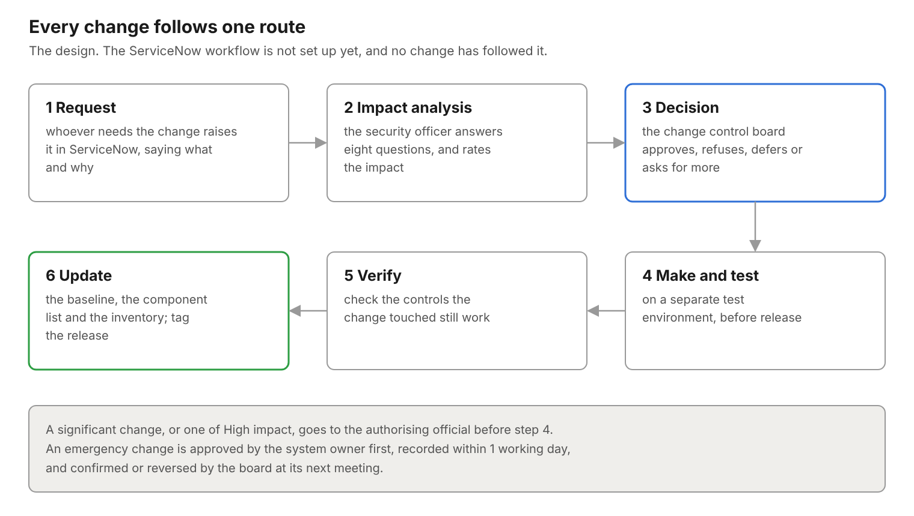

# \<System Name\> Configuration Management

## 1 Purpose

This document sets out how \<System Name\>'s configuration is recorded, controlled and changed to meet the 24 Configuration Management (CM) controls and enhancements in the CSS Moderate baseline.

Section 3 is the design: roles and processes, the configuration items, the baseline, the software components and licences, the secure settings, change control and the change control board, impact analysis, least functionality, who may change what, the inventory and where information is held, the library, what \<Organisation\> provides, approved software, devices for travel, and the policy, procedures and this plan. Each subsection names the controls it helps to meet. This document is also the Configuration Management Plan that CM-9 requires, and follows the outline in CSS, Appendix D. Appendix A sets out the development, test and production environments, and Appendix B lists the CM controls CSS does not select at Moderate.

Other documents hold the rest. Who provides and is responsible for each control, its status and its assessment result are in \<System Security Plan\>, section 7.5 (Table 14). The tests, their results and the records an assessor will ask for are in \<Control Assessment Record\> (CM). Each control's risk is in \<Risk List\>, and what is still open is in \<Plan of Action and Milestones\>. The policy is in \<Policy\> (CM), and the steps people follow are in \<Procedures\> (CM).

Values that CSS asks the organisation to define are set at corporate level by \<Organisation\>. The settings in section 3 should match those corporate values. Where one does not, it is changed in this document.

\<System Name\> is not yet built on its servers. Where section 3 notes the state now or "today", it means the tested v1.0 build, run in Docker, and the position of the servers, which are not yet built. Those notes show where that differs from the design.

## 2 Summary

The implementation status of each control, how it is met, who is responsible, its assessment result and the risk and plan entries for its gaps are recorded in \<System Security Plan\>, section 7.5 (Table 14).

## 3 The design

### 3.1 Principles

Controls met here: CM-2, CM-3, CM-6, CM-7, CM-8, CM-8(3).

1. **Known baseline.** The approved configuration is recorded and versioned, so that any release can be rebuilt exactly.
2. **Controlled change.** No change happens without an impact analysis, approval and testing.
3. **Least functionality.** Anything \<System Name\> does not need is turned off or left out.
4. **Accurate inventory.** Every component is recorded, and an unauthorised one is detected.
5. **Secure settings at every layer.** Windows Server, PostgreSQL, the hosting, the runtime and the applications each follow a named standard.
6. **Nothing drifts unseen.** The running system is compared with the baseline every month.

These carry out the principles and rules of \<Policy\>, sections CM.3 and CM.4.

### 3.2 Roles and processes

Controls met here: CM-3, CM-3(4), CM-9.

**Table 1: Configuration management roles**

| Role | Part in configuration management |
| --- | --- |
| System owner | Owns this plan; chairs the change control board; approves departures from the secure settings, licence decisions and requests to install software |
| Security officer | Analyses the impact of every change; member of the board; receives drift reports |
| Windows server administrator | Member of the board; applies and checks the servers' settings; installs releases; keeps the approved software list |
| Database administrator | Applies and checks the PostgreSQL settings |
| Developers | Make, test and release changes to the applications; keep the component list |
| Legal adviser | Privacy representative on the board, for any change that touches personal data |
| Authorising official | Decides on significant changes and High impact changes |
| \<Organisation\> | Provides the hosts, Group Policy, discovery tools and ServiceNow |

The holders are named in \<Roles and Responsibilities\>. The processes are the nine procedures of \<Procedures\> (CM).

**Identifying configuration items.** An item is identified when it enters the baseline, and is managed through the change procedure, PRO-CM-1, for its whole life. Each is named by its component and its version or tag, for example API v1.0 or Npgsql 10.0.2. Each release is named by its tag.

### 3.3 Configuration items

Controls met here: CM-3, CM-9.

**Table 2: Configuration items**

| Item | Held in | Controlled by |
| --- | --- | --- |
| Application code, API, UI application, Admin application, shared library | Git repositories, tagged v1.0 | Developers, PRO-CM-1 |
| Access-control toolkit (OfflineModules.AccessControl 0.2.0) | Its own repository, commit 20524d8 | Developers, PRO-CM-1 |
| Software components: packages, base images, runtime and database | Section 3.5 | Developers, PRO-CM-1 and PRO-CM-4 |
| Container and deployment files | workspace repository, tagged v1.0 | Developers, PRO-CM-1 |
| Application settings and environment values, without secrets | Settings files and deployment files; secrets outside the baseline once PA-19 is fixed | Developers, Windows server administrator |
| Windows Server 2025 and PostgreSQL settings | CIS Benchmarks and recorded exceptions; VMs not built | Windows server and database administrators |
| Security documents | Restricted document store | System owner |

### 3.4 Baseline

Controls met here: CM-2, CM-2(2), CM-2(3).

The baseline is what a release must contain so that it can be rebuilt exactly. The current baseline is v1.0. Checks C01 to C03 test it.

**Table 3: Baseline v1.0**

| Item | Baseline | State now |
| --- | --- | --- |
| Application code | Tag v1.0: API b82831a, UI application b06b4e1, Admin application 43ef895, shared library a8c3a3a | Met (C03) |
| Deployment files | workspace repository tag v1.0, commit 21018a6 | Met |
| Access-control toolkit | Commit 20524d8, packaged as 0.2.0 | Met |
| Application base images | mcr.microsoft.com/dotnet/aspnet:10.0 and sdk:10.0, to be pinned by digest; .NET runtime 10.0.14 observed in the tested build | Not met: floating tags (C01; PA-77) |
| Database image | postgres:18, to be pinned by digest; observed as PostgreSQL 18.6, digest sha256:3a4264520e12… | Not met: floating tag (C02; PA-77) |
| Software components | Section 3.5 | Met: listed by hand; no bill of materials yet (PA-78) |
| Settings | Section 3.6; settings files at tag v1.0, with secrets moved out (PA-19) | Partly: secrets still in settings files (C07) |
| Windows Server and PostgreSQL on the VMs | CIS Benchmarks with recorded exceptions | Not assessable: VMs not built (PA-54) |
| Network placement and connections | The two servers, their zones and the flows between them, as \<Security Architecture\> and \<Access Control Management\>, section 3.6.4, set out; the connections in \<Assessment, Authorization, and Monitoring Management\>, section 3.7 | Recorded as the design. Not built |

Three means keep the baseline current, complete and accurate: release tags in the source repositories; image versions pinned by digest; and the deployment files, which state the exact configuration. The build produces a bill of materials at each release.

The system owner and the Windows server administrator review the baseline every 12 months and at each release (PRO-CM-2). Step 6 of every change updates it (PRO-CM-1). The three previous configurations are kept, so that a release can be rolled back (section 3.13).

### 3.5 Software components and licences

Controls met here: CM-7(5), CM-8, CM-10.

Every package, image, runtime and database \<System Name\> is built from, with its licence. The check of the tested build wrote the same list, and the two matched (C04). A new component is recorded here, and checked for known vulnerabilities, before it enters the baseline (PRO-CM-4). Licences are checked again at each release and every 12 months (PRO-CM-9).

**Table 4: Software components**

| Component | Version | Supplier | Licence | Used by | Note |
| --- | --- | --- | --- | --- | --- |
| .NET and ASP.NET Core runtime (aspnet image) | 10.0, observed 10.0.14 | Microsoft | MIT | All three applications | Image to be pinned (PA-77) |
| .NET SDK image | \<ver\> | Microsoft | MIT | Build only | Image to be pinned (PA-77) |
| PostgreSQL (postgres image) | 18, observed 18.6 | PostgreSQL Global Development Group | PostgreSQL Licence | Database | Image to be pinned (PA-77) |
| Microsoft.AspNetCore.Authentication.JwtBearer | 10.0.5 | Microsoft | MIT | API |  |
| Microsoft.AspNetCore.Authorization | 10.0.5 | Microsoft | MIT | UI application |  |
| Microsoft.AspNetCore.Components.Authorization | 10.0.5 | Microsoft | MIT | UI application, Admin application |  |
| Microsoft.AspNetCore.OpenApi | 10.0.5 | Microsoft | MIT | API |  |
| Microsoft.EntityFrameworkCore | 10.0.5 | Microsoft | MIT | shared library, UI application |  |
| Microsoft.EntityFrameworkCore.Design and .Tools | 10.0.5 | Microsoft | MIT | API, UI application, Admin application | Design-time tools |
| Npgsql | 10.0.2 | Npgsql project | PostgreSQL Licence | shared library, UI application |  |
| Npgsql.EntityFrameworkCore.PostgreSQL | 10.0.1 | Npgsql project | PostgreSQL Licence | All three applications |  |
| OfflineModules.AccessControl (Accounts, AspNetCore, Sessions) | 0.2.0 | Access-control toolkit repository | \[owner and licence to confirm\] (PA-113) | shared library | Internal component |
| SixLabors.ImageSharp | 3.1.12 | Six Labors | Six Labors Split License 1.0, free community tier (D-CM-09) | API, UI application | Known advisories (PA-56) |
| SkiaSharp and SkiaSharp.NativeAssets.Linux.NoDependencies | 3.119.2 | Microsoft (.NET Foundation) | MIT | API, UI application |  |
| Swashbuckle.AspNetCore | 10.1.7 | Swashbuckle project | MIT | API | Development only; to leave release builds (PA-79) |
| Azure.Storage.Blobs | 12.27.0 | Microsoft | MIT | API | Not used; to be removed (PA-79) |

### 3.6 Secure settings for every layer

Controls met here: CM-6.

**Table 5: Secure settings**

| Layer | Guidance | Key settings | Where set | State now |
| --- | --- | --- | --- | --- |
| Windows Server 2025, both VMs | CIS Benchmark, Level 1 member server | Unneeded services and accounts removed, default passwords changed, auto-run off, Defender on, audit policy as \<Audit and Accountability Management\>, section 3.2 | Group policy and VM build | Not assessable: VMs not built (PA-54) |
| PostgreSQL 18 | CIS Benchmark for PostgreSQL | TLS required; scram-sha-256 passwords; listens only on the database VM's address; connections and changes logged | The server and client access settings of PostgreSQL | Not met in Docker: TLS off (B02), logging off (A30) |
| Application hosting | Microsoft's guidance for hosting ASP.NET Core as a Windows service | HTTPS only with HSTS, under NCSC's TLS profiles in \<System and Communications Protection Management\>, section 3.3; data protection key rings protected with DPAPI; each application under its own low-privilege account | Each service's configuration | Each application runs as a Windows service, under its own service account (D-PL-10, D-AC-19). Not built, as the servers are not built |
| .NET runtime | Microsoft ASP.NET Core security guidance | Production environment; detailed errors off; API documentation off | Environment values | Met in Docker (C08, C11) |
| Application security settings | \<Access Control Management\>, \<Identification and Authentication Management\> and \<System and Communications Protection Management\> | The authentication cookie's lifetime, no longer than PingFederate's sign-in lifetime, the PingFederate connection (OpenID Connect client), cookie flags, content security policy and allowed origins, at the values in those documents | Settings files at tag v1.0 | As assessed in the AC, IA and SC assessments |

The Windows server and database administrators apply the benchmarks when the servers are built, and the developers apply the hosting and application settings (PRO-CM-3). Each departure from the guidance is recorded on TPL-6 with a reason, and approved by the system owner (PRO-CM-3).

Each month the Windows server administrator scans both servers against the benchmarks, and the database administrator compares the PostgreSQL settings. Any difference is reported to the security officer, and is put back or raised as a change (PRO-CM-7). Some Windows settings are set by \<Organisation\>'s Group Policy as part of its corporate configuration: account lockout, the logon banner and the screen lock. \<System Name\> accepts the corporate standard for those (D-AC-21).

One fact is still to be supplied: \[who builds the two servers and to which standard\]. The Administrator Guide, \<Administrator Guide\>, has them built from \<Organisation\>'s hardened build and then brought to this baseline. If that is how they are built, \<Organisation\>'s build standard is asked for as evidence, and the CIS Benchmark scan shows what the build leaves to be done. Until that is known, the design stands as written: the CIS Benchmark, applied by the Windows server administrator. If \<Organisation\> builds them, its standard is asked for as evidence, compared with the benchmark, and any shortfall recorded as a departure.

### 3.7 Change control

Controls met here: CM-3, CM-3(2), CM-4, CM-4(2), CM-5, CM-8(1).

Every change to a configuration item in section 3.3 follows one route, including routine patches. Developers or administrators make the change through a release, and nothing else reaches the servers. Figure 1 shows the route.

**Figure 1: The route every change follows**

**Table 6: Steps of a change**

| Step | Who | What | Record |
| --- | --- | --- | --- |
| 1 Request | Whoever needs the change | States what is to change and why | A ServiceNow change, or TPL-6 until ServiceNow is set up |
| 2 Impact analysis | Security officer | Answers the questions in section 3.9, and rates the impact | On the change, with the rating |
| 3 Decision | Change control board | Approves, refuses, defers or asks for more. A significant or High impact change goes to the authorising official first | On the change, with the date and members present |
| 4 Make and test | Developers or administrators | Make the change, and test it on a separate test environment before release | Test result on the change |
| 5 Verify | Those who made it | Check that the controls named in the analysis still work | Result on the change |
| 6 Update | Those who made it | Update the baseline, the component list and the inventory; tag the release; record the pinned image versions; produce the bill of materials | This document; the release record |

**Testing.** Each change is tested on the separate test environment before release, with the security tests that apply, and the result is recorded on the change (PRO-CM-1, step 4). A release that fails a test does not go out.

**Who made each change.** The change record names who made it. The servers and the database record it independently: Windows logs each administrator sign-in, installed service and policy change, and PostgreSQL logs each change to a table, role or permission (\<Audit and Accountability Management\>, section 3.2). The monthly comparison with the baseline finds a change that has no record.

**Emergency changes.** An emergency change is allowed only to stop or limit an incident or an outage. The system owner, or their deputy, approves it by phone or in person before it is made. It is recorded within 1 working day, with the impact analysis done afterwards, and the board confirms or reverses it at its next meeting (PRO-CM-8).

**Today:** the ServiceNow workflow is not set up, and no change has followed this route. Changes so far are commits in the source repositories (PA-53).

### 3.8 Change control board charter

Controls met here: CM-3, CM-3(4).

This charter follows CSS, Appendix H.

**Table 7: Change control board charter**

| Item | Rule |
| --- | --- |
| Purpose | To consider every change to \<System Name\>'s configuration items, make sure its impact is analysed and tested, decide on it, and tell those affected |
| Members | The system owner (chair), the security officer and the Windows server administrator. The legal adviser joins for any change touching personal data, as privacy representative. The database administrator and developers attend when their work is affected |
| Quorum | The system owner, or their deputy, and the security officer |
| Meetings | Monthly, and whenever an urgent or security change needs a decision sooner. Each meeting reviews the month's changes, emergency changes and drift reports |
| Inputs | A change request on TPL-6 or in ServiceNow, with its impact analysis (section 3.9) and test plan |
| Decisions | Approve, refuse, defer, or ask for more analysis. Each decision is recorded on the change with the date and the members present |
| Conflicts | Nobody approves a change they requested or made |
| Significant changes | Referred to the authorising official before they are made (\<Assessment, Authorization, and Monitoring Management\>, section 3.9) |
| Emergency changes | Made under PRO-CM-8 and reviewed at the next meeting |
| Records | Kept for 3 years (CM-03\_ODP\[01\]) |

### 3.9 Security impact analysis

Controls met here: CM-4.

The security officer answers each question on the change before the board decides. This follows CSS, Appendix I.

**Table 8: Impact analysis criteria**

| Question | What to check |
| --- | --- |
| What changes? | The configuration items in section 3.3 and the components in section 3.5 affected |
| Which controls are affected? | The families touched, for example access, sign-in, audit, encryption, boundary or backup, and the procedures that rely on them |
| Does it touch personal data? | If so, the legal adviser joins the decision |
| Does it add or change a connection or component? | Connections need \<Assessment, Authorization, and Monitoring Management\>, section 3.7; components need section 3.5 and a vulnerability check on TPL-7 |
| Is it a significant change? | The test in \<Assessment, Authorization, and Monitoring Management\>, section 3.9 |
| How will it be tested? | The test scripts in the test scripts folder that apply, on a separate stack, and what proves the affected controls still work |
| How is it undone? | The back-out plan |
| What must be updated? | This plan, \<System Security Plan\> and any family document the change affects |

The security officer rates the impact Low, Medium or High. A High impact needs the authorising official's agreement as well as the board's.

### 3.10 Least functionality

Controls met here: CM-7, CM-7(1).

\<System Name\> is configured to do four things: store, search and show documents, and administer them. Table 9 lists what is prohibited or restricted.

**Table 9: What is prohibited or restricted**

| Kind | Prohibited or restricted | Today |
| --- | --- | --- |
| Functions | Diagnostic, test and maintenance pages in production; the API documentation page outside development | The documentation page is off (B06). Diagnostic, test and maintenance pages remain (PA-07, PA-31) |
| Ports | Everything except HTTPS to the applications, the database from the application server only, and administration from \<Organisation\>'s network. The flows \<System Name\> asks \<Organisation\> to allow are in \<Access Control Management\>, section 3.6.4 | The database is reachable only locally in the test environment (C09). The servers are not built |
| Protocols | Everything except TLS-protected ones on those routes | Plain HTTP in the test environment (PA-18) |
| Software | Anything not on the approved software list, and any package the applications do not use | An unused package and a development-only package are in the release (C05, C06; PA-79). Each image holds a shell and a package manager (PA-85) |
| Services | Any Windows service not needed for those four things | Not assessable: the servers are not built |

The Windows server administrator and the developers review all five every 12 months, and record the result on TPL-3 (PRO-CM-5). Anything not needed is removed through a change.

### 3.11 Who may change what

Controls met here: CM-5.

**Table 10: Access restrictions for change**

| What | Who may change it | How it is limited |
| --- | --- | --- |
| The applications | Developers, each change reviewed by a second developer | Permissions and required reviews in the source repositories (PA-91) |
| What runs on the application server | The named Windows server administrators, installing an approved release | Windows permissions: only they can write to each application's program folder, and no application can change its own files (\<Access Control Management\>, section 3.6.3) |
| Windows settings | The named Windows server administrators; \<Organisation\>, through Group Policy | Named administrator accounts; \<Organisation\>'s change process |
| PostgreSQL settings and structure | The named database administrators. The API's database account cannot create, alter or drop tables | Database permissions (\<Access Control Management\>, section 3.6) |
| Application settings and secrets | The named Windows server administrators | Windows permissions on the settings files; secrets in the key store (PA-19) |
| The hosts, network and firewall | \<Organisation\> | Its physical and logical controls, and its change process (EV-CM-01) |
| This document set | The system owner | The restricted document store, under version control (PA-88) |

Nobody approves a change they requested or made. Every change by any of these people follows the route in section 3.7.

### 3.12 Inventory and where information is held

Controls met here: CM-8, CM-8(1), CM-8(3), CM-12, CM-12(1).

**Inventory.** Two lists make up the inventory, and no component is in both. The servers and the other components of the system are in \<System Security Plan\>, section 3.4. The software components are in section 3.5. Each entry gives the name, type, version, location and owner, and for software also the supplier and licence. Both are updated as step 6 of every change, and a change is not closed until they are. A bill of materials from each build checks the software list.

**Unauthorised components.** \<Organisation\>'s discovery tools check its network, including both servers, every month. When one finds an unauthorised component, it alerts the Windows server administrator, who removes the component or disables its network access, tells the security officer, and records it on TPL-8 (PRO-CM-6).

**Where information is held.** Documents and audit records are in PostgreSQL on the database server, each project in its own schema. The application server holds only working files: export output for up to 24 hours, each application's key ring, and logs. Backups go to \<Organisation\>'s backup site. \<System Security Plan\>, sections 3.4 and 4.4, hold the record. A change of location is a change to the baseline, and a new site is a significant change. Each is recorded on the change and in \<System Security Plan\>.

**Finding information.** Restricted documents are held by project in the database, so the database itself lists them. For anything outside it, \<Organisation\>'s tools are to scan both servers for stray copies, if it has such tools.

**Who has access to it.** The approved access list names the members of each of \<System Name\>'s AD groups, the Windows server and database administrators, and \<Organisation\>'s staff with access to the hosts and backups. The first list is made before any production documents are held (D-AC-14).

### 3.13 Library, tools, monitoring and retention

Controls met here: CM-2(3), CM-3, CM-6.

**Table 11: Library, tools, monitoring and retention**

| Item | Detail |
| --- | --- |
| Configuration library | Git repositories for code and deployment files; an image registry holding images by digest, \[registry to be chosen when the VMs are built\]; the restricted document store for documents; release records with their bill of materials |
| Tools | Git and its tags; Docker; ServiceNow for changes (PA-53); CIS-CAT or an equivalent scanner (PA-80); Test-ConfigurationManagement.ps1; \<Organisation\>'s discovery tools (EV-CM-02) |
| Monitoring | Monthly drift check under PRO-CM-7, reported on TPL-8 to the security officer, and included in the monthly measures in \<Assessment, Authorization, and Monitoring Management\>, section 3.8 |
| Retention | Change records for 3 years; the 3 previous configurations, each with tag, digests, settings and bill of materials; superseded documents for 3 years |
| Disposal | Removed configurations are deleted from the library only after their retention period, with the system owner's approval |

### 3.14 What \<Organisation\> provides

Controls met here: CM-3, CM-5, CM-6, CM-8(3), CM-10, CM-12(1).

**Table 12: Asked of \<Organisation\>**

| Provided | Controls | What \<System Name\> relies on | Evidence asked | State |
| --- | --- | --- | --- | --- |
| Physical and logical limits on changing the hosts | CM-5 | Only authorised \<Organisation\> staff can change the hosts and hosting, through its change process | EV-CM-01 | Not sent |
| Tools that detect unauthorised components, and that locate information | CM-8(3), CM-12(1) | Both servers are checked every month, and the Windows server administrator is alerted | EV-CM-02 | Not sent |
| Licences for the software on the servers and hosting, and controls on peer-to-peer software | CM-10 | Windows Server and the hosting are licensed, and peer-to-peer software is blocked | EV-CM-03 | Not sent |
| Group Policy settings on the servers | CM-6 | The corporate standard for lockout, the logon banner and the screen lock (D-AC-21) | EV-AC-05 to EV-AC-07 | Not sent |
| ServiceNow, for the change workflow | CM-3 | A workflow built by the Application Support Team to \<System Name\>'s design | None: tracked by PA-53 | Not built |

### 3.15 Approved software and installation

Controls met here: CM-7(2), CM-7(5), CM-10, CM-11.

1. **Approved software list.** The Windows server administrator keeps the approved software list, which says what may run on the servers. For the applications themselves, the component list in section 3.5 is the list. Both are reviewed every 12 months.
2. **Allow by exception, by procedure.** Nothing is installed on the servers without an approved request (PRO-CM-4). A person who needs software there raises a request in ServiceNow, and the system owner approves or refuses it (D-CM-07). Only the named Windows server administrators have the Windows user rights to install software.
3. **Not enforced by the system.** Windows application control is not used (D-CM-06), so the list is not technically enforced on the servers.
4. **Compliance check.** Every 12 months, with the functions review in section 3.10, what is installed on the servers is compared with the approved software list.
5. **Users' devices.** \<Organisation\>'s policy governs software on users' own devices.
6. **Licences.** Every component's licence is recorded in section 3.5 before it enters the baseline, and must permit \<System Name\>'s use. A licence that is not a standard open source licence goes to the system owner for a recorded decision. \<System Name\>'s own components are not licensed by quantity. Windows Server and anything else licensed by quantity is \<Organisation\>'s, and is tracked in its licence record.
7. **Peer-to-peer file sharing.** None is allowed: no peer-to-peer software is on the approved list, and \<Organisation\>'s network controls apply.

### 3.16 Devices for travel to high-risk areas

Controls met here: CM-2(7).

No \<System Name\> device is issued to anyone, for travel or otherwise (D-CM-05). \<System Name\> is reached only from \<Organisation\>'s managed devices, and phones and tablets cannot reach it (\<Access Control Management\>, section 3.6.5). If that changes, the system owner sets the configuration of the devices, and the checks made on them when the person returns, before the first device is issued.

### 3.17 Policy, procedures and this plan

Controls met here: CM-1, CM-9.

1. **Policy.** \<Policy\> (CM) is a system-level policy. Its purpose and scope are in section CM.1, responsibilities in CM.5, and commitment, coordination and compliance in CM.6. It is shared with everyone who changes or administers \<System Name\>. The legal adviser reviews it.
2. **Procedures.** \<Procedures\> (CM) holds nine procedures, PRO-CM-1 to PRO-CM-9, each naming who acts, how often and the record. They are shared with the same people.
3. **Owner.** The system owner manages the policy and procedures.
4. **Review.** The policy is reviewed every 12 months, and after a significant incident, audit finding or system change. The procedures are reviewed every 12 months, and after a change to the steps.
5. **This plan.** This document is the configuration management plan. Roles and processes are in section 3.2, the configuration items in section 3.3, the route a change follows in section 3.7, and the environments in Appendix A. The system owner reviews and approves it. It is classified Restricted and held in the restricted document store.
6. **Records.** The documents are under version control, and each review is recorded in the change record.

## Appendix A Environments

The CSS guidance on CM-9 asks the plan to say how the development, test and operational environments are controlled. \<System Name\> has three, and nothing moves from one to the next except as a tagged release.

**Table 13: Environments**

| Environment | What it is | What it may hold | Who may change it | Today |
| --- | --- | --- | --- | --- |
| Development | The developers' PCs, and the source repositories | Sample data only. Never production documents or production secrets | Developers, each change reviewed by a second developer | In use. Reviews are not yet required by the repositories (PA-91) |
| Test | A separate, throwaway copy of the whole system, built from a tagged release and removed after each test run | Sample data only | Developers | In use for every test recorded in the evidence store. It runs in Docker on one PC, not on servers like the production ones |
| Production | The application server and the database server at \<Organisation\> | Production documents, once \<System Name\> is authorised | The named Windows server and database administrators only, installing an approved release | Not built |

A release is tested in the test environment before it reaches production (section 3.7, step 4). CSS asks for a separate test environment only at High, as CM-4(1); \<System Name\> has one already. The tests are to be repeated on the production servers once they are built, because the test environment differs from them.

## Appendix B CM controls outside the Moderate baseline

CSS does not select these at Moderate, so they are not assessed. Some of the design goes further than the baseline, and Table 14 says where.

**Table 14: CM controls not selected at Moderate**

| Control | What it adds | \<System Name\>'s position |
| --- | --- | --- |
| CM-3(1) Automated Documentation, Notification, and Prohibition of Changes | A workflow that records each change, tells the approvers, and blocks a change until approved | Not required. Done in part once the ServiceNow workflow is built (PA-53) |
| CM-3(6) Cryptography Management | Cryptographic mechanisms under configuration management | Not required. Keys and certificates are in the key register (\<System and Communications Protection Management\>, section 3.4), and a new key or certificate goes through change control |
| CM-4(1) Separate Test Environments | Changes analysed in a separate test environment | Not required. Done: appendix A |
| CM-5(1) Automated Access Enforcement and Audit Records | Automated enforcement of who may change the system, with audit records | Not required. Done in part: Windows and database permissions enforce it, and their logs record it |
| CM-6(1), CM-6(2) Automated Management and Verification; Respond to Unauthorized Changes | Automated checking of settings, and a set response to an unauthorised change | Not required. Done in part in design: the monthly benchmark scan, and the drift procedure (PA-80) |
| CM-7(4) Unauthorized Software, Deny-by-exception | A list of software that must not run | Not required. \<System Name\> uses the stricter alternative, CM-7(5), an approved list, though it is not enforced by the system |
| CM-8(2), CM-8(4) Automated Maintenance; Accountability Information | An inventory kept by automated means, naming who is accountable for each component | Not required. Each entry names an owner. The bill of materials will keep the software list by automated means (PA-78) |
| CM-13 Data Action Mapping | A map of what the system does with personal data | In no security baseline. The personal data inventory is in \<PII Processing Management\>, section 3.3 |
| CM-14 Signed Components | Components installed only if signed with an approved certificate | In no baseline. Release tags are to be signed, and packages checked for their signature (PA-91, PA-94) |
