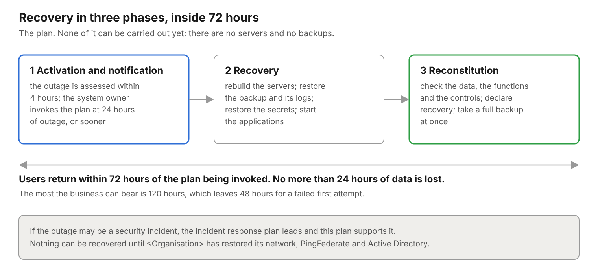

# \<System Name\> Contingency Planning Management

## 1 Purpose

This document sets out how \<System Name\> is recovered after a failure, and the design that meets the 23 Contingency Planning (CP) controls and enhancements in the CSS Moderate baseline.

Section 3 is the design, and is the contingency plan that CP-2 requires: the principles, scope and assumptions, the business impact analysis, the roles, the three phases of activation and notification, recovery and reconstitution, the backups, the second site and telecommunications, testing, training and exercises, what \<Organisation\> provides, keeping the plan current, coordination with related plans, and the policy and procedures. With appendix A, which holds the contacts, and appendix B, which lists the associated plans, it can be used on its own in an emergency. Each subsection names the controls it helps to meet. Appendix C lists the CP controls CSS does not select at Moderate.

### 1.1 Distribution and protection

Copies go to the people in section 3.4 and the authorising official. \<Organisation\>'s IT service desk receives sections 3.5, 3.6 and 3.9 and appendix A, which it needs to act (CP-02\_ODP\[04\]). The same people are told of every change, with a note of what changed (CP-2f).

The document is marked \<Classification\>. It is kept in the restricted document store with the other records, where only the people above can read it and only the system owner can change it (CP-2h). The system owner and security officer each keep a current offline copy, so that the plan can be used when \<System Name\> and the document store are down. The offline copy is section 3 with appendices A and B, which together are the whole plan. There is no separate plan document.

## 2 Related documents

Who provides and is responsible for each control, and its status, are in \<System Security Plan\>, section 7.6 (Table 15). The tests, their results and the records an assessor will ask for are in \<Control Assessment Record\> (CP). Each control's risk is in \<Risk List\>, and what is still open is in \<Plan of Action and Milestones\>. The policy is in \<Policy\> (CP), and the steps people follow are in \<Procedures\> (CP).

## 3 The contingency plan

### 3.1 Principles

Controls met here: CP-2, CP-2(1), CP-4, CP-6, CP-9, CP-9(1), CP-9(8), CP-10.

1. **Know what matters.** Recovery objectives come from a business impact analysis, not a guess.
2. **Keep copies apart.** Encrypted backups are held away from the main site, with one copy that an attacker on the network cannot change.
3. **Test recovery.** A backup counts only once it has been restored and checked.
4. **Plan ahead.** People know their part, and how to reach each other, before anything fails.
5. **Coordinate.** This plan works with the incident response plan and \<Organisation\>'s plans.
6. **Return only when safe.** Users come back when the data, the functions and the controls have all been checked.

These carry out the principles and rules of \<Policy\>, sections CP.3 and CP.4.

### 3.2 Scope and assumptions

Controls met here: CP-2, CP-2(8).

The plan recovers \<System Name\> in three phases: activation and notification, recovery, and reconstitution. Figure 1 shows them against the time allowed.

**Figure 1: The three phases of recovery**

**Scope:** the UI application, the Admin application, the API, the Microsoft SQL Server 2022 database that holds every item, file, schema definition and audit record, the secrets they need, and the two Windows Server 2025 VMs at \<Organisation\>. \<Organisation\>'s own sites, network and services, including PingFederate and Active Directory, are covered by its plans (appendix B).

**Assumptions:**

1. \<Organisation\> provides a second site, network, sign-in through PingFederate, directory, name resolution and time (EV-CP-01, EV-CP-02).
2. The latest good backup, its transaction logs and the protected copy of the secrets are at the second site.
3. The tagged release and the baseline in \<Configuration Management\>, section 3.4, can be reached to rebuild the applications.
4. At least one holder or deputy of each role in section 3.4 is available.
5. An outage that is also a security incident is handled under the incident response plan as well (section 3.6.2).

### 3.3 Business impact analysis

Controls met here: CP-2, CP-2(3), CP-2(8).

This analysis follows CSS, Appendix B. \<System Name\>'s availability is rated Low: an outage delays work, but no service to the public stops. Losing items or audit records cannot be tolerated.

#### 3.3.1 Impact over time

Controls met here: CP-2.

**Table 1: Impact of an outage, by function**

| Function | 24 hours | 72 hours | 1 week | 2 weeks |
| --- | --- | --- | --- | --- |
| Sign in, find and read items (essential) | Staff wait or use paper copies where they exist | The business processes it supports are delayed | Requests with legal deadlines, such as subject access, are at risk | Deadlines are missed |
| Upload and manage items | New items queue | Backlog grows | Backlog takes days to clear | Records are incomplete |
| Administration: schemas and the groups that open each | None while \<System Name\> is down | None while \<System Name\> is down | Starters wait for access | Starters wait for access |
| Reports and bulk export | None | None | Planned reports are late | Planned reports are late |

While \<System Name\> is down nobody can use it, so an outage does not leave leavers with access. The members of \<System Name\>'s AD groups are checked against current staff before users return (section 3.7).

#### 3.3.2 Recovery objectives

Controls met here: CP-2, CP-2(3), CP-10.

**Table 2: Recovery objectives**

| Function | Maximum tolerable downtime | Recovery time objective | Recovery point objective | Priority |
| --- | --- | --- | --- | --- |
| Sign in, find and read items | 120 hours (P-14) | 72 hours (P-12) | 24 hours (P-13) from the daily backup; less with the archived transaction logs | 1 |
| Upload and manage items | 14 days | 7 days | As above | 2 |
| Administration | 14 days | 7 days | As above | 2 |
| Reports and bulk export | 14 days | 7 days | Not applicable: produced from the database | 3 |

The recovery time objective includes reconstitution (section 3.7), so users return within 72 hours. That leaves 48 hours within the maximum tolerable downtime for a failed first attempt, such as a damaged backup.

#### 3.3.3 Components, dependencies and order of recovery

Controls met here: CP-2, CP-2(8).

**Table 3: Order of recovery**

| Order | Component | Needed for | Depends on | Recovered from |
| --- | --- | --- | --- | --- |
| 1 | \<Organisation\>'s network, PingFederate sign-in, directory, name resolution, time and certificates | Everything | \<Organisation\> | \<Organisation\>'s plans (appendix B) |
| 2 | Database VM and SQL Server 2022 | Every function | 1 | \<Configuration Management\> baseline, then the latest good backup and transaction logs |
| 3 | Secrets: the token signing key and the audit chain key. There is no database password: the API connects with Windows authentication | Starting the API | 1 | The protected copy at the second site (section 3.8) |
| 4 | Application VM: API | Every function | 2, 3 | The tagged release and \<Configuration Management\> |
| 5 | UI application | Finding and reading items | 4 | The tagged release |
| 6 | Admin application | Administration | 4 | The tagged release |

\<System Name\> cannot be used while PingFederate is unavailable, because nobody can sign in. \<Organisation\>'s recovery time for PingFederate and Active Directory therefore sets a floor under \<System Name\>'s own. It is asked for with EV-CP-01. If it is longer than 72 hours, the system owner takes the recovery objectives back to the authorising official.

#### 3.3.4 Essential assets

Controls met here: CP-2(8).

**Table 4: Essential assets (CP-2(8))**

| Asset | Why it is essential | Recovery |
| --- | --- | --- |
| The database | Holds every item, file, schema definition, the read and edit group of each schema, and every audit record | Rebuild the VM, then restore the latest good backup and transaction logs |
| The application VM | Runs the API, the UI application and the Admin application | Rebuild from the tagged release and \<Configuration Management\> |
| Backups and transaction logs | The only way back after a loss | Held encrypted at the second site, with one offline or immutable copy |
| Secrets | Without them the API cannot start, accept calls from the other two applications or chain audit records | A protected copy held apart from the backups |

The applications' key rings are not essential. They protect the authentication cookie and anti-forgery tokens only: if they are lost, users simply sign in again through PingFederate. They are not restored.

### 3.4 Roles

Controls met here: CP-2.

**Table 5: Contingency roles**

| Role | Holder | Deputy | Part in recovery |
| --- | --- | --- | --- |
| Decides to invoke | \[Name\], system owner | \[Name\] | Invokes this plan, tells the people below, and declares recovery complete |
| Risk decision | \[Name\], authorising official | None | Decides on running in a reduced state, or beyond the recovery time objective |
| Coordination | \[Name\], security officer | \[Name\] | Keeps the activity log, coordinates with any incident, and confirms controls before users return |
| Database | \[Name\], database administrator | \[Name\] | Restores backups and transaction logs, and runs the data checks |
| Servers | \[Name\], Windows server administrator | \[Name\] | Rebuilds the VMs and restores the secrets |
| Service | \<Organisation\>'s IT service desk | Its own rota | Provides the second site and connectivity |

Each role has a deputy, as Table 5 shows. Contact details are in appendix A.

### 3.5 Activation and notification

Controls met here: CP-2.

#### 3.5.1 When the plan is invoked

Controls met here: CP-2, CP-2(3).

The system owner, or their deputy, invokes this plan when any of these is true:

1. The essential functions have been unavailable for 24 hours, or are expected to be.
2. The database or its backups are lost, damaged, or cannot be trusted, including after ransomware or a compromise.
3. The main site, or a VM, is lost or unusable.
4. \<Organisation\> declares a disaster that affects the VMs.

Shorter outages are handled as normal operations or incidents. Invoking at 24 hours leaves time to recover within the 72-hour objective.

#### 3.5.2 Outage assessment

Controls met here: CP-2.

Within 4 hours of a report, the database and Windows server administrators assess the outage and tell the system owner: the cause if known, what is damaged, the expected duration, whether data may be lost or altered, and whether it may be a security incident. If it may be, the security officer starts the incident response plan at the same time.

#### 3.5.3 Notification

Controls met here: CP-2.

1. Whoever finds the failure tells \<Organisation\>'s IT service desk and the security officer.
2. The security officer tells the system owner, and starts the activity log.
3. The system owner decides whether to invoke, and tells the database and Windows server administrators, the authorising official and \<Organisation\>'s IT service desk, by phone first and then in writing.
4. The system owner tells users that \<System Name\> is unavailable and when it is expected back, through \<Organisation\>'s usual staff channel, and updates them at least daily.

### 3.6 Recovery

Controls met here: CP-2, CP-7, CP-10.

#### 3.6.1 Order of recovery

Controls met here: CP-2, CP-7, CP-10, CP-10(2).

Recovery follows PRO-CP-3 in the order of recovery in section 3.3.3, at the second site if the main one is lost:

1. Confirm \<Organisation\>'s services and the site are available, including PingFederate, without which nobody can sign in, and that the firewall allows every flow F1 to F11 in \<System Description\>, section 6.5, including the application server's route to PingFederate (flow F10) and the administrators' managed administration route (flow F11).
2. Rebuild the database VM to the baseline in \<Configuration Management\>, sections 3.4 and 3.6.
3. Restore the latest good backup, then apply the archived transaction logs up to the last consistent point (CP-10(2)). If a backup fails its checks, use the one before it.
4. Restore the secrets from their protected copy. Change them if a compromise is suspected.
5. Rebuild the application VM from the tagged release, with each application as a Windows service under its own group managed service account, and start the API, then the UI application, then the Admin application.
6. Move to reconstitution (section 3.7).

#### 3.6.2 Recovery during a security incident

Controls met here: CP-2, CP-10.

If the outage may be an incident, the incident response plan leads and this plan supports it. Evidence is kept before anything is rebuilt. The restore uses a backup taken before the compromise, and every secret is changed.

#### 3.6.3 Running in a reduced state

Controls met here: CP-2.

There is no manual alternative for reading items. If full recovery would take longer than 72 hours, the system owner may restore sign-in, finding and reading first, with uploads and administration turned off, once the authorising official accepts the risk. Security controls stay in force throughout.

#### 3.6.4 Escalation

Controls met here: CP-2, CP-2(3).

If the database has not been restored 48 hours after the plan is invoked, the system owner tells the authorising official, with a new estimate and the options.

### 3.7 Reconstitution

Controls met here: CP-2, CP-7, CP-9(1), CP-10.

Users return only when every step below is done.

1. **Validate the data:** the database administrator runs the checks in PRO-CP-2: row counts against the last known counts, each stored file against its SHA-256 checksum, and the audit chain checked from end to end. The newest audit record shows how much data was lost, against the recovery point objective.
2. **Validate the functions:** sign in, find and read an item, upload a test item to a test schema and remove it, and sign in to the Admin application. Audit records must be written for each.
3. **Confirm the controls:** the security officer checks that the controls match the main site, including encryption in transit, the members of \<System Name\>'s AD groups against current staff, and audit logging.
4. **Declare recovery:** the system owner declares \<System Name\> recovered, and tells users and the people in section 3.4.
5. **Back up at once:** a full backup is taken and confirmed at the second site before normal work resumes.
6. **Clean up:** temporary access is removed. If running at the second site, the return to the main site is a planned change under \<Configuration Management\>.
7. **Deactivate and learn:** the system owner closes the plan's activation. Within 10 working days an after-action report is written on TPL-11, and this plan is updated (CP-2g).
8. **Restart monitoring, and check the authorisation:** the security officer confirms that the monitoring duties have restarted. If the recovery changed the system in a way that counts as a significant change, such as a move to the second site, the authorising official decides whether \<System Name\> must be assessed or authorised again (\<Assessment, Authorization, and Monitoring Management\>, section 3.9).

### 3.8 Backups

Controls met here: CP-6, CP-9, CP-9(1), CP-9(8), CP-10, CP-10(2).

**Table 6: Backups**

| What | How often | Kept | Where | Protection |
| --- | --- | --- | --- | --- |
| The SQL Server database, including items, files and audit records | Daily, full SQL Server backup | 14 daily, 8 weekly and 12 monthly copies | The second site, and one offline or immutable copy | Encrypted. The key is held apart from the backups. Its SHA-256 value is recorded when taken |
| SQL Server transaction log backups | Between the daily backups, \[interval\] | Until the oldest daily copy is removed | The second site | Encrypted |
| Each VM's system configuration | Weekly | 8 copies | The second site | Encrypted |
| Secrets | At each change | Every version for 12 months | A protected copy at the second site, held apart from the backups | Encrypted, with access limited to the system owner and administrators |
| This plan and the records | At each change | As each record's retention | The controlled library | Access controlled |
| Code and releases | Each release | Every release | The Git host, and the tag recorded in \<Configuration Management\> | Access controlled |

A failed backup alerts the database administrator and the security officer, and the week's backups are checked under \<Security Operating Procedures\>, duty C8. Restores are tested every 6 months (PRO-CP-2), and after a change to the database or the backup method.

Every backup is encrypted by SQL Server's backup encryption, with AES-256, before it leaves the database server, so that nobody who holds a copy, including the second site's staff, can read or change it. The key is held apart from the backups, where only the system owner and the administrators can reach it, and is listed in the key register (\<System and Communications Protection Management\>, section 3.4). The SHA-256 value recorded when a backup is taken is checked before it is restored.

SQL Server's transaction log backups are taken between the daily backups and copied to the second site, so that a restore can be brought forward to the last consistent point before the failure (section 3.6.1). That keeps data loss well within the 24-hour recovery point objective (P-13).

The system documentation, including this plan and the other security and privacy documents, is under version control, and each change is kept in the restricted document store.

### 3.9 Second site and telecommunications

Controls met here: CP-6, CP-6(1), CP-6(3), CP-7, CP-7(1), CP-7(2), CP-7(3), CP-8, CP-8(1), CP-8(2).

**Second site.** \<Organisation\> is expected to provide a second site, far enough from the main one not to share its hazards, such as flood, power supply or a single building. The same site serves for storing backups and for processing.

- **Storage.** It holds the encrypted backups, with one copy offline or immutable, under the same physical and access controls as the main site. Backups are encrypted before they leave the database server, so the site's staff cannot read them.
- **Processing.** If the main site is lost, both servers are rebuilt there, on virtual servers that \<Organisation\> provides, and the essential functions resume within 72 hours (section 3.6.1). \<System Name\> needs nothing else there but its backups, its secrets and the tagged release. The servers are rebuilt to the same baseline (\<Configuration Management\>, section 3.4), and the security officer confirms the controls before users return (section 3.7).
- **Priority.** \<Organisation\> is asked what priority \<System Name\> has at the second site. Availability is rated Low, with 72 hours to recover, so a modest priority is enough.
- **Reaching it.** If a wide-area disruption makes the second site hard to reach, \<Organisation\>'s plans say how the site and its backups are reached. \<System Name\> asks for that part of its plans.

**Telecommunications.** Alternate telecommunications are inherited from \<Organisation\>. Its network connects users to both sites. It is asked what alternate service exists, how quickly it takes over, and what priority its main and alternate agreements give. The alternate service must not share a route, a building entry or a provider with the main one. Telecommunications Service Priority is a United States scheme, so \<Organisation\> is asked whether it uses any UK equivalent.

The evidence is asked for with EV-CP-01 and EV-CP-02. If it is not available, the system owner takes the risk to the authorising official.

### 3.10 Testing, training and exercises

Controls met here: CP-2, CP-3, CP-4, CP-4(1), CP-9(1).

This follows CSS. The first restore test and tabletop exercise take place within 30 days of the VMs being built, and before production.

**Table 7: Test, training and exercise schedule**

| Activity | When | Who | Objective | Record |
| --- | --- | --- | --- | --- |
| Role training | Within 30 days of taking a role, and every 12 months | Everyone in section 3.4 | Each person knows this plan, their steps in PRO-CP, the call tree and where the offline copy is | TPL-9 |
| Restore test | First within 30 days of the VMs being built; then every 6 months (P-16) | Database administrator, observed by the security officer | Restore the latest backup to a separate server within the recovery time objective, and pass the checks in PRO-CP-2 | TPL-11 |
| Tabletop exercise, with the incident response plan | First within 30 days of the VMs being built; then every 12 months (P-16) | Everyone in section 3.4, and \<Organisation\>'s IT service desk | Walk through one scenario from activation to deactivation | TPL-11 |
| Plan review | Every 12 months, and after each test or activation | System owner and authorising official | Keep the plan current and build in what was learned | Change record |

Tabletop scenarios rotate through: ransomware on the database VM; loss of the main site; a backup that fails its checks; a key person being unavailable; and PingFederate being unavailable. Training content covers the activation criteria, the call tree, each role's steps and the checks before return; it is reviewed every 12 months and after a plan change, test or activation. Role training is module M8 of the role curriculum (\<Awareness and Training Management\>, section 3.4), and the training register shows who is trained (\<Awareness and Training Management\>, section 3.8). After a change to the plan that alters a person's steps, that person is briefed on the change.

Each test has objectives and a scenario set beforehand. Each test or activation ends with an after-action report on TPL-11, written within 10 working days: the objectives, what happened, the time to recover and data lost against the objectives, what went wrong, the actions with owners and dates, and the changes made to this plan and to the training content. An action that is not done within the month becomes an item in \<Plan of Action and Milestones\>.

### 3.11 What \<Organisation\> provides

Controls met here: CP-2(1), CP-4(1), CP-6, CP-6(1), CP-6(3), CP-7, CP-7(1), CP-7(2), CP-7(3), CP-8, CP-8(1), CP-8(2).

**Table 8: Asked of \<Organisation\>**

| Provided | Controls | What \<System Name\> relies on | Evidence asked |
| --- | --- | --- | --- |
| A second site for backups and for rebuilt servers | CP-6, CP-6(1), CP-6(3), CP-7, CP-7(1), CP-7(2), CP-7(3) | A site that does not share the main site's hazards, holds the encrypted backups with one offline or immutable copy, can run both servers within 72 hours, and can be reached in a wide-area disruption | EV-CP-01 |
| Alternate telecommunications | CP-8, CP-8(1), CP-8(2) | An alternate service with no single point of failure shared with the main one, and a stated priority | EV-CP-02 |
| Its own disaster recovery and business continuity plans | CP-2(1), CP-4(1) | Who declares a disaster, and the recovery times of the network, PingFederate, Active Directory, name resolution and time | EV-CP-01 |

### 3.12 Keeping the plan current

Controls met here: CP-2.

1. **Review and approval.** The system owner and the authorising official review the plan every 12 months, and after each test or activation, and approve each new version.
2. **Update.** A change to the system that affects recovery updates the plan as part of the change (\<Configuration Management\>, section 3.9). Each after-action report lists the changes made to the plan (section 3.10).
3. **Telling people.** The people who hold copies (section 1.1) are told of each change, with a note of what changed from the change record (PRO-CP-7).
4. **Record.** The plan is under version control, which records every change.

### 3.13 Coordination with related plans

Controls met here: CP-2(1), CP-4(1).

Appendix B lists the related plans. This plan and the incident response plan each cite the other. Their tabletop exercise is held together, and \<Organisation\>'s IT service desk takes part (section 3.10). \<Organisation\>'s disaster recovery and business continuity plans provide the network, PingFederate, the second site and telecommunications. The system owner agrees with \<Organisation\> how the plans fit: who declares a disaster, and the recovery times of the services \<System Name\> depends on (section 3.3.3).

### 3.14 Policy and procedures

Controls met here: CP-1.

\<Policy\> (CP) and \<Procedures\> (CP) meet CP-1. Who they are shared with is in \<Policy\>, section CP.6. Their ownership, approval, review and records follow the rules common to every policy in \<Policy\>, section 1.1.

## Appendix A Contacts

**Table 9: Contacts**

| Role | Name | Phone | Email |
| --- | --- | --- | --- |
| System owner | \[Name\] | \[phone to add\] | \[email to add\] |
| Authorising official | \[Name\] | \[phone to add\] | \[email to add\] |
| Security officer | \[Name\] | \[phone to add\] | \[email to add\] |
| Database administrator | \[Name\] | \[phone to add\] | \[email to add\] |
| Windows server administrator | \[Name\] | \[phone to add\] | \[email to add\] |
| \<Organisation\>'s IT service desk | \[name to add\] | \[phone to add\] | \[email to add\] |
| \<Organisation\>'s security contact | \[name to add\] | \[phone to add\] | \[email to add\] |

## Appendix B Associated plans and records

**Table 10: Associated plans**

| Plan or record | Owner | How it relates |
| --- | --- | --- |
| \<Incident Response Management\> Incident response plan | Security officer | Leads when an outage may be an incident (section 3.6.2); exercised together (CP-4(1)) |
| \<Organisation\>'s disaster recovery and business continuity plans \[names to add\] | \<Organisation\> | Provide the network, second site and telecommunications (EV-CP-01, EV-CP-02) |
| \<Configuration Management\>, the configuration management plan | System owner | The baseline the VMs and applications are rebuilt to |
| \<Security Operating Procedures\> Security Operating Procedures | System owner | The routine backup and check steps (C2, C6, C8, C18, C21) and planned shutdown |
| TPL-9 and TPL-11 in \<Record Templates\> | System owner | Training records, test records and after-action reports |
| \<System Security Plan\>, sections 3.4 and 4 | System owner | The inventory and diagrams of what is rebuilt |

## Appendix C CP controls outside the Moderate baseline

CSS does not select these at Moderate, so they are not assessed. Some of the design goes further than the baseline, and Table 11 says where.

**Table 11: CP controls not selected at Moderate**

| Control | What it adds | \<System Name\>'s position |
| --- | --- | --- |
| CP-2(2) Capacity Planning | Capacity planned for processing, telecommunications and support during a contingency | Not required. The second site is asked to run both servers at their normal size (EV-CP-01) |
| CP-2(5) Continue Mission and Business Functions | Functions continue with little or no loss of continuity | Not required. Availability is rated Low, and 72 hours to recover is enough |
| CP-3(1) Simulated Events | Training that simulates a real event | Not required. The tabletop exercise walks through a scenario |
| CP-4(2) Alternate Processing Site | Testing the plan at the second site | Not required, and not planned. The first restore test is on the main servers |
| CP-6(2) Recovery Time and Recovery Point Objectives | The storage site set up to meet the recovery objectives | Not required. Done in design: transaction log backups go to the second site between the daily backups |
| CP-7(4) Preparation for Use | The second site kept ready to use | Not required. The servers are rebuilt there when needed |
| CP-8(3), CP-8(4) Separation of Providers; Provider Contingency Plan | Alternate services from a separate provider, who has a contingency plan | Not required. \<Organisation\>'s plans are asked for with EV-CP-01 |
| CP-9(2), CP-9(3), CP-9(5) Test Restoration Using Sampling; Separate Storage for Critical Information; Transfer to Alternate Storage Site | Further assurance for backups | Not required. Done in design: every restore test restores the whole database; one copy is offline or immutable; backups and transaction log backups go to the second site |
| CP-10(4) Restore Within Time Period | Components restored from configuration-controlled images within a set time | Not required. Done in design: the servers are rebuilt from the baseline and the tagged release (\<Configuration Management\>, section 3.4) |
