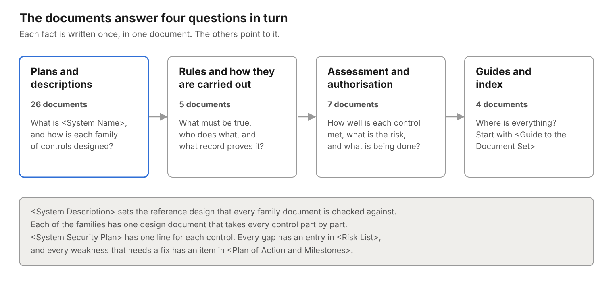

# \<System Name\> Guide to the Document Set

## 1 Purpose

This guide is the place to start. It says what the \<System Name\> document set is, how its 44 documents relate to each other, and how to find a way through them. It is written for someone who has not seen the set before: an external auditor, the independent assessment team, a new role holder, or the authorising official.

It holds no facts about the system of its own. It says which document in the set holds each kind of fact. The full index is \<Documentation Map\>, which also says where each fact about a control is held (its section 3) and sets the standard every document follows (its section 4).

The set shows how \<System Name\>, an internal digital library built on the reference system in \<System Description\>, is designed and run to the CSS Moderate baseline, with the CSS privacy baseline. It covers 20 control families and 316 controls. The plans, descriptions, rules and procedures state the design. The assessment and authorisation documents are templates, filled in as \<System Name\> is assessed, authorised and run.

## 2 The set at a glance

The documents fall into four groups, and answer four questions in turn: what the system is, what must be true and how it is done, how well it is met, and how to find things.

**Figure 1: How the documents relate**

**Table 1: The four groups**

| Group | Documents | The question it answers |
| --- | --- | --- |
| Plans and descriptions | 22 | What is \<System Name\>, and how is each family of controls designed? |
| Rules and how they are carried out | 11 | What must be true, who does what, and what record proves it? |
| Assessment and authorisation | 7 | How well is each control met, what is the risk, and what is being done about it? |
| Guides and index | 4 | Where is everything? |

Four ideas explain how the set is built.

1. **Point, don't repeat.** Within the set, a value, a design or a decision is written in one document, and the others point to it. If two documents seem to say the same thing, one of them is a summary and says so. Other sources, such as the development team's design documents, may also describe the system.
2. **One design document for each family.** Each of the 20 control families has a document that sets out its design and takes every control part by part. Section 6 lists them.
3. **One line for each control in the security plan.** \<System Security Plan\>, section 7, has a line for every one of the 316 controls: how it is met, who is responsible, its status and where its gap is registered. It is the quickest way in to any control.
4. **Every gap is registered.** A control that is not fully met has an entry in \<Risk List\>, and a weakness that needs a fix has an item in \<Plan of Action and Milestones\>. Nothing is described as done that is not.

## 3 How the documents relate

Each control is carried through the set by the same chain. Table 2 gives the chain, and the question each link answers.

**Table 2: The chain for every control**

| Link | Where | What it tells you |
| --- | --- | --- |
| 1 The control | \<System Security Plan\>, section 7 | How the control is met in brief, who is responsible, its status and where its gap is registered |
| 2 The rule | \<Policy\>, the family's chapter | What must be true, and who is accountable. The Head of Cyber approves it |
| 3 The design | The family's design document (section 6) | How \<System Name\> meets each part of the control, the values CSS asks to be defined, and what \<Organisation\> provides |
| 4 The steps | \<Procedures\>, the family's chapter; \<Security Operating Procedures\> for day-to-day duties and the rules people sign | Who does what, when, and the record kept |
| 5 The record | The forms in \<Record Templates\> | What proves the step was done |
| 6 The finding | \<Control Assessment Record\>, the family's chapter; brought together in \<Security Assessment Report\> | Whether each of the CSS determination statements is satisfied, and why |
| 7 The risk | \<Risk List\> | The rating of each non-compliance, and the decision on it |
| 8 The fix | \<Plan of Action and Milestones\> | The work, its owner, its milestone and its latest date |
| 9 The decision | \<Decision Register\> | Who approved or decided what, and when |

Around the chain sit the documents that describe the system as a whole, and those that support an assessment.

**Table 3: If you want to know**

| If you want to know | Read |
| --- | --- |
| What \<System Name\> is, as a whole, in one document | \<System Description\> |
| What \<System Name\> is, where it runs and where its boundary lies | \<System Security Plan\>, sections 2 to 4; \<Security Architecture\> |
| Why it exists and how it is used | \<Concept of Operations\> |
| Who holds each role | \<Roles and Responsibilities\> |
| Whether it is ready to be authorised | \<Security Assessment Report\>, sections 2 and 8 |
| What \<Organisation\> provides, and whether that is evidenced | \<Assessment, Authorization, and Monitoring Management\>, section 3.6; \<Evidence Requests\> |
| Why a control is treated as not applicable | \<Tailoring Register\> |
| What a role holder would be asked at interview | \<Interview Guide\> |
| How personal data is governed | \<Privacy Plan\>; \<PII Processing Management\>; \<Data Protection Impact Assessment\> |
| What users and administrators are told to do | \<Security Operating Procedures\>; \<User Guide\>; \<Administrator Guide\> |
| Which facts are still to be supplied | \<Plan of Action and Milestones\>, section 5.7 |
| Where any one fact about a control is held | \<Documentation Map\>, section 3 |

## 4 An auditor's route through the set

An auditor does not need to read every document from end to end. This route takes six steps, and each step says what to read and what to look for.

**Figure 2: An auditor's route through the set**

**Table 4: The route, step by step**

| Step | Read | Look for |
| --- | --- | --- |
| 1 Get your bearings | This guide; \<Documentation Map\>, section 2 | The four groups, and the design document for each family |
| 2 Understand the system | \<System Description\>; then \<System Security Plan\>, sections 2 to 6; \<Concept of Operations\>; \<Security Architecture\> | The boundary, the categorisation, the components, the data flows, what is inherited from \<Organisation\>, and who is responsible |
| 3 See the overall result | \<Security Assessment Report\>; then \<System Security Plan\>, section 7 | How many controls and statements are satisfied, the top risks, the conditions before authorisation, and the line for each control |
| 4 Take a family | Its design document; its chapter of \<Policy\> and of \<Procedures\>; its chapter of \<Control Assessment Record\> | The summary table of what is missing; then each control part by part; whether the rule, the design, the steps and the finding agree |
| 5 Follow a gap | The entry in \<Risk List\>; the item in \<Plan of Action and Milestones\>; the decision in \<Decision Register\> | That the gap is rated, decided by the right person, planned with an owner and a date, and not described elsewhere as done |
| 6 Test and ask | The test named in the design document, with its evidence; \<Interview Guide\>; \<Evidence Requests\>; completed forms from \<Record Templates\> | That a test can be repeated and gives the recorded result; that the people interviewed describe what the procedures say; that \<Organisation\>'s evidence exists |

Steps 4 to 6 are repeated for each family chosen. A good first family is Access Control, as it is the largest, or Risk Assessment, as it shows how every gap in the other families is rated and answered.

Two things save time. Within the set, each control's status is recorded in \<System Security Plan\>, section 7, and every design document's section 2 points to its family's table there. And in each chapter of \<Control Assessment Record\>, the final section is the assessment plan, which records what is examined and tested, what is not, and what the independent assessor should do next.

## 5 Following one control from end to end

RA-5, Vulnerability Monitoring and Scanning, shows the chain at work. Every link has a place for it.

**Table 5: RA-5 through the set**

| Link | Where | What is there |
| --- | --- | --- |
| The control | \<System Security Plan\>, section 7.15 | One line: how RA-5 is met, who is responsible, its status, and where any gap is registered |
| The rule | \<Policy\> (RA), rules R6 to R9 | Scans monthly and at each release, the time allowed for each severity, exploited flaws first, and how reports are received |
| The design | \<Risk Assessment Management\>, sections 3.5 to 3.7 | What is checked, how and how often; the vulnerability timetable; how findings are analysed and shared; and each of the six parts of RA-5 |
| The steps | \<Procedures\>, PRO-RA-3 to PRO-RA-5; \<Security Operating Procedures\>, duties C10 and C50 | Who scans, who reviews the results within 5 working days, and what happens when a flaw is being exploited |
| The record | TPL-7 in \<Record Templates\> | Each finding, its severity, its due date and its fix |
| The finding | \<Control Assessment Record\> (RA) | Whether each of the RA-5 determination statements is satisfied, with the reason |
| The risk | \<Risk List\>, section 5 | A non-compliance entry for each statement not satisfied, with its rating and the decision on it |
| The fix | \<Plan of Action and Milestones\> | The work to close each gap, its owner and its date |
| The decision | \<Decision Register\> | The approval of the timetable, and any risk decision for the authorising official |
| The test | Test-Vulnerability.ps1, with its results in the RA evidence | Its checks, which can be run again |

## 6 Finding a family

Each family has a policy chapter, a design document, a procedures chapter, a section of the security plan, an assessment chapter and a test. \<Documentation Map\>, Table 2, gives all of them for each family, and its Table 1 lists every document with who reads it. Program Management is outside the baseline and is inherited from \<Organisation\>, so it has a design document only.

Four design documents are also the plan that CSS requires for their family, in their section 3: configuration management, contingency planning, incident response and supply chain risk management.

## 7 How to read the documents

1. **Layout.** Every document starts with its purpose. Documents carry no document control, approval or change history: decisions are in \<Decision Register\>, and changes are kept in the change record (\<Documentation Map\>, section 4.1).
2. **Names, not numbers.** A document is cited by its name in angle brackets. A chapter of the Policy, the Procedures or the assessment record is cited with its family code, such as the Policy (RA), and a section in a chapter as section RA.4.
3. **Design and records.** A design document gives the design for each part of a control. What has happened is recorded only in the assessment and authorisation documents and the completed forms, so that a plan is never read as a fact.
4. **Status.** A control is implemented, partially implemented, not implemented or not applicable. Its assessment result is satisfied or other than satisfied, as CSS uses the terms.
5. **Placeholders.** Text in square brackets is a fact that only someone else can supply, such as a date from \<Organisation\>. They are counted by kind in \<Plan of Action and Milestones\>, section 5.7.
6. **Drafts and approvals.** Nothing is shown as approved unless the person who approves it has done so. Every approval and decision is in \<Decision Register\>.
7. **Values.** Values that CSS asks the organisation to define are set at corporate level by \<Organisation\>. Their reference values are the parameters in \<System Description\>, section 4, which the design documents cite rather than repeat. Where a design document's value does not match the corporate value, the design document is changed.
8. **Reference numbers.** Identifiers such as PRO-AC-3, TPL-7, EV-MP-01 and P-20 never change when a document is renumbered. \<Documentation Map\>, Table 9, lists every kind and where it is defined.

## 8 Reviewing the set

A reviewer judges what a script cannot: whether each document is true of \<System Name\> and \<Organisation\>, whether each step is workable by the person named in the time given, whether anything expected is missing, and whether a new reader would understand it. Links, references and totals are left to the automatic check (\<Documentation Map\>, section 4.11).

**Table 6: A review order**

| Stage | Review | Look for |
| --- | --- | --- |
| 1 Learn the system | \<Documentation Map\>, sections 1 to 3; \<System Description\>; \<Concept of Operations\>; \<Roles and Responsibilities\> | Whether the set looks complete, the business picture is right, and the boundary and flows match what will be built |
| 2 The plan and its scope | \<System Security Plan\>, sections 1 to 6; \<Tailoring Register\> | Categorisation, inventory, laws, figures, and whether each control treated as not applicable is justified |
| 3 The rules, one family at a time | For each family, its \<Policy\> chapter, its \<Procedures\> chapter and its design document side by side; then \<Security Operating Procedures\> and \<Record Templates\> | Gaps between the rule, the steps and the design. Families in this order: PL, PS, AT; AC, IA, AU; CM, MA, SA, SR; SC, SI, RA; IR, CP; MP, PE; PT, with the legal adviser; CA last |
| 4 The assessment templates | \<Security Assessment Report\>; \<System Security Plan\>, section 7 (sample five controls); \<Control Assessment Record\> (each assessment plan, and a sample of statements); \<Risk List\>, sections 1 to 4; \<Plan of Action and Milestones\> | Whether each template gives its reader what they need, and the rules for filling it in are sound |
| 5 Reference | \<Decision Register\>, \<Evidence Requests\>, \<Interview Guide\>; \<Administrator Guide\> and \<User Guide\>, for the developers to confirm | Look things up; do not read end to end. \<Organisation\> reviews \<Evidence Requests\> in full, and the security assessor \<Interview Guide\> |

**Table 7: Who reviews what**

| Reviewer | Review in full | Sample or skim |
| --- | --- | --- |
| System owner | Stages 1 and 2, \<Security Operating Procedures\>, \<Plan of Action and Milestones\> | Everything else |
| Head of Cyber | \<Policy\>, \<Incident Response Management\> | \<System Security Plan\>, \<Risk List\> |
| Authorising official | \<Security Assessment Report\>, \<Risk List\> sections 1 to 4, \<System Security Plan\> sections 1 to 6 | \<Plan of Action and Milestones\>, \<Contingency Planning Management\> |
| Legal adviser | \<Privacy Plan\>, \<Data Protection Impact Assessment\>, the PT chapters and \<PII Processing Management\> | The laws in \<System Security Plan\>, section 3.5, and the monitoring rules in \<Security Operating Procedures\> |
| Business owner | \<Concept of Operations\>, the retention schedule in \<PII Processing Management\> | \<Contingency Planning Management\>, for the recovery times |
| Developers | \<System Description\>, \<Access Control Management\>, \<Administrator Guide\>, \<User Guide\>, and the CM, SA, SC and SI design documents | \<Plan of Action and Milestones\>, for the fixes that are theirs |
| Security officer | \<Incident Response Management\>, \<Security Operating Procedures\> Part C, the AU, IR and SI chapters of \<Procedures\> | \<Record Templates\> |
| \<Organisation\>'s security contact | \<Evidence Requests\> | The inherited controls in \<Assessment, Authorization, and Monitoring Management\>, section 3.6 |
| Security assessor | \<Control Assessment Record\>, \<Interview Guide\>, \<Security Assessment Report\> | \<System Security Plan\>, section 7 |

Give each review comment the document, the section or table, and what should change. Settle the rules before the findings that judge them, because a change to a rule can change a finding.
