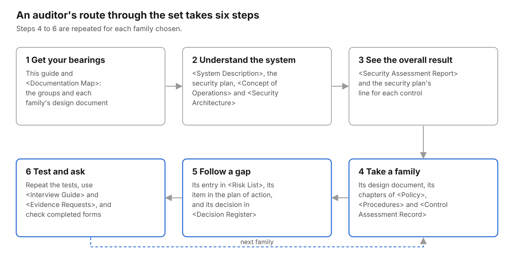

# \<DocuView\> Guide to the Document Set

**\<ref\> | Version \<ver\> | Draft for the system owner's approval**

**Contents**

[1 Document control](#1-document-control)

[2 Purpose](#2-purpose)

[3 The set at a glance](#3-the-set-at-a-glance)

[4 How the documents relate](#4-how-the-documents-relate)

[5 An auditor's route through the set](#5-an-auditors-route-through-the-set)

[6 Following one control from end to end](#6-following-one-control-from-end-to-end)

[7 Finding a family](#7-finding-a-family)

[8 Every document](#8-every-document)

[9 How to read the documents](#9-how-to-read-the-documents)

[10 What the set does not yet show](#10-what-the-set-does-not-yet-show)

| **SECTION 1** |
| --- |

## 1 Document control

### 1.1 Document details

**Table 1: Document details**

| Item | Detail |
| --- | --- |
| Reference | \<ref\> |
| Title | \<DocuView\> Guide to the Document Set |
| Version | \<ver\> |
| Status | Draft for the system owner's approval |
| Date | 18 November 2026 |
| Owner | System owner |
| Applies to | Every control family |
| Classification | Restricted |
| Next review | Every 12 months, and whenever a document is added, removed or renamed |
| Format | \<Documentation Map\>, section 5 |

### 1.2 Approval

**Table 2: Approval**

| Role | Name | Decision | Date |
| --- | --- | --- | --- |
| System owner | Neil Ramsbottom | Pending | Pending |

### 1.3 Change history

**Table 3: Change history**

| Version | Date | Change |
| --- | --- | --- |
| \<ver\> | 18 November 2026 | The System Description is added: to the list of documents, to the table of where to look, and to step 2 of the route |
| \<ver\> | 18 November 2026 | Issued into the set as a draft for review |
| \<ver\> | 18 November 2026 | First draft, at the system owner's request (D-GEN-29): a guide to the document set, with a figure of how the documents relate and a route for an auditor |

| **SECTION 2** |
| --- |

## 2 Purpose

This guide is the place to start. It says what the \<DocuView\> document set is, how its 44 documents relate to each other, and how to find a way through them. It is written for someone who has not seen the set before: an external auditor, the independent assessment team, a new role holder, or the authorising official.

It holds no facts about the system of its own. Each fact is held in one document only, and this guide says which. The full index is \<Documentation Map\>, which also says where each fact about a control is held (its section 4) and sets the standard every document follows (its section 5).

The set is the evidence that \<DocuView\>, ABC Technologies' document management system, is designed and run to the NIST SP 800-53 Rev 5 Moderate baseline, with NIST's privacy baseline. It covers 20 control families and 316 controls. It is written before the system goes live, so it shows honestly what is built, what is planned and what is missing.

| **SECTION 3** |
| --- |

## 3 The set at a glance

The documents fall into four groups, and answer four questions in turn: what the system is, what must be true and how it is done, how well it is met, and how to find things.

**Figure 1: How the documents relate**

**Table 4: The four groups**

| Group | Documents | The question it answers |
| --- | --- | --- |
| Plans and descriptions | 22 | What is \<DocuView\>, and how is each family of controls designed? |
| Rules and how they are carried out | 11 | What must be true, who does what, and what record proves it? |
| Assessment and authorisation | 7 | How well is each control met, what is the risk, and what is being done about it? |
| Guides and index | 4 | Where is everything? |

Four ideas explain how the set is built.

1. **One home for each fact.** A value, a design or a decision is written once. Every other document points to it. If two documents seem to say the same thing, one of them is a summary and says so.
2. **One design document for each family.** Each of the 20 control families has a document that sets out its design and takes every control part by part. Section 7 lists them.
3. **One line for each control in the security plan.** \<System Security Plan\>, section 8, has a line for every one of the 316 controls: how it is met, who is responsible, its status, its assessment result and where its gap is registered. It is the quickest way in to any control.
4. **Every gap is registered.** A control that is not fully met has an entry in \<Risk List\>, and a weakness that needs a fix has an item in \<Plan of Action and Milestones\>. Nothing is described as done that is not.

| **SECTION 4** |
| --- |

## 4 How the documents relate

Each control is carried through the set by the same chain. Table 5 gives the chain, and the question each link answers.

**Table 5: The chain for every control**

| Link | Where | What it tells you |
| --- | --- | --- |
| 1 The control | \<System Security Plan\>, section 8 | How the control is met in brief, who is responsible, its status and its result |
| 2 The rule | \<Policy\>, the family's chapter | What must be true, and who is accountable. Approved by the Head of Cyber |
| 3 The design | The family's design document (section 7) | How \<DocuView\> meets each part of the control, what is in place today, the values NIST asks to be defined, and what ABC Technologies provides |
| 4 The steps | \<Procedures\>, the family's chapter; \<Security Operating Procedures\> for day-to-day duties and the rules people sign | Who does what, when, and the record kept |
| 5 The record | The forms in \<Record Templates\> | What proves the step was done |
| 6 The finding | \<Control Assessment Record\>, the family's chapter; brought together in \<Security Assessment Report\> | Whether each of NIST's determination statements is satisfied, and why |
| 7 The risk | \<Risk List\> | The rating of each non-compliance, and the decision on it |
| 8 The fix | \<Plan of Action and Milestones\> | The work, its owner, its milestone and its latest date |
| 9 The decision | \<Decision Register\> | Who approved or decided what, and when |

Around the chain sit the documents that describe the system as a whole, and those that support an assessment.

**Table 6: If you want to know**

| If you want to know | Read |
| --- | --- |
| What \<DocuView\> is, as a whole, in one document | \<System Description\> |
| What \<DocuView\> is, where it runs and where its boundary lies | \<System Security Plan\>, sections 3 to 5; \<Security Architecture\> |
| Why it exists and how it is used | \<Concept of Operations\> |
| Who holds each role | \<Roles and Responsibilities\> |
| Whether it is ready to be authorised | \<Security Assessment Report\>, sections 3 and 9 |
| What ABC Technologies provides, and whether that is evidenced | \<Assessment, Authorization, and Monitoring Management\>, section 4.6; \<Evidence Requests\> |
| Why a control is treated as not applicable | \<Tailoring Register\> |
| What a role holder would be asked at interview | \<Interview Guide\> |
| How personal data is governed | \<Privacy Plan\>; \<PII Processing Management\>; \<Data Protection Impact Assessment\> |
| What users and administrators are told to do | \<Security Operating Procedures\>; \<User Guide\>; \<Administrator Guide\> |
| Which facts are still to be supplied | \<Plan of Action and Milestones\>, section 6.7 |
| Where any one fact about a control is held | \<Documentation Map\>, section 4 |

| **SECTION 5** |
| --- |

## 5 An auditor's route through the set

An auditor does not need to read every document from end to end. This route takes six steps, and each step says what to read and what to look for.

**Figure 2: An auditor's route through the set**

**Table 7: The route, step by step**

| Step | Read | Look for |
| --- | --- | --- |
| 1 Get your bearings | This guide; \<Documentation Map\>, section 3 | The four groups, and the design document for each family |
| 2 Understand the system | \<System Description\>; then \<System Security Plan\>, sections 3 to 7; \<Concept of Operations\>; \<Security Architecture\> | The boundary, the categorisation, the components, the data flows, what is inherited from ABC Technologies, and who is responsible |
| 3 See the overall result | \<Security Assessment Report\>; then \<System Security Plan\>, section 8 | How many controls and statements are satisfied, the top risks, the conditions before authorisation, and the line for each control |
| 4 Take a family | Its design document; its chapter of \<Policy\> and of \<Procedures\>; its chapter of \<Control Assessment Record\> | The summary table of what is missing; then each control part by part; whether the rule, the design, the steps and the finding agree |
| 5 Follow a gap | The entry in \<Risk List\>; the item in \<Plan of Action and Milestones\>; the decision in \<Decision Register\> | That the gap is rated, decided by the right person, planned with an owner and a date, and not described elsewhere as done |
| 6 Test and ask | The test named in the design document, with its evidence; \<Interview Guide\>; \<Evidence Requests\>; completed forms from \<Record Templates\> | That a test can be repeated and gives the recorded result; that the people interviewed describe what the procedures say; that ABC Technologies' evidence exists |

Steps 4 to 6 are repeated for each family chosen. A good first family is Access Control, as it is the largest, or Risk Assessment, as it shows how every gap in the other families is rated and answered.

Two things save time. In every design document, section 3 is a one-page summary: the status of each control, what is missing, and where it is registered. And in each chapter of \<Control Assessment Record\>, the final section is the assessment plan, which says what was examined and tested, what was not, and what the independent assessor should do next.

| **SECTION 6** |
| --- |

## 6 Following one control from end to end

RA-5, Vulnerability Monitoring and Scanning, shows the chain at work. It is partly met, so every link has something to show.

**Table 8: RA-5 through the set**

| Link | Where | What is there |
| --- | --- | --- |
| The control | \<System Security Plan\>, section 8.15 | One line: packages are checked, nothing scans the servers, the status is partially implemented, and the gap is registered as NC-RA-04, PA-56 and PA-62 |
| The rule | \<Policy\> (RA), rules R6 to R9 | Scans monthly and at each release, the time allowed for each severity, exploited flaws first, and how reports are received |
| The design | \<Risk Assessment Management\>, sections 4.5 to 4.7 and 5.5 | What is checked, how and how often; the vulnerability timetable; how findings are analysed and shared; and each of the six parts of RA-5 with the position today |
| The steps | \<Procedures\>, PRO-RA-3 to PRO-RA-5; \<Security Operating Procedures\>, duties C10 and C50 | Who scans, who reviews the results within 5 working days, and what happens when a flaw is being exploited |
| The record | TPL-7 in \<Record Templates\> | Each finding, its severity, its due date and its fix |
| The finding | \<Control Assessment Record\> (RA) | Four of fourteen statements satisfied, with the reason for each of the others |
| The risk | \<Risk List\>, NC-RA-04 and risk R-SI-01 | Rated Medium, to be remediated before go-live |
| The fix | \<Plan of Action and Milestones\>, PA-56 and PA-62 | Update the packages; choose and run a scanner |
| The decision | \<Decision Register\>, D-RA-P02 and D-RA-13 | The timetable agreed, and the risk decision asked of the authorising official |
| The test | Test-Vulnerability.ps1, with its results in the RA evidence | Checks V01 to V09, which can be run again |

| **SECTION 7** |
| --- |

## 7 Finding a family

Each family has a policy chapter, a design document, a procedures chapter, a section of the security plan and an assessment chapter. Program Management is outside the baseline and is inherited from ABC Technologies, so it has a design document only.

**Table 9: Where each family is documented**

| Family | Rules | Design | Steps | Security plan | Findings | Test |
| --- | --- | --- | --- | --- | --- | --- |
| AC Access Control | \<Policy\> (AC) | \<Access Control Management\> | \<Procedures\> (AC) | Section 8.1 | \<Control Assessment Record\> (AC) | Test-AccessControl.ps1 |
| AT Awareness and Training | \<Policy\> (AT) | \<Awareness and Training Management\> | \<Procedures\> (AT) | Section 8.2 | \<Control Assessment Record\> (AT) | Test-PlanConsistency.ps1, check L14 |
| AU Audit and Accountability | \<Policy\> (AU) | \<Audit and Accountability Management\> | \<Procedures\> (AU) | Section 8.3 | \<Control Assessment Record\> (AU) | Test-AuditAndAuth.ps1 |
| CA Assessment, Authorization, and Monitoring | \<Policy\> (CA) | \<Assessment, Authorization, and Monitoring Management\> | \<Procedures\> (CA) | Section 8.4 | \<Control Assessment Record\> (CA) | Test-PlanConsistency.ps1 |
| CM Configuration Management | \<Policy\> (CM) | \<Configuration Management\> | \<Procedures\> (CM) | Section 8.5 | \<Control Assessment Record\> (CM) | Test-ConfigurationManagement.ps1 |
| CP Contingency Planning | \<Policy\> (CP) | \<Contingency Planning Management\> | \<Procedures\> (CP) | Section 8.6 | \<Control Assessment Record\> (CP) | Test-BackupRestore.ps1 |
| IA Identification and Authentication | \<Policy\> (IA) | \<Identification and Authentication Management\> | \<Procedures\> (IA) | Section 8.7 | \<Control Assessment Record\> (IA) | Test-AuditAndAuth.ps1 and Test-Identification.ps1 |
| IR Incident Response | \<Policy\> (IR) | \<Incident Response Management\> | \<Procedures\> (IR) | Section 8.8 | \<Control Assessment Record\> (IR) | Test-IncidentReadiness.ps1 |
| MA Maintenance | \<Policy\> (MA) | \<Maintenance Management\> | \<Procedures\> (MA) | Section 8.9 | \<Control Assessment Record\> (MA) | Test-Maintenance.ps1 |
| MP Media Protection | \<Policy\> (MP) | \<Media Protection Management\> | \<Procedures\> (MP) | Section 8.10 | \<Control Assessment Record\> (MP) | Test-MediaProtection.ps1 |
| PE Physical and Environmental Protection | \<Policy\> (PE) | \<Physical and Environmental Protection Management\> | \<Procedures\> (PE) | Section 8.11 | \<Control Assessment Record\> (PE) | None: provided by ABC Technologies |
| PL Planning | \<Policy\> (PL) | \<Planning Management\> | \<Procedures\> (PL) | Section 8.12 | \<Control Assessment Record\> (PL) | Test-PlanConsistency.ps1 |
| PM Program Management | ABC Technologies' policies | \<Program Management\> | None | Section 6 | Not assessed | None: outside the baseline |
| PS Personnel Security | \<Policy\> (PS) | \<Personnel Security Management\> | \<Procedures\> (PS) | Section 8.13 | \<Control Assessment Record\> (PS) | Test-PlanConsistency.ps1, check L17 |
| PT PII Processing and Transparency | \<Policy\> (PT) | \<PII Processing Management\> | \<Procedures\> (PT) | Section 8.14 | \<Control Assessment Record\> (PT) | Test-PersonalData.ps1 |
| RA Risk Assessment | \<Policy\> (RA) | \<Risk Assessment Management\> | \<Procedures\> (RA) | Section 8.15 | \<Control Assessment Record\> (RA) | Test-Vulnerability.ps1 |
| SA System and Services Acquisition | \<Policy\> (SA) | \<System and Services Acquisition Management\> | \<Procedures\> (SA) | Section 8.16 | \<Control Assessment Record\> (SA) | Test-Development.ps1 |
| SC System and Communications Protection | \<Policy\> (SC) | \<System and Communications Protection Management\> | \<Procedures\> (SC) | Section 8.17 | \<Control Assessment Record\> (SC) | Test-Protection.ps1 |
| SI System and Information Integrity | \<Policy\> (SI) | \<System and Information Integrity Management\> | \<Procedures\> (SI) | Section 8.18 | \<Control Assessment Record\> (SI) | Test-Integrity.ps1 and Test-Vulnerability.ps1 |
| SR Supply Chain Risk Management | \<Policy\> (SR) | \<Supply Chain Risk Management\> | \<Procedures\> (SR) | Section 8.19 | \<Control Assessment Record\> (SR) | Test-SupplyChain.ps1 |

Four design documents are also the plan that NIST requires for their family, in their section 4: configuration management, contingency planning, incident response and supply chain risk management.

| **SECTION 8** |
| --- |

## 8 Every document

**Table 10: The documents, and who reads them**

| Document | Group | What it holds | Who reads it |
| --- | --- | --- | --- |
| \<System Security Plan\> | Plans and descriptions | How \<DocuView\> implements each of the 316 controls, or does not yet, with the system description, architecture figures, inheritance and responsibilities | Everyone, first |
| \<Privacy Plan\> | Plans and descriptions | How personal data in \<DocuView\> is governed: the privacy plan that PL-2 calls for | The legal adviser; an auditor |
| \<System Description\> | Plans and descriptions | One description of the whole system, for a person or an AI without the source code | Anyone who needs to understand the system; an auditor, early |
| \<Security Architecture\> | Plans and descriptions | System boundary, components, data flows and what is inherited from ABC Technologies | Developers, administrators, an auditor |
| \<Concept of Operations\> | Plans and descriptions | Why \<DocuView\> exists, who uses it, the business workflows it supports and its operational scenarios | The business owner; an auditor, early |
| \<Roles and Responsibilities\> | Plans and descriptions | Who holds each role, so that other documents name roles and not people | Anyone asking who holds a role |
| \<Configuration Management\> | Plans and descriptions | The configuration management design, and the plan CM-9 requires | Whoever works in, or assesses, that family |
| \<Contingency Planning Management\> | Plans and descriptions | The contingency design, and the contingency plan CP-2 requires | Whoever works in, or assesses, that family |
| \<System and Communications Protection Management\> | Plans and descriptions | The communications protection design | Whoever works in, or assesses, that family |
| \<System and Information Integrity Management\> | Plans and descriptions | The integrity design | Whoever works in, or assesses, that family |
| \<System and Services Acquisition Management\> | Plans and descriptions | The acquisition design | Whoever works in, or assesses, that family |
| \<Risk Assessment Management\> | Plans and descriptions | The risk assessment design | Whoever works in, or assesses, that family |
| \<PII Processing Management\> | Plans and descriptions | The personal data design | Whoever works in, or assesses, that family |
| \<Personnel Security Management\> | Plans and descriptions | The personnel security design | Whoever works in, or assesses, that family |
| \<Program Management\> | Plans and descriptions | How \<DocuView\> relies on ABC Technologies' security and privacy programme | Whoever works in, or assesses, that family |
| \<Planning Management\> | Plans and descriptions | The planning design | Whoever works in, or assesses, that family |
| \<Physical and Environmental Protection Management\> | Plans and descriptions | The physical and environmental protection design | Whoever works in, or assesses, that family |
| \<Media Protection Management\> | Plans and descriptions | The media protection design | Whoever works in, or assesses, that family |
| \<Maintenance Management\> | Plans and descriptions | The maintenance design | Whoever works in, or assesses, that family |
| \<Incident Response Management\> | Plans and descriptions | The incident response design, and the plan IR-8 requires | Whoever works in, or assesses, that family |
| \<Supply Chain Risk Management\> | Plans and descriptions | The supply chain risk management plan that SR-2 requires: the system context, the team, the risks at each stage, the supplier register, the risk tolerance and how components come in, with each of the 12 SR controls and the parameter values | Whoever works in, or assesses, that family |
| \<Data Protection Impact Assessment\> | Plans and descriptions | The data protection impact assessment, drafted for the legal adviser to complete | The legal adviser |
| \<Policy\> | Rules and how they are carried out | The security and privacy policy: one chapter of rules for each of the 19 families | Everyone bound by the rules |
| \<Procedures\> | Rules and how they are carried out | The procedures that carry out the policy: one chapter for each family, each step naming who acts and the record kept | Whoever carries out a duty |
| \<Control Implementation Register\> | Rules and how they are carried out | Formerly the register of decisions and values; now an index that points to each family's design document | Only when an older record cites a register chapter |
| \<Assessment, Authorization, and Monitoring Management\> | Rules and how they are carried out | The assessment, authorisation and monitoring design | Whoever works in, or assesses, that family |
| \<Identification and Authentication Management\> | Rules and how they are carried out | The identification and authentication design | Whoever works in, or assesses, that family |
| \<Audit and Accountability Management\> | Rules and how they are carried out | The audit design | Whoever works in, or assesses, that family |
| \<Awareness and Training Management\> | Rules and how they are carried out | The training design | Whoever works in, or assesses, that family |
| \<Access Control Management\> | Rules and how they are carried out | The access control design | Whoever works in, or assesses, that family |
| \<Security Operating Procedures\> | Rules and how they are carried out | Rules of behaviour for everyone and for privileged users, and how security is operated day to day, with the record that proves each duty | Every user and administrator, who sign it |
| \<Record Templates\> | Rules and how they are carried out | The forms that show controls operating, TPL-1 to TPL-24 | Whoever carries out a procedure |
| \<Tailoring Register\> | Rules and how they are carried out | The case for each control treated as not applicable, and the decision that Program Management is outside the baseline | An assessor |
| \<Control Assessment Record\> | Assessment and authorisation | The Level 1 self-assessment: a finding for each of the 1,998 determination statements, one chapter for each family | An assessor |
| \<Security Assessment Report\> | Assessment and authorisation | The results of all 19 families in one report for the authorising official, with the risk position and the conditions before authorisation | The authorising official; an auditor, early |
| \<Risk List\> | Assessment and authorisation | Each risk with its rating, treatment and acceptance, and a non-compliance entry for every control that is not satisfied | The authorising official and system owner |
| \<Plan of Action and Milestones\> | Assessment and authorisation | Each weakness with its fix, owner, milestone and latest completion, and the road to authorisation | The system owner, monthly; an auditor |
| \<Decision Register\> | Assessment and authorisation | Every approval and decision, who made it, when, and the evidence of it | Anyone checking who approved what |
| \<Evidence Requests\> | Assessment and authorisation | The evidence needed from ABC Technologies, and who does what for each control | The system owner and ABC Technologies |
| \<Interview Guide\> | Assessment and authorisation | The interview questions by role, the statements each supports, and the answers given at Level 1 | An assessor, and the people interviewed |
| \<Administrator Guide\> | Guides and index | How administrators set up and run \<DocuView\> securely | Administrators |
| \<User Guide\> | Guides and index | How users work securely in \<DocuView\> | Users |
| \<Documentation Map\> | Guides and index | The index: every document, where each family is documented, where each fact about a control is held, and the document standard | Anyone looking for a document or a fact |
| \<Guide to the Document Set\> | Guides and index | This guide: how the documents relate, and how to find a way through them | Anyone new to the set |

| **SECTION 9** |
| --- |

## 9 How to read the documents

1. **Layout.** Every document starts with its document control: details, approval and change history. Its status line says whether it is a draft or approved, and by whom.
2. **Names, not numbers.** A document is cited by its name in angle brackets. A chapter of the Policy, the Procedures or the assessment record is cited with its family code, such as the Policy (RA), and a section in a chapter as section RA.4.
3. **Design and today.** A design document gives, for each part of a control, the design that is agreed and the position today. The two are kept apart, so that a plan is never read as a fact.
4. **Status.** A control is implemented, partially implemented, not implemented or not applicable. Its assessment result is satisfied or other than satisfied, as NIST SP 800-53A uses the terms.
5. **Placeholders.** Text in square brackets is a fact that only someone else can supply, such as a date from ABC Technologies. They are counted by kind in \<Plan of Action and Milestones\>, section 6.7.
6. **Drafts and approvals.** Nothing is shown as approved unless the person who approves it has done so. Every approval and decision is in \<Decision Register\>.

**Table 11: Reference numbers**

| Prefix | What it is | Where it is held |
| --- | --- | --- |
| PA- | A weakness with its fix: an item in the plan of action | \<Plan of Action and Milestones\> |
| NC- | A non-compliance: a control that is not satisfied, with its rating and decision | \<Risk List\>, section 6 |
| R- | A risk | \<Risk List\>, section 3 |
| D- | A decision or approval | \<Decision Register\> |
| TR- | A tailoring decision | \<Tailoring Register\> |
| EV- | A request for evidence from ABC Technologies | \<Evidence Requests\> |
| INT- | An interview question | \<Interview Guide\> |
| PRO- | A procedure | \<Procedures\> |
| TPL- | A form | \<Record Templates\> |
| A, B and C with a number | A rule for everyone, a rule for privileged users, and an operating duty | \<Security Operating Procedures\> |
| A letter and two digits, such as V05 or T22 | A check in a test script | The design document of the family, and the evidence for it |
| ODP | A value NIST asks the organisation to define | The parameter register, an appendix of each design document |

| **SECTION 10** |
| --- |

## 10 What the set does not yet show

The set is written before \<DocuView\> goes live, and says so throughout. A reader should expect the following, each of which is tracked.

1. **\<DocuView\> is not authorised, and holds no production documents.** The conditions before authorisation are in \<Security Assessment Report\>, section 9.
2. **The servers are not built.** The tests ran on a test stack with sample data, and are to be repeated on the servers. Sign-in through ABC Technologies' AD FS is stated but not yet tested (PA-95).
3. **ABC Technologies' controls are not evidenced.** The evidence requests in \<Evidence Requests\> have not been sent.
4. **Nothing has been seen in operation.** Reviews, training and exercises start with operation, so their records do not exist yet.
5. **The assessment so far is a self-assessment.** The independent assessment, led by Josh Leak, has not started.
6. **Some documents are drafts.** Each says so in its status line, and \<Documentation Map\>, section 3.1, gives the state of every document.
