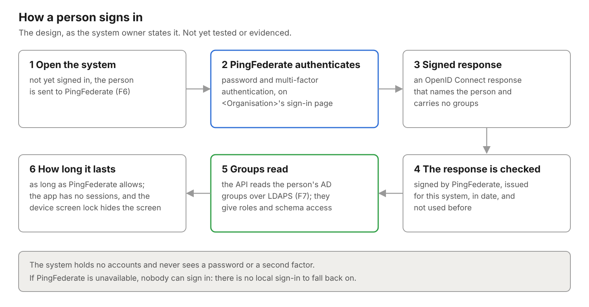

# \<System Name\> Identification and Authentication Management

## 1 Purpose

This document sets out how \<System Name\> is designed and configured to meet the 24 Identification and Authentication (IA) controls and enhancements in the CSS Moderate baseline.

Section 3 is the design: who and what is identified, sign-in through AD FS, the assurance levels, the authenticators, the authentication settings against CSS, sessions and signing in again, identity proofing, what \<Organisation\> provides, and the policy and procedures. Each subsection names the controls it helps to meet.

Other documents hold the rest. Who provides and is responsible for each control, its status and its assessment result are in \<System Security Plan\>, section 7.7 (Table 16). The tests, their results and the records an assessor will ask for are in \<Control Assessment Record\> (IA). Each control's risk is in \<Risk List\>, and what is still open is in \<Plan of Action and Milestones\>. The policy is in \<Policy\> (IA), and the steps people follow are in \<Procedures\> (IA). Who may do what once signed in is in \<Access Control Management\>.

Every user signs in through \<Organisation\>'s AD FS, with multi-factor authentication, and \<System Name\> holds no accounts or passwords of its own (D-AC-23).

Values that CSS asks the organisation to define are set at corporate level by \<Organisation\>. The settings in section 3 should match those corporate values. Where one does not, it is changed in this document.

\<System Name\> is not yet built on its servers. Where section 3 notes what "today" is, it means the tested v1.0 build, which signed in with its own passwords. Those notes show where that build differs from the design.

Appendix A lists the IA controls CSS does not select at Moderate.

## 2 Summary

The implementation status of each control, how it is met, who is responsible, its assessment result and the risk and plan entries for its gaps are recorded in \<System Security Plan\>, section 7.7 (Table 16).

## 3 The design

### 3.1 Principles

Controls met here: IA-2, IA-2(1), IA-2(2), IA-4, IA-5, IA-5(6), IA-12.

1. **Unique.** Each person has one named identifier, which is never reused.
2. **Proven.** A person's identity is established before they have an account.
3. **Strong.** Every sign-in needs more than a password.
4. **Protected.** Authenticators are never stored or sent in the clear, and secrets are kept out of the source repositories.
5. **Current.** Authenticators change whenever they may be compromised.
6. **One place to sign in.** \<System Name\> holds no accounts and no passwords. \<Organisation\>'s AD FS authenticates every user.

These carry out the principles and rules of \<Policy\>, sections IA.3 and IA.4.

### 3.2 Who and what is identified

Controls met here: IA-2, IA-2(12), IA-3, IA-4, IA-4(4), IA-8, IA-8(1), IA-8(2), IA-8(4).

**Table 1: Identifiers**

| Who or what | Identifier | Issued by | Authenticated by | Reused |
| --- | --- | --- | --- | --- |
| Every user, whatever their role | Their Active Directory account name. It shows whether they are staff or a contractor | \<Organisation\>, after HR's pre-employment checks | AD FS: password and second factor | Never |
| The API, to the database | One database service account, which is not a superuser | Database administrator | Its password, held in the protected store | Not applicable |
| Each application, on the application server | Its own Windows service account | \<Organisation\>, in Active Directory | Windows: a group managed service account, whose password no person knows | Not applicable |
| Windows server and database administrators, on the servers | Their own named administrator accounts | \<Organisation\> | \<Organisation\>'s directory and approved route | Never |
| The database server, to the API | Its TLS certificate | \[Issuer to be agreed with \<Organisation\>\] | The API checks the certificate and the server's name in full before it sends the password (PA-18) | Not applicable |
| AD FS, to the applications | Its token-signing certificate | \<Organisation\> | Each application checks every token against it | Not applicable |
| Users' devices | The managed device, to the network | \<Organisation\> | Its network access control | Not applicable |

There are no shared, guest, anonymous or local accounts, and nobody outside \<Organisation\>'s staff and contractors may use \<System Name\> (\<Access Control Management\>, section 3.2).

**Issuing identifiers.** \<Organisation\> authorises each Active Directory account through its starters process, and assigns it to the person its HR has checked. \<System Name\>'s part is membership of its groups, which the group's owner authorises through the ServiceNow workflow (\<Access Control Management\>, section 3.13). Service accounts are named for the application they run. Active Directory accounts are never reused, under \<Organisation\>'s rule. \<System Name\> issues no identifiers, so it has none to reuse.

**User status.** Active Directory shows whether a person is staff or a contractor, and the group's owner sees it when authorising a request.

**Devices.** \<Organisation\>'s network access control identifies each managed device before it joins the network, and unmanaged devices are kept off it. \<System Name\> does not identify devices itself: it is reached only from that network or the VPN.

**Users from outside \<Organisation\>.** Only \<Organisation\>'s staff and contractors, with an Active Directory account, may use \<System Name\>, so the controls for non-organisational users do not apply (TR-IA-03 to TR-IA-06 in \<Tailoring Register\>). PIV is a United States federal credential, and no \<System Name\> user holds one, so PIV credentials are not accepted (TR-IA-01).

### 3.3 Sign-in through AD FS

Controls met here: IA-2, IA-2(1), IA-2(2), IA-2(8), IA-6, IA-11.

**Figure 1: How a person signs in**

**Table 2: Steps of a sign-in**

| Step | What happens | Who does it |
| --- | --- | --- |
| 1 | The person opens \<System Name\>. Having no session, they are sent to AD FS | \<System Name\> |
| 2 | The person gives their password and their second factor. \<System Name\> never sees either | AD FS |
| 3 | AD FS issues a signed token that names the person and lists their AD groups | AD FS |
| 4 | \<System Name\> checks the token: that AD FS signed it, that it was issued for \<System Name\>, that it is within its short life, and that it has not been used before | \<System Name\> |
| 5 | \<System Name\> opens a session for that person, with the roles and project access their groups give, and records the sign-in | \<System Name\> |
| 6 | The session ends after 30 minutes idle, after 8 hours, at sign-out, or when a global administrator ends it. The person then signs in again | \<System Name\> |

**Table 3: The trust between AD FS and \<System Name\>**

| Setting | Design | Today |
| --- | --- | --- |
| Protocol | \[federation protocol to be confirmed with \<Organisation\>\] | Not built |
| Who \<System Name\> trusts | \<Organisation\>'s AD FS only, by its token-signing certificate | Not built |
| What a token must show | Signed by AD FS; issued for \<System Name\>; within its life; not used before | Not built |
| Token life | Short: \[minutes to be agreed with \<Organisation\>\] | Not built |
| What the token carries | The person's account name and their AD groups, and nothing more than \<System Name\> needs | Not built |
| Certificate renewal | \<System Name\> picks up AD FS's new certificate when \<Organisation\> renews it | Not built |
| Federation assurance level | Level 2 of CSS. The system owner set this as the target (D-IA-12): a signed token that only \<System Name\> can use. It is to be agreed with \<Organisation\> | Not agreed (PA-117) |
| If AD FS is unavailable | Nobody can sign in. There is no local sign-in to fall back on | By design (\<Contingency Planning Management\>, section 3.3.3) |

**Second factor.** AD FS requires a second factor from every user, privileged or not, under the same authentication policy for \<System Name\>. The application roles are AD groups, and nobody reaches an administration page without signing in through AD FS. The named Windows server and database administrators reach the servers only through \<Organisation\>'s managed route, which also requires a second factor (\<Maintenance Management\>, section 3.4).

**Replay resistance.** For privileged and non-privileged accounts alike, sign-in tokens from AD FS are signed, short-lived, issued for \<System Name\> only and used once. Everything travels over TLS. \<System Name\>'s own session token is tied to one session and ends with it.

**What the person sees.** Passwords and second factors are entered on AD FS's page, which masks them and does not say whether an account exists. \<System Name\> shows no sign-in form.

The steps and the trust are the design, from the system owner's statement of how \<System Name\> works (D-AC-23, D-IA-12). The settings shown as placeholders are asked of \<Organisation\> with EV-IA-04, and are filled in when it answers (PA-117). None of it has been tested or evidenced (PA-95).

### 3.4 Assurance levels

Controls met here: IA-2, IA-2(1), IA-2(2), IA-5, IA-12.

This follows CSS, section 3, and the federal acceptance statement template (D-IA-08). The statement is revised for sign-in through AD FS (D-AC-23).

Identity assurance is how sure we are that a person is who they claim. Authenticator assurance is how sure we are that the person signing in holds the account. Federation assurance applies when another system, here AD FS, vouches for the person.

**Table 4: Assurance levels by user group**

| User group | Harm if impersonated | Identity assurance | Authenticator assurance: target | Authenticator assurance: today | Federation | Until the target is met |
| --- | --- | --- | --- | --- | --- | --- |
| Global administrators | High: every document, account and setting | \<Organisation\>'s pre-employment checks, with the request confirmed by the system owner (PRO-IA-1) | AAL2: multi-factor sign-in through AD FS | Multi-factor through AD FS, as the system owner states (D-AC-23); not yet evidenced | AD FS, at federation assurance level 2 (D-IA-12), to be agreed with \<Organisation\> | No production documents held (D-GEN-13); 8-hour sessions; all actions audited |
| Project access approvers and editors | Moderate: one project's documents | As above, confirmed by the project access approver | AAL2: multi-factor sign-in through AD FS | Multi-factor through AD FS, as the system owner states (D-AC-23); not yet evidenced | AD FS, at federation assurance level 2 (D-IA-12), to be agreed with \<Organisation\> | No production documents held (D-GEN-13); 8-hour sessions; all actions audited |
| Readers and auditors | Moderate: reading one project's documents, or the audit trail | As above | AAL2: multi-factor sign-in through AD FS | Multi-factor through AD FS, as the system owner states (D-AC-23); not yet evidenced | AD FS, at federation assurance level 2 (D-IA-12), to be agreed with \<Organisation\> | No production documents held (D-GEN-13); 8-hour sessions; all actions audited |
| Services (API to PostgreSQL) | High: the whole database | Not applicable | A secret held outside source code, changed every 12 months (section 3.5) | Secret in settings files (PA-19) | Not applicable | Database reachable only from the host (B07, C09) |

**Reasoning:** \<System Name\> will hold HR and finance documents rated Moderate, so a failed sign-in check could expose personal data. CSS points to authenticator assurance level 2 for that harm, which needs two factors and replay resistance. Identity proofing is done once, by \<Organisation\>'s HR, and is not repeated by \<System Name\>. Federation is used: AD FS proves who the person is and vouches for them to \<System Name\> (D-AC-23).

### 3.5 Authenticators

Controls met here: IA-5, IA-5(1), IA-5(2), IA-5(6), IA-7.

**Table 5: Authenticator inventory**

| Authenticator | Used by | Held or stored | Changed | If lost or exposed | Today |
| --- | --- | --- | --- | --- | --- |
| Active Directory password | Every user | Active Directory; the person. \<System Name\> never sees it | Under \<Organisation\>'s corporate standard, and on suspected compromise (PRO-IA-3) | \<Organisation\>'s service desk resets it; a global administrator ends the \<System Name\> sessions | \<Organisation\>'s standard is to be supplied |
| Temporary password | Not used by \<System Name\> | Not applicable | Not applicable | Not applicable | The tested build used them (A01) |
| Second factor | Every user | Held by the person; registered with \<Organisation\> for AD FS | On loss or replacement (PRO-IA-6) | \<Organisation\>'s service desk resets it after checking who the person is | Provided by AD FS, as the system owner states (D-AC-23); not yet evidenced |
| Session token | UI application, Admin application and API callers | Issued by \<System Name\> after AD FS has signed the user in, and tied to a session row | Under 8 hours; ends on sign-out or administrator action | Administrator ends the session | Replays from another client (PA-46) |
| Token signing key | API | \[Secret store to be chosen\]; protected copy at the second site (\<Contingency Planning Management\>, section 3.8) | Every 12 months, and when an administrator leaves (PRO-IA-4) | Change it; every session ends | In settings files (PA-19) |
| Database account password | API only: one service account, which is not a superuser and cannot change the schema (D-AC-18) | \[Secret store to be chosen\]; protected copy at the second site (\<Contingency Planning Management\>, section 3.8) | Every 12 months, and when an administrator leaves (PRO-IA-4) | Change it in PostgreSQL and API | In settings files, and the account is a superuser in the tested build (PA-19, PA-10) |
| Windows service accounts | UI application, Admin application and API, one each | Group managed service accounts in Active Directory. Windows sets and changes the password, and no person knows it (D-AC-19) | By Windows, automatically | \<Organisation\> resets the account | Not built. \<Organisation\>'s agreement to group managed service accounts is to be confirmed |
| First administrator account | Not used | Not applicable: \<System Name\> holds no accounts (D-AC-23) | Not applicable | Not applicable | The tested build had one (D-AC-13) |
| AD FS token-signing certificate | UI application, Admin application, API, to check each sign-in token | Published by \<Organisation\>'s AD FS; \<System Name\> holds only the public part | When \<Organisation\> renews it | \<Organisation\> replaces it, and \<System Name\> picks up the new one | To be set up and evidenced |
| ASP.NET Data Protection keys | UI application, Admin application, API | A volume on each application | Rolled by the framework | Users sign in again; no data is lost | As designed |
| VM administrator accounts | Windows server and database administrators | \<Organisation\>'s directory | \[\<Organisation\>'s rule\] | \<Organisation\>'s process | Not assessable (EV-IA-01) |
| PostgreSQL superuser | Database administrator | \[To be set on the database VM\] | Every 12 months, and when an administrator leaves | Change it | Not assessable |
| TLS certificates | UI application, Admin application, API | \[Issuer and store to be agreed with \<Organisation\>\] | Before expiry | Revoke and reissue | Not in use (PA-18) |

Only the API connects to PostgreSQL, with one service account that is not a superuser (D-AC-18). The system owner and security officer review the inventory every 12 months (PRO-IA-7).

1. **First issue.** For people, \<Organisation\>'s service desk issues authenticators after HR's pre-employment checks (PRO-IA-2), with first content under \<Organisation\>'s corporate standard. Service secrets and the signing key are set by the named administrators, generated randomly. Service account passwords are set by Windows.
2. **Lost, compromised or revoked.** \<Organisation\>'s service desk issues, resets and revokes, and a global administrator ends the person's \<System Name\> sessions at once (PRO-IA-2, PRO-IA-3, PRO-IA-6). After account recovery, \<Organisation\>'s service desk process requires a new password at once.
3. **No defaults.** \<System Name\> ships with no default account or password. The PostgreSQL superuser's password is set when the database server is built, and no vendor default is left on either server.
4. **Protection.** User passwords stay in Active Directory and never reach \<System Name\>: they are typed into AD FS over TLS, and never into \<System Name\>. The information is rated Moderate, and the database password and the signing key open the whole database, so they are held in a protected store, outside the source repositories and settings files, that only the named administrators and the API's service account can read, with a protected copy at the second site. Windows permissions protect each application's settings (\<Access Control Management\>, section 3.6.3). Everything travels over TLS.
5. **What people do.** The rules of behaviour require people never to share a password or second factor, and to report a loss at once (\<Security Operating Procedures\>, Part A). Managed devices encrypt their disks.
6. **Group accounts.** There are no shared, group or role accounts (TR-AC-02 in \<Tailoring Register\>). Service secrets are changed when an administrator who knew them leaves.
7. **Certificates.** No person or service signs in to \<System Name\> with a certificate, so public key authentication does not apply (TR-IA-02 in \<Tailoring Register\>). If \<Organisation\>'s AD FS uses a public key second factor, such as a security key, it applies again, and falls to \<Organisation\>.
8. **Cryptographic modules.** \<System Name\> uses the cryptographic modules of Windows Server 2025 and .NET. No person signs in to a module directly: the applications reach them through their service accounts. \<Organisation\> is asked which modules and mode the servers use (EV-IA-03).

### 3.6 Settings against CSS

Controls met here: IA-2(1), IA-2(2), IA-2(8), IA-5, IA-5(1), IA-6, IA-11.

\<System Name\> sets no password rule of its own. \<Organisation\>'s corporate standard applies, and is to be compared with CSS and NCSC password guidance when \<Organisation\> supplies it (EV-IA-04).

**Table 6: Authentication settings at authenticator assurance level 2**

| Requirement | CSS | \<System Name\> | Evidence | State |
| --- | --- | --- | --- | --- |
| Password length, password only | At least 15 characters | \<Organisation\>'s corporate standard, to be supplied | None yet | To be compared when supplied |
| Password length, with multi-factor | At least 8 characters | \<Organisation\>'s corporate standard, to be supplied | None yet | To be compared when supplied |
| Longest password allowed | At least 64 should be allowed | \<Organisation\>'s corporate standard | None yet | To be compared when supplied |
| Spaces and all characters | Should be allowed | \<Organisation\>'s corporate standard | None yet | To be compared when supplied |
| Composition rules | Must not be imposed | \<Organisation\>'s corporate standard | None yet | To be compared when supplied |
| Scheduled changes | Must not be required | \<Organisation\>'s corporate standard | None yet | To be compared when supplied |
| Blocklist | Must be checked | \<Organisation\>'s corporate standard | None yet | To be compared when supplied |
| Storage | Salted, with a costly function | Active Directory. \<System Name\> stores no passwords | None yet | Provided by \<Organisation\>; to be evidenced |
| Rate limiting | At most 100 failures | Lockout by AD FS and Active Directory, under the corporate standard (P-AC-14) | None yet | To be compared when supplied |
| Inactivity timeout | No more than 1 hour | 30 minutes | T44 | Met, stricter |
| Overall session limit | No more than 24 hours | 8 hours | I08, I11, T45 | Met, stricter |
| Second factor | Required | Provided by AD FS (D-AC-23) | None yet | To be evidenced by \<Organisation\> |
| Replay resistance | Required | To be assessed with AD FS sign-in and TLS | A13, A14 | Gap in the tested build (PA-46, PA-18) |
| Sessions end on password change | Expected | Not applicable: \<System Name\> holds no passwords. A global administrator ends sessions on notice (PRO-IA-3) | T38 | Met by other means |
| Feedback | No hint whether the user exists | Given by AD FS, not \<System Name\> | None yet | To be evidenced by \<Organisation\> |

### 3.7 Sessions and signing in again

Controls met here: IA-2, IA-11.

1. A session ends after 30 minutes without activity, and after 8 hours whatever the activity.
2. The page locks after 25 minutes, 5 minutes before the session ends (\<Access Control Management\>, section 3.7).
3. A change to a person's AD groups takes effect at their next sign-in.
4. A global administrator can end any person's sessions at once. This is the first step when a password or second factor may be compromised, when someone leaves, and when a role is removed (PRO-IA-3).
5. Each session is tied to the person AD FS authenticated, and every audit record names them.

### 3.8 Identity proofing

Controls met here: IA-12, IA-12(2), IA-12(3), IA-12(5).

\<Organisation\>'s HR proves who each person is, once, in its pre-employment checks, before the person has an Active Directory account. As stated by \<Organisation\>, that is photo identification and a right-to-work check for staff, and the same through the agency for contractors, with a notice of proofing sent to the person. HR sees the evidence, and validates and verifies it, in those checks, and each identity resolves to one person, with one Active Directory account. \<System Name\> does not repeat it. Before adding anyone to a group, the group's owner confirms the request came from that person and their line manager (PRO-IA-1).

### 3.9 What \<Organisation\> provides

Controls met here: IA-2, IA-2(1), IA-2(2), IA-2(8), IA-3, IA-4, IA-4(4), IA-5, IA-5(1), IA-6, IA-7, IA-12, IA-12(2), IA-12(3), IA-12(5).

**Table 7: Asked of \<Organisation\>**

| Provided | Controls | What \<System Name\> relies on | As stated by \<Organisation\> | Evidence asked |
| --- | --- | --- | --- | --- |
| AD FS and its multi-factor authentication | IA-2, IA-2(1), IA-2(2), IA-2(8), IA-6 | Every user is authenticated with two factors; the token is signed and carries the person's groups; the sign-in page hides what is typed | Stated by the system owner (D-AC-23); not yet by \<Organisation\> | EV-IA-04 |
| Active Directory accounts and passwords | IA-4, IA-4(4), IA-5, IA-5(1) | One named account for each person, never reused, showing staff or contractor; passwords under the corporate standard | Not yet asked | EV-IA-04, EV-AC-01 |
| Device identification | IA-3 | Only managed devices join the network | Network access control with device certificates, and disk encryption on managed devices | EV-IA-01 |
| Identity proofing | IA-12, IA-12(2), IA-12(3), IA-12(5) | Each person's identity is checked before they have an account | Photo ID and right-to-work checks for staff, and the same through the agency for contractors | EV-IA-02 |
| Cryptographic modules on the servers | IA-7 | The modules meet the applicable standards | Standard Windows modules, not in CSS-approved cryptographic mode | EV-IA-03 |

**Today:** no request has been sent, and none of this is evidenced.

### 3.10 Policy and procedures

Controls met here: IA-1.

1. **Policy.** \<Policy\> (IA) is a system-level policy, shared with everyone who uses or administers \<System Name\>. The legal adviser reviews it.
2. **Procedures.** \<Procedures\> (IA) holds eight procedures, PRO-IA-1 to PRO-IA-8. They are shared with the same people.
3. **Owner.** The system owner manages the policy and procedures.
4. **Review.** The policy is reviewed every 12 months, and after a significant incident, audit finding or system change. The procedures are reviewed every 12 months, and after a change to the steps.
5. **Records.** The documents are under version control.

## Appendix A IA controls outside the Moderate baseline

CSS does not select these at Moderate, so they are not assessed. Some bear on the design, and Table 8 says how.

**Table 8: IA controls not selected at Moderate**

| Control | What it adds | \<System Name\>'s position |
| --- | --- | --- |
| IA-2(5) Individual Authentication with Group Authentication | A person signs in as themselves before using a shared account | Not required. There are no shared accounts |
| IA-2(6) Access to Accounts, Separate Device | The second factor is on a device separate from the one signing in | Not required. Decided by \<Organisation\>'s AD FS, and asked with EV-IA-04 |
| IA-5(7) No Embedded Unencrypted Static Authenticators | No passwords or keys left in code, scripts or settings | Not required. It is what PA-19 puts right: the signing key and database password are in settings files today |
| IA-5(13) Expiration of Cached Authenticators | Cached sign-in details expire | Not required. \<System Name\> caches none: a session ends at 8 hours at most |
| IA-9 Service Identification and Authentication | Services prove who they are to each other | In no baseline. Done in design: the API to the database, and the applications' check of AD FS (section 3.2) |
| IA-10 Adaptive Authentication | Extra checks when a sign-in looks unusual | In no baseline. A matter for \<Organisation\>'s AD FS |
| IA-12(4) In-person Validation and Verification | Identity evidence checked in person | Selected only at High. \<Organisation\>'s HR is asked how it checks (EV-IA-02) |
| IA-13 Identity Providers and Authorization Servers | Controls on the service that vouches for users, and on checking its tokens | In no baseline. It bears directly on \<System Name\>, which relies on AD FS. Section 3.3 sets what \<System Name\> checks in a token, and PA-117 tracks agreeing it |
