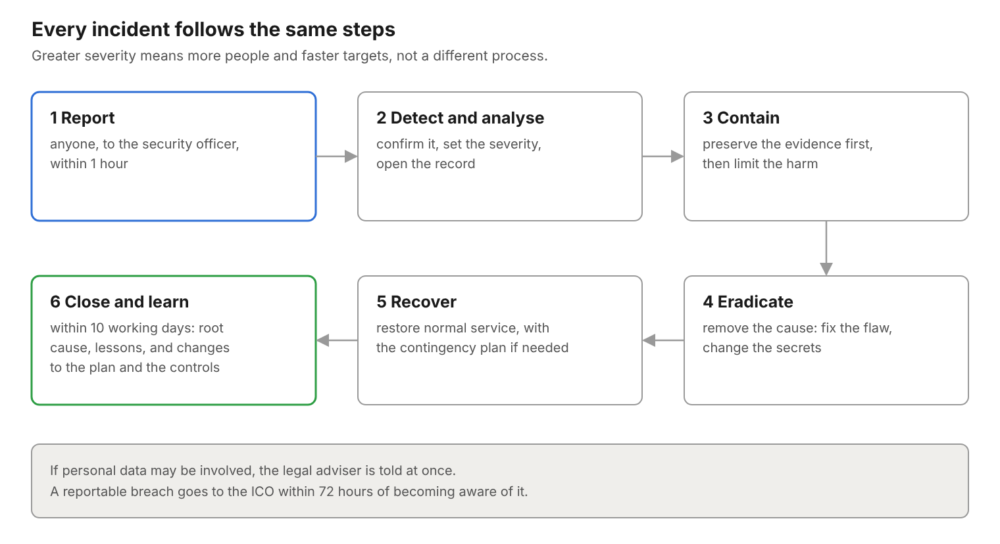

# \<System Name\> Incident Response Management

## 1 Purpose

This document sets out how \<System Name\> is designed to prepare for, find, handle and learn from security incidents, to meet the 13 Incident Response (IR) controls and enhancements in the CSS Moderate baseline.

Section 3 is the design, and is the incident response plan that IR-8 requires: the scope, who does what, preparation, how incidents are found, how severe each is and how fast it must be contained, the steps every incident follows, personal data breaches, the playbooks, evidence, reportable incidents, measures and resources, sharing information, the register, what \<Organisation\> provides, how the plan is kept, and the policy and procedures. It can be used on its own during an incident. Each subsection names the controls it helps to meet. Appendix A holds the contacts, and Appendix B lists the IR controls CSS does not select at Moderate.

## 2 Related documents

Who provides and is responsible for each control, and its status, are in \<System Security Plan\>, section 7.8 (Table 17). The tests, their results and the records an assessor will ask for are in \<Control Assessment Record\> (IR). Each control's risk is in \<Risk List\>, and what is still open is in \<Plan of Action and Milestones\>. The policy is in \<Policy\> (IR), and the steps people follow are in \<Procedures\> (IR).

## 3 The incident response plan

### 3.1 Principles

Controls met here: IR-4, IR-6, IR-6(3).

1. **Report early.** A suspected incident is reported straight away, and within 1 hour.
2. **Preserve evidence.** Contain the harm, and do not clean up first.
3. **One plan.** Everyone follows the same steps, so handling is consistent.
4. **Tell those who must know.** The legal adviser at once when personal data may be involved; \<Organisation\> and any supplier concerned.
5. **Learn.** Each incident improves the plan, the training and the controls.

These carry out the principles and rules of \<Policy\>, sections IR.3 and IR.4.

### 3.2 Scope

Controls met here: IR-8.

The plan follows CSS, which treats incident response as part of managing cyber risk across the six CSF 2.0 functions: preparation (Govern, Identify, Protect), detection (Detect), and handling and recovery (Respond, Recover). It meets the needs of a Moderate system holding items that include personal data (\<System Description\>, section 3.4), run by a small named team.

It covers the UI application, the Admin application, the API, the \<System Name\> SQL Server database, its backups and secrets, and the two Windows Server 2025 virtual servers at \<Organisation\>. Incidents in \<Organisation\>'s own services, including PingFederate and Active Directory, are handled by \<Organisation\>, with this plan for \<System Name\>'s part.

**Figure 1: The steps every incident follows**

### 3.3 How the response is organised

Controls met here: IR-7, IR-8.

**Table 1: Incident response roles**

| Role | Holder | Deputy | Part in a response |
| --- | --- | --- | --- |
| Incident lead | \[Name\], security officer | \[Name\] | Leads the response, sets the severity, keeps the record, and tells others |
| Decision maker | \[Name\], system owner | \[Name\] | Decides on stopping the service, recovery and outside reporting of crime |
| Risk decision | \[Name\], authorising official | None | Decides on the risk arising from the incident |
| Technical response | \[Name\], \[Name\], and the developers | Each other | Contain, eradicate, recover and preserve evidence |
| Audit records | \[Name\], auditor | \[Name\], auditor | Searches and exports the audit records the response needs, with a hash, and tells the incident lead what they show. The auditor is the only role that reads the audit log |
| Legal | \[Name\] | \[Deputy to be named\] | Decides whether to tell the ICO and the people affected, and makes the reports |
| Support | \[Name\], \<Organisation\>'s security contact | \[Name\] | \<Organisation\>'s monitoring, network and forensic help |

Contact details are in appendix A.

The security officer, as incident lead, is responsible for incident response, and is the first point of help for every user, giving advice on handling and reporting an incident. \<Organisation\>'s security contact gives monitoring, network and forensic help (section 3.15).

The targets in section 3.6 for Critical and High incidents run in clock hours, so someone must be reachable outside working hours. \<Organisation\> provides that out of hours route: \[out of hours route\].

### 3.4 Preparation

Controls met here: IR-2, IR-2(3), IR-3, IR-3(2), IR-4, IR-4(1), IR-6(1), IR-7(1), IR-8.

Preparation covers the CSF 2.0 Govern, Identify and Protect functions as they apply to incidents.

1. **People:** each role holder is trained within 30 days of taking the role and every 12 months (PRO-IR-3). The training covers this plan, the severity levels, the playbooks in section 3.9, preserving evidence, the breach steps in section 3.8, and the contacts. It is module M7 of the role curriculum (\<Awareness and Training Management\>, section 3.4), and the training register shows who is trained (\<Awareness and Training Management\>, section 3.8). After a change to the plan that alters a person's part, that person is briefed on it. The training content is reviewed every 12 months, and after a plan change or an incident.
2. **Exercises:** a tabletop exercise every 12 months, held with the contingency plan (\<Contingency Planning Management\>, section 3.10), the first within 30 days of the servers being built and before production. \<Organisation\>'s security contact and IT service desk take part. Each exercise walks through one playbook from report to closing, and ends with an after-action report on TPL-11.
3. **Assets and baseline:** the components and baseline in \<Configuration Management\>, sections 3.4 and 3.5, show what normal looks like.
4. **Tools:** ServiceNow, and the audit records and logs in section 3.10. ServiceNow holds each incident's record, timeline, actions and evidence list, and reminds the owner of each action. A report raises a ticket there, which notifies the security officer. Users raise a request for help there, and see its progress. If ServiceNow is out of use, reports are made by phone or email, users ask the security officer directly for help, and the record is form TPL-10, kept by hand.
5. **Contacts:** appendix A, checked at each review and exercise.
6. **Copies:** each role holder keeps a copy of this plan and the contacts that can still be read if the document store, ServiceNow or email is out of use, such as a printed copy.

### 3.5 Detection sources

Controls met here: IR-4.

**Table 2: How incidents are found**

| Source | What it shows | Who watches |
| --- | --- | --- |
| User and staff reports | Anything that looks wrong (section 3.11) | Security officer |
| Weekly audit log review (\<Procedures\> (AU); \<System Description\>, P-08) | Refused access, changes to schemas and their groups, large exports; failed sign-ins and lockouts from \<Organisation\>'s PingFederate and Active Directory records | The auditor, who reports anything suspicious to the security officer. The security officer does not read the audit log |
| Alerts (\<System Description\>, P-27) | The eight alert events: repeated failed sign-ins; a break in the audit chain; malware detected; a person added to an administrator group; a bulk export above a set size; an administrator sign-in out of hours; an audit logging failure; and an unexpected change to the software | Security officer |
| Microsoft Defender on both servers | Malicious code | Windows server administrator |
| Backup and integrity checks (SyOps C8, C12) | Failed backups, changed stored files or release packages | Database and Windows server administrators |
| \<Organisation\>'s monitoring (EV-IR-01) | Network and directory events | \<Organisation\>'s security contact |
| Supplier and NCSC advisories | Vulnerabilities in components \<System Name\> uses | Security officer |

### 3.6 Severity and targets

Controls met here: IR-4.

The incident lead sets the severity when the incident is confirmed, and may raise or lower it as facts emerge.

**Table 3: Severity**

| Severity | Examples | Work starts within | Contained within | Who is told |
| --- | --- | --- | --- | --- |
| Critical | Personal data breach likely to harm people; ransomware; a privileged account compromised | 1 hour | 4 hours | System owner, authorising official, legal adviser, \<Organisation\>'s security contact |
| High | A user account compromised; a secret exposed; access to items someone should not see | 4 hours | 1 working day | System owner, \<Organisation\>'s security contact; legal adviser if personal data is involved |
| Medium | Malware stopped by Defender; repeated failed sign-ins; a supplier advisory affecting \<System Name\> | 1 working day | 5 working days | System owner |
| Low | A single policy breach with no data exposed | 5 working days | As planned | Recorded only |

### 3.7 Handling an incident

Controls met here: IR-4.

Every incident follows these steps, the same severity table and the same record, TPL-10, so that handling is consistent. Greater severity means more people and faster targets, not a different process.

1. **Detect and analyse:** the incident lead confirms whether a report is an incident, sets its severity, and opens a record on TPL-10.
2. **Contain:** limit the harm, for example by disabling an account and ending the person's PingFederate sign-in, removing a group membership, or isolating a server. Preserve evidence first (section 3.10).
3. **Eradicate:** remove the cause, for example by fixing a flaw or changing secrets.
4. **Recover:** restore normal service, invoking \<Contingency Planning Management\> if needed. The incident plan leads while the outage may be an incident, with the contingency plan in support, and recovery uses a backup taken before the compromise (\<Contingency Planning Management\>, section 3.6.2).
5. **Close and learn:** within 10 working days of containment, the incident lead records the root cause and lessons, and updates this plan, the training, \<Risk List\> and \<Plan of Action and Milestones\> (PRO-IR-7).

### 3.8 Personal data breaches

Controls met here: IR-4, IR-6, IR-8(1).

A personal data breach is any security incident that leads to the accidental or unlawful loss, change, disclosure of, or access to personal data.

1. **Tell the legal adviser at once.** The security officer tells the legal adviser as soon as personal data may be involved.
2. **72 hours from becoming aware.** If the breach is likely to put people's rights and freedoms at risk, the legal adviser tells the ICO within 72 hours of the organisation becoming aware of it (\<System Description\>, P-21), even if not all details are known. A later report gives the reasons for the delay.
3. **Assess and reduce the harm.** The legal adviser and the security officer judge how the breach could harm the people concerned, such as distress, discrimination, fraud or the loss of confidentiality, and what would reduce it: getting copies back or deleted, changing access, and telling people what to watch for.
4. **Tell the people affected** without undue delay when the risk to them is high, unless the data was protected, for example by encryption, so that it cannot be read.
5. **Record every breach** in the register in section 3.14, whether or not it is reported: the facts, the effects, the action taken, and, if not reported, why.
6. **What the ICO report holds:** what happened, the kinds and rough numbers of people and records, the likely effects, what is being done, and the contact details of the data protection officer, or of the legal adviser if no officer is required (UK GDPR, Article 33(3)(b)).

### 3.9 Playbooks

Controls met here: IR-4.

**Table 4: Playbooks**

| Incident | Contain | Eradicate and recover | Usual severity |
| --- | --- | --- | --- |
| Stolen or guessed password | Ask \<Organisation\>'s service desk to disable the Active Directory account and end the person's PingFederate sign-in, so that \<System Name\> refuses them at the next group lookup; check the audit records for what was read or exported | \<Organisation\>'s service desk resets the password and second factor under PRO-IA-3; access returns once identity is checked | High; Critical for an administrator |
| Exposed secret (token signing key, audit chain key or a data protection key ring) | Change the secret at once (\<System Description\>, P-10); replacing an application's key ring makes every user of it sign in again. There is no database password: the API uses Windows authentication | Find where it was exposed and remove it; check the audit records for misuse since | High |
| Compromise of PingFederate or of Active Directory accounts, reported by \<Organisation\> | Ask \<Organisation\> to disable the accounts affected and end their PingFederate sign-ins, or to end every PingFederate sign-in to \<System Name\> if it cannot say who; ask \<Organisation\> which accounts and groups were touched | Check the audit records for what those accounts did; check the members of \<System Name\>'s groups against the requests authorised in ServiceNow; let people back in once \<Organisation\> confirms the accounts are safe | High; Critical for a privileged account |
| Ransomware or destructive attack on a server | Isolate the server through \<Organisation\>; do not power off before evidence is taken | Rebuild and restore from a backup taken before the compromise (\<Contingency Planning Management\>, section 3.6.2); change every secret | Critical |
| Bulk export or download misuse | The schema's Data Owner removes the person from the schema's Active Directory group, or \<Organisation\>'s service desk disables the account and ends the person's PingFederate sign-in | Work out what left, with the export audit records; treat as a personal data breach if items holding personal data were included | High; Critical if personal data |
| Audit record tampering | Export the audit records with a hash before anything changes; restrict database access | Compare with the last exported copy and backups; fix the cause | High |
| Malicious file uploaded, despite the scan before storing | Remove access to the item; stop further uploads if needed | Scan, remove, and check who opened it | Medium; High if opened |
| Item in the wrong place: filed in the wrong schema, or sent or shown to the wrong person | Remove access to the item; find who viewed or exported it, from the audit records | Ask anyone who received a copy to delete it and confirm; file the item in the right schema; treat it as a personal data breach if it holds personal data (section 3.8) | Medium; High if the item is Restricted or holds personal data |
| Lost or stolen laptop, phone or printout | \<Organisation\> locks or wipes the device and ends the person's PingFederate sign-in; for a printout, find out which items it held | Confirm the device was encrypted; check the audit records for what the user viewed or exported; treat personal data as a possible breach (section 3.8) | Medium; High if unencrypted or holding personal data |
| Physical intrusion, fire, flood or power loss at a data centre | \<Organisation\> secures the site and tells the security officer (\<Procedures\>, PRO-PE-2); take evidence before anything is moved | Invoke the contingency plan if the site is lost (\<Contingency Planning Management\>); after an intrusion, check the servers and disks for tampering, and change secrets | High |

### 3.10 Evidence and forensic readiness

Controls met here: IR-4.

**Table 5: Evidence sources**

| Source | Where it is kept | Kept for | Notes |
| --- | --- | --- | --- |
| Audit records | The \<System Name\> database, table dbo.AuditLog | 12 months online and 12 months in an offline archive (\<Audit and Accountability Management\>; \<System Description\>, P-07) | Times stored in UTC; each record is chained to the one before |
| Application logs | Each application's log on the application server, forwarded to central logging | 30 days (\<Audit and Accountability Management\>, section 3.10) | Errors and events that add to the audit records; no personal data |
| Windows and SQL Server logs | The servers, and \<Organisation\>'s central service if it takes them (EV-AU-01) | As \<Organisation\> sets; 12 months is expected (\<Audit and Accountability Management\>, section 3.7) | Operating system and database events |
| PingFederate and Active Directory records | \<Organisation\> | As \<Organisation\> sets (EV-AU-05) | Sign-in attempts and changes to group members |
| Backups | The second site (\<Contingency Planning Management\>, section 3.8) | 14 daily, 8 weekly, 12 monthly (\<System Description\>, P-15) | A snapshot of the state before an incident |

1. **Before changing anything,** export the evidence and record its SHA-256 hash, and note it on TPL-10 with who took it and when.
2. **Time:** all times are UTC. Check each system's clock against a trusted source before building a timeline; the servers take time from \<Organisation\>, within 1 second of UTC (EV-AU-02; \<System Description\>, P-09).
3. **Custody:** each piece of evidence is listed on TPL-10 with who holds it, where, and each hand-over.
4. **Personal data in evidence** is handled as Restricted and kept only as long as the incident needs.

### 3.11 Reportable incidents

Controls met here: IR-6, IR-8.

An event is anything seen in \<System Name\> or reported about it. It becomes an incident when the incident lead confirms that it harms, or may harm, the confidentiality, integrity or availability of \<System Name\> or its information, or breaks a security rule. People report what they suspect; they do not wait to be sure. Everyone reports a suspected incident to the security officer within 1 hour (\<System Description\>, P-21), and the rules of behaviour repeat this (\<Security Operating Procedures\>, Part A).

These must be reported: suspected account misuse; access to items by someone who should not have it; an exposed password or secret; malicious code; an attack on the system; loss or unexpected change of items, stored files or audit records; and a failure of logging or backups. Anything else that looks wrong should be reported too.

### 3.12 Measures and resources

Controls met here: IR-5, IR-7, IR-8.

**Table 6: Measures**

| Measure | Target |
| --- | --- |
| Time from noticing to reporting | Within 1 hour |
| Time from reporting to containment | As section 3.6 for the severity |
| Time to recover | Within the contingency plan's recovery time objective of 72 hours (\<System Description\>, P-12) |
| Incidents closed with lessons recorded within 10 working days | All |
| Repeat incidents with the same root cause | None |

The measures are reported monthly under \<Procedures\>, PRO-CA-5. The resources are the people in section 3.3, ServiceNow, and the evidence sources in section 3.10. \<Organisation\>'s security contact is the first route for forensic help (EV-IR-01). \[Whether an outside forensic firm is kept on call, and its budget\].

### 3.13 Sharing information

Controls met here: IR-6, IR-6(3), IR-8.

Information is shared with \<Organisation\>'s security contact, any affected supplier, and the ICO and the people affected through the legal adviser. The security officer tells \<Organisation\>'s security contact, and any other supplier whose product or service is involved, using the supplier register (\<Supply Chain Risk Management\>, section 3.5). \<Organisation\> in turn reports a compromise on its side to the security officer within 24 hours. Crime or a significant cyber attack is reported by the system owner to the NCSC or to Report Fraud, the national police reporting service that replaced Action Fraud. Anything else goes through the system owner. Only \[\<Organisation\> communications contact\] speaks to the press or the public about an incident, with the system owner's agreement. If ServiceNow or email may be compromised, use the phone numbers in appendix A. This document is Restricted, and is kept in the restricted document store with the other records.

### 3.14 Incident and breach register

Controls met here: IR-5.

Incidents and personal data breaches are listed here, each with its TPL-10 record: what happened, the severity, the timeline, the evidence, the actions and the lessons. The measures in section 3.12 are reported each month.

**Table 7: Incident and breach register**

| Reference | Opened | Summary | Severity | Personal data breach | Status |
| --- | --- | --- | --- | --- | --- |
| \[Incident reference\] | \[date opened\] | \[what happened\] | \[severity\] | \[yes or no\] | \[status\] |

### 3.15 What \<Organisation\> provides

Controls met here: IR-4, IR-4(1), IR-6, IR-6(1), IR-6(3), IR-7, IR-7(1).

**Table 8: Asked of \<Organisation\>**

| Provided | Controls | What \<System Name\> relies on | Evidence asked |
| --- | --- | --- | --- |
| Its own incident process, and a route for \<System Name\>'s reports | IR-6, IR-6(3) | The security contact takes a report at any time, and tells \<System Name\>'s security officer of a compromise on its side within 24 hours | EV-IR-01, EV-SR-01 |
| Help during an incident | IR-7, IR-4 | Monitoring, network and forensic help; isolating a server; disabling an account; locking or wiping a device | EV-IR-01 |
| ServiceNow, for incident records and reports | IR-4(1), IR-6(1), IR-7(1) | A workflow built to \<System Name\>'s design | None |
| Its monitoring of the network, PingFederate and Active Directory | IR-4 | Events that show an attack on \<System Name\> reach the security officer | EV-AU-01, EV-AU-05 |

### 3.16 Keeping the plan

Controls met here: IR-8.

1. **Review and approval.** The Head of Cyber reviews and approves the plan every 12 months and after an incident.
2. **Copies.** Copies go to the security officer, the system owner, the administrators and the authorising official, and to \<Organisation\>'s security contact. Each keeps a copy that can be read when the document store is out of use (section 3.4).
3. **Updates.** The plan is updated after each incident and exercise (PRO-IR-7), and when a system change affects it. Changes are told to the same people, with the change record. Version control records every change.
4. **Protection.** The plan is Restricted, and kept in the restricted document store, where only the people in item 2 can read it and only the security officer can change it.

### 3.17 Policy and procedures

Controls met here: IR-1.

\<Policy\> (IR) and \<Procedures\> (IR) meet IR-1. Who they are shared with is in \<Policy\>, section IR.6. Their ownership, approval, review and records follow the rules common to every policy in \<Policy\>, section 1.1.

## Appendix A Contacts

Use the phone if ServiceNow or email may be compromised.

**Table 9: Contacts**

| Contact | Name | Phone | Email or route |
| --- | --- | --- | --- |
| Security officer | \[Name\] | \[phone to add\] | \[email to add\] |
| System owner | \[Name\] | \[phone to add\] | \[email to add\] |
| Authorising official | \[Name\] | \[phone to add\] | \[email to add\] |
| Legal adviser | \[Name\] | \[phone to add\] | \[email to add\] |
| Windows server administrator | \[Name\] | \[phone to add\] | \[email to add\] |
| Database administrator | \[Name\] | \[phone to add\] | \[email to add\] |
| \<Organisation\>'s security contact | \[Name\]; deputy \[Name\] | \[phone to add\] | \[email to add\] |
| \<Organisation\>'s IT service desk | \[name to add\] | \[phone to add\] | \[email to add\] |
| Information Commissioner's Office | Breach reporting | \[phone to add\] | ICO online breach report form |
| National Cyber Security Centre | Incident reporting | \[phone to add\] | NCSC online incident report |
| Report Fraud, which replaced Action Fraud | Cyber crime and fraud reporting | 0300 123 2040 | Report Fraud online report |

## Appendix B IR controls outside the Moderate baseline

CSS does not select these in the Moderate security baseline, so they are not assessed in this family. Two are in the CSS privacy baseline and apply because \<System Name\> holds personal data: they are assessed with the PT family. Some of the design goes further than the baseline, and Table 10 says where.

**Table 10: IR controls not selected at Moderate**

| Control | What it adds | \<System Name\>'s position |
| --- | --- | --- |
| IR-2(1), IR-2(2) Simulated Events; Automated Training Environments | Training that simulates an incident, in an automated environment | Not required. The tabletop exercise walks through a playbook |
| IR-2(3) Breach | Training on finding, handling and reporting a personal data breach | Privacy baseline, so it applies. Covered by modules M7 and M9, and assessed with the PT family |
| IR-3(1), IR-3(3) Automated Testing; Continuous Improvement | Automated tests of the capability, and measures used to improve it | Not required. Done in part: the measures in section 3.12 and each after-action report feed the plan |
| IR-4(2), IR-4(3), IR-4(5), IR-4(9) Dynamic Reconfiguration; Continuity of Operations; Automatic Disabling of System; Dynamic Response Capability | The system changes itself, or is shut down, in response to an incident | Not required. Nothing is automatic: people decide, to the targets in section 3.6 |
| IR-4(4) Information Correlation | Incident information correlated across the organisation | Not required. Done in part: the monthly review reads the incident records with the audit findings and the vulnerability results (\<Procedures\>, PRO-CA-5) |
| IR-4(6), IR-4(7) Insider Threats | A capability for incidents caused by insiders, coordinated across the organisation | Not required. Done in part: the playbook for bulk export or download misuse, and \<Organisation\>'s disciplinary process |
| IR-4(8), IR-4(10) Correlation with External Organizations; Supply Chain Coordination | Handling coordinated with outside bodies and suppliers | Not required. Reports to suppliers are covered by IR-6(3) |
| IR-4(11) Integrated Incident Response Team | A team that can be sent out within a set time | Not required. The roles in section 3.3 are a small named team |
| IR-4(12), IR-4(13) Malicious Code and Forensic Analysis; Behavior Analysis | Analysis of malicious code and of attackers' behaviour | Not required. Any such work would be done by \<Organisation\> or an outside firm (section 3.12) |
| IR-4(14) Security Operations Center | A security operations centre | Not required. \<Organisation\> is asked what monitoring it provides (EV-IR-01) |
| IR-4(15) Public Relations and Reputation Repair | Managing public relations after an incident | Not required. Section 3.13 says who may speak to the press and the public |
| IR-5(1) Automated Tracking, Data Collection, and Analysis | Incidents tracked and analysed automatically | Not required. ServiceNow gives part of it |
| IR-6(2) Vulnerabilities Related to Incidents | Weaknesses found through incidents are reported | Not required. Done in design: closing an incident updates the Risk List and the POA&M (PRO-IR-7) |
| IR-7(2) Coordination with External Providers | A working relationship with outside providers of protection | Not required. \<Organisation\> is the only provider (section 3.15) |
| IR-8(1) Breaches | The plan covers personal data breaches: whether to notify, the harm to people, and the law that applies | Privacy baseline, so it applies. Met by section 3.8, and assessed with the PT family |
| IR-9, IR-9(2), IR-9(3), IR-9(4) Information Spillage Response | Handling information that reaches a system or person not cleared for it | Not required. Done in part: the playbook for an item in the wrong place (section 3.9) |
| IR-9(1), IR-10 | Withdrawn by CSS | Not applicable |
