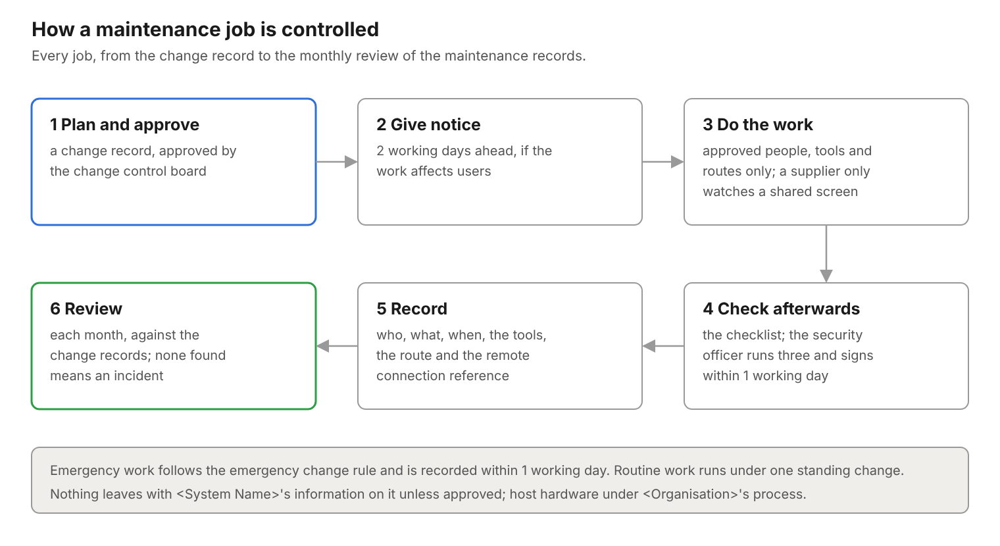

# \<System Name\> Maintenance Management

## 1 Purpose

This document is the maintenance design for \<System Name\>. It covers the Maintenance (MA) family of the CSS Moderate baseline, 9 controls and enhancements.

Section 3 is the design: the principles, who maintains what, how a job is controlled from approval to review, the routes for remote maintenance, the approved tools and people, what may leave and how, the components whose support matters, and what \<Organisation\> provides.

## 2 Related documents

Which section of this design meets each control, who is responsible for it and its status are in \<System Security Plan\>, section 7.9 (Table 18). The assessment is in \<Control Assessment Record\> (MA), the risks are in \<Risk List\>, and open work is in \<Plan of Action and Milestones\>. The policy is in \<Policy\> (MA), and the steps people follow are in \<Procedures\> (MA). Fixing flaws and releasing new versions follow their own designs, in \<System and Information Integrity Management\> and \<Configuration Management\>, and use the same change records.

## 3 The design

### 3.1 Principles

1. **Approve first.** No maintenance happens without approval.
2. **Known people, tools and routes.** Only those on the approved lists are used.
3. **Protect data.** Nothing leaves with \<System Name\>'s information on it unless it is approved and protected.
4. **Check and record.** Controls are checked after the work, and every job is recorded and reviewed.

These carry out the principles and rules of \<Policy\>, sections MA.3 and MA.4.

Maintenance means preventive and corrective work, repair and replacement, done on site or remotely. \<System Name\> runs on two virtual servers at \<Organisation\>, so there is no \<System Name\> hardware to repair: \<Organisation\> maintains the hosts beneath them.

### 3.2 Who maintains what

**Table 1: Who maintains what**

| Part | Maintained by | Route | Record |
| --- | --- | --- | --- |
| Hardware and hypervisor | \<Organisation\> | \<Organisation\>'s own process | \<Organisation\>'s report |
| Windows Server on both servers | \[Name\], Windows server administrator | Change record, route R1 | Maintenance record |
| SQL Server 2022 | \[Name\], database administrator | Change record, route R2 | Maintenance record |
| \<System Name\> schemas, settings and diagnostics | \[Name\], administrator | Change record, route R3 | Maintenance record |
| Applications, and changes to the database's structure | Developers; the database administrator applies structure changes from the release | Change record and release test, route R4 | Change record |
| The services \<System Name\> depends on: PingFederate, Active Directory, the network and firewall, the time service and the backup store | \<Organisation\> | \<Organisation\>'s own process. It is asked to tell the system owner before work that affects \<System Name\> | \<Organisation\>'s notice |

\<Organisation\>'s engineers maintain the hosts over route R5 and hold no account on the two servers. If one ever needs to work on a server, they work as a supplier does, through an administrator's session (section 3.6). \<System Name\>'s change records and the maintenance record cover the work of \<System Name\>'s own people; \<Organisation\>'s maintenance of the hosts and services is approved, monitored and recorded under its own process, which \<System Name\> inherits.

### 3.3 How a maintenance job is controlled

**Figure 1: How a maintenance job is controlled**

**Table 2: Steps of a maintenance job**

| Step | What happens | Who | Record |
| --- | --- | --- | --- |
| 1 Plan and approve | A change record names the component, the work, who will do it, the tools, the route and any downtime. The change control board approves it before work starts (\<Configuration Management\>, sections 3.7 and 3.8). The routine work in the preventive schedule runs under one standing change: the board approves the schedule, reviews it every 12 months and whenever it changes, and each run cites that change. Emergency work follows the emergency change rule: the system owner or their deputy approves it before it is made, and it is recorded within 1 working day | Administrator; the change control board, or the system owner or deputy in an emergency | Change record |
| 2 Give notice | Users are told at least 2 working days before planned work that affects them | System owner | Notice |
| 3 Do the work | Only approved people, with approved tools, over an approved route. A supplier, or anyone else not on the list, takes part only through an approved administrator's session, which the administrator drives (section 3.6) | Administrator | Session log, for remote work |
| 4 Check afterwards | The checks below | Administrator; the security officer runs the sign-in, audit chain and checksum checks, and signs within 1 working day | Maintenance record |
| 5 Record | The job is recorded with the fields below | Administrator | Maintenance record |
| 6 Review | Every record is compared with its change record each month. Maintenance with no change record is raised as a security incident | Security officer | Maintenance record |

**The check after maintenance** confirms that: the services answer; anonymous access is refused; sign-in works and is recorded; the audit chain is intact; the stored files match their checksums; Defender is running; backups still run; the time is right; the settings are unchanged, with App Control for Business enforced; and nothing the job needed is left behind, such as an added group membership, login or copied tool. The administrator who did the work runs most of them. The security officer runs the sign-in, audit chain and checksum checks, because the administrators hold no application role and nobody but the auditor reads the audit log. The method and the expected result of each are in \<Procedures\> (MA).

**The maintenance record** holds: the date and time; the component; what was done; who did it, their organisation and contact; the administrator who drove a supplier's session; whether on site or remote, with the route and session reference; the tools used; parts removed or replaced, with any case or return number; data taken away; the inspection of the tools and the scan of any media; and the check afterwards with its reviewer. The maintenance record form in \<Record Templates\> has a field for each. Each change to the database's structure is also recorded, with its version and release. Maintenance records are kept for 3 years.

**Routine work** follows the preventive schedule in \<Procedures\> (MA): database upkeep, disk space, updates, certificates, keys and secrets, old logs and support dates, each with its owner and how often. The change control board approves the schedule as a standing change (step 1).

### 3.4 Remote maintenance routes

All administration of the servers is remote maintenance, done over a network: they are at \<Organisation\>'s data centre, and no \<System Name\> role enters it. Table 3 gives the routes, and section 3.5 the tools.

**Table 3: Remote maintenance routes**

| Route | Used by | Tool | Logged in |
| --- | --- | --- | --- |
| R1 Windows administration | Windows server administrator; a supplier or \<Organisation\>'s engineer only by watching the administrator's session (section 3.6) | \[Remote desktop or PowerShell remoting\] | Windows Security log and \[\<Organisation\>'s route log\] |
| R2 Database administration | Database administrator | sqlcmd and SQL Server Management Studio | SQL Server Audit and error logs, and route R1's logs |
| R3 Admin application | Administrator | Browser | \<System Name\> audit log |
| R4 Application releases | Developers | Release package | Change record |
| R5 Hardware and hypervisor | \<Organisation\> | \<Organisation\>'s tools | \<Organisation\>'s records |

The path, sign-in and ending of each route are below.

**R1 Windows administration**

- **Network path:** From the administrators' managed devices, only over \<Organisation\>'s managed administration route to the servers' management interface (flow F11); from outside the office, through the VPN first
- **Sign-in:** Multi-factor authentication on the managed administration route, and on the VPN as well from outside the office; then the administrator's named Windows account
- **How it ends:** Sign out of Windows rather than only disconnect, so that no session is left open on the server; close the route connection; end any screen sharing

**R2 Database administration**

- **Network path:** Route R1 (flow F11) to the database server, then SQL Server locally
- **Sign-in:** As R1; then SQL Server by Windows authentication, with the administrator's own account as a named login, never the API's. SQL Server accepts Windows authentication only
- **How it ends:** Close the SQL Server session, then end the R1 session as above

**R3 Admin application**

- **Network path:** \<Organisation\>'s managed administration route only, over HTTPS (F2); from outside the office, through the VPN first
- **Sign-in:** Sign-in through PingFederate, with multi-factor authentication
- **How it ends:** Use Sign out (FR-084) and lock the device. Otherwise the sign-in ends 8 hours after sign-in, never later than PingFederate's sign-in

**R4 Application releases**

- **Network path:** No direct route; the Windows server administrator installs the release over R1
- **Sign-in:** Not applicable
- **How it ends:** Not applicable

**R5 Hardware and hypervisor**

- **Network path:** \<Organisation\>'s internal management network
- **Sign-in:** \<Organisation\>'s controls
- **How it ends:** \<Organisation\>'s process

The change control board approves remote work in the change record, which names the route, or the system owner or deputy in an emergency (section 3.3). Strong authentication comes from the multi-factor sign-in on the managed administration route, and from PingFederate's on R3: a Windows password alone never opens a session. A supplier never holds a credential: an approved administrator drives the session and the supplier watches and guides over a shared screen (section 3.6). For each session the logs must show the start and end time, the account, the source address, the route, and the actions where the tool records them, and the session reference goes on the maintenance record. The security officer reviews the logs weekly.

### 3.5 Approved maintenance tools

Maintenance tools are those used to diagnose and repair \<System Name\>: those on the administrators' managed devices, and any tool installed or copied onto a server for maintenance. The parts of Windows Server and SQL Server in the baseline are listed below too, but are controlled as the baseline is, by change control and the drift check (\<Configuration Management\>).

The Windows server administrator keeps this list as part of the approved software list (\<Configuration Management\>, section 3.15), and reviews it with the system owner every 12 months. The list records the version, publisher and file hash of each tool. A new tool on the servers is added only through a change: the system owner approves the request, and the change that installs it adds it to the App Control for Business policy. App Control then refuses to run any tool on the servers whose publisher or hash does not match its rule, so a modified tool cannot run there. A tool from outside the baseline, such as one on an administrator's managed device or one copied onto a server for a job, has its version, publisher and file hash compared with the list before use, and the result is recorded on the maintenance record. A tool found modified is handled as a security incident.

No removable media reach the servers: no USB device is passed through to the VMs (\<Policy\>, section MP.4, R10). Any file or disk image copied onto a server for maintenance is scanned by Microsoft Defender before it is used, the scan is recorded on the maintenance record, and the file is removed when the job ends.

**Table 4: Approved maintenance tools**

| Tool | Use | Where | Who |
| --- | --- | --- | --- |
| \[Remote desktop or PowerShell remoting\] | Administer the servers | Over route R1 | Windows server administrator |
| Windows built-in tools: Event Viewer, Services, Windows Update, Defender | Diagnose, update and scan. Part of the baseline | Both servers | Windows server administrator |
| Windows service control | Start, stop and inspect the three application services. Part of the baseline | Application server | Windows server administrator |
| \[Screen-sharing tool\] | Show an administrator's session to a supplier, who can watch but not type (section 3.6) | The administrator's managed device | Windows server or database administrator |
| sqlcmd and SQL Server Management Studio, SQL Server 2022 | Maintain, back up and restore the database | Database server | Database administrator |
| \[Database administration tool, if any\] | \[Use\] | \[Where\] | Database administrator |
| \<System Name\> diagnostics page | Fixed checks that read no item content | Admin application | Administrator |

Not approved on the servers: any shell or package manager carried inside a release, and any tool not in this table. App Control for Business blocks them.

**No maintenance pages.** No page in \<System Name\> changes the database's structure, repairs data in bulk or deletes data outside the normal, audited functions. The Admin application offers only fixed diagnostics that read no item content, and each run is written to the audit log. They are run as part of an approved maintenance job or an incident, whose reference is recorded with the run on the maintenance record, and the auditor sees each run in the weekly review. A change to the database's structure is a script in a release, applied by the database administrator under an approved change record, after a checked backup. Database maintenance, like any direct query of the database, is done only under an approved change or incident; SQL Server Audit records each read of the item tables by any login other than the API's, and the auditor reviews it weekly (\<Risk List\>, R-AC-01). No second person is needed (D-MA-02). An item's details are corrected, a file replaced or an item deleted only through the application's own functions, each of which is audited.

### 3.6 Approved maintenance people

The system owner approves this list. The Windows server administrator checks it when someone leaves, and every 12 months.

Before giving access, the administrator checks that the person is on the list, is screened, has signed Part B of the rules of behaviour, and has a named account, granted through the access process in \<Access Control Management\>. Only people on the list work without supervision.

A supplier, \<Organisation\>'s engineer, or anyone else not on the list holds no account on the servers or in \<System Name\>, as temporary and emergency accounts are prohibited (D-MA-01). They watch and guide over a shared screen while the Windows server administrator or the database administrator, who is on the list and competent in the work, signs in and drives the session, and can end it at once. That administrator supervises the work. The supplier receives no copy of \<System Name\>'s data, apart from a support copy approved under section 3.7. The administrator keeps item content and personal data off the shared screen where the job allows; where it does not, the supplier must be under a contract with UK GDPR Article 28 terms, as for a support copy.

**Table 5: Approved maintenance people**

| Person or organisation | Role, and what they maintain | Screened; Part B signed | Account and supervision |
| --- | --- | --- | --- |
| \[Name\] | Windows server administrator: both servers | \[Date\]; \[Date\] | Named Windows administrator account. Supervised: no |
| \[Name\] | Database administrator: SQL Server 2022 | \[Date\]; \[Date\] | Named SQL Server login. Supervised: no |
| \[Name\] | Administrator: schemas, settings and diagnostics, in the Admin application | \[Date\]; \[Date\] | Their Active Directory account, in the administrators' group. Supervised: no |
| \[Developers\] | Developers: applications, through releases | \[Date\]; \[Date\] | No access to the servers. Supervised: not applicable |
| \<Organisation\>'s engineers, \[names\] | Hardware and hypervisor: the hosts | \<Organisation\>'s screening; Part B not applicable | \<Organisation\>'s own, on the hosts only; none on the servers. Supervised: on the hosts, no; on a server, only through an administrator's session |
| \[Supplier\] | \[Role\]: \[As contracted\] | Screening not required, as always supervised. Part B not applicable: bound by the contract's confidentiality terms | None: watches an administrator's shared screen. Supervised: yes, always |

### 3.7 Equipment and data that leave

**Table 6: What may leave, and how**

| What | Rule | Approved by, and record |
| --- | --- | --- |
| Hardware or a disk beneath the servers | The hosts are \<Organisation\>'s and shared, and the servers' disks are encrypted with BitLocker. \<Organisation\>'s own process approves the removal, and \<Organisation\> first sanitises the hardware of all \<System Name\> information, including configuration and secrets, by the method in \<Media Protection Management\>, section 3.6, and confirms it with a certificate. It tells the system owner beforehand where it can, and afterwards in every case, with the certificate (D-MA-03) | \<Organisation\>'s data centre, under its own process. Record: \<Organisation\>'s record; the maintenance record and the media record for the notice and certificate |
| Equipment used for maintenance: the administrators' managed devices, and a supplier's own device | Nothing from \<System Name\> is kept on an administrator's device after the job, apart from an approved support copy; the device stays under \<Organisation\>'s management. A supplier sees a shared screen and receives no copy, so their equipment holds no \<System Name\> information. \<Organisation\>'s engineers' equipment at the data centre follows its own process | System owner, for any copy. Record: maintenance record |
| A copy of data, a database dump, a log or a screenshot, sent for maintenance or support | Kept to the minimum, with personal data removed where possible; encrypted; sent by an approved route; and the receiver confirms deletion when it is no longer needed. If personal data cannot be removed, the legal adviser agrees first, and the receiver must hold it under a contract with UK GDPR Article 28 terms, in the UK | System owner; the legal adviser as well where personal data remains. Record: maintenance record or the media record |

### 3.8 Security-critical components and support

These are the components that \<System Name\>'s security depends on, taken from the critical components in \<Risk Assessment Management\>, section 3.9. PingFederate and Active Directory are critical too, but are \<Organisation\>'s, and their support is its own. \<Organisation\> provides support and parts for the hardware and the hypervisor within 24 hours of a failure, so that a restore fits the 72-hour recovery time objective. Support for Microsoft software is obtained through \<Organisation\>'s Microsoft support agreement, under which an administrator raises a case; if a component cannot be fixed in time, the server is rebuilt under \<Contingency Planning Management\>. Support dates are checked each month against the vendors' published lifecycles, software is kept on supported versions, and a replacement is planned at least 6 months before support ends.

**Table 7: Security-critical components**

| Component | Version; support ends | Support or parts within | Who |
| --- | --- | --- | --- |
| Hardware and hypervisor hosts | \[\<Organisation\>\]; \[Per \<Organisation\>'s service agreement\] | Support and parts within 24 hours | \<Organisation\> |
| Windows Server 2025, both servers, with BitLocker and App Control for Business | 2025; \[As Microsoft's published lifecycle states\] | Updates; a support case under \<Organisation\>'s agreement, \[response time, from \<Organisation\>\] | Windows server administrator |
| Microsoft SQL Server, database server | 2022; \[As Microsoft's published lifecycle states\] | Updates; a support case as above | Database administrator |
| .NET and ASP.NET Core runtime | 10.0, long-term support; \[As Microsoft's published lifecycle states\] | Updates; a support case as above | Developers |
| Microsoft Defender | \[Version\]; while Windows Server is supported | Updates; a support case as above | Windows server administrator |
| \[Key store, to be chosen\] | \[Version\]; \[As its supplier states\] | \[Supplier's support terms\] | Windows server administrator |

### 3.9 What \<Organisation\> provides

**Table 8: Provided by \<Organisation\>**

| Provided | What \<System Name\> relies on |
| --- | --- |
| Maintenance of the hardware and the hypervisor | Approved, recorded maintenance by screened engineers, with notice to the system owner of work that affects \<System Name\> |
| Approving and sanitising before host equipment leaves | Removal approved under \<Organisation\>'s process; disks and equipment sanitised by the method in \<Media Protection Management\>, section 3.6, with a certificate; the system owner told beforehand where possible and given the certificate (D-MA-03) |
| Support and parts | Within 24 hours of a failure, for the hardware and the hypervisor; a Microsoft support agreement under which \<System Name\>'s administrators can raise a case |
| The managed route administrators use | Multi-factor sign-in; a log of each session; sessions and connections that end when the work does; a firewall rule that limits the Admin application to the route; a screen-sharing tool that lets a supplier watch an administrator's session without control |
| Maintenance of the services \<System Name\> depends on | Notice before work on PingFederate, Active Directory, the network, the time service or the backup store that affects \<System Name\> |

### 3.10 Policy and procedures

\<Policy\> (MA) and \<Procedures\> (MA) are the policy and procedures for this family. Who they are shared with is in \<Policy\>, section MA.6. Their ownership, approval, review and records follow the rules common to every policy in \<Policy\>, section 1.1.
