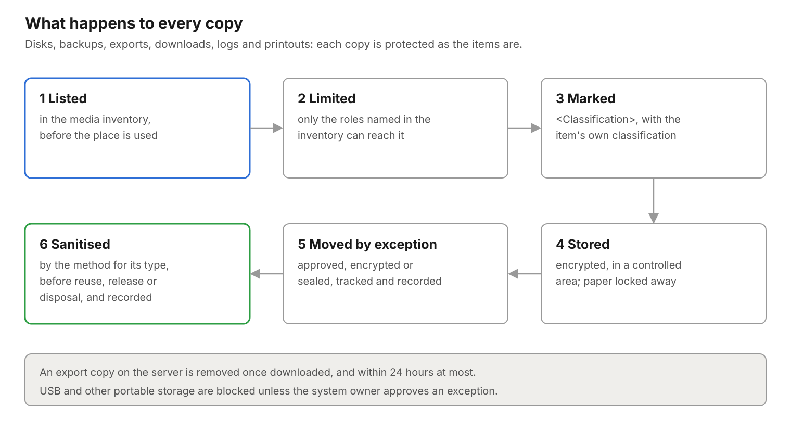

# \<System Name\> Media Protection Management

## 1 Purpose

This document sets out how \<System Name\>'s media are protected to meet the 7 Media Protection (MP) controls in the CSS Moderate baseline.

Section 3 is the design: every place the information is held outside the running application, how each is marked, stored, moved and sanitised, the limits on portable storage, what \<Organisation\> provides, and the policy and procedures. Each subsection names the controls it helps to meet. Appendix A gives the MP controls CSS does not select at Moderate.

Other documents hold the rest. Who provides and is responsible for each control, its status and its assessment result are in \<System Security Plan\>, section 7.10 (Table 19). The tests, their results and the records an assessor will ask for are in \<Control Assessment Record\> (MP). Each control's risk is in \<Risk List\>, and what is still open is in \<Plan of Action and Milestones\>. The policy is in \<Policy\> (MP), and the steps people follow are in \<Procedures\> (MP). The rules each user signs for exports, printing and copies are in \<Security Operating Procedures\>, Part A.

Values that CSS asks the organisation to define are set at corporate level by \<Organisation\>. The settings in section 3 should match those corporate values. Where one does not, it is changed in this document.

\<System Name\> is not yet built on its servers. Where section 3 notes the state now or "today", it means the tested v1.0 build and what \<Organisation\> has evidenced. Those notes show where that differs from the design.

## 2 Summary

The implementation status of each control, how it is met, who is responsible, its assessment result and the risk and plan entries for its gaps are recorded in \<System Security Plan\>, section 7.10 (Table 19).

## 3 The design

### 3.1 Principles

Controls met here: MP-3, MP-4, MP-6.

1. **Same protection.** Every copy gets the protection of the information it holds.
2. **Know where it is.** Every place \<System Name\> information is held is listed, and copies are kept only as long as needed.
3. **Marked.** \<System Name\> information is marked RESTRICTED wherever it goes.
4. **Nothing left behind.** Media are sanitised, by an approved method, before reuse, release or disposal.

These carry out the principles and rules of \<Policy\>, sections MP.3 and MP.4.

**Figure 1: What happens to every copy**

### 3.2 Media inventory

Controls met here: MP-2, MP-4.

Every place \<System Name\> information is held outside the running application, with who may reach it. It includes the audit archive, the secret store, incident evidence, the document set, managed printers and the approved locations for users' copies (D-MP-10, D-MP-11). The system owner reviews the inventory every 12 months, and adds any new place before it is used (PRO-MP-6). \<System Name\> lets only the editors of a project create an export of it, and Windows permissions limit the export folder and the logs to the Windows server administrator. A printout is shared only with people authorised to read that project.

**Table 1: Media inventory**

| Media | Holds | Protection | Who may reach it | Sanitising method (section 3.6) | State now |
| --- | --- | --- | --- | --- | --- |
| Server disks, both servers | Everything on the servers | BitLocker; \<Organisation\>'s data centre | Windows server administrator; \<Organisation\>'s hosting staff | M1 | Disk encryption planned (PA-52) |
| Database and key volumes | Documents, audit records and data protection keys | As the server disks | Database administrator; Windows server administrator | M1 | As the server disks |
| Export folder on the application server | Full copies of exported documents | Removed once downloaded and within 24 hours | Windows server administrator | M5 | Copies left unencrypted (P02 to P06, PA-86) |
| Users' managed devices | Downloads and exports | \<Organisation\>'s disk encryption and USB blocking | The user | M4 | Not evidenced (EV-MP-03) |
| Approved locations for users' copies | Exports and downloads that users keep | \<Organisation\>'s access control and encryption for the location | The user, and those the location is shared with | M5 | The locations are not named (PA-121) |
| \<Organisation\>'s managed printers | Print jobs, held until the user releases them at the printer | Secure release; \<Organisation\>'s control of the printer and its storage | The user who printed; \<Organisation\>'s staff who maintain the printer | M4 | Not evidenced (EV-MP-03) |
| Application logs | Personal data repeated from audit events | Access limited; kept 30 days (C46) | Windows server administrator | M5 | Personal data in logs (PA-75) |
| Backups, at the second site | Everything in the database | Encrypted before they leave (PA-64) | Database administrator; \<Organisation\>'s hosting staff | M2 | Not yet encrypted (R02, PA-64) |
| Support copies | Data, dumps, logs or screenshots sent for support | Approved, minimised and encrypted (\<Procedures\>, PRO-MA-7) | As approved | M5 | Not yet used |
| Audit archive, offline | Audit records older than 12 months | Encrypted, held off the database server, with its SHA-256 value recorded (\<Audit and Accountability Management\>) | Database administrator | M2 | Not built; where it is held is not yet set (EV-AU-03) |
| Secret store, and its copy at the second site | The database password, the signing key and the backup key | Readable only by the named administrators and the API's service account (\<Identification and Authentication Management\>, section 3.5) | Windows server administrator; database administrator | M5, and the secret is changed | Not built: the secrets are in settings files (PA-19) |
| Incident evidence | Audit records and logs exported during an incident | Handled as Restricted, with a hash and a record of custody (\<Incident Response Management\>, section 3.10) | Security officer; the administrators | M5 | Not yet used |
| Physical disks and backup media | \<Organisation\>'s storage under the servers | \<Organisation\>'s data centre | \<Organisation\>'s hosting staff | M3 | Not evidenced (EV-MP-01) |
| Test PCs | Sample data only, in throwaway Docker stacks | Removed after each test, with its data volumes | Developers | M5 | In place |
| The document set and the test evidence | This set of Restricted documents, and the test results | The restricted document store | The people each document is shared with | M5 | One copy, on the system owner's computer, outside the restricted store (PA-88) |
| Printouts | Printed documents | Marked, locked away, kept on site | People authorised to read that project | M6 | Not yet in use |

### 3.3 Marking scheme

Controls met here: MP-3.

All \<System Name\> information is marked RESTRICTED, \<Organisation\>'s marking (MP-3). Each document also holds its own classification (Public, Internal, Confidential or Restricted), which is shown alongside but never lowers the RESTRICTED marking. No other handling caveat is used: who may see a document is set by its project, not by a further marking. No media is exempt.

**Table 2: Where the marking goes**

| Output | How it is marked | State now |
| --- | --- | --- |
| Viewer pages | A RESTRICTED banner with the document's classification | Not built (PA-87) |
| Printouts | The banner on every page, by a print style; by hand until then | By hand (PRO-MP-1) |
| Export files | RESTRICTED in the file name, and a marking notice inside | Not built (PA-87); by hand until then |
| Other digital media | A RESTRICTED label on the media or its record | Through \<Organisation\> (EV-MP-01) |

### 3.4 Storage, export copies and users' copies

Controls met here: MP-2, MP-4.

**Table 3: Where media are stored**

| Media | Controlled area | Rule |
| --- | --- | --- |
| Server disks, volumes, backups and physical media | \<Organisation\>'s data centres | Encrypted. Reached only by the roles in section 3.2 |
| Export copies on the application server | The application server | Removed once downloaded, and within 24 hours at most. \<System Name\> is to do this itself (PA-86) |
| Users' exports and downloads | A managed device, in the locations \<Organisation\> approves: \[approved locations\] | Kept to the minimum, and deleted within 30 days once no longer needed |
| Printouts | Locked storage in \<Organisation\>'s offices | Printed only on \<Organisation\>'s managed printers with secure release. Collected at once, locked away when not in use, kept on site, and shredded when no longer needed, within 30 days if they hold personal data |

Until \<System Name\> removes export copies itself, the Windows server administrator checks the export folder each working day and deletes anything older than 24 hours. The check is made each working day, not weekly, because a weekly check would let a copy stay for up to 7 days (D-MP-10). A copy made before a weekend can still stay until the next working day: that shortfall is part of the gap registered as PA-86.

### 3.5 Transport

Controls met here: MP-5.

Media are carried physically only by exception. Each move is approved by the system owner, the media are encrypted or, for paper, sealed, an authorised courier carries them with tracking, and the move is recorded on TPL-13: from and to, the sender and receiver, the protection and the courier. Only \<Organisation\>'s hosting staff and its authorised courier carry media, and a printout does not leave the site without the system owner's approval. Copies sent over the network, such as backups to the second site, are not transport in this sense: they are protected in transit and must be encrypted first (\<Contingency Planning Management\>, section 3.8).

### 3.6 Sanitising methods

Controls met here: MP-6.

Methods follow CSS and IEEE 2883-2022, with the NCSC's guidance for the UK. Each action is recorded on TPL-13, with the tool used and how the result was verified (PRO-MP-3). Every 12 months the system owner checks a sample of \<Organisation\>'s certificates against those records. Media records are kept for 3 years (D-MP-11). That matches the training records, and covers a full authorisation cycle.

Cryptographic erase is sound only if the media were encrypted before any \<System Name\> information was written to them, and only once every copy of the key is destroyed. Both servers are therefore encrypted before \<System Name\> is installed, and the record on TPL-13 lists each copy of the key and confirms its destruction. Where either condition cannot be shown, the media are purged or destroyed instead.

The information is rated Moderate, and the methods in Table 4 are chosen to match it: physical disks are purged or destroyed, encrypted virtual disks and backups are erased by destroying their keys, and deleting a file is used only where the disk beneath it is covered by one of those.

**Table 4: Sanitising methods by media type**

| Method | Media | How | Who | Evidence |
| --- | --- | --- | --- | --- |
| M1 | Server disks and database and key volumes | Cryptographic erase: destroy every copy of the BitLocker keys, including the recovery keys held in \<Organisation\>'s protected store, then \<Organisation\> deletes the volumes | Windows server administrator, \<Organisation\> | TPL-13; \<Organisation\>'s confirmation |
| M2 | Backups and the audit archive | Cryptographic erase: destroy every copy of the encryption key, including the copy at the second site, then delete the copies | Database administrator | TPL-13 |
| M3 | Physical disks and backup media | Purge or destroy to IEEE 2883-2022 | \<Organisation\> | Certificate (EV-MP-02) |
| M4 | Users' managed devices and managed printers | \<Organisation\>'s device wipe before reuse or disposal | \<Organisation\> | \<Organisation\>'s record |
| M5 | Export copies, logs, support copies, incident evidence, copies of the document set, superseded secrets and test data | Delete; the disk beneath is covered by M1 or M4 | Windows server administrator, user, developers | TPL-8 or TPL-13 |
| M6 | Paper | Cross-cut shred to DIN 66399 level P-4 or better | Everyone | None; bulk on TPL-13 |

### 3.7 Portable storage

Controls met here: MP-7.

1. USB and other portable storage are blocked on users' devices by \<Organisation\>'s device control.
2. No USB device is passed through to either server.
3. The system owner may approve an exception on TPL-17, for a stated purpose and time, using only encrypted media issued by \<Organisation\>.
4. Portable storage with no identifiable owner must not be used. It is handed to the security officer, who records it on TPL-13.

### 3.8 What \<Organisation\> provides

Controls met here: MP-2, MP-4, MP-5, MP-6, MP-7.

**Table 5: Asked of \<Organisation\>**

| Provided | Controls | What \<System Name\> relies on | Evidence asked | State |
| --- | --- | --- | --- | --- |
| Storage of disks and backup media | MP-2, MP-4 | They stay in its data centres, reached only by its hosting staff | EV-MP-01 | Not sent |
| Transport of physical media | MP-5 | Only by exception, protected, tracked and recorded | EV-MP-01 | Not sent |
| Sanitising | MP-6 | Physical disks are purged or destroyed to IEEE 2883-2022, with a certificate; virtual disks are erased when a server is removed | EV-MP-02 | Not sent |
| Managed devices and device control | MP-4, MP-7 | Users' devices are disk-encrypted, USB storage is blocked, and no USB device is passed through to the servers | EV-MP-03, EV-AC-17 | Not sent |
| Locked storage for paper | MP-4 | Lockable storage in its offices, and a cross-cut shredder | Not yet asked | Added to EV-MP-01 |

**Today:** no request has been sent, and none of this is evidenced (PA-121).

### 3.9 Policy and procedures

Controls met here: MP-1.

1. **Policy.** \<Policy\> (MP) is a system-level policy. It is shared with everyone who uses or administers \<System Name\>. The legal adviser reviews it.
2. **Procedures.** \<Procedures\> (MP) holds six procedures, PRO-MP-1 to PRO-MP-6. They are shared with the same people.
3. **Owner.** The system owner manages the policy and procedures.
4. **Review.** The policy is reviewed every 12 months, and after a significant incident, audit finding or system change. The procedures are reviewed every 12 months, and after a change to the steps.
5. **Records.** The documents are under version control.

## Appendix A MP controls outside the Moderate baseline

CSS does not select these at Moderate, so they are not assessed. Some of the design goes further than the baseline, and Table 6 says where.

**Table 6: MP controls not selected at Moderate**

| Control | What it adds | \<System Name\>'s position |
| --- | --- | --- |
| MP-4(2) Automated Restricted Access | Access to media storage areas restricted and logged by automated means | Not required. \<Organisation\> is asked how access to its data centres is controlled (\<Physical and Environmental Protection Management\>) |
| MP-5(3) Custodians | A named custodian for media in transport | Not required. Done in part: the system owner approves each move, and an authorised courier carries it with tracking |
| MP-6(1) Review, Approve, Track, Document, and Verify | Sanitising and disposal reviewed, approved, tracked, documented and verified | Not required. Done in part: each action is recorded on TPL-13 with its verification, and the system owner checks a sample of certificates every 12 months |
| MP-6(2) Equipment Testing | Sanitising equipment and procedures tested on a schedule | Not required. \<Organisation\> is asked how each action is verified (EV-MP-02) |
| MP-6(3) Nondestructive Techniques | Portable storage sanitised before it is first connected | Not required. Portable storage is blocked, and an exception uses only encrypted media issued by \<Organisation\> |
| MP-6(7) Dual Authorization | Two people to authorise sanitising | Not required |
| MP-6(8) Remote Purging or Wiping of Information | Devices purged or wiped from a distance | Not required. Done in part: \<Organisation\> can lock or wipe a lost managed device (\<Incident Response Management\>, section 3.9) |
| MP-7(2) Prohibit Use of Sanitization-resistant Media | Media that cannot be sanitised are not used | Not required. Every kind of media in section 3.2 has a method in section 3.6 |
| MP-8, MP-8(1) to MP-8(4) Media Downgrading | A process for lowering the classification of media | Not required. No media is downgraded: everything is RESTRICTED until sanitised |
| MP-2(1), MP-2(2), MP-4(1), MP-5(1), MP-5(2), MP-5(4), MP-6(4), MP-6(5), MP-6(6), MP-7(1) | Withdrawn by CSS | Not applicable |
