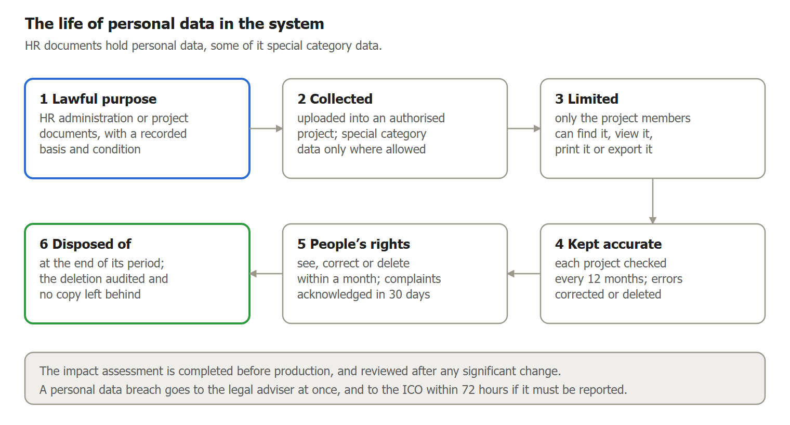

# \<System Name\> PII Processing Management

## 1 Purpose

This document sets out how \<System Name\> is designed to process personal data lawfully, openly and no more than it needs, to meet the 6 Personally Identifiable Information Processing and Transparency (PT) controls that apply and the 16 other controls of the CSS privacy baseline. CSS places none of the PT controls in the Moderate baseline. \<System Name\> applies the privacy baseline because it holds HR documents with personal data, some of it special category data (D-PT-01, D-PT-07).

Section 3 is the design: the authority, purposes and lawful basis; every kind of personal data \<System Name\> holds; special category data; the privacy notice; people's rights; minimisation, quality, retention and disposal; the impact assessment; where the privacy controls held in other documents are designed; what \<Organisation\> provides; the processing rules and monitoring; and the policy and procedures. Each subsection names the controls it helps to meet.

Other documents hold the rest. Who provides and is responsible for each control, its status and its assessment result are in \<System Security Plan\>, section 7.14 (Table 23). The tests, their results and the records an assessor will ask for are in \<Control Assessment Record\> (PT). Each control's risk is in \<Risk List\>, and what is still open is in \<Plan of Action and Milestones\>. The policy is in \<Policy\> (PT), and the steps people follow are in \<Procedures\> (PT). Two documents sit beside this one and are owned by the legal adviser: the privacy plan, \<Privacy Plan\>, which PL-2 calls for, and the data protection impact assessment, \<Data Protection Impact Assessment\>.

UK law decides what is lawful. The CSS controls set out how it is shown. Where a value needs a legal decision, it is a placeholder for the legal adviser.

Values that CSS asks the organisation to define are set at corporate level by \<Organisation\>. The settings in section 3 should match those corporate values. Where one does not, it is changed in this document.

Where section 3 notes what "today" is, or what \<System Name\> cannot yet do, it means the tested v1.0 build.

Appendix A lists the related enhancements CSS does not select.

## 2 Summary

The implementation status of each control, how it is met, who is responsible, its assessment result and the risk and plan entries for its gaps are recorded in \<System Security Plan\>, section 7.14 (Table 23).

## 3 The design

### 3.1 Principles

Controls met here: AC-3(14), PT-2, PT-3, RA-8, SA-8(33).

1. **Lawful and known purpose.** Personal data is processed only for a stated purpose, with a recorded lawful basis and, for special category data, a recorded condition.
2. **Only what is needed, only as long as needed.** \<System Name\> holds no more personal data than the purpose requires, for no longer than the retention schedule allows.
3. **People's rights.** People can see, correct and ask to delete their data, and complain, as the law allows.
4. **Assess before relying on it.** The impact assessment comes before production and before any significant change.

These carry out the principles and rules of \<Policy\>, sections PT.3 and PT.4.

**Figure 1: The life of personal data in \<System Name\>**

### 3.2 Authority, purposes and lawful basis

Controls met here: PT-2, PT-3, PT-4, PT-5(2), PT-6, PT-6(1), PT-6(2), PT-7(1), PT-7(2), PT-8.

The authority is UK GDPR, the Data Protection Act 2018 and the Data (Use and Access) Act 2025 (D-PT-09). Personal data is processed for two purposes only: HR administration, and managing project documents. Processing means storing, finding, displaying, printing and exporting HR and project documents, within project permissions. Project permissions limit who processes each project's documents, and the rules of behaviour on personal data (\<Security Operating Procedures\>, rules A23 to A29) keep processing to what is compatible with the two purposes.

Each kind of personal data has an Article 6 lawful basis, and special category data an Article 9 condition and, where needed, a Schedule 1 condition. They are recorded in the inventory in section 3.3, and the legal adviser confirms each (D-PT-20). Where a Schedule 1, Part 1 condition is relied on, an appropriate policy document is put in place.

Consent is not the lawful basis for employee data, because employees cannot freely refuse their employer (D-PT-10), as the ICO's guidance on employment records says. So there is no consent tool. \<System Name\> sets only strictly necessary cookies, which need no consent banner (check Q07).

\<System Name\> makes no decision about a person by automated means alone, and does no profiling, so UK GDPR Article 22 does not apply. Personal data is not sold, shared with third parties for their own purposes, or transferred outside the United Kingdom.

The controls that rest on United States law and federal bodies do not apply: the Privacy Act, Federal Register notices, Social Security numbers, the First Amendment and computer matching. \<Organisation\> operates in the United Kingdom (\<Tailoring Register\>, TR-PT-01).

### 3.3 Personal data inventory

Controls met here: AU-3(3), PT-2, PT-3, PT-7, SI-12(1).

One row for each kind of personal data. The legal adviser confirms each basis and condition (D-PT-20). No data is transferred outside the UK, and no processor outside \<Organisation\> is used. The inventory must match \<Organisation\>'s record of processing (UK GDPR, Article 30; EV-PM-02).

**Table 1: Personal data inventory**

| Kind of data | Where | Source | Purpose | Article 6 basis | Article 9 and Schedule 1 condition | Recipients | Retention |
| --- | --- | --- | --- | --- | --- | --- | --- |
| HR records: contract, pay, absence, performance | HR project documents | HR team uploads | HR administration | \[Legal adviser\] | Not applicable | HR project members | Section 3.7, H1 to H4 |
| Health and other special category data | HR project documents | HR team uploads | HR administration | \[Legal adviser\] | \[Legal adviser; appropriate policy document if Schedule 1, Part 1 applies\] | HR project members only | Section 3.7, H5 |
| Names and contact details | Other project documents | Project uploads | Managing project documents | \[Legal adviser\] | Not applicable | Project members | The project's period |
| People who sign in: name and Active Directory account name, and the AD groups in the sign-in token | Each session; the audit records; document records such as who uploaded or last changed a document | AD FS, at each sign-in | Signing in and accountability | \[Legal adviser\] | Not applicable | Global administrators, auditors | Section 3.7, A1 |
| Audit records: username, user ID, IP address, user agent, session ID | The audit log in the \<System Name\> database (\<Audit and Accountability Management\>, section 3.5) | \<System Name\> | Accountability and security | \[Legal adviser\] | Not applicable | Auditors, security officer | Section 3.7, A2 |
| Application log | Each application's log on the application server (\<Audit and Accountability Management\>, section 3.10) | \<System Name\> | Troubleshooting | \[Legal adviser\] | Not applicable | Administrators | Section 3.7, A3; personal data to be removed (PA-75) |
| Export copies | Users' managed devices; server temporary folder | Bulk export | Sharing documents for work | As the source document | As the source document | The exporting user | 30 days at most (SyOps A28); server copies removed (PA-86) |

### 3.4 Special category data

Controls met here: PT-7.

Health and other special category data may be held only in HR projects the business owner authorises, and only by the people approved for those projects. Project permissions enforce this. Each document that holds it is marked as special category data, so that it can be found and handled with care. \<System Name\> cannot yet mark documents in this way (Q01; PA-89), and the conditions that allow the processing are placeholders for the legal adviser (PA-72).

### 3.5 Transparency

Controls met here: PT-3, PT-5.

\<Organisation\>'s employee privacy notice tells people how their data is used. \<Organisation\> gives it to each employee on joining. It must name \<System Name\> and its two purposes, give the authority and lawful basis, be in plain language, and be reviewed every 12 months. People sign in on \<Organisation\>'s AD FS page, so \<System Name\>'s own pages link to the notice, with a short statement of what \<System Name\> records about its users: their name, the groups they belong to, and what they do (PA-90). The notice has not been seen (EV-PT-01).

### 3.6 People's rights

Controls met here: AC-3(14), SI-18(4).

**Table 2: Requests and complaints**

| Request | What happens | Who | Within | Record |
| --- | --- | --- | --- | --- |
| To see their data, and a copy of it | The legal adviser confirms the person's identity, and an administrator the legal adviser names makes a reasonable and proportionate search of every project and the audit records | Legal adviser; a named administrator | One month, extendable as the law allows | TPL-15 |
| To correct or delete their data | The project access approver or an administrator makes the change, and confirms it in writing. Each change is to be audited | Legal adviser; project access approver or administrator | One month | TPL-15; audit records |
| To restrict or object to the use of their data, or to receive it in a portable form | The legal adviser decides whether the right applies and how it is met, for example by limiting a document to fewer people while a dispute about its accuracy is settled | Legal adviser; project access approver | One month | TPL-15 |
| To complain about how their data is handled | The legal adviser acknowledges the complaint, investigates without undue delay, keeps the person informed and tells them the outcome. Any weakness found is raised as a risk | Legal adviser | Acknowledged within 30 days | TPL-22 |

The time allowed starts once the person's identity is confirmed, and pauses while the legal adviser waits for any clarification the request needs, as the Data (Use and Access) Act 2025 allows. When data is corrected, deleted or restricted, the legal adviser tells anyone it was disclosed to, unless that is impossible or would take disproportionate effort (UK GDPR, Article 19).

Requests and complaints follow PRO-PT-1. Until \<System Name\> can search every project for one person in one step, each project is searched in turn and listed. Until the admin portal audits corrections and deletions, the administrator records the document, the field and the change on TPL-15 (PA-89).

### 3.7 Minimisation, quality, retention and disposal

Controls met here: SA-8(33), SI-12(1), SI-12(2), SI-12(3), SI-18, SI-19.

1. **Minimisation.** What personal data is collected is reviewed at design, in each change record, and in the impact assessment. Each project holds only what its documents' purpose requires.
2. **Quality.** Every 12 months each project access approver checks that their project's personal data is accurate, relevant, timely and complete, and no more than its documents' purpose requires, and records the check on TPL-3 (PRO-PT-5). The project access approver or an administrator corrects or deletes inaccurate or out-of-date data, and each correction and deletion is audited.
3. **Retention.** Each kind of record is kept for the period below, then disposed of. The business owner sets each period with the legal adviser (D-PT-21), guided by the ICO's employment records guidance (February 2025). Row A1 was reworded for sign-in through AD FS and confirmed by the system owner on 18 November 2026 (D-PT-23); its period stays with the business owner.
4. **Disposal.** At the end of its period a document is deleted, the deletion is audited, and the database is vacuumed afterwards so that no readable copy remains. Media are sanitised as \<Media Protection Management\>, section 3.6 sets out. \<System Name\> cannot yet do this (Q03, Q08; PA-70).
5. **Testing, training and research.** Testing and training use sample data only, loaded into each test stack, and no real personal data is used for research.
6. **De-identification.** No dataset is de-identified or released, so there is nothing to remove identifiers from.

**Table 3: Retention schedule**

| ID | Record type | Period | Trigger | Basis for the period | Disposal |
| --- | --- | --- | --- | --- | --- |
| H1 | Employment contract and changes | \[Period\] | End of employment | \[Reason\] | Delete and audit |
| H2 | Pay and pension records | \[Period\] | End of the tax year | \[Reason\] | Delete and audit |
| H3 | Absence and leave records | \[Period\] | End of the absence | \[Reason\] | Delete and audit |
| H4 | Performance, conduct and grievance records | \[Period\] | Close of the matter | \[Reason\] | Delete and audit |
| H5 | Health and occupational health records | \[Period\] | End of employment | \[Reason\] | Delete and audit |
| A1 | Names of people held from sign-in, in document records such as who uploaded or last changed a document | \[Period\] | The person leaves | \[Reason\] | Delete or anonymise |
| A2 | Audit records | 24 months: 12 online and 12 archived | Record created | AU-11, as set in \<Audit and Accountability Management\> | Archive, then delete |
| A3 | Application log | 30 days | Log written | As set in \<Audit and Accountability Management\>, section 3.10 | Rotated and deleted |
| A4 | Training records (TPL-9) and the training register | 3 years | Training completed | AT-4, as set in \<Awareness and Training Management\> (AT-04\_ODP) | Delete |
| A5 | Maintenance records (TPL-12) | 3 years | Job completed | MA-2, as set in \<Maintenance Management\>, section 3.3 (D-MP-11) | Delete |
| A6 | Media records (TPL-13) | 3 years | Action completed | MP-6, as set in \<Media Protection Management\>, section 3.6 (D-MP-11) | Delete |
| A7 | Signed rules of behaviour (TPL-21) and the register of signatures | While the person has access, and 3 years after | Access ended | PL-4, as set in \<Planning Management\>, section 3.5 (D-PL-14) | Delete |
| A8 | Personnel security register entries | While the person has access, and 3 years after | Access ended | PS-3, as set in \<Personnel Security Management\>, section 3.9 (D-PS-12) | Delete |
| A9 | Leaver and mover records (TPL-14) | 3 years | Record completed | PS-4, PS-5, as set in \<Personnel Security Management\>, section 3.9 (D-PS-12) | Delete |
| A10 | Privacy requests (TPL-15) | 3 years | Request closed | Covers a complaint to the ICO about how a request was handled, and matches the other records. Set by the system owner (D-PT-24), for the legal adviser to confirm | Delete |
| A11 | Data protection complaints (TPL-22) | 3 years | Complaint closed | Covers a complaint to the ICO about how a complaint was handled, and matches the other records. Set by the system owner (D-PT-24), for the legal adviser to confirm | Delete |

### 3.8 Impact assessment and changes in processing

Controls met here: PT-3, RA-8, SA-8(33).

The data protection impact assessment, \<Data Protection Impact Assessment\>, follows the ICO's sample template. The legal adviser completes and approves it before production, with the advice of the data protection officer, and reviews it after any significant change in processing and every 12 months. Its measures go into the Plan of Action and Milestones, and its residual risks to the authorising official. If a high risk remains, the legal adviser consults the ICO before processing starts.

Every change record says whether the change affects personal data, through change control (\<Configuration Management\>, section 3.7). If it does, the legal adviser reviews it, and decides whether the inventory, the privacy notice or the impact assessment must change, and whether the change, such as a new collection of personal data, needs a new or revised impact assessment (PRO-PT-3, PRO-PT-4).

### 3.9 Privacy controls held in other documents

Controls met here: AT-3(5), AU-3(3), IR-2(3), IR-8(1), PE-8(3), PL-9, SC-7(24).

Eight of the privacy baseline controls are assessed with this family, but part of their design belongs with another. Table 4 says where the design of each is held.

**Table 4: Where the other privacy controls are designed**

| Control | Where its design is held | What it covers |
| --- | --- | --- |
| AC-3(14) Individual Access | This document, section 3.6 | The route through the legal adviser |
| AT-3(5) Processing PII | \<Awareness and Training Management\>, section 3.4, module M9 | The privacy module, for everyone who handles HR documents and all administrators, before access and every 12 months |
| AU-3(3) Limit PII Elements | \<Audit and Accountability Management\> | What audit records may hold: username, user ID, IP address, user agent and session ID, and no personal data in the application log |
| IR-2(3) Breach | \<Awareness and Training Management\>, modules M7 and M9; \<Incident Response Management\>, section 3.4 | Breach training: module M7 for incident roles, and module M9 for everyone who handles HR documents, on recognising a breach, reporting it within 1 hour, and the breach steps |
| IR-8(1) Breaches | \<Incident Response Management\>, section 3.8 | The breach steps: the legal adviser and the security officer judge the harm and what would reduce it, and the legal adviser decides whether to tell the ICO and the people affected. UK GDPR Articles 33 and 34 apply: a report to the ICO within 72 hours of becoming aware, telling people when the risk to them is high, and recording every breach |
| PE-8(3) Limit PII Elements | \<Physical and Environmental Protection Management\> | What visitor records may hold: name, organisation, and the date and time of the visit |
| PL-9 Central Management | \<Planning Management\> | The one document set: policies, plans, registers and records under one owner, checked by one consistency test, and kept in the restricted store |
| SC-7(24) PII | This document, section 3.11 | Processing rules and monitoring |

### 3.10 What \<Organisation\> provides

Controls met here: PE-8(3), PT-1, PT-2, PT-3, PT-5, RA-8.

**Table 5: Asked of \<Organisation\>**

| Provided | Controls | What \<System Name\> relies on | Evidence asked | State |
| --- | --- | --- | --- | --- |
| The employee privacy notice | PT-3, PT-5 | It names \<System Name\> and its purposes, and is reviewed every 12 months | EV-PT-01 | Not sent |
| The record of processing | PT-2 | It lists \<System Name\>'s HR personal data, matching section 3.3 | EV-PM-02 | Not sent |
| The privacy programme and the data protection officer | PT-1, RA-8 | A data protection officer advises on the impact assessment, or the reason none is required is recorded (D-PM-04) | EV-PM-04 | Not sent |
| Visitor records | PE-8(3) | They hold only name, organisation, and the date and time of the visit | EV-PT-02 | Not sent |

**Today:** no request has been sent, and none of this is evidenced.

### 3.11 Processing rules and monitoring

Controls met here: SC-7(24).

1. **Processing rules.** Project access permissions, and the measures in the impact assessment, are the rules for processing personal data. \<System Name\>'s project permissions and audit records enforce them.
2. **Monitoring.** Exports and downloads are audited, and the auditor reviews them each week. The impact assessment decides what further monitoring is needed at external interfaces and key internal boundaries.
3. **Exceptions.** Each processing exception is approved and recorded in the exception register (\<Security Operating Procedures\>, section 5). Exceptions are reviewed at each access review, and removed when they are no longer supported.

### 3.12 Policy and procedures

Controls met here: PT-1.

1. **Policy.** \<Policy\> (PT) is a system-level policy, shared with everyone who administers \<System Name\>. The legal adviser reviews it.
2. **Procedures.** \<Procedures\> (PT) holds six procedures, PRO-PT-1 to PRO-PT-6. They are shared with the same people.
3. **Owner.** The system owner manages the policy and procedures.
4. **Review.** The policy is reviewed every 12 months, and after a significant incident, audit finding, change in the law or system change. The procedures are reviewed every 12 months, and after a change to the steps.
5. **Records.** The documents are under version control.

## Appendix A Privacy controls outside the privacy baseline

CSS does not select these enhancements in its privacy baseline, so they are not assessed. Some of the design goes some way towards them, and Table 6 says where. The United States controls that the baseline does select are tailored out in section 3.2.

**Table 6: Related enhancements not selected**

| Control | What it adds | \<System Name\>'s position |
| --- | --- | --- |
| PT-2(1), PT-3(1), SI-18(2) Data Tagging; Data Tags | Tags on personal data that carry its permitted processing, purposes or quality | Not required. Done in part in design: HR documents are to be marked as personal or special category data (PA-89) |
| PT-2(2), PT-3(2), SI-18(1) Automation; Automation Support | Processing limits and quality checks enforced by automated means | Not required. Project permissions limit who processes each project's documents |
| PT-4(1), PT-4(2), PT-4(3) Tailored Consent; Just-in-time Consent; Revocation | Ways to give, refine and withdraw consent | Not required. Consent is not the lawful basis (D-PT-10) |
| PT-5(1) Just-in-time Notice | Notice given at the moment data is collected | Not required. Done in part in design: the short statement on \<System Name\>'s pages (PA-90) |
| SI-18(3) Collection | Personal data collected directly from the person where possible | Not required. HR collects employees' data from them; \<System Name\> stores the documents |
| SI-18(5) Notice of Correction or Deletion | People to whom data was disclosed are told of a correction or deletion | Not required. Done in design: the legal adviser tells them, as UK GDPR Article 19 requires (section 3.6) |
| SI-19(1) to SI-19(8) | Ways of de-identifying data | Not applicable. No dataset is de-identified (SI-19) |
