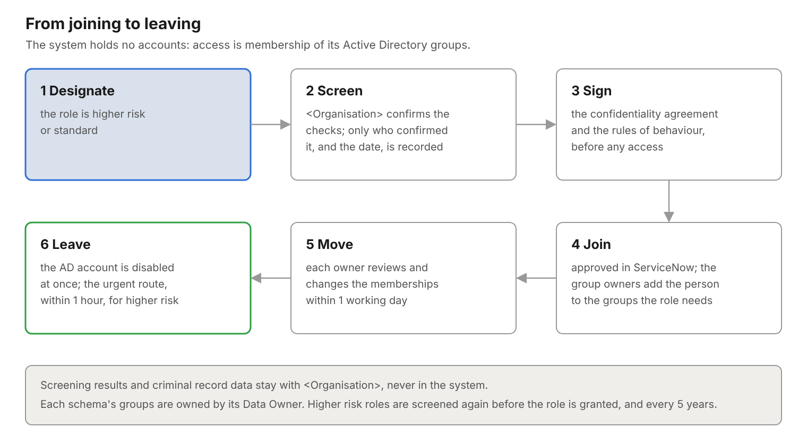

# \<System Name\> Personnel Security Management

## 1 Purpose

This document sets out how \<System Name\> makes sure the people who use and run it are trustworthy, and stay so, to meet the 9 Personnel Security (PS) controls in the CSS Moderate baseline.

Section 3 is the design: the principles, the risk designation of every role, the minimum screening, the access agreements, what happens when people join, move and leave, the time limits, external people, sanctions, the personnel security register, what \<Organisation\> provides, role duties in job descriptions, and the policy and procedures. Each subsection names the controls it helps to meet.

Screening, HR and disciplinary processes belong to \<Organisation\>. \<System Name\> sets the minimum it requires of them, records only that each check was confirmed and when, and relies on \<Organisation\>'s evidence for the rest. How access is requested, granted and removed is in \<Access Control Management\>, and the duties of each role are in \<Roles and Responsibilities\>.

## 2 Related documents

Who provides and is responsible for each control, and its status, are in \<System Security Plan\>, section 7.13 (Table 22). The tests, their results and the records an assessor will ask for are in \<Control Assessment Record\> (PS). Each control's risk is in \<Risk List\>, and what is still open is in \<Plan of Action and Milestones\>. The policy is in \<Policy\> (PS), and the steps people follow are in \<Procedures\> (PS).

## 3 The design

### 3.1 Principles

1. **Check first.** People are screened and sign their agreements before they get access.
2. **Match the risk.** Roles with more power carry a higher risk designation, and more is asked of them.
3. **Act on change.** Access follows people's roles when they move or leave, and fastest where the risk is highest.
4. **Hold only what is needed.** \<System Name\> records that a check was passed, never the result of the check.

These carry out the principles and rules of \<Policy\>, sections PS.3 and PS.4.

### 3.2 Risk designations

Every role in \<Roles and Responsibilities\> has a designation. A role is higher risk if it has privileged technical access, or can see or change security records. The plan consistency test confirms that no role is missed.

**Table 1: Risk designations**

| Role | Designation | Why |
| --- | --- | --- |
| System owner | Standard | Holds no privileged technical access, but owns the five role groups, \<Code\>\_Admins, \<Code\>\_Auditors, \<Code\>\_Security, \<Code\>\_BusinessOwners and \<Code\>\_LegalSearch, and adds their members. The safeguards are that nobody authorises their own access, the auditor checks and signs each role-group review, and the Head of Cyber checks the system owner's own memberships and the administrators' group each quarter (the access review record; D-PS-01) |
| Head of Cyber | Standard | Approves policies; no \<System Name\> account is needed |
| Legal adviser | Standard | Advises and reviews; no privileged access |
| Data protection officer | Standard | Advises; no privileged access |
| Information owner | Standard | Owns the information and its categorisation; a user in their own schemas, if any |
| Business owner | Standard | Owns the business need and sets retention; approves, in the UI application, the disposal of items due under the retention schedule (\<System Description\>, FR-074) as a member of \<Code\>\_BusinessOwners; no privileged technical access |
| Authorising official | Standard | Decides risk; no \<System Name\> account is needed |
| Authorising official for \<Organisation\>'s common controls | Standard | Authorises the inherited controls; no \<System Name\> account is needed |
| Security assessor | Higher risk | Examines the evidence, including samples of audit records, configuration and test results, so can see security records; also sees every weakness before it is fixed |
| \<Organisation\> security contact | Standard | Provides evidence; no \<System Name\> account is needed |
| Administrator | Higher risk | Manages schemas, which Active Directory groups open each schema, and system settings, and opens no item content. This is the one administrator role |
| Auditor | Higher risk | Reads every audit record |
| Security officer | Higher risk | Sees logs, alerts and incident records |
| Data Owner | Standard | Owns a schema's data and its read and edit groups, and authorises who may read or edit it in ServiceNow; nobody approves their own access |
| Legal adviser's delegate | Higher risk | Searches every schema for one person's items to answer a request under data protection law (\<System Description\>, FR-073), so can see items in every schema; a member of \<Code\>\_LegalSearch, named by the legal adviser; holds no other role |
| Windows server administrator | Higher risk | Full control of both servers |
| Database administrator | Higher risk | Full control of the database that holds every item |
| Developers | Higher risk | Change the code that handles every item, including personal data; hold no administrator access on the servers |
| Reader | Standard | Searches and reads items in their own schemas |
| Editor | Standard | Creates, uploads, manages and exports items within their own schemas |
| Line manager | Standard | Approves their people's access requests in ServiceNow and reports movers and leavers; no access of their own is implied |

A higher risk role adds two things to what every role needs. Screening is repeated before the role is granted and every 5 years. And when the holder leaves, their access is ended by the urgent route, not left to \<Organisation\>'s starters and leavers process: the service desk disables the Active Directory account within 1 hour of notice, and the system owner confirms that \<System Name\> refuses the person (Table 3). Every role, standard or higher risk, completes the training its row in \<Awareness and Training Management\>, Table 4, sets: the role modules before taking the role, and the rest within 30 days. A deputy holds the designation of the role they cover (\<Roles and Responsibilities\>, section 5).

### 3.3 Screening standard

\<Organisation\> screens its staff. \<System Name\> relies on that screening, and sets the minimum it must cover before anyone is given access. The four checks are those of the HMG Baseline Personnel Security Standard.

**Table 2: Minimum screening before \<System Name\> access**

| Check | What it confirms | \<Organisation\>'s practice |
| --- | --- | --- |
| Identity | The person is who they say they are | \[\<Organisation\>'s standard and evidence\] |
| Right to work | They may lawfully work in the UK | \[\<Organisation\>'s standard and evidence\] |
| Employment history | Their recent employment is as stated | \[\<Organisation\>'s standard and evidence\] |
| Basic criminal record check | Unspent convictions only | \[\<Organisation\>'s standard and evidence\] |

\<System Name\> records only that \<Organisation\> confirmed the screening, and the date. It never holds a screening result or criminal record data (\<Policy\> (PS), R4). If \<Organisation\>'s standard is fuller, for example BS 7858:2019, that standard applies.

In the United Kingdom a basic criminal record check is made through the Disclosure and Barring Service in England and Wales, Disclosure Scotland or AccessNI, and shows only unspent convictions. The Rehabilitation of Offenders Act 1974 limits what may be asked beyond that, which is why the minimum is a basic check.

### 3.4 Access agreements

Two agreements are signed before access. The rules of behaviour are signed again every 12 months, and within 30 days of a material change. \<Organisation\>'s confidentiality agreement is signed again when \<Organisation\> changes it, and each yearly signature of the rules confirms that the person is still bound by it (\<Security Operating Procedures\>, section 9). CSS places PS-6 in its privacy baseline as well as the Moderate baseline, so the agreements cover privacy too: the rules of behaviour tell each person to look at personal data only when their task needs it, to delete exported personal data within 30 days, and to report a loss involving it within 1 hour.

1. **\<Organisation\>'s confidentiality agreement,** signed on employment or engagement.
2. **The rules of behaviour,** \<Security Operating Procedures\>: Part A for everyone, and Part B, the privileged rules, for privileged users as well. Each person signs the declaration in \<Security Operating Procedures\>, section 9, on the rules of behaviour acknowledgement, and the signature is recorded in the register of signatures (\<Planning Management\>, section 3.5).

Each person signs both before being added to any \<System Name\> group. The ServiceNow access request checks the register of signatures, and is not approved without a signature in it; the date the confidentiality agreement was signed is in the personnel security register (section 3.9). The system owner reviews the agreements every 12 months, updates the rules of behaviour, and asks \<Organisation\> to update its agreement where it no longer covers \<System Name\>.

### 3.5 Joiners, movers and leavers

\<System Name\> holds no accounts. A person signs in through PingFederate with their Active Directory account, and the API reads their membership of \<System Name\>'s Active Directory groups directly from Active Directory over LDAPS; that membership is their access (\<Access Control Management\>). So joining means being added to a group, and leaving means \<Organisation\> disabling the Active Directory account.

**Figure 1: From joining to leaving**

**Table 3: Joiners, movers and leavers**

| Event | What happens | Who | Within | Record |
| --- | --- | --- | --- | --- |
| Joiner | The role's designation is looked up; \<Organisation\> confirms the screening; the person completes training and signs the agreements; the access request is authorised in ServiceNow, by the Data Owner for a schema's groups and by the system owner for a role group; only then do the group owners add them to the groups the role needs | System owner; \<Organisation\>; the Data Owner; the group owners | Before access | Access request record; the rules of behaviour acknowledgement; the register |
| Mover | The line manager tells the system owner and the owners of the person's groups. Each owner confirms whether the person still needs the group, and removes or adds memberships. A new role's training is completed, and, for a higher risk role, screening repeated, before its group is added | Line manager; system owner; the group owners | 1 working day | Leaver or mover record |
| Leaver | \<Organisation\> disables the Active Directory account at once, which ends access to \<System Name\> within 5 minutes, and ends the person's PingFederate sign-in. Its starters and leavers process gives notice of the leaver to the group owners, through ServiceNow, and they remove the memberships. Any service secret the person knew is changed, and exported files and printouts are recovered or destroyed. Separately, anyone who has not signed in for 90 days is removed from \<System Name\>'s groups each month (\<Access Control Management\>, section 3.14) | \<Organisation\>; the group owners; system owner | At once, and memberships within 5 working days | Leaver or mover record |
| Higher-risk leaver, dismissal or suspected misuse | By the urgent route: \<Organisation\>'s service desk disables the Active Directory account and ends the person's PingFederate sign-in, and \<System Name\> refuses the person within 5 minutes, even while a sign-in is open. The account stays disabled for at least 8 hours, unless every key in the key rings is revoked first. The system owner confirms the refusal | \<Organisation\>'s service desk; system owner | 1 hour of notice | Leaver or mover record; the incident record if it is an incident |

**Leavers.** Disabling the Active Directory account revokes the person's password and second factor. Any service secret the person knew is changed. \<Organisation\> holds an exit interview, which covers the person's continuing confidentiality duties and the return of equipment, and recovers their laptop, phone, pass and any other equipment. Exported files and printouts are recovered or destroyed (\<Security Operating Procedures\>, section 4.4). Items belong to schemas, not to people, so the items a leaver created stay with the schema and its members. The system owner confirms this on the leaver or mover record.

**Movers.** Each group owner removes the memberships the person no longer needs, and adds any the new role needs through an access request, once the new role's training is done (\<Awareness and Training Management\>, section 3.5). A change to a person's groups takes effect within 5 minutes, because the API reads them from Active Directory on every request (\<Access Control Management\>, sections 3.14 and 3.15). No \<System Name\> role gives physical access to the servers (\<Physical and Environmental Protection Management\>, section 3.2), so a move changes logical access only.

### 3.6 Time limits

These values are approved in \<Decision Register\> (D-PS-P72).

**Table 4: Personnel security time limits**

| Event | Limit | Who acts | Record |
| --- | --- | --- | --- |
| Screening confirmed and agreements signed | Before the person is added to any \<System Name\> group | System owner | Access request record; the rules of behaviour acknowledgement |
| Leaver | \<Organisation\> disables the Active Directory account at once, which ends access; group memberships removed within 5 working days | \<Organisation\>; the owners of the person's groups | Leaver or mover record |
| Higher-risk leaver, dismissal or suspected misuse | Active Directory account disabled, and PingFederate sign-in ended, within 1 hour of notice, and kept disabled for at least 8 hours | \<Organisation\>'s service desk; the system owner confirms | Leaver or mover record; the incident record if it is an incident |
| Mover | Access reviewed, and the system owner told, within 1 working day | Line manager, system owner, the owners of the person's groups | Leaver or mover record |
| Supplier's leaver or mover | Supplier tells the system owner within 1 working day | Supplier | Leaver or mover record |
| Formal sanctions process started for a breach of the rules by someone with \<System Name\> access | System owner told, with the person and the reason, within 1 working day | \<Organisation\> | Incident record if it is an incident |
| Rules of behaviour signed again | Every 12 months, and within 30 days of a material change to the rules | Everyone | Rules of behaviour acknowledgement |
| Confidentiality agreement signed again | When \<Organisation\> changes it | Everyone | Personnel security register |
| Designations and agreements reviewed | Every 12 months, and when a role's access changes | System owner | Access review record |
| Rescreening for higher risk roles | Before the role is granted, and every 5 years; the system owner asks for it when the register shows it falls due within the next 12 months | \<Organisation\>; system owner | Personnel security register |

### 3.7 External people

People who are not \<Organisation\>'s staff, such as contracted developers, may hold a \<System Name\> role only on the same terms as staff: screened to the minimum in section 3.3, signed up to the agreements in section 3.4, and designated by their role. Each contract states these requirements and their security duties, requires the supplier and its people to comply with \<Policy\> (PS) and \<Procedures\> (PS), and requires the supplier to tell the system owner within 1 working day when one of its people moves or leaves.

A supplier's engineer, or \<Organisation\>'s engineer, who helps with maintenance holds no \<System Name\> role and no account. They watch and guide over the shared screen of an approved administrator, who drives the session, so they need no screening for \<System Name\> and are bound by their contract's confidentiality terms (\<Maintenance Management\>, section 3.6; D-MA-01).

The same applies to the independent assessors who carry out the Level 2 assessment, as they see the whole document set and its evidence, which describe \<System Name\>'s weaknesses. Any member of the team who is not \<Organisation\>'s staff is screened, signs a confidentiality agreement and Part A of the rules of behaviour, and is entered in the register, before the evidence is shared: \[whether the assessment team are \<Organisation\>'s staff or external\]. The system owner checks each supplier's compliance every 12 months, and records it on the supplier review.

### 3.8 Sanctions

A breach of the rules is handled through \<Organisation\>'s disciplinary process, and the rules of behaviour tell each person so (\<Security Operating Procedures\>). When \<Organisation\> starts a formal sanctions process against someone with \<System Name\> access for breaching \<System Name\>'s or \<Organisation\>'s security or privacy rules, it tells the system owner within 1 working day, naming the person and the reason. The system owner decides whether the person's access must change, and keeps no record of the sanction itself, which stays with \<Organisation\>. If the breach is a security incident, the security officer records it on the incident record, and the system owner decides whether the person's access must end at once.

### 3.9 Personnel security register

The system owner keeps this register for everyone who has, or will have, access to \<System Name\> or its \<Classification\> documents: every user, the system owner, the operating roles in \<Roles and Responsibilities\>, their deputies and the security assessor. Each person is added when their access is requested. It holds names, roles, who confirmed and dates only, never a screening result. Entries are kept while the person has access, and for 3 years after it ends. Leaver and mover records are kept for 3 years. Signatures of the rules of behaviour are recorded in the register of signatures (\<Planning Management\>, section 3.5).

**Table 5: Personnel security register**

| Person | Role | Designation | Screening confirmed by \<Organisation\> | Confidentiality agreement signed | Rescreening due |
| --- | --- | --- | --- | --- | --- |
| \[Name\] | \[Role\] | \[Standard or Higher risk\] | \[Who confirmed, and date\] | \[Date\] | \[Date, for a higher risk role; otherwise none\] |

### 3.10 What \<Organisation\> provides

**Table 6: Asked of \<Organisation\>**

| Provided | What \<System Name\> relies on |
| --- | --- |
| Pre-employment screening | Each person is screened to at least the minimum in section 3.3, rescreened as section 3.6 says, and confirmed to the system owner with the date only |
| Starters, movers and leavers | A leaver's Active Directory account is disabled at once, and the group owners are told of every mover and leaver |
| Exit interviews, equipment, discipline and job descriptions | Exit interviews cover continuing confidentiality duties and the return of equipment, equipment is recovered, the start of a formal sanctions process is notified within 1 working day, and job descriptions refer to the duties in \<Roles and Responsibilities\> |
| The confidentiality agreement | Every person signs it before access, and again when \<Organisation\> changes it |
| Contract terms for external people | Contracts require the same personnel security, and notice of movers and leavers within 1 working day |

### 3.11 Role duties in job descriptions

The security and privacy duties of every \<System Name\> role are stated in \<Roles and Responsibilities\>. \<Organisation\>'s job descriptions for those roles refer to them.

### 3.12 Policy and procedures

\<Policy\> (PS) and \<Procedures\> (PS) meet PS-1. Who they are shared with is in \<Policy\>, section PS.6. Their ownership, approval, review and records follow the rules common to every policy in \<Policy\>, section 1.1.
