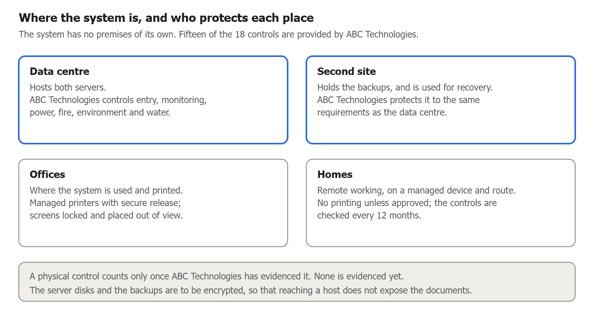

# \<System Name\> Physical and Environmental Protection Management

## 1 Purpose

This document is the design for how the places where \<System Name\> runs and is used are protected. It covers the Physical and Environmental Protection (PE) family of the CSS Moderate baseline, 18 controls and enhancements.

Section 3 is the design: the sites and contacts, who provides each part, how \<System Name\> relies on \<Organisation\>'s sites, the rules for offices and for working from home, physical incidents, the encryption that stands behind the physical controls, what \<Organisation\> provides, and what \<System Name\> requires at each data centre.

\<System Name\> has no premises of its own. It runs on two virtual servers in \<Organisation\>'s data centre, with backups, the restore test and recovery at a second site, so most of its physical protection is \<Organisation\>'s. \<System Name\>'s own part is small: how its users treat screens and printouts, how they work from home, how physical incidents are handled, and the encryption of the server disks. The values it sets are given in full in this document, and approved in \<Decision Register\> (D-PE-P70).

## 2 Related documents

Which section of this design meets each control, who is responsible for it and its status are in \<System Security Plan\>, section 7.11 (Table 20). The assessment is in \<Control Assessment Record\> (PE), the risks are in \<Risk List\>, and open work is in \<Plan of Action and Milestones\>. The policy is in \<Policy\> (PE), and the steps people follow are in \<Procedures\> (PE).

## 3 The design

### 3.1 Principles

1. **Inherit with evidence.** A physical control counts only once \<Organisation\> has evidenced it.
2. **Same protection everywhere.** The second site meets the same requirements as the main one.
3. **Protect what users see.** Screens and printouts are protected by the people who use them.
4. **Report physical events.** Physical incidents are handled as security incidents.

These carry out the principles and rules of \<Policy\>, sections PE.3 and PE.4.

### 3.2 Sites and contacts

**Figure 1: Where \<System Name\> is, and who protects each place**

**Table 1: Sites**

| Site | Use | Location | \<Organisation\> contact |
| --- | --- | --- | --- |
| Data centre | Hosts both servers | \[Data centre name and address\] | \[Facilities contact\] |
| Second site | Holds the encrypted backups, with one copy offline or immutable, and the protected copy of the secrets; runs the restore test server every 6 months; the servers are rebuilt there if the main site is lost (\<Contingency Planning Management\>, sections 3.8 and 3.9) | \[Second site name and address\] | \[Facilities contact\] |
| Offices | Where \<System Name\> is used and printed | \[\<Organisation\> offices\] | \[Office security contact\] |
| Homes | Remote working, including the administrators' remote administration | Employees' homes | Security officer |

No \<System Name\> role needs to enter either data centre. The Windows server and database administrators work from their managed devices over \<Organisation\>'s VPN and managed administration route (flow F11; \<Maintenance Management\>, section 3.4), including when they build the restore test server or rebuild the servers at the second site, and the hardware beneath the servers is maintained by \<Organisation\>'s engineers.

### 3.3 Who provides each control

Table 2 shows who provides each part of physical and environmental protection.

**Table 2: Who provides each part**

| Control | \<Organisation\> provides | \<System Name\> provides |
| --- | --- | --- |
| PE-1 | Its own physical security policy | The policy, the procedures and this document |
| PE-2 | Authorised access list for the data centres | Nothing |
| PE-3 | Entry control, logs, visitors, keys and cards | Nothing |
| PE-4 | Protected cabling | Nothing |
| PE-5 | Managed printers with secure release; office security | Users' rules: print only on managed printers with secure release, lock the screen when away, and keep desks clear and screens out of view; the device screen lock is \<Organisation\>'s |
| PE-6, PE-6(1) | Monitoring, alarms and CCTV; log review; results passed to incident response | Nothing. The security officer handles what \<Organisation\> reports (section 3.7) |
| PE-8 | Visitor records and review; records hold only the name, organisation, and date and time of the visit | Nothing |
| PE-9, PE-10, PE-12 | Power protection, emergency shutoff and emergency lighting | Nothing |
| PE-11 | UPS; if power cannot be kept, a clean shutdown of both servers through the hypervisor (section 3.7; D-PE-01) | Nothing. The administrators run the start-up checks when power returns (\<Security Operating Procedures\>, section 4.6) |
| PE-13, PE-13(1) | Fire detection and suppression, with automatic notification | Nothing |
| PE-14 | Temperature and humidity control and monitoring | Nothing |
| PE-15 | Water damage protection | Nothing |
| PE-16 | Control of deliveries and removals | Receives notice of host hardware removal and its sanitising certificate; approves removal of any other \<System Name\> equipment |
| PE-17 | Managed devices and route | Home working rules and the yearly check |
| Compensating | Nothing | Server disk encryption, so physical access to hosts does not expose data |

Where \<System Name\> has a step beside a part \<Organisation\> provides, such as handling a reported incident, checking the servers after a power loss or receiving notice of a hardware removal, the step is \<System Name\>'s and the protection stays \<Organisation\>'s (D-MP-03).

### 3.4 How \<System Name\> relies on the sites

\<System Name\> relies on the physical and environmental protection of both sites once \<Organisation\> has shown that it meets section 3.10, through its ISO/IEC 27001 certification or a SOC 2 report covering both sites, and each data centre has been inspected once. \<System Name\> does not assess the sites itself. A shortfall is raised as a risk in \<Risk List\>. The reliance is checked again every 12 months, and after a change of site or a significant incident at a site. How the evidence is asked for and checked is in \<Evidence Requests\>, section 13.

### 3.5 Offices: screens and printing

1. \<System Name\> items are printed only on \<Organisation\>'s managed printers with secure release: \[managed printers\]. A page prints only when its owner is at the printer.
2. A printout is collected at once, marked \<Classification\>, locked away when not in use, and shredded when no longer needed (\<Media Protection Management\>, section 3.4).
3. A screen is locked when its user leaves it, and placed so that others cannot read it.
4. \<Organisation\>'s managed devices lock the screen after the inactivity period it sets (\<Access Control Management\>, section 3.15). \<System Name\> has no page lock or idle timeout of its own.
5. Desks are kept clear of printouts and notes.

### 3.6 Working from home

1. People work remotely only from home, unless the system owner has approved another place in writing (\<Security Operating Procedures\>).
2. They use only \<Organisation\>'s managed device, and connect to its VPN before opening \<System Name\>. They never use a public or shared computer, and use public Wi-Fi only with the VPN connected first.
3. They work where others in the home cannot see the screen, and never print \<System Name\> items at home (D-MP-01).
4. They do not use \<System Name\> from outside the UK, or take a device that can reach it abroad, without written approval from the system owner and the security officer.
5. They report any concern or incident to the security officer at once, and a lost or stolen device within 1 hour. The security and privacy contacts are in \<Security Operating Procedures\>, section 6.
6. Every 12 months the security officer puts a short checklist to every person who works from home: the managed device, the VPN, screen privacy, no printing, and reporting. The answers are recorded on the home working check. Every person completes it, not a sample.
7. The system owner's and security officer's offline copies of the contingency plan are kept as \<Contingency Planning Management\>, section 1.1, sets, wherever they are kept, including at home: on the encrypted managed device, or printed in the office and kept in locked storage.

These are part of the rules of behaviour, which each person signs (\<Security Operating Procedures\>, Part A).

### 3.7 Physical incidents

The loss or theft of a device or printout, unauthorised entry to a data centre, and fire, flood or power loss affecting \<System Name\> are security incidents. Whoever sees one reports it to the security officer at once. \<Organisation\>'s security contact tells the security officer of any physical incident at a site that affects \<System Name\>, and of any anomaly in the visitor records, within 24 hours. The security officer handles it with the playbooks for a lost device or printout and for intrusion, fire, flood or power loss at a data centre (\<Incident Response Management\>, section 3.9), and the contingency plan is invoked if a site is lost (\<Contingency Planning Management\>).

**Loss of power.** Each data centre's uninterruptible power supply carries the hosts until a generator takes over, or for long enough for an orderly shutdown. If power cannot be kept, \<Organisation\>'s hosting staff shut both servers down cleanly through the hypervisor, the application server first, before the backup power runs out, and tell the Windows server administrator (D-PE-01). A clean guest shutdown stops the applications and SQL Server in order, so no \<System Name\> administrator has to be reached in the minutes the supply lasts. When power returns, the administrators start the servers and run the start-up checks (\<Security Operating Procedures\>, section 4.6), and the security officer records it as a physical incident. This applies at the second site too whenever \<System Name\> runs there. How long the backup power lasts, whether there is a generator, and how the shutdown is done, are set by \<Organisation\>.

### 3.8 Encryption behind the physical controls

Both servers' disks are encrypted, and backups are encrypted before they leave the database server. Someone who reaches a host, a disk or a backup copy therefore cannot read \<System Name\>'s items. This does not replace \<Organisation\>'s physical controls: it limits the harm if one fails.

### 3.9 What \<Organisation\> provides

**Table 4: Provided by \<Organisation\>**

| Provided | What \<System Name\> relies on |
| --- | --- |
| Entry control at both sites | Only authorised people enter each data centre; entry is controlled, logged and monitored; visitors, keys and cabling are managed; and physical incidents reach \<System Name\>'s security officer within 24 hours (section 3.10) |
| Power at both sites | Protected power, an emergency shutoff, emergency lighting, and backup power that carries the hosts to a generator or to a clean shutdown of both servers (section 3.7) |
| Fire, temperature, humidity and water at both sites | Detection and suppression that notify the fire and rescue service, temperature and humidity kept within the envelope in section 3.10.4, and protection from water |
| Deliveries and removals at both sites | Hardware and media are authorised and recorded when entering or leaving, and host hardware is sanitised before it leaves |
| Office and home working controls | Managed printers with secure release, office security, and the controls on managed devices and the route at home |

### 3.10 What \<System Name\> requires at each data centre

These are what \<System Name\> requires of \<Organisation\> at both the main data centre and the second site. \<Organisation\> provides them, and \<System Name\> relies on them as section 3.4 sets out.

#### 3.10.1 Entry, keys and cabling

1. **Access list.** \<Organisation\> keeps the list of people authorised to enter each data centre, and issues each an individual card or credential. The list is reviewed every 12 months, and a person is removed when their need ends or they leave. No \<System Name\> role is on it: every administrator works remotely (\<Maintenance Management\>, section 3.4).
2. **Entry control.** Every data centre entrance and exit is controlled by \<Organisation\>'s electronic access control system, with individual cards or credentials, and every entry and exit is logged.
3. **Public areas and visitors.** A staffed reception controls the areas open to the public. Visitors are signed in, and always escorted.
4. **Keys and combinations.** \<Organisation\>'s facilities staff hold keys, combinations and other entry devices securely, and inventory keys, cards and combinations every 12 months. Keys and combinations are changed every 12 months, and also: a key when it is lost or not returned, a combination when it may be compromised, and either when someone who holds it moves to other work or leaves.
5. **Cabling.** Power and network cabling is kept in locked rooms, cabinets and cable trays.

#### 3.10.2 Monitoring and visitor records

1. **Monitoring.** \<Organisation\> monitors each data centre with intrusion alarms and CCTV, and responds to alarms.
2. **Entry log review.** The entry logs are reviewed monthly, and after a physical security incident or alarm. The results of each review, and of any investigation that follows, go to \<Organisation\>'s incident response, and to \<System Name\>'s security officer where they affect \<System Name\> (section 3.7).
3. **Visitor records.** Visitor records are kept for 12 months and reviewed monthly. They hold only the visitor's name and organisation, and the date and time of the visit (\<PII Processing Management\>, section 3.9). Anomalies go to \<Organisation\>'s security contact, who tells \<System Name\>'s security officer (section 3.7).

#### 3.10.3 Power and lighting

1. **Power equipment.** \<Organisation\> protects the power equipment and cabling that serve the hosts from damage and destruction.
2. **Emergency shutoff.** Power to the hosting equipment for both servers can be shut off in an emergency, by switches near the exits of the data centre room. The shutoff is guarded against accidental and unauthorised use.
3. **Backup power.** An uninterruptible power supply that carries the hosts to a generator, or for long enough for \<Organisation\>'s hosting staff to shut both servers down cleanly (section 3.7).
4. **Emergency lighting.** Automatic emergency lighting in each data centre comes on in a power failure and covers the emergency exits and evacuation routes.

#### 3.10.4 Fire, temperature, humidity and water

1. **Fire.** Each data centre has fire detection and suppression systems, with an independent energy source. Detection works automatically and notifies \<Organisation\>'s facilities staff and the fire and rescue service.
2. **Temperature and humidity.** Kept within the ASHRAE TC 9.9 recommended envelope: 18 to 27°C, a dew point from -9 to 15°C, and at most 60% relative humidity. They are monitored continuously.
3. **Water.** Each data centre has master shutoff or isolation valves that can be reached, work, and are known to key people.

#### 3.10.5 Deliveries and removals

1. **What is controlled.** Hardware and media that hold \<System Name\> information, entering and leaving each data centre.
2. **Approval.** \<Organisation\>'s own process approves the removal of host hardware beneath the servers, after sanitising it, and tells the system owner beforehand where it can and afterwards with the certificate; the system owner approves the removal of anything else of \<System Name\>'s (\<Maintenance Management\>, section 3.7; D-MA-03).
3. **Records.** \<Organisation\> keeps its delivery and removal records. \<System Name\>'s own are on the maintenance record and the media record.

### 3.11 Policy and procedures

\<Policy\> (PE) and \<Procedures\> (PE) are the policy and procedures for this family. Who they are shared with is in \<Policy\>, section PE.6. Their ownership, approval, review and records follow the rules common to every policy in \<Policy\>, section 1.1.
