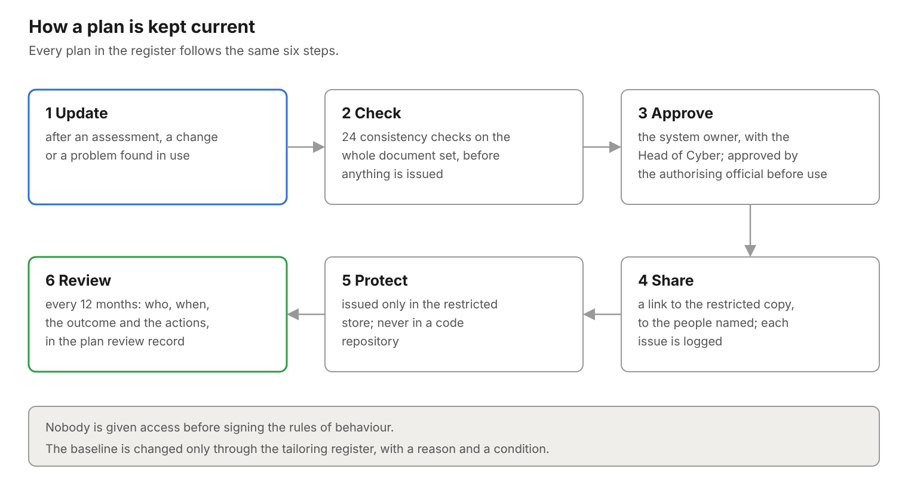

# \<System Name\> Planning Management

## 1 Purpose

This document shows how \<System Name\>'s plans are written, approved, shared, reviewed and protected, for each of the 7 Planning (PL) controls and enhancements in the CSS Moderate baseline. Section 3 sets out the design: the register of every plan in force, what the security plan and the privacy plan must hold and where each part is, how a plan is approved and kept current, the rules of behaviour and who has signed them, the architecture, and the baseline and its tailoring. Section 4 takes each control in turn. Values CSS asks the organisation to define are set at corporate level by \<Organisation\>. Appendix A the PL controls CSS does not select at Moderate.

The policy is in \<Policy\> (PL), and the steps people follow are in \<Procedures\> (PL). The plans themselves are separate documents, listed in section 3.2.

An assessor examines the plans against what CSS requires them to hold, their approvals and review records, who received them and how they are protected, the signed rules of behaviour, and the architecture; and interviews those who keep the plans and a sample of those who signed the rules (CSS). So for each control section 4 gives:

- **each part of the control**, as CSS letters them, with the design that meets it and the position today;
- **who provides it**, and who is responsible;
- **what enforces it**, the rules and procedures that apply, and the tests run;
- **the records an assessor will ask for**, and whether they exist yet;
- **its status**, the risk decision, and what is still open.

**Table 1: Status values**

| Status | Meaning |
| --- | --- |
| Implemented | The design is in place and working |
| Partially implemented | Some of the design is in place; the open items say what is missing |
| Not implemented | None of the design is in place yet |

## 2 Summary

The implementation status of each control, how it is met, who is responsible, its assessment result and the risk and plan entries for its gaps are recorded in \<System Security Plan\>, section 7.12 (Table 21). This section gives only the overall position.

No control in the baseline is missing from the design. Every gap is registered in the Risk List (\<Risk List\>) and the Plan of Action and Milestones (\<Plan of Action and Milestones\>).

One PL control from the privacy baseline is assessed with the PT family: PL-9, central management, which rests on the one document set described here (NC-PT-13; PA-88).

The plans are written and agree with each other: a test of 24 checks runs on the whole set before each issue. Three things remain. The plans are not yet in the restricted store, and are held on one computer (PA-88, rated Medium). Nobody has signed the rules of behaviour, because nobody has access yet. And the plans have not been shared with the people who should receive them (PA-123).

## 3 The design

### 3.1 Principles

1. **One current set.** The System Security Plan is the single statement of how controls are met, and every plan it relies on is listed in one register.
2. **Rules before access.** Nobody gets access without signing the rules.
3. **Plans change with the system.** Plans change when the system, its risks or an assessment changes, and every review and change is recorded.
4. **Plans are Restricted.** Plans describe weaknesses, and must be protected like the system itself.

These carry out the principles and rules of \<Policy\>, sections PL.3 and PL.4.

**Figure 1: How a plan is kept current**

### 3.2 Register of plans in force

Every plan and planning record in force, with its owner, version, approver and next review. The design documents for each control family are not plans, and are listed in \<Documentation Map\>.

**Table 2: Plans in force**

| Plan or record | Document | Version | Owner | Approved by | Next review |
| --- | --- | --- | --- | --- | --- |
| System security plan | \<System Security Plan\> | \<ver\> | System owner | Version \<ver\> by the system owner, accepted by the authorising official as an accurate record; 2.1 by the system owner (D-GEN-19); later versions await the system owner. The Head of Cyber's concurrence is pending (D-PL-06) | November 2027, and after a significant change |
| Privacy plan | \<Privacy Plan\> | \<ver\> | Legal adviser | Version \<ver\> by the legal adviser and authorising official (D-PT-05); 1.1 legally reviewed; 1.2 factual update; later versions references only | November 2027 |
| Data protection impact assessment | \<Data Protection Impact Assessment\> | \<ver\> | Legal adviser | Draft; completion and approval by the legal adviser pending (D-PT-20) | Before production, and after a significant change in processing |
| Supply chain risk management plan | \<Supply Chain Risk Management\> | \<ver\> | System owner | System owner | November 2027 |
| Configuration management plan | \<Configuration Management\> | \<ver\> | System owner | System owner, for version \<ver\> (D-CM-12, D-SC-07). The version rebuilt on 13 November 2026 awaits approval | November 2027 |
| Contingency plan | \<Contingency Planning Management\> | \<ver\> | System owner | System owner and authorising official, for version \<ver\> (D-CP-11). The version rebuilt on 15 November 2026 awaits both | November 2027, and after a test or activation |
| Incident response plan | \<Incident Response Management\> | \<ver\> | Security officer | Version \<ver\> by the Head of Cyber; later versions pending (D-IR-07) | November 2027, and after an incident or exercise |
| Continuous monitoring strategy | \<Assessment, Authorization, and Monitoring Management\> | \<ver\> | System owner | System owner | November 2027 |
| Security architecture | \<Security Architecture\> | \<ver\> | System owner | System owner (D-PL-08) | November 2027, and after a significant change |
| Concept of operations | \<Concept of Operations\> | \<ver\> | System owner | System owner | November 2027 |
| Rules of behaviour | \<Security Operating Procedures\> | \<ver\> | System owner | System owner | November 2027, and after a material change (D-PL-P02) |
| Baseline and tailoring | CSS Moderate and privacy baselines; \<Tailoring Register\> | \<ver\> | System owner | System owner; acceptance by the authorising official pending (D-PL-09) | November 2027, and when a condition changes |
| Risk list | \<Risk List\> | \<ver\> | System owner | System owner | Every 3 months once in operation |
| Plan of action | \<Plan of Action and Milestones\> | \<ver\> | System owner | System owner | Monthly once in operation |

The versions in the register are checked by the plan consistency test (check L22), and are brought up to date whenever a plan is given a new version. The register is to be kept in the restricted document store with the plans (D-GEN-15).

### 3.3 What the plans hold

PL-2 lists 15 things a security plan and a privacy plan must hold. The security plan is \<System Security Plan\>, written to CSS, and the privacy plan is \<Privacy Plan\>. The system owner confirmed Table 3 on 17 November 2026 (D-PL-13).

**Table 3: Where each required part of the plans is held**

| Part | CSS requires | Security plan | Privacy plan | Today |
| --- | --- | --- | --- | --- |
| a.1 | Consistent with the enterprise architecture | \<System Security Plan\>, section 4; \<Security Architecture\>, sections 4 and 6.3 | \<Privacy Plan\>, section 8 | \<Organisation\>'s architecture has not been seen (EV-PL-01) |
| a.2 | Defines the components of the system | \<System Security Plan\>, sections 3.1 and 3.4; \<Security Architecture\>, section 2 | \<Privacy Plan\>, section 2 | Met |
| a.3 | Describes the operational context | \<System Security Plan\>, sections 1 and 2; \<Concept of Operations\> | \<Privacy Plan\>, section 2 | Met. Three questions for the business owner are still open in \<Concept of Operations\>, section 7: who will use \<System Name\> and from where, which business processes it supports, and the hours and numbers it must serve (PA-123) |
| a.4 | Names the people in each role | \<System Security Plan\>, section 6; \<Roles and Responsibilities\> | \<Privacy Plan\>, section 3 | Met |
| a.5 | Identifies the types of information | \<System Security Plan\>, section 3.3 | \<Privacy Plan\>, section 4 | Met |
| a.6 | Gives the security categorisation, with its reasons | \<System Security Plan\>, section 3.3 | \<Privacy Plan\>, section 4 | Met; approved by the authorising official |
| a.7 | Describes the threats of concern | \<Risk List\>, section 2 | \<Privacy Plan\>, section 5 | Met |
| a.8 | Gives the results of a privacy risk assessment | \<Data Protection Impact Assessment\> | \<Data Protection Impact Assessment\> | Not met: the impact assessment is a draft (PA-72) |
| a.9 | Describes the environment, and the connections to other systems | \<System Security Plan\>, sections 3.1, 3.2 and 4 | \<Privacy Plan\>, section 2 | Met |
| a.10 | Gives an overview of the requirements | \<System Security Plan\>, sections 1 and 5 | \<Privacy Plan\>, section 6 | Met |
| a.11 | Identifies the baselines and overlays | \<System Security Plan\>, section 5; \<Tailoring Register\> | \<Privacy Plan\>, section 6 | Met |
| a.12 | Describes each control, in place or planned, with the reason for any tailoring | \<System Security Plan\>, section 7: one row for each control; \<Tailoring Register\> | \<Privacy Plan\>, section 6 | Met |
| a.13 | Includes the risk decisions on architecture and design | \<Risk List\>; \<Decision Register\> | \<Privacy Plan\>, section 5; \<Decision Register\> | Met |
| a.14 | Includes the activities that need planning and coordination with defined people | The operating calendar in \<Security Operating Procedures\>, Part C; \<Plan of Action and Milestones\>. They are coordinated with the Head of Cyber, the administrators and \<Organisation\>'s security contact | \<Privacy Plan\>, section 7 | Met |
| a.15 | Reviewed and approved by the authorising official before it is put into effect | Approved by the system owner, with the Head of Cyber's concurrence, and accepted by the authorising official as an accurate record | Approved by the legal adviser and the authorising official | Version \<ver\> of the security plan was accepted; later versions await acceptance (D-GEN-20), and the Head of Cyber's concurrence is pending (D-PL-06). The privacy plan was approved (D-PT-05) |

### 3.4 Approval, review, sharing and protection

**Table 4: How a plan is kept current**

| Step | What happens | Who | Record |
| --- | --- | --- | --- |
| 1 Update | After an assessment, a significant change or a problem found in use, the affected plans are updated | System owner | A line in each plan's change record |
| 2 Check | The plan consistency test is run on the whole document set, and every gap is corrected before the plans are issued. It has 24 checks: for example, that the plan and the assessment agree on the status of every control, and that every section one document cites exists in the other | System owner | The test result, kept with its hash |
| 3 Approve | The security plan goes to the Head of Cyber for concurrence and to the authorising official to accept as an accurate record. The privacy plan is approved by the legal adviser and the authorising official | System owner | \<Decision Register\> |
| 4 Share | A link to the restricted copy goes to the Head of Cyber, the administrators and \<Organisation\>'s security contact | System owner | Plan review record, naming the recipients |
| 5 Protect | The plans and the evidence are kept only in the restricted document store. The access list is checked against \<Roles and Responsibilities\> at each review | System owner | Plan review record |
| 6 Review | Every plan in the register is reviewed every 12 months: who reviewed it, their role, the date, the outcome and the actions | System owner | Plan review record, kept in the change record (\<Documentation Map\>, section 4.1) |

### 3.5 Rules of behaviour and the register of signatures

The Security Operating Procedures are the rules of behaviour (D-PL-05). Part A applies to everyone, and Part B, the privileged rules, to administrators as well. The rules on social media, public websites and work credentials on outside sites are A25 and A43 to A45.

1. Before access, the person is given the rules, and signs a declaration that they have read and understood them and agree to follow them, on paper or electronically. The system owner completes TPL-21.
2. The signature is added to the register below. The access request checks the register before access is given.
3. Everyone signs again every 12 months, and after a material change to the rules: a new or stricter rule, a changed consequence, new monitoring or a new privileged duty (D-PL-P02). The system owner decides whether a change is material, and records it in the change record of the rules. After a material change everyone signs within 30 days, or loses access.

Signed forms are kept for as long as the person has access, and for 3 years after it ends, as the system owner decided on 17 November 2026 (D-PL-14). The declaration each person signs is: "I have read and understood these rules, and I agree to follow them."

No one has signed yet: first signatures are taken on the version current when the remaining family reviews end (D-PL-P02).

**Table 5: Register of signatures**

| TPL-21 record | Name | Role | Parts | SyOps version | Reason | Date signed | Next due |
| --- | --- | --- | --- | --- | --- | --- | --- |
| None yet |  |  |  |  |  |  |  |

### 3.6 Architecture

The security architecture is \<Security Architecture\>, which states the protection goals, the design principles, the trust zones, the layers of defence, and the assumptions and dependencies. The privacy architecture is section 8 of \<Privacy Plan\>. The system owner reviews the architecture against the system as built every 12 months and after a significant change. Each change is carried into the security plan, the privacy plan, the concept of operations, the list of critical components, the procedures and any procurement. New open questions go to \<Decision Register\> or \<Plan of Action and Milestones\>, and not into the architecture.

### 3.7 Baseline and tailoring

The baseline is CSS Moderate, with the privacy baseline. It was chosen from the categorisation of \<System Name\>'s information, which is Moderate for confidentiality and integrity and Low for availability. A control, or a part of one, is set aside only through \<Tailoring Register\>, with a rationale, a condition that must hold, what happens if the condition changes, and a recorded decision. Each condition is checked at the yearly review.

### 3.8 What \<Organisation\> provides

**Table 6: Asked of \<Organisation\>**

| Provided | Controls | What \<System Name\> relies on | Evidence asked | State |
| --- | --- | --- | --- | --- |
| Its enterprise architecture standards | PL-2, PL-8 | The standards that \<System Name\>'s plans and architecture must fit | EV-PL-01 | Not sent |
| Who runs the hypervisor beneath the servers, and whether it is within the Cyber Essentials Plus scope | PL-8 | The answer settles a dependency recorded in the architecture (D-PL-11) | EV-PL-01 | Not sent |
| The restricted document store | PL-2 | A SharePoint area where only named people can read or change the plans | Not an evidence request: tracked by PA-88 | Not in use |

## 4 Each control and enhancement

The controls are in CSS order. Each has two tables. The first takes each part of the control and gives what CSS requires, the design that meets it, and the position today. The second says who provides and is responsible for the control, what enforces it, the rules and procedures that apply, the tests run, the records an assessor will ask for, its status, the risk decision, and what is still open.

### 4.1 PL-1 Policy and Procedures

**Table 7: PL-1 design**

| Part | CSS requires | Design | Today |
| --- | --- | --- | --- |
| a.1 | A planning policy, shared with defined people, covering purpose, scope, roles, responsibilities, management commitment, coordination and compliance, and consistent with the law | \<Policy\> (PL): a system-level policy, shared with everyone who administers \<System Name\>. The legal adviser reviews it | Version \<ver\> approved by the Head of Cyber (D-PL-01) and legally reviewed on 11 November 2026. The later version awaits the Head of Cyber (D-PL-07). Not yet shared (PA-20) |
| a.2 | Procedures that carry out the policy, shared with defined people | \<Procedures\> (PL): six procedures, PRO-PL-1 to PRO-PL-6. Shared with the same people | Approved by the system owner (D-PL-08). Not yet shared or walked through |
| b | A named official manages the policy and procedures | The system owner | \[Name\] is named in \<Roles and Responsibilities\> |
| c.1 | The policy is reviewed on a schedule and after set events | Every 12 months, and after a significant incident, audit finding or system change | Reviewed on 11 November 2026. The first yearly review falls due in November 2027 |
| c.2 | The procedures are reviewed on a schedule and after set events | Every 12 months, and after a change to the steps | As the policy |

**Table 8: PL-1 responsibility and evidence**

| | |
| --- | --- |
| Provided by | People, following the procedures |
| Responsible | System owner, Head of Cyber |
| Enforced by | Not a system function. The documents are under version control |
| Rules and procedures | The whole policy (\<Policy\>, section PL.4); all six procedures (\<Procedures\> (PL)) |
| Tests | None. Examined from the documents |
| Records an assessor will ask for | The policy and procedures with their approvals; proof they were shared; review records. The approvals exist |
| Status | Partially implemented |
| Risk decision | NC-PL-01, rated Low: approve |
| Open items | PA-20: share the policy and procedures. The Head of Cyber's approval of the later version (D-PL-07) |

### 4.2 PL-2 System Security and Privacy Plans

**Table 9: PL-2 design**

| Part | CSS requires | Design | Today |
| --- | --- | --- | --- |
| a | Develop security and privacy plans that hold the 15 things CSS lists, from the fit with the enterprise architecture to approval by the authorising official | \<System Security Plan\> is the security plan and \<Privacy Plan\> the privacy plan. Section 3.3 shows where each of the 15 is held | Thirteen of the 15 are met. \<Organisation\>'s enterprise architecture has not been seen (EV-PL-01), and the privacy risk results wait on the impact assessment, which is a draft (PA-72) |
| b | Give copies of the plans to defined people, and tell them of later changes | The Head of Cyber, the administrators and \<Organisation\>'s security contact receive a link to the restricted copy when a plan is approved or changed. Each issue is recorded in the plan review record (section 3.4) | Not yet shared (PA-123) |
| c | Review the plans on a schedule | Every 12 months, and after an assessment, a significant change or a problem found in use. Each review is recorded in the plan review record | The plan review record was started on 11 November 2026. The first yearly review falls due in November 2027 |
| d | Update the plans for changes to the system and for problems found in use or in assessments | The affected plans are updated, each with a line in its change record, and the consistency test of 24 checks is run on the whole set before a plan is issued | Done at each change. The test passes on the current set |
| e | Protect the plans from unauthorised disclosure and change | The plans and the assessment evidence are Restricted. They are kept only in the restricted document store, where only named people can read or change them, and never in a code repository | Not met: the set is on the system owner's computer, outside the restricted store. Every change is recorded in a private local repository, with a manifest of hashes for each issue (NC-PL-06; PA-88) |

**Table 10: PL-2 responsibility and evidence**

| | |
| --- | --- |
| Provided by | People, following the procedures |
| Responsible | System owner, authorising official |
| Enforced by | Not a system function. The consistency test; the restricted document store, once used |
| Rules and procedures | Policy rules R1 to R5 (\<Policy\>, section PL.4); PRO-PL-1, PRO-PL-2, PRO-PL-6 (\<Procedures\> (PL)) |
| Tests | The plan consistency test, 24 checks on the whole document set, run before each issue: all pass |
| Records an assessor will ask for | The plans with their approvals; the plan review record (\<Documentation Map\>, section 4.1); the record of who received each issue; the access list of the restricted store. The approvals and the log exist |
| Status | Partially implemented |
| Risk decision | NC-PL-02, rated Low: approve; NC-PL-06, rated Medium: move to SharePoint (D-GEN-15, D-PL-06) |
| Open items | PA-123: share the plans, and obtain \<Organisation\>'s architecture standards. PA-88: the restricted store. PA-72: the impact assessment |

### 4.3 PL-4 Rules of Behavior

**Table 11: PL-4 design**

| Part | CSS requires | Design | Today |
| --- | --- | --- | --- |
| a | Set rules for everyone who needs access, describing their responsibilities and the behaviour expected for use of the system, security and privacy, and give the rules to them | \<Security Operating Procedures\> is the rules of behaviour. Part A applies to everyone, and Part B, the privileged rules, to administrators as well. The privacy rules are A23 to A29 | Approved by the system owner (D-PL-05) |
| b | Receive each person's documented acknowledgement before giving them access | Each person signs a declaration, before access, that they have read and understood the rules and agree to follow them. The signature is recorded on TPL-21 and in the register in section 3.5, and the access request checks the register before access is given | Nobody has signed. The form and the register are ready (PA-123) |
| c | Review and update the rules on a schedule | Every 12 months | The first yearly review falls due in November 2027 |
| d | Have people who signed an earlier version read and sign again, on a schedule or when the rules change | Every 12 months, and after a material change to the rules: a new or stricter rule, a changed consequence, new monitoring or a new privileged duty. After a material change everyone signs again within 30 days, or loses access | Nobody has signed yet |

**Table 12: PL-4 responsibility and evidence**

| | |
| --- | --- |
| Provided by | People, following the procedures |
| Responsible | System owner, everyone |
| Enforced by | Not a system function. The access request is not approved without a signature in the register |
| Rules and procedures | Policy rules R6, R7 (\<Policy\>, section PL.4); PRO-PL-3 (\<Procedures\> (PL)) |
| Tests | None |
| Records an assessor will ask for | Signed TPL-21 forms, checked against the register of signatures and the access requests. None exist yet |
| Status | Partially implemented |
| Risk decision | NC-PL-03, rated Low: approve |
| Open items | PA-123: take the first signatures before access is given |

### 4.4 PL-4(1) Social Media and External Site/Application Usage Restrictions

**Table 13: PL-4(1) design**

| Part | CSS requires | Design | Today |
| --- | --- | --- | --- |
| a | Include in the rules limits on the use of social media, social networking sites and external sites and applications | Rule A43: \<System Name\> information, documents and how the system works are not posted or discussed on social media, forums or any public website. Rule A45 limits outside services and AI tools | Met: the rules are approved |
| b | And on posting the organisation's information on public websites | Rules A25 and A43 | Met |
| c | And on using the organisation's identifiers and authentication secrets to create accounts on external sites and applications | Rule A44: work credentials are not used on outside sites | Met |

**Table 14: PL-4(1) responsibility and evidence**

| | |
| --- | --- |
| Provided by | People, following the procedures |
| Responsible | System owner |
| Enforced by | Not a system function |
| Rules and procedures | Policy rule R8 (\<Policy\>, section PL.4); PRO-PL-3 (\<Procedures\> (PL)) |
| Tests | None. Examined from the rules |
| Records an assessor will ask for | The rules of behaviour, rules A25 and A43 to A45 |
| Status | Implemented |
| Risk decision | NC-PL-04, rated Low: approve; now satisfied |
| Open items | None |

### 4.5 PL-8 Security and Privacy Architectures

**Table 15: PL-8 design**

| Part | CSS requires | Design | Today |
| --- | --- | --- | --- |
| a.1 | A security architecture that describes the requirements and approach for protecting confidentiality, integrity and availability | \<Security Architecture\>, section 6: the protection goals, design principles, trust zones and layers of defence | Met |
| a.2 | A privacy architecture that describes the requirements and approach for processing personal data so as to limit the risk to individuals | \<Privacy Plan\>, section 8 | Met |
| a.3 | Both describe how they fit into and support the enterprise architecture | \<Security Architecture\>, sections 4 and 6.3: what is inherited from \<Organisation\>, and where the trust zones meet its network | Written. \<Organisation\>'s own architecture standards have not been seen (EV-PL-01) |
| a.4 | Both describe their assumptions about, and dependencies on, external systems and services | \<Security Architecture\>, section 6.6, and \<Privacy Plan\>, section 8 | Met |
| b | Review and update the architectures on a schedule, to reflect changes in the enterprise architecture | Every 12 months, and after a significant change, the system owner reviews the architecture against the system as built | The first yearly review falls due in November 2027 |
| c | Carry planned changes to the architecture into the plans, the concept of operations, the criticality analysis, the procedures and procurement | Each change is carried into the security plan, the privacy plan, the concept of operations, the list of critical components (\<Risk Assessment Management\>, section 3.9), the procedures and any procurement, and each is noted in the review record (PRO-PL-5) | Done for the documents at each change. There has been no procurement |

**Table 16: PL-8 responsibility and evidence**

| | |
| --- | --- |
| Provided by | People, following the procedures |
| Responsible | System owner |
| Enforced by | Not a system function |
| Rules and procedures | Policy rule R9 (\<Policy\>, section PL.4); PRO-PL-5 (\<Procedures\> (PL)) |
| Tests | None. Examined from the documents |
| Records an assessor will ask for | The architecture with its approval and review record; an example of a change carried into the other documents |
| Status | Partially implemented |
| Risk decision | NC-PL-05, rated Low: approve |
| Open items | PA-123: hold the first yearly review, and obtain \<Organisation\>'s architecture standards (EV-PL-01) |

### 4.6 PL-10 Baseline Selection

**Table 17: PL-10 design**

| Part | CSS requires | Design | Today |
| --- | --- | --- | --- |
| All | Select a control baseline for the system | The CSS Moderate baseline, with the privacy baseline, chosen from the categorisation in \<System Security Plan\>, section 3.3 | Selected, and approved by the authorising official (D-GEN-06) |

**Table 18: PL-10 responsibility and evidence**

| | |
| --- | --- |
| Provided by | People, following the procedures |
| Responsible | Authorising official |
| Enforced by | Not a system function |
| Rules and procedures | Policy rule R10 (\<Policy\>, section PL.4); PRO-PL-4 (\<Procedures\> (PL)) |
| Tests | None |
| Records an assessor will ask for | The categorisation and the decision that selected the baseline |
| Status | Implemented |
| Risk decision | None: the control is satisfied |
| Open items | None |

### 4.7 PL-11 Baseline Tailoring

**Table 19: PL-11 design**

| Part | CSS requires | Design | Today |
| --- | --- | --- | --- |
| All | Tailor the selected baseline by applying defined tailoring actions | A control or a part of one is set aside only through \<Tailoring Register\>, with a rationale, a condition that must hold, and a recorded decision. Each condition is checked at the yearly review (PRO-PL-4) | In use. The tailoring register is approved by the system owner (D-PL-09). The authorising official's acceptance of it as a record is pending |

**Table 20: PL-11 responsibility and evidence**

| | |
| --- | --- |
| Provided by | People, following the procedures |
| Responsible | System owner |
| Enforced by | Not a system function. The consistency test checks that the plan and the register agree |
| Rules and procedures | Policy rule R10 (\<Policy\>, section PL.4); PRO-PL-4 (\<Procedures\> (PL)) |
| Tests | The plan consistency test: the applicability table of the plan agrees with the tailoring register |
| Records an assessor will ask for | The tailoring register with its decisions; the yearly check of each condition |
| Status | Implemented |
| Risk decision | None: the control is satisfied |
| Open items | The authorising official's acceptance (D-PL-09) |

## Appendix A PL controls outside the Moderate baseline

CSS does not select these in the Moderate security baseline, so they are not assessed in this family. One is in the CSS privacy baseline, and is assessed with the PT family. The design already does what two of the others ask, and Table 21 says where.

**Table 21: PL controls not selected at Moderate**

| Control | What it adds | \<System Name\>'s position |
| --- | --- | --- |
| PL-7 Concept of Operations | A concept of operations that says how the organisation means to operate the system, reviewed on a schedule | Not required. Done: \<Concept of Operations\> is in the register of plans, and is reviewed every 12 months. Three of its questions for the business owner are still open |
| PL-8(1) Defense in Depth | Controls placed in layers, so that one failure does not expose the system | Not required. Done in design: the layers of defence in \<Security Architecture\>, section 6.4 |
| PL-8(2) Supplier Diversity | Controls in different layers obtained from different suppliers | Not required |
| PL-9 Central Management | Defined controls and processes managed centrally | Privacy baseline, so it applies. The whole document set is managed as one, by one owner, with one consistency test. Assessed with the PT family; partly in place, as the set is not yet in the restricted store (NC-PT-13; PA-88) |
| PL-2(1), PL-2(2), PL-2(3), PL-3, PL-5, PL-6 | Withdrawn by CSS | Not applicable |
