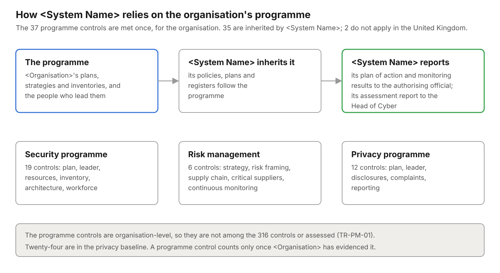

# \<System Name\> Program Management

## 1 Purpose

This document sets out how \<System Name\> relies on \<Organisation\>'s security and privacy programme for the 36 Program Management (PM) controls and enhancements in CSS.

Section 3 is the design: who leads the programme, which control is provided by whom and what \<System Name\> adds, the PM controls CSS places in the privacy baseline, what is asked of \<Organisation\>, and how the design is kept current. Each subsection names the controls it helps to meet.

**PM is different from the other families.** Its controls describe an organisation's whole security and privacy programme, not one system. CSS does not place them in the Low, Moderate or High baselines, and expects them to be implemented once, for the organisation. \<System Name\> therefore has no PM policy or procedures of its own, and gives no PM control a status. It inherits the controls from \<Organisation\> as common controls (CSS, task P-5), and its own documents follow \<Organisation\>'s programme where that is known.

Other documents hold the rest. The decision that PM is outside \<System Name\>'s baseline is TR-PM-01 in \<Tailoring Register\>, so PM has no section in \<System Security Plan\> and no chapter in \<Control Assessment Record\>. The evidence asked of \<Organisation\> is in \<Evidence Requests\>. The risk of relying on the programme before it is evidenced is in \<Risk List\> (R-AC-11), and what is still open is in \<Plan of Action and Milestones\> (PA-124).

Values that CSS asks the organisation to define are set at corporate level by \<Organisation\>, and \<System Name\> sets no PM values of its own. Anything in section 3 that depends on such a value should match it, and is changed in this document where it does not.

Where section 3 notes what "today" is, it means what was known when the tested v1.0 build was assessed: none of \<Organisation\>'s evidence had been received.

## 2 Summary

There are 36 PM controls and enhancements. Two do not apply in the United Kingdom. \<Organisation\> provides the other 34, in some cases with the Head of Cyber or the legal adviser. None is evidenced: the four evidence requests have not been sent.

**Table 1: PM controls by group**

| Group | Controls | In the privacy baseline | Evidence requests | State |
| --- | --- | --- | --- | --- |
| Security programme | 19 | 10 | EV-PM-01, EV-PM-02, EV-PM-03, EV-PL-01 | Not sent |
| Risk management | 5 | 3 | EV-PM-01, EV-PM-03 | Not sent |
| Privacy programme | 12 | 11 | EV-PM-04 | Not sent |

CSS places 24 of the PM controls in its privacy baseline, which \<System Name\> applies because it holds personal data. They are still the organisation's to provide, but they matter more to \<System Name\> than the rest: section 3.4 lists them.

Two decisions are open with other people. The Head of Cyber has not confirmed that he is the senior information security officer, nor that \<System Name\>'s risk thresholds fit \<Organisation\>'s risk appetite (D-PM-03). The legal adviser has not named the data protection officer, or recorded why none is required (D-PM-04). The gap as a whole is registered in the Risk List (R-AC-11) and the Plan of Action and Milestones (PA-124).

## 3 The design

### 3.1 Principles

Controls met here: PM-1, PM-4, PM-31.

1. **One programme.** \<Organisation\> runs one security and privacy programme, and \<System Name\> is one system within it.
2. **Inherit with evidence.** A common control counts for \<System Name\> only once \<Organisation\> has evidenced it.
3. **Follow, and feed back.** \<System Name\>'s policies, plans and registers follow the programme, and its risks, weaknesses and monitoring results feed back into it.
4. **Stand in, and say so.** Where \<Organisation\>'s document has not been seen, \<System Name\>'s own document stands in, and the dependency is checked when the evidence arrives.

**Figure 1: How \<System Name\> relies on the organisation's programme**

### 3.2 Who leads the programme

Controls met here: PM-2, PM-10, PM-18, PM-19, PM-29.

**Table 2: Programme roles**

| Role | Holder | Controls | State |
| --- | --- | --- | --- |
| Senior information security officer | \[Name\], Head of Cyber | PM-2 | Named by the system owner. His confirmation is pending (D-PM-03) |
| Senior official for privacy: the data protection officer | \[Name, or the reason none is required\] | PM-19 | For the legal adviser to complete (D-PM-04) |
| Authorising official | \[Name\] | PM-10 | Named |
| Authorising official for \<Organisation\>'s common controls | \[Organisation common control official\] | PM-10 | Not named: asked of \<Organisation\> (EV-CA-01; \<Assessment, Authorization, and Monitoring Management\>) |
| Senior accountable official for risk management | \[\<Organisation\> to name\] | PM-29 | Not known. \<Organisation\> is asked to name the official (EV-PM-01) |
| System owner | \[Name\] | All | Keeps \<System Name\>'s documents in step with the programme, and sends the evidence requests |
| Legal adviser | \[Name\] | PM-18 to PM-27 | Owns the privacy plan, and \<System Name\>'s part of the privacy programme |

### 3.3 Which control is provided by whom

Controls met here: PM-1, PM-2, PM-3, PM-4, PM-5, PM-5(1), PM-6, PM-7, PM-7(1), PM-8, PM-9, PM-10, PM-11, PM-12, PM-13, PM-14, PM-15, PM-16, PM-16(1), PM-17, PM-18, PM-19, PM-20, PM-20(1), PM-21, PM-22, PM-23, PM-24, PM-25, PM-26, PM-27, PM-28, PM-29, PM-30, PM-31, PM-32.

Agreed on 11 November 2026 (D-PM-02). Each Rev 5 PM control is listed with who provides it, which \<System Name\> controls rely on it, what \<System Name\> contributes, the evidence that would show it, whether CSS places it in the privacy baseline, and the position today. A consistency check confirms that every row names a provider and an evidence request that exists. The three enhancements, PM-7(1), PM-16(1) and PM-20(1), were added on 17 November 2026 and confirmed by the system owner (D-PM-06).

**Table 3: PM inheritance**

| PM control | Provider | \<System Name\> controls that rely on it | \<System Name\>'s part | Evidence | In the privacy baseline | Today |
| --- | --- | --- | --- | --- | --- | --- |
| PM-1 Information Security Program Plan | \<Organisation\>, Head of Cyber | Every family's policy (xx-1) | The 19 family policies follow it | EV-PM-01 | No | Not evidenced (EV-PM-01) |
| PM-2 Information Security Program Leadership Role | Head of Cyber | All | \[Name\] named as senior information security officer in \<System Security Plan\> (D-PM-03) | EV-PM-01 | No | \[Name\] is named. His confirmation of the role is pending (D-PM-03) |
| PM-3 Information Security and Privacy Resources | \<Organisation\> | CA-5, SA-2 | Fixes costed in \<Plan of Action and Milestones\>, and on TPL-23 | EV-PM-01 | Yes | Not evidenced (EV-PM-01) |
| PM-4 Plan of Action and Milestones Process | \<Organisation\>, Head of Cyber | CA-5 | \<Plan of Action and Milestones\> feeds it | EV-PM-01 | Yes | \<System Name\> keeps its own register. \<Organisation\>'s process has not been seen (EV-PM-01) |
| PM-5 System Inventory | \<Organisation\> | CM-8, PL-2 | A system identifier, shown as a placeholder in \<System Security Plan\>, section 2 | EV-PM-02 | No | \<System Name\>'s entry in the inventory is not known: a placeholder (EV-PM-02) |
| PM-5(1) Inventory of Personally Identifiable Information | \<Organisation\>, legal adviser | PT-2, PT-3, CM-12 | Personal data inventory in \<PII Processing Management\>, section 3.3 | EV-PM-02 | Yes | \<System Name\> keeps its own inventory of personal data. \<Organisation\>'s record of processing has not been seen (EV-PM-02) |
| PM-6 Measures of Performance | Head of Cyber | CA-7 | Monitoring results in \<Assessment, Authorization, and Monitoring Management\> | EV-PM-03 | Yes | Not evidenced (EV-PM-03) |
| PM-7 Enterprise Architecture | \<Organisation\> | PL-2, PL-8, SA-17 | \<Security Architecture\> fits it | EV-PL-01 | Yes | \<Organisation\>'s enterprise architecture has not been seen (EV-PL-01) |
| PM-7(1) Offloading | \<Organisation\> | PL-8, SA-8 | None | EV-PL-01 | No | Not evidenced (EV-PL-01) |
| PM-8 Critical Infrastructure Plan | \<Organisation\> | CP-2 | None; \<System Name\> is not critical infrastructure | EV-PM-01 | Yes | Not evidenced (EV-PM-01) |
| PM-9 Risk Management Strategy | \<Organisation\>, Head of Cyber | RA-3, CA-5, CA-6 | Decision rules in \<Risk List\>, section 4.2, to be confirmed against the risk appetite (D-PM-03) | EV-PM-01 | Yes | \<System Name\>'s thresholds are agreed, but not confirmed against \<Organisation\>'s risk appetite (D-PM-03; EV-PM-01) |
| PM-10 Authorization Process | \<Organisation\> | CA-6 | TPL-18; authorising official named; acceptance of the inherited controls (\<Assessment, Authorization, and Monitoring Management\>) | EV-PM-03 | Yes | \[Name\] is named as authorising official. \<Organisation\>'s process has not been seen (EV-PM-03) |
| PM-11 Mission and Business Process Definition | \<Organisation\> | CP-2, RA-2 | \<Concept of Operations\>; business impact in \<Contingency Planning Management\> | EV-PM-01 | Yes | Not evidenced (EV-PM-01) |
| PM-12 Insider Threat Program | \<Organisation\> | AU-6, PS-3 | Audit records and reviews; the playbook for bulk export misuse (\<Incident Response Management\>, section 3.9) | EV-PM-01 | No | Not evidenced (EV-PM-01) |
| PM-13 Security and Privacy Workforce | \<Organisation\> | AT-2, AT-3 | The role curriculum in \<Awareness and Training Management\>, and TPL-9 training records | EV-PM-01 | Yes | Not evidenced (EV-PM-01) |
| PM-14 Testing, Training, and Monitoring | Head of Cyber | CA-2, CA-7, AT-2, CP-4, IR-3 | Family tests and exercises; \<Assessment, Authorization, and Monitoring Management\> | EV-PM-03 | Yes | Not evidenced (EV-PM-03) |
| PM-15 Security and Privacy Groups and Associations | Head of Cyber | SI-5 | None | EV-PM-01 | No | Not evidenced (EV-PM-01) |
| PM-16 Threat Awareness Program | Head of Cyber | SI-5, RA-3 | Advisories handled under \<Procedures\>, PRO-SI-5 | EV-PM-01 | No | Not evidenced (EV-PM-01) |
| PM-16(1) Automated Means for Sharing Threat Intelligence | Head of Cyber | SI-5 | None | EV-PM-01 | No | Not evidenced (EV-PM-01) |
| PM-17 Protecting Controlled Unclassified Information on External Systems | Not applicable | None | United States only | None | Yes | Not applicable in the United Kingdom |
| PM-18 Privacy Program Plan | \<Organisation\>, legal adviser | PT family, PL-2 | \<Privacy Plan\> follows it | EV-PM-04 | Yes | Not evidenced (EV-PM-04) |
| PM-19 Privacy Program Leadership Role | \<Organisation\> | PT family | Data protection officer placeholder in \<Roles and Responsibilities\> and \<Privacy Plan\> (D-PM-04) | EV-PM-04 | Yes | The data protection officer is not named, nor the reason recorded why none is required (D-PM-04) |
| PM-20 Dissemination of Privacy Program Information | \<Organisation\> | PT-5 | Employee privacy notice (EV-PT-01) | EV-PM-04 | Yes | Not evidenced (EV-PM-04) |
| PM-20(1) Privacy Policies on Websites, Applications, and Digital Services | \<Organisation\> | PT-5 | A link to the employee privacy notice from \<System Name\>'s pages, which is not built (PA-90) | EV-PM-04 | Yes | Not evidenced (EV-PM-04) |
| PM-21 Accounting of Disclosures | \<Organisation\>, legal adviser | PT-2, AU-2 | Exports and shares are audited | EV-PM-04 | Yes | Not evidenced (EV-PM-04) |
| PM-22 Personally Identifiable Information Quality Management | \<Organisation\> | SI-18 | The yearly check of accuracy (\<Procedures\>, PRO-PT-5) | EV-PM-04 | Yes | Not evidenced (EV-PM-04) |
| PM-23 Data Governance Body | \<Organisation\> | PT-2 | None | EV-PM-04 | No | Not evidenced (EV-PM-04) |
| PM-24 Data Integrity Board | Not applicable | None | United States only | None | Yes | Not applicable in the United Kingdom |
| PM-25 Minimization of PII Used in Testing, Training, and Research | \<Organisation\> | SA-8(33), SI-12(2) | Testing uses sample data only | EV-PM-04 | Yes | Not evidenced (EV-PM-04) |
| PM-26 Complaint Management | \<Organisation\>, legal adviser | AC-3(14), PT-5 | TPL-15 privacy requests and TPL-22 complaints (\<Procedures\>, PRO-PT-1 and PRO-PT-2) | EV-PM-04 | Yes | Not evidenced (EV-PM-04) |
| PM-27 Privacy Reporting | \<Organisation\>, legal adviser | IR-8(1) | Breach steps in section 3.8 of \<Incident Response Management\>, and the breach register in its section 3.14 | EV-PM-04 | Yes | Not evidenced (EV-PM-04) |
| PM-28 Risk Framing | \<Organisation\>, Head of Cyber | RA-3, RA-7 | \<Risk List\> | EV-PM-01 | Yes | Not evidenced (EV-PM-01) |
| PM-29 Risk Management Program Leadership Roles | \<Organisation\> | All | None | EV-PM-01 | No | Not evidenced (EV-PM-01) |
| PM-30 Supply Chain Risk Management Strategy | \<Organisation\> | SR-2, SR-3 | \<Supply Chain Risk Management\> follows it | EV-PM-03 | No | Not evidenced (EV-PM-03) |
| PM-31 Continuous Monitoring Strategy | \<Organisation\>, Head of Cyber | CA-7 | \<Assessment, Authorization, and Monitoring Management\> follows it | EV-PM-03 | Yes | Not evidenced (EV-PM-03) |
| PM-32 Purposing | \<Organisation\> | SA-8 | \<Concept of Operations\> states \<System Name\>'s purpose | EV-PM-01 | No | Not evidenced (EV-PM-01) |

Where \<Organisation\>'s document is not yet seen, \<System Name\>'s own document stands in, and the dependency is checked when the evidence arrives.

### 3.4 PM controls in the privacy baseline

Controls met here: PM-5(1), PM-18, PM-26, PM-27.

\<System Name\> applies the CSS privacy baseline, as it holds HR documents with personal data (D-PT-01). That baseline includes 24 PM controls: PM-3, PM-4, PM-5(1), PM-6 to PM-11, PM-13, PM-14, PM-17 to PM-22, PM-20(1), PM-24 to PM-28 and PM-31. CSS still expects them to be met once, by the organisation's programme, so they stay \<Organisation\>'s to provide. The system owner decided on 17 November 2026 that they stay inherited and are not assessed for \<System Name\>, and the authorising official is asked to confirm it (D-PM-06). Two of them, PM-17 and PM-24, rest on United States law and do not apply.

For the rest, \<System Name\>'s privacy controls depend on them directly: the personal data inventory on PM-5(1), complaints on PM-26, breach reporting on PM-27, and the privacy plan on PM-18. Until \<Organisation\> evidences its privacy programme (EV-PM-04, EV-PM-02), \<System Name\>'s own privacy plan, inventory and procedures stand in.

### 3.5 What is asked of \<Organisation\>

Controls met here: PM-1, PM-2, PM-3, PM-5, PM-5(1), PM-6, PM-7, PM-7(1), PM-8, PM-9, PM-10, PM-11, PM-12, PM-13, PM-14, PM-15, PM-16, PM-16(1), PM-18, PM-19, PM-20, PM-20(1), PM-21, PM-22, PM-23, PM-25, PM-26, PM-27, PM-28, PM-29, PM-30, PM-31, PM-32.

**Table 4: Asked of \<Organisation\>**

| Request | Controls | What is asked | State |
| --- | --- | --- | --- |
| EV-PM-01 | PM-1, PM-2, PM-3, PM-8, PM-9, PM-11, PM-12, PM-13, PM-15, PM-16, PM-16(1), PM-28, PM-29, PM-32 | The information security programme plan, the risk management strategy and risk appetite, and the roles that lead them | Not sent |
| EV-PM-02 | PM-5, PM-5(1) | \<System Name\>'s entry in the system inventory, and its HR personal data in the record of processing | Not sent |
| EV-PM-03 | PM-6, PM-10, PM-14, PM-30, PM-31 | How systems are authorised, tested and monitored, how performance is measured, and how supply chain risk is managed | Not sent |
| EV-PM-04 | PM-18 to PM-23, PM-20(1), PM-25 to PM-27 | The privacy programme plan, the data protection officer or the reason none is required, and the complaint and reporting processes | Not sent |
| EV-PL-01 | PM-7, PM-7(1) | The enterprise architecture standards that \<System Name\> must fit | Not sent |

The first choice of evidence is \<Organisation\>'s ISO/IEC 27001 certificate, with its scope statement and Statement of Applicability. That standard certifies the management system itself: its leadership, risk management, resources, measurement and review. One certificate whose scope includes the services \<System Name\> uses would evidence most of the security programme controls at once. Where it does not, or if \<Organisation\> holds no certificate, the documents in each request are asked for. The system owner agreed this order on 17 November 2026 (D-PM-07).

### 3.6 Keeping this design current

The system owner reviews this document every 12 months with the plans (\<Procedures\>, PRO-PL-1), and whenever \<Organisation\> answers an evidence request or changes its programme. What is received is recorded against each control in section 3.3. If the evidence shows that a control \<System Name\> relies on is not in place, the shortfall is raised as a risk in \<Risk List\>, and the \<System Name\> controls that rely on it are looked at again.

PM stays outside \<System Name\>'s assessment for as long as the organisation's programme stays with \<Organisation\> and the Head of Cyber, and neither the system owner nor the authorising official asks for it to be assessed (TR-PM-01). If that changes, the PM controls are assessed.
