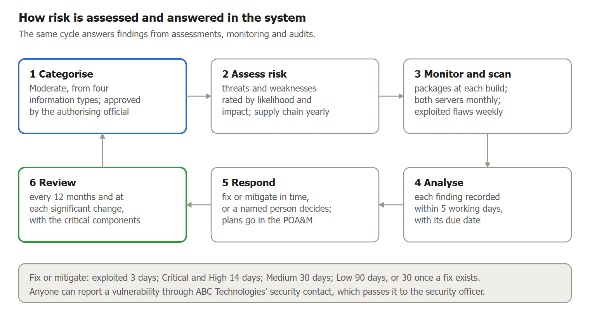

# \<System Name\> Risk Assessment Management

## 1 Purpose

This document shows how \<System Name\> assesses risk and responds to it, for each of the 10 Risk Assessment (RA) controls in the CSS Moderate baseline: the security categorisation, the risk assessment and its supply chain part, vulnerability monitoring and scanning, the response to findings, and the critical components.

Section 3 sets out the design: the categorisation, the risk assessment, the supply chain review, what is monitored for vulnerabilities, the vulnerability timetable, how findings are analysed, shared and reported, how risk is responded to, the critical components, how monitoring stands today, and what \<Organisation\> provides. Section 4 takes each control in turn. Values CSS asks the organisation to define are set at corporate level by \<Organisation\>. Appendix A the related controls and enhancements CSS does not select at Moderate.

The policy is in \<Policy\> (RA), and the steps people follow are in \<Procedures\> (RA). Three records sit beside this one: the risks, and the method that rates them, are in the Risk List, \<Risk List\>; the categorisation is in \<System Security Plan\>, section 3.3, as RA-2 requires; and the suppliers are managed under the supply chain plan, \<Supply Chain Risk Management\>.

An assessor examines the risk assessment, the categorisation, the scan reports and the record of each finding, the supply chain review and the critical components; interviews the system owner, the security officer and the Windows server administrator; and tests the scanning and how quickly what it finds is fixed (CSS). So for each control section 4 gives:

- **each part of the control**, as CSS letters them, with the design that meets it and the position today;
- **who provides it**, and who is responsible;
- **what enforces it**, the rules and procedures that apply, and the tests run;
- **the records an assessor will ask for**, and whether they exist yet;
- **its status**, the risk decision, and what is still open.

**Table 1: Status values**

| Status | Meaning |
| --- | --- |
| Implemented | The design is in place and working |
| Partially implemented | Some of the design is in place; the open items say what is missing |
| Not implemented | None of the design is in place yet |

## 2 Summary

The implementation status of each control, how it is met, who is responsible, its assessment result and the risk and plan entries for its gaps are recorded in \<System Security Plan\>, section 7.15 (Table 24). This section gives only the overall position.

No control in the Moderate baseline is missing from the design. Every gap is registered in the Risk List (\<Risk List\>) and the Plan of Action and Milestones (\<Plan of Action and Milestones\>).

Two things matter most. Nothing scans the VMs or the images, and no scanner has been chosen (PA-62, rated Medium), so vulnerability monitoring rests on the package check alone. And seven package advisories are open, five of them High (PA-56, rated High). The timetable requires them to be fixed by 20 November 2026; if they are not, a risk decision is needed (\<Policy\>, section RA.7), and the authorising official has been asked for it in advance (D-RA-13).

## 3 The design

### 3.1 Principles

1. **Risk-based.** Decisions follow the rated risk, assessed by a stated method.
2. **Named decisions.** A named person decides each risk, at the level its rating calls for.
3. **Keep looking.** Vulnerabilities are looked for all the time, not only at assessment.
4. **Exploited first.** A flaw that is being exploited is dealt with ahead of everything else.
5. **Know what matters most.** The critical components get the closest attention.

These carry out the principles and rules of \<Policy\>, sections RA.3 and RA.4.

**Figure 1: How risk is assessed and answered in \<System Name\>**

### 3.2 Security categorisation

\<System Name\> is categorised Moderate: confidentiality Moderate, integrity Moderate and availability Low. Each of its four information types was mapped to CSS and rated under CSS, and the system takes the highest level of each. The record, with the rationale for each level, is in \<System Security Plan\>, section 3.3, as RA-2 requires. \[Name\] owns the information types, and the authorising official, \[Name\], approved the categorisation (D-GEN-06).

Availability is Low because the 120-hour maximum tolerable downtime means a loss of availability has a limited adverse effect; "business critical" means important to \<Organisation\>, not that \<System Name\> must always be available. The information owner and the authorising official are asked to confirm that rationale (D-RA-07).

The fourth information type was named for accounts and credentials. Since sign-in moved to AD FS, \<System Name\> holds neither (D-AC-23), so it is now named for the identities that arrive at sign-in, sessions and audit records. Its levels do not change. The authorising official is asked to see the new name with the availability rationale (D-RA-07).

The categorisation is reviewed with the risk assessment, and whenever an information type is added or changed.

### 3.3 Risk assessment

\<System Name\>'s risk assessment is the Risk List, \<Risk List\>. It follows CSS: a threat source exploits a weakness, with a likelihood, to cause an impact. The method is set out in full in its section 4, beside the risks it rates, so that the Risk List can be read on its own. The authorising official confirmed it on 6 November 2026. Table 2, below, summarises it.

**Table 2: The risk method at a glance**

| Element | Design | Where it is held |
| --- | --- | --- |
| Threat sources | Adversarial, accidental, structural and environmental, each with examples for \<System Name\> | \<Risk List\>, Table 3c |
| Likelihood | Low, Medium or High, on a scale of how able and motivated the source is and what stands in its way | \<Risk List\>, Table 3a |
| Impact | Low, Medium or High, on the CSS scale, for the documents and for \<Organisation\> | \<Risk List\>, Table 3b |
| Rating | A matrix that weights impact: a High impact never rates below Medium, and a Low impact never above Low, because \<System Name\>'s harm is driven by what it holds | \<Risk List\>, Table 3 |
| Uncertainty | Where the evidence is a single test or a document review, the higher of the two plausible ratings is used. Ratings set before the evidence was seen are marked provisional | \<Risk List\>, section 4.1 and Table 3d |
| Privacy risk | Rated by the same method. The data protection impact assessment adds the effects on individuals | \<Risk List\>, R-PT-01 and R-AU-02; \<Data Protection Impact Assessment\> |
| Who decides | Low: the system owner. Medium: the authorising official, on the system owner's advice. High: the authorising official, and only for a stated period while a fix runs | \<Risk List\>, section 4.2 |
| Tolerance | The thresholds are \<System Name\>'s own until the Head of Cyber confirms them against \<Organisation\>'s risk management strategy and risk appetite | D-PM-03; EV-PM-01 |

**Table 3: When the risk assessment is reviewed**

| When | What is done | Who | Record |
| --- | --- | --- | --- |
| Every 12 months | Each risk is reviewed against the method, and its rating, status and last-reviewed date updated. Each acceptance is checked against its review date, and each Medium and High risk for a decision | System owner | TPL-23; \<Risk List\> |
| After a significant change, an incident or a new test result | The same, for the risks it affects | System owner | TPL-23; \<Risk List\> |
| After each review | The results are shared | System owner, with the authorising official and the Head of Cyber | TPL-23 |
| When a risk needs a decision | Decided by the person its rating calls for | System owner or authorising official | \<Decision Register\> |
| At each review | The categorisation is checked against the information \<System Name\> holds, and any change goes to the authorising official (section 3.2) | System owner | TPL-23 |

Two significant changes were made in November 2026: sign-in moved to AD FS with multi-factor authentication (D-AC-23), and each application now runs as a Windows service on the servers (D-PL-10). Risk entries were reworded as each family was reviewed, but the risk assessment has not been reviewed as a whole since, as RA-3 and PRO-RA-1 require after a significant change. The acceptance of password-only sign-in (D-GEN-13), which the move to AD FS overtakes, is still recorded; the authorising official is asked to note it, and to keep it until AD FS sign-in is shown to work (D-RA-15). The review is registered as PA-127, and a draft of it has been prepared for the system owner to check.

### 3.4 Supply chain risk assessment

Every 12 months, before a new supplier or a new kind of component is added, and after a significant change to the system or where it runs, the system owner and the developers review each item in the supply chain for its origin, support, known problems and end of support (PRO-RA-2). They use the supplier register in \<Supply Chain Risk Management\>, the latest package and image check, and the bill of materials once it is produced (PA-78). Each review is recorded on TPL-23, and any new risk goes into the Risk List. The supply chain plan, \<Supply Chain Risk Management\>, holds the suppliers and how they are managed; this section holds the risk assessment.

The first review was held on 11 November 2026 and approved by the system owner (D-RA-09). It used \<Supply Chain Risk Management\>, Test-Vulnerability.ps1 and the configuration management findings. It stands as the first record; each later review is recorded on TPL-23.

**Table 4: First supply chain review**

| Item | Origin and support | Known problems | Risk |
| --- | --- | --- | --- |
| NuGet packages | nuget.org directly, except the in-house OfflineModules packages, which come from the offline feed (corrected on 12 November 2026; U01, PA-94); maintained | SixLabors.ImageSharp 3.1.12 and Microsoft.OpenApi 2.4.1 have advisories (V01) | R-SI-01, PA-56 |
| Base images | Microsoft .NET 10 on Ubuntu 24.04 LTS, supported to 2029 | Floating tags (V03); no security updates waiting (V04) | R-CM-01, PA-77 |
| Browser libraries | Loaded from a public CDN | Integrity not checked | PA-34 |
| PostgreSQL 18 | Open source; supported | None known | None new |
| Windows Server 2025 VMs | Microsoft, through \<Organisation\> | Not yet built | EV-SR-01 |
| \<Organisation\> | Hosting, network and hardware | Evidence not yet seen | EV-SR-01, EV-SR-02 |

No new risk was found. The open items are already tracked.

Three changes since the first review alter the supply chain. Each is a significant change, so RA-3(1) calls for the review to be updated now, not at the yearly point. The update has not been held (PA-127).

**Table 5: Changes since the first supply chain review**

| Change | Date | What it adds or removes | State |
| --- | --- | --- | --- |
| Sign-in through AD FS, with access decided by Active Directory groups (D-AC-23) | 12 November 2026 | \<Organisation\>'s AD FS and Active Directory become critical dependencies (section 3.9). \<System Name\> no longer holds passwords | Not yet reviewed |
| Access requests through ServiceNow, and leavers through the Starters/Leavers system (D-AC-22) | 12 November 2026 | Two of \<Organisation\>'s corporate services become part of how access is given and removed | Not yet reviewed |
| Each application runs as a Windows service on Windows Server 2025 (D-PL-10) | 13 November 2026 | The .NET runtime is installed on the application server. Whether the base images still reach a release is to be confirmed | Not yet reviewed |

### 3.5 What is monitored for vulnerabilities

**Table 6: Components checked for vulnerabilities**

| Component | How it is checked | Who | How often | Today |
| --- | --- | --- | --- | --- |
| Windows Server 2025, on both VMs | Vendor updates, and a credentialed scan (PRO-RA-3) | Windows server administrator | Monthly, and at each release | The VMs are not yet built, and no scanner is chosen (PA-62) |
| PostgreSQL | Vendor security announcements | Database administrator | Monthly | Not yet in use |
| .NET and NuGet packages, from nuget.org and the offline feed | The package vulnerability report at each build, and Test-Vulnerability.ps1 at each release | Developers | Each build, and monthly | Checked: 7 advisories open (V01; PA-56). The build turns NuGet's own audit off, so nothing reports automatically (PA-92) |
| Browser libraries | Vendor security announcements | Developers | Monthly | Not yet in use. They are loaded from a public CDN with no integrity check (PA-34) |
| Images, and their operating system packages | Test-Vulnerability.ps1, and an image scanner once chosen | Developers | Each release | No update waiting (V04). No scanner (V02; PA-62), and the base images are not pinned (V03; PA-77) |
| \<System Name\>'s own applications: UI application, Admin application and API | A web application scan, reaching them as a user and as an outsider would; the static analysis in the build (PA-92); and an independent penetration test before go-live (PA-109) | Developers | Each release | Nothing scans them (PA-62) |
| Server and database settings | The configuration scan against the baseline in \<Configuration Management\>, which finds the improper configurations RA-5 also asks about | Windows server administrator, database administrator | Monthly | Not yet in use (PA-80) |
| All components, for exploited flaws | CISA's Known Exploited Vulnerabilities catalogue and \<Organisation\>'s alerts (PRO-RA-4) | Security officer | Weekly (\<Security Operating Procedures\>, C50) | Not yet in use |

Monitoring also starts whenever a new vulnerability that may affect \<System Name\> is reported, through these sources or the reporting route in section 3.7.

The scanner is still to be chosen (PA-62). The system owner confirmed on 18 November 2026 that it must (D-RA-12):

1. scan both VMs with an account approved for scanning, so that the scan sees what an administrator sees (RA-5(5));
2. update its definitions before each scan (RA-5(2));
3. name each flaw by its CVE identifier and rate it by CVSS, so that its results and the package check's can be compared and measured the same way (RA-5b);
4. cover the images and their operating system packages, if images are still used to build or run a release;
5. find ports, protocols and services that should not be reachable, against the allowed flows in \<Access Control Management\>, section 3.6;
6. scan \<System Name\>'s three applications at each release, as section 3.5 sets out.

Items 5 and 6 were added by the RA cross-check on 18 November 2026, from the CSS guidance on RA-5, and confirmed by the system owner the same day (D-RA-14).

### 3.6 Vulnerability timetable

This is the one timetable for vulnerabilities in \<System Name\>, its packages, images and VMs (D-RA-P02). It replaces any other limit for vulnerabilities, including the general limits for POA&M items in \<Policy\> (CA). It meets the Cyber Essentials limit of 14 days for high and critical updates, which \<Organisation\> holds.

**Table 7: Vulnerability timetable**

| Severity | How it is set | Fix or mitigate within |
| --- | --- | --- |
| Exploited | In CISA's Known Exploited Vulnerabilities catalogue, or confirmed exploited by the vendor or \<Organisation\> | 3 days, as an emergency change (PRO-RA-4) |
| Critical | Vendor rating Critical, or CVSS base 9.0 or more | 14 days |
| High | Vendor rating High, or CVSS base 7.0 to 8.9, or no rating given | 14 days |
| Medium | Vendor rating Medium or Moderate, or CVSS base 4.0 to 6.9 | 30 days |
| Low | Vendor rating Low, or CVSS base below 4.0 | 90 days, or 30 days once a vendor update exists |

The clock starts when the fix is released, or when \<System Name\>'s use of the flaw is detected if that is later. The vendor's rating comes first; the CVSS version is recorded on TPL-7. Mitigating means reducing the risk without the fix, for example by turning off the affected feature or blocking its route. A fix that cannot meet its time goes to a risk decision under \<Policy\>, section RA.7, with its compensating measure.

### 3.7 Analysing, sharing and reporting

1. **Analysis.** Within 5 working days of each scan or check, the security officer records each finding on TPL-7: its severity under section 3.6, whether \<System Name\> uses the affected part, and its due date (PRO-RA-3).
2. **False positives.** A finding that does not apply, such as a flaw in a feature \<System Name\> does not call, is marked as a false positive on TPL-7 with the reason, and checked again at the next scan.
3. **Fixing.** The people responsible fix or mitigate each finding within its time, as a change (\<Configuration Management\>). An exploited flaw is fixed or mitigated as an emergency change, and the security officer confirms it and tells the system owner (PRO-RA-4).
4. **Sharing.** After each scan the security officer shares each finding that applies with the developers and the Windows server administrator, so that the same flaw is fixed wherever it occurs. A finding that may affect \<Organisation\>'s other systems also goes to its security contact, so that it can be removed there too (PRO-RA-5).
5. **Reports from anyone.** Anyone may report a vulnerability in \<System Name\> to \<Organisation\>'s security contact, which passes the report to the security officer, who records it on TPL-7 and handles it as a scan finding (D-RA-05). CSS asks for a public channel, so the contact must be published where people outside \<Organisation\> can find it, for example in a security.txt file on its website (RFC 9116): \[Where the contact is published, once agreed with \<Organisation\>\] (EV-RA-01). Its published terms must authorise research in good faith, and may ask the reporter to allow a set time for a fix before disclosing the flaw, but must not require it to be kept secret for ever. The time asked for is 90 days, as the system owner decided (D-RA-14), once \<Organisation\> agrees it (EV-RA-01).
6. **Flaws in other parties' components.** A flaw found in another party's package or image is reported to its maintainer through their published route, and noted on TPL-7.

### 3.8 Risk response

Findings come from four sources: security assessments, privacy assessments, monitoring and audits. Each is answered the same way, within the risk tolerance in section 3.3.

**Table 8: How a finding is answered**

| Step | What happens | Who | Record |
| --- | --- | --- | --- |
| 1 Record | Each finding that is not satisfied becomes an entry in the Risk List's non-compliance register, linked to the risk it adds to | System owner | \<Risk List\>, section 5 |
| 2 Rate | The entry is rated by the method in section 3.3 | System owner | \<Risk List\> |
| 3 Decide | The person the rating calls for decides: accept, remediate, approve, obtain evidence from \<Organisation\>, or tailor | System owner for Low; authorising official for Medium and High | \<Decision Register\>; acceptances in \<Risk List\>, section 3 |
| 4 Plan | A remediation goes into the Plan of Action and Milestones, with milestones and a due date. A vulnerability follows the timetable in section 3.6 | System owner | \<Plan of Action and Milestones\> |
| 5 Review | Each acceptance is reviewed by its review date: Medium every 6 months and Low every 12 | System owner; authorising official | \<Risk List\>, section 3 |

A monitoring finding, such as a scan result, is first recorded on TPL-7 (section 3.7). It enters the Risk List only if it cannot be fixed in time.

### 3.9 Critical components

**Method.** A component is critical if its failure or compromise would expose or lose the documents, or defeat a security control. Each component in the authorisation boundary, and each outside service it relies on, was judged by the impact levels in \<System Security Plan\>, section 3.3, the recovery priorities in \<Contingency Planning Management\>, section 3.3, and whether it lies on the path to the documents. A component that gives unmediated access to a critical component is critical too. The developers' criticality analysis (SA-15(3)) uses this list.

**Table 9: Critical components**

| Component | Why it is critical | If it fails or is compromised | State |
| --- | --- | --- | --- |
| Database server VM | Holds every document, document record and audit record | All documents are exposed or lost | Planned |
| Application server VM | Runs all three applications, and holds their data protection key rings and the bulk export working folder. Whoever controls it reaches the database through the API | Every document reachable, and the applications' controls bypassed | Planned; added by the cross-check |
| API | The only route to the database. Checks each request's session, role and project access for the other two applications | Access controls can be bypassed, and every document read | Built |
| UI application | Users' document pages, reached after sign-in through AD FS | Documents shown to the wrong person, or a user's session taken over | Built |
| Admin application | Sets which AD groups open each project, and administers projects, documents, sessions and audit records, including raw deletes and maintenance pages | Project access granted, or documents deleted, without trace | Built |
| Audit records | Show who did what | Misuse cannot be traced or proved | Built |
| Backup store | Holds a full copy of every document | Every document exposed from a stolen or unencrypted backup (R02), or lost | Planned (PA-64) |
| Bulk export working folder | Holds full, unencrypted copies of documents for each export job, left after download and after a restart (PA-86) | Documents disclosed outside their project's permissions | Built; added by the cross-check |
| Key store | Holds the signing key and service secrets | Sessions and database access can be forged | Planned (PA-19) |
| Data protection key rings | Protect each app's cookies and tokens | Sign-in cookies can be forged or read | Built |
| AD FS, with Active Directory (\<Organisation\>) | Authenticate every user with multi-factor authentication, and carry the AD groups that decide each role and each project's access (D-AC-23) | Anyone could sign in as another user, or be given any role or project | Inherited from \<Organisation\>; added on 18 November 2026 |

The first review was held on 11 November 2026, for the RA pack review, and approved by the system owner (D-RA-09). On 18 November 2026 the rows for the database server, API, UI application and Admin application were reworded, and AD FS with Active Directory was added, because since sign-in moved to AD FS \<System Name\> holds no accounts and relies on \<Organisation\> to authenticate every user (D-AC-23). The system owner confirmed the list on 18 November 2026 (D-RA-12). The RA cross-check the same day added the application server VM and the bulk export working folder, as each gives a path to the documents that goes round the other controls; the system owner confirmed them the same day (D-RA-14).

**Critical functions.** CSS asks for critical functions as well as components. Five functions would expose or lose the documents if they failed: signing in and deciding access (AD FS with Active Directory, API, the key store and the data protection key rings); storing and showing documents (the database server, the application server, API and UI application); administering projects and access (Admin application); recording who did what (the audit records); and recovering documents (the backup store).

The next review is due at the first major release, or at the VM build if sooner.

### 3.10 How vulnerability monitoring stands today

Test-Vulnerability.ps1 ran on 11 November 2026 on the v1.0 build and its images. Its results, with their hashes, are kept with the RA evidence.

- **Packages:** the package check found the same 7 advisories as on 6 November, 5 of them High, in API and UI application (V01; PA-56).
- **Images:** the runtime images run Ubuntu 24.04.5 LTS with 97 packages and no security update waiting (V04). No scanner checks them (V02), and their base images are not pinned (V03).
- **VMs:** nothing scans them, and they do not exist yet (PA-62).
- **Reports:** vulnerability reports go through \<Organisation\>'s security contact, which has not yet been agreed with them (EV-RA-01).

### 3.11 What \<Organisation\> provides

**Table 10: Asked of \<Organisation\>**

| Provided | Controls | What \<System Name\> relies on | Evidence asked | State |
| --- | --- | --- | --- | --- |
| The security contact for vulnerability reports | RA-5(11) | It is published, and passes any report about \<System Name\> to the security officer | EV-RA-01 | Not sent |
| A shared scanning service, or a list of exploited flaws it tracks, if it offers one | RA-5 | Whether \<System Name\> can use it | EV-RA-01 | Not sent |
| The risk management strategy and risk appetite | RA-3, RA-7 | System risk decisions respect them, and the Head of Cyber confirms the thresholds against them | EV-PM-01 | Not sent |
| AD FS and Active Directory | RA-9 | They authenticate every user and carry the groups that decide access; they are critical components (section 3.9) | The AC evidence requests in \<Evidence Requests\> | As those requests |
| Hosting, network and hardware, and their suppliers | RA-3(1) | Their supply chain risk is managed, and the approved suppliers are known | EV-SR-01, EV-SR-02 | Not sent |

**Today:** no request has been sent, and none of this is evidenced.

## 4 Each control and enhancement

The controls are in CSS order. Each has two tables. The first takes each part of the control and gives what CSS requires, the design that meets it, and the position today. The second says who provides and is responsible for the control, what enforces it, the rules and procedures that apply, the tests run, the records an assessor will ask for, its status, the risk decision, and what is still open.

### 4.1 RA-1 Policy and Procedures

**Table 11: RA-1 design**

| Part | CSS requires | Design | Today |
| --- | --- | --- | --- |
| a.1 | A risk assessment policy, shared with defined people, covering purpose, scope, roles, responsibilities, management commitment, coordination and compliance, and consistent with the law | \<Policy\> (RA): a system-level policy, shared with everyone who administers \<System Name\>. The legal adviser reviewed it on 11 November 2026 | Version \<ver\> approved by the Head of Cyber (D-RA-01). Version \<ver\> awaits the Head of Cyber (D-RA-06). Not yet shared (PA-20) |
| a.2 | Procedures that carry out the policy, shared with defined people | \<Procedures\> (RA): six procedures, PRO-RA-1 to PRO-RA-6. Shared with the same people | Version \<ver\> approved by the system owner (D-RA-09). Not yet shared |
| b | A named official manages the policy and procedures | The system owner | \[Name\] is named in \<Roles and Responsibilities\> |
| c.1 | The policy is reviewed on a schedule and after set events | Every 12 months, and after a significant incident, audit finding or system change | Reviewed on 11 November 2026 after the RA pack review. The first yearly review falls due in November 2027 |
| c.2 | The procedures are reviewed on a schedule and after set events | Every 12 months, and after a change to the steps | Reviewed and approved as version \<ver\> on 11 November 2026. The first yearly review falls due in November 2027 |

**Table 12: RA-1 responsibility and evidence**

| | |
| --- | --- |
| Provided by | People, following the procedures |
| Responsible | System owner, Head of Cyber |
| Enforced by | Not a system function. The documents are under version control |
| Rules and procedures | The whole policy; all six procedures (\<Procedures\>) |
| Tests | None. Examined from the documents |
| Records an assessor will ask for | The policy and procedures with their approvals; proof they were shared; review records. The approvals exist |
| Status | Partially implemented |
| Risk decision | NC-RA-01, rated Low: approve |
| Open items | PA-20: share the policy and procedures. The Head of Cyber's approval of version \<ver\> (D-RA-06) |

### 4.2 RA-2 Security Categorization

**Table 13: RA-2 design**

| Part | CSS requires | Design | Today |
| --- | --- | --- | --- |
| a | Categorise the system and the information it processes, stores and transmits | Four information types, each mapped to CSS and rated under CSS. The system takes the highest level of each: Moderate, with confidentiality Moderate, integrity Moderate and availability Low (section 3.2) | Done |
| b | Document the results, with the supporting rationale, in the security plan | \<System Security Plan\>, section 3.3, with the rationale for each level | Done. The rationale for availability awaits the information owner and the authorising official (D-RA-07) |
| c | The authorising official reviews and approves the categorisation | The authorising official, \[Name\] | Approved (D-GEN-06) |

**Table 14: RA-2 responsibility and evidence**

| | |
| --- | --- |
| Provided by | People, following the procedures |
| Responsible | System owner, authorising official |
| Enforced by | Not a system function |
| Rules and procedures | Policy rule R3 (\<Policy\>, section RA.4); no procedure of its own |
| Tests | None. Examined from the security plan |
| Records an assessor will ask for | \<System Security Plan\>, section 3.3; the approval (D-GEN-06) |
| Status | Implemented |
| Risk decision | None needed: satisfied |
| Open items | D-RA-07: the information owner and the authorising official confirm the availability rationale |

### 4.3 RA-3 Risk Assessment

**Table 15: RA-3 design**

| Part | CSS requires | Design | Today |
| --- | --- | --- | --- |
| a.1 | Identify threats to and vulnerabilities in the system | Threat sources of four kinds, adversarial, accidental, structural and environmental, as CSS sets out; and the weaknesses that assessments, tests, monitoring and audits find (section 3.3) | Done: the threat sources are in \<Risk List\>, section 4, and each risk's causes in its section 2 |
| a.2 | Determine the likelihood and magnitude of harm from unauthorised access, use, disclosure, disruption, change or destruction | Likelihood and impact are each rated Low, Medium or High on defined scales, and combined in a matrix that weights impact (\<Risk List\>, section 4.1) | Done. Check V05 found every rating agrees with the matrix |
| a.3 | Determine the likelihood and impact of adverse effects on individuals from processing personal data | Privacy risks are rated by the same method, and the data protection impact assessment adds the effects on individuals (\<PII Processing Management\>, section 3.8) | Rated (R-PT-01, R-AU-02). The impact assessment is a draft (PA-72) |
| b | Integrate risk results and decisions from the organisation and business process levels with the system's | System risk decisions respect \<Organisation\>'s risk management strategy and risk appetite, and the Head of Cyber confirms the thresholds against them (D-PM-03; \<Program Management\>) | \<Organisation\>'s risk appetite has not been seen (EV-PM-01, EV-RA-01) |
| c | Document the results in a defined document | \<Risk List\>, the Risk List | Done |
| d | Review the results at a defined frequency | Every 12 months, and after a significant change, incident or new test result (PRO-RA-1) | The first yearly review is not yet due (November 2027). Entries were reworded as each family was reviewed in November 2026, but the whole was not reviewed after the changes to sign-in and hosting of 12 and 13 November 2026 (PA-127) |
| e | Share the results with defined people | The system owner, the authorising official and the Head of Cyber | Not yet shared with the Head of Cyber |
| f | Update the assessment at a defined frequency, and when the system, its environment or other conditions change significantly | Every 12 months, and at each significant change | Not yet updated after the changes to sign-in and hosting of 12 and 13 November 2026 (PA-127). The first yearly update is not yet due |

**Table 16: RA-3 responsibility and evidence**

| | |
| --- | --- |
| Provided by | People, following the procedures |
| Responsible | System owner |
| Enforced by | Not a system function. The Risk List, under version control |
| Rules and procedures | Policy rules R1, R2, R4 (\<Policy\>, section RA.4); PRO-RA-1 (\<Procedures\>) |
| Tests | Checks V05 and V07 (Test-Vulnerability.ps1 on the v1.0 build, 11 November 2026): every rating agrees with the matrix, and no acceptance is past its review date. Both passed |
| Records an assessor will ask for | \<Risk List\>; TPL-23 records of each review, with the date it was shared; \<Organisation\>'s risk appetite |
| Status | Partially implemented |
| Risk decision | NC-RA-02, rated Low: approve |
| Open items | PA-127: share the results with the Head of Cyber, and hold the yearly reviews. EV-PM-01: \<Organisation\>'s risk appetite |

### 4.4 RA-3(1) Supply Chain Risk Assessment

**Table 17: RA-3(1) design**

| Part | CSS requires | Design | Today |
| --- | --- | --- | --- |
| a | Assess the supply chain risks of defined systems, components and services | Packages, base images, suppliers and the VMs, each for its origin, support, known problems and end of support (section 3.4) | First review held on 11 November 2026 (D-RA-09) |
| b | Update the assessment at a defined frequency, and when the supply chain, the system or its environment changes significantly | Every 12 months, before a new supplier or a new kind of component is added, and after a significant change to the system or where it runs | The update called for by the changes to sign-in and hosting of 12 and 13 November 2026 has not been held (PA-127). The first yearly update is due in November 2027 |

**Table 18: RA-3(1) responsibility and evidence**

| | |
| --- | --- |
| Provided by | People, following the procedures |
| Responsible | System owner, developers |
| Enforced by | Not a system function |
| Rules and procedures | Policy rule R5 (\<Policy\>, section RA.4); PRO-RA-2 (\<Procedures\>) |
| Tests | None of its own. Test-Vulnerability.ps1 gives the review the package and image results |
| Records an assessor will ask for | TPL-23 records of each review; the first review in section 3.4 |
| Status | Partially implemented |
| Risk decision | NC-RA-03, rated Low: approve |
| Open items | PA-127: hold the yearly update |

### 4.5 RA-5 Vulnerability Monitoring and Scanning

**Table 19: RA-5 design**

| Part | CSS requires | Design | Today |
| --- | --- | --- | --- |
| a | Monitor and scan for vulnerabilities at a defined frequency, and when new vulnerabilities that may affect the system are reported | Monthly and at each release, with exploited flaws checked weekly. Each component is covered as section 3.5 sets out: packages at each build, \<System Name\>'s own applications at each release, both VMs by a credentialed scan, their settings against the baseline, and the rest from vendor announcements | Packages are checked (V01). Nothing scans the images, the VMs or \<System Name\>'s own applications, and the VMs are not yet built (V02; PA-62) |
| b | Use tools that work together and automate parts of the process, using standards to name platforms and flaws, format checklists and measure impact | The scanner to be chosen names each flaw by its CVE identifier and rates it by CVSS, so that its results and the package check's can be compared (section 3.5). Improper configurations are found by the configuration scan against the baseline, which uses a standard checklist format (\<Configuration Management\>; PA-80) | No scanner chosen (PA-62) |
| c | Analyse the scan reports and the results of monitoring | Within 5 working days the security officer records each finding on TPL-7, with its severity, whether \<System Name\> uses the affected part, and its due date. False positives are marked with the reason and checked again at the next scan (section 3.7) | Approved in PRO-RA-3. Not yet in use |
| d | Fix legitimate vulnerabilities within defined times, in line with the assessment of risk | The one timetable in section 3.6: 3 days if exploited; 14 days for Critical and High; 30 days for Medium; 90 days for Low, or 30 once a vendor update exists | Not met: 7 package advisories open, 5 of them High, due by 20 November 2026 (V01; PA-56) |
| e | Share what monitoring and assessments find with defined people, to remove similar flaws elsewhere | The security officer shares each finding that applies with the developers and the Windows server administrator, so that it is fixed wherever it occurs, and passes to \<Organisation\>'s security contact any that may affect its other systems (PRO-RA-5) | Approved. Not yet in use. Sharing with \<Organisation\> was added by the cross-check |
| f | Use tools that can readily update the vulnerabilities they scan for | The scanner to be chosen updates its definitions before each scan | No scanner chosen (PA-62) |

**Table 20: RA-5 responsibility and evidence**

| | |
| --- | --- |
| Provided by | Shared: \<System Name\> and \<Organisation\> |
| Responsible | Security officer, Windows server administrator |
| Enforced by | Test-Vulnerability.ps1 for the packages and images; a scanner for the VMs, once chosen |
| Rules and procedures | Policy rules R6 to R9 (\<Policy\>, section RA.4); PRO-RA-3, PRO-RA-4, PRO-RA-5 (\<Procedures\>) |
| Tests | Checks V01 to V04 and V09 (Test-Vulnerability.ps1 on the v1.0 build, 11 November 2026): V01 found 7 package advisories, 5 of them High; V02 found no scanner for the images; V03 found the base images unpinned; V04 found no operating system update waiting in the images; V09 found that the POA&M names every affected package |
| Records an assessor will ask for | TPL-7 records, each with its due date and fix; scan reports; the change records of fixes |
| Status | Partially implemented |
| Risk decision | NC-RA-04, rated Medium: remediate |
| Open items | PA-56: update the packages, or the authorising official decides (D-RA-13). PA-62: choose and run a scanner, and scan \<System Name\>'s own applications. PA-80: the configuration scan. PA-77: pin the base images. PA-92: turn the build's package audit on |

### 4.6 RA-5(2) Update Vulnerabilities to Be Scanned

**Table 21: RA-5(2) design**

| Part | CSS requires | Design | Today |
| --- | --- | --- | --- |
| All | Update the vulnerabilities to be scanned at a defined time | Before each new scan | No scanner (PA-62) |

**Table 22: RA-5(2) responsibility and evidence**

| | |
| --- | --- |
| Provided by | Shared: \<System Name\> and \<Organisation\> |
| Responsible | Windows server administrator |
| Enforced by | The scanner, once chosen |
| Rules and procedures | Policy rule R6 (\<Policy\>, section RA.4); PRO-RA-3, step 1 (\<Procedures\>) |
| Tests | Check V02 (Test-Vulnerability.ps1 on the v1.0 build, 11 November 2026): no scanner |
| Records an assessor will ask for | The definitions date on each TPL-7 record |
| Status | Not implemented |
| Risk decision | NC-RA-05, rated Low: remediate |
| Open items | PA-62: choose and run a scanner |

### 4.7 RA-5(5) Privileged Access

**Table 23: RA-5(5) design**

| Part | CSS requires | Design | Today |
| --- | --- | --- | --- |
| All | Authorise privileged access to defined components for defined scanning activities | Credentialed scans of both VMs, using an account approved for that purpose | The VMs are not yet built, and no scanner is chosen (PA-62) |

**Table 24: RA-5(5) responsibility and evidence**

| | |
| --- | --- |
| Provided by | Shared: \<System Name\> and \<Organisation\> |
| Responsible | Windows server administrator |
| Enforced by | The scanner's account on each VM, approved for scanning |
| Rules and procedures | Policy rule R6 (\<Policy\>, section RA.4); PRO-RA-3, step 2 (\<Procedures\>) |
| Tests | None. It cannot be tested until the VMs exist |
| Records an assessor will ask for | The scanning account and its approval; a credentialed scan report |
| Status | Not implemented |
| Risk decision | NC-RA-06, rated Low: obtain evidence |
| Open items | PA-62: choose a scanner and set up its account on the VMs |

### 4.8 RA-5(11) Public Disclosure Program

**Table 25: RA-5(11) design**

| Part | CSS requires | Design | Today |
| --- | --- | --- | --- |
| All | Set up a public channel for reports of vulnerabilities in the system and its components | \<Organisation\>'s security contact, published where people outside \<Organisation\> can find it. It passes any report about \<System Name\> to the security officer, who records it on TPL-7 and handles it as a scan finding (section 3.7; D-RA-05). Its published terms authorise research in good faith, and ask for a set time for a fix without requiring secrecy for ever | Not yet agreed with \<Organisation\>; where it is published, and its terms, are not known (EV-RA-01) |

**Table 26: RA-5(11) responsibility and evidence**

| | |
| --- | --- |
| Provided by | Shared: \<System Name\> and \<Organisation\> |
| Responsible | Security officer, \<Organisation\> |
| Enforced by | \<Organisation\>'s security contact |
| Rules and procedures | Policy rule R9 (\<Policy\>, section RA.4); PRO-RA-5 (\<Procedures\>) |
| Tests | None |
| Records an assessor will ask for | The agreement with \<Organisation\>; where the contact is published; a sample report |
| Status | Not implemented |
| Risk decision | NC-RA-07, rated Low: approve |
| Open items | PA-127 and EV-RA-01: agree the route with \<Organisation\> |

### 4.9 RA-7 Risk Response

**Table 27: RA-7 design**

| Part | CSS requires | Design | Today |
| --- | --- | --- | --- |
| All | Respond to findings from security and privacy assessments, monitoring and audits, in line with the organisation's risk tolerance | Each finding becomes an entry in the Risk List, rated by the method, and the person the rating calls for decides whether to accept, remediate, approve, obtain evidence or tailor. Remediations go into the Plan of Action and Milestones, and decisions into the Decision Register (section 3.8) | Security and privacy assessment findings all have decisions (V06). No monitoring or audit finding has arisen yet |

**Table 28: RA-7 responsibility and evidence**

| | |
| --- | --- |
| Provided by | People, following the procedures |
| Responsible | System owner, authorising official |
| Enforced by | Not a system function |
| Rules and procedures | Policy rules R2, R4, R7, R8 (\<Policy\>, section RA.4); PRO-RA-1, step 4 (\<Procedures\>) |
| Tests | Checks V06 and V07 (Test-Vulnerability.ps1 on the v1.0 build, 11 November 2026): every Medium or High entry has a decision, and no acceptance is past its review date. Both passed |
| Records an assessor will ask for | \<Risk List\>; \<Decision Register\>; \<Plan of Action and Milestones\>; TPL-7 records of monitoring findings |
| Status | Partially implemented |
| Risk decision | NC-RA-08, rated Low: approve |
| Open items | PA-127: respond to the first monitoring and audit findings in the same way |

### 4.10 RA-9 Criticality Analysis

**Table 29: RA-9 design**

| Part | CSS requires | Design | Today |
| --- | --- | --- | --- |
| All | Identify critical components and functions by a criticality analysis of defined items at defined decision points | Every component in the authorisation boundary, and the outside services it relies on, judged by the method in section 3.9 at each major release and significant change | Eleven critical components and five critical functions. Eight components were reviewed and approved on 11 November 2026 (D-RA-09); AD FS and Active Directory were added, and the list confirmed by the system owner, on 18 November 2026 (D-RA-12); the application server VM and the bulk export working folder were added by the cross-check and confirmed by the system owner the same day (D-RA-14) |

**Table 30: RA-9 responsibility and evidence**

| | |
| --- | --- |
| Provided by | People, following the procedures |
| Responsible | System owner, developers |
| Enforced by | Not a system function |
| Rules and procedures | Policy rule R10 (\<Policy\>, section RA.4); PRO-RA-6 (\<Procedures\>) |
| Tests | Check V08 (Test-Vulnerability.ps1 on the v1.0 build, 11 November 2026): every critical component then listed is described in the security plan. It passed |
| Records an assessor will ask for | The critical components list and its method; TPL-23 records of each review |
| Status | Implemented |
| Risk decision | NC-RA-09, rated Low: approve; now satisfied |
| Open items | None |

## Appendix A Risk assessment controls outside the Moderate baseline

CSS does not select these at Moderate, so they are not assessed. Some of the design goes some way towards them, and Table 31 says where. RA-4, RA-5(1), RA-5(7) and RA-5(9) are withdrawn: RA-5(1) is now part of RA-5f, and the others were moved into other controls.

**Table 31: Related controls and enhancements not selected**

| Control | What it adds | \<System Name\>'s position |
| --- | --- | --- |
| RA-2(1) Impact-level Prioritization | Ranks systems within one impact level | Not required. \<System Name\> is one system |
| RA-3(2) Use of All-source Intelligence | Draws on all sources of threat intelligence | Not required. \<Organisation\>'s threat awareness programme (PM-16) and the advisory sources in \<System and Information Integrity Management\>, section 3.3, feed the risk assessment |
| RA-3(3) Dynamic Threat Awareness | Assesses the current threat continuously | Not required. Done in part: CISA's exploited list and \<Organisation\>'s alerts are checked weekly (PRO-RA-4) |
| RA-3(4) Predictive Cyber Analytics | Uses advanced analytics to predict threats | Not required |
| RA-5(3) Breadth and Depth of Coverage | Defines how widely and deeply scans look | Not required. Done in part in design: section 3.5 says which components are checked, how and how often |
| RA-5(4) Discoverable Information | Finds what an adversary could learn about the system, and acts on it | Not required: selected at High only. The penetration test before go-live looks for it (PA-109) |
| RA-5(6) Automated Trend Analyses | Compares scan results over time automatically | Not required. Done in part by hand: the monthly monitoring analysis looks for a trend over three months (\<Assessment, Authorization, and Monitoring Management\>, section 3.8) |
| RA-5(8) Review Historic Audit Logs | Checks the audit records for signs a newly found flaw was exploited before | Not required |
| RA-5(10) Correlate Scanning Information | Combines scan results to find attacks that use several flaws | Not required |
| RA-6 Technical Surveillance Countermeasures Survey | Surveys premises for eavesdropping devices | Not required. \<System Name\> has no premises of its own |
| RA-8 Privacy Impact Assessments | Assesses the effect on people's privacy | In the CSS privacy baseline. Designed and assessed with the personal data controls in \<PII Processing Management\> |
| RA-10 Threat Hunting | Searches actively for threats that have evaded other controls | Not required. Any threat hunting is \<Organisation\>'s security operations |
