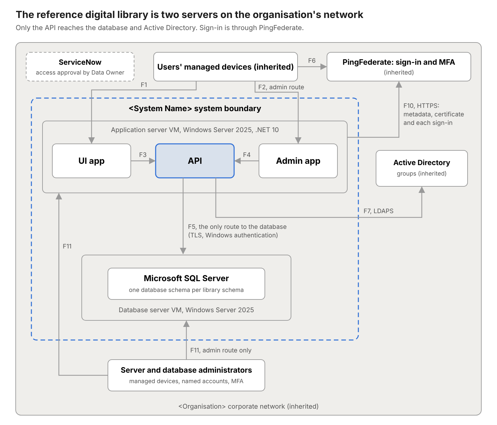

# \<System Name\> Security Architecture

## 1 Purpose

This document is used by every control family. \<System Name\> is the whole stack on two Windows Server 2025 VMs on \<Organisation\>'s corporate network. It describes the design on the two VMs, as set in \<System Description\>. Testing runs on a separate, throwaway copy of the whole system, built from a tagged release with invented data, and development on developers' computers, both apart from production.

## 2 System boundary

**Table 1: System boundary**

| Inside the boundary | Outside the boundary |
| --- | --- |
| Application server VM: Windows Server 2025, UI application, Admin application, API | \<Organisation\>'s corporate network and firewalls |
| Database server VM: Windows Server 2025, Microsoft SQL Server 2022, the \<System Name\> database | Users' devices |
| Service accounts and configuration on both VMs | \<Organisation\>'s remote access, PingFederate, Active Directory, time, logging, proxy and backup services, ServiceNow and the starters and leavers process |

**Figure 1: Target design, showing the \<System Name\> boundary on \<Organisation\>'s network with flows F1 to F7, F10 and F11**

The figure shows the two VMs inside the \<System Name\> boundary, on \<Organisation\>'s corporate network. Users' devices reach UI application (F1) and Admin application (F2). Both call API (F3, F4), and only API connects to SQL Server on the database VM (F5) and reads groups from Active Directory over LDAPS (F7); browsers sign in through PingFederate (F6), and the two apps fetch PingFederate's metadata and signing certificate, and complete each sign-in, from the application VM (F10). Server and database administrators reach both VMs only over \<Organisation\>'s managed administration route (F11). Both VMs also reach \<Organisation\>'s time, logging, proxy and backup services (F8), which the figure does not draw.

Users sign in through \<Organisation\>'s PingFederate, with multi-factor authentication, which returns a signed OpenID Connect response that names the person and carries no groups. The API reads the person's group membership from Active Directory over LDAPS. \<System Name\> holds no accounts or passwords of its own.

## 3 Data flows

**Table 2: Data flows**

| Flow | From | To | Purpose | On the VMs |
| --- | --- | --- | --- | --- |
| F1 | User's browser | UI application | User work | HTTPS, TCP 443 |
| F2 | Administrator's browser | Admin application | Administration | HTTPS, only over \<Organisation\>'s managed administration route (\<Maintenance Management\>, route R3) |
| F3, F4 | UI application and Admin application | API | Every request for data and background work | HTTPS, on the application VM's loopback address only |
| F5 | API | SQL Server | All data | SQL Server over TLS 1.2 or later with strict encryption, TCP 1433, from the application VM only. Windows authentication with the API's managed service account, so no database password exists |
| F6 | User's and administrator's browser | \<Organisation\>'s PingFederate | Sign-in with multi-factor authentication. PingFederate returns a signed OpenID Connect response that names the person and carries no groups | HTTPS |
| F7 | API | \<Organisation\>'s Active Directory | Reading the signed-in person's group memberships | LDAPS, TCP 636, read-only |
| F8 | Both VMs | \<Organisation\>'s time service, central logging, proxy and backup site | Time, logs, updates and backups | As \<Organisation\> sets, encrypted |
| F9 | ServiceNow and the starters and leavers process | People, not \<System Name\> | Access approvals by the Data Owner, and leaver notices | By people, in \<Organisation\>'s services. ServiceNow has no connection to \<System Name\> |
| F10 | UI application and Admin application | \<Organisation\>'s PingFederate | Fetching PingFederate's OpenID Connect metadata and signing certificate, and completing each sign-in | HTTPS, TCP 443, from the application VM only |
| F11 | Server and database administrators' managed devices | Both VMs | Server and database administration | Only over \<Organisation\>'s managed administration route (\<Maintenance Management\>, section 3.4), with multi-factor authentication, using named accounts |

The flows are those in \<System Description\>, section 6.5, with the same numbers. F9 is not a technical connection to \<System Name\>, and is not shown on Figure 1. No other flow is allowed. The UI application and the Admin application have no connection to the database. \<System Name\> needs no route to the internet: it serves every script and style itself, and loads nothing from a content delivery service or any other outside host.

## 4 Inherited from \<Organisation\>

\<Organisation\> holds Cyber Essentials Plus, which supports these claims but does not prove a CSS control. Each needs a named service and evidence from \<Organisation\>.

**Table 3: Services inherited from \<Organisation\>**

| Area | Expected from \<Organisation\> | Evidence |
| --- | --- | --- |
| Network firewalls | Boundary and network protection | \<Evidence Requests\> |
| Remote access | Managed route for remote users and administrators | \<Evidence Requests\> |
| User devices | Build, screen lock, encryption, USB and mobile device controls | \<Evidence Requests\> |
| Wireless | Wireless network controls | \<Evidence Requests\> |
| VM hosting | Hypervisor and physical hardware | \<Evidence Requests\> |
| Boundary services | Proxy, DNS, certificates and denial-of-service protection | EV-SC-01 to 05 |
| Network monitoring | Monitoring of inbound and outbound traffic | EV-SI-01 |
| Second site and telecommunications | A separate site for encrypted backups and rebuilt VMs, with alternate telecommunications | EV-CP-01, EV-CP-02 |
| Hardware maintenance | Hardware and hypervisor maintenance, and support and parts within 24 hours | EV-MA-01 |
| Disks and backup media | Storage, transport and sanitising | EV-MP-01, EV-MP-02 |
| Data centre and offices | Physical access, power, fire, environment and water protection | EV-PE-01 to 05 |
| People processes | Screening, exit interviews, job descriptions and disciplinary action | EV-PS-01 to 03 |
| Enterprise architecture | Standards \<System Name\>'s design must fit | EV-PL-01 |
| Privacy notice | An employee privacy notice that names \<System Name\> | EV-PT-01; \<System Name\>'s pages link to it |
| Contracts and suppliers | Standard contract terms, service descriptions and approved suppliers | EV-SA-01, EV-SA-02, EV-SR-01 |
| Hardware buying and disposal | Inspection, trained buyers, control during repair, and disposal | EV-SR-02 |

## 5 Configuration on the VMs

**Table 4: Configuration on the VMs**

| Item | Target |
| --- | --- |
| Host | Two Windows Server 2025 VMs |
| Traffic | HTTPS and encrypted database connections |
| Secrets | The token signing key and the audit chain key, in a key store outside source code, changed as \<System Description\>, P-10, sets. There is no database password: the API uses Windows authentication |
| Database login | One least-privilege SQL Server login for the API's managed service account, by Windows authentication, used only by API |
| Storage | Full-disk encryption on both VMs |
| Malicious code | Microsoft Defender on both VMs, and each upload scanned through AMSI before it is stored (\<System and Information Integrity Management\>, section 3.2) |
| Hardening | CIS Benchmarks for Windows Server 2025 and SQL Server 2022 |
| Backups | Encrypted daily backups and transaction logs, kept at the second site |
| Retention | Schedule in \<PII Processing Management\>, section 3.7, with periods set by the business owner, and disposal when they end |
| Build and test | Built under \<Organisation\>'s corporate SDLC, with a build pipeline and release test gate |

## 6 Security approach

This section states how \<System Name\> is protected, as CSS PL-8 requires. It describes the design on the VMs.

### 6.1 Protection goals

**Table 5: Protection goals**

| Objective | Impact | What it means for \<System Name\> | Main protections |
| --- | --- | --- | --- |
| Confidentiality | Moderate | Items, including personal data, are seen only by members of the schema's read or edit group, and by administrators | Schema groups read from Active Directory, encrypted transport and storage, audit |
| Integrity | Moderate | Items, their details and files, and the audit trail cannot be changed without trace | Edit rights by role, change control, hash-chained audit records |
| Availability | Low (\<System Security Plan\>, section 3.3; \<System Description\>, P-01) | \<System Name\> can be restored after a failure within the times in \<Contingency Planning Management\> | Encrypted backups at the second site, rebuild procedure |

### 6.2 Design principles

1. **Deny by default:** nothing is reachable or allowed unless a rule permits it.
2. **Least privilege:** people, services and the database role get only what their task needs.
3. **No trust from network position:** every request is authenticated and authorised, even from inside \<Organisation\>'s network.
4. **Defence in depth:** no single control stands alone; each layer in Table 7 has a fallback.
5. **Fail secure:** an error denies access rather than allowing it.

### 6.3 Trust zones

**Table 6: Trust zones**

| Zone | What is in it | Trust | Entry into the zone |
| --- | --- | --- | --- |
| Z1 Users | Users' managed devices and \<Organisation\>'s corporate network | Not trusted by \<System Name\> | Not applicable |
| Z2 Administration route | \<Organisation\>'s managed route for administrators | Trusted for administration only | Managed route and administrator sign-in |
| Z3 Application | Application VM: UI application, Admin application and API | Trusted to enforce access | HTTPS on 443 from Z1 (F1); the Admin application only from Z2 (F2); server administration only from Z2 (F11) |
| Z4 Data | Database VM: SQL Server and the \<System Name\> database | Most protected | Encrypted database connections from the API in Z3 only (F5); database administration only from Z2 (F11) |
| Z5 Provider services | \<Organisation\>'s directory, sign-on, monitoring, ServiceNow and starters and leavers services | Trusted by agreement and evidence | From browsers to PingFederate (F6), outbound from Z3 (F7, F8, F10) or by people (F9), as in section 4 |

### 6.4 Layers of defence

**Table 7: Layers of defence**

| Layer | Protection | Main controls |
| --- | --- | --- |
| Boundary | \<Organisation\>'s firewalls allow only HTTPS into Z3, and the Admin application and server and database administration (F11) only from Z2 | SC-7, AC-17, MA-4 |
| Transport | TLS on every flow, F1 to F8 and F10, as \<System Description\>, P-26, sets, under NCSC's profiles (\<System and Communications Protection Management\>, section 3.3); data protection key rings protected with DPAPI | SC-8, SC-13 |
| Identity | Each person's own Active Directory account, signed in through PingFederate with multi-factor authentication; roles and schema access from AD groups, read by the API over LDAPS (F7) | IA-2, IA-5, AC-7 |
| Authorisation | Roles and schema access checked on every page and API call | AC-3, AC-6 |
| Sign-in lifetime and screen lock | No session management in \<System Name\>. The sign-in is held only in the authentication cookie, which lasts no longer than PingFederate's sign-in lifetime (P-AC-10; \<System Description\>, P-02); an unattended screen is locked by the operating system on \<Organisation\>'s managed devices and the servers (P-AC-15; P-03) | AC-11, AC-12, SC-23 |
| Data at rest | Full-disk encryption on both VMs; no plain copies left by exports | SC-28, MP-4 |
| Audit | Hash-chained audit records, reviewed and kept | AU-2, AU-6, AU-9 |
| Host | CIS hardening, Microsoft Defender, patching | CM-6, SI-2, SI-3 |
| Recovery | Encrypted backups and logs at the second site | CP-9, CP-10 |
| People | Rules signed before access, training, screening | PL-4, AT-2, PS-3 |

### 6.5 Engineering principles

\<System Name\>'s security engineering principles are the NCSC secure design principles, and its privacy engineering principles are the CSS privacy engineering objectives (\<System and Services Acquisition Management\>; SA-8). The table shows where the design meets each. Development, implementation and changes are checked against it (\<Procedures\>, PRO-SA-1).

**Table 8: Engineering principles**

| Principle | Where \<System Name\>'s design meets it |
| --- | --- |
| NCSC 1: Establish the context | Boundary, data flows and trust zones (sections 2, 3 and 6.3); information types and impact in \<System Security Plan\>, section 3.3; risks in \<Risk List\> |
| NCSC 2: Make compromise difficult | Deny by default and least privilege (section 6.2); schema access checked on every request; layered defences (Table 7); trust zones with the Admin application only from Z2 |
| NCSC 3: Make disruption difficult | Separate application and database VMs; recovery times in \<Contingency Planning Management\> |
| NCSC 4: Make compromise detection easier | Hash-chained audit records, weekly review and alerts (\<Audit and Accountability Management\>), detection use cases U1 to U8 (\<System and Information Integrity Management\>, section 3.4); log forwarding to \<Organisation\> |
| NCSC 5: Reduce the impact of compromise | Each schema's items in its own database schema; database reachable only from Z3; separate administration route; critical components in \<Risk Assessment Management\>, section 3.9 |
| CSS privacy: Predictability | Purposes and processing rules in \<PII Processing Management\>; privacy notice through \<Organisation\> |
| CSS privacy: Manageability | Requests, corrections and deletions through PRO-PT-1; retention schedule |
| CSS privacy: Disassociability | Access limited by schema group; audit free text holds no extra personal data |

### 6.6 Assumptions and dependencies

1. \<Organisation\> provides and evidences the services in section 4. \<System Name\> relies on them but does not describe how they are built.
2. The VMs are built to this design, with the configuration in section 5, before production.
3. Users work only on \<Organisation\>'s managed devices, over its network or managed route.
4. The critical components and their failure effects are in \<Risk Assessment Management\>, section 3.9.

