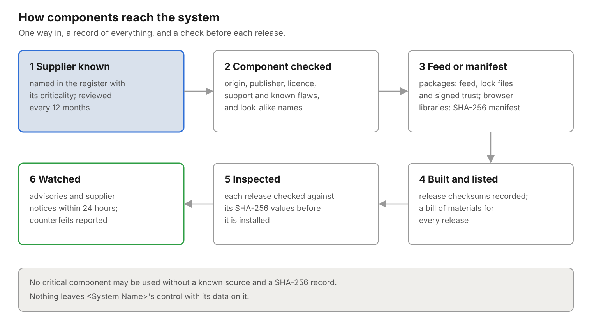

# \<System Name\> Supply Chain Risk Management

## 1 Purpose

This document sets out how \<System Name\> manages the risk that it is harmed through what it is built from, where it is hosted and who supplies it, to meet the 12 Supply Chain Risk Management (SR) controls and enhancements in the CSS Moderate baseline.

Section 3 is the design, and is the supply chain risk management plan that SR-2 requires, on the headings of CSS: the principles, the system context, the team, the risks at each stage, the supplier register, the risk tolerance, how components come in, notices, inspection, authenticity and disposal, what \<Organisation\> provides, the policy and procedures, and the values chosen for the controls. Each subsection names the controls it helps to meet.

## 2 Related documents

Who provides and is responsible for each control, and its status, are in \<System Security Plan\>, section 7.19 (Table 28). The tests, their results and the records an assessor will ask for are in \<Control Assessment Record\> (SR). Each control's risk is in \<Risk List\> (R-SR-01, R-SR-02, and NC-SR-01 to NC-SR-12), the decisions in \<Decision Register\> (D-SR-01 to D-SR-03, D-SR-P76), and what is still open is in \<Plan of Action and Milestones\>. The policy is in \<Policy\> (SR), and the steps people follow are in \<Procedures\> (SR). The critical components are in \<Risk Assessment Management\>, section 3.9, the supply chain risk review in its section 3.4, the external services in \<System and Services Acquisition Management\>, section 3.7, and the integrity baseline in \<System and Information Integrity Management\>, section 3.5.

## 3 The supply chain risk management plan

### 3.1 Principles

Controls met here: SR-2, SR-3.

1. **Know the supply chain.** Every supplier is named, with its criticality.
2. **One way in.** Every package comes through one checked source, and every browser library through one checked, recorded route.
3. **Fix and verify.** A release is built from exactly the components recorded for it, and can be shown to be so.
4. **Hear about problems.** Suppliers and advisories tell us when something goes wrong.
5. **Nothing left behind.** \<System Name\> data is removed before anything leaves.

These carry out the principles and rules of \<Policy\>, sections SR.3 and SR.4.

**Figure 1: How components reach \<System Name\>, and the checks on the way**

### 3.2 System context

Controls met here: SR-2.

\<System Name\> is three .NET 10 web applications, the UI application, the Admin application and the API, with a shared library built into all three, and a Microsoft SQL Server 2022 database (\<System Description\>, sections 6.3 and 6.4). The applications run as Windows services, each under its own group managed service account, on two Windows Server 2025 virtual servers in \<Organisation\>'s data centre. The test environment is a throwaway copy of the whole system, built from a tagged release. Its impact level is Moderate. Users sign in through \<Organisation\>'s PingFederate, and the API reads their Active Directory groups over LDAPS to decide their access. \<System Name\> is built in-house under \<Organisation\>'s corporate SDLC.

This plan covers \<System Name\>, its software packages, browser libraries, build and developer tools, scanners, the \<Organisation\> services it relies on (\<System and Services Acquisition Management\>, Table 4), hosting and hardware, and the suppliers who support any of them.

What it is built from: the Microsoft products in the reference stack; \[number\] packages for the API, \[number\] for the UI application and \[number\] for the Admin application, counting those pulled in, all through the in-house package feed; and \[number\] browser libraries the pages need, held in the UI application's source repository with a manifest of their SHA-256 values, packaged with the UI application and served by it. Every component is in the inventory, \<Configuration Management\>, Table 4, and in each release's bill of materials.

### 3.3 The supply chain team

Controls met here: SR-2, SR-2(1), SR-6.

The supply chain team is the system owner, the security officer, a developer and \<Organisation\>'s IT service desk (SR-02(01)\_ODP\[01\]). Its activities (SR-02(01)\_ODP\[02\]) are to keep this plan and the supplier register current; to review each supplier in the register every 12 months, and a new High supplier before it is used, on TPL-16; to handle notices of compromise and suspected counterfeits; and to bring \<Organisation\>'s hardware, repair and disposal processes into the plan (PRO-SR-2, PRO-SR-4, PRO-SR-5). The system owner leads it and approves the plan.

The team reviews this plan every 12 months, and after a significant change, a supply chain compromise, or a new threat to the supply chain in the threat model (\<Risk List\>, section 2.1) (PRO-SR-2). The plan is restricted, under version control, and held in the restricted store (until the store is set up, the private records repository; \<Documentation Map\>, section 4.1). \<Organisation\>'s part is evidenced through EV-SR-01.

### 3.4 Risks across the lifecycle

Controls met here: SR-2, SR-3.

**Table 1: Supply chain risks by stage**

| Stage | Risk | Response |
| --- | --- | --- |
| Research and development | A harmful, vulnerable or look-alike package or browser library is added | PRO-SR-1 check, then into the in-house package feed, or for a browser library into the UI application's repository with its SHA-256 in the manifest |
| Design | A design relies on an unsuitable supplier | Supplier register; review before a new critical supplier |
| Manufacturing | Hardware is altered before arrival | \<Organisation\> inspects |
| Acquisition | A supplier makes no security commitment | \<Organisation\>'s contract (EV-SA-01), or for an \<Organisation\> service its signed interface record row; open-source security policies checked |
| Delivery | A package, browser library or release is altered in transit | Lock files, signed-package trust, the browser library manifest checked against the publisher's values, and releases from a signed tag with SHA-256 values |
| Integration | A new component weakens a control, or an unapproved program runs on a server | Release tests and Test-SupplyChain.ps1; App Control for Business allows only approved programs (\<Configuration Management\>, section 3.15) |
| Operation and maintenance | A known flaw appears in a component; a component's support ends; a supplier's engineer sees data while giving support | Monthly and release checks (\<Procedures\>, PRO-SI-1); unsupported components replaced (\<System and Services Acquisition Management\>, section 3.12); suppliers' engineers hold no account and work only through an administrator's shared screen, under UK GDPR Article 28 terms if personal data may be seen (\<Maintenance Management\>, sections 3.6 and 3.7) |
| Disposal | Data leaves with a component | PRO-MP-3, then \<Organisation\>'s disposal (PRO-SR-6) |

### 3.5 Supplier register

Controls met here: SR-3, SR-5, SR-6, SR-8.

Criticality follows the critical components in \<Risk Assessment Management\>, section 3.9, and \<Organisation\>'s list of critical suppliers (PM-30(1)): High where a compromise would reach items, or the way people sign in. Advisories are watched through the sources in \<System and Information Integrity Management\>, section 3.3. Every supplier in the register is reviewed every 12 months (PRO-SR-2).

**Table 2: Supplier register**

| Supplier | What it supplies | Criticality | How it reaches \<System Name\> | Evidence | Notification route | Review |
| --- | --- | --- | --- | --- | --- | --- |
| \<Organisation\> | Hosting on its virtual platform and data centre, network, hardware, service desk, sign-in through PingFederate and Active Directory, central logging, the time service, the backup site, the authenticated proxy, ServiceNow, the starters and leavers process, the certificate authority, name resolution and discovery tools, and the corporate SDLC with its source repositories, build pipeline and in-house package feed (\<System Description\>, section 10; \<System and Services Acquisition Management\>, Table 4) | High | Corporate services. The agreement with each service \<System Name\> connects to is its signed row of the interface record (D-CA-04); the others rest on their service descriptions | EV-SR-01, EV-SR-02, EV-CA-02, EV-SA-02 | Security contact to the security officer, within 24 hours | Every 12 months, and before a new critical service is used |
| Microsoft | Windows Server 2025, with Defender, BitLocker and App Control for Business; Microsoft SQL Server 2022; .NET 10, ASP.NET Core 10 and Blazor Server; Entity Framework Core 10 with the SQL Server provider (Microsoft.Data.SqlClient); the .NET SDK and PowerShell 7 | High | The server build, by \<Organisation\>, with updates through the proxy; packages through the in-house package feed | Published lifecycle and security advisories | Microsoft and .NET advisories | Every 12 months |
| nuget.org | The package registry behind the in-house package feed | High | Copied into the in-house package feed after the PRO-SR-1 check; read directly by builds only for vulnerability data. No agreement: it is managed as a supplier of components (\<System and Services Acquisition Management\>, Table 4) | Repository signatures on every package | GitHub Advisory Database | Every 12 months |
| \<System Name\>'s developers (in-house) | The shared library, \<Code\>\_Shared, which holds the data model, the access checks and the audit record format, built into all three applications | High | Built from \<System Name\>'s own source repositories under the corporate SDLC | Reviewed changes and the release record | Internal | Every 12 months |
| \[Supplier of each other third-party package\] | \[Packages the application needs beyond the reference stack\] | \[Medium or Low\] | The in-house package feed | \[Licence and security policy\] | \[Advisory source\] | Every 12 months |
| \[Supplier of each browser library\] | Third-party scripts and styles the pages need, for example a document viewer or an icon set | Medium | From the publisher's release, after the PRO-SR-1 check, into the UI application's source repository, with each file's SHA-256 in the browser library manifest; packaged with the UI application and served by \<System Name\> itself. No content delivery service is used | \[Licence and security policy\] | Library advisories | Every 12 months |
| \[Supplier of the API documentation package\] | Interactive API documentation, for development only | Low | The in-house package feed; left out of release builds | \[Licence\] | \[Advisory source\] | Every 12 months |
| \[Supplier of each developer tool and scanner\] | The tools in \<System and Services Acquisition Management\>, Table 7 (code scan, secret scan, web application scanner, repository command-line tool), the bill of materials tool, the configuration scanner and the vulnerability scanner, once chosen | Medium; High for the vulnerability scanner, which holds an account approved for scanning both servers | Chosen through \<Procedures\>, PRO-SA-3; a tool that runs on a server must be on the approved software list that App Control for Business enforces | \[Licence and security policy\] | \[Advisory source\] | Every 12 months |
| \[Supplier who gives support\] | Support for a product in this register, such as a Microsoft support case | Medium | No account and no connection: its engineer watches an administrator's shared screen, and receives a support copy only as \<Maintenance Management\>, section 3.7 allows, under UK GDPR Article 28 terms if personal data remains | \[Support contract\] | \[Contract terms\] | Every 12 months, and before first use |

### 3.6 Risk tolerance

Controls met here: SR-2, SR-3.

No critical component may be used without a known source and a SHA-256 record. A known flaw in any component is fixed to the timetable in \<Risk Assessment Management\>, section 3.6, and an unsupported component is replaced as \<System and Services Acquisition Management\>, section 3.12, sets. A High supplier that has not been reviewed within 12 months, or a component that fails a check in section 3.8, is recorded in \<Risk List\> for a decision. The risk that a harmful package, browser library or build tool still enters a release is R-RA-06.

### 3.7 How components come in

Controls met here: SR-3, SR-5, SR-10, SR-11.

Three processes find and address weaknesses in the supply chain: component checks before use (PRO-SR-1), supplier reviews (PRO-SR-2) and release inspection (PRO-SR-3). They are coordinated with \<Organisation\>'s IT service desk and the suppliers in section 3.5. They carry out \<Organisation\>'s organisation-wide supply chain risk management strategy, and the supplier register uses its list of critical suppliers (PM-30, PM-30(1), inherited: \<Program Management\>; EV-PM-03). Where the two differ, \<Organisation\>'s strategy wins and this plan is changed to match. They sit within \<Organisation\>'s corporate SDLC, which provides the one checked package feed, the lock file support and the pipeline that produces a software bill of materials for each release (\<System Description\>, section 7.12); the developers check each bill of materials (PRO-SR-3). The processes and controls are documented in this plan and in \<System Security Plan\> (SR-03\_ODP\[04\]).

The acquisition strategies, tools and methods (SR-5) are: buying only from suppliers \<Organisation\> has approved, under its contract terms (EV-SA-01); choosing a component on its origin, publisher, licence, maintainer activity, support period and known flaws before it is used (PRO-SA-7, PRO-SR-1); preferring a supplier that publishes a security policy and advisories; one checked route in for each kind of component, with versions fixed; a bill of materials for each release; and the controls in Table 3.

**Table 3: How each component comes in**

| Component | How it comes in |
| --- | --- |
| The shared library | Built from \<System Name\>'s own source repositories, under the corporate SDLC |
| All other packages | Through the in-house package feed only, by package source mapping, after the PRO-SR-1 check; lock files in locked mode; trust policy for nuget.org's repository signature; NuGet's audit on, reading vulnerability data from nuget.org |
| Windows Server 2025 and SQL Server 2022 | Installed by \<Organisation\>'s server build from Microsoft's media, and updated through \<Organisation\>'s proxy |
| Browser libraries | From the publisher's release, after the PRO-SR-1 check and a second developer's review, into the UI application's source repository, with each file's SHA-256 in the browser library manifest and checked against the publisher's published value where it gives one; packaged with the UI application and served by \<System Name\> itself. No content delivery service |
| Releases | From a signed tag, with SHA-256 values and a CycloneDX bill of materials that lists the packages and the browser libraries, checked before installation |
| Programs on the servers | Only those on the approved software list run: App Control for Business allows \<System Name\>'s release files by their signing certificate or the hashes in the release record (\<Configuration Management\>, section 3.15) |
| Developer tools and scanners | Chosen through \<Procedures\>, PRO-SA-3, recorded in \<System and Services Acquisition Management\>, Table 7, and reviewed every 12 months (PRO-SA-6) |
| Inventory | Every component, with its version, supplier and licence, in \<Configuration Management\>, Table 4, updated at each change (PRO-CM-4) |
| Hardware and hosting | Inspected, controlled under repair and disposed of by \<Organisation\>, with evidence |

### 3.8 Notices, inspection, authenticity and disposal

Controls met here: SR-8, SR-10, SR-11, SR-11(1), SR-11(2), SR-12.

1. **Notices** (SR-8). \<Organisation\> reports a supply chain compromise to the security officer within 24 hours, and shares assessment or audit results that affect \<System Name\> (EV-SR-01). For open-source suppliers, their published advisories are the notice, through the sources in \<System and Information Integrity Management\>, section 3.3. Each notice that applies is recorded on TPL-7, and a compromise is handled as an incident (PRO-SR-5).
2. **Inspection** (SR-10). The release packages, every file a release installs, including the release scripts, and the browser library files are checked against their recorded SHA-256 values at each release before installation, and whenever tampering is suspected (PRO-SR-3). Once installed, the same files are checked monthly by the integrity check (\<System and Information Integrity Management\>, section 3.5). A different value, a missing or extra file, an unsigned or wrongly signed tag, an unexpected package source or damaged packaging is a sign of tampering. \<Organisation\> inspects the host hardware on arrival and after repair (EV-SR-02).
3. **Authenticity** (SR-11). Under policy rule R11, package names are checked against look-alikes, packages come only from the in-house package feed under a signed-package trust policy, and browser library files are checked against their publisher's values. A suspected counterfeit is refused and reported to its source, the security officer, \<Organisation\>, the package registry and, if serious, the NCSC. \<Organisation\> trains its buyers every year (SR-11(1)); the developers, who choose the software, learn to spot look-alike and counterfeit packages in role module M5 (\<Awareness and Training Management\>). \<Organisation\> keeps configuration control of the host hardware while it awaits repair and until it returns to service (SR-11(2); \<Maintenance Management\>; PRO-SR-4).
4. **Disposal** (SR-12). For hardware, virtual disks, media, data and documents, \<System Name\> data is removed first by the method for its type (PRO-MP-3): for the servers' virtual disks, the Windows server administrator destroys every copy of the BitLocker keys; paper is shredded. \<Organisation\> then disposes of the component and confirms in writing (PRO-SR-6). A package or browser library that is retired is removed from the release and the inventory at the next change.

### 3.9 What \<Organisation\> provides

Controls met here: SR-2(1), SR-3, SR-5, SR-6, SR-8, SR-10, SR-11(1), SR-11(2), SR-12.

**Table 4: Asked of \<Organisation\>**

| Provided | Controls | What \<System Name\> relies on | Evidence asked |
| --- | --- | --- | --- |
| Approved suppliers, a seat on the supply chain team, notice of a compromise within 24 hours, and the results of assessments or audits that affect \<System Name\> | SR-2(1), SR-3, SR-5, SR-6, SR-8 | Its suppliers are approved, the IT service desk joins the team, a compromise reaches the security officer within 24 hours, and relevant assessment results are shared | EV-SR-01 |
| Hardware inspection, buyers' training, control of equipment under repair, and disposal | SR-10, SR-11(1), SR-11(2), SR-12 | Each is done, with records | EV-SR-02 |
| Its supply chain risk management strategy, and its list of critical suppliers | PM-30, PM-30(1), inherited (\<Program Management\>) | This plan follows the strategy, and the criticality in the supplier register matches \<Organisation\>'s list | EV-PM-03 |

### 3.10 Policy and procedures

Controls met here: SR-1.

\<Policy\> (SR) and \<Procedures\> (SR) meet SR-1. Who they are shared with is in \<Policy\>, section SR.6. Their ownership, approval, review and records follow the rules common to every policy in \<Policy\>, section 1.1.

### 3.11 Values chosen for the controls

Controls met here: SR-2, SR-2(1), SR-3, SR-5, SR-6, SR-8, SR-10, SR-11, SR-11(1), SR-11(2), SR-12.

These are the organisation-defined parameters for the SR controls. They are approved in \<Decision Register\> (D-SR-P76).

**Table 5: Values chosen**

| Control | Parameter | Value |
| --- | --- | --- |
| SR-2 | What the plan covers; review frequency | \<System Name\>, its packages, browser libraries, build and developer tools, scanners, the \<Organisation\> services it relies on, hosting and hardware (section 3.2); every 12 months, and after a significant change, a supply chain compromise or a new threat |
| SR-2(1) | Team; its activities | Section 3.3 |
| SR-3 | What is covered; who is coordinated with; controls; where documented | \<System Name\> and every component in section 3.2; \<Organisation\>'s IT service desk and the suppliers in Table 2; Table 3 and section 3.8; this plan and \<System Security Plan\> |
| SR-5 | Strategies, tools and methods | Section 3.7 |
| SR-6 | Review frequency | Every supplier every 12 months; a new High supplier before it is used |
| SR-8 | What is notified | Supply chain compromises, within 24 hours, and the results of assessments or audits that affect \<System Name\> |
| SR-10 | What is inspected; when; signs of tampering | The release packages, installed files, release scripts and browser library files, and the host hardware; at each release before installation, monthly once installed, and when tampering is suspected; the signs in section 3.8, item 2 |
| SR-11 | Who counterfeits are reported to | The source of the component; the security officer and \<Organisation\>; the package registry, and the NCSC if serious |
| SR-11(1) | Who is trained | \<Organisation\>'s buyers, every year |
| SR-11(2) | Components kept under configuration control during repair | The host hardware beneath the two servers, with its disks |
| SR-12 | What is disposed of; how | Hardware, virtual disks, media, data and documents; \<System Name\> data removed by the method in \<Media Protection Management\>, section 3.6 (PRO-MP-3), then disposal by \<Organisation\>, confirmed in writing |
