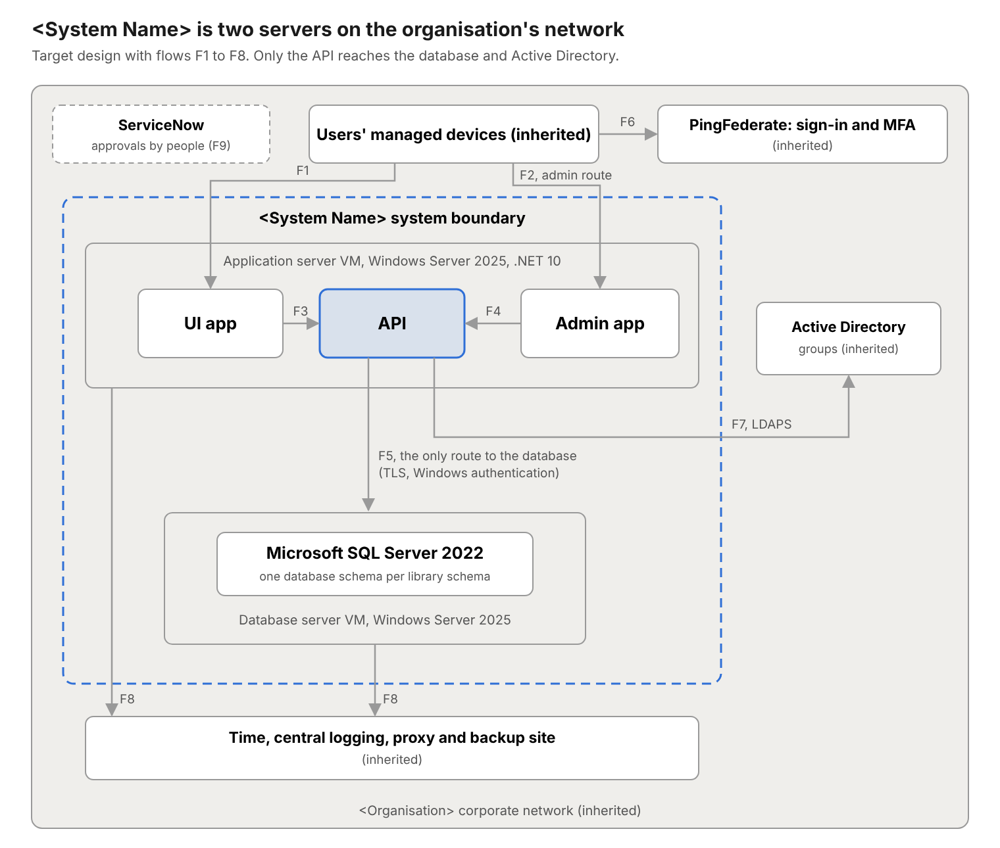
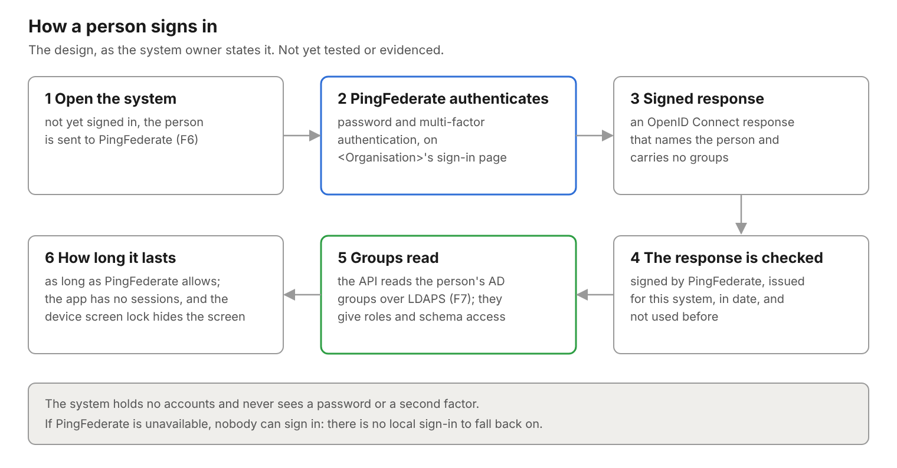
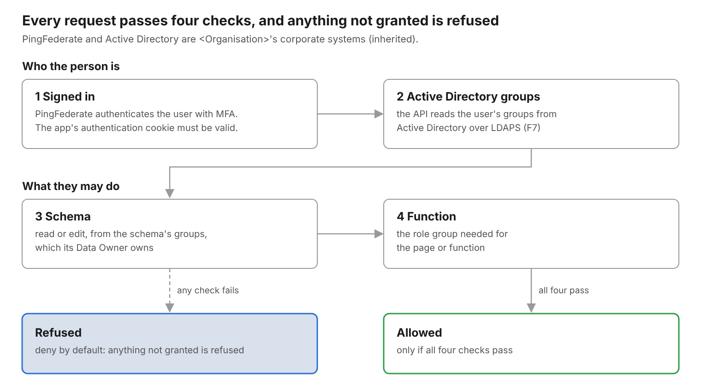

# \<DocuView\> System Description

**\<ref\> | Version \<ver\> | Draft for the system owner's approval**

**Contents**

[1 Document control](#1-document-control)

[2 Purpose, and how to use this document](#2-purpose-and-how-to-use-this-document)

[3 The system at a glance](#3-the-system-at-a-glance)

[4 Business context and users](#4-business-context-and-users)

[5 Requirements](#5-requirements)

[6 Architecture](#6-architecture)

[7 Design](#7-design)

[8 Security, family by family](#8-security-family-by-family)

[9 The design compared with what is built](#9-the-design-compared-with-what-is-built)

[10 What ABC Technologies provides](#10-what-abc-technologies-provides)

[11 Questions and answers](#11-questions-and-answers)

[12 Terms](#12-terms)

| **SECTION 1** |
| --- |

## 1 Document control

### 1.1 Document details

**Table 1: Document details**

| Item | Detail |
| --- | --- |
| Reference | \<ref\> |
| Title | \<DocuView\> System Description |
| Version | \<ver\> |
| Status | Draft for the system owner's approval |
| Date | 18 November 2026 |
| Owner | System owner |
| Applies to | Every control family |
| Classification | Restricted |
| Next review | Every 12 months, and after a significant change to the system |
| Format | \<Documentation Map\>, section 5 |

### 1.2 Approval

**Table 2: Approval**

| Role | Name | Decision | Date |
| --- | --- | --- | --- |
| System owner | Neil Ramsbottom | Pending | Pending |

### 1.3 Change history

**Table 3: Change history**

| Version | Date | Change |
| --- | --- | --- |
| \<ver\> | 18 November 2026 | Every requirement in section 5 now says briefly how it is implemented, as the system owner asked: which part of the system does the work, where the data is held and where the check is made, so that a reader without the source code has it |
| \<ver\> | 18 November 2026 | Section 5 now holds the full requirement set, as the system owner asked: 134 functional requirements in 12 groups and 102 non-functional requirements in 13 groups, drawn from the agreed design and from every page and function of the tested build |
| \<ver\> | 18 November 2026 | Issued into the set as a draft for review |
| \<ver\> | 18 November 2026 | First draft, at the system owner's request (D-GEN-30): one description of the whole system, its architecture, technologies, design and high-level requirements, from a security standpoint, for a person or an AI who does not have the source code |

| **SECTION 2** |
| --- |

## 2 Purpose, and how to use this document

This document describes \<DocuView\> as a whole: what it is for, how it is built, what it runs on, how it is designed, and what it must do. It is written so that a person, or an AI assistant, can answer questions about \<DocuView\>'s security against NIST SP 800-53 Rev 5 without the source code. Everything a reader needs is stated in plain words. No part of it points to code.

It is a summary. The fact itself is held once, in the document named beside it, and that document is the authority if the two ever differ. The design of each control family is in its own design document (section 8), each control has one line in \<System Security Plan\>, section 8, and \<Guide to the Document Set\> shows how the whole set fits together.

**Rules for anyone answering questions from this document, human or AI:**

1. **Keep the design apart from what is built.** \<DocuView\> is not in production. Many answers have two parts: what the design requires, and what the tested build does today. Give both, and say which is which. Section 9 lists the differences.
2. **Three kinds of statement.** A fact about the tested build was tested or examined on the dates given. A design statement is agreed by the system owner but may not be built. A statement about ABC Technologies is what it has said or is expected to provide, and is not yet evidenced.
3. **Say when something is not known.** Text in square brackets is a fact nobody has yet supplied. Do not guess it.
4. **Name the gap.** Where a control is not met, the weakness has a number beginning PA- in \<Plan of Action and Milestones\>, and the risk decision is in \<Risk List\>. Quote the number.
5. **Do not claim compliance.** \<DocuView\> is not authorised to operate, and nothing has been seen in operation.

| **SECTION 3** |
| --- |

## 3 The system at a glance

**Table 4: Key facts**

| Fact | Value |
| --- | --- |
| What it is | A document management system: internal storage, search and viewing of scanned and electronic business documents, kept apart by project |
| Owner and operator | ABC Technologies. System owner: Neil Ramsbottom. Authorising official: Bob Jones. Information owner: Tony Tilley |
| Users | ABC Technologies' staff and contractors only. No external or public users |
| Exposure | Internal only. Reached by browser from ABC Technologies' network or its VPN, on managed devices. Not reachable from the internet |
| Applications | Three: the user application (DV\_Web), the admin portal (DV\_Admin\_UI) and the API (DV\_API), with a shared library (DV\_Shared) |
| Database | PostgreSQL 18, holding every document, project record and audit record |
| Hosting | Two Windows Server 2025 virtual servers at ABC Technologies: an application server and a database server. Each application runs as a Windows service |
| Sign-in | ABC Technologies' single sign-on service, AD FS, with multi-factor authentication. \<DocuView\> holds no accounts and no passwords |
| Authorisation | Active Directory groups, for roles and for each project's read and edit access |
| Information held | HR documents with personal data, some of it special category data; invoices and financial documents; business correspondence; sign-in identities, sessions and audit records |
| Security categorisation | Moderate: confidentiality Moderate, integrity Moderate, availability Low (FIPS 199) |
| Control baseline | NIST SP 800-53 Rev 5, Moderate baseline, with NIST's privacy baseline: 316 controls in 19 assessed families, and Program Management inherited |
| Law | UK GDPR, the Data Protection Act 2018 and the Data (Use and Access) Act 2025; the Computer Misuse Act 1990 |
| Status | Under development. Not in production, not authorised, and holding sample data only. The servers are not built; testing is on a test stack on one computer |
| Version described | The build tagged v1.0, tested from 5 November 2026, and the design agreed up to 18 November 2026 |
| Assessment so far | A self-assessment: 1,083 of 1,998 determination statements satisfied, and 19 controls fully satisfied |
| Open work | 131 items in the plan of action: 13 High, 55 Medium and 63 Low. 123 are open |

| **SECTION 4** |
| --- |

## 4 Business context and users

### 4.1 Why \<DocuView\> exists

Teams need one controlled place to keep scanned and electronic documents, such as PDF and TIFF files, so that the right people can find them quickly and others cannot see them. Each project's documents are kept apart from every other project's, so that one system can serve several parts of the business. The sample data has three projects: invoices, correspondence and HR. The business processes and expected benefits are still to be confirmed by the business owner (\<Concept of Operations\>).

### 4.2 Who uses it

**Table 5: Users and roles**

| Role | What they do | Where | How the role is given |
| --- | --- | --- | --- |
| Reader | Searches and reads documents in their projects, and reports a bad file | User application | Member of the project's read group |
| Editor | A reader's work, and uploads, bulk uploads, manages and exports the project's documents | User application | Member of the project's edit group. Edit includes read |
| Global administrator | Manages projects, which groups open each project, and sessions. Can reach every project | Admin portal and user application | Member of the global administrators' group |
| Administrator | Uses the administration dashboard and system settings | Admin portal | Member of the administrators' group |
| Auditor | Reads and searches the audit log. Holds no administration role | Admin portal | Member of the auditors' group |
| Security officer | Reads security information, reviews logs and alerts, leads incident response. Holds no administration role | Admin portal | Member of the security group |
| Project access approver | Owns a project's data and its two groups. Decides who may read or edit it | Active Directory | Named in \<Roles and Responsibilities\> |
| Windows server and database administrators | Run the servers and PostgreSQL. Need no application role | The servers, over ABC Technologies' managed route | Named accounts from ABC Technologies |
| Developers | Build and fix the applications. Hold no administrator access on the servers | Development environment | Named in \<Roles and Responsibilities\> |

All role and project groups are Active Directory groups. The system owner owns the four role groups, and each project access approver owns their project's two groups. Only a group's owner changes its members.

### 4.3 What information it holds

**Table 6: Information types and impact**

| Information type | Confidentiality | Integrity | Availability |
| --- | --- | --- | --- |
| HR documents, including personal data and some special category data | Moderate | Moderate | Low |
| Invoices and financial documents | Moderate | Moderate | Low |
| Business correspondence | Moderate | Low | Low |
| Sign-in identities, sessions and audit records | Moderate | Moderate | Low |
| **The system, taking the highest of each** | **Moderate** | **Moderate** | **Low** |

Availability is Low because the business can tolerate 120 hours without \<DocuView\>. The record is \<System Security Plan\>, section 4.3.

| **SECTION 5** |
| --- |

## 5 Requirements

This section lists what \<DocuView\> must do. Section 5.1 gives the 134 functional requirements, FR-001 to FR-134: every function of the three applications, who uses it, and whether the tested build provides it. Section 5.2 gives the 102 non-functional requirements, NFR-001 to NFR-102: the qualities the system must have, with the document that holds each value.

The State column of a functional requirement reads as follows. **Built** means the tested build does it. **Built with a gap** means it does it, but a weakness is open, and the PA- number is given. **Designed** means the system owner has agreed it and the tested build does not yet do it. **Not built** means nothing provides it. A non-functional requirement states the design; whether it is met today is in section 7 and section 9.

The **How it is implemented** column says, in a sentence or two, how the system does it: which part does the work, where the data is held, and where the check is made. It stands in for the source code. Where a note says the API reads or writes data, that is the design: in the tested build the user application and the admin portal also read and write the database themselves for some functions, including search and project administration (PA-10). For a requirement that is designed or not built, it gives the agreed way of doing it. Where a person and not the system meets the requirement, it says so.

Each requirement was drawn from the agreed design and from an examination of every page and function of the tested build. No requirement specification has been issued by the business owner, and the capacity, performance and service-hours requirements await them.

### 5.1 Functional requirements

#### 5.1.1 Sign-in, sessions and the person's own account

**Table 7: Functional requirements: sign-in, sessions and the person's own account**

| No. | Requirement | Who | How it is implemented | State |
| --- | --- | --- | --- | --- |
| FR-001 | Sign in once through ABC Technologies' single sign-on service, AD FS, with multi-factor authentication. \<DocuView\> shows no sign-in form of its own | Everyone | The application sends a person with no session to AD FS and accepts only its signed token. The tested build showed its own sign-in page and checked a salted password hash | Designed; the tested build used its own sign-in page and passwords (PA-95) |
| FR-002 | Take the person's name and Active Directory groups from the signed token AD FS returns, and give the roles and project access those groups allow | System | The API reads the name and group list from the token and maps the groups to roles and projects for the session. Nothing is looked up in a \<DocuView\> account table | Designed; not tested (PA-95, PA-117) |
| FR-003 | Refuse a sign-in token that is not signed by AD FS, not issued for \<DocuView\>, outside its life, or already used, and record the refusal | System | The token's signature, audience and life are checked against AD FS's public certificate, and used token identifiers are remembered until they expire | Designed; not tested (PA-95) |
| FR-004 | Show a system use notice on the first page after sign-in, which the person accepts before going further | Everyone | A notice page shown once in each session, whose acceptance is written to the audit log | Not built (PA-11) |
| FR-005 | Open a home page that loads the person's workspace: the projects and functions their groups allow, and nothing else | Everyone | The home page asks the API for the projects whose read or edit group is among the person's groups, and shows those | Built |
| FR-006 | Show only the menu items the person may use. The menu is a convenience: each function checks access itself | Everyone | The menu is drawn from the person's roles. Each page and each API function carries its own access rule as well | Built |
| FR-007 | Show the state of the person's session, and warn them before it ends so that they can carry on | Everyone | A panel on every page reads the session's expiry from the API every 30 seconds and counts down in the browser | Built |
| FR-008 | Lock the page after 25 minutes without activity, hiding its content, until the person signs in again | Everyone | A timer in the browser covers the page. The design ends the lock only by a fresh sign-in, enforced by the server | Built; the lock can be continued without signing in (PA-12) |
| FR-009 | End the session after 30 minutes without activity and after 8 hours in total, and show a session-expired page | System | Each session record holds its start and last activity. The API checks both on every request, and a background task ends expired sessions | Built |
| FR-010 | Allow each person at most 3 sessions; when a fourth starts, end the least recently used | System | The API counts the person's live sessions when one is issued and ends the oldest-used beyond three | Built |
| FR-011 | Sign out, which ends the session on the server | Everyone | Sign-out marks the session record ended and removes the cookie, so the token is refused from then on | Built |
| FR-012 | Show an access-denied page when a request is refused, without saying what exists behind it | Everyone | A refused request is sent to one fixed page with one fixed message, and the refusal is audited | Built |
| FR-013 | Let nobody choose or change a role for themselves or for another person: roles come only from groups | System | The session's roles are set by the API from the groups at sign-in. The tested build has an API function that changes a session's role without checking the caller | Built with a gap: any signed-in user can change another user's session role (PA-02) |
| FR-014 | Show an About page that describes the system and its version | Everyone | A fixed page in the user application | Built |
| FR-015 | Choose a light or dark display | Everyone | The choice is kept in the person's browser and applied by a style sheet | Built |
| FR-016 | Link to the employee privacy notice, and say what \<DocuView\> records about its users | Everyone | A link and a short statement on the home page and the About page | Not built (PA-90) |
| FR-017 | Hold no user accounts, passwords or password resets. The tested build's pages for these are withdrawn | System | Accounts, passwords and lockout live in Active Directory and AD FS. The tested build's account, password and credential tables and pages are removed | Designed (D-AC-23); the tested build has them |

#### 5.1.2 Projects and search

**Table 8: Functional requirements: projects and search**

| No. | Requirement | Who | How it is implemented | State |
| --- | --- | --- | --- | --- |
| FR-018 | Choose a project from a list of those the person may read. A project the person may not read is not shown and cannot be opened | Reader | A drop-down list filled by the API with the projects the person's groups allow. The API checks the project again on each request | Built |
| FR-019 | Search the chosen project with one search box that looks in the title, author, document number and keywords | Reader | One parameterised query in the project's own area of the database, matching the term against those four fields. The search is audited | Built |
| FR-020 | List the results with document number, title, author, type, status and date created | Reader | The query returns one row for each document, with those six columns | Built |
| FR-021 | Sort the results by any of those columns, ascending or descending. The newest are first by default | Reader | Sorting is done by the database, on a column chosen from a fixed list, so no text from the user becomes part of the query | Built |
| FR-022 | Page through the results, 50 to a page by default, and choose how many to show | Reader | The database returns one page of rows and the total count. The page size is chosen from a fixed list | Built |
| FR-023 | Clear the search and its filters | Reader | Resets the page's state in the user application | Built |
| FR-024 | Remember the person's recent searches in their own browser only | Reader | Held in the browser's own storage on the person's device. Not sent to the server | Built |
| FR-025 | Open a result in a side panel that can be resized and closed, or in the full viewer | Reader | The panel loads the viewer for the chosen document within the search page | Built |
| FR-026 | Save the list of results, not the documents, as a CSV file | Reader | The user application writes the rows on screen to a file and hands it to the browser. It holds details only | Built |
| FR-027 | Search one project at a time. There is no search across projects | Reader | Every query names one project. No function queries more than one | Built; a search across projects for one person is a separate requirement (FR-123) |

#### 5.1.3 Viewing documents

**Table 9: Functional requirements: viewing documents**

| No. | Requirement | Who | How it is implemented | State |
| --- | --- | --- | --- | --- |
| FR-028 | View a scanned document one page at a time, and move to the next or previous page | Reader | The viewer asks the API for one page at a time and shows it as an image | Built |
| FR-029 | View a PDF document in a built-in PDF viewer | Reader | The API sends the PDF to a viewer that runs in the browser, served by \<DocuView\>, which draws the pages | Built |
| FR-030 | Show large scanned pages in tiles at several levels of detail, so that only the part being looked at is sent | Reader | The API cuts each tile from the stored page on request and sends it as a JPEG. The image viewer in the browser asks only for the tiles in view | Built |
| FR-031 | Zoom in and out, fit the page to the window or to its width, and view full screen | Reader | Done in the browser by the image viewer, on the tiles already sent | Built |
| FR-032 | Rotate the page left or right on screen | Reader | Done in the browser. Nothing is sent to the server | Built |
| FR-033 | Invert the colours and adjust brightness and contrast on screen. The stored document is not changed | Reader | Done in the browser with display filters. Nothing is sent to the server | Built |
| FR-034 | Measure a distance on the page, and show a scale bar | Reader | Drawn in the browser, from the page's size and resolution | Built |
| FR-035 | Mark up the view on screen. Marks are not saved and are seen by nobody else | Reader | Drawn over the page in the browser and discarded when the page closes | Built |
| FR-036 | Take a picture of the part of the page in view | Reader | The browser copies the visible part of the viewer to an image file on the person's device | Built; the picture is not marked (PA-87) |
| FR-037 | Show a small preview of a page, and a page's details such as its size and type | Reader | The API makes a reduced copy of the page on request, and returns the page's stored details | Built |
| FR-038 | Download the original file of a page or document | Reader | The API sends the stored file as a download, after the same access check as viewing | Built; the file is not marked (PA-87) |
| FR-039 | Open the document in a new browser tab, and copy a link to the view. A link opens only for a person who may read the project | Reader | The link holds the project and a random token for the document, not its number. Opening it runs the normal sign-in and access checks | Built |
| FR-040 | Work the viewer from the keyboard, with a list of the shortcuts | Reader | Key presses are handled in the browser by the viewer | Built |
| FR-041 | Return from the viewer to the search | Reader | A link back to the search page | Built |
| FR-042 | Check the person's access to the project on every request for a document, page, tile, preview or download | System | Every API function that returns content takes the project, confirms it against the person's groups, and only then reads from that project's area | Built; fixed on 5 November 2026 and awaiting a repeat test on the servers (PA-01) |
| FR-043 | Name the project in every document address, because page numbers restart in each project | System | The address of each document, page and tile carries the project. The tested build also keeps older addresses without it | Built; an older address with no project still works (PA-25) |
| FR-044 | Send document content so that it is not kept in shared caches or after sign-out | System | The API sets response headers that forbid shared caching and storing | Built; fixed on 5 November 2026 (PA-09) |
| FR-045 | Mark what \<DocuView\> shows, prints and exports with its classification | System | A banner and watermark on the viewer, on printed pages and in export files | Not built (PA-87) |

#### 5.1.4 Reporting a faulty document

**Table 10: Functional requirements: reporting a faulty document**

| No. | Requirement | Who | How it is implemented | State |
| --- | --- | --- | --- | --- |
| FR-046 | Report a document or page as faulty, from the viewer or from a separate page | Reader | A dialog in the viewer, and a page, each sending the report to the API | Built |
| FR-047 | Give the kind of fault: blurry image, missing file, corrupted data, wrong file, poor quality, unreadable text, wrong version or other | Reader | Chosen from a fixed list and stored with the report | Built |
| FR-048 | Give a priority of low, normal or high, the page concerned, and a description | Reader | Stored with the report, with the reporter's name and the time | Built |
| FR-049 | List the reports for a project, and filter them by status and priority | Reader, editor | The API reads the reports of one project after checking the person's access to it, and filters in the database | Built; the project check was fixed on 5 November 2026 (PA-05) |
| FR-050 | Move a report through its states: open, in progress, resolved, closed or rejected | Editor | An editor changes the state on the report. The API checks edit access to the project first | Built |
| FR-051 | Record the corrective action taken and notes on the resolution | Editor | Two text fields stored on the report, with who resolved it and when | Built |
| FR-052 | Record each report and each change of state in the audit log | System | The API writes an audit record when a report is created or changes state | Not confirmed (PA-103) |

#### 5.1.5 Uploading and managing documents

**Table 11: Functional requirements: uploading and managing documents**

| No. | Requirement | Who | How it is implemented | State |
| --- | --- | --- | --- | --- |
| FR-053 | List and search the project's documents on a management page open only to its editors | Editor | A page that first checks the person is an editor of the project, then lists its documents through the API | Built |
| FR-054 | Upload a file as a new document, with its details | Editor | The file and its details go to the API, which checks them, creates the document record and stores the file as its first page | Built |
| FR-055 | Add a page to an existing document, with its page number and an optional page reference | Editor | The API stores the file as a further page of the document named, at the page number given | Built |
| FR-056 | Accept only PDF, TIFF, JPEG, PNG, BMP and GIF files | System | The extension and the declared type are checked against a fixed list on the server | Built |
| FR-057 | Check on the server that the file's first bytes match its type, that its name holds no path, and that its size is within the limit for the person's role: 25, 50, 75 or 100 MB | System | The API compares the file's leading bytes with the known signature of its type, strips any folder from the name, and compares its size with the limit for the person's role | Built |
| FR-058 | Scan each upload for malicious code before it is stored; refuse, record and report a flagged file | System | The API passes the file to Microsoft Defender through Windows before storing it, and stores it only if it is clean | Not built (PA-58) |
| FR-059 | Hold these details for each document: number, title, author, document date, type, version, index, issue, keywords, a memo, status and classification | Editor | Columns of the document record, in the project's area of the database | Built |
| FR-060 | Give each document a status: draft, pending, active, approved, final, archived, superseded, cancelled or rejected | Editor | Chosen from a fixed list and held on the document record | Built |
| FR-061 | Give each document a classification: public, internal, confidential or restricted | Editor | Chosen from a fixed list and held on the document record. Nothing sets it from the project | Built; HR documents are classified like any other (PA-89) |
| FR-062 | Hold further details a project defines for itself: up to 12 text, 4 date and several yes-or-no fields | Editor | Spare columns on the document record, which each project labels for its own use | Built |
| FR-063 | Show the pages just uploaded, each of which can be viewed or downloaded | Editor | A list on the upload page, read back from the API | Built |
| FR-064 | Correct a document's details | Editor, global administrator | The API updates the document record after checking access. No audit record is written | Built; not recorded in the audit log (PA-89) |
| FR-065 | Replace a page's file, and correct a page's details | Global administrator | The API stores the new file in place of the old one, in the admin portal's document pages. No audit record is written | Built; not recorded in the audit log (PA-89) |
| FR-066 | Delete a document, after confirming | Global administrator | The API removes the document record and its pages from the database. No audit record is written, and nothing is kept | Built; not recorded in the audit log (PA-89) |
| FR-067 | Set the status of several chosen documents at once | Global administrator | One update of the chosen records | Built |
| FR-068 | Show a project's totals: documents, pages and storage used | Global administrator | Counted by the database for the project chosen | Built |
| FR-069 | Store each page with a checksum, so that a change can be detected | System | The API calculates the checksum of the file when it is stored and holds it on the page record | Built with MD5; SHA-256 is designed (PA-61) |
| FR-070 | Record who uploaded each document, and when | System | The signed-in name and the time are written to the document and page records by the API | Built |

#### 5.1.6 Bulk upload

**Table 12: Functional requirements: bulk upload**

| No. | Requirement | Who | How it is implemented | State |
| --- | --- | --- | --- | --- |
| FR-071 | Upload up to 100 files, and up to 500 MB, in one batch | Editor | The API counts the files and their total size and refuses a batch over either limit | Built |
| FR-072 | Supply the files one by one or together in a ZIP file | Editor | A ZIP file is unpacked, and each entry is then treated as a separate uploaded file with the same checks | Built |
| FR-073 | Supply the details of each file in a CSV list, from a template \<DocuView\> provides | Editor | The API gives out a template. Each row of the list is matched to a file by its name | Built |
| FR-074 | Check the batch and its list before anything is stored, and show what is wrong | Editor | A separate API function checks every file and row and returns the faults, storing nothing | Built |
| FR-075 | Set a status, classification, author and version for the whole batch, or copy the first file's details to the rest | Editor | Applied to the rows in the user application before the batch is sent | Built |
| FR-076 | Apply the checks of a single upload to every file in the batch | System | The same checking routine runs for each file. One failure does not stop the others | Built; no malware scan (PA-58) |
| FR-077 | Show the result for each file and for the batch, and notify the person when it ends | Editor | The API returns a result for each file, and creates a notification for the person | Built |
| FR-078 | Check the person's edit access against the project the files are stored in, not only the project named | System | The API works out the project's storage area from the project record it has just checked, not from a name in the request | Built; fixed on 5 November 2026 (PA-27) |

#### 5.1.7 Bulk export

**Table 13: Functional requirements: bulk export**

| No. | Requirement | Who | How it is implemented | State |
| --- | --- | --- | --- | --- |
| FR-079 | Choose a project's documents to export by status, classification, type, title, author, document number, keywords, memo, date created and document date, and by rules on any other field | Editor | The filters become one parameterised query in the project's area. Field names come from a fixed list | Built |
| FR-080 | Show how many documents match before the export starts | Editor | The same query, counted | Built |
| FR-081 | Run the export as a job in the background: queued, processing, completed, failed or cancelled | Editor | The API places the job on a queue, and a background task works through it. A job's state is held in the API's memory and is lost if the API restarts | Built |
| FR-082 | List the person's own jobs and follow their progress | Editor | The API returns only the jobs started by the caller | Built |
| FR-083 | Download a finished export as one ZIP file | Editor | The background task copies the files to a working folder on the application server and packs them into a ZIP, which the API then sends | Built; the file is neither encrypted nor marked (PA-86, PA-87) |
| FR-084 | Cancel a job | Editor | The API signals the background task to stop and marks the job cancelled | Built |
| FR-085 | Let only the person who started a job see, download or cancel it | System | Each job holds the name of its starter, and the API compares it with the caller on every status, download and cancel request | Built; fixed on 5 November 2026 (PA-04) |
| FR-086 | Deliver exports only as downloads. The tested build's option to write an export to a folder on the server is to be removed | System | The folder option is taken out, so the only output is the download | Designed; the option remains (PA-26) |
| FR-087 | Delete an export's working copies once downloaded, and within 24 hours | System | The API deletes the working folder and the ZIP after the download, and a background task removes any left after 24 hours | Not built (PA-86) |
| FR-088 | Record every export in the audit log, with who, which project and how many documents | System | An audit record is written for each export | Built |
| FR-089 | Raise an alert on an export above a set size | System | A rule in central monitoring on the export audit records | Not built (PA-59) |

#### 5.1.8 Notifications

**Table 14: Functional requirements: notifications**

| No. | Requirement | Who | How it is implemented | State |
| --- | --- | --- | --- | --- |
| FR-090 | Show a count of unread notifications on every page | Everyone | A bell on every page asks the API for the count every 30 seconds | Built |
| FR-091 | List the person's notifications, and filter by category, by read or unread, and by importance | Everyone | The API returns the caller's own notifications, filtered in the database | Built |
| FR-092 | Sort notifications into categories: faulty document report, batch import, batch export, document upload, security, system, role change, project access and general | System | A category is set by the function that creates the notification, from a fixed list | Built |
| FR-093 | Mark one or all as read, and delete one or several | Everyone | The API changes or removes only notifications addressed to the caller | Built |
| FR-094 | Remove old notifications | System | A clean-up function in the API deletes notifications past a set age. It is to be limited to administrators | Built; any signed-in user can start it (PA-06) |
| FR-095 | Let only \<DocuView\> itself create a notification, and show a person only their own | System | Notifications are created inside the API by the function concerned. The tested build also lets a caller create one for any person | Built with a gap: any signed-in user can send one to anyone (PA-06) |
| FR-096 | Send no email or message outside \<DocuView\> | System | \<DocuView\> has no mail or messaging component, and no outbound route for one | Built |

#### 5.1.9 Administration

**Table 15: Functional requirements: administration**

| No. | Requirement | Who | How it is implemented | State |
| --- | --- | --- | --- | --- |
| FR-097 | Show a dashboard in the admin portal with only the functions the person's role allows | Administrator, global administrator, auditor, security officer | Each tile on the dashboard is shown only for the role it needs, and each page behind it has its own access rule | Built |
| FR-098 | Create a project with a code, a name, a description and its own storage area in the database | Global administrator | The API adds a project record and creates the project's area in the database with its tables | Built |
| FR-099 | Name the Active Directory group that may read a project and the group that may edit it | Global administrator | Two fields on the project record. The API compares them with the groups in the person's session | Built; the tested build also offered its own groups, which are withdrawn (D-AC-23) |
| FR-100 | Search, change, deactivate, reactivate and delete projects. A deactivated project opens for nobody | Global administrator | The API updates the project record. Inactive projects are left out of every list and refused on request | Built; changes are not all recorded in the audit log (PA-14) |
| FR-101 | Close a project with no groups to everyone but global administrators | System | The access check finds no group to match, so only the global administrator rule lets a person in | Built |
| FR-102 | List active sessions with the person, role, address, start, last activity, expiry and browser, with totals | Global administrator | The API lists the live session records | Built |
| FR-103 | End one session, or all of a person's sessions, at once | Global administrator | The API marks the session records ended, so the next request from each is refused | Built; ending all of a person's sessions is not recorded (PA-14) |
| FR-104 | Manage system settings | Administrator | \[Which settings can be changed from the admin portal, from the developers\] | Built |
| FR-105 | Run diagnostics: the database connection, the project records and each project's storage area | Global administrator | A page that runs fixed checks through the application and shows the results | Built; other diagnostic and test pages are open to any signed-in user and are to be removed (PA-07, PA-29) |
| FR-106 | Clear the API's cache of access decisions and see its statistics | Administrator | The API holds access decisions in memory for a few minutes to save queries, and has functions to empty the store and count its use | Built with a gap: open to anyone without sign-in (PA-03) |
| FR-107 | Change the database's structure or reset its data only by a release under an approved change, never from a page | Database administrator | Structure changes are scripts in a release, applied by the database administrator. The pages that do this from the admin portal are removed | Designed; maintenance pages for this remain in the admin portal (PA-31, PA-84) |
| FR-108 | Hold no pages for user accounts, passwords, roles, groups of users or global administrators: these are managed in Active Directory | System | The pages and tables are removed from the release | Designed (D-AC-23); the tested build has these pages |
| FR-109 | Answer a health check without sign-in, giving no detail | System | One API function that returns a fixed answer and reads no data | Built |

#### 5.1.10 Audit and security information

**Table 16: Functional requirements: audit and security information**

| No. | Requirement | Who | How it is implemented | State |
| --- | --- | --- | --- | --- |
| FR-110 | Record every event type in section 7.6 in one audit log, with who, what, when, where and the result | System | The function that carries out an action calls the audit service in the API, which adds one record to the audit table | Built in part (PA-14, PA-76, PA-89, PA-103) |
| FR-111 | Accept audit records only from \<DocuView\>'s own applications, and let no user write or change one | System | The API accepts audit events only on calls bearing the token of the user application or admin portal, and the database account may only add rows | Built with gaps (PA-29, PA-36) |
| FR-112 | Chain the records with a keyed hash, and check the chain on a schedule and on request | System | Each record stores a hash of its own content and the previous record's hash. A scheduled task recomputes the chain and reports a break | Built without a key; the check does not run (PA-73, PA-74, PA-37) |
| FR-113 | Read the audit log with totals: all events, successful, denied, failed, document access and security events | Auditor | The admin portal asks the API, which counts the records by result and type in the database | Built |
| FR-114 | Filter the audit log by date range, event type, result and username | Auditor | The filters become a parameterised query on the audit table, paged in the database | Built |
| FR-115 | Search the audit log by project or document, choose the sort order, and export or report from it | Auditor | Further filters and a download on the audit page | Not built (PA-41) |
| FR-116 | Let only auditors read the audit log | System | The audit pages and API functions require the auditor role | Built with a gap: global administrators can read it (PA-15, PA-39) |
| FR-117 | Record each reading and export of the audit log | System | The API writes an audit record when the audit log is read or exported | Not built (PA-76) |
| FR-118 | Show the security officer a report of every page, the access it requires and its risk | Security officer | The page lists each page of the admin portal with the access rule it declares | Built; not yet tested |
| FR-119 | Raise an alert on the eight events in section 7.10, and on a failure to write an audit record | System | Rules in ABC Technologies' central monitoring on the forwarded logs, sending to the security officer | Not built (PA-59, PA-38) |
| FR-120 | Forward the application, Windows and PostgreSQL logs to ABC Technologies' central logging | System | A log forwarding agent on each server, set up by ABC Technologies | Not built (PA-59, PA-43) |
| FR-121 | Keep audit records 12 months online and 12 months archived, then dispose of them | System | A scheduled task moves records older than 12 months to an offline archive and deletes those older than 24 | Not built (PA-42) |

#### 5.1.11 Privacy and the life of a document

**Table 17: Functional requirements: privacy and the life of a document**

| No. | Requirement | Who | How it is implemented | State |
| --- | --- | --- | --- | --- |
| FR-122 | Keep each kind of document for the period in the retention schedule, then dispose of it and record the disposal | Business owner | A retention period on each project or document type, and a scheduled task that lists documents due and deletes them once approved | Not built (PA-70) |
| FR-123 | Find every document about one person across all projects, to answer a request under data protection law | Legal adviser's delegate | A search function limited to a named role, which queries every project and is audited | Not built (PA-89) |
| FR-124 | Mark documents and projects that hold personal or special category data | Editor, project access approver | A flag on the project and the document record | Not built (PA-89) |
| FR-125 | Correct or erase a person's data on the legal adviser's instruction, and record it | Editor, global administrator | By hand, by an editor or global administrator, using the correct and delete functions | Possible by hand; not recorded (PA-89) |
| FR-126 | Keep personal data out of the free text of audit records and out of the application logs | System | Audit free text is built from fixed wording and identifiers, and the application logs carry no usernames, addresses or session identifiers | Not met (PA-71, PA-75) |
| FR-127 | Use only sample data in test and development. Real personal data is never used there | Developers | Test stacks are built from a script that loads invented projects and documents | In force |

#### 5.1.12 What \<DocuView\> does not do

**Table 18: Functional requirements: what \<DocuView\> does not do**

| No. | \<DocuView\> does not provide | How this is ensured | State |
| --- | --- | --- | --- |
| FR-128 | No access for the public, customers or other organisations | The applications are reachable only on ABC Technologies' network, and only its directory accounts can sign in | By design |
| FR-129 | No interface for other systems to call, and no data sent to another system | The API accepts calls only from the other two applications on the same server | By design |
| FR-130 | No email, text message or other outbound message | No mail or messaging component is included | By design |
| FR-131 | No editing of a document's content, no text recognition, no workflow or approval of documents, and no versions held side by side | Documents are stored and shown as uploaded. No such functions exist | By design |
| FR-132 | No mobile application, and no use from phones, tablets or unmanaged devices | The pages are built for a desktop browser, and ABC Technologies' network admits managed devices only | By design |
| FR-133 | No automated decisions about people | No function scores, ranks or decides about a person | By design |
| FR-134 | No storage outside the United Kingdom, and no cloud service at run time | Both servers and the backups are in ABC Technologies' data centres in the United Kingdom | By design |

### 5.2 Non-functional requirements

#### 5.2.1 Access control

**Table 19: Non-functional requirements: access control**

| No. | Requirement | How it is implemented | Held in |
| --- | --- | --- | --- |
| NFR-001 | Refuse anything not granted: every page and function states the access it needs, and one with none is refused | The applications apply a default rule that requires a signed-in session, and each page or function adds the role or project it needs | \<Access Control Management\> |
| NFR-002 | Check access on the server on every request, where the function runs. Nothing is decided in the browser | The access rule sits on the server-side page and on the API function. Pages are drawn on the server, so the browser receives only what was allowed | \<Access Control Management\> |
| NFR-003 | Take roles and project access only from Active Directory groups. \<DocuView\> holds no table of who may do what | Group names arrive in the sign-in token and are compared with the group names on role settings and project records | \<Access Control Management\>, section 4.3 |
| NFR-004 | Keep each project's documents in its own area of the database, so that one project's documents are never returned for another | One database schema for each project, each with its own document and page tables. The API picks the schema from the checked project record | \<Security Architecture\> |
| NFR-005 | Give each person, service and administrator the least access their work needs | Separate groups for each role, a separate service account for each application, and a database account limited to what the API needs | \<Access Control Management\> |
| NFR-006 | Keep duties apart: nobody approves or reviews their own access; auditors and security officers hold no administration role; application, Windows and database administration are held by different people | Separate Active Directory groups with different owners, and role rules that give auditors and security officers no administration page | \<Access Control Management\> |
| NFR-007 | Allow without sign-in only the redirect to AD FS, the signed-out, session-expired and access-denied pages, static files and the health check | A short fixed list of open pages and functions in each application. Everything else falls under the default rule | \<Access Control Management\> |
| NFR-008 | Review the members of the four role groups every 3 months and of the project groups every 12 months | A person does this: each group's owner checks its members against a list and signs a form | \<Access Control Management\> |
| NFR-009 | End a leaver's access at once by disabling their Active Directory account; remove their group memberships within 5 working days; for a high-risk leaver, end their sessions within 1 hour | ABC Technologies' leavers process disables the account. A global administrator ends sessions from the session page | \<Access Control Management\>, section 4.13 |
| NFR-010 | Require every user to sign the rules of behaviour before being added to a group | A person does this: the group's owner sees the signed form before adding the member | \<Planning Management\> |

#### 5.2.2 Identification and authentication

**Table 20: Non-functional requirements: identification and authentication**

| No. | Requirement | How it is implemented | Held in |
| --- | --- | --- | --- |
| NFR-011 | Identify every user uniquely by their Active Directory account. No shared or generic accounts | The username in the session and in every audit record is the Active Directory account name | \<Identification and Authentication Management\> |
| NFR-012 | Multi-factor authentication for every user, at authenticator assurance level 2 of NIST SP 800-63 | AD FS requires the second factor before it issues a token. \<DocuView\> accepts no other sign-in | \<Identification and Authentication Management\> |
| NFR-013 | Hold no passwords, password hashes or user accounts in \<DocuView\> | No account or password table exists in the database | \<Identification and Authentication Management\> |
| NFR-014 | Resist replay: a sign-in token is used once, within a short life, and a session token works only from the client it was issued to | Used sign-in token identifiers are remembered, and the session token is tied to the client it was issued to | \<Identification and Authentication Management\> |
| NFR-015 | Give each application its own service account, managed by Windows, with no interactive sign-in | Group managed service accounts, whose passwords Windows sets and changes | \<Identification and Authentication Management\> |
| NFR-016 | Authenticate the user application and the admin portal to the API with a signed token on every call | The user application and admin portal obtain a short-lived token from the API, signed with HMAC-SHA256, and send it with every call | \<Identification and Authentication Management\> |
| NFR-017 | Authenticate the API to the database with its own account, which is not a superuser, over TLS | A PostgreSQL role for the API alone, with rights on \<DocuView\>'s schemas only, checked by SCRAM-SHA-256 | \<Identification and Authentication Management\> |
| NFR-018 | Show nothing that helps an attacker when sign-in or access fails | One general message for every failure. The reason is written to the logs only | \<Identification and Authentication Management\> |

#### 5.2.3 Sessions

**Table 21: Non-functional requirements: sessions**

| No. | Requirement | How it is implemented | Held in |
| --- | --- | --- | --- |
| NFR-019 | Hold the session on the server. The browser holds only a cookie that refers to it, marked Secure, HttpOnly and SameSite | A session record in the database, issued by the access-control library. The cookie is encrypted by the application's key ring | \<Access Control Management\>, section 4.7 |
| NFR-020 | Issue a new session identifier at each sign-in, from a cryptographic random source | The identifier is generated by the web framework's session component at sign-in, from a random source | \<System and Communications Protection Management\>, section 4.3 |
| NFR-021 | Lock at 25 minutes idle; end at 30 minutes idle and at 8 hours; at most 3 sessions for each user | Limits held in the session settings and enforced by the API on every request | \<Access Control Management\>, section 4.7 |
| NFR-022 | Protect every form with an anti-forgery token | Built into the web framework: each form carries a token tied to the session, checked on submission | \<System and Communications Protection Management\> |

#### 5.2.4 Audit and accountability

**Table 22: Non-functional requirements: audit and accountability**

| No. | Requirement | How it is implemented | Held in |
| --- | --- | --- | --- |
| NFR-023 | Record in each audit record the event type and action, the time in UTC, the application, the address and browser, the result, the user, the project and document, and a hash of the session identifier | One record layout, filled in by the audit service in the API from the request and the session | \<Audit and Accountability Management\> |
| NFR-024 | Never record a password, key, token or live session identifier | The audit service takes named fields only, and stores a hash of the session identifier in place of the identifier | \<Audit and Accountability Management\> |
| NFR-025 | Let only the API write audit records, and let its database account add records and nothing more | Only the API has a route to the audit table, and its database role is granted insert and select on it and nothing more | \<Audit and Accountability Management\>, section 4.5 |
| NFR-026 | Chain audit records with HMAC-SHA-256 under a key held outside the database, so that a change or removal is detected | The hash covers the record's content and the previous hash, keyed with a secret from the key store | \<Audit and Accountability Management\>, section 4.5 |
| NFR-027 | Keep audit records 12 months online and a further 12 months in an offline archive | A scheduled archive and deletion, with the archive kept offline | \<Audit and Accountability Management\> |
| NFR-028 | Review the audit log weekly, and compare it with Windows, PostgreSQL and AD FS records | A person does this: the security officer, weekly, recording the review on a form | \<Audit and Accountability Management\> |
| NFR-029 | Alert the security officer when an audit record cannot be written | The audit service reports a failed write to central monitoring, which alerts the security officer | \<Audit and Accountability Management\> |
| NFR-030 | Keep both servers within 1 second of UTC, from ABC Technologies' time service | The Windows time service on each server, pointed at ABC Technologies' source | \<Audit and Accountability Management\> |
| NFR-031 | Plan storage for 24 months of audit records, and warn before it fills | Sized when the servers are built, with a disk-space alert | \<Audit and Accountability Management\> |

#### 5.2.5 Cryptography and data protection

**Table 23: Non-functional requirements: cryptography and data protection**

| No. | Requirement | How it is implemented | Held in |
| --- | --- | --- | --- |
| NFR-032 | TLS 1.3 preferred and TLS 1.2 with AES-GCM allowed, on every flow, under NCSC's profiles. No plain HTTP | Set in the Windows server configuration and each application's web server settings | \<System and Communications Protection Management\>, section 4.3 |
| NFR-033 | Certificates from ABC Technologies' certificate authority, renewed before they expire, and HSTS for one year | Server certificates issued by ABC Technologies and installed on the application and database servers | \<System and Communications Protection Management\>, section 4.3 |
| NFR-034 | Check the database server's certificate and name in full on every connection | The API's database connection is set to verify the certificate chain and the server name | \<System and Communications Protection Management\>, section 4.3 |
| NFR-035 | Encrypt both servers' disks with BitLocker, XTS-AES 256, using the TPM | Switched on by the Windows server administrator when the servers are built, with recovery keys held by ABC Technologies | \<System and Communications Protection Management\>, section 4.6 |
| NFR-036 | Encrypt backups with AES-256, with the key held apart from the backup | The backup tool encrypts each backup, and the key is kept in a different store | \<Contingency Planning Management\>, section 4.8 |
| NFR-037 | Hold every secret in a key store outside the source code and settings files, readable only by the account that needs it | Secrets are read at start-up from a store protected by Windows for the service account. The tested build read them from settings files | \<System and Communications Protection Management\>, section 4.4 |
| NFR-038 | Give every key an owner, a store and a life in the key register; change application keys every 90 days and secrets every 12 months, and at once if exposed | The key register lists each key. Rotation is a duty in the operating calendar | \<System and Communications Protection Management\>, section 4.4 |
| NFR-039 | Use only approved algorithms: AES-256, SHA-256, HMAC-SHA-256 and SCRAM-SHA-256. No MD5 or SHA-1 for protection | The algorithms are those built into .NET and PostgreSQL. No cryptography is written in-house | \<System and Communications Protection Management\> |
| NFR-040 | Hold a SHA-256 checksum for each page and each release, and check them at each release and monthly | Calculated by the API when a page is stored and by the build when a release is made, and compared by a scheduled check | \<System and Information Integrity Management\> |

#### 5.2.6 Network and boundary

**Table 24: Non-functional requirements: network and boundary**

| No. | Requirement | How it is implemented | Held in |
| --- | --- | --- | --- |
| NFR-041 | Internal only: no route to \<DocuView\> from the internet, and none from \<DocuView\> to the internet | No firewall rule or address translation exposes either server, and outbound traffic is blocked or sent through the proxy | \<System and Communications Protection Management\> |
| NFR-042 | Allow only the flows in section 6.5, at ABC Technologies' firewalls and at each server's own firewall | Rules written by ABC Technologies on its firewalls, and Windows Firewall rules on each server | \<System and Communications Protection Management\> |
| NFR-043 | Listen for users on TCP 443 only; the API on the application server's loopback address only; the database to the application server only | Set by the address and port each application is bound to, and by the database's list of permitted clients | \<System and Communications Protection Management\> |
| NFR-044 | Reach the admin portal only over ABC Technologies' managed administration route, with multi-factor authentication | The admin portal is bound to the administration network, with a firewall rule to match | \<Maintenance Management\> |
| NFR-045 | Remote users only through ABC Technologies' VPN, from a managed device, with no split tunnelling | ABC Technologies' VPN and its device checks | \<Access Control Management\> |
| NFR-046 | Keep the user application, the admin portal, the API and the database apart, so that user functions are separate from management functions | Four separate programs: two web applications, the API and the database, on two servers | \<System and Communications Protection Management\> |
| NFR-047 | Limit how fast any one client may send requests | A request limit for each client, built into each application. Switched off in the tested build | \<System and Communications Protection Management\> |

#### 5.2.7 Application and information integrity

**Table 25: Non-functional requirements: application and information integrity**

| No. | Requirement | How it is implemented | Held in |
| --- | --- | --- | --- |
| NFR-048 | Validate all input on the server: every API request, upload and search term | Every API function checks its inputs for type, length and range before use, and uploads go through the checks in section 7.5 | \<System and Information Integrity Management\> |
| NFR-049 | Use parameters in every database query | Queries are built with placeholders for values, and names of columns and schemas come only from fixed lists or checked records | \<System and Information Integrity Management\> |
| NFR-050 | Run only code \<DocuView\> itself serves: a page policy with no inline scripts and no outside hosts, and headers that stop content-type guessing and limit referrer information | A content security policy header and related headers, added to every response by each application | \<System and Communications Protection Management\> |
| NFR-051 | Serve every script and style from \<DocuView\>. No content delivery service | The two browser libraries are packaged with the user application | \<System and Communications Protection Management\> |
| NFR-052 | Show users and callers a general error message, with the detail only in the logs | A common error handler returns a fixed message and logs the detail | \<System and Information Integrity Management\> |
| NFR-053 | Fail secure: an error, a time-out or a missing dependency refuses access | Access checks are written so that any failure returns a refusal. A session that cannot be confirmed is treated as ended | \<Security Architecture\> |
| NFR-054 | Scan every upload, and run Microsoft Defender with current definitions on both servers | The Windows malware scanning interface for uploads, and Defender's real-time protection on each server | \<System and Information Integrity Management\>, section 4.2 |
| NFR-055 | Fix or mitigate a flaw within 3 days if exploited, 14 days if Critical or High, 30 if Medium and 90 if Low | A person does this: the developers and administrators, tracked in the plan of action | \<Risk Assessment Management\>, section 4.6 |
| NFR-056 | Scan both servers and each release for vulnerabilities, monthly and at each release | ABC Technologies' scanner for the servers, and a package and code scan for each release | \<Risk Assessment Management\> |
| NFR-057 | Raise an alert on the eight events in section 7.10, to a named person, within the time set for its severity | Rules in central monitoring, each with a named recipient | \<System and Information Integrity Management\> |

#### 5.2.8 Availability and recovery

**Table 26: Non-functional requirements: availability and recovery**

| No. | Requirement | How it is implemented | Held in |
| --- | --- | --- | --- |
| NFR-058 | Availability is rated Low. The business can work without \<DocuView\> for up to 120 hours | A business decision, recorded in the business impact analysis | \<Contingency Planning Management\>, section 4.3 |
| NFR-059 | Recover within 72 hours of a failure | By rebuilding the servers and restoring the latest backup, in the order in section 7.11 | \<Contingency Planning Management\>, section 4.3 |
| NFR-060 | Lose at most 24 hours of data, and minutes once transaction logs are archived | A daily backup, with the database's transaction log archived between backups | \<Contingency Planning Management\>, section 4.3 |
| NFR-061 | Back up the database daily; keep 14 daily, 8 weekly and 12 monthly copies; keep one at a second site and one offline or immutable | A scheduled PostgreSQL backup, copied by ABC Technologies' backup service | \<Contingency Planning Management\>, section 4.8 |
| NFR-062 | Test a restore every 6 months and hold a tabletop exercise every 12 months | People do this, to a written plan, and record the result | \<Contingency Planning Management\> |
| NFR-063 | After a restore, check row counts, document checksums and the audit chain before users return | Scripts that compare counts and checksums and run the chain check | \<Contingency Planning Management\> |
| NFR-064 | No high availability, clustering or second live site is required | One application server and one database server | \<Contingency Planning Management\> |
| NFR-065 | When AD FS is down nobody can sign in, and no local sign-in is provided | The applications redirect to AD FS and have no other way to start a session | \<Concept of Operations\>, section 7.3 |
| NFR-066 | Hours of service and planned maintenance times: \[from the business owner\] | \[From the business owner\] | \<Concept of Operations\>, section 8 |

#### 5.2.9 Capacity and performance

**Table 27: Non-functional requirements: capacity and performance**

| No. | Requirement | How it is implemented | Held in |
| --- | --- | --- | --- |
| NFR-067 | Numbers of users, projects and documents, and their growth: \[from the business owner\] | \[From the business owner\] | \<Concept of Operations\>, section 8 |
| NFR-068 | Response times for search, opening a page and upload: \[from the business owner\] | \[From the business owner\] | \<Concept of Operations\>, section 8 |
| NFR-069 | Server sizes: processors, memory and storage: \[when the servers are built\] | \[When the servers are built\] | \<Security Architecture\> |
| NFR-070 | A single upload of up to 100 MB, by role; a batch of up to 100 files and 500 MB | Limits checked by the API before a file is stored | \<System and Information Integrity Management\>, section 4.2 |
| NFR-071 | Run bulk uploads and exports in the background, so that other users are not held up | Exports run on a queue in the API, apart from the request that started them. Bulk uploads are processed file by file | \<Security Architecture\> |
| NFR-072 | Send large pages in tiles, and results a page at a time, so that the time taken does not grow with the size of a document or a project | Tiles are cut on request and paging is done in the database | \<Security Architecture\> |

#### 5.2.10 Privacy

**Table 28: Non-functional requirements: privacy**

| No. | Requirement | How it is implemented | Held in |
| --- | --- | --- | --- |
| NFR-073 | Process personal data only for HR administration and managing project documents | A rule of use, in the policy and the rules of behaviour. Nothing in the system enforces it | \<PII Processing Management\> |
| NFR-074 | Hold only the personal data a project needs, and keep special category documents only in projects the business owner authorises | A person does this: the project access approver and the business owner | \<PII Processing Management\> |
| NFR-075 | Answer a person's request about their data within one month | A person does this: the legal adviser's delegate, using the search across projects once built | \<PII Processing Management\> |
| NFR-076 | Send a personal data breach to the legal adviser, who decides on the report to the ICO within 72 hours | The incident response playbook routes it there | \<Incident Response Management\> |
| NFR-077 | Keep all data in the United Kingdom | Servers, backups and the second site are all in the United Kingdom, and nothing is sent elsewhere | \<PII Processing Management\> |
| NFR-078 | Complete the data protection impact assessment before production, and review it at each significant change | A person does this: the legal adviser | \<Data Protection Impact Assessment\> |

#### 5.2.11 Platform and compatibility

**Table 29: Non-functional requirements: platform and compatibility**

| No. | Requirement | How it is implemented | Held in |
| --- | --- | --- | --- |
| NFR-079 | Run on Windows Server 2025, .NET 10 and PostgreSQL 18, each within its vendor's support | Fixed by the release's build settings and the server build | \<System and Services Acquisition Management\>, section 4.12 |
| NFR-080 | Run each application as a Windows service under its own low-privilege account. No containers in production | Each application is installed as a service by the release procedure | \<Configuration Management\> |
| NFR-081 | Work in a current browser on a device ABC Technologies manages, with nothing installed on it | The pages use only standard browser features, and no plug-in or installed program | \<System Security Plan\>, section 5.5 |
| NFR-082 | Refuse phones, tablets and unmanaged devices | ABC Technologies' network admission control | \<System Security Plan\>, section 5.5 |
| NFR-083 | Use only the components on the approved list; remove what is not used | The component list in the configuration management design, checked at each release | \<Configuration Management\>, section 4.5 |
| NFR-084 | Accessibility standard and supported languages: \[from the business owner\] | \[From the business owner\] | \<Concept of Operations\>, section 8 |

#### 5.2.12 Build, change and supply chain

**Table 30: Non-functional requirements: build, change and supply chain**

| No. | Requirement | How it is implemented | Held in |
| --- | --- | --- | --- |
| NFR-085 | Develop under NIST's Secure Software Development Framework, version \<ver\> | A way of working, set out in the acquisition design | \<System and Services Acquisition Management\> |
| NFR-086 | Have every change reviewed by a second developer and merged through a protected branch | Branch rules in the source repositories | \<System and Services Acquisition Management\> |
| NFR-087 | Approve every change to production by the change control board, after a security impact analysis | A change record, with the board's decision, before any release | \<Configuration Management\> |
| NFR-088 | Test every release with the 15 test scripts, and to OWASP ASVS 5.0 Level 2 | Scripts run against a throwaway test stack built from the release | \<System and Services Acquisition Management\>, section 4.9 |
| NFR-089 | Release from a signed tag with recorded checksums, so that a release can be rebuilt exactly | The release procedure tags the source and records a checksum for each package | \<Configuration Management\> |
| NFR-090 | Take every package through one checked source, with lock files and a bill of materials for each release | An in-house package feed, with package sources mapped so that nothing else is used | \<Supply Chain Risk Management\> |
| NFR-091 | Keep development, test and production apart, with no production data outside production | Separate environments, with sample data loaded by script | \<System and Services Acquisition Management\> |
| NFR-092 | Compare the running system with its approved baseline monthly | A scheduled comparison of files and settings with the release record | \<Configuration Management\> |
| NFR-093 | Configure both servers to the CIS Benchmark, with only the functions, ports and services \<DocuView\> needs | Group Policy applied by ABC Technologies, checked with a benchmark tool | \<Configuration Management\> |

#### 5.2.13 Operation and assurance

**Table 31: Non-functional requirements: operation and assurance**

| No. | Requirement | How it is implemented | Held in |
| --- | --- | --- | --- |
| NFR-094 | Operate under the duties C1 to C53, each with a named owner, a frequency and a record | The operating calendar in the security operating procedures | \<Security Operating Procedures\> |
| NFR-095 | Train every user before access and every 12 months, and privileged users for their role | ABC Technologies' course, and \<DocuView\>'s briefing and role modules | \<Awareness and Training Management\> |
| NFR-096 | Report a suspected incident within 1 hour, and handle it to the targets for its severity | The incident response plan, with ABC Technologies' service desk | \<Incident Response Management\> |
| NFR-097 | Approve maintenance beforehand, and record it | A change record for each piece of maintenance | \<Maintenance Management\> |
| NFR-098 | Meet the NIST SP 800-53 Rev 5 Moderate baseline and privacy baseline, as tailored | The control register and the family design documents | \<Tailoring Register\> |
| NFR-099 | Be authorised by the authorising official before holding production documents, and again at least every 12 months | A signed authorisation decision | \<Assessment, Authorization, and Monitoring Management\> |
| NFR-100 | Be assessed independently before authorisation, and monitored continuously after it | An assessor independent of the developers, and the monitoring measures | \<Assessment, Authorization, and Monitoring Management\> |
| NFR-101 | Comply with UK GDPR, the Data Protection Act 2018, the Data (Use and Access) Act 2025 and the Computer Misuse Act 1990 | Through the privacy design and the legal adviser's review | \<Planning Management\> |
| NFR-102 | Provide an administrator guide and a user guide | Two guides, written by the developers | \<Administrator Guide\> |

| **SECTION 6** |
| --- |

## 6 Architecture

### 6.1 Boundary

**Figure 1: The \<DocuView\> boundary on ABC Technologies' network**

The authorisation boundary is the whole stack on two servers: the application server, which runs the three applications, and the database server, which runs PostgreSQL. Everything else is outside it and is provided by ABC Technologies: the network and firewalls, the VPN, users' devices, AD FS and Active Directory, the virtual platform and hardware, logging, time, certificates, name resolution, Jira and the Starters/Leavers system.

### 6.2 Hardware and hosting

**Table 32: Hardware and hosting**

| Item | Design | State |
| --- | --- | --- |
| Application server | A virtual server running Windows Server 2025 at ABC Technologies. Runs DV\_Web, DV\_Admin\_UI and DV\_API, each as a Windows service under its own low-privilege service account | Not built |
| Database server | A separate virtual server running Windows Server 2025. Runs PostgreSQL 18 | Not built |
| Virtual platform and hardware | ABC Technologies' hypervisor and physical hosts, in its data centre in the United Kingdom | Stated by ABC Technologies; not evidenced |
| Second site | A separate ABC Technologies site, for encrypted backups and for rebuilding the servers | Not confirmed (PA-66) |
| Disks | Encrypted with BitLocker, using XTS-AES 256 and the server's TPM | Planned (PA-52) |
| Users' devices | Laptops and desktops managed by ABC Technologies, with disk encryption, a screen lock and USB storage blocked unless approved | Stated by ABC Technologies; not evidenced |
| Sizes, host names and addresses | \[To be added when the servers are built\] | Not known |

\<DocuView\> has no hardware of its own, no wireless, no mobile application and no removable media in normal use.

### 6.3 Software components

**Table 33: Software components**

| Component | What it is | What it does | Runs on |
| --- | --- | --- | --- |
| DV\_Web, the user application | A web application whose pages run on the server, with the browser holding a live connection to it | Searching, viewing, uploading, bulk upload, bulk export, bad file reports, notifications and the person's own session | Application server |
| DV\_Admin\_UI, the admin portal | A second web application of the same kind, separate from the user application | Projects and their groups, sessions, the audit log pages, security information, the dashboard and maintenance | Application server, reachable only over the administration route |
| DV\_API, the API | A web service | In the design, the only route to the database: every read and write, access decisions for the other two applications, sessions, tokens, bulk jobs, and writing the audit log | Application server, on its loopback address only |
| DV\_Shared | A library built into all three applications | The data model, the access checks and the audit record format | Built in |
| Access-control toolkit | An in-house library, version 0.2.0, built into the applications | Session and project access decisions | Built in |
| PostgreSQL | The database, version 18 | Holds every document page, project record, session record and audit record | Database server |
| Browser libraries | Two third-party libraries: an icon set and an image viewer for large scanned pages | Icons, and zooming and panning a page in tiles | The user's browser. Loaded from an outside service today, and to be served by \<DocuView\> itself (PA-34) |

### 6.4 Technologies

**Table 34: Technologies**

| Layer | Technology | Note |
| --- | --- | --- |
| Operating system | Windows Server 2025 | Mainstream support to November 2029 |
| Application platform | Microsoft .NET 10 and ASP.NET Core 10, a long-term support release | Supported to November 2028 |
| User interface | Blazor Server: pages are rendered on the server and updated over a live connection from the browser | No application code or data logic runs in the browser beyond the viewer and page scripts |
| API | ASP.NET Core web API, called over HTTP by the other two applications with a signed token | Its interactive documentation is for development only and is to be left out of releases (PA-79) |
| Data access | Entity Framework Core 10 with the Npgsql provider for PostgreSQL | Queries use parameters |
| Database | PostgreSQL 18 | Supported to November 2030 |
| Image handling | SixLabors.ImageSharp 3.1.12 and SkiaSharp 3.119.2, for rendering scanned pages and tiles | ImageSharp has open advisories (PA-56) |
| Sign-in | ABC Technologies' AD FS, by federation, returning a signed token with the person's groups | Protocol and token life to be agreed with ABC Technologies (PA-117) |
| Session protection | ASP.NET Core data protection, with one key ring for each application, protecting cookies and anti-forgery tokens | Key rings to be protected with Windows DPAPI (PA-93) |
| Tokens between the applications | Signed with HMAC-SHA256 | The signing key is to move to a key store (PA-19) |
| Malicious code | Microsoft Defender, called for each upload through the Windows Antimalware Scan Interface | Planned (PA-58) |
| Source control | Git, in six private repositories on GitHub | No branch protection yet (PA-91) |
| Packages | NuGet packages; an in-house offline package feed | Most packages come straight from the public registry today (PA-94) |
| Test environment | Container images on one computer, with sample data | For build and test only. Production does not use containers |
| Testing | 15 test scripts, run by hand at each release | \<System and Services Acquisition Management\>, section 4.9 |

### 6.5 Data flows

**Table 35: Data flows**

| Flow | From | To | Purpose | Design | Tested build |
| --- | --- | --- | --- | --- | --- |
| F1 | User's browser | User application | Document work | HTTPS, TCP 443 | Plain HTTP |
| F2 | Administrator's browser | Admin portal | Administration | HTTPS, only over ABC Technologies' managed administration route | Plain HTTP, on every network interface (PA-83) |
| F3, F4 | User application and admin portal | API | Every request for data, sessions and bulk work | HTTPS, on the application server's loopback address only | Plain HTTP |
| F5, F6 | User application and admin portal | Database | Withdrawn: they are to have no database connection | None | Both connect directly (PA-10) |
| F7 | API | Database | All data | PostgreSQL over TLS 1.2 or later, TCP 5432, from the application server only | No TLS |
| F8 | User's browser | An outside content delivery service | Scripts and styles | Removed: \<DocuView\> serves these files itself | In use, with no integrity check (PA-34) |
| F9, F10 | Jira and the Starters/Leavers system | People, not \<DocuView\> | Access requests, and leaver prompts | By people, in ABC Technologies' services | Not set up |
| F11 | Browser | ABC Technologies' AD FS | Sign-in with multi-factor authentication | HTTPS | Not in the tested build |
| Not numbered | Both servers | ABC Technologies' time service, central logging, proxy and backup site | Time, logs, updates and backups | As ABC Technologies sets | Not built |

No other flow is allowed. \<DocuView\> needs no route to the internet once F8 is removed.

### 6.6 Trust zones and layers of defence

**Table 36: Trust zones**

| Zone | What is in it | Trust |
| --- | --- | --- |
| Z1 Users | Users' managed devices on ABC Technologies' network | Not trusted by \<DocuView\>: every request is authenticated and authorised |
| Z2 Administration route | ABC Technologies' managed route for administrators | Trusted for administration only |
| Z3 Application | The application server | Trusted to enforce access |
| Z4 Data | The database server | Most protected. Reached only from Z3 |
| Z5 Provider services | ABC Technologies' directory, sign-in, monitoring, Jira and Starters/Leavers services | Trusted by agreement and evidence |

The design rests on five principles: deny by default; least privilege; no trust from network position; defence in depth; and fail secure, so that an error refuses access. The layers are the boundary, transport, identity, authorisation, session, data at rest, audit, the host, recovery and people. Each is described in section 7, and \<Security Architecture\> holds the architecture.

### 6.7 Environments

**Table 37: Environments**

| Environment | What it is | Data | State |
| --- | --- | --- | --- |
| Production | The two Windows servers at ABC Technologies | Real documents | Not built |
| Test | A separate, throwaway copy of the whole system, built from a tagged release in container images on one computer, and removed after each test run | Sample data only. Real personal data is never used | In use for every test recorded |
| Development | Developers' computers | Sample data only | In use |

| **SECTION 7** |
| --- |

## 7 Design

Each part below gives the design, and then what the tested build does where it differs.

### 7.1 Identity and sign-in

**Figure 2: How a person signs in**

1. A person opens \<DocuView\>. Having no session, they are sent to ABC Technologies' AD FS.
2. AD FS checks their password and second factor. \<DocuView\> never sees either.
3. AD FS returns a signed token that names the person and lists their Active Directory groups.
4. \<DocuView\> checks the token: that AD FS signed it, that it was issued for \<DocuView\>, that it is within its short life, and that it has not been used before.
5. \<DocuView\> opens a session with the roles and project access those groups give, and records the sign-in.

\<DocuView\> holds no accounts, no passwords and no password hashes. There is no local sign-in to fall back on, so nobody can sign in while AD FS is down. Failed sign-ins and lockouts happen in AD FS, under ABC Technologies' corporate standard. A leaver's Active Directory account is disabled by ABC Technologies at once, which ends their access. The target is federation assurance level 2 and authenticator assurance level 2 of NIST SP 800-63.

**Tested build:** it signed in with its own passwords and held its accounts and groups in its own database. Sign-in through AD FS is stated by the system owner (D-AC-23) and is not yet tested or evidenced (PA-95).

### 7.2 Authorisation

**Figure 3: How an access decision is made**

Every request passes six checks, in order. Anything not granted is refused.

1. The person signed in through AD FS.
2. A session for them exists on the server.
3. The request carries a signed token or cookie for that session.
4. The session is still valid: not ended, not idle too long, not past 8 hours.
5. The person's groups allow the project, to read or to edit.
6. The person's groups allow the page or function.

A project with no group is closed to everyone but global administrators. Checks are made where the function runs, not only in the menu. Page addresses name the project, because page numbers restart in each project. Document content is sent so that it is not kept in shared caches. The permissions of each role are in section 4.2 and \<Access Control Management\>, section 4.4.

**Duties kept apart.** Nobody approves or reviews their own access. Auditors and security officers hold no administration role. Application, Windows and database administration use separate accounts held by different people. Developers hold no administrator access on the servers.

**Without signing in,** a person may only be sent to AD FS, see the signed-out, session-expired and access-denied pages, load static files, and check that the API is healthy.

**Tested build:** project read and edit are enforced, and 23 checks pass, including an outsider refused, an editor of one project refused in another, and a forged token refused. The gaps: any signed-in user can change another user's session role (PA-02); some cache and diagnostic functions are open without sign-in (PA-03, PA-07); diagnostic pages let a signed-in user write audit records (PA-29); and a global administrator can read the audit log of their own actions (PA-15).

### 7.3 Sessions

A session is held on the server. The browser holds only a cookie that refers to it, marked Secure, HttpOnly and SameSite. A new session identifier is issued at each sign-in. The page locks after 25 minutes idle, and the session ends after 30 minutes idle, after 8 hours, at sign-out, or when a global administrator ends it. A person may have at most 3 sessions; the least recently used ends first.

**Tested build:** the time limits work. The page lock can be continued without signing in again (PA-12), cookies are not marked Secure over plain HTTP (PA-18), and a token copied to another client still works (PA-46).

### 7.4 Data and storage

**Table 38: Where data is held**

| Data | Held in | Protected by |
| --- | --- | --- |
| Projects, and the read group and edit group of each | The database, in a schema shared by all projects | The API's service account; changed only by global administrators |
| Documents, their details and their pages | The database, in a separate schema for each project. Page content is stored in the database, not as files. Some older scanned pages may instead point to a file in a folder only the API can read | Project access checks; disk encryption; a SHA-256 checksum for each page |
| Sessions | The database | The API's service account |
| The audit log | The database | The API's service account may add records and nothing more; a keyed hash chains the records |
| Bulk export working copies | A working folder on the application server, written by the API | Deleted once downloaded, and within 24 hours |
| Each application's key ring | Its own folder on the application server | Readable only by that application's service account; Windows DPAPI |
| Each application's log | Log files on the application server | Readable by the Windows server administrators and the auditor; kept 30 days |
| Secrets: the database password and the token signing key | A key store outside the source code | Access limited to the API's service account; changed every 12 months |
| Backups | ABC Technologies' backup store and second site | Encrypted, with the key held apart |

\<DocuView\> holds no user accounts. The names and groups that arrive at sign-in are held only in the session, in the audit records, and in document records such as who uploaded a document.

**Tested build:** all three applications connect to the database with one shared account that is a superuser (PA-10). Nothing is encrypted at rest (PA-52). The database password and signing key are in settings files in the source repositories (PA-19). Export copies are left behind (PA-86). Page checksums use MD5 (PA-61).

### 7.5 Documents: upload, viewing and export

**Upload.** Every upload is checked on the server before it is stored: the type must be one of the supported document types; the file's first bytes must match its extension; its size must be within the limit for the person's role; and its name must not contain a path. Each upload is then to be passed to Microsoft Defender, and a flagged file is refused, audited and reported.

**Viewing.** A page is rendered on the server and sent to the browser as an image or in tiles. The person can zoom and pan. Each request for a page or tile is checked against the person's project access.

**Export.** Only an editor of the project, or a global administrator, may bulk export. A job can be seen, downloaded or cancelled only by the person who started it. Exports are delivered as downloads, and every export is audited. Taking exported documents outside ABC Technologies' systems needs the project access approver's decision.

**Tested build:** the type, signature, size and name checks work, and injection-style input is refused. No malware scan exists (PA-58). An export to a server folder is still possible (PA-26).

### 7.6 Audit

One application audit log, written only by the API. The other two applications send their events to the API, which accepts them only from those two applications.

**Table 39: What is audited**

| Event type | Examples | Logged in the tested build |
| --- | --- | --- |
| Sign-in | Sign-in accepted; sign-in token refused; sign-out | Yes |
| Session | Created; ended; timed out; ended by an administrator | Partly (PA-14) |
| Project and group administration | Project created or changed; a project's groups changed | Partly (PA-14) |
| Access decision | Access to a page, function or project refused | Yes |
| Document access and export | Viewed; downloaded; searched; exported | Yes |
| Data change | Uploaded; corrected; deleted | No (PA-89) |
| Privileged function | Maintenance page used; cache cleared | Partly (PA-14) |
| Configuration change | A security setting changed | Not confirmed (PA-103) |
| Audit | Audit log read or exported; logging changed; chain check result | No (PA-76) |
| System | Application started or stopped | No (PA-76) |
| Logging failure | A record could not be written | Application log only (PA-38) |

Each record holds the event type and action, the time in UTC, the application that raised it, the IP address and browser, the result, the username and user ID, the project and document, a hash of the session identifier, free text, and a chain hash. It never holds a password, key, token or live session identifier. Records are read only by auditors, reviewed weekly, kept 12 months online and 12 months in an offline archive. Failed passwords, lockouts and group membership changes are recorded by AD FS and Active Directory, not by \<DocuView\>. Windows and PostgreSQL keep their own logs.

**Tested build:** the chain has no key and its stored hashes cannot be recomputed (PA-73, PA-74). The application's database account can change or delete records (PA-36). The application log repeats usernames, IP addresses and session identifiers (PA-75).

### 7.7 Cryptography and keys

**Table 40: Cryptography**

| Use | Design | Tested build |
| --- | --- | --- |
| Traffic | TLS 1.3 preferred, TLS 1.2 with AES-GCM allowed, certificates from ABC Technologies' certificate authority, HSTS for one year | Plain HTTP (PA-18) |
| Database connection | TLS, with the server's certificate and name checked in full | No TLS |
| Tokens between the applications | HMAC-SHA256 with a random key of at least 256 bits, held in a key store | In place; the key is in a settings file (PA-19) |
| Cookies and anti-forgery tokens | AES-256 with HMAC-SHA256, from each application's key ring, changed every 90 days | In place; key rings unencrypted (PA-93) |
| Disks | BitLocker, XTS-AES 256 with the TPM | Not built (PA-52) |
| Backups | AES-256, with the key held apart | Not built (PA-64) |
| Document checksums | SHA-256 | MD5 (PA-61) |
| Audit chain | HMAC-SHA-256 with a key held outside the database | SHA-256 with no key (PA-74) |
| Database service account | Password checked by SCRAM-SHA-256 | In place |
| Sign-in tokens | Signed by AD FS; \<DocuView\> holds only the public certificate | Not tested (PA-95) |

Every key has an owner, a store and a cryptoperiod in the key register, \<System and Communications Protection Management\>, section 4.4. Keys are never held in source code. United States FIPS 140 validation is not required: NCSC's profiles are used instead.

### 7.8 Network and boundary

ABC Technologies' firewalls and each server's own firewall deny everything but the flows in section 6.5. The user application listens on TCP 443 only. The admin portal is reachable only over the administration route. The API listens only on the application server's loopback address, so nothing off the server can call it. The database accepts connections only from the application server. Outbound traffic goes through ABC Technologies' authenticated proxy, or is blocked. Remote users come in through ABC Technologies' VPN, which does not allow split tunnelling. ABC Technologies writes and holds every firewall rule; \<DocuView\> states the flows it needs.

**Tested build:** all three applications listen on every network interface (PA-83).

### 7.9 Pages and input

Pages may run only code that \<DocuView\> itself serves. Each application sends a page security policy that allows no inline scripts and no outside hosts, with headers that stop content-type guessing and limit referrer information. All input to the API, every upload and every search term is validated on the server, and database queries use parameters. Users and callers see a general error message; the detail goes only to the logs. Each application limits how fast requests may arrive.

**Tested build:** the user application and admin portal do not send their security headers, and the policy as written allows inline scripts (PA-51). Pages load code from an outside service (PA-34). About 29 API responses return the detail of an error (PA-60). The rate limits are switched off (PA-50).

### 7.10 Monitoring, flaws and integrity

Application, Windows and PostgreSQL logs are to be forwarded to ABC Technologies' central logging, and the security officer reviews them weekly. Eight events must raise an alert: repeated failed sign-ins; a break in the audit chain; malware detected; a person added to an administrator group; a bulk export above a set size; an administrator session out of hours; an audit logging failure; and an unexpected change to the software. Advisories come from NCSC, CISA, Microsoft, GitHub and PostgreSQL, and CISA's list of exploited flaws is checked weekly. Releases, documents and audit records are checked against a recorded baseline at start-up, at each release and monthly.

**Tested build:** nothing raises an alert and nothing is forwarded (PA-59). Seven package advisories are open, five of them High (PA-56). Nothing scans the servers or the applications (PA-62).

### 7.11 Backup and recovery

The database is backed up daily, encrypted, with transaction logs archived, and a copy is kept at ABC Technologies' second site with one copy offline or immutable. Recovery is in order: ABC Technologies' network and sign-in; the database server and its backup; the secrets; the API; the user application; the admin portal. After a restore, row counts, document checksums and the audit chain are checked, and the members of \<DocuView\>'s groups are checked against current staff before users return. A restore is tested every 6 months.

**Tested build:** there are no backups (PA-64). The restore procedure has been shown in the test environment only.

### 7.12 Build, release and supply chain

\<DocuView\> is built in-house under NIST's Secure Software Development Framework, version \<ver\>. A change is planned, checked against the engineering principles if significant, reviewed by a second developer, tested, and released through change control with a signed tag and recorded checksums. Every package is to come through one checked offline feed, with lock files and a signed-package trust policy, and each release is to have a bill of materials. The suppliers are in a register with their criticality.

**Tested build:** no repository protects its default branch or requires a review (PA-91). There is no build pipeline or unit test (PA-68). Most packages come straight from the public registry, with no lock files (PA-94).

### 7.13 Operation and maintenance

Day-to-day duties are numbered C1 to C53 in \<Security Operating Procedures\>, each with the record that proves it. Every user signs rules of behaviour before access. Maintenance is approved first as a change, and remote maintenance uses only ABC Technologies' managed route with multi-factor authentication. Changes are approved by a change control board of the system owner, the security officer and the Windows server administrator.

### 7.14 Privacy

\<DocuView\> holds personal data chiefly in HR documents, and some of it is special category data. It is processed only for HR administration and managing project documents, under UK GDPR, the Data Protection Act 2018 and the Data (Use and Access) Act 2025. Consent is not the lawful basis. \<DocuView\> makes no automated decisions about people and transfers no data outside the United Kingdom. A person's request about their data goes to the legal adviser and is answered within one month; a personal data breach goes to the legal adviser, who decides on the report to the ICO within 72 hours. The inventory, the retention schedule and people's rights are in \<PII Processing Management\>.

**Today:** the lawful bases and the impact assessment await the legal adviser (PA-72), and retention and disposal are not built (PA-70).

| **SECTION 8** |
| --- |

## 8 Security, family by family

Table 41 gives each NIST SP 800-53 Rev 5 control family: how many controls apply, the self-assessment result, the design in brief, the main gaps, and the document that holds the full design, where every control is set out part by part.

**Table 41: The control families**

| Family | Controls | Controls satisfied | Statements satisfied | Design in brief | Main gaps today | Full design |
| --- | --- | --- | --- | --- | --- | --- |
| AC Access Control | 39 | 0 | 74 of 189 | Deny by default. Roles and project access come only from Active Directory groups. Each project has a read group and an edit group. Sessions lock at 25 minutes idle and end at 30 minutes idle or 8 hours. Duties are kept apart by separate groups | Some functions are open to any signed-in user or to anyone; a global administrator can read the audit log of their own actions; the page lock continues without sign-in; no system use notice; no access review yet | \<Access Control Management\> |
| AT Awareness and Training | 6 | 0 | 34 of 66 | Nobody is added to a group until they have had ABC Technologies' awareness course and the \<DocuView\> briefing, and privileged roles complete role modules first. Repeated every 12 months | No training has been given, and the modules are not written | \<Awareness and Training Management\> |
| AU Audit and Accountability | 16 | 1 | 48 of 81 | One application audit log, written only by the API, with who, what, when, where and the result. Records are chained by a keyed hash, read only by auditors, reviewed weekly and kept for 24 months | Several event types are not logged; the chain has no key and cannot be recomputed; the application's database account can change records; the application log repeats personal data | \<Audit and Accountability Management\> |
| CA Assessment, Authorization, and Monitoring | 10 | 0 | 64 of 93 | A self-assessment against every NIST determination statement, then an independent assessment; a plan of action; authorisation by a named official; 14 monitoring measures | Not authorised. The independent assessment and monitoring have not started; no exchange agreement is signed | \<Assessment, Authorization, and Monitoring Management\> |
| CM Configuration Management | 24 | 2 | 90 of 178 | A baseline for each release, changes approved by a change control board after a security impact analysis, CIS Benchmark settings, least functionality, and a monthly check for drift | No change workflow or pipeline; images not pinned; no bill of materials; servers not built, so settings cannot be checked | \<Configuration Management\> |
| CP Contingency Planning | 23 | 2 | 65 of 124 | Recover within 72 hours, losing at most 24 hours of data. Encrypted daily backups with transaction logs, a copy at a second site, and a restore test every 6 months | No backups exist, and the second site is not confirmed. The restore procedure has been shown in the test environment only | \<Contingency Planning Management\> |
| IA Identification and Authentication | 24 | 0 | 41 of 92 | Every user signs in through ABC Technologies' AD FS with multi-factor authentication. \<DocuView\> holds no accounts or passwords. Services use their own accounts and secrets held outside the code | Sign-in through AD FS is stated but not tested; service secrets are in settings files; a token works from another client | \<Identification and Authentication Management\> |
| IR Incident Response | 13 | 0 | 49 of 90 | Report within 1 hour, four severities with targets, playbooks, evidence preserved before clean-up, and personal data breaches to the legal adviser for the 72-hour ICO report | Nobody is trained, no exercise has been held, and incidents cannot yet be tracked | \<Incident Response Management\> |
| MA Maintenance | 9 | 0 | 32 of 64 | Maintenance is approved first, done by known people with approved tools over ABC Technologies' managed route, checked afterwards and recorded | The admin portal is reachable on every interface in the test environment; maintenance pages leave no audit record; ABC Technologies' route is not evidenced | \<Maintenance Management\> |
| MP Media Protection | 7 | 0 | 46 of 71 | Documents stay in the database. Exports are limited, marked and removed, portable storage needs approval, and media are sanitised to NIST SP 800-88 | Export copies are left unencrypted on the server; nothing \<DocuView\> produces is marked | \<Media Protection Management\> |
| PE Physical and Environmental Protection | 18 | 0 | 54 of 121 | Provided by ABC Technologies at its data centre and second site. \<DocuView\> checks its evidence each year and sets rules for offices and home working | None of ABC Technologies' evidence has been seen | \<Physical and Environmental Protection Management\> |
| PL Planning | 7 | 3 | 74 of 93 | A security plan, a privacy plan and rules of behaviour that every user signs, all checked for consistency before each issue | Nobody has signed the rules; the plans are not yet in the restricted store | \<Planning Management\> |
| PM Program Management | 36 | Not assessed | Not assessed | Outside the baseline. Inherited from ABC Technologies' security and privacy programme | ABC Technologies' programme has not been evidenced | \<Program Management\> |
| PS Personnel Security | 9 | 0 | 38 of 68 | ABC Technologies screens staff. Every role has a risk designation; access agreements are signed; a leaver's account is disabled at once | Screening is not evidenced; the leaver prompt is not set up | \<Personnel Security Management\> |
| PT PII Processing and Transparency | 29 | 1 | 58 of 109 | Personal data is processed only for HR administration and managing project documents, under UK GDPR. An inventory, a retention schedule, a route for people's requests, and an impact assessment | The lawful basis and impact assessment are not confirmed; no retention or disposal is built; no search across projects for one person | \<PII Processing Management\> |
| RA Risk Assessment | 10 | 2 | 49 of 73 | Categorised Moderate. A risk list on the NIST SP 800-30 method, a vulnerability timetable of 3, 14, 30 and 90 days, and a list of critical components | Nothing scans the servers or the applications; 7 package advisories are open | \<Risk Assessment Management\> |
| SA System and Services Acquisition | 17 | 5 | 88 of 159 | Built in-house under NIST SSDF \<ver\>, with reviewed changes, 15 test scripts at each release, and external services reviewed yearly | No branch protection, required review or signed tags; no pipeline or unit tests | \<System and Services Acquisition Management\> |
| SC System and Communications Protection | 25 | 1 | 49 of 107 | Deny by default at the firewalls and on each server, TLS on every flow, a register of every key, a strict page policy, and encryption at rest | Every flow is plain in the test environment; keys are in settings files; nothing is encrypted at rest | \<System and Communications Protection Management\> |
| SI System and Information Integrity | 18 | 2 | 74 of 139 | Uploads are checked and scanned for malware, flaws are fixed to the timetable, logs are forwarded and eight events raise alerts, and releases are checked against a baseline | No malware scan of uploads; nothing raises an alert; error messages leak detail | \<System and Information Integrity Management\> |
| SR Supply Chain Risk Management | 12 | 0 | 56 of 81 | A supplier register with criticality, every package through one checked source with lock files, and each release inspected against its record | Most packages come straight from the public registry; no lock files or bill of materials | \<Supply Chain Risk Management\> |

In all, 316 controls are assessed: 27 are met by the system, 98 are shared, 103 are met by people and procedure, 65 are inherited from ABC Technologies, and 23 are not applicable (\<Tailoring Register\>).

| **SECTION 9** |
| --- |

## 9 The design compared with what is built

\<DocuView\> is assessed before it is built on its servers, so the difference between the design and the tested build matters to almost every answer. The largest differences are these.

**Table 42: Design compared with the tested build**

| Area | Design | Tested build | Item |
| --- | --- | --- | --- |
| Sign-in | AD FS with multi-factor authentication; no accounts in \<DocuView\> | Its own passwords, accounts and groups | PA-95 |
| Hosting | Windows services on two Windows servers | Containers on one computer | D-PL-10 |
| Traffic | TLS on every flow | Plain HTTP; no database TLS | PA-18 |
| Database access | Only the API connects, with a limited account | All three applications connect, as a superuser | PA-10 |
| Secrets | In a key store | In settings files in the source repositories | PA-19 |
| At rest | Disk, backup and key ring encryption | None | PA-52, PA-93 |
| Admin portal | Reachable only over the administration route | On every network interface | PA-83 |
| Malicious code | Each upload scanned; Defender on both servers | No scan | PA-58 |
| Alerts | Eight detection use cases | None | PA-59 |
| Backups | Daily, encrypted, at a second site | None | PA-64 |
| Audit chain | Keyed, and checked on a schedule | No key; cannot be recomputed; not run | PA-73, PA-74, PA-37 |
| Change control | Reviewed changes through a protected branch and a pipeline | No protection, review or pipeline | PA-91, PA-68 |

The 13 items rated High are below. The full list of 131 is in \<Plan of Action and Milestones\>.

**Table 43: Weaknesses rated High**

| Item | Weakness | Controls | State |
| --- | --- | --- | --- |
| PA-01 | Any signed-in user can fetch any document page by number, with no project check | AC-3 | Fixed; awaiting a repeat test on the servers |
| PA-02 | Any signed-in user can change another user's active session role and create session records for them | AC-3, AC-6(10) | Open |
| PA-03 | Anyone, without signing in, can read cache statistics and clear the API cache | AC-14, AC-3 | Open |
| PA-04 | Export job status, download and cancel do not check that the job belongs to the caller | AC-3 | Fixed; awaiting a repeat test on the servers |
| PA-10 | All three apps use one database role, and in Docker it is a superuser | AC-6, AC-6(5) | Open |
| PA-16 | No access review exists, in the system or as a practice | AC-2, AC-6(7) | Open |
| PA-18 | The Docker stack uses plain HTTP | AC-4, AC-17, AC-17(1) to (4) | Open |
| PA-19 | The database password and JWT signing key are committed in the applications' settings files; the configuration points at a database on a public address; the old AD FS secret remains in git history (incident INC-2026-001, \<Incident Response Management\>, section 4.14) | AC-3, AC-6 | Open |
| PA-27 | Export and upload checked access to the project named in a request but used a separately named schema, so an editor of one project could reach another | AC-3 | Fixed; awaiting a repeat test on the servers |
| PA-29 | Diagnostic pages let any signed-in user write audit records, including under a false name, and press buttons that start database migrations and change their own administrator status and roles | AC-6(10) | Open |
| PA-36 | The application's database account can change, delete and empty the audit table | AU-9 | Open |
| PA-56 | SixLabors.ImageSharp 3.1.12 has 6 advisories (4 High, 2 Moderate) in DV\_API and DV\_Web, and Microsoft.OpenApi 2.4.1 has 1 High in DV\_API | SI-2, RA-5 | Open |
| PA-95 | No test or evidence yet shows sign-in through AD FS, with multi-factor authentication, or authorisation by Active Directory groups, which is how the system owner states \<DocuView\> works (D-AC-23) | AC-2, AC-3, AC-7, IA-2, IA-2(1), IA-2(2), IA-5 | Open |

\<DocuView\> holds no production documents until the authorising official has authorised it. \<Security Assessment Report\>, section 7, lists the conditions to meet first.

| **SECTION 10** |
| --- |

## 10 What ABC Technologies provides

\<DocuView\> relies on ABC Technologies for much of its protection. ABC Technologies holds Cyber Essentials Plus, which supports these services but does not prove a NIST control. None has yet been evidenced: the requests are in \<Evidence Requests\>.

**Table 44: Services provided by ABC Technologies**

| Service | What \<DocuView\> relies on |
| --- | --- |
| AD FS and Active Directory | Authenticating every user with multi-factor authentication; lockout after failed sign-ins; accounts created, changed and disabled by its starters and leavers process; groups whose members only the owner can change |
| Network and firewalls | Only \<DocuView\>'s flows allowed, at the network edge; network monitoring; denial-of-service protection |
| Remote access | One route in from outside: the VPN, from a managed device, with multi-factor authentication and no split tunnelling |
| Users' devices | Managed builds, disk encryption, screen lock, and USB storage blocked unless approved |
| Virtual platform and hardware | The servers, their hardware maintenance, firmware and physical security |
| Data centre and second site | Physical access control, power, fire and environmental protection; a second site for backups |
| Certificates, name resolution, time and proxy | A certificate authority, signed and validated name resolution, a time service and an authenticated proxy |
| Central logging | Receiving \<DocuView\>'s logs, and giving the auditor AD FS and Active Directory events |
| Jira and the Starters/Leavers system | Access requests in which nobody decides their own, and prompt notice of leavers |
| People | Pre-employment screening, the employee privacy notice, awareness training and disciplinary process |
| Media | Storing, transporting and sanitising disks and backup media |

| **SECTION 11** |
| --- |

## 11 Questions and answers

These are questions an assessor is likely to ask, each with its answer and where the full answer is held.

**Table 45: Common questions**

| Question | Answer | Held in |
| --- | --- | --- |
| How do users authenticate? | Through ABC Technologies' AD FS, with multi-factor authentication. \<DocuView\> holds no passwords. Stated by the system owner; not yet tested (PA-95) | \<Identification and Authentication Management\>, section 4.3 |
| Does \<DocuView\> store passwords? | No. The tested build did, salted and hashed; the design holds none | \<Identification and Authentication Management\> |
| How is access to a document decided? | By membership of the project's read or edit group in Active Directory, checked on every request | \<Access Control Management\>, sections 4.3 and 4.4 |
| Who can see every document? | Global administrators, by right of the role. Database administrators could by reaching the database, under an approved change only | \<Access Control Management\> |
| How is a leaver's access removed? | ABC Technologies disables their Active Directory account at once; group owners remove their memberships within 5 working days; for a high-risk leaver, a global administrator also ends their sessions within 1 hour | \<Access Control Management\>, section 4.13 |
| What are the session limits? | Lock at 25 minutes idle; end at 30 minutes idle and at 8 hours; at most 3 sessions | \<Access Control Management\>, section 4.7 |
| Is data encrypted in transit? | Designed: TLS on every flow. Tested build: no (PA-18) | \<System and Communications Protection Management\>, section 4.3 |
| Is data encrypted at rest? | Designed: BitLocker on both servers, encrypted backups. Not built (PA-52) | \<System and Communications Protection Management\>, section 4.6 |
| Where are documents stored? | In the PostgreSQL database, in a separate schema for each project, not as files | Section 7.4 |
| Where are secrets kept? | Designed: in a key store. Today: in settings files in the source repositories (PA-19) | \<System and Communications Protection Management\>, section 4.4 |
| What is logged, and for how long? | The events in section 7.6, kept 24 months | \<Audit and Accountability Management\> |
| Can an administrator change the audit log? | Designed: nobody can. Tested build: the application's database account can (PA-36), and the chain has no key (PA-74) | \<Audit and Accountability Management\>, section 4.5 |
| Is the system reachable from the internet? | No. It is internal only | Section 6.5 |
| Are uploads scanned for malware? | Designed: yes, each one. Not built (PA-58). Type, signature, size and name checks work | \<System and Information Integrity Management\>, section 4.2 |
| How quickly are vulnerabilities fixed? | 3 days if exploited, 14 days Critical and High, 30 days Medium, 90 days Low | \<Risk Assessment Management\>, section 4.6 |
| What are the recovery objectives? | Recovery time 72 hours; recovery point 24 hours; maximum tolerable downtime 120 hours | \<Contingency Planning Management\>, section 4.3 |
| Are there backups? | Designed: daily and encrypted, with a copy at a second site. None exist yet (PA-64) | \<Contingency Planning Management\>, section 4.8 |
| What third-party software is used? | .NET 10, ASP.NET Core, Entity Framework Core, Npgsql, PostgreSQL 18, ImageSharp, SkiaSharp and two browser libraries | \<Configuration Management\>, section 4.5 |
| What external services does it depend on? | ABC Technologies' services in section 10; for building, GitHub and the package and image registries | \<System and Services Acquisition Management\>, section 4.7 |
| Does it hold personal data? | Yes, chiefly in HR documents, some of it special category data | \<PII Processing Management\>, section 4.3 |
| Which controls are inherited? | 65 controls, from ABC Technologies; none is yet evidenced | \<Assessment, Authorization, and Monitoring Management\>, section 4.6 |
| Is \<DocuView\> authorised to operate? | No | \<Security Assessment Report\> |
| Has it been independently assessed? | No. The assessment so far is a self-assessment | \<Security Assessment Report\>, section 4 |
| What happens if AD FS is down? | Nobody can sign in. People already signed in carry on until their session ends | \<Concept of Operations\>, section 7.3 |
| Is multi-factor authentication used for administrators? | Yes, for every user, through AD FS; and again on the VPN and the administration route | \<Identification and Authentication Management\> |

| **SECTION 12** |
| --- |

## 12 Terms

**Table 46: Terms**

| Term | Meaning |
| --- | --- |
| AD FS | Active Directory Federation Services: ABC Technologies' single sign-on service |
| Project | A set of documents with its own read group and edit group, kept apart from every other project |
| Tested build | The build tagged v1.0, tested on a test stack from 5 November 2026 |
| Design | What the system owner has agreed the system must do, whether or not it is built |
| Global administrator | The application role that manages projects and sessions and can reach every project |
| API | DV\_API: the service the other two applications call, and the only route to the database in the design |
| Loopback address | An address that can be reached only from the same server |
| Key ring | The keys an application uses to protect its cookies and anti-forgery tokens |
| PA- number | A weakness and its fix, in \<Plan of Action and Milestones\> |
| Inherited control | A control provided by ABC Technologies, which is to supply the evidence |
| Determination statement | One of the 1,998 tests NIST SP 800-53A sets for the controls that apply |
