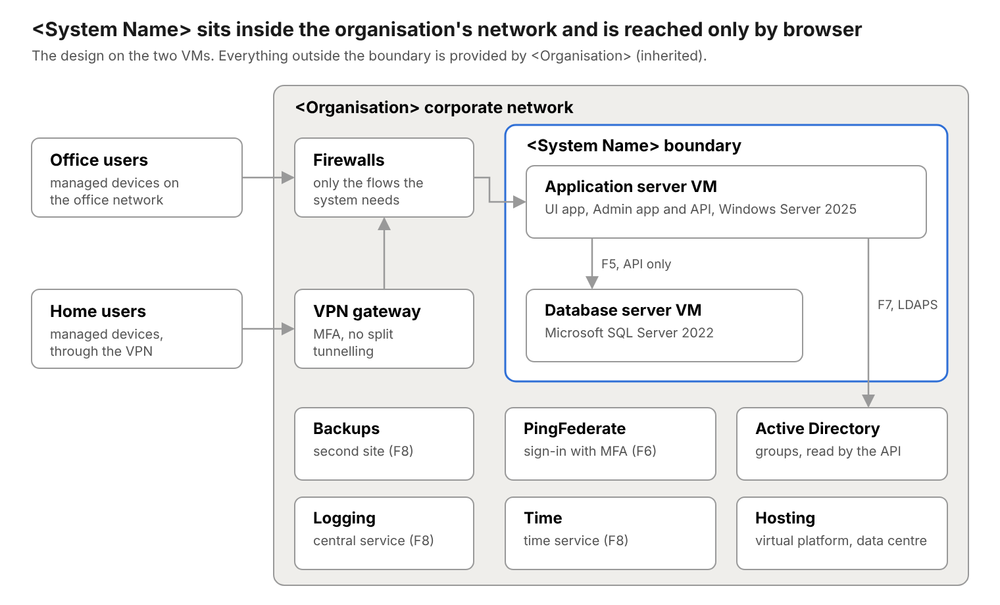

# \<System Name\> System Security Plan

**\<ref\> | Version \<ver\> | The corrections made since version \<ver\> await the system owner's approval; version \<ver\> approved by the system owner (D-GEN-19)**

**Contents**

[1 Document control](#1-document-control)

[2 Purpose and summary](#2-purpose-and-summary)

[3 System identification](#3-system-identification)

[4 System description](#4-system-description)

[5 Security architecture](#5-security-architecture)

[6 Control applicability and inheritance](#6-control-applicability-and-inheritance)

[7 Security responsibilities](#7-security-responsibilities)

[8 Control implementation](#8-control-implementation)

[9 Referenced artifacts](#9-referenced-artifacts)

[10 Acronyms](#10-acronyms)

| **SECTION 1** |
| --- |

## 1 Document control

### 1.1 Document details

**Table 1: Document details**

| Item | Detail |
| --- | --- |
| Reference | \<ref\> |
| Title | \<System Name\> System Security Plan |
| Version | \<ver\> |
| Status | The versions since 2.1 correct references, counts and wording after the complete review of 12 November 2026, and await the system owner's approval. Version \<ver\> was approved by the system owner (D-GEN-19). The authorising official's acceptance of the current version is pending (D-GEN-20). Version \<ver\> was approved by both. \<System Name\> is not authorised |
| Date | 13 November 2026 |
| Owner | System owner |
| Applies to | All control families; AC, AT, AU, CA, CM, CP, IA, IR, MA, MP, PE, PL, PS, PT, RA, SA, SC, SI and SR assessed in this version |
| Classification | Restricted |
| Next review | 12 months after approval, and after a significant change |
| Format | \<Documentation Map\>, section 5 |

### 1.2 Approval

**Table 2: Approval**

| Role | Name | Decision | Date |
| --- | --- | --- | --- |
| System owner | \[Name\] | Version \<ver\> approved on 8 November 2026; version \<ver\> approved on 12 November 2026 (D-GEN-19); later versions await approval | 12 November 2026 |
| Authorising official | \[Name\] | Version \<ver\> approved as an accurate record, not authorised, as confirmed by the system owner. Later versions pending (D-GEN-20) | 8 November 2026 |
| Head of Cyber | \[Name\] | Concurrence requested, as NIST SP 800-18 Rev 2 expects of the senior information security officer (D-PL-06). Pending | Pending |

### 1.3 Change history

**Table 3: Change history**

| Version | Date | Change | Sections | By |
| --- | --- | --- | --- | --- |
| \<ver\> | 18 November 2026 | Whole-set review: sections 4 and 5 follow the applications running as Windows services (D-PL-10) and sign-in through AD FS (D-AC-23): AD FS and Active Directory added to the component inventory, the global administrator's privileges and the Starters/Leavers system corrected, and the database connection no longer said to carry accounts. Citations of other documents brought up to their current versions | 4 and 5 | \[Name\], system owner |
| \<ver\> | 18 November 2026 | No code references: page addresses, setting names, folder paths and file paths are described in plain words, and names of groups, scripts and releases are shown as plain text. No value, finding or decision is changed. Whole-set review: the SC-1, SI-1, AT-1 and PS-1 rows and the table of referenced artifacts follow the family design documents, the register being an index; the supply chain plan and risk assessment rows show their present state; PT-5 follows sign-in through AD FS. Citations of other documents brought up to their current versions | 2, 8 and 9 | \[Name\], system owner |
| \<ver\> | 18 November 2026 | Citations of other documents brought up to their current versions |  |  |
| \<ver\> | 18 November 2026 | References to the communications protection design point to \<System and Communications Protection Management\>, where it is now held (D-SC-09). References to the integrity design point to \<System and Information Integrity Management\>, where it is now held (D-SI-10). References to the supply chain plan follow its new sections, as it is rebuilt in the family form and renamed Supply Chain Risk Management (D-SR-14). The Decision column of 18 control rows brought up to the risk list: each row names every non-compliance entry for its control, and the POA&M items those entries name. Citations of other documents brought up to their current versions | 8.19 | \[Name\], system owner |
| \<ver\> | 18 November 2026 | RA-9: the eleven critical components are confirmed by the system owner (D-RA-14) | 8.15 | \[Name\], system owner |
| \<ver\> | 18 November 2026 | References to the acquisition design point to \<System and Services Acquisition Management\>, where it is now held (D-SA-19). Section 8.16: SA-4(1) points to the family design documents, and the developer test plan has 15 scripts. The Decision column of 7 control rows brought up to the risk list: each row names every non-compliance entry for its control, and the POA&M items those entries name. Citations of other documents brought up to their current versions | 8.16 | \[Name\], system owner |
| \<ver\> | 18 November 2026 | Section 8.15: the RA rows say what the cross-check found: no review after the changes to sign-in and hosting, no scan of \<System Name\>'s own applications, no published terms for the reporting route, and two more critical components | 8.15 | \[Name\], system owner |
| \<ver\> | 18 November 2026 | RA-9: the nine critical components are confirmed by the system owner (D-RA-12) |  |  |
| \<ver\> | 18 November 2026 | References to the risk assessment design point to \<Risk Assessment Management\>, where it is now held (D-RA-11). Table 7: the fourth information type is named for the identities that arrive at sign-in, sessions and audit records, as \<System Name\> holds no accounts or credentials since sign-in moved to AD FS (D-AC-23); its levels are unchanged. RA-9: nine critical components. The Decision column of 4 control rows brought up to the risk list: each row names every non-compliance entry for its control, and the POA&M items those entries name. Citations of other documents brought up to their current versions | 4.3 and 8 | \[Name\], system owner |
| \<ver\> | 18 November 2026 | Citations of other documents brought up to their current versions |  |  |
| \<ver\> | 18 November 2026 | References to the personal data design point to \<PII Processing Management\>, where it is now held (D-PT-22). The Decision column of 5 control rows brought up to the risk list: each row names every non-compliance entry for its control, and the POA&M items those entries name. Citations of other documents brought up to their current versions | 4.5 and 8 | \[Name\], system owner |
| \<ver\> | 17 November 2026 | The AC-2(3) row adds the monthly removal of members who have not signed in for 90 days (D-PS-11). No status is changed | 8 | \[Name\], system owner |
| \<ver\> | 17 November 2026 | References to the personnel security design point to \<Personnel Security Management\>, where it is now held (D-PS-10). The Decision column of 7 control rows brought up to the risk list: each row names every non-compliance entry for its control, and the POA&M items those entries name | 8 | \[Name\], system owner |
| \<ver\> | 17 November 2026 | Section 6 states that 24 of the inherited PM controls are in the privacy baseline, and stay inherited and not assessed (D-PM-06) | 6 | \[Name\], system owner |
| \<ver\> | 17 November 2026 | References to the Program Management controls \<System Name\> inherits point to \<Program Management\>, where the list is now held (D-PM-05). Citations of other documents brought up to their current versions | 6 | \[Name\], system owner |
| \<ver\> | 17 November 2026 | References to the planning design point to \<Planning Management\>, where it is now held (D-PL-12). The Decision column of 3 control rows brought up to the risk list: each row names every non-compliance entry for its control, and the POA&M items those entries name | 8 | \[Name\], system owner |
| \<ver\> | 17 November 2026 | The Decision column of 1 control rows brought up to the risk list: each row names every non-compliance entry for its control, and the POA&M items those entries name |  |  |
| \<ver\> | 17 November 2026 | References to the physical and environmental protection design point to \<Physical and Environmental Protection Management\>, where it is now held (D-PE-11). The Decision column of 17 control rows brought up to the risk list: each row names every non-compliance entry for its control, and the POA&M items those entries name | 7 and 8 | \[Name\], system owner |
| \<ver\> | 17 November 2026 | The export folder is checked each working day in place of weekly (D-MP-10). Citations of other documents brought up to their current versions | 4.4 and 8.10 | \[Name\], system owner |
| \<ver\> | 17 November 2026 | References to the media protection design point to \<Media Protection Management\>, where it is now held (D-MP-09). The Decision column of 5 control rows brought up to the risk list: each row names every non-compliance entry for its control, and the POA&M items those entries name | 7 and 8 | \[Name\], system owner |
| \<ver\> | 17 November 2026 | References to the maintenance design point to \<Maintenance Management\>, where it is now held (D-MA-09). The Decision column of 5 control rows brought up to the risk list: each row names every non-compliance entry for its control, and the POA&M items those entries name. Citations of other documents brought up to their current versions | 4.7, 7, 8 and 10 | \[Name\], system owner |
| \<ver\> | 17 November 2026 | Citations of other documents brought up to their current versions |  |  |
| \<ver\> | 17 November 2026 | The referenced artifacts table shows that the rebuilt incident response document awaits approval. The Decision column of 4 control rows brought up to the risk list: each row names every non-compliance entry for its control, and the POA&M items those entries name. Citations of other documents brought up to their current versions | 9 | \[Name\], system owner |
| \<ver\> | 17 November 2026 | Citations of other documents brought up to their current versions |  |  |
| \<ver\> | 17 November 2026 | IR-4 row: wording of the reference | 8 | \[Name\], system owner |
| \<ver\> | 17 November 2026 | References to the incident response design follow the new section numbers of \<Incident Response Management\> (D-IR-10). The Decision column of 6 control rows brought up to the risk list: each row names every non-compliance entry for its control, and the POA&M items those entries name. Citations of other documents brought up to their current versions | 8 | \[Name\], system owner |
| \<ver\> | 15 November 2026 | References to the identification and authentication design point to \<Identification and Authentication Management\>, where it is now held (D-IA-11). The IA-4, IA-4(4) and IA-11 rows follow sign-in through AD FS (D-AC-23). No status is changed. The Decision column of 7 control rows brought up to the risk list: each row names every non-compliance entry for its control, and the POA&M items those entries name | 8 | \[Name\], system owner |
| \<ver\> | 15 November 2026 | The referenced artifacts table shows that the rebuilt configuration and contingency documents await approval | 9 | \[Name\], system owner |
| \<ver\> | 15 November 2026 | References to the contingency design follow the new section numbers of \<Contingency Planning Management\> (D-CP-14). The Decision column of 5 control rows brought up to the risk list: each row names every non-compliance entry for its control, and the POA&M items those entries name. Citations of other documents brought up to their current versions | 8 | \[Name\], system owner |
| \<ver\> | 13 November 2026 | Section 5.4 no longer says \<System Name\> holds accounts (D-AC-23, D-CM-14). The Decision column of 1 control rows brought up to the risk list: each row names every non-compliance entry for its control, and the POA&M items those entries name. Citations of other documents brought up to their current versions | 5.4 | \[Name\], system owner |
| \<ver\> | 13 November 2026 | References to the configuration management design follow the new section numbers of \<Configuration Management\> (D-CM-13). The Decision column of 9 control rows brought up to the risk list: each row names every non-compliance entry for its control, and the POA&M items those entries name. Citations of other documents brought up to their current versions | 8 | \[Name\], system owner |
| \<ver\> | 13 November 2026 | The common control provider row names AD FS and Active Directory (D-AC-23) | 3 | \[Name\], system owner |
| \<ver\> | 12 November 2026 | CA-3 row counts the six external exchanges | 8 | \[Name\], system owner |
| \<ver\> | 12 November 2026 | References to the assessment, authorisation and monitoring design point to \<Assessment, Authorization, and Monitoring Management\>, where it is now held (D-CA-11). The information exchanges include AD FS, and the CA-6 row gives the current count of inherited controls. The Decision column of 7 control rows brought up to the risk list: each row names every non-compliance entry for its control, and the POA&M items those entries name. Citations of other documents brought up to their current versions | 4.2, 8 | \[Name\], system owner |
| \<ver\> | 12 November 2026 | Citations of other documents brought up to their current versions |  |  |
| \<ver\> | 12 November 2026 | Citations of other documents brought up to their current versions |  |  |
| \<ver\> | 12 November 2026 | The Decision column of 1 control rows brought up to the risk list: each row names every non-compliance entry for its control, and the POA&M items those entries name. Citations of other documents brought up to their current versions |  |  |
| \<ver\> | 12 November 2026 | The Decision column of 2 control rows brought up to the risk list: each row names every non-compliance entry for its control, and the POA&M items those entries name. Citations of other documents brought up to their current versions |  |  |
| \<ver\> | 12 November 2026 | References to the audit design point to \<Audit and Accountability Management\>, where it is now held (D-AU-10). The Decision column of 2 control rows brought up to the risk list: each row names every non-compliance entry for its control, and the POA&M items those entries name. Citations of other documents brought up to their current versions | 8 | \[Name\], system owner |
| \<ver\> | 12 November 2026 | The Decision column of 6 control rows brought up to the risk list: each row names every non-compliance entry for its control, and the POA&M items those entries name. Citations of other documents brought up to their current versions |  |  |
| \<ver\> | 12 November 2026 | Citations of other documents brought up to their current versions |  |  |
| \<ver\> | 12 November 2026 | References to the training design point to \<Awareness and Training Management\>, where it is now held (D-AT-09). Citations of other documents brought up to their current versions | 8 | \[Name\], system owner |
| \<ver\> | 12 November 2026 | AC-2(1) and AC-2(4) are shown as hybrid, as \<Organisation\> provides part of each (D-AC-23). Generated parts rebuilt from their sources. Citations of other documents brought up to their current versions | 8 | \[Name\], system owner |
| \<ver\> | 12 November 2026 | Citations of other documents brought up to their current versions |  |  |
| \<ver\> | 12 November 2026 | Figures 2, 5 and 6 redrawn for sign-in through AD FS (D-AC-23). Citations of other documents brought up to their current versions | 5 | \[Name\], system owner |
| \<ver\> | 12 November 2026 | Sign-in and the AC and IA control rows follow D-AC-23: AD FS with multi-factor authentication, and Active Directory groups. AC-2(3), AC-7, IA-5(1) and IA-6 are now inherited. No assessment result is changed. The Decision column of 2 control rows brought up to the risk list: each row names every non-compliance entry for its control, and the POA&M items those entries name. Generated parts rebuilt from their sources. Citations of other documents brought up to their current versions | 4, 5, 8 | \[Name\], system owner |
| \<ver\> | 12 November 2026 | Version numbers are shown as a placeholder, as the system owner asked (D-GEN-28). No other change. Citations of other documents brought up to their current versions | All | \[Name\], system owner |
| \<ver\> | 12 November 2026 | The document number is replaced by a placeholder on the line under the title and in the details table, as the system owner asked (D-GEN-27). No other change. Citations of other documents brought up to their current versions | 1 | \[Name\], system owner |
| \<ver\> | 12 November 2026 | The name of the system is shown as a placeholder, as the system owner asked (D-GEN-26). No other change. Citations of other documents brought up to their current versions | All | \[Name\], system owner |
| \<ver\> | 12 November 2026 | Figures 1, 2, 3 and 6 redrawn for the target design in which only the API connects to the database (D-AC-18), and the text of section 5 follows. Citations of other documents brought up to their current versions | 5 | \[Name\], system owner |
| \<ver\> | 12 November 2026 | Citations of other documents brought up to their current versions |  |  |
| \<ver\> | 12 November 2026 | Citations of other documents brought up to their current versions |  |  |
| \<ver\> | 12 November 2026 | Section 5 notes that only the API is to connect to the database (D-AC-18), and that Figures 1 to 3 are to be redrawn. Citations of other documents brought up to their current versions | 5 | \[Name\], system owner |
| \<ver\> | 12 November 2026 | References to the access control design point to \<Access Control Management\>, where it is now held. Citations of other documents brought up to their current versions |  |  |
| \<ver\> | 12 November 2026 | References to documents that no longer exist now name where their content is, as the system owner asked. No other change. Citations of other documents brought up to their current versions |  |  |
| \<ver\> | 12 November 2026 | Table 5 names the key contacts; their contact details are held once, in the roles document, section 7 (D-GEN-25). The earlier rows of the change history are folded into one row, as the system owner decided (D-GEN-25). No other change. Citations of other documents brought up to their current versions | 1 | \[Name\], system owner |
| \<ver\> | 12 November 2026 | Citations of other documents brought up to their current versions |  |  |
| \<ver\> | 12 November 2026 | Table 32 follows the removal of the control map from the documentation map. Citations of other documents brought up to their current versions | 9 | \[Name\], system owner |
| \<ver\> | 12 November 2026 | Citations of other documents brought up to their current versions |  |  |
| \<ver\> | 12 November 2026 | Two references to the list of former document numbers follow its move out of the map | 1, 8 | \[Name\], system owner |
| \<ver\> to \<ver\> | 5 to 12 November 2026 | The earlier versions. Their history is kept in the change record (\<Documentation Map\>, section 5.1) |  |  |

### 1.4 Plan review log

NIST SP 800-18 Rev 2 asks for reviews of the plan to be recorded apart from its changes. Each review below names who reviewed, their role, the date, the outcome and any actions. Each time the plan is shared, the recipients are recorded here too (\<Procedures\>, PRO-PL-2). Each entry keeps the section and table numbers of its date. Until version \<ver\>, section 8 was in the order the families were assessed.

**Table 3b: Plan review log**

| Date | Reviewer and role | Review | Outcome and actions |
| --- | --- | --- | --- |
| 12 November 2026 | \[Name\], system owner, with Claude as Level 1 assessor | Complete review of this plan after the family documents were combined and the families put in NIST order. Every reference, identifier, count and control row was checked against the document it points to, with Test-PlanConsistency.ps1 | Version \<ver\>. 21 section references in section 8 given their chapter code; Table 11 corrected for MP and SA; status wording made uniform; the Decision column of 32 control rows brought up to the risk list; the fire safety law, seven artefacts and 20 abbreviations added. Four decisions put to the system owner (SSP-D1 to SSP-D4). Not yet shared |
| 12 November 2026 | \[Name\], system owner, with Claude as Level 1 assessor | Whole-set review of 12 November 2026, checked against NIST's catalogue release 5.2.0, with Test-PlanConsistency.ps1 | Reissued as version \<ver\> (D-GEN-19). Two statements added and two corrected, making 1,998; the PS pack reissued; four risks added; figures restored; stale statements corrected. From now on any change to this plan is a new version. |
| 12 November 2026 | \[Name\], system owner | Legal reviews of the AC, AU, CA, CM and PS policies recorded, with Test-PlanConsistency.ps1 | AC 74 of 189, AU 48 of 81, CA 63 of 92, CM 90 of 178, PS 36 of 68; total 1,082 of 1,996. Every policy in the set is now legally reviewed. |
| 12 November 2026 | \[Name\], system owner | Sweep after the AT policy's legal review, with Test-PlanConsistency.ps1 | AT now 34 of 66; total 1,077 of 1,996. AT-1 row records the legal review; shared documents checked against the AT changes. |
| 12 November 2026 | \[Name\], system owner | AT pack review applied (D-AT-06), with check L14 of Test-PlanConsistency.ps1 | AT now 33 of 66; total 1,076 of 1,996. Section 8.11 rewritten: role curriculum, \<System Name\> briefing and one training matrix; AT-2(2) and AT-2(3) now hybrid. |
| 12 November 2026 | \[Name\], system owner | Sweep after the SR policy's legal review, with Test-PlanConsistency.ps1 | SR now 56 of 81; total 1,074 of 1,996. SR-1 row records the legal review; shared documents checked against the SR changes. |
| 12 November 2026 | \[Name\], system owner | SR pack review applied (D-SR-11), with Test-SupplyChain.ps1 | SR now 55 of 81; total 1,073 of 1,996. Section 8.19 corrected: only the OfflineModules packages use the offline feed (PA-94, Medium). |
| 12 November 2026 | \[Name\], system owner | Sweep after the SI policy's legal review, with Test-PlanConsistency.ps1 | SI now 74 of 139; total 1,070 of 1,996. SI-1 row records the legal review; shared documents checked against the SI changes. |
| 12 November 2026 | \[Name\], system owner | SI pack review applied (D-SI-08), with Test-Integrity.ps1 | SI now 73 of 139, with SI-10 satisfied by test; total 1,069 of 1,996 and 19 controls satisfied. Section 8.6 rewritten; SI follows the RA timetable. |
| 12 November 2026 | \[Name\], system owner | Sweep after the SC policy's legal review, with Test-PlanConsistency.ps1 | SC now 49 of 107; total 1,066 of 1,996. Shared documents checked against SC. |
| 12 November 2026 | \[Name\], system owner | SC pack review applied (D-SC-07), with Test-Protection.ps1 | SC now 48 of 107; total 1,065 of 1,996. Section 8.4 rewritten: SC-2 Implemented; SC-7 and SC-7(5) Hybrid; UI application and Admin application found to send no page policy; PA-93 added for the key rings. |
| 11 November 2026 | \[Name\], system owner | Sweep after the SA policy's legal review, with Test-PlanConsistency.ps1 | SA now 88 of 159; total 1,063 of 1,996. Shared documents checked against SA. |
| 11 November 2026 | \[Name\], system owner | SA pack review applied (D-SA-17), with Test-Development.ps1 | SA now 87 of 159, with SA-4(1), SA-4(2), SA-4(9), SA-15(3) and SA-22 satisfied; total 1,062 of 1,996 and 18 controls satisfied. Section 8.18 rewritten; PA-91 and PA-92 added. |
| 11 November 2026 | \[Name\], system owner | Sweep after the RA policy's legal review, with Test-PlanConsistency.ps1 and Test-Vulnerability.ps1 | RA now 49 of 72; total 1,029 of 1,996. SyOps 2.9 section 5.3 and ConOps 1.15 follow the one vulnerability timetable; architecture and PL references point to the critical components, now in \<Risk Assessment Management\>, section 4.9. Not yet shared |
| 11 November 2026 | \[Name\], system owner, with Claude as Level 1 assessor | RA pack review against NIST SP 800-30 Rev 1, SP 800-53A and SP 800-40 Rev 4, with Test-Vulnerability.ps1 (V01 to V09) | RA now 48 of 72; total 1,028 of 1,996. Section 4.3 gains the availability rationale (D-RA-07 pending); section 8.7 updated from the test. Actions: PA-56 and PA-62 open; D-RA-06 and D-RA-07 pending. Not yet shared |
| 11 November 2026 | \[Name\], system owner | Sweep after the PT policy's legal review, with Test-PlanConsistency.ps1 | PT now 60 of 109; total 1,024 of 1,996. Shared documents brought into line: SyOps 2.7 (A27 covers complaints), ConOps 1.14, architecture 1.8, tailoring register 1.2, privacy plan 1.2, recommendations 1.14 (REC-55), map 1.17. All 13 checks passed. Not yet shared |
| 11 November 2026 | \[Name\], system owner, with Claude as Level 1 assessor | PT pack review against NIST SP 800-53A, the ICO's DPIA guidance and the Data (Use and Access) Act 2025, with Test-PersonalData.ps1 (Q01 to Q10) | PT now 59 of 109, with IR-8(1) satisfied; total 1,023 of 1,996. Section 8.17 updated from the test; draft impact assessment \<Data Protection Impact Assessment\> added. Actions: PA-89, PA-90; D-PT-18, D-PT-20 and D-PT-21 pending. Not yet shared |
| 11 November 2026 | \[Name\], system owner, with Claude as Level 1 assessor | PM dependency review against NIST SP 800-53B and SP 800-37, task P-5 | PM stays outside the baseline; inherited PM controls listed in \<Tailoring Register\>, Table 7b; section 3 names the senior information security officer and inventory placeholders; section 6 points to the programme. Actions: EV-PM-01 to EV-PM-04; D-PM-03 and D-PM-04 pending. Not yet shared |
| 11 November 2026 | \[Name\], system owner | Sweep after the PL policy's legal review, with Test-PlanConsistency.ps1 | PL now 74 of 93; total 1,019 of 1,996. SyOps rule A55 brought into line with the material-change rule (SyOps 2.6); test evidence row updated. All 12 checks passed. Not yet shared |
| 11 November 2026 | \[Name\], system owner, with Claude as Level 1 assessor | PL pack review against NIST SP 800-18 Rev 2 and SP 800-53A, with Test-PlanConsistency.ps1 (L01 to L12) | Plan complete and consistent with the 19 assessments. Actions: add this log and the Head of Cyber's concurrence; correct one stale version (IRP); move the plan to the restricted store (PA-88). The plan has not yet been shared |
| 10 November 2026 | \[Name\], system owner | Sweep after the PE pack review and its legal review | IR rows brought up to IRP 1.2; PE totals updated |

| **SECTION 2** |
| --- |

## 2 Purpose and summary

This plan is used by every control family. It describes how \<System Name\> implements its security controls: how it meets each one or does not, at a high level, which are shared, and which do not apply. It covers all nineteen assessed families, listed below, and section 8 gives a brief overview of every control in each of them. PM is outside the baseline (\<Tailoring Register\>, TR-PM-01). Nothing is fully implemented in operation, because \<System Name\> is not yet operational. This plan does not claim compliance.

\<System Name\> is assessed against NIST SP 800-53 Rev 5 only, using the SP 800-53A Rev 5 assessment procedures and the SP 800-53B baselines. Assessment results are in each family's chapter of \<Control Assessment Record\>, summarised below. The privacy plan is \<Privacy Plan\> and the supply chain risk management plan is \<Supply Chain Risk Management\>. This plan refers to them rather than repeating them. The organisation takes a risk-based approach, so each non-compliance is rated and decided in \<Risk List\>. This plan is a brief overview of each control. The findings behind it are in that record, and are not repeated here. In section 8, Status describes what is built, and Assessment gives the Level 1 result.

Level 1 statements satisfied, by family, on 12 November 2026:

- **AC** (section 8.1): 74 of 189, with 29 not applicable
- **AT** (section 8.2): 34 of 66
- **AU** (section 8.3): 48 of 81
- **CA** (section 8.4): 64 of 93
- **CM** (section 8.5): 90 of 178
- **CP** (section 8.6): 65 of 124
- **IA** (section 8.7): 41 of 92, with 14 not applicable
- **IR** (section 8.8): 49 of 90
- **MA** (section 8.9): 32 of 64
- **MP** (section 8.10): 46 of 71, with 1 not applicable
- **PE** (section 8.11): 54 of 121
- **PL** (section 8.12): 74 of 93
- **PS** (section 8.13): 38 of 68
- **PT** (section 8.14): 58 of 109, with 4 not applicable
- **RA** (section 8.15): 49 of 73
- **SA** (section 8.16): 88 of 159
- **SC** (section 8.17): 49 of 107, with 3 not applicable
- **SI** (section 8.18): 74 of 139, with 7 not applicable
- **SR** (section 8.19): 56 of 81

\<System Name\> is not authorised. The authorising official decided that TLS and committed secrets are fixed before production, and that no production documents are held until multi-factor authentication is in place or its acceptance ends on 6 May 2027 (\<Decision Register\>).

| **SECTION 3** |
| --- |

## 3 System identification

**Table 4: System identification**

| Item | Value |
| --- | --- |
| System name | \<System Name\>, built from the API, UI application, Admin application, shared library and workspace repository repositories |
| Unique identifier | \<ref\> |
| Organisation's inventory entries | System inventory: \[\<Organisation\>'s reference\]. Personal data inventory or record of processing: \[\<Organisation\>'s reference\]. To be confirmed through EV-PM-02 (PM-5, PM-5(1)) |
| Version described | v1.0, tagged on the development branch: API b82831a, UI application b06b4e1, Admin application 43ef895, shared library a8c3a3a, workspace repository 21018a6 |
| Purpose and function | Document management: internal storage, search and viewing of business documents by project |
| System type | Internally developed web application on two Windows Server 2025 virtual machines, with a PostgreSQL database |
| Environment | Production once live. Today it runs only for development and test, in Docker with sample data |
| Exposure | Internal only. It is reached by browser from \<Organisation\>'s network and VPN, and is not public-facing |
| Criticality | Business critical, as set by the system owner on 8 November 2026 |
| Ownership | Owned and operated by \<Organisation\>, with the system owner accountable for it |
| Common control provider | \<Organisation\>'s IT services: sign-in through AD FS, the Active Directory, network, firewalls, VPN, managed devices, VM hosting, logging, time, physical security and backup site (section 6) |
| Operational status | Under development. Not in production |
| Authorisation status | Not authorised |
| Security categorisation | Moderate, confirmed by the authorising official |
| System owner | \[Name\] |
| Authorising official | \[Name\] |
| Control baseline | NIST SP 800-53 Rev 5 Moderate; the AC, AT, AU, CA, CM, CP, IA, IR, MA, MP, PE, PL, PS, RA, SA, SC, SI and SR families in this version, with PT and 16 other controls from NIST's privacy baseline |

The key contacts are below. Their business contact details are in \<Roles and Responsibilities\>, section 7.

**Table 5: Key contacts**

| Role | Name |
| --- | --- |
| Authorising official | \[Name\] |
| System owner | \[Name\] |
| Information owner | \[Name\] |
| Senior information security officer | \[Name\], Head of Cyber (PM-2; confirmation pending, D-PM-03) |
| Data protection officer | \[Name, or the reason none is required\] (PM-19; D-PM-04) |
| System security officer | \[Name\], security officer |
| \<Organisation\> security contact | \[Name\]; deputy \[Name\] |
| Security assessor | \[Name\] |

Other role holders are named in \<Roles and Responsibilities\>.

| **SECTION 4** |
| --- |

## 4 System description

### 4.1 Description and boundary

\<System Name\> will be deployed on the corporate network of \<Organisation\>, which holds Cyber Essentials Plus. The boundary is the whole stack: an application server VM running UI application, Admin application and API, and a separate database server VM running PostgreSQL, both on Windows Server 2025. Each application runs as a Windows service under its own service account (D-PL-10). Current evidence comes from Docker containers on one PC with sample data, so it proves application behaviour and must be repeated on the VMs. CE+ supports inherited controls but does not prove them, so each one names its \<Organisation\> service and evidence.

### 4.2 System interconnections

\<System Name\> has no approved information exchanges yet, and no exchange agreement has been signed. The planned exchanges are below, and are also recorded in \<Assessment, Authorization, and Monitoring Management\>, section 4.7. \<Organisation\>'s network, VPN, central logging, time service and UK virtual platform are provided as stated by \<Organisation\> on 6 November 2026, and none is evidenced yet (\<Evidence Requests\>). Today browsers also load code from cdn.jsdelivr.net, which is to be removed (PA-34).

**Table 6: Information exchanges**

| Exchange | Direction and method | Information | Agreement | State |
| --- | --- | --- | --- | --- |
| \<Organisation\>'s AD FS and Active Directory | From AD FS to \<System Name\>, through the user's browser, by HTTPS | Sign-in tokens, carrying each user's identity and AD groups | \[Agreement covering \<Organisation\>'s hosting and services\] | Stated by the system owner (D-AC-23); not evidenced (PA-95) |
| ServiceNow, \<Organisation\>'s IT service desk | Both ways, by HTTPS with approved accounts | Access and change requests and approvals; names of requesters | Information exchange agreement with \<Organisation\>, not yet signed: \[dates\] (\<Assessment, Authorization, and Monitoring Management\>, section 4.7) | Planned (PA-63) |
| Starters/Leavers system, \<Organisation\> | To \<System Name\>'s administrators, by HTTPS with approved accounts | Prompts to add or remove access; staff names and leaving dates | Information exchange agreement with \<Organisation\>, not yet signed: \[dates\] (\<Assessment, Authorization, and Monitoring Management\>, section 4.7) | Planned (PA-63) |
| \<Organisation\>'s central logging | Out from both VMs; protocol to be confirmed | Windows and application security logs | \[Agreement covering \<Organisation\>'s hosting and services\] | Stated, not evidenced |
| \<Organisation\>'s time service | Into both VMs, by NTP | Time | As above | Stated, not evidenced |
| \<Organisation\>'s backup site | Out from the database VM; method to be chosen (PA-64) | Encrypted database backups | As above | Planned (PA-64, PA-66) |
| Application VM to database VM | Internal, PostgreSQL over TLS | Documents, document records and audit records | Not needed: inside the boundary (CA-9) | Planned (PA-18) |

### 4.3 Information types and security categorisation

The information types below are taken from the projects in the sample data, and each is mapped to its NIST SP 800-60 Volume II Rev 1 information types. The impact levels follow FIPS 199, and the mapping does not change them. \[Name\] owns all four information types. \[Name\] and the authorising official confirmed the levels on 6 November 2026. The high-water mark is Moderate, which is why the Moderate baseline is used. Availability is Low for every type, as in SP 800-60's provisional levels: the business impact analysis allows 120 hours of downtime (\<Contingency Planning Management\>, section 4.3), so a loss of availability has a limited adverse effect. "Business critical" in section 3 means the system matters to \<Organisation\>'s work, not that it must be highly available. The information owner and authorising official are asked to confirm this rationale (D-RA-07).

**Table 7: Information types and impact levels**

| Information type | SP 800-60 Volume II types | Confidentiality | Integrity | Availability |
| --- | --- | --- | --- | --- |
| HR documents, including personal data | C.3.3 Human Resource Management, chiefly C.3.3.2 Staff Acquisition, C.3.3.4 Compensation Management, C.3.3.7 Employee Relations and C.3.3.9 Separation Management | Moderate | Moderate | Low |
| Invoices and financial documents | C.3.2.4 Accounting; C.3.2.5 Payments | Moderate | Moderate | Low |
| Business correspondence | C.3.5.7 Information Management; C.3.5.6 Record Retention | Moderate | Low | Low |
| Sign-in identities, sessions and audit records | C.3.5.5 Information Security; C.2.8.9 Personal Identity and Authentication Information | Moderate | Moderate | Low |
| **System, as a high-water mark** |  | **Moderate** | **Moderate** | **Low** |

### 4.4 Component inventory

This is the intended inventory for the authorisation boundary. Host names, asset numbers and exact versions are to be added when the VMs are built.

**Table 8: Component inventory**

| Component | Type | Version or source | Location |
| --- | --- | --- | --- |
| Application server VM | Virtual server | Windows Server 2025 | \<Organisation\>, not yet built |
| Database server VM | Virtual server | Windows Server 2025 | \<Organisation\>, not yet built |
| UI application | Internally developed web application | .NET 10, repository UI application | Application server VM |
| Admin application | Internally developed web application | .NET 10, repository Admin application | Application server VM |
| API | Internally developed service | .NET 10, repository API | Application server VM |
| shared library | Internally developed library | .NET 10, repository shared library | Built into the applications |
| access-control-toolkit | Library | 0.2.0 | Built into the applications |
| PostgreSQL, holding the \<System Name\> database | Database | 18 in Docker; to be confirmed on the VM | Database server VM |
| Browser libraries | Third-party scripts and styles, including bootstrap-icons 1.11.1 and openseadragon 6.0.2 | Loaded from cdn.jsdelivr.net (PA-34) | Outside the boundary today |
| ServiceNow | Access request and approval workflows, owned by \<Organisation\>'s IT service desk | Planned for go-live; not yet set up for \<System Name\> | Outside the boundary |
| AD FS and Active Directory | Sign every user in with multi-factor authentication, and hold the groups that decide roles and project access (D-AC-23). A critical component (\<Risk Assessment Management\>, section 4.9) | \<Organisation\>'s corporate services | Outside the boundary |
| Starters/Leavers system | Raises leaver requests, and prompts the owners of a leaver's groups | Planned for go-live; not yet set up for \<System Name\> | Outside the boundary |
| Microsoft Defender | Malicious code protection | Planned (PA-58) | Both VMs |
| BitLocker full-disk encryption (XTS-AES 256 with the TPM) | Protection at rest | Planned (PA-52) | Both VMs |
| Key store | Holds the signing key and service secrets outside source code | Planned (PA-19) | To be decided |
| Vulnerability scanner | Monthly and at each release | Not yet chosen (PA-62) | To be decided |
| Backup store | Encrypted backups | To be chosen (PA-64) | \<Organisation\>'s second site, not yet confirmed (PA-66) |
| Bulk export working folder | Temporary export files for each job: full, unencrypted copies of documents, left after download and after a restart (PA-86), checked each working day (C49) | A working folder written by API | Application server VM |
| Data protection key rings | Keys protecting each app's cookies and tokens | ASP.NET Core data protection, one per app | Application server VM |

### 4.5 Related laws, regulations and policies

\<Organisation\> operates in the UK, and \<System Name\> holds HR documents, so the laws in Table 8a apply. \<Organisation\>'s policies, Cyber Essentials Plus and NIST SP 800-53 Rev 5 also apply. The legal adviser, \[Name\], confirmed the first row on 6 November 2026. The other rows are the laws the family policies name, and the legal adviser confirms each with that policy's review.

**Table 8a: Laws and where they are applied**

| Law | Why it applies | Where it is applied |
| --- | --- | --- |
| UK GDPR and the Data Protection Act 2018 | HR documents hold personal data, some of it special category | \<Policy\> (PT), \<Privacy Plan\>, \<PII Processing Management\> and \<Data Protection Impact Assessment\>; breach reporting in \<Incident Response Management\>, section 4.8; rules A23 to A29 of \<Security Operating Procedures\> |
| Data (Use and Access) Act 2025 | The right to complain to the controller, and how far a search for a person's data must go | \<Policy\> (PT), \<Procedures\> (PT) and \<PII Processing Management\> |
| Computer Misuse Act 1990 | Misuse of the system may be an offence, and audit records may be evidence | \<Policy\> (AC), \<Policy\> (AU), \<Policy\> (IA), \<Policy\> (IR) and \<Policy\> (MA); rule A4 of \<Security Operating Procedures\> |
| Copyright, Designs and Patents Act 1988 | Software must be licensed | \<Policy\> (CM) |
| Regulatory Reform (Fire Safety) Order 2005 | Fire precautions at the data centre and offices, which \<Organisation\> provides | \<Policy\> (PE) |
| Rehabilitation of Offenders Act 1974; Immigration, Asylum and Nationality Act 2006; Equality Act 2010; Employment Rights Act 1996 | Screening, the right to work and sanctions, all carried out by \<Organisation\> as employer | \<Policy\>, section PS.6 |

### 4.6 Users

All users are staff or contractors of \<Organisation\>, so all are internal. \<System Name\> has no external or public users (TR-IA-03). Expected numbers are placeholders for the system owner to complete.

**Table 9: Users**

| Role | Internal or external | Main privileges | Expected users |
| --- | --- | --- | --- |
| Global administrator | Internal | Manages projects, the AD groups each project uses, and sessions, in the admin portal. Group members are changed by each group's owner, in Active Directory | \[Number\] |
| Administrator | Internal | Manages system settings in the admin portal | \[Number\] |
| Auditor | Internal | Reads audit records and privileged activity | \[Number\] |
| Security officer | Internal | Reviews logs, alerts and scan results; leads incident response | \[Number\] |
| Project access approver | Internal | Approves who may read or edit a project; also a user | \[Number\] |
| User | Internal | Reads, searches and, where a project allows it, edits and exports documents | \[Number\] |
| Windows server and database administrators | Internal | Administer the VMs and PostgreSQL; need no application role | \[Number\] |

### 4.7 Ports, protocols and services

The target design on the two VMs is below, with what runs in Docker today. Rules for these flows are not yet set in \<Organisation\>'s firewalls. Flow numbers match \<Security Architecture\>.

**Table 10: Ports, protocols and services**

| Service | Target on the VMs | Today in Docker | From and to | Flow |
| --- | --- | --- | --- | --- |
| UI application | HTTPS, TCP 443 (PA-18) | HTTP, TCP 5001 | User browsers to the application VM | F1 |
| Admin application | HTTPS, on its own port or host name, to be set (PA-18); reachable only through \<Organisation\>'s managed route (route R3, PA-83) | HTTP, TCP 7004, on every interface (M04) | Administrator browsers to the application VM, over the managed route | F2 |
| API | HTTPS on the application VM's loopback address only (D-SC-07; PA-18) | HTTP, TCP 5002 | UI application and Admin application to API | F3, F4 |
| PostgreSQL | TCP 5432 with TLS, allowed only from the application VM (PA-18) | TCP 15433, local machine only | Application VM to database VM | F5 to F7 |
| Windows administration | Through \<Organisation\>'s managed route; tool and protocol to be confirmed (EV-MA-02). All remote maintenance routes, R1 to R5, are in \<Maintenance Management\>, section 4.4 | Not applicable | Administrators to both VMs | Not numbered |
| Time | NTP, UDP 123 | Host clock | Both VMs to \<Organisation\>'s time service | Not numbered |
| Central logging | To be confirmed by \<Organisation\> | None | Both VMs to \<Organisation\>'s logging | Not numbered |
| Browser libraries | None: to be served by \<System Name\> itself (PA-34) | HTTPS, TCP 443 | User browsers to cdn.jsdelivr.net | F8 |

| **SECTION 5** |
| --- |

## 5 Security architecture

Users reach UI application, and administrators reach Admin application, by browser. Users sign in through \<Organisation\>'s AD FS, with multi-factor authentication (D-AC-23), which gives \<System Name\> their Active Directory groups, and \<System Name\> holds no passwords of its own. Both apps call API, and all three connect to PostgreSQL on the database VM. In the target design, which the figures show, only API connects to the database, and the two apps get their data through it (D-AC-18). Today the two apps also connect to the database themselves, which is to be removed (PA-10). Access decisions go through access-control-toolkit, and each project's documents sit in their own schema. \<Organisation\> provides the network, firewalls, remote access, user devices and VM hosting, all outside the boundary. Today browsers also load code from an outside service (PA-34). The boundary diagram, data flows F1 to F8 and the comparison with Docker are in [\<Security Architecture\>](Security%20Architecture.md).

The figures below show the target design on the two VMs, not the Docker test stack. Where they show \<Organisation\>'s services, the detail comes from answers its security contacts gave on 6 November 2026. Those answers are statements, not evidence, and are tracked in \<Evidence Requests\>. Flow numbers F1 to F8 match \<Security Architecture\>, Table 5.

### 5.1 High-level architecture

**Figure 1: High-level architecture**

Users reach \<System Name\> only by browser, from managed devices in the office or at home through the VPN. Both VMs sit inside \<Organisation\>'s network, behind its firewalls. \<Organisation\> also provides logging, time, hosting and, when confirmed, the second site for backups.

### 5.2 Application architecture

**Figure 2: Application architecture**

UI application and Admin application are Blazor Server apps, so the pages run on the server and the browser holds a live connection to the app. Both call API, which is to be their only route to the database (D-AC-18). Today they call it for sign-in, sessions and bulk work, and also read and write the database themselves (PA-10). Access decisions and audit records come from shared library and access-control-toolkit, which are built into each app. Users and administrators sign in through \<Organisation\>'s AD FS, with multi-factor authentication (D-AC-23). The tested build used a \<System Name\> password checked by API. Showing this working is tracked as PA-95.

### 5.3 Network

**Figure 3: Network**

Both VMs sit inside \<Organisation\>'s network. Home users come in through the VPN, office devices through the office network, and Windows administrators through \<Organisation\>'s approved route. All of these pass the firewalls, whose rules \<Organisation\>'s corporate network team alone sets, and which are not set yet. In Docker today the apps use plain HTTP on ports 5001, 7004 and 5002, and the database listens only on the local machine. On the VMs, the target is HTTPS for the apps and TLS between the VMs (PA-18). The one outbound flow, F8 to cdn.jsdelivr.net, is to be removed (PA-34).

### 5.4 Storage

**Figure 4: Storage**

Documents and audit records are all held in PostgreSQL on the database VM, with the record of projects and the AD groups each uses. \<System Name\> holds no accounts: they are in \<Organisation\>'s Active Directory (D-AC-23). Shared tables sit in a common schema, and each project has its own schema, which holds its documents and page content. Older TIFF pages may be read from a file path instead. The application VM holds only working files: bulk export output, each app's data protection keys and, today, its secrets. Encryption at rest, a key store, backups and retention are all planned, not built.

### 5.5 End-points

**Figure 5: End-points**

\<System Name\> has no client software. It is used through a browser on a device that \<Organisation\> manages. As stated by \<Organisation\>, phones and tablets cannot reach it, and unmanaged devices are blocked by network access control. Managed devices have certificates for network access, disk encryption, a screen lock that hides the display, and USB storage blocked unless approved.

### 5.6 VPN and administrator access

**Figure 6: VPN and administrator access**

The VPN's multi-factor authentication protects the network route. \<System Name\>'s own sign-in is through \<Organisation\>'s AD FS, with multi-factor authentication (D-AC-23). The authorising official's earlier acceptance of password-only sign-in until 6 May 2027, with no production documents held (D-GEN-13), was given before this was known, and stands until AD FS sign-in is shown working (PA-95). Windows administrators reach the VMs through \<Organisation\>'s approved route, whose details are still to come (EV-MA-02).

| **SECTION 6** |
| --- |

## 6 Control applicability and inheritance

The controls are those of NIST SP 800-53 Rev 5 in the SP 800-53B Moderate baseline. PT and 16 related privacy controls come from the SP 800-53B privacy baseline (D-PT-01, D-PT-07), and PM is outside the baseline (TR-PM-01). \<System Name\> inherits PM controls from \<Organisation\>'s security and privacy programme as common controls; they are listed with their providers and evidence in \<Program Management\>, section 4.3. Twenty-four of them are in the privacy baseline; they stay inherited and are not assessed for \<System Name\> (D-PM-06). \<Organisation\>'s programme plan has not yet been seen (EV-PM-01). Tailoring is recorded in \<Tailoring Register\>, under which 23 controls are not applicable.

Each control is given one of four types. **System** controls are met by \<System Name\>. **Hybrid** controls are met partly by \<System Name\> and partly by the organisation or \<Organisation\>. **Organisational** controls are met by policy, procedure and people. **Inherited** controls are provided by \<Organisation\>, which is expected to supply the evidence (\<Evidence Requests\>). As NIST SP 800-37 allows, this plan names the provider of an inherited control but does not describe how that provider implements it.

**Table 11: Controls by family**

| Family | Controls | System | Hybrid | Organisational | Inherited | Not applicable | Controls satisfied | Statements satisfied |
| --- | --- | --- | --- | --- | --- | --- | --- | --- |
| AC Access Control | 39 | 8 | 14 | 5 | 6 | 6 | 0 | 74 of 189 |
| AT Awareness and Training | 6 | 0 | 3 | 3 | 0 | 0 | 0 | 34 of 66 |
| AU Audit and Accountability | 16 | 7 | 7 | 2 | 0 | 0 | 1 | 48 of 81 |
| CA Assessment, Authorization, and Monitoring | 10 | 0 | 2 | 8 | 0 | 0 | 0 | 64 of 93 |
| CM Configuration Management | 24 | 0 | 13 | 9 | 2 | 0 | 2 | 90 of 178 |
| CP Contingency Planning | 23 | 0 | 5 | 8 | 10 | 0 | 2 | 65 of 124 |
| IA Identification and Authentication | 24 | 2 | 7 | 1 | 8 | 6 | 0 | 41 of 92 |
| IR Incident Response | 13 | 0 | 4 | 9 | 0 | 0 | 0 | 49 of 90 |
| MA Maintenance | 9 | 0 | 2 | 6 | 1 | 0 | 0 | 32 of 64 |
| MP Media Protection | 7 | 0 | 4 | 1 | 2 | 0 | 0 | 46 of 71 |
| PE Physical and Environmental Protection | 18 | 0 | 2 | 1 | 15 | 0 | 0 | 54 of 121 |
| PL Planning | 7 | 0 | 0 | 7 | 0 | 0 | 3 | 74 of 93 |
| PS Personnel Security | 9 | 0 | 4 | 3 | 2 | 0 | 0 | 38 of 68 |
| PT Personally Identifiable Information Processing and Transparency | 29 | 3 | 2 | 15 | 2 | 7 | 1 | 58 of 109 |
| RA Risk Assessment | 10 | 0 | 4 | 6 | 0 | 0 | 2 | 49 of 73 |
| SA System and Services Acquisition | 17 | 1 | 3 | 10 | 2 | 1 | 5 | 88 of 159 |
| SC System and Communications Protection | 25 | 3 | 10 | 1 | 10 | 1 | 1 | 49 of 107 |
| SI System and Information Integrity | 18 | 3 | 9 | 3 | 1 | 2 | 2 | 74 of 139 |
| SR Supply Chain Risk Management | 12 | 0 | 3 | 5 | 4 | 0 | 0 | 56 of 81 |
| **Total** | **316** | **27** | **98** | **103** | **65** | **23** | **19** | **1,083 of 1,998** |

A control counts as satisfied only when every one of its assessment statements is satisfied. Section 8 lists every control.

| **SECTION 7** |
| --- |

## 7 Security responsibilities

**Table 12: Security responsibilities**

| Responsible | For |
| --- | --- |
| System owner | This plan, approvals, exceptions, risk within their authority, and coordination with \<Organisation\> |
| Authorising official | Accepting residual risk and authorising operation |
| Developers | Security functions built into the application, and fixing POA&M items |
| Global administrator, administrator | Operating access control in the application |
| Auditor, security officer | Reviewing audit records, logs, alerts, advisories and scan results, and reporting monthly on security status |
| Windows server and database administrators | Securing, patching and scanning the VMs and PostgreSQL, and running Defender and disk encryption |
| Change control element | Approving changes: the system owner, security officer and Windows server administrator (\<Configuration Management\>) |
| Security assessor | Leading the independent Level 2 assessment |
| \<Organisation\> | Inherited services and their evidence |
| Users | Following the SyOps |
| Security officer, system owner, database and Windows server administrators | Incident response and training records (security officer); invoking recovery (system owner); backups and rebuilding (administrators). See \<Incident Response Management\>, \<Contingency Planning Management\> and \<Awareness and Training Management\> |
| \<Organisation\> | Maintaining hardware, handling disks and backup media, and physical and environmental protection. See \<Maintenance Management\>, \<Media Protection Management\> and \<Physical and Environmental Protection Management\> |
| Legal adviser | The privacy plan (\<Privacy Plan\>), the impact assessment, the lawful basis, requests and complaints from individuals, and reports to the ICO |
| Business and information owner | The information types, and retention periods for each project |
| Supply chain team: system owner, security officer, a developer and \<Organisation\>'s IT service desk | The supply chain plan (\<Supply Chain Risk Management\>), supplier reviews and notices of compromise |

People holding these roles are named in \<Roles and Responsibilities\>. How security is operated is in \<Security Operating Procedures\>.

| **SECTION 8** |
| --- |

## 8 Control implementation

This section gives a brief overview of every control in the 19 families, one line each. Each line says how the control is implemented or planned, who is responsible, its type (section 6), its implementation status and its Level 1 assessment status. It does not repeat the assessment. The finding for each determination statement is in the family's chapter of \<Control Assessment Record\>, and each non-compliance and its decision are in \<Risk List\> and \<Decision Register\>.

**Status** uses the NIST SP 800-18 Rev 2 terms, for the target design on the two VMs: Fully implemented, Partially implemented, Planned (selected, but not started), or Not applicable. **Assessment:** Satisfied only when every statement for the control is satisfied, and otherwise Other than satisfied. **Decision:** the NC entry in \<Risk List\> and, where a fix is planned, its POA&M item in \<Plan of Action and Milestones\>; or the tailoring entry in \<Tailoring Register\>.

### 8.1 Access Control (AC)

74 of 189 assessment statements satisfied; 0 of 39 controls fully satisfied. Assessed on 5 November 2026: findings are in \<Control Assessment Record\> (AC), whose section AC.6 is the assessment plan, and decisions are in \<Risk List\>. Implementation detail is in \<Policy\> (AC), \<Procedures\> (AC) and \<Access Control Management\>, whose appendix B holds the parameter values.

**Table 13: AC controls**

| Control | How it is implemented | Who | Type | Status | Assessment | Decision |
| --- | --- | --- | --- | --- | --- | --- |
| AC-1 Policy and Procedures | Approved and legally reviewed; not yet shared | System owner, Head of Cyber | Hybrid | Partially implemented | Other than satisfied | NC-01, PA-20 |
| AC-2 Account Management | Each person uses their own Active Directory account; access is membership of an AD group, which the group's owner gives on an approved ServiceNow request. Approval, notification and review are not yet in use (\<Access Control Management\>) | Global administrator, project access approvers | Hybrid | Partially implemented | Other than satisfied | NC-02, PA-16, PA-20, PA-32 |
| AC-2(1) Automated Account Management | Active Directory, AD FS and the Starters/Leavers system manage accounts and sign-in; \<System Name\> applies the groups and can end sessions. Not yet evidenced | \<Organisation\>, developers | Hybrid | Partially implemented | Other than satisfied | NC-03, PA-13, PA-16, PA-32 |
| AC-2(2) Temporary and Emergency Accounts | Not used; forbidden by policy | None | Not applicable | Not applicable | Not applicable | TR-AC-01; NC-04 (tailored) |
| AC-2(3) Disable Accounts | \<Organisation\> disables Active Directory accounts, which stops sign-in; unused accounts follow its corporate standard. In addition, members who have not signed in for 90 days are removed from \<System Name\>'s groups each month (D-PS-11). Not yet evidenced | \<Organisation\> | Inherited | Partially implemented | Other than satisfied | NC-05, PA-13 |
| AC-2(4) Automated Audit Actions | Account and group changes are audited in Active Directory by \<Organisation\>; \<System Name\> audits sign-ins and its own project settings (PA-14) | \<Organisation\>, developers | Hybrid | Partially implemented | Other than satisfied | NC-06, PA-14 |
| AC-2(5) Inactivity Logout | Sessions stop working after 30 minutes idle | Developers | System | Partially implemented | Other than satisfied | NC-07, PA-20, PA-30 |
| AC-2(13) High-risk Individuals | \<Organisation\> disables the Active Directory account and a global administrator ends the sessions, both within 1 hour; the procedure is approved, not yet used | Global administrator, security officer | Hybrid | Partially implemented | Other than satisfied | NC-08, PA-20 |
| AC-3 Access Enforcement | Project read and edit decisions go through access-control-toolkit, denying by default | Developers | System | Partially implemented | Other than satisfied | NC-09, PA-02, PA-19, PA-25, PA-26 |
| AC-4 Information Flow Enforcement | Only flows F1 to F8 exist; network enforcement depends on \<Organisation\>'s firewalls, not yet set | Developers, \<Organisation\> | Hybrid | Partially implemented | Other than satisfied | NC-10, PA-18, PA-26, PA-34 |
| AC-5 Separation of Duties | Separate administrator, auditor and security roles exist, but a global administrator holds them all | System owner | Hybrid | Partially implemented | Other than satisfied | NC-11, PA-15 |
| AC-6 Least Privilege | Access through groups and roles; diagnostic pages and a superuser database role remain | Developers, database administrator | Hybrid | Partially implemented | Other than satisfied | NC-12, PA-10, PA-19, PA-26, PA-31 |
| AC-6(1) Authorize Access to Security Functions | Security pages need the global administrator or a security role; some API functions lack a check | Developers | System | Partially implemented | Other than satisfied | NC-13, PA-07, PA-15, PA-19, PA-30 |
| AC-6(2) Non-privileged Access for Nonsecurity Functions | SyOps requires a separate everyday account; not yet issued or enforced | System owner | Organisational | Planned | Other than satisfied | NC-14, PA-17 |
| AC-6(5) Privileged Accounts | Global administrator is a flag on named accounts; the apps' database role is a superuser | Global administrator, database administrator | Hybrid | Partially implemented | Other than satisfied | NC-15, PA-10, PA-30 |
| AC-6(7) Review of User Privileges | Review procedure approved; no review held yet | System owner, auditor | Organisational | Planned | Other than satisfied | NC-16, PA-16 |
| AC-6(9) Log Use of Privileged Functions | Some privileged actions are audited; many are not (PA-14) | Developers | System | Partially implemented | Other than satisfied | NC-17, PA-14, PA-29, PA-31 |
| AC-6(10) Prohibit Non-privileged Users from Executing Privileged Functions | Ordinary users are refused admin functions, except debug pages and some API calls | Developers | System | Partially implemented | Other than satisfied | NC-18, PA-02, PA-03, PA-06, PA-07, PA-29 |
| AC-7 Unsuccessful Logon Attempts | AD FS and Active Directory count failed sign-ins and lock the account, under \<Organisation\>'s corporate standard. Not yet evidenced. The tested build locked after five failures | \<Organisation\> | Inherited | Partially implemented | Other than satisfied | NC-19, PA-20, PA-30, PA-35 |
| AC-8 System Use Notification | No notice is shown at sign-in yet; the wording is approved | Developers, Windows server administrator | Hybrid | Planned | Other than satisfied | NC-20, PA-11 |
| AC-11 Device Lock | The page locks after 25 minutes but unlocks without signing in again; device lock by \<Organisation\> | Developers, \<Organisation\> | Hybrid | Partially implemented | Other than satisfied | NC-21, PA-12, PA-21 |
| AC-11(1) Pattern-hiding Displays | The lock overlay hides the page | Developers | System | Partially implemented | Other than satisfied | NC-22, PA-21 |
| AC-12 Session Termination | Sessions end on sign-out, when idle, after 8 hours, or when an administrator ends them | Developers | System | Partially implemented | Other than satisfied | NC-23, PA-20, PA-30; PA-33 closed (I11) |
| AC-14 Permitted Actions Without Identification | Only sign-in and its steps work without signing in, except some open API endpoints | Developers | System | Partially implemented | Other than satisfied | NC-24, PA-03, PA-07, PA-28 |
| AC-17 Remote Access | \<Organisation\>'s VPN with MFA, as stated; not yet evidenced | \<Organisation\> | Hybrid | Planned | Other than satisfied | NC-25, PA-18 |
| AC-17(1) Monitoring and Control | \<Organisation\> monitors VPN sessions, as stated | \<Organisation\> | Hybrid | Planned | Other than satisfied | NC-26, PA-18, PA-21 |
| AC-17(2) Encryption | VPN encrypted, as stated; \<System Name\> HTTPS planned (PA-18) | \<Organisation\>, Windows server administrator | Hybrid | Planned | Other than satisfied | NC-27, PA-18 |
| AC-17(3) Managed Access Control Points | One managed gateway, as stated | \<Organisation\> | Inherited | Planned | Other than satisfied | NC-28, PA-18, PA-21 |
| AC-17(4) Privileged Commands and Access | No remote administration beyond the approved route | None | Not applicable | Not applicable | Not applicable | TR-AC-05; NC-29 (tailored) |
| AC-18 Wireless Access | \<Organisation\>'s wireless controls; \<System Name\> has no wireless part | \<Organisation\> | Inherited | Planned | Other than satisfied | NC-30, PA-21 |
| AC-18(1) Authentication and Encryption | \<Organisation\>'s wireless controls | \<Organisation\> | Inherited | Planned | Other than satisfied | NC-31, PA-21 |
| AC-18(3) Disable Wireless Networking | The VMs have no wireless adapter, to be confirmed when built | \<Organisation\> | Inherited | Planned | Other than satisfied | NC-32, PA-21 |
| AC-19 Mobile Devices | Phones and tablets cannot reach \<System Name\> | None | Not applicable | Not applicable | Not applicable | TR-AC-06; NC-33 (tailored) |
| AC-19(5) Device Encryption | As AC-19 | None | Not applicable | Not applicable | Not applicable | TR-AC-06; NC-34 (tailored) |
| AC-20 External Systems | Policy forbids external systems without approval; unmanaged devices are blocked, as stated | System owner, \<Organisation\> | Organisational | Planned | Other than satisfied | NC-35, PA-21 |
| AC-20(1) Limits on Authorized Use | External use is forbidden | None | Not applicable | Not applicable | Not applicable | TR-AC-07; NC-36 (tailored) |
| AC-20(2) Portable Storage Devices | USB storage blocked unless approved, as stated; bulk export can still save files | \<Organisation\>, users | Organisational | Planned | Other than satisfied | NC-37, PA-21 |
| AC-21 Information Sharing | Project groups control sharing inside \<System Name\>; no wider sharing process | Project access approvers | Organisational | Planned | Other than satisfied | NC-38, PA-22 |
| AC-22 Publicly Accessible Content | \<System Name\> has no public content | None | Not applicable | Not applicable | Not applicable | TR-AC-08; NC-39 (tailored) |

### 8.2 Awareness and Training (AT)

34 of 66 assessment statements satisfied; 0 of 6 controls fully satisfied. Assessed on 6 November 2026 and updated on 12 November 2026 after the AT pack review and the policy's legal review: findings are in \<Control Assessment Record\> (AT), whose section AT.5 is the assessment plan, and decisions are in \<Risk List\>. Implementation detail is in \<Policy\> (AT), \<Procedures\> (AT) and \<Awareness and Training Management\>, which holds the \<System Name\> briefing, the role curriculum, the training matrix for AT, IR-2, CP-3, AT-3(5) and PL-4, the training register and the parameter values. No training has yet been given.

**Table 14: AT controls**

| Control | How it is implemented | Who | Type | Status | Assessment | Decision |
| --- | --- | --- | --- | --- | --- | --- |
| AT-1 Policy and Procedures | Policy 1.1 legally reviewed on 12 November 2026 and awaits the Head of Cyber's re-approval (D-AT-07); procedures approved, and the design approved as a register chapter at 1.1, now in \<Awareness and Training Management\>; not yet shared | System owner, Head of Cyber | Organisational | Partially implemented | Other than satisfied | NC-AT-01, PA-20 |
| AT-2 Literacy Training | \<Organisation\>'s course, plus the \<System Name\> briefing (\<Awareness and Training Management\>, section 4.3) given with the SyOps signature; neither yet given | \<Organisation\>, system owner | Hybrid | Planned | Other than satisfied | NC-AT-02, PA-96, PA-99 |
| AT-2(2) Insider Threat | Briefing part B4, and \<Organisation\>'s course (not seen) | \<Organisation\>, system owner | Hybrid | Planned | Other than satisfied | NC-AT-03, PA-96, PA-99 |
| AT-2(3) Social Engineering | Briefing part B3, and \<Organisation\>'s course (not seen); no punitive phishing simulations | \<Organisation\>, system owner | Hybrid | Planned | Other than satisfied | NC-AT-04, PA-96, PA-99 |
| AT-3 Role-based Training | Role curriculum M1 to M9 and the training matrix (\<Awareness and Training Management\>, sections 4.4 and 4.5); content not yet written | Security officer, Head of Cyber | Organisational | Planned | Other than satisfied | NC-AT-05, PA-97, PA-99, PA-100 |
| AT-4 Training Records | TPL-9 and the training register, kept 3 years; none yet | Security officer | Organisational | Planned | Other than satisfied | NC-AT-06, PA-98 |

### 8.3 Audit and Accountability (AU)

48 of 81 assessment statements satisfied; 1 of 16 controls fully satisfied. Assessed on 6 November 2026: findings are in \<Control Assessment Record\> (AU), whose section AU.5 is the assessment plan, and decisions are in \<Risk List\>. Implementation detail is in \<Policy\> (AU), \<Procedures\> (AU) and \<Audit and Accountability Management\>, whose appendix B holds the parameter values.

**Table 15: AU controls**

| Control | How it is implemented | Who | Type | Status | Assessment | Decision |
| --- | --- | --- | --- | --- | --- | --- |
| AU-1 Policy and Procedures | Approved and legally reviewed; not yet shared | System owner, Head of Cyber | Organisational | Partially implemented | Other than satisfied | NC-AU-01, PA-20 |
| AU-2 Event Logging | Most agreed events are logged; most account, group and role changes in the admin portal are not (PA-14), nor are reading the audit log, start-up and shut-down, or logging changes (PA-76) | System owner, developers | System | Partially implemented | Other than satisfied | NC-AU-02, NC-AU-17, NC-PT-22, PA-14, PA-76, PA-89, PA-101, PA-103 |
| AU-3 Content of Audit Records | Records show type, time, component, IP address, outcome and username; some API records name "System" | Developers | System | Partially implemented | Other than satisfied | NC-AU-03, PA-14 |
| AU-3(1) Additional Audit Information | Records show session, browser, project and document | Developers | System | Partially implemented | Satisfied | None |
| AU-4 Audit Log Storage Capacity | Records are held in the database; no capacity planned, as the VMs are not built | Database administrator | Hybrid | Planned | Other than satisfied | NC-AU-04, PA-42 |
| AU-5 Response to Logging Failures | A failed write goes to the application log and the action continues; nobody is alerted | Windows server administrator, security officer | Hybrid | Partially implemented | Other than satisfied | NC-AU-05, PA-38 |
| AU-6 Review, Analysis and Reporting | Weekly review defined in PRO-AU-1 and the SyOps; not started | Auditor, security officer | Organisational | Planned | Other than satisfied | NC-AU-06, PA-40 |
| AU-6(1) Automated Process Integration | None; \<Organisation\>'s central monitoring is unconfirmed | Auditor, \<Organisation\> | Hybrid | Planned | Other than satisfied | NC-AU-07, PA-40 |
| AU-6(3) Correlate Repositories | Only the application table can be reviewed | Auditor, \<Organisation\> | Hybrid | Planned | Other than satisfied | NC-AU-08, PA-40 |
| AU-7 Reduction and Report Generation | The audit page filters and summarises without changing records; no export or report | Developers | System | Partially implemented | Other than satisfied | NC-AU-09, PA-41 |
| AU-7(1) Automatic Processing | Search by date, event type, result and username; project, document and sort are missing | Developers | System | Partially implemented | Other than satisfied | NC-AU-10, PA-41 |
| AU-8 Time Stamps | Application records use UTC; the VMs' time source is not yet evidenced | Developers, \<Organisation\> | Hybrid | Partially implemented | Other than satisfied | NC-AU-11, PA-102 |
| AU-9 Protection of Audit Information | Ordinary users cannot open the page and records are hash-chained; the app's database account can change them, and nothing runs the chain check. The chain has no key and, as stored, cannot be recomputed; the application log repeats usernames, IP addresses and session IDs | Developers, database administrator | System | Partially implemented | Other than satisfied | NC-AU-12, NC-AU-16, PA-36, PA-37, PA-73, PA-74, PA-75, PA-104 |
| AU-9(4) Access by Subset of Privileged Users | Auditors can read records, and so can global administrators, against the agreed value | System owner, developers | System | Partially implemented | Other than satisfied | NC-AU-13, PA-39 |
| AU-11 Audit Record Retention | Nothing removes records; the rule of 12 months online and 12 months archived has no capacity or backup behind it yet | Database administrator | Hybrid | Planned | Other than satisfied | NC-AU-14, PA-42 |
| AU-12 Audit Record Generation | All three apps generate records; PostgreSQL statement logging is off, and Windows logs are not yet available | Developers, administrators | Hybrid | Partially implemented | Other than satisfied | NC-AU-15, NC-AU-17, PA-14, PA-43, PA-76, PA-105 |

### 8.4 Assessment, Authorization, and Monitoring (CA)

64 of 93 assessment statements satisfied; 0 of 10 controls fully satisfied. Assessed on 6 November 2026: findings are in \<Control Assessment Record\> (CA), whose section CA.5 is the assessment plan, and decisions are in \<Risk List\>. Implementation detail is in \<Policy\> (CA), \<Procedures\> (CA) and \<Assessment, Authorization, and Monitoring Management\>, whose appendix A holds the parameter values.

**Table 16: CA controls**

| Control | How it is implemented | Who | Type | Status | Assessment | Decision |
| --- | --- | --- | --- | --- | --- | --- |
| CA-1 Policy and Procedures | Approved and legally reviewed; not yet shared | System owner, Head of Cyber | Organisational | Partially implemented | Other than satisfied | NC-CA-01, PA-20 |
| CA-2 Control Assessments | Level 1 is done for all 19 families and reported in \<Security Assessment Report\>; all 19 plans are approved; Level 2 has not started | System owner, security assessor | Organisational | Partially implemented | Other than satisfied | NC-CA-02, PA-106 |
| CA-2(1) Independent Assessors | \[Name\]'s team, with independence to be confirmed on TPL-19 | Security assessor | Organisational | Planned | Other than satisfied | NC-CA-03, PA-106 |
| CA-3 Information Exchange | All six external exchanges are recorded with an agreement type in \<Assessment, Authorization, and Monitoring Management\>, section 4.7; none is in use yet | System owner, \<Organisation\> | Hybrid | Planned | Other than satisfied | NC-CA-04, PA-63 |
| CA-5 Plan of Action and Milestones | \<Plan of Action and Milestones\> exists, with time limits by rating (D-CA-07); monthly updates start at go-live | System owner | Organisational | Partially implemented | Other than satisfied | NC-CA-05, PA-108 |
| CA-6 Authorization | \[Name\] is assigned; the package and the TPL-18 decision form are defined; 65 inherited controls are listed in \<Assessment, Authorization, and Monitoring Management\>, section 4.6, and are to be accepted again, as the list has changed since D-CA-08; \<System Name\> is not authorised | Authorising official | Organisational | Partially implemented | Other than satisfied | NC-CA-06, PA-107 |
| CA-7 Continuous Monitoring | Strategy with measures, thresholds and re-assessment triggers approved (\<Assessment, Authorization, and Monitoring Management\>, section 4.8); starts at go-live | Security officer, system owner | Organisational | Planned | Other than satisfied | NC-CA-07, PA-108 |
| CA-7(1) Independent Assessment | Not started | Security assessor | Organisational | Planned | Other than satisfied | NC-CA-08, PA-108 |
| CA-7(4) Risk Monitoring | Not started | System owner | Organisational | Planned | Other than satisfied | NC-CA-09, PA-108 |
| CA-9 Internal Connections | The link between the VMs is recorded as planned | Windows server and database administrators | Hybrid | Planned | Other than satisfied | NC-CA-10, PA-63 |

### 8.5 Configuration Management (CM)

90 of 178 assessment statements satisfied; 2 of 24 controls fully satisfied. Assessed on 6 November 2026: findings are in \<Control Assessment Record\> (CM), whose section CM.5 is the assessment plan, and decisions are in \<Risk List\>. Implementation detail is in \<Policy\> (CM), \<Procedures\> (CM) and \<Configuration Management\>, whose appendix B holds the parameter values.

**Table 17: CM controls**

| Control | How it is implemented | Who | Type | Status | Assessment | Decision |
| --- | --- | --- | --- | --- | --- | --- |
| CM-1 Policy and Procedures | Approved and legally reviewed; not yet shared | System owner, Head of Cyber | Organisational | Partially implemented | Other than satisfied | NC-CM-01, PA-20 |
| CM-2 Baseline Configuration | Baseline documented in \<Configuration Management\>, section 4.4; code tagged v1.0, but images not pinned (PA-77); no VM baseline | System owner, Windows server administrator | Hybrid | Partially implemented | Other than satisfied | NC-CM-02, NC-CM-25, PA-54, PA-77, PA-80 |
| CM-2(2) Automation Support | Git tags, pinned image digests and deployment files agreed; digests not yet pinned | Developers | Hybrid | Partially implemented | Other than satisfied | NC-CM-03, NC-CM-25, PA-53, PA-77 |
| CM-2(3) Previous Configurations | 3 to be kept; only v1.0 exists | Developers | Hybrid | Planned | Other than satisfied | NC-CM-04, PA-53 |
| CM-2(7) High-risk Travel | Kept in scope; no device is issued for travel | System owner | Organisational | Fully implemented | Satisfied | NC-CM-05 (met) |
| CM-3 Change Control | Git commits only; the ServiceNow workflow is planned (PA-53) | System owner, security officer, Windows server administrator | Hybrid | Planned | Other than satisfied | NC-CM-06, PA-53 |
| CM-3(2) Testing Changes | Test scripts exist; no release gate (PA-68) | Developers | Hybrid | Planned | Other than satisfied | NC-CM-07, PA-53 |
| CM-3(4) Representatives | Security officer and legal adviser are the representatives | System owner | Organisational | Fully implemented | Satisfied | NC-CM-08 (met) |
| CM-4 Impact Analyses | Set out in PRO-CM-1, not yet in use | Security officer | Organisational | Planned | Other than satisfied | NC-CM-09, PA-53 |
| CM-4(2) Verification | Set out in PRO-CM-1, not yet in use | Developers, security officer | Organisational | Planned | Other than satisfied | NC-CM-10, PA-53 |
| CM-5 Access Restrictions | Not assessable until the VMs exist | Windows server administrator, \<Organisation\> | Hybrid | Planned | Other than satisfied | NC-CM-11, PA-112 |
| CM-6 Configuration Settings | CIS Benchmarks and settings for every layer set in \<Configuration Management\>, section 4.6; VMs not built; drift checks planned (PA-80) | Windows server and database administrators | Hybrid | Planned | Other than satisfied | NC-CM-12, PA-54, PA-80 |
| CM-7 Least Functionality | API documentation off, database local, not running as root; diagnostic and maintenance pages remain, and unused packages are built in (PA-79) | Developers, Windows server administrator | Hybrid | Partially implemented | Other than satisfied | NC-CM-13, NC-CM-27, PA-07, PA-31, PA-79 |
| CM-7(1) Periodic Review | Set out in PRO-CM-5, not yet in use | Windows server administrator, developers | Organisational | Planned | Other than satisfied | NC-CM-14, PA-110 |
| CM-7(2) Prevent Execution | Not technically enforced, by decision | Windows server administrator | Hybrid | Planned | Other than satisfied | NC-CM-15, PA-55 |
| CM-7(5) Authorised Software | List to be written; not enforced, by decision | Windows server administrator | Hybrid | Planned | Other than satisfied | NC-CM-16, PA-55 |
| CM-8 Inventory | Servers in section 4.4; software components in \<Configuration Management\>, section 4.5; no bill of materials yet (PA-78) | System owner | Hybrid | Partially implemented | Other than satisfied | NC-CM-17, NC-CM-26, PA-54, PA-78 |
| CM-8(1) Updates | Set out in PRO-CM-1, not yet in use | Windows server administrator | Organisational | Planned | Other than satisfied | NC-CM-18, NC-CM-26, PA-78, PA-111 |
| CM-8(3) Unauthorised Components | \<Organisation\>'s tools, monthly | \<Organisation\> | Inherited | Planned | Other than satisfied | NC-CM-19, PA-112 |
| CM-9 Configuration Management Plan | \<Configuration Management\> is the plan. Version \<ver\> was approved; the version rebuilt on 13 November 2026 awaits the system owner's approval. Not yet in use | System owner | Organisational | Partially implemented | Other than satisfied | NC-CM-20, PA-88 |
| CM-10 Software Usage | \<System Name\>'s component licences reviewed, with ImageSharp under its community licence (D-CM-09); \<Organisation\>'s licences not evidenced | System owner, \<Organisation\> | Hybrid | Planned | Other than satisfied | NC-CM-21, PA-112, PA-113 |
| CM-11 User-installed Software | Allowed on the VMs with approval | System owner, Windows server administrator | Hybrid | Planned | Other than satisfied | NC-CM-22, PA-110 |
| CM-12 Information Location | Recorded in sections 4.4 and 5.4; approved access list not yet built | System owner | Organisational | Partially implemented | Other than satisfied | NC-CM-23, PA-111 |
| CM-12(1) Automated Tools | Value agreed; tools not confirmed | \<Organisation\> | Inherited | Planned | Other than satisfied | NC-CM-24, PA-112 |

### 8.6 Contingency Planning (CP)

65 of 124 assessment statements satisfied; 2 of 23 controls fully satisfied. Assessed on 6 November 2026, and updated on 9 November 2026 after the CP pack review, with a restore test (R01 to R09): findings are in \<Control Assessment Record\> (CP), whose section CP.5 is the assessment plan, and decisions are in \<Risk List\>. Implementation detail is in \<Policy\> (CP), \<Procedures\> (CP) and \<Contingency Planning Management\>, whose appendix B holds the parameter values.

**Table 18: CP controls**

| Control | How it is implemented | Who | Type | Status | Assessment | Decision |
| --- | --- | --- | --- | --- | --- | --- |
| CP-1 Policy and Procedures | Version \<ver\> approved, and legally reviewed on 9 November 2026; not yet shared | System owner, Head of Cyber | Organisational | Partially implemented | Other than satisfied | NC-CP-01, PA-20 |
| CP-2 Contingency Plan | Section 4 of \<Contingency Planning Management\> is the plan, structured after NIST SP 800-34. Version \<ver\> was approved by the system owner and authorising official (D-CP-11); the version rebuilt on 15 November 2026 awaits their approval. Not yet shared | System owner, authorising official | Organisational | Partially implemented | Other than satisfied | NC-CP-02, PA-88, PA-114 |
| CP-2(1) Related Plans | Related plans named in \<Contingency Planning Management\>, appendix D; coordination not yet shown | System owner, security officer | Organisational | Planned | Other than satisfied | NC-CP-03, PA-114 |
| CP-2(3) Resume Functions | 72 hours for essential functions, within a maximum tolerable downtime of 120 hours, from the business impact analysis in \<Contingency Planning Management\>, section 4.3. Reaching it depends on backups (PA-64) | System owner | Organisational | Fully implemented | Satisfied | NC-CP-04 (met) |
| CP-2(8) Critical Assets | Listed in \<Contingency Planning Management\>, section 4.3.4, including the secrets \<System Name\> needs | System owner | Organisational | Fully implemented | Satisfied | NC-CP-05 (met) |
| CP-3 Training | Agreed; not started | System owner | Organisational | Planned | Other than satisfied | NC-CP-06, NC-CP-24, PA-81 |
| CP-4 Testing | Tabletop and restore test due within 30 days of the VMs being built (PA-81); restore procedure shown in Docker | System owner, database administrator | Organisational | Planned | Other than satisfied | NC-CP-07, NC-CP-24, PA-81 |
| CP-4(1) Related Plans | Agreed; not held | System owner, security officer | Organisational | Planned | Other than satisfied | NC-CP-08, NC-CP-24, PA-81 |
| CP-6 Alternate Storage | \<Organisation\>'s second site, unconfirmed | \<Organisation\> | Inherited | Planned | Other than satisfied | NC-CP-09, PA-66 |
| CP-6(1) Separation | Unconfirmed | \<Organisation\> | Inherited | Planned | Other than satisfied | NC-CP-10, PA-66 |
| CP-6(3) Accessibility | Unconfirmed | \<Organisation\> | Inherited | Planned | Other than satisfied | NC-CP-11, PA-66 |
| CP-7 Alternate Processing | Rebuild at the second site, unconfirmed | \<Organisation\>, Windows server administrator | Inherited | Planned | Other than satisfied | NC-CP-12, PA-66 |
| CP-7(1) Separation | Unconfirmed | \<Organisation\> | Inherited | Planned | Other than satisfied | NC-CP-13, PA-66 |
| CP-7(2) Accessibility | Unconfirmed | \<Organisation\> | Inherited | Planned | Other than satisfied | NC-CP-14, PA-66 |
| CP-7(3) Priority of Service | Unconfirmed | \<Organisation\> | Inherited | Planned | Other than satisfied | NC-CP-15, PA-66 |
| CP-8 Telecommunications | \<Organisation\> | \<Organisation\> | Inherited | Planned | Other than satisfied | NC-CP-16, PA-115 |
| CP-8(1) Priority of Service | \<Organisation\> | \<Organisation\> | Inherited | Planned | Other than satisfied | NC-CP-17, PA-115 |
| CP-8(2) Single Points of Failure | \<Organisation\> | \<Organisation\> | Inherited | Planned | Other than satisfied | NC-CP-18, PA-115 |
| CP-9 System Backup | No backups | Database and Windows server administrators | Hybrid | Planned | Other than satisfied | NC-CP-19, PA-64 |
| CP-9(1) Testing | No backups to test; procedure shown in Docker on 9 November 2026 (R03 to R07) | Database administrator | Hybrid | Planned | Other than satisfied | NC-CP-20, PA-64 |
| CP-9(8) Cryptographic Protection | No backups to protect; the default backup is unencrypted (R02) | Database administrator | Hybrid | Planned | Other than satisfied | NC-CP-21, PA-64 |
| CP-10 Recovery | Cannot recover today; restore shown in Docker (R04) | Administrators, system owner | Hybrid | Planned | Other than satisfied | NC-CP-22, PA-64 |
| CP-10(2) Transaction Recovery | PostgreSQL can do this; transaction logs not archived (R09) | Database administrator | Hybrid | Planned | Other than satisfied | NC-CP-23, PA-64 |

### 8.7 Identification and Authentication (IA)

41 of 92 assessment statements satisfied; 0 of 24 controls fully satisfied. Assessed on 6 November 2026, and updated on 9 November 2026 after the IA pack review, with checks I01 to I11: findings are in \<Control Assessment Record\> (IA), whose section IA.5 is the assessment plan, and decisions are in \<Risk List\>. Implementation detail is in \<Policy\> (IA), \<Procedures\> (IA) and \<Identification and Authentication Management\>, whose appendix B holds the parameter values.

**Table 19: IA controls**

| Control | How it is implemented | Who | Type | Status | Assessment | Decision |
| --- | --- | --- | --- | --- | --- | --- |
| IA-1 Policy and Procedures | Version \<ver\> approved, and legally reviewed on 9 November 2026; not yet shared | System owner, Head of Cyber | Organisational | Partially implemented | Other than satisfied | NC-IA-01, PA-20 |
| IA-2 Organizational Users | Each person signs in through \<Organisation\>'s AD FS, with multi-factor authentication (D-AC-23) with their own Active Directory account; tokens are tied to a session. The tested build used its own passwords | Developers | Hybrid | Partially implemented | Other than satisfied | NC-IA-02, PA-25, PA-117 |
| IA-2(1) MFA, Privileged | Provided by AD FS for every user, including global administrators (D-AC-23); not yet tested or evidenced (PA-95). The earlier acceptance of password-only sign-in stands until then (D-GEN-13) | \<Organisation\>, developers | Hybrid | Planned | Other than satisfied | NC-IA-03, PA-23, PA-95 |
| IA-2(2) MFA, Non-privileged | Provided by AD FS for every user (D-AC-23); not yet tested or evidenced (PA-95). The earlier acceptance stands until then (D-GEN-13) | \<Organisation\>, developers | Hybrid | Planned | Other than satisfied | NC-IA-04, PA-23, PA-95 |
| IA-2(8) Replay Resistant | A token works from another client, and traffic is plain HTTP in Docker | Developers, Windows server administrator | Hybrid | Planned | Other than satisfied | NC-IA-05, PA-18, PA-46, PA-117 |
| IA-2(12) PIV Credentials | Not applicable | None | Not applicable | Not applicable | Not applicable | TR-IA-01 |
| IA-3 Device Identification | \<Organisation\>'s network access control; \<System Name\> does not identify devices | \<Organisation\> | Inherited | Planned | Other than satisfied | NC-IA-06, PA-116 |
| IA-4 Identifier Management | Each person's identifier is their Active Directory account name, issued by \<Organisation\> and never reused. Membership of \<System Name\>'s groups is authorised through ServiceNow, which is not set up. The tested build freed a username when an account was deleted | System owner, global administrator | Hybrid | Partially implemented | Other than satisfied | NC-IA-07, PA-20, PA-47 |
| IA-4(4) User Status | Active Directory shows staff or contractor status; to be evidenced. The tested build had no such field | Developers, global administrator | System | Planned | Other than satisfied | NC-IA-08, PA-47 |
| IA-5 Authenticator Management | User passwords and second factors are managed by \<Organisation\> in Active Directory; \<System Name\> holds none. Service secrets are committed in source (PA-19). The tested build used its own passwords | Global administrator, developers | Hybrid | Partially implemented | Other than satisfied | NC-IA-09, PA-19, PA-44 |
| IA-5(1) Password-based | Password rules and storage are \<Organisation\>'s corporate standard for Active Directory, to be supplied. The tested build used its own passwords, stored with salted PBKDF2-SHA512 | \<Organisation\> | Inherited | Partially implemented | Other than satisfied | NC-IA-10, PA-18, PA-45, PA-49, PA-82 |
| IA-5(2) Public Key | Not applicable | None | Not applicable | Not applicable | Not applicable | TR-IA-02 |
| IA-5(6) Protection of Authenticators | User passwords are protected by Active Directory; the signing key and database password are committed in source | Developers, administrators | System | Partially implemented | Other than satisfied | NC-IA-11, PA-19 |
| IA-6 Authentication Feedback | Sign-in feedback is given by AD FS, not \<System Name\>; not yet evidenced. The tested build gave the same response for a wrong password and an unknown user | \<Organisation\> | Inherited | Partially implemented | Other than satisfied | NC-IA-12, PA-25 |
| IA-7 Cryptographic Module Authentication | Modules on the VMs not confirmed; standard Windows modules, not in FIPS mode, as stated | Windows server administrator, \<Organisation\> | Inherited | Planned | Other than satisfied | NC-IA-13, PA-48 |
| IA-8 Non-organizational Users | Only staff and contractors hold accounts | System owner | Not applicable | Not applicable | Not applicable | TR-IA-03 |
| IA-8(1) PIV from Other Agencies | Not applicable | None | Not applicable | Not applicable | Not applicable | TR-IA-04 |
| IA-8(2) External Authenticators | Not applicable | None | Not applicable | Not applicable | Not applicable | TR-IA-05 |
| IA-8(4) Defined Profiles | Not applicable | None | Not applicable | Not applicable | Not applicable | TR-IA-06 |
| IA-11 Re-authentication | Sessions end after 30 minutes idle and after 8 hours; a change to a person's groups takes effect at their next sign-in | Developers | Hybrid | Partially implemented | Other than satisfied | NC-IA-14; PA-33 closed (I11) |
| IA-12 Identity Proofing | Relies on \<Organisation\>'s pre-employment checks | \<Organisation\>, system owner | Inherited | Planned | Other than satisfied | NC-IA-15, PA-116 |
| IA-12(2) Identity Evidence | Relies on \<Organisation\>'s HR | \<Organisation\> | Inherited | Planned | Other than satisfied | NC-IA-16, PA-116 |
| IA-12(3) Validation and Verification | Relies on \<Organisation\>'s HR | \<Organisation\> | Inherited | Planned | Other than satisfied | NC-IA-17, PA-116 |
| IA-12(5) Address Confirmation | Notice of proofing, through \<Organisation\>'s HR | \<Organisation\> | Inherited | Planned | Other than satisfied | NC-IA-18, PA-116 |

### 8.8 Incident Response (IR)

49 of 90 assessment statements satisfied; 0 of 13 controls fully satisfied. Assessed on 6 November 2026 and updated on 10 November 2026: findings are in \<Control Assessment Record\> (IR), whose section IR.5 is the assessment plan, and decisions are in \<Risk List\>. Implementation detail is in \<Policy\> (IR), \<Procedures\> (IR) and \<Incident Response Management\>, whose appendix A holds the parameter values.

**Table 20: IR controls**

| Control | How it is implemented | Who | Type | Status | Assessment | Decision |
| --- | --- | --- | --- | --- | --- | --- |
| IR-1 Policy and Procedures | Version \<ver\> approved, and legally reviewed on 10 November 2026; version \<ver\> awaits the Head of Cyber (D-IR-07); not yet shared | System owner, Head of Cyber | Organisational | Partially implemented | Other than satisfied | NC-IR-01, PA-20 |
| IR-2 Training | Agreed; not started | Security officer | Organisational | Planned | Other than satisfied | NC-IR-02, PA-81, PA-97 |
| IR-3 Testing | Tabletop agreed; not held. Containment and evidence drill run in Docker (D01 to D08) | Security officer | Organisational | Planned | Other than satisfied | NC-IR-03, PA-81 |
| IR-3(2) Coordination | Agreed; not held | Security officer, system owner | Organisational | Planned | Other than satisfied | NC-IR-04, PA-81 |
| IR-4 Incident Handling | Set out in section 4 of \<Incident Response Management\>, with severity targets and nine playbooks, including physical incidents and a compromise at \<Organisation\>; containment shown in the test environment (D01, D03); not yet in use | Security officer | Organisational | Partially implemented | Other than satisfied | NC-IR-05, PA-14, PA-118 |
| IR-4(1) Automated Handling | ServiceNow, not set up | Security officer, \<Organisation\> | Hybrid | Planned | Other than satisfied | NC-IR-06, PA-65 |
| IR-5 Monitoring | Register in \<Incident Response Management\>, section 4.14 (INC-2026-001); ServiceNow once set up | Security officer | Organisational | Planned | Other than satisfied | NC-IR-07, PA-65, PA-118 |
| IR-6 Reporting | 1 hour to the security officer; ICO within 72 hours of awareness; people affected told when the risk is high; every breach recorded (\<Incident Response Management\>, section 4.8) | Everyone, security officer, legal adviser | Organisational | Partially implemented | Other than satisfied | NC-IR-08, PA-118 |
| IR-6(1) Automated Reporting | ServiceNow, not set up | Security officer, \<Organisation\> | Hybrid | Planned | Other than satisfied | NC-IR-09, PA-65 |
| IR-6(3) Supply Chain | The security officer tells any affected supplier | Security officer | Organisational | Planned | Other than satisfied | NC-IR-10, PA-118 |
| IR-7 Assistance | The security officer and \<Organisation\>'s contact | Security officer, \<Organisation\> | Hybrid | Planned | Other than satisfied | NC-IR-11, PA-118 |
| IR-7(1) Automation Support | ServiceNow, not set up | \<Organisation\> | Hybrid | Planned | Other than satisfied | NC-IR-12, PA-65 |
| IR-8 Incident Response Plan | Section 4 of \<Incident Response Management\> is the plan. Version \<ver\> is approved (D-IR-03); the version rebuilt on 17 November 2026 awaits the Head of Cyber (D-IR-07). Not yet shared | Security officer, Head of Cyber | Organisational | Partially implemented | Other than satisfied | NC-IR-13, PA-88, PA-119 |

### 8.9 Maintenance (MA)

32 of 64 assessment statements satisfied; 0 of 9 controls fully satisfied. Assessed on 6 November 2026 and updated on 10 November 2026: findings are in \<Control Assessment Record\> (MA), whose section MA.5 is the assessment plan, and decisions are in \<Risk List\>. Implementation detail is in \<Policy\> (MA), \<Procedures\> (MA) and \<Maintenance Management\>, whose appendix A holds the parameter values.

**Table 21: MA controls**

| Control | How it is implemented | Who | Type | Status | Assessment | Decision |
| --- | --- | --- | --- | --- | --- | --- |
| MA-1 Policy and Procedures | Policy \<ver\> approved, \<ver\> awaits the Head of Cyber (D-MA-07); procedures and the MA chapter of \<Control Implementation Register\> at \<ver\>, now in \<Maintenance Management\> approved; legally reviewed on 10 November 2026; not yet shared | System owner, Head of Cyber | Organisational | Partially implemented | Other than satisfied | NC-MA-01, PA-20 |
| MA-2 Controlled Maintenance | Change records, TPL-12, a preventive schedule and a checklist after maintenance (PRO-MA-1, PRO-MA-6); the checks passed in Docker (M06 to M08); not yet in use. The built-in maintenance pages and schema changes leave no record (M03, M09). \<Organisation\> maintains the hardware | Administrators, security officer, \<Organisation\> | Hybrid | Planned | Other than satisfied | NC-MA-02, PA-31, PA-84, PA-120 |
| MA-3 Maintenance Tools | Provisional approved tool list (\<Maintenance Management\>, section 4.5); five built-in maintenance pages open to global administrators (M01) and a package manager in the images (M10) | Windows server administrator | Organisational | Planned | Other than satisfied | NC-MA-03, PA-31, PA-67, PA-85 |
| MA-3(1) Inspect Tools | Version, publisher and hash checked before use; not yet in use | Windows server administrator | Organisational | Planned | Other than satisfied | NC-MA-04, PA-67, PA-120 |
| MA-3(2) Inspect Media | Defender scan; Defender not yet in place | Windows server administrator | Organisational | Planned | Other than satisfied | NC-MA-05, PA-58 |
| MA-3(3) Prevent Unauthorized Removal | The system owner approves equipment or data leaving, including data sent for support (PRO-MA-7); not yet in use | System owner | Organisational | Planned | Other than satisfied | NC-MA-06, PA-120 |
| MA-4 Nonlocal Maintenance | Routes R1 to R5 in \<Maintenance Management\>, section 4.4, with multi-factor sign-in and logging; \<Organisation\>'s route not evidenced; the admin portal is open to every network (M04) and, in the tested build, password-only (PA-23, PA-95); sign-out ends an admin session (M12) | Administrators, \<Organisation\> | Hybrid | Planned | Other than satisfied | NC-MA-07, PA-19, PA-23, PA-83, PA-120 |
| MA-5 Maintenance Personnel | Provisional approved list with screening, Part B and accounts (\<Maintenance Management\>, section 4.6); suppliers escorted, with temporary accounts | System owner | Organisational | Planned | Other than satisfied | NC-MA-08, PA-67 |
| MA-6 Timely Maintenance | Support and parts within 24 hours for hardware and the hypervisor; supported software versions (M11); not evidenced | \<Organisation\> | Inherited | Planned | Other than satisfied | NC-MA-09, PA-120 |

### 8.10 Media Protection (MP)

46 of 71 assessment statements satisfied; 0 of 7 controls fully satisfied. Assessed on 6 November 2026 and updated on 10 November 2026: findings are in \<Control Assessment Record\> (MP), whose section MP.5 is the assessment plan, and decisions are in \<Risk List\>. Implementation detail is in \<Policy\> (MP), \<Procedures\> (MP) and \<Media Protection Management\>, whose appendix A holds the parameter values.

**Table 22: MP controls**

| Control | How it is implemented | Who | Type | Status | Assessment | Decision |
| --- | --- | --- | --- | --- | --- | --- |
| MP-1 Policy and Procedures | Policy \<ver\> approved, \<ver\> awaits the Head of Cyber (D-MP-07); procedures and the MP chapter of \<Control Implementation Register\> at \<ver\>, now in \<Media Protection Management\> approved; legally reviewed on 10 November 2026; not yet shared | System owner, Head of Cyber | Organisational | Partially implemented | Other than satisfied | NC-MP-01, PA-20 |
| MP-2 Media Access | Media inventory in \<Media Protection Management\>, section 4.2, with who may reach each; only editors can create exports (P01); \<Organisation\> limits disks and backups; users limit paper | \<Organisation\>, administrators, everyone | Hybrid | Partially implemented | Other than satisfied | NC-MP-02, PA-121 |
| MP-3 Media Marking | RESTRICTED for all \<System Name\> information, with the document's classification alongside (\<Media Protection Management\>, section 4.3); nothing \<System Name\> shows or produces is marked yet (P04, P07); printouts marked by hand | Developers, everyone | Hybrid | Planned | Other than satisfied | NC-MP-03, PA-87 |
| MP-4 Media Storage | \<Organisation\>'s data centres and managed devices; locked storage for paper; export copies left unencrypted on the server (P02 to P06, P09), checked each working day until fixed (C49) | \<Organisation\>, Windows server administrator, everyone | Hybrid | Planned | Other than satisfied | NC-MP-04, PA-26, PA-52, PA-86, PA-88, PA-121 |
| MP-5 Media Transport | Physical transport only by exception, encrypted or sealed, tracked; network backup copies under SC-8 and CP-6, to be encrypted (PA-64); not evidenced | \<Organisation\>, system owner | Inherited | Planned | Other than satisfied | NC-MP-05, PA-64, PA-121 |
| MP-6 Media Sanitization | Methods by media type to NIST SP 800-88 Revision 2 and IEEE 2883-2022, including cryptographic erase for virtual disks (\<Media Protection Management\>, section 4.6); paper to DIN 66399 P-4; recorded on TPL-13; not evidenced | \<Organisation\>, administrators, everyone | Hybrid | Planned | Other than satisfied | NC-MP-06, PA-52, PA-121 |
| MP-7 Media Use | USB blocked on users' devices unless approved; none passed through to the VMs; ownerless devices handed in; not evidenced | \<Organisation\>, system owner | Inherited | Planned | Other than satisfied | NC-MP-07, PA-121 |

### 8.11 Physical and Environmental Protection (PE)

54 of 121 assessment statements satisfied; 0 of 18 controls fully satisfied. Assessed on 6 November 2026 and updated on 10 November 2026 after the PE pack review: findings are in \<Control Assessment Record\> (PE), whose section PE.5 is the assessment plan, and decisions are in \<Risk List\>. Implementation detail is in \<Policy\> (PE), \<Procedures\> (PE) and \<Physical and Environmental Protection Management\>, whose appendix A holds the parameter values and section 4.3 the inheritance matrix, which maps each inherited control to the \<Organisation\> evidence that closes it.

**Table 23: PE controls**

| Control | How it is implemented | Who | Type | Status | Assessment | Decision |
| --- | --- | --- | --- | --- | --- | --- |
| PE-1 Policy and Procedures | Legally reviewed on 10 November 2026; version \<ver\> awaits the Head of Cyber's re-approval (D-PE-09); not yet shared | System owner, Head of Cyber | Organisational | Partially implemented | Other than satisfied | NC-PE-01, PA-20 |
| PE-2 Physical Access Authorizations | \<Organisation\>'s access list; not evidenced | \<Organisation\> | Inherited | Planned | Other than satisfied | NC-PE-02, PA-122 |
| PE-3 Physical Access Control | \<Organisation\>'s access control; not evidenced | \<Organisation\> | Inherited | Planned | Other than satisfied | NC-PE-03, PA-122 |
| PE-4 Access Control for Transmission | \<Organisation\>'s locked rooms and cabinets; not evidenced | \<Organisation\> | Inherited | Planned | Other than satisfied | NC-PE-04, PA-122 |
| PE-5 Access Control for Output Devices | Managed printers with secure release only (D-PE-P02), and screens locked by \<System Name\> after 25 minutes; printers not yet listed or evidenced | \<Organisation\>, everyone | Hybrid | Planned | Other than satisfied | NC-PE-05, PA-122 |
| PE-6 Monitoring Physical Access | \<Organisation\> reviews logs monthly; not evidenced | \<Organisation\> | Inherited | Planned | Other than satisfied | NC-PE-06, PA-122 |
| PE-6(1) Intrusion Alarms | Not evidenced | \<Organisation\> | Inherited | Planned | Other than satisfied | NC-PE-07, PA-122 |
| PE-8 Visitor Access Records | Kept for 12 months; not evidenced | \<Organisation\> | Inherited | Planned | Other than satisfied | NC-PE-08, PA-122 |
| PE-9 Power Equipment and Cabling | Not evidenced | \<Organisation\> | Inherited | Planned | Other than satisfied | NC-PE-09, PA-122 |
| PE-10 Emergency Shutoff | Not evidenced | \<Organisation\> | Inherited | Planned | Other than satisfied | NC-PE-10, PA-122 |
| PE-11 Emergency Power | Orderly shutdown on backup power; not evidenced | \<Organisation\> | Inherited | Planned | Other than satisfied | NC-PE-11, PA-122 |
| PE-12 Emergency Lighting | Not evidenced | \<Organisation\> | Inherited | Planned | Other than satisfied | NC-PE-12, PA-122 |
| PE-13 Fire Protection | Not evidenced | \<Organisation\> | Inherited | Planned | Other than satisfied | NC-PE-13, PA-122 |
| PE-13(1) Detection Systems | Not evidenced | \<Organisation\> | Inherited | Planned | Other than satisfied | NC-PE-14, PA-122 |
| PE-14 Environmental Controls | Kept within the ASHRAE recommended envelope and monitored continuously; not evidenced | \<Organisation\> | Inherited | Planned | Other than satisfied | NC-PE-15, PA-122 |
| PE-15 Water Damage Protection | Not evidenced | \<Organisation\> | Inherited | Planned | Other than satisfied | NC-PE-16, PA-122 |
| PE-16 Delivery and Removal | Not evidenced | \<Organisation\> | Inherited | Planned | Other than satisfied | NC-PE-17, PA-122 |
| PE-17 Alternate Work Site | Home only, on managed devices and route, with no home printing; yearly checklist not yet held | Security officer, \<Organisation\> | Hybrid | Planned | Other than satisfied | NC-PE-18, PA-122 |

### 8.12 Planning (PL)

74 of 93 assessment statements satisfied; 3 of 7 controls fully satisfied. Assessed on 6 November 2026 and updated on 11 November 2026 after the PL pack review, with Test-PlanConsistency.ps1: findings are in \<Control Assessment Record\> (PL), whose section PL.5 is the assessment plan, and decisions are in \<Risk List\>. Implementation detail is in \<Policy\> (PL), \<Procedures\> (PL) and \<Planning Management\>, whose appendix A holds the parameter values, section 4.2 the register of plans and section 4.5 the register of signed rules.

**Table 24: PL controls**

| Control | How it is implemented | Who | Type | Status | Assessment | Decision |
| --- | --- | --- | --- | --- | --- | --- |
| PL-1 Policy and Procedures | Legally reviewed on 11 November 2026; version \<ver\> awaits the Head of Cyber's re-approval (D-PL-07); procedures \<ver\> approved; not yet shared | System owner, Head of Cyber | Organisational | Partially implemented | Other than satisfied | NC-PL-01, PA-20 |
| PL-2 Security and Privacy Plans | Security plan approved, with a plan review log, and a register of plans in \<Planning Management\>; not yet shared or in the restricted store (PA-88); privacy plan \<Privacy Plan\> approved, without privacy risk results yet | System owner, authorising official | Organisational | Partially implemented | Other than satisfied | NC-PL-02, NC-PL-06, PA-88, PA-123 |
| PL-4 Rules of Behavior | \<Security Operating Procedures\> is approved; signatures recorded on TPL-21 and in the register; none signed yet | System owner, everyone | Organisational | Partially implemented | Other than satisfied | NC-PL-03, PA-123 |
| PL-4(1) Social Media | Rules A43 and A44 in \<Security Operating Procedures\>, approved | System owner | Organisational | Fully implemented | Satisfied | NC-PL-04 (met) |
| PL-8 Architectures | \<Security Architecture\> \<ver\> is approved, with its security approach; privacy architecture in \<Privacy Plan\>; first yearly review not yet due | System owner | Organisational | Partially implemented | Other than satisfied | NC-PL-05, PA-123 |
| PL-10 Baseline Selection | Moderate | Authorising official | Organisational | Fully implemented | Satisfied | None |
| PL-11 Baseline Tailoring | \<Tailoring Register\> \<ver\>, approved by the system owner, with the PM inheritance table | System owner | Organisational | Fully implemented | Satisfied | None |

### 8.13 Personnel Security (PS)

38 of 68 assessment statements satisfied; 0 of 9 controls fully satisfied. Assessed on 6 November 2026 and updated on 12 November 2026 after the whole-set review: findings are in \<Control Assessment Record\> (PS), whose section PS.5 is the assessment plan, and decisions are in \<Risk List\>. Implementation detail is in \<Policy\> (PS), \<Procedures\> (PS) and \<Personnel Security Management\>, whose appendix A holds the parameter values, section 4.2 the risk designation of every role, section 4.3 the screening standard, section 4.6 the time limits and section 4.9 the personnel security register.

**Table 25: PS controls**

| Control | How it is implemented | Who | Type | Status | Assessment | Decision |
| --- | --- | --- | --- | --- | --- | --- |
| PS-1 Policy and Procedures | Policy 1.0 approved and legally reviewed; policy 1.1 awaits the Head of Cyber and the legal adviser (D-PS-08); procedures approved, and the design approved as a register chapter at 1.1, now in \<Personnel Security Management\>; not yet shared | System owner, Head of Cyber | Organisational | Partially implemented | Other than satisfied | NC-PS-01, PA-20 |
| PS-2 Position Risk Designation | Every role in \<Roles and Responsibilities\> is designated, with developers higher risk (\<Personnel Security Management\>, section 4.2); \<Organisation\>'s screening criteria not evidenced | System owner | Organisational | Planned | Other than satisfied | NC-PS-02, PA-125 |
| PS-3 Personnel Screening | \<Organisation\>'s screening, not evidenced; \<System Name\>'s minimum is identity, right to work, employment history and a basic criminal record check (\<Personnel Security Management\>, section 4.3) | \<Organisation\> | Inherited | Planned | Other than satisfied | NC-PS-03, PA-125 |
| PS-4 Personnel Termination | 5 working days, or 1 hour for a higher-risk leaver; route not built | Global administrator, \<Organisation\> | Hybrid | Planned | Other than satisfied | NC-PS-04, PA-32, PA-125 |
| PS-5 Personnel Transfer | 1 working day; route not built | System owner, global administrator | Organisational | Planned | Other than satisfied | NC-PS-05, PA-32 |
| PS-6 Access Agreements | Agreement exists; none signed | System owner, everyone | Hybrid | Partially implemented | Other than satisfied | NC-PS-06, PA-123, PA-125 |
| PS-7 External Personnel Security | Stated in contracts; not evidenced | System owner, \<Organisation\> | Hybrid | Planned | Other than satisfied | NC-PS-07, PA-125 |
| PS-8 Personnel Sanctions | \<Organisation\>'s process; not evidenced | \<Organisation\> | Inherited | Planned | Other than satisfied | NC-PS-08, PA-125 |
| PS-9 Position Descriptions | The duties of each \<System Name\> role are in \<Roles and Responsibilities\>; \<Organisation\>'s job descriptions not seen | System owner, \<Organisation\> | Hybrid | Planned | Other than satisfied | NC-PS-09, PA-125 |

### 8.14 Personally Identifiable Information Processing and Transparency (PT)

58 of 109 assessment statements satisfied; 1 of 29 controls fully satisfied. Assessed on 6 November 2026 and updated on 11 November 2026 after the PT pack review, with checks Q01 to Q10: findings are in \<Control Assessment Record\> (PT), whose section PT.5 is the assessment plan, and decisions are in \<Risk List\>. Implementation detail is in \<Policy\> (PT), \<Procedures\> (PT) and \<PII Processing Management\>, whose appendix A holds the parameter values, section 4.3 the personal data inventory and section 4.7 the retention schedule. The draft impact assessment is \<Data Protection Impact Assessment\>.

**Table 26: PT controls**

| Control | How it is implemented | Who | Type | Status | Assessment | Decision |
| --- | --- | --- | --- | --- | --- | --- |
| PT-1 Policy and Procedures | Version \<ver\> approved by the system owner, legally reviewed, awaiting the Head of Cyber (D-PT-18); not yet shared | System owner, Head of Cyber | Organisational | Partially implemented | Other than satisfied | NC-PT-01, PA-20 |
| PT-2 Authority to Process | UK GDPR, the DPA 2018 and the Data (Use and Access) Act 2025; lawful basis for each kind of data drafted in \<PII Processing Management\>, section 4.3, for the legal adviser (D-PT-20) | Legal adviser | Organisational | Planned | Other than satisfied | NC-PT-02, PA-72 |
| PT-3 Processing Purposes | HR administration and managing project documents; rule and change check (PRO-PT-3) approved; not yet in use | Legal adviser, system owner | Organisational | Planned | Other than satisfied | NC-AU-16, NC-PT-03, PA-75, PA-104, PA-126 |
| PT-4 Consent | Consent proposed as not the basis, so no tool | Legal adviser | Organisational | Planned | Other than satisfied | NC-PT-04, PA-126 |
| PT-5 Privacy Notice | \<Organisation\>'s notice, not yet seen; \<System Name\>'s pages do not link to it (Q06) | \<Organisation\>, system owner | Inherited | Planned | Other than satisfied | NC-PT-05, PA-90 |
| PT-7 Specific Categories | Project permissions can limit it; HR documents are not marked as special category data (Q01); conditions drafted for the legal adviser | Business owner, legal adviser | Hybrid | Partially implemented | Other than satisfied | NC-PT-06, PA-72, PA-89 |
| AC-3(14) Individual Access | Through a request to the legal adviser (PRO-PT-1); no search across projects for one person (Q02) | Legal adviser | Organisational | Partially implemented | Other than satisfied | NC-PT-07, PA-89 |
| AT-3(5) Processing PII | No privacy training yet | Security officer | Organisational | Planned | Other than satisfied | NC-PT-08, PA-97 |
| AU-3(3) Limit PII in Audit | Named fields hold personal data; free text holds no extra personal data (Q04); the application log repeats usernames and IP addresses (Q05) | Developers, auditor | System | Partially implemented | Other than satisfied | NC-PT-09, PA-71, PA-75 |
| IR-2(3) Breach | Training not yet given | Security officer | Organisational | Planned | Other than satisfied | NC-PT-10, PA-81, PA-97 |
| IR-8(1) Breaches | \<Incident Response Management\> \<ver\>, section 4.8: notification decision, harm to people, telling them, the 72-hour ICO report and the breach register | Security officer, legal adviser | Organisational | Fully implemented | Satisfied | NC-PT-11 (met) |
| PE-8(3) Limit PII in Visitor Records | \<Organisation\>'s records, not yet seen | \<Organisation\> | Inherited | Planned | Other than satisfied | NC-PT-12, PA-122 |
| PL-9 Central Management | One document set, not yet in the Restricted store | System owner | Organisational | Partially implemented | Other than satisfied | NC-PT-13, PA-88 |
| RA-8 Privacy Impact Assessments | Draft \<Data Protection Impact Assessment\> \<ver\> prepared; the legal adviser completes it (D-PT-20) | Legal adviser | Organisational | Partially implemented | Other than satisfied | NC-PT-14, PA-72 |
| SA-8(33) Minimization | Rule approved; not yet in use; reviewed in the impact assessment | Developers, legal adviser | Organisational | Planned | Other than satisfied | NC-PT-15, PA-72 |
| SC-7(24) PII | No monitoring of permitted processing | Developers, security officer | System | Planned | Other than satisfied | NC-PT-16, PA-71 |
| SI-12(1) Limit PII Elements | Rule approved; not yet in use | Business owner | Organisational | Planned | Other than satisfied | NC-PT-17, PA-126 |
| SI-12(2) Minimize PII in Testing | Test stacks use sample data only (Q09) | Developers | Hybrid | Partially implemented | Other than satisfied | NC-PT-18, PA-126 |
| SI-12(3) Information Disposal | Retention schedule drafted in \<PII Processing Management\>, section 4.7 (D-PT-21); no retention field or disposal (Q08); deleted pages stay until vacuum (Q03) | Developers, business owner | System | Planned | Other than satisfied | NC-PT-19, PA-70 |
| SI-18 PII Quality Operations | Yearly check (PRO-PT-5) approved; not yet in use | Project access approvers | Organisational | Planned | Other than satisfied | NC-PT-20, PA-126 |
| SI-18(4) Individual Requests | Through the legal adviser (PRO-PT-1); corrections and deletions in the admin portal are not audited (Q03, Q10) | Legal adviser | Organisational | Partially implemented | Other than satisfied | NC-PT-21, NC-PT-22, PA-89 |
| SI-19 De-identification | No dataset is de-identified or released | None | Organisational | Not applicable | Not applicable | Not applicable |
| PT-5(2), PT-6, PT-6(1), PT-6(2), PT-7(1), PT-7(2), PT-8 | US-only requirements, which do not apply to \<Organisation\> in the UK | None | Not applicable | Not applicable | Not applicable | TR-PT-01 |

### 8.15 Risk Assessment (RA)

49 of 73 assessment statements satisfied; 2 of 10 controls fully satisfied. Assessed on 6 November 2026 and updated on 11 November 2026 after the RA pack review, with checks V01 to V09: findings are in \<Control Assessment Record\> (RA), whose section RA.5 is the assessment plan, and decisions are in \<Risk List\>. Implementation detail is in \<Policy\> (RA), \<Procedures\> (RA) and \<Risk Assessment Management\>, whose appendix A holds the parameter values and section 4.6 the vulnerability timetable.

**Table 27: RA controls**

| Control | How it is implemented | Who | Type | Status | Assessment | Decision |
| --- | --- | --- | --- | --- | --- | --- |
| RA-1 Policy and Procedures | Version \<ver\> legally reviewed, awaiting the Head of Cyber (D-RA-06); procedures approved; not yet shared | System owner, Head of Cyber | Organisational | Partially implemented | Other than satisfied | NC-RA-01, PA-20 |
| RA-2 Security Categorization | Moderate, approved by the authorising official; availability rationale for confirmation (D-RA-07) | System owner, authorising official | Organisational | Fully implemented | Satisfied | None |
| RA-3 Risk Assessment | \<Risk List\>, on the NIST SP 800-30 Rev 1 method in its section 5; first scheduled review not yet due; not reviewed after the changes to sign-in and hosting (PA-127) | System owner | Organisational | Partially implemented | Other than satisfied | NC-RA-02, PA-127 |
| RA-3(1) Supply Chain | First review held on 11 November 2026 (\<Risk Assessment Management\>, section 4.4); not updated after the changes to sign-in and hosting (PA-127) | System owner, developers | Organisational | Partially implemented | Other than satisfied | NC-RA-03, PA-127 |
| RA-5 Vulnerability Monitoring | Packages checked by Test-Vulnerability.ps1; 5 High advisories open; no scanner for the images, the VMs or \<System Name\>'s own applications; one timetable in \<Risk Assessment Management\>, section 4.6 | Security officer, Windows server administrator | Hybrid | Partially implemented | Other than satisfied | NC-RA-04, PA-56, PA-62 |
| RA-5(2) Update Vulnerabilities | No scanner | Windows server administrator | Hybrid | Planned | Other than satisfied | NC-RA-05, PA-62 |
| RA-5(5) Privileged Access | Credentialed scans planned for the VMs | Windows server administrator | Hybrid | Planned | Other than satisfied | NC-RA-06, PA-62 |
| RA-5(11) Public Disclosure | \<Organisation\>'s security contact (PRO-RA-5), not yet agreed or published with its terms | Security officer, \<Organisation\> | Hybrid | Planned | Other than satisfied | NC-RA-07, PA-127 |
| RA-7 Risk Response | Assessment and privacy assessment findings are decided in \<Decision Register\>; monitoring and audit findings have not arisen | System owner, authorising official | Organisational | Partially implemented | Other than satisfied | NC-RA-08, PA-127 |
| RA-9 Criticality Analysis | Eleven components and five critical functions in \<Risk Assessment Management\>, section 4.9, with their method: eight reviewed on 11 November 2026, and AD FS with Active Directory added, and the list confirmed by the system owner, on 18 November 2026 (D-RA-12); the application server VM and the bulk export working folder added by the cross-check and confirmed by the system owner (D-RA-14) | System owner, developers | Organisational | Fully implemented | Satisfied | NC-RA-09 (met) |

### 8.16 System and Services Acquisition (SA)

88 of 159 assessment statements satisfied; 5 of 17 controls fully satisfied. Assessed on 6 November 2026 and updated on 11 November 2026 with Test-Development.ps1 (S01 to S10): findings are in \<Control Assessment Record\> (SA), whose section SA.5 is the assessment plan, and decisions are in \<Risk List\>. Implementation detail is in \<Policy\> (SA), \<Procedures\> (SA) and \<System and Services Acquisition Management\>, whose appendix A holds the parameter values and whose section 4.2 maps the development process to the NIST Secure Software Development Framework (SSDF).

**Table 28: SA controls**

| Control | How it is implemented | Who | Type | Status | Assessment | Decision |
| --- | --- | --- | --- | --- | --- | --- |
| SA-1 Policy and Procedures | Version \<ver\> approved by the system owner and legally reviewed; awaits the Head of Cyber's re-approval (D-SA-16); not yet shared | System owner, Head of Cyber | Organisational | Partially implemented | Other than satisfied | NC-SA-01, PA-20 |
| SA-2 Allocation of Resources | Security requirements set; TPL-23 now records the costs; not yet raised in budgeting | System owner | Organisational | Partially implemented | Other than satisfied | NC-SA-02, PA-128 |
| SA-3 System Development Life Cycle | Lifecycle mapped to the SSDF (\<System and Services Acquisition Management\>, section 4.2); roles named; approved; not yet in routine use | System owner, developers | Organisational | Partially implemented | Other than satisfied | NC-SA-03, PA-128 |
| SA-4 Acquisition Process | \<Organisation\>'s contract, not yet seen | System owner, \<Organisation\> | Inherited | Planned | Other than satisfied | NC-SA-04, PA-128 |
| SA-4(1) Functional Properties | Section 8 of this plan and each family's design document describe the controls' functional properties | Developers | Organisational | Fully implemented | Satisfied | NC-SA-05 (met) |
| SA-4(2) Design Information | \<Security Architecture\> and sections 4 and 5 of this plan | Developers | Organisational | Fully implemented | Satisfied | NC-SA-06 (met) |
| SA-4(9) Functions, Ports, Protocols | Section 4.7, Table 10, lists the functions, ports, protocols and services | Developers | Organisational | Fully implemented | Satisfied | NC-SA-07 (met) |
| SA-4(10) Use of Approved PIV Products | US government identity cards are not used | None | Not applicable | Not applicable | Not applicable | TR-SA-01 |
| SA-5 System Documentation | Administrator and user guides drafted (\<Administrator Guide\> and \<User Guide\>, version \<ver\>); developers to complete them | Developers | System | Partially implemented | Other than satisfied | NC-SA-08, PA-69 |
| SA-8 Engineering Principles | NCSC principles and privacy objectives mapped to the specification and design (\<Security Architecture\>, section 7.5); earlier work not checked against them | Developers, security officer | Organisational | Partially implemented | Other than satisfied | NC-SA-09, PA-128 |
| SA-9 External System Services | GitHub, NuGet, Microsoft's registry, jsDelivr and \<Organisation\> listed with their controls (\<System and Services Acquisition Management\>, section 4.7); providers' compliance not seen | System owner, \<Organisation\> | Hybrid | Partially implemented | Other than satisfied | NC-SA-10, PA-128 |
| SA-9(2) Functions, Ports, Protocols | \<Organisation\>'s list not yet seen | \<Organisation\> | Inherited | Planned | Other than satisfied | NC-SA-11, PA-128 |
| SA-10 Developer Configuration Management | Code is in Git on private repositories; no branch protection, required review or signed tags (S01, S05) | Developers | Hybrid | Partially implemented | Other than satisfied | NC-SA-12, PA-53, PA-91 |
| SA-11 Developer Testing | Developer test plan of 15 scripts (\<System and Services Acquisition Management\>, section 4.9), run with kept evidence; no unit tests or pipeline, and the build turns the package audit off | Developers | Hybrid | Partially implemented | Other than satisfied | NC-SA-13, PA-68, PA-92 |
| SA-15 Development Process | SSDF-based process and tools documented (\<System and Services Acquisition Management\>, sections 4.2 and 4.10); reviews not yet in use | Developers | Organisational | Partially implemented | Other than satisfied | NC-SA-14, PA-128 |
| SA-15(3) Criticality Analysis | Done on 11 November 2026 (\<Risk Assessment Management\>, section 4.9) | Developers | Organisational | Fully implemented | Satisfied | NC-SA-15 (met) |
| SA-22 Unsupported Components | No component within 6 months of the end of support (S09; \<Maintenance Management\>, section 4.8) | Developers, authorising official | Organisational | Fully implemented | Satisfied | NC-SA-16 (met) |

### 8.17 System and Communications Protection (SC)

49 of 107 assessment statements satisfied; 1 of 25 controls fully satisfied. Assessed on 6 November 2026 and updated on 12 November 2026 with Test-Protection.ps1 (N01 to N12): findings are in \<Control Assessment Record\> (SC), whose section SC.5 is the assessment plan, and decisions are in \<Risk List\>. Implementation detail is in \<Policy\> (SC), \<Procedures\> (SC) and \<System and Communications Protection Management\>, whose appendix A holds the parameter values, section 4.4 the cryptographic and key register, section 4.3 the TLS profile and section 4.2 the host firewall allow-lists.

**Table 29: SC controls**

| Control | How it is implemented | Who | Type | Status | Assessment | Decision |
| --- | --- | --- | --- | --- | --- | --- |
| SC-1 Policy and Procedures | Version \<ver\> legally reviewed; awaits the Head of Cyber's re-approval (D-SC-06); procedures approved, and the design approved as a register chapter at 1.1, now in \<System and Communications Protection Management\>; not yet shared | System owner, Head of Cyber | Organisational | Partially implemented | Other than satisfied | NC-SC-01, PA-20 |
| SC-2 Separation of Functionality | The admin portal is a separate application and process | Developers | System | Fully implemented | Satisfied | None |
| SC-4 Shared Resources | Not assessable until the VMs exist; bulk export leaves document copies in a shared temporary folder (PA-86) | Windows server administrator, developers | Inherited | Planned | Other than satisfied | NC-SC-02, PA-54, PA-86 |
| SC-5 Denial-of-service | Sign-in lockout by AD FS; the apps' rate limiter is switched off (N12); network protection from \<Organisation\> | Developers, \<Organisation\> | Hybrid | Partially implemented | Other than satisfied | NC-SC-03, PA-50 |
| SC-7 Boundary Protection | \<Organisation\>'s firewalls and logical separation, plus each VM's host firewall and listening addresses (\<System and Communications Protection Management\>, section 4.2); the apps listen on every interface in Docker (N07) | \<Organisation\>, Windows server administrator | Hybrid | Planned | Other than satisfied | NC-SC-04, PA-83 |
| SC-7(3) Access Points | \<Organisation\>'s managed gateway | \<Organisation\> | Inherited | Planned | Other than satisfied | NC-SC-05, PA-129 |
| SC-7(4) External Telecoms | \<Organisation\> | \<Organisation\> | Inherited | Planned | Other than satisfied | NC-SC-06, PA-129 |
| SC-7(5) Deny by Default | \<Organisation\>'s firewalls, and host firewall allow-lists on each VM (\<System and Communications Protection Management\>, section 4.2), not built | \<Organisation\>, Windows server administrator | Hybrid | Planned | Other than satisfied | NC-SC-07, PA-83 |
| SC-7(7) Split Tunnelling | Not allowed; \<Organisation\>'s VPN | \<Organisation\> | Inherited | Planned | Other than satisfied | NC-SC-08, PA-129 |
| SC-7(8) Authenticated Proxy | Outbound through \<Organisation\>'s proxy, or blocked | \<Organisation\> | Inherited | Planned | Other than satisfied | NC-SC-09, PA-129 |
| SC-8 Transmission Protection | Plain HTTP on every app and the internal API calls, and database TLS off (N01, N06); NCSC's TLS profiles, client rules that require TLS and API on loopback over HTTPS planned (PA-18) | Windows server administrator, database administrator, developers | Hybrid | Planned | Other than satisfied | NC-SC-10, PA-18 |
| SC-8(1) Cryptographic Protection | As SC-8, under the TLS profile in \<System and Communications Protection Management\>, section 4.3 | Windows server administrator, database administrator | Hybrid | Planned | Other than satisfied | NC-SC-11, PA-18 |
| SC-10 Network Disconnect | Application sessions end after 30 minutes idle and 8 hours; network disconnect by \<Organisation\> | Developers, \<Organisation\> | Hybrid | Partially implemented | Other than satisfied | NC-SC-12, PA-129 |
| SC-12 Key Management | Register of every key and cryptoperiod (\<System and Communications Protection Management\>, section 4.4); the signing key and passwords are committed in source, and the key rings are unencrypted (PA-19, PA-93) | Developers, administrators | Hybrid | Planned | Other than satisfied | NC-SC-13, PA-19, PA-93 |
| SC-13 Cryptographic Protection | HMAC-SHA256 token signing; user passwords are held by Active Directory, not \<System Name\>; TLS, disk and key ring encryption not set up; document checksums use MD5 | Developers, administrators | Hybrid | Partially implemented | Other than satisfied | NC-SC-14, PA-18, PA-52, PA-61, PA-93 |
| SC-15 Collaborative Devices | Not applicable | None | Not applicable | Not applicable | Not applicable | TR-SC-01 |
| SC-17 PKI Certificates | \<Organisation\>'s certificate policy, with ECDSA P-256 or RSA 2048 and SHA-256 | \<Organisation\>, Windows server administrator | Inherited | Planned | Other than satisfied | NC-SC-15, PA-129 |
| SC-18 Mobile Code | Rule approved; UI application and Admin application send no page policy, and the configured policy allows inline scripts and outside hosts (N04, N10) | Developers | System | Partially implemented | Other than satisfied | NC-SC-16, PA-34, PA-51 |
| SC-20 Authoritative DNS | \<Organisation\> | \<Organisation\> | Inherited | Planned | Other than satisfied | NC-SC-17, PA-129 |
| SC-21 Recursive DNS | \<Organisation\> | \<Organisation\> | Inherited | Planned | Other than satisfied | NC-SC-18, PA-129 |
| SC-22 DNS Architecture | \<Organisation\> | \<Organisation\> | Inherited | Planned | Other than satisfied | NC-SC-19, PA-129 |
| SC-23 Session Authenticity | Sessions are checked on the server; cookies are not Secure and there is no HSTS (N02, N03) | Developers | System | Partially implemented | Other than satisfied | NC-SC-20, PA-18 |
| SC-28 Information at Rest | Documents in PostgreSQL, backups, export copies and key rings not encrypted in Docker; BitLocker and encrypted backups planned on the VMs | Windows server administrator, database administrator | Hybrid | Planned | Other than satisfied | NC-SC-21, PA-52, PA-86, PA-93 |
| SC-28(1) Cryptographic Protection | As SC-28 | Windows server administrator | Hybrid | Planned | Other than satisfied | NC-SC-22, PA-52 |
| SC-39 Process Isolation | Windows Server | Windows server administrator | Inherited | Planned | Other than satisfied | NC-SC-23, PA-54 |

### 8.18 System and Information Integrity (SI)

74 of 139 assessment statements satisfied; 2 of 18 controls fully satisfied. Assessed on 6 November 2026 and updated on 12 November 2026 with Test-Integrity.ps1 (H01 to H12): findings are in \<Control Assessment Record\> (SI), whose section SI.5 is the assessment plan, and decisions are in \<Risk List\>. Implementation detail is in \<Policy\> (SI), \<Procedures\> (SI) and \<System and Information Integrity Management\>, whose appendix A holds the parameter values, section 4.2 the upload checks, section 4.4 the detection use cases and section 4.5 the integrity baseline. Flaws follow the one timetable in \<Risk Assessment Management\>, section 4.6.

**Table 30: SI controls**

| Control | How it is implemented | Who | Type | Status | Assessment | Decision |
| --- | --- | --- | --- | --- | --- | --- |
| SI-1 Policy and Procedures | Version \<ver\> awaits the Head of Cyber's re-approval (D-SI-06) and is legally reviewed; procedures approved, and the design approved as a register chapter at 1.1, now in \<System and Information Integrity Management\>; not yet shared | System owner, Head of Cyber | Organisational | Partially implemented | Other than satisfied | NC-SI-01, PA-20 |
| SI-2 Flaw Remediation | Test-Vulnerability.ps1 finds 7 advisories, 5 High, still open; fixes follow \<Risk Assessment Management\>, section 4.6 | Developers, Windows server administrator | Hybrid | Partially implemented | Other than satisfied | NC-SI-02, PA-56 |
| SI-2(2) Automated Status | Test-Vulnerability.ps1 exists but is run by hand; dependency alerts off | Developers | Hybrid | Planned | Other than satisfied | NC-SI-03, PA-57, PA-91 |
| SI-3 Malicious Code Protection | Upload type and signature checks work (H04 to H07); no malware scan of uploads (H08); AMSI scanning and Defender planned | Windows server administrator, developers | Hybrid | Planned | Other than satisfied | NC-SI-04, PA-58 |
| SI-4 System Monitoring | Failed sign-ins are audited (H11); detection use cases set; reviews and log forwarding not started | Security officer, \<Organisation\> | Hybrid | Partially implemented | Other than satisfied | NC-SI-05, PA-130 |
| SI-4(2) Real-time Analysis | No log forwarding or automated analysis (H12) | Security officer | Hybrid | Planned | Other than satisfied | NC-SI-06, PA-59 |
| SI-4(4) Traffic Monitoring | \<Organisation\> | \<Organisation\> | Inherited | Planned | Other than satisfied | NC-SI-07, PA-130 |
| SI-4(5) System Alerts | Use cases set (\<System and Information Integrity Management\>, section 4.4); nothing raises an alert (H12) | Developers, security officer | System | Planned | Other than satisfied | NC-SI-08, PA-59 |
| SI-5 Advisories | Sources include CISA's exploited list and NCSC Early Warning; not started | Security officer | Organisational | Planned | Other than satisfied | NC-SI-09, PA-130 |
| SI-7 Integrity | Baseline recorded; MD5 document checksums (H09); the audit chain cannot be recomputed (H10) | Developers, security officer | Hybrid | Partially implemented | Other than satisfied | NC-SI-10, PA-61, PA-74 |
| SI-7(1) Integrity Checks | No scheduled check | Security officer | Hybrid | Planned | Other than satisfied | NC-SI-11, PA-61 |
| SI-7(7) Detection and Response | Unexpected changes go to incident response (PRO-SI-6) | Security officer | Organisational | Fully implemented | Satisfied | NC-SI-12 (met) |
| SI-8 Spam Protection | Not applicable; \<System Name\> sends no email | None | Not applicable | Not applicable | Not applicable | TR-SI-01 |
| SI-8(2) Automatic Updates | Not applicable | None | Not applicable | Not applicable | Not applicable | TR-SI-01 |
| SI-10 Input Validation | Tested: injection-style input refused, and wrong signatures, disguised executables, unknown types and paths rejected (H03 to H07) | Developers | System | Fully implemented | Satisfied | NC-SI-13 (met) |
| SI-11 Error Handling | About 29 API responses return the exception message (H01) | Developers | System | Partially implemented | Other than satisfied | NC-SI-14, PA-60 |
| SI-12 Information Retention | \<System Name\>'s retention schedule (\<PII Processing Management\>, section 4.7) and audit retention set; not applied | System owner | Hybrid | Planned | Other than satisfied | NC-SI-15, PA-70 |
| SI-16 Memory Protection | .NET managed memory and non-root containers; Windows settings on the VMs | Windows server administrator | Hybrid | Partially implemented | Other than satisfied | NC-SI-16, PA-54 |

### 8.19 Supply Chain Risk Management (SR)

56 of 81 assessment statements satisfied; 0 of 12 controls fully satisfied. Assessed on 6 November 2026 and updated on 12 November 2026 with Test-SupplyChain.ps1 (U01 to U10): findings are in \<Control Assessment Record\> (SR), whose section SR.5 is the assessment plan, and decisions are in \<Risk List\>. Implementation detail is in \<Policy\> (SR), \<Procedures\> (SR) and \<Supply Chain Risk Management\>, whose appendix A holds the parameter values, section 4.5 the supplier register and section 4.7 how components come in. Only the in-house OfflineModules packages come through the offline feed today; every other package comes straight from nuget.org (PA-94).

**Table 31: SR controls**

| Control | How it is implemented | Who | Type | Status | Assessment | Decision |
| --- | --- | --- | --- | --- | --- | --- |
| SR-1 Policy and Procedures | Policy 1.1 awaits the Head of Cyber's re-approval (D-SR-12) and is legally reviewed; procedures and plan 1.1 approved; not yet shared | System owner, Head of Cyber | Organisational | Partially implemented | Other than satisfied | NC-SR-01, PA-20 |
| SR-2 Supply Chain Risk Management Plan | \<Supply Chain Risk Management\> \<ver\>, with a supplier register and risk tolerance; not yet in the restricted store | System owner | Organisational | Partially implemented | Other than satisfied | NC-SR-02, PA-88 |
| SR-2(1) Establish SCRM Team | Team named; \<Organisation\>'s part not confirmed; not yet met | System owner | Organisational | Planned | Other than satisfied | NC-SR-03, PA-131 |
| SR-3 Supply Chain Controls | Only OfflineModules packages use the offline feed; no lock files, trust policy or pinned images (U01 to U03, U06) | System owner, developers | Hybrid | Partially implemented | Other than satisfied | NC-SR-04, PA-94 |
| SR-5 Acquisition Strategies | Packages acquired from nuget.org unchecked; NuGet audit off in the build (U01, U04) | Developers, \<Organisation\> | Hybrid | Partially implemented | Other than satisfied | NC-SR-05, PA-92, PA-94 |
| SR-6 Supplier Assessments | Supplier register in place; no review yet held on TPL-16 | System owner | Organisational | Planned | Other than satisfied | NC-SR-06, PA-131 |
| SR-8 Notification Agreements | \<Organisation\>'s terms not seen; open-source advisories watched | \<Organisation\>, suppliers | Inherited | Planned | Other than satisfied | NC-SR-07, PA-131 |
| SR-10 Inspection of Systems | Release images match the integrity baseline (U08); no release checksums or bill of materials; \<Organisation\> inspects hardware (not seen) | Developers, \<Organisation\> | Hybrid | Partially implemented | Other than satisfied | NC-SR-08, PA-61, PA-77, PA-78 |
| SR-11 Component Authenticity | Software and hardware steps approved (PRO-SR-4); no trust policy; CDN files unchecked | Security officer | Organisational | Planned | Other than satisfied | NC-SR-09, PA-34, PA-94 |
| SR-11(1) Anti-counterfeit Training | \<Organisation\> trains its buyers (not seen) | \<Organisation\> | Inherited | Planned | Other than satisfied | NC-SR-10, PA-131 |
| SR-11(2) Service and Repair | \<Organisation\>'s process, not seen | \<Organisation\> | Inherited | Planned | Other than satisfied | NC-SR-11, PA-131 |
| SR-12 Component Disposal | \<Organisation\> disposes, after PRO-MP-3 (not seen) | \<Organisation\> | Inherited | Planned | Other than satisfied | NC-SR-12, PA-131 |

| **SECTION 9** |
| --- |

## 9 Referenced artifacts

The artifacts this plan relies on are below, in the order NIST SP 800-18 Rev 2 lists them. All are part of the \<System Name\> document set indexed in \<Documentation Map\>. The master copies are the Markdown files in the document source folder, held under version control in a private local repository that is never pushed (D-GEN-19). They are not yet in the Restricted store (PA-88, D-GEN-15).

**Table 32: Referenced artifacts**

| Artifact | Where it is | State |
| --- | --- | --- |
| Authorisation decision | None: \<System Name\> is not authorised. Decisions so far are in \<Decision Register\> | Not authorised |
| Security categorisation | Section 4.3 and \<Decision Register\> | Confirmed by the authorising official |
| Policies and procedures | \<Policy\> and \<Procedures\>, with one chapter for each family | Approved and legally reviewed; some new versions await the Head of Cyber |
| Rules of behaviour | \<Security Operating Procedures\> | Approved; none signed yet |
| Contingency plan, with test and training records | \<Contingency Planning Management\>, section 4; records on the forms in \<Record Templates\> | Version \<ver\> approved; the rebuilt version awaits approval; not yet tested |
| Configuration management plan and change records | \<Configuration Management\>; changes in the source repositories, and in ServiceNow once set up | Version \<ver\> approved; the rebuilt version awaits approval; not yet in use |
| Information exchange agreements | None yet. Planned exchanges are in section 4.2 and \<Assessment, Authorization, and Monitoring Management\>, section 4.7 | None signed |
| Continuous monitoring strategy | \<Assessment, Authorization, and Monitoring Management\>, section 4.8 | Approved; not started |
| Incident response plan, with test and training records | Section 4 of \<Incident Response Management\>; records on the forms in \<Record Templates\> | Version \<ver\> approved; the rebuilt version awaits the Head of Cyber; not yet tested |
| Plan of action and milestones | \<Plan of Action and Milestones\> | Live |
| Risk assessment | \<Risk List\>, with the design in \<Risk Assessment Management\> | Live; a review after the changes to sign-in and hosting is due (PA-127) |
| The design, decisions, parameter values and registers for each family | Each family's design document, listed in \<Documentation Map\>, section 3.2. \<Control Implementation Register\>, which held them, is now an index (D-SR-15) | Each approved by the system owner as a register chapter or plan; the rebuilt documents await approval |
| Control assessments and plans | \<Control Assessment Record\>, with one chapter for each family, each holding its own assessment plan, all approved (D-GEN-18); results brought together in \<Security Assessment Report\> | Level 1 complete |
| Privacy plan | \<Privacy Plan\> | Approved |
| Privacy impact assessment | \<Data Protection Impact Assessment\> | Draft, for the legal adviser to complete (D-PT-20) |
| Supply chain risk management plan | \<Supply Chain Risk Management\>, section 4 | Version \<ver\> approved; the rebuilt version awaits approval |
| Architecture and data flows | \<Security Architecture\> | Approved |
| Concept of operations | \<Concept of Operations\> | Approved; business facts still to be supplied |
| Administrator and user guides | \<Administrator Guide\> and \<User Guide\> | Drafts, for the developers to confirm (PA-69) |
| Roles and responsibilities | \<Roles and Responsibilities\> | Approved |
| Tailoring decisions | \<Tailoring Register\> | Live |
| Evidence requested from \<Organisation\> | \<Evidence Requests\> | Not yet sent |
| Interview questions, and the answers given at Level 1 | \<Interview Guide\> | Live |
| Record forms | \<Record Templates\> | Live; none completed yet |
| Index of the set and document standard | \<Documentation Map\> | Issued |
| Test evidence | The evidence store, with a manifest of hashes for each family | From the test stack, and document consistency checks in the PL evidence (Test-PlanConsistency.ps1) |
| Sanitisation and destruction certificates | None yet; \<Organisation\> issues them under MP-6 | None issued |

| **SECTION 10** |
| --- |

## 10 Acronyms

Control family abbreviations, such as AC and SR, are spelled out in Table 11. Test check numbers, such as T01 and H12, are listed with their scripts in \<Security Assessment Report\>, section 8. Numbers such as A43 and C49 are rules and duties in \<Security Operating Procedures\>. Flows F1 to F8 are in \<Security Architecture\>, Table 5, and routes R1 to R5 in \<Maintenance Management\>, section 4.4.

**Table 33: Acronyms**

| Acronym | Meaning |
| --- | --- |
| AMSI | Antimalware Scan Interface, in Windows |
| API | Application programming interface |
| CDN | Content delivery network |
| CE+ | Cyber Essentials Plus |
| CIS | Center for Internet Security |
| CISA | US Cybersecurity and Infrastructure Security Agency |
| D | Decision in \<Decision Register\> |
| DNS | Domain Name System |
| DPA | Data Protection Act 2018 |
| ECDSA | Elliptic Curve Digital Signature Algorithm |
| EV | Evidence request in \<Evidence Requests\> |
| FIPS | Federal Information Processing Standard |
| HMAC | Hash-based message authentication code |
| HR | Human resources |
| HSTS | HTTP Strict Transport Security |
| HTTP, HTTPS | Hypertext Transfer Protocol, and its secure form |
| ICO | Information Commissioner's Office |
| IP | Internet Protocol |
| MD5 | Message Digest 5, an older checksum |
| AD FS | Active Directory Federation Services: \<Organisation\>'s single sign-on service |
| MFA | Multi-factor authentication |
| NC | Non-compliance entry in \<Risk List\> |
| NCSC | UK National Cyber Security Centre |
| NIST | US National Institute of Standards and Technology |
| NTP | Network Time Protocol |
| PA | Plan of action item in \<Plan of Action and Milestones\> |
| PBKDF2 | Password-Based Key Derivation Function 2 |
| PII | Personally identifiable information |
| PIV | Personal Identity Verification, a US government card |
| PKI | Public key infrastructure |
| POA&M | Plan of action and milestones |
| PRO | Procedure in \<Procedures\> |
| RSA | Rivest-Shamir-Adleman, a public key algorithm |
| SCRM | Supply chain risk management |
| SHA | Secure Hash Algorithm |
| SP | NIST Special Publication |
| SSDF | NIST Secure Software Development Framework |
| SSP | System security plan |
| SyOps | Security operating procedures, \<Security Operating Procedures\> |
| TCP, UDP | Transmission Control Protocol, User Datagram Protocol |
| TIFF | Tagged Image File Format |
| TLS | Transport Layer Security |
| TPL | Record form in \<Record Templates\> |
| TPM | Trusted Platform Module |
| TR | Tailoring entry in \<Tailoring Register\> |
| UK GDPR | UK General Data Protection Regulation |
| USB | Universal Serial Bus |
| UTC | Coordinated Universal Time |
| VM | Virtual machine |
| VPN | Virtual private network |
