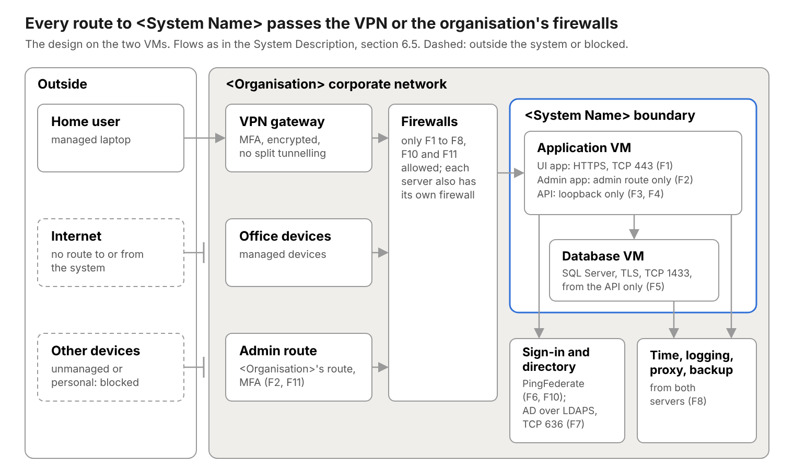
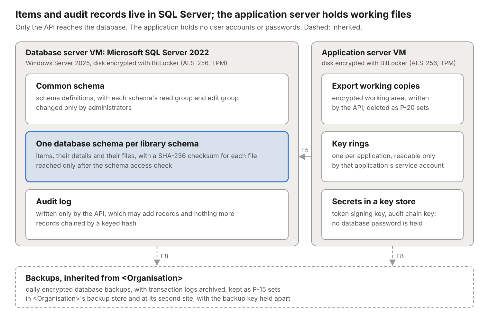
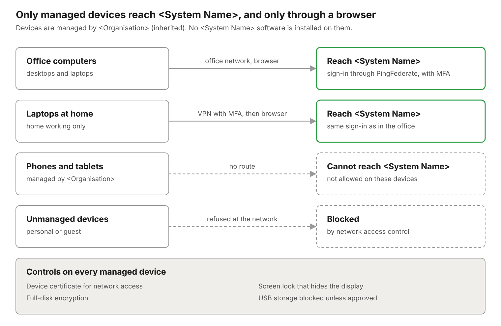

# \<System Name\> System Security Plan

## 1 Purpose and summary

This plan is used by every control family. It describes how \<System Name\> implements its security controls: how it meets each one or does not, at a high level, which are shared, and which do not apply. It covers all nineteen assessed families, listed in section 5, and section 7 gives a brief overview of every control in each of them. PM is outside the baseline (\<Tailoring Register\>, TR-PM-01). This plan does not claim compliance.

\<System Name\> is assessed against CSS only, using the CSS assessment procedures and the CSS baselines. Assessment results are recorded in each family's chapter of \<Control Assessment Record\>. The privacy plan is \<Privacy Plan\> and the supply chain risk management plan is \<Supply Chain Risk Management\>. This plan refers to them rather than repeating them. The organisation takes a risk-based approach, so each non-compliance is rated and decided in \<Risk List\>. This plan is a brief overview of each control. The assessment results behind it are in that record, and are not repeated here. In section 7, Status describes what is built, and Assessment gives the Level 1 result.

## 2 System identification

**Table 1: System identification**

| Item | Value |
| --- | --- |
| System name | \<System Name\>, built from the UI application, the Admin application, the API and the shared library (\<Code\>\_Web, \<Code\>\_Admin, \<Code\>\_API and \<Code\>\_Shared) |
| Unique identifier | \<ref\> |
| Organisation's inventory entries | System inventory: \[\<Organisation\>'s reference\]. Personal data inventory or record of processing: \[\<Organisation\>'s reference\]. Requested through EV-PM-02 (PM-5, PM-5(1)) |
| Version described | \[Version, with the commit of each repository\] |
| Purpose and function | An internal digital library: staff store, search and view digital items, kept apart in separate schemas (\<System Description\>, section 2) |
| System type | Internally developed web application on two Windows Server 2025 virtual machines, with a Microsoft SQL Server 2022 database |
| Environment | Production, with a separate, throwaway test copy of the whole system built from a tagged release, and development on developers' computers; test and development hold invented data only |
| Exposure | Internal only. It is reached by browser from \<Organisation\>'s network and VPN, and is not public-facing |
| Criticality | Business critical |
| Ownership | Owned and operated by \<Organisation\>, with the system owner accountable for it |
| Common control provider | \<Organisation\>'s IT services: sign-in through PingFederate, the Active Directory, ServiceNow, network, firewalls, VPN, managed devices, VM hosting, logging, time, proxy, physical security and backup site (section 5) |
| Operational status | \[Operational status\] |
| Authorisation status | \[Authorisation status\] |
| Security categorisation | Moderate (\<System Description\>, P-01) |
| System owner | \[Name\] |
| Authorising official | \[Name\] |
| Control baseline | CSS Moderate; the AC, AT, AU, CA, CM, CP, IA, IR, MA, MP, PE, PL, PS, RA, SA, SC, SI and SR families in this version, with PT and 16 other controls from the CSS privacy baseline |

The key contacts are below. Their business contact details are in \<Roles and Responsibilities\>, section 6.

**Table 2: Key contacts**

| Role | Name |
| --- | --- |
| Authorising official | \[Name\] |
| System owner | \[Name\] |
| Information owner | \[Name\] |
| Senior information security officer | \[Name\], Head of Cyber (PM-2) |
| Data protection officer | \[Name, or the reason none is required\] (PM-19) |
| Data Owners | \[Names, one for each schema\] |
| System security officer | \[Name\], security officer |
| \<Organisation\> security contact | \[Name\]; deputy \[Name\] |
| Security assessor | \[Name\] |

Other role holders are named in \<Roles and Responsibilities\>.

## 3 System description

### 3.1 Description and boundary

\<System Name\> will be deployed on the corporate network of \<Organisation\>, which holds Cyber Essentials Plus. The boundary is the whole stack: an application server VM running UI application, Admin application and API, and a separate database server VM running Microsoft SQL Server 2022, both on Windows Server 2025. Each application runs as a Windows service under its own group managed service account. CE+ supports inherited controls but does not prove them, so each one names its \<Organisation\> service and evidence.

### 3.2 System interconnections

The planned exchanges are below, and are also recorded in \<Assessment, Authorization, and Monitoring Management\>, section 3.7. \<Organisation\>'s network, VPN, central logging, time service and UK virtual platform are provided by \<Organisation\>, which supplies the evidence for them (\<Evidence Requests\>).

**Table 3: Information exchanges**

| Exchange | Direction and method | Information | Agreement |
| --- | --- | --- | --- |
| \<Organisation\>'s PingFederate and Active Directory | From PingFederate to \<System Name\>, through the user's browser, by OpenID Connect over HTTPS (flow F6); from the UI application and Admin application on the application VM to PingFederate, for its OpenID Connect metadata and signing certificate and to complete each sign-in, by HTTPS on TCP 443 (flow F10); and from Active Directory to API, by LDAPS (flow F7) | A signed OpenID Connect response that names each user, with no groups; each user's group membership, read by API from Active Directory | \[Agreement covering \<Organisation\>'s hosting and services\] |
| ServiceNow, \<Organisation\>'s IT service desk | By people only (flow F9). ServiceNow has no connection to \<System Name\> | Access requests and the Data Owner's authorisations; change requests and approvals; names of requesters | Information exchange agreement with \<Organisation\> (\<Assessment, Authorization, and Monitoring Management\>, section 3.7) |
| Starters and leavers process, \<Organisation\> | To the owners of a leaver's groups, by people only (flow F9). It has no connection to \<System Name\> | Prompts to add or remove access; staff names and leaving dates | Information exchange agreement with \<Organisation\> (\<Assessment, Authorization, and Monitoring Management\>, section 3.7) |
| \<Organisation\>'s central logging | Out from both VMs (flow F8); protocol requested from \<Organisation\> | Windows and application security logs | \[Agreement covering \<Organisation\>'s hosting and services\] |
| \<Organisation\>'s time service | Into both VMs, by NTP (flow F8) | Time | As above |
| \<Organisation\>'s backup site | Out from the database VM (flow F8), encrypted; method set by \<Organisation\> | Encrypted database backups | As above |
| Application VM to database VM | Internal, from the API only (flow F5): SQL Server over TLS with strict encryption, TCP 1433, by Windows authentication | Items, their details and files, schema definitions and audit records | Not needed: inside the boundary (CA-9) |

### 3.3 Information types and security categorisation

The information types below are taken from the application profile (\<System Description\>, section 3.4), and each is mapped to its CSS information types. The impact levels follow CSS, and the mapping does not change them. The information owner, \[Name\], owns every information type. The last type is held by every application built on the reference system. The reference categorisation is Moderate for confidentiality, Moderate for integrity and Low for availability (\<System Description\>, P-01), which is why the Moderate baseline is used; an application rated High in any objective is outside the reference system. Availability is Low as in CSS's provisional levels: the business impact analysis allows 120 hours of downtime (P-14; \<Contingency Planning Management\>, section 3.3), so a loss of availability has a limited adverse effect. "Business critical" in section 2 means the system matters to \<Organisation\>'s work, not that it must be highly available.

**Table 4: Information types and impact levels**

| Information type | CSS types | Confidentiality | Integrity | Availability |
| --- | --- | --- | --- | --- |
| \[Information type 1, from the application profile\] | \[CSS types\] | \[Rating\] | \[Rating\] | \[Rating\] |
| \[Information type 2\] | \[CSS types\] | \[Rating\] | \[Rating\] | \[Rating\] |
| Sign-in identities and audit records | C.3.5.5 Information Security; C.2.8.9 Personal Identity and Authentication Information | Moderate | Moderate | Low |
| **System, as a high-water mark (reference value, P-01)** |  | **Moderate** | **Moderate** | **Low** |

### 3.4 Component inventory

This is the intended inventory for the authorisation boundary. Host names, asset numbers and exact versions are to be added when the VMs are built.

**Table 5: Component inventory**

| Component | Type | Version or source | Location |
| --- | --- | --- | --- |
| Application server VM | Virtual server | Windows Server 2025 | \<Organisation\> |
| Database server VM | Virtual server | Windows Server 2025 | \<Organisation\> |
| UI application (\<Code\>\_Web) | Internally developed web application | .NET 10 and Blazor Server, its own repository | Application server VM |
| Admin application (\<Code\>\_Admin) | Internally developed web application | .NET 10 and Blazor Server, its own repository | Application server VM |
| API (\<Code\>\_API) | Internally developed service, the only route to the database | .NET 10, its own repository | Application server VM |
| Shared library (\<Code\>\_Shared) | Internally developed library: the data model, the access checks and the audit record format | .NET 10, its own repository | Built into the applications |
| Microsoft SQL Server, holding the \<System Name\> database | Database | SQL Server 2022 | Database server VM |
| Browser libraries | Third-party scripts and styles the pages need, such as a document viewer and an icon set | Packaged with the UI application and served by \<System Name\> itself; no content delivery service | Application server VM |
| ServiceNow | Access request and approval workflows, in which the Data Owner authorises each request, owned by \<Organisation\>'s IT service desk. No connection to \<System Name\> | \<Organisation\>'s service | Outside the boundary |
| PingFederate and Active Directory | Sign every user in with multi-factor authentication, and hold the groups that decide roles and schema access. A critical component (\<Risk Assessment Management\>, section 3.9) | \<Organisation\>'s corporate services | Outside the boundary |
| Starters and leavers process | Raises leaver requests, and prompts the owners of a leaver's groups | \<Organisation\>'s service | Outside the boundary |
| Microsoft Defender | Malicious code protection | Windows Server 2025 | Both VMs |
| BitLocker full-disk encryption (XTS-AES 256 with the TPM) | Protection at rest | Windows Server 2025 | Both VMs |
| Key store | Holds the token signing key and the audit chain key outside source code. There is no database password | To be chosen | To be chosen |
| Vulnerability scanner | Servers monthly; packages and code at each release (\<System Description\>, P-30) | To be chosen | To be chosen |
| Backup store | Encrypted backups | To be chosen | \<Organisation\>'s second site |
| Bulk export working area | Encrypted working copies for each export job, holding copies of items, deleted as \<System Description\>, P-20, sets and checked each working day (C49) | An encrypted working area written by API | Application server VM |
| Data protection key rings | Keys protecting each app's authentication cookie and anti-forgery tokens | ASP.NET Core data protection, one per app | Application server VM |

### 3.5 Related laws, regulations and policies

\<Organisation\> operates in the UK, and \<System Name\> holds personal data, so the laws in Table 5a apply. \<Organisation\>'s policies, Cyber Essentials Plus and CSS also apply. The first three rows are the laws in \<System Description\>, P-31. The rows are the laws the family policies name, and the legal adviser, \[Name\], confirms each with that policy's review.

**Table 5a: Laws and where they are applied**

| Law | Why it applies | Where it is applied |
| --- | --- | --- |
| UK GDPR and the Data Protection Act 2018 | Items and audit records hold personal data, and items may hold special category data | \<Policy\> (PT), \<Privacy Plan\>, \<PII Processing Management\> and \<Data Protection Impact Assessment\>; breach reporting in \<Incident Response Management\>, section 3.8; rules A23 to A29 of \<Security Operating Procedures\> |
| Data (Use and Access) Act 2025 | The right to complain to the controller, and how far a search for a person's data must go | \<Policy\> (PT), \<Procedures\> (PT) and \<PII Processing Management\> |
| Computer Misuse Act 1990 | Misuse of the system may be an offence, and audit records may be evidence | \<Policy\> (AC), \<Policy\> (AU), \<Policy\> (IA), \<Policy\> (IR) and \<Policy\> (MA); rule A4 of \<Security Operating Procedures\> |
| Copyright, Designs and Patents Act 1988 | Software must be licensed | \<Policy\> (CM) |
| Regulatory Reform (Fire Safety) Order 2005 | Fire precautions at the data centre and offices, which \<Organisation\> provides | \<Policy\> (PE) |
| Rehabilitation of Offenders Act 1974; Immigration, Asylum and Nationality Act 2006; Equality Act 2010; Employment Rights Act 1996 | Screening, the right to work and sanctions, all carried out by \<Organisation\> as employer | \<Policy\>, section PS.6 |

### 3.6 Users

All users are staff or contractors of \<Organisation\>, so all are internal. \<System Name\> has no external or public users (TR-IA-03). The roles are those in \<System Description\>, section 3.3. Expected numbers are placeholders for the system owner to complete (\<System Description\>, P-33).

**Table 6: Users**

| Role | Internal or external | Main privileges | Expected users |
| --- | --- | --- | --- |
| Reader | Internal | Searches and reads items in the schemas whose read group they belong to, and reports a fault | \[Number\] |
| Editor | Internal | A reader's work, and creates, uploads, manages and exports the schema's items | \[Number\] |
| Administrator | Internal | Manages schemas, which groups open each schema, and system settings, in the Admin application; can reach every schema. There is no separate global administrator. Group members are changed by each group's owner, in Active Directory | \[Number\] |
| Auditor | Internal | Reads and searches the audit log, and reviews it weekly (P-08); holds no administration role | \[Number\] |
| Security officer | Internal | Reads security information, reviews alerts, the central logs and scan results, and leads incident response; does not read the audit log; holds no administration role | \[Number\] |
| Business owner | Internal | Approves the disposal of items due under the retention schedule, in the Admin application (FR-074) | \[Number\] |
| Legal adviser's delegate | Internal | Searches every schema for one person's items to answer a request under data protection law, in the Admin application (FR-073); holds no other role | \[Number\] |
| Data Owner | Internal | Owns a schema's data and its read and edit groups, and authorises who may read or edit it, in ServiceNow | \[Number\] |
| Windows server and database administrators | Internal | Administer the VMs and SQL Server; need no application role | \[Number\] |

### 3.7 Ports, protocols and services

The design on the two VMs is below. Flow numbers are those in \<System Description\>, section 6.5, and \<Security Architecture\>, Table 2. ServiceNow and the starters and leavers process (F9) have no connection to \<System Name\>, so they have no port.

**Table 7: Ports, protocols and services**

| Service | On the VMs | From and to | Flow |
| --- | --- | --- | --- |
| UI application | HTTPS, TCP 443 | User browsers to the application VM | F1 |
| Admin application | HTTPS, on its own port or host name; reachable only through \<Organisation\>'s managed route (route R3) | Administrator browsers to the application VM, over the managed route | F2 |
| API | HTTPS on the application VM's loopback address only | UI application and Admin application to API | F3, F4 |
| SQL Server | TCP 1433, TLS with strict encryption and Windows authentication, allowed only from the application VM | API on the application VM to the database VM | F5 |
| Sign-in | HTTPS | User and administrator browsers to \<Organisation\>'s PingFederate | F6 |
| Sign-in completion | HTTPS, TCP 443, from the application VM only | UI application and Admin application to \<Organisation\>'s PingFederate, for its OpenID Connect metadata and signing certificate and to complete each sign-in | F10 |
| Group lookup | LDAPS, TCP 636, read-only | API on the application VM to \<Organisation\>'s Active Directory | F7 |
| Server and database administration | Only through \<Organisation\>'s managed administration route, with multi-factor authentication, using named accounts; tool and protocol requested in EV-MA-02. All remote maintenance routes, R1 to R5, are in \<Maintenance Management\>, section 3.4 | Server and database administrators' managed devices to both VMs | F11 |
| Time | NTP, UDP 123 | Both VMs to \<Organisation\>'s time service | F8 |
| Central logging | Set by \<Organisation\> (\<Evidence Requests\>) | Both VMs to \<Organisation\>'s logging | F8 |
| Updates and backups | Through \<Organisation\>'s authenticated proxy, and to its backup site, encrypted, as \<Organisation\> sets | Both VMs to \<Organisation\>'s proxy and backup site | F8 |
| Browser libraries | Served by \<System Name\> itself, over F1; no content delivery service and no outside host | None outside the system | F1 |

## 4 Security architecture

Users reach UI application, and administrators reach Admin application, by browser. Users sign in through \<Organisation\>'s PingFederate, with multi-factor authentication. API reads their group membership from Active Directory over LDAPS (flow F7), and \<System Name\> holds no accounts or passwords of its own. Both apps call API (F3, F4), and only API connects to SQL Server on the database VM (F5), by Windows authentication with no database password; the two apps get their data through it. Access decisions are made by the access checks in the shared library, and each schema's items sit in their own database schema. \<Organisation\> provides the network, firewalls, remote access, user devices and VM hosting, all outside the boundary. The boundary diagram and data flows F1 to F11 are in [\<Security Architecture\>](Security%20Architecture.md).

The figures below show the target design on the two VMs, not the test environment. Where they show \<Organisation\>'s services, the evidence for them is requested in \<Evidence Requests\>. Flow numbers F1 to F11 are those in \<System Description\>, section 6.5, and \<Security Architecture\>, Table 2.

### 4.1 High-level architecture

**Figure 1: High-level architecture**

Users reach \<System Name\> only by browser, from managed devices in the office or at home through the VPN, and the application VM reaches PingFederate to complete each sign-in (F10). Both VMs sit inside \<Organisation\>'s network, behind its firewalls. \<Organisation\> also provides logging, time, hosting and the second site for backups.

### 4.2 Application architecture

**Figure 2: Application architecture**

UI application and Admin application are Blazor Server apps, so the pages run on the server and the browser holds a live connection to the app. Both call API, which is their only route to the database. Access checks and the audit record format come from the shared library, which is built into each app, and the API reads each person's groups from Active Directory over LDAPS (F7). Users and administrators sign in through \<Organisation\>'s PingFederate, with multi-factor authentication (F6); the two apps fetch PingFederate's metadata and signing certificate, and complete each sign-in, from the application VM (F10); and \<System Name\> holds the sign-in only in its authentication cookie.

### 4.3 Network

**Figure 3: Network**

Both VMs sit inside \<Organisation\>'s network. Home users come in through the VPN, office devices through the office network, and server and database administrators through \<Organisation\>'s managed administration route (F11). All of these pass the firewalls, whose rules \<Organisation\>'s corporate network team alone sets. The apps use HTTPS, and traffic between the VMs uses TLS.

### 4.4 Storage

**Figure 4: Storage**

Items, their files and audit records are all held in SQL Server on the database VM, with each schema's definition and its read and edit groups. \<System Name\> holds no accounts: they are in \<Organisation\>'s Active Directory. Schema definitions sit in a common schema, and each schema has its own database schema, which holds its items, their details and their files. Only the API reaches the database (F5), by Windows authentication, so no database password is held. The application VM holds only working files: the encrypted export working copies, each app's key ring, and the secrets in the key store.

### 4.5 End-points

**Figure 5: End-points**

\<System Name\> has no client software. It is used through a browser on a device that \<Organisation\> manages. Phones and tablets cannot reach it, and unmanaged devices are blocked by network access control. Managed devices have certificates for network access, disk encryption, a screen lock that hides the display, and USB storage blocked unless approved. \<Organisation\> supplies the evidence for these (\<Evidence Requests\>).

### 4.6 VPN and administrator access

**Figure 6: VPN and administrator access**

The VPN's multi-factor authentication protects the network route. \<System Name\>'s own sign-in is through \<Organisation\>'s PingFederate, with multi-factor authentication. Server and database administrators reach the VMs only through \<Organisation\>'s managed administration route, with multi-factor authentication and named accounts (F11), whose details are requested in EV-MA-02.

## 5 Control applicability and inheritance

The controls are those of CSS in the CSS Moderate baseline. PT and 16 related privacy controls come from the CSS privacy baseline, and PM is outside the baseline (TR-PM-01). \<System Name\> inherits PM controls from \<Organisation\>'s security and privacy programme as common controls; they are listed with their providers and evidence in \<Program Management\>, section 3.3. Twenty-four of them are in the privacy baseline; they stay inherited and are not assessed for \<System Name\>. \<Organisation\>'s programme plan is requested in EV-PM-01. Tailoring proposals are in \<Tailoring Register\>.

Each control is given one of four types. **System** controls are met by \<System Name\>. **Hybrid** controls are met partly by \<System Name\> and partly by the organisation or \<Organisation\>. **Organisational** controls are met by policy, procedure and people. **Inherited** controls are provided by \<Organisation\>, which is expected to supply the evidence (\<Evidence Requests\>). As CSS allows, this plan names the provider of an inherited control but does not describe how that provider implements it.

**Table 8: Controls by family**

| Family | Controls | System | Hybrid | Organisational | Inherited | Not applicable |
| --- | --- | --- | --- | --- | --- | --- |
| AC Access Control | 39 | 5 | 13 | 5 | 10 | 6 |
| AT Awareness and Training | 6 | 0 | 3 | 3 | 0 | 0 |
| AU Audit and Accountability | 16 | 7 | 7 | 2 | 0 | 0 |
| CA Assessment, Authorization, and Monitoring | 10 | 0 | 2 | 8 | 0 | 0 |
| CM Configuration Management | 24 | 0 | 13 | 9 | 2 | 0 |
| CP Contingency Planning | 23 | 0 | 5 | 8 | 10 | 0 |
| IA Identification and Authentication | 24 | 2 | 7 | 1 | 8 | 6 |
| IR Incident Response | 13 | 0 | 4 | 9 | 0 | 0 |
| MA Maintenance | 9 | 0 | 2 | 6 | 1 | 0 |
| MP Media Protection | 7 | 0 | 4 | 1 | 2 | 0 |
| PE Physical and Environmental Protection | 18 | 0 | 2 | 1 | 15 | 0 |
| PL Planning | 7 | 0 | 0 | 7 | 0 | 0 |
| PS Personnel Security | 9 | 0 | 4 | 3 | 2 | 0 |
| PT Personally Identifiable Information Processing and Transparency | 29 | 3 | 2 | 15 | 2 | 7 |
| RA Risk Assessment | 10 | 0 | 4 | 6 | 0 | 0 |
| SA System and Services Acquisition | 17 | 1 | 4 | 9 | 2 | 1 |
| SC System and Communications Protection | 25 | 3 | 10 | 1 | 10 | 1 |
| SI System and Information Integrity | 18 | 3 | 9 | 3 | 1 | 2 |
| SR Supply Chain Risk Management | 12 | 0 | 3 | 5 | 4 | 0 |
| **Total** | **316** | **24** | **98** | **102** | **69** | **23** |

Section 7 lists every control. A control counts as satisfied only when every one of its assessment statements is satisfied.

## 6 Security responsibilities

**Table 9: Security responsibilities**

| Responsible | For |
| --- | --- |
| System owner | This plan, approvals, exceptions, risk within their authority, and coordination with \<Organisation\> |
| Authorising official | Accepting residual risk and authorising operation |
| Developers | Security functions built into the application under \<Organisation\>'s corporate SDLC, and fixing POA&M items |
| Administrators | Managing schemas, the groups that open each schema, and system settings, in the Admin application |
| Data Owners | Authorising who may read or edit their schema, in ServiceNow, and owning its read and edit groups |
| Auditor | Reviewing the audit log weekly, comparing it with the server, database, PingFederate and Active Directory records, recording the review, and reporting anything suspicious to the security officer |
| Security officer | Reviewing alerts, the central logs, advisories and scan results, leading incident response, and reporting monthly on security status. The security officer does not read the audit log |
| Windows server and database administrators | Securing, patching and scanning the VMs and SQL Server, and running Defender and disk encryption |
| Change control element | Approving changes: the system owner, security officer and Windows server administrator (\<Configuration Management\>) |
| Security assessor | Leading the independent Level 2 assessment |
| \<Organisation\> | Inherited services and their evidence |
| Users | Following the SyOps |
| Security officer, system owner, database and Windows server administrators | Incident response and training records (security officer); invoking recovery (system owner); backups and rebuilding (administrators). See \<Incident Response Management\>, \<Contingency Planning Management\> and \<Awareness and Training Management\> |
| \<Organisation\> | Maintaining hardware, handling disks and backup media, and physical and environmental protection. See \<Maintenance Management\>, \<Media Protection Management\> and \<Physical and Environmental Protection Management\> |
| Legal adviser | The privacy plan (\<Privacy Plan\>), the impact assessment, the lawful basis, requests and complaints from individuals, and reports to the ICO |
| Business and information owner | The information types, and retention periods for each schema; the business owner approves the disposal of items due under the retention schedule (FR-074) |
| Legal adviser's delegate | Searching every schema for one person's items to answer a request under data protection law (FR-073), named by the legal adviser |
| Supply chain team: system owner, security officer, a developer and \<Organisation\>'s IT service desk | The supply chain plan (\<Supply Chain Risk Management\>), supplier reviews and notices of compromise |

People holding these roles are named in \<Roles and Responsibilities\>. How security is operated is in \<Security Operating Procedures\>.

## 7 Control implementation

This section gives a brief overview of every control in the 19 families, one line each. Each line says how the control is implemented or planned, who is responsible, its type (section 5), its implementation status and its Level 1 assessment status. It does not repeat the assessment. The finding for each determination statement is in the family's chapter of \<Control Assessment Record\>, and each non-compliance and its decision are in \<Risk List\> and \<Decision Register\>.

**Status** is where the set records each control's implementation status, for the design on the two VMs: Implemented, Partially implemented, Not implemented (selected, but not started), or Not applicable. The family documents point here. **Assessment:** Satisfied only when every statement for the control is satisfied, and otherwise Other than satisfied. **Decision:** the NC entry in \<Risk List\> and, where a fix is planned, its POA&M item in \<Plan of Action and Milestones\>; or the tailoring entry in \<Tailoring Register\>.

### 7.1 Access Control (AC)

The assessment plan is in \<Control Assessment Record\> (AC), section AC.6, where the results are recorded. Implementation detail is in \<Policy\> (AC), \<Procedures\> (AC) and \<Access Control Management\>.

**Table 10: AC controls**

| Control | How it is implemented | Who | Type | Status | Assessment | Decision |
| --- | --- | --- | --- | --- | --- | --- |
| AC-1 Policy and Procedures | Policy and procedures in \<Policy\> (AC) and \<Procedures\> (AC) | System owner, Head of Cyber | Hybrid | \[Status\] | \[Result\] | \[Decision\] |
| AC-2 Account Management | Each person uses their own Active Directory account; access is membership of an AD group, which the group's owner gives once the request is authorised in ServiceNow: by the Data Owner for a schema's groups, and by the system owner for the role groups. Approval, notification and review are set out in \<Access Control Management\> | Data Owners, system owner | Hybrid | \[Status\] | \[Result\] | \[Decision\] |
| AC-2(1) Automated Account Management | Active Directory, PingFederate and the starters and leavers process manage accounts and sign-in; \<System Name\> applies the groups it reads from Active Directory | \<Organisation\>, developers | Hybrid | \[Status\] | \[Result\] | \[Decision\] |
| AC-2(2) Temporary and Emergency Accounts | Not used; forbidden by policy | None | Not applicable | \[Status\] | \[Result\] | \[Decision\] |
| AC-2(3) Disable Accounts | \<Organisation\> disables Active Directory accounts, which stops sign-in; unused accounts follow its corporate standard. In addition, members who have not signed in for 90 days are removed from \<System Name\>'s groups each month | \<Organisation\> | Inherited | \[Status\] | \[Result\] | \[Decision\] |
| AC-2(4) Automated Audit Actions | Account and group changes are audited in Active Directory by \<Organisation\>; \<System Name\> audits sign-ins and its own schema and group settings | \<Organisation\>, developers | Hybrid | \[Status\] | \[Result\] | \[Decision\] |
| AC-2(5) Inactivity Logout | Provided by \<Organisation\>: \<System Name\> has no session management. A sign-in lasts no longer than PingFederate's sign-in lifetime (P-AC-10; \<System Description\>, P-02), and \<Organisation\>'s managed devices lock an unattended screen (P-AC-15; P-03) | \<Organisation\> | Inherited | \[Status\] | \[Result\] | \[Decision\] |
| AC-2(13) High-risk Individuals | \<Organisation\> disables the Active Directory account and ends the person's PingFederate sign-in, within 1 hour; \<System Name\> has no sessions of its own to end | Security officer, \<Organisation\> | Hybrid | \[Status\] | \[Result\] | \[Decision\] |
| AC-3 Access Enforcement | Schema read and edit decisions are made by the shared library's access checks on every page and API function, from the groups the API reads from Active Directory, denying by default | Developers | System | \[Status\] | \[Result\] | \[Decision\] |
| AC-4 Information Flow Enforcement | Only flows F1 to F11 in \<System Description\>, section 6.5, exist; network enforcement is by \<Organisation\>'s firewalls and each VM's host firewall | Developers, \<Organisation\> | Hybrid | \[Status\] | \[Result\] | \[Decision\] |
| AC-5 Separation of Duties | Separate Administrator, Auditor, Security officer, Business owner and Legal adviser's delegate roles, each in its own group; the system owner or the Data Owner authorises each request, so nobody approves their own access | System owner | Hybrid | \[Status\] | \[Result\] | \[Decision\] |
| AC-6 Least Privilege | Access through groups and roles | Developers, database administrator | Hybrid | \[Status\] | \[Result\] | \[Decision\] |
| AC-6(1) Authorize Access to Security Functions | Security functions need the Administrator or Security officer role | Developers | System | \[Status\] | \[Result\] | \[Decision\] |
| AC-6(2) Non-privileged Access for Nonsecurity Functions | SyOps requires a separate everyday account | System owner | Organisational | \[Status\] | \[Result\] | \[Decision\] |
| AC-6(5) Privileged Accounts | The Administrator role is membership of the administrators' group (\<Code\>\_Admins), given only to named accounts | System owner, database administrator | Hybrid | \[Status\] | \[Result\] | \[Decision\] |
| AC-6(7) Review of User Privileges | Periodic review of privileges, by procedure | System owner, auditor | Organisational | \[Status\] | \[Result\] | \[Decision\] |
| AC-6(9) Log Use of Privileged Functions | Privileged actions are audited | Developers | System | \[Status\] | \[Result\] | \[Decision\] |
| AC-6(10) Prohibit Non-privileged Users from Executing Privileged Functions | Ordinary users are refused admin functions | Developers | System | \[Status\] | \[Result\] | \[Decision\] |
| AC-7 Unsuccessful Logon Attempts | PingFederate and Active Directory count failed sign-ins and lock the account, under \<Organisation\>'s corporate standard | \<Organisation\> | Inherited | \[Status\] | \[Result\] | \[Decision\] |
| AC-8 System Use Notification | A notice is shown at sign-in, and a Windows logon banner on the VMs | Developers, Windows server administrator | Hybrid | \[Status\] | \[Result\] | \[Decision\] |
| AC-11 Device Lock | Provided by \<Organisation\>: its managed devices and the servers lock an unattended screen (P-AC-15; \<System Description\>, P-03); \<System Name\> has no page lock of its own | \<Organisation\> | Inherited | \[Status\] | \[Result\] | \[Decision\] |
| AC-11(1) Pattern-hiding Displays | Provided by \<Organisation\>: its device lock screen hides the display (P-AC-15; P-03); \<System Name\> has no page lock of its own | \<Organisation\> | Inherited | \[Status\] | \[Result\] | \[Decision\] |
| AC-12 Session Termination | Provided by \<Organisation\>: a sign-in ends when PingFederate's sign-in lifetime ends (P-AC-10; \<System Description\>, P-02), or when \<Organisation\> ends the PingFederate sign-in or disables the account. \<System Name\> holds the sign-in only in its authentication cookie, no longer than that lifetime, and has no session management of its own | \<Organisation\> | Inherited | \[Status\] | \[Result\] | \[Decision\] |
| AC-14 Permitted Actions Without Identification | Only the redirect to PingFederate, the access-denied page, static files and the API health check work without signing in (P-AC-25) | Developers | System | \[Status\] | \[Result\] | \[Decision\] |
| AC-17 Remote Access | \<Organisation\>'s VPN with MFA | \<Organisation\> | Hybrid | \[Status\] | \[Result\] | \[Decision\] |
| AC-17(1) Monitoring and Control | \<Organisation\> monitors VPN sessions | \<Organisation\> | Hybrid | \[Status\] | \[Result\] | \[Decision\] |
| AC-17(2) Encryption | VPN encrypted; \<System Name\> uses HTTPS | \<Organisation\>, Windows server administrator | Hybrid | \[Status\] | \[Result\] | \[Decision\] |
| AC-17(3) Managed Access Control Points | One managed gateway | \<Organisation\> | Inherited | \[Status\] | \[Result\] | \[Decision\] |
| AC-17(4) Privileged Commands and Access | No remote administration beyond the approved route | None | Not applicable | \[Status\] | \[Result\] | \[Decision\] |
| AC-18 Wireless Access | \<Organisation\>'s wireless controls; \<System Name\> has no wireless part | \<Organisation\> | Inherited | \[Status\] | \[Result\] | \[Decision\] |
| AC-18(1) Authentication and Encryption | \<Organisation\>'s wireless controls | \<Organisation\> | Inherited | \[Status\] | \[Result\] | \[Decision\] |
| AC-18(3) Disable Wireless Networking | The VMs have no wireless adapter, checked when built | \<Organisation\> | Inherited | \[Status\] | \[Result\] | \[Decision\] |
| AC-19 Mobile Devices | Phones and tablets cannot reach \<System Name\> | None | Not applicable | \[Status\] | \[Result\] | \[Decision\] |
| AC-19(5) Device Encryption | As AC-19 | None | Not applicable | \[Status\] | \[Result\] | \[Decision\] |
| AC-20 External Systems | Policy forbids external systems without approval; unmanaged devices are blocked | System owner, \<Organisation\> | Organisational | \[Status\] | \[Result\] | \[Decision\] |
| AC-20(1) Limits on Authorized Use | External use is forbidden | None | Not applicable | \[Status\] | \[Result\] | \[Decision\] |
| AC-20(2) Portable Storage Devices | USB storage blocked unless approved | \<Organisation\>, users | Organisational | \[Status\] | \[Result\] | \[Decision\] |
| AC-21 Information Sharing | Schema groups control sharing inside \<System Name\>; the Data Owner decides on sharing outside a schema (P-AC-23) | Data Owners | Organisational | \[Status\] | \[Result\] | \[Decision\] |
| AC-22 Publicly Accessible Content | \<System Name\> has no public content | None | Not applicable | \[Status\] | \[Result\] | \[Decision\] |

### 7.2 Awareness and Training (AT)

The assessment plan is in \<Control Assessment Record\> (AT), section AT.5, where the results are recorded. Implementation detail is in \<Policy\> (AT), \<Procedures\> (AT) and \<Awareness and Training Management\>, which holds the \<System Name\> briefing, the role curriculum, the training matrix for AT, IR-2, CP-3, AT-3(5) and PL-4, the training register and the parameter values.

**Table 11: AT controls**

| Control | How it is implemented | Who | Type | Status | Assessment | Decision |
| --- | --- | --- | --- | --- | --- | --- |
| AT-1 Policy and Procedures | Policy and procedures in \<Policy\> (AT) and \<Procedures\> (AT); the design is in \<Awareness and Training Management\> | System owner, Head of Cyber | Organisational | \[Status\] | \[Result\] | \[Decision\] |
| AT-2 Literacy Training | \<Organisation\>'s course, plus the \<System Name\> briefing (\<Awareness and Training Management\>, section 3.3) given with the SyOps signature | \<Organisation\>, system owner | Hybrid | \[Status\] | \[Result\] | \[Decision\] |
| AT-2(2) Insider Threat | Briefing part B4, and \<Organisation\>'s course | \<Organisation\>, system owner | Hybrid | \[Status\] | \[Result\] | \[Decision\] |
| AT-2(3) Social Engineering | Briefing part B3, and \<Organisation\>'s course; no punitive phishing simulations | \<Organisation\>, system owner | Hybrid | \[Status\] | \[Result\] | \[Decision\] |
| AT-3 Role-based Training | Role curriculum M1 to M9 and the training matrix (\<Awareness and Training Management\>, sections 3.4 and 3.5) | Security officer, Head of Cyber | Organisational | \[Status\] | \[Result\] | \[Decision\] |
| AT-4 Training Records | TPL-9 and the training register, kept 3 years | Security officer | Organisational | \[Status\] | \[Result\] | \[Decision\] |

### 7.3 Audit and Accountability (AU)

The assessment plan is in \<Control Assessment Record\> (AU), section AU.5, where the results are recorded. Implementation detail is in \<Policy\> (AU), \<Procedures\> (AU) and \<Audit and Accountability Management\>.

**Table 12: AU controls**

| Control | How it is implemented | Who | Type | Status | Assessment | Decision |
| --- | --- | --- | --- | --- | --- | --- |
| AU-1 Policy and Procedures | Policy and procedures in \<Policy\> (AU) and \<Procedures\> (AU) | System owner, Head of Cyber | Organisational | \[Status\] | \[Result\] | \[Decision\] |
| AU-2 Event Logging | The events defined in \<Audit and Accountability Management\> are logged | System owner, developers | System | \[Status\] | \[Result\] | \[Decision\] |
| AU-3 Content of Audit Records | Records show the event type and action, the time in UTC, the application, the IP address, the result and the username | Developers | System | \[Status\] | \[Result\] | \[Decision\] |
| AU-3(1) Additional Audit Information | Records show the browser, the user ID, the schema and the item | Developers | System | \[Status\] | \[Result\] | \[Decision\] |
| AU-4 Audit Log Storage Capacity | Records are held in the database, with storage sized for the retention period | Database administrator | Hybrid | \[Status\] | \[Result\] | \[Decision\] |
| AU-5 Response to Logging Failures | Response to a logging failure as set out in \<Audit and Accountability Management\> | Windows server administrator, security officer | Hybrid | \[Status\] | \[Result\] | \[Decision\] |
| AU-6 Review, Analysis and Reporting | Weekly review of the audit log by the auditor (\<System Description\>, P-08), defined in PRO-AU-1 and the SyOps; the security officer reviews alerts and the central logs, not the audit log | Auditor, security officer | Organisational | \[Status\] | \[Result\] | \[Decision\] |
| AU-6(1) Automated Process Integration | Integration with \<Organisation\>'s central monitoring | Auditor, \<Organisation\> | Hybrid | \[Status\] | \[Result\] | \[Decision\] |
| AU-6(3) Correlate Repositories | The application records are correlated with Windows and \<Organisation\>'s records | Auditor, \<Organisation\> | Hybrid | \[Status\] | \[Result\] | \[Decision\] |
| AU-7 Reduction and Report Generation | The audit page filters and summarises without changing records | Developers | System | \[Status\] | \[Result\] | \[Decision\] |
| AU-7(1) Automatic Processing | Search by date, event type, result and username | Developers | System | \[Status\] | \[Result\] | \[Decision\] |
| AU-8 Time Stamps | Application records use UTC; the VMs take time from \<Organisation\>'s time service | Developers, \<Organisation\> | Hybrid | \[Status\] | \[Result\] | \[Decision\] |
| AU-9 Protection of Audit Information | Only auditors can read records; only the API writes them, and its database login may only add records; records are chained with HMAC-SHA-256 | Developers, database administrator | System | \[Status\] | \[Result\] | \[Decision\] |
| AU-9(4) Access by Subset of Privileged Users | Auditors can read records | System owner, developers | System | \[Status\] | \[Result\] | \[Decision\] |
| AU-11 Audit Record Retention | Records are kept 12 months online and 12 months in an offline archive (P-07) | Database administrator | Hybrid | \[Status\] | \[Result\] | \[Decision\] |
| AU-12 Audit Record Generation | The API writes the application's records, including events the UI and Admin applications send it, alongside SQL Server and Windows logs | Developers, administrators | Hybrid | \[Status\] | \[Result\] | \[Decision\] |

### 7.4 Assessment, Authorization, and Monitoring (CA)

The assessment plan is in \<Control Assessment Record\> (CA), section CA.5, where the results are recorded. Implementation detail is in \<Policy\> (CA), \<Procedures\> (CA) and \<Assessment, Authorization, and Monitoring Management\>.

**Table 13: CA controls**

| Control | How it is implemented | Who | Type | Status | Assessment | Decision |
| --- | --- | --- | --- | --- | --- | --- |
| CA-1 Policy and Procedures | Policy and procedures in \<Policy\> (CA) and \<Procedures\> (CA) | System owner, Head of Cyber | Organisational | \[Status\] | \[Result\] | \[Decision\] |
| CA-2 Control Assessments | Level 1 and Level 2 assessments, with a plan for each of the 19 families; results reported in \<Security Assessment Report\> | System owner, security assessor | Organisational | \[Status\] | \[Result\] | \[Decision\] |
| CA-2(1) Independent Assessors | \[Name\]'s team, with independence to be recorded on TPL-19 | Security assessor | Organisational | \[Status\] | \[Result\] | \[Decision\] |
| CA-3 Information Exchange | All six external exchanges are recorded with an agreement type in \<Assessment, Authorization, and Monitoring Management\>, section 3.7 | System owner, \<Organisation\> | Hybrid | \[Status\] | \[Result\] | \[Decision\] |
| CA-5 Plan of Action and Milestones | \<Plan of Action and Milestones\>, with time limits by rating and monthly updates | System owner | Organisational | \[Status\] | \[Result\] | \[Decision\] |
| CA-6 Authorization | \[Name\] is assigned; the package and the TPL-18 decision form are defined; the inherited controls listed in \<Assessment, Authorization, and Monitoring Management\>, section 3.6, are for the authorising official to accept | Authorising official | Organisational | \[Status\] | \[Result\] | \[Decision\] |
| CA-7 Continuous Monitoring | Strategy with measures, thresholds and re-assessment triggers (\<Assessment, Authorization, and Monitoring Management\>, section 3.8), from go-live | Security officer, system owner | Organisational | \[Status\] | \[Result\] | \[Decision\] |
| CA-7(1) Independent Assessment | Independent assessment, as set out in the monitoring strategy | Security assessor | Organisational | \[Status\] | \[Result\] | \[Decision\] |
| CA-7(4) Risk Monitoring | Risk monitoring, as set out in the monitoring strategy | System owner | Organisational | \[Status\] | \[Result\] | \[Decision\] |
| CA-9 Internal Connections | The link between the VMs is recorded | Windows server and database administrators | Hybrid | \[Status\] | \[Result\] | \[Decision\] |

### 7.5 Configuration Management (CM)

The assessment plan is in \<Control Assessment Record\> (CM), section CM.5, where the results are recorded. Implementation detail is in \<Policy\> (CM), \<Procedures\> (CM) and \<Configuration Management\>.

**Table 14: CM controls**

| Control | How it is implemented | Who | Type | Status | Assessment | Decision |
| --- | --- | --- | --- | --- | --- | --- |
| CM-1 Policy and Procedures | Policy and procedures in \<Policy\> (CM) and \<Procedures\> (CM) | System owner, Head of Cyber | Organisational | \[Status\] | \[Result\] | \[Decision\] |
| CM-2 Baseline Configuration | Baseline documented in \<Configuration Management\>, section 3.4: tagged code, release checksums and a VM baseline | System owner, Windows server administrator | Hybrid | \[Status\] | \[Result\] | \[Decision\] |
| CM-2(2) Automation Support | Git tags, recorded release checksums and deployment files | Developers | Hybrid | \[Status\] | \[Result\] | \[Decision\] |
| CM-2(3) Previous Configurations | 3 previous configurations kept | Developers | Hybrid | \[Status\] | \[Result\] | \[Decision\] |
| CM-2(7) High-risk Travel | Kept in scope; no device is issued for travel | System owner | Organisational | \[Status\] | \[Result\] | \[Decision\] |
| CM-3 Change Control | Changes through the ServiceNow workflow, approved by the change control board after a security impact analysis, and Git commits | System owner, security officer, Windows server administrator | Hybrid | \[Status\] | \[Result\] | \[Decision\] |
| CM-3(2) Testing Changes | Changes tested with the test scripts before release | Developers | Hybrid | \[Status\] | \[Result\] | \[Decision\] |
| CM-3(4) Representatives | Security officer and legal adviser are the representatives | System owner | Organisational | \[Status\] | \[Result\] | \[Decision\] |
| CM-4 Impact Analyses | Set out in PRO-CM-1 | Security officer | Organisational | \[Status\] | \[Result\] | \[Decision\] |
| CM-4(2) Verification | Set out in PRO-CM-1 | Developers, security officer | Organisational | \[Status\] | \[Result\] | \[Decision\] |
| CM-5 Access Restrictions | Physical and logical restrictions on changing the VMs and hosting | Windows server administrator, \<Organisation\> | Hybrid | \[Status\] | \[Result\] | \[Decision\] |
| CM-6 Configuration Settings | CIS Benchmarks and settings for every layer set in \<Configuration Management\>, section 3.6; drift checks | Windows server and database administrators | Hybrid | \[Status\] | \[Result\] | \[Decision\] |
| CM-7 Least Functionality | API documentation left out of releases; API on loopback only; database reachable only from the application VM; each app a Windows service under its own low-privilege account | Developers, Windows server administrator | Hybrid | \[Status\] | \[Result\] | \[Decision\] |
| CM-7(1) Periodic Review | Set out in PRO-CM-5 | Windows server administrator, developers | Organisational | \[Status\] | \[Result\] | \[Decision\] |
| CM-7(2) Prevent Execution | Not technically enforced | Windows server administrator | Hybrid | \[Status\] | \[Result\] | \[Decision\] |
| CM-7(5) Authorised Software | Authorised software list; not technically enforced | Windows server administrator | Hybrid | \[Status\] | \[Result\] | \[Decision\] |
| CM-8 Inventory | Servers in section 3.4; software components in \<Configuration Management\>, section 3.5 | System owner | Hybrid | \[Status\] | \[Result\] | \[Decision\] |
| CM-8(1) Updates | Set out in PRO-CM-1 | Windows server administrator | Organisational | \[Status\] | \[Result\] | \[Decision\] |
| CM-8(3) Unauthorised Components | \<Organisation\>'s tools, monthly | \<Organisation\> | Inherited | \[Status\] | \[Result\] | \[Decision\] |
| CM-9 Configuration Management Plan | \<Configuration Management\> is the plan | System owner | Organisational | \[Status\] | \[Result\] | \[Decision\] |
| CM-10 Software Usage | \<System Name\>'s component licences listed, with ImageSharp under its community licence; \<Organisation\> holds the licences for its own software | System owner, \<Organisation\> | Hybrid | \[Status\] | \[Result\] | \[Decision\] |
| CM-11 User-installed Software | Allowed on the VMs with approval | System owner, Windows server administrator | Hybrid | \[Status\] | \[Result\] | \[Decision\] |
| CM-12 Information Location | Recorded in sections 3.4 and 4.4, with an approved access list | System owner | Organisational | \[Status\] | \[Result\] | \[Decision\] |
| CM-12(1) Automated Tools | \<Organisation\>'s tools | \<Organisation\> | Inherited | \[Status\] | \[Result\] | \[Decision\] |

### 7.6 Contingency Planning (CP)

The assessment plan is in \<Control Assessment Record\> (CP), section CP.5, where the results are recorded. Implementation detail is in \<Policy\> (CP), \<Procedures\> (CP) and \<Contingency Planning Management\>.

**Table 15: CP controls**

| Control | How it is implemented | Who | Type | Status | Assessment | Decision |
| --- | --- | --- | --- | --- | --- | --- |
| CP-1 Policy and Procedures | Policy and procedures in \<Policy\> (CP) and \<Procedures\> (CP) | System owner, Head of Cyber | Organisational | \[Status\] | \[Result\] | \[Decision\] |
| CP-2 Contingency Plan | Section 3 of \<Contingency Planning Management\> is the plan, structured after CSS | System owner, authorising official | Organisational | \[Status\] | \[Result\] | \[Decision\] |
| CP-2(1) Related Plans | Related plans named in \<Contingency Planning Management\>, appendix B, and coordinated with their owners | System owner, security officer | Organisational | \[Status\] | \[Result\] | \[Decision\] |
| CP-2(3) Resume Functions | 72 hours for essential functions, within a maximum tolerable downtime of 120 hours, from the business impact analysis in \<Contingency Planning Management\>, section 3.3. Reaching it depends on backups | System owner | Organisational | \[Status\] | \[Result\] | \[Decision\] |
| CP-2(8) Critical Assets | Listed in \<Contingency Planning Management\>, section 3.3.4, including the secrets \<System Name\> needs | System owner | Organisational | \[Status\] | \[Result\] | \[Decision\] |
| CP-3 Training | Contingency training, as set out in \<Contingency Planning Management\> | System owner | Organisational | \[Status\] | \[Result\] | \[Decision\] |
| CP-4 Testing | Tabletop and restore test within 30 days of the VMs being built, then as \<System Description\>, P-16, sets | System owner, database administrator | Organisational | \[Status\] | \[Result\] | \[Decision\] |
| CP-4(1) Related Plans | Coordinated with the owners of related plans | System owner, security officer | Organisational | \[Status\] | \[Result\] | \[Decision\] |
| CP-6 Alternate Storage | \<Organisation\>'s second site | \<Organisation\> | Inherited | \[Status\] | \[Result\] | \[Decision\] |
| CP-6(1) Separation | \<Organisation\>'s second site, separate from the main one | \<Organisation\> | Inherited | \[Status\] | \[Result\] | \[Decision\] |
| CP-6(3) Accessibility | Provided by \<Organisation\> | \<Organisation\> | Inherited | \[Status\] | \[Result\] | \[Decision\] |
| CP-7 Alternate Processing | Rebuild at the second site | \<Organisation\>, Windows server administrator | Inherited | \[Status\] | \[Result\] | \[Decision\] |
| CP-7(1) Separation | Provided by \<Organisation\> | \<Organisation\> | Inherited | \[Status\] | \[Result\] | \[Decision\] |
| CP-7(2) Accessibility | Provided by \<Organisation\> | \<Organisation\> | Inherited | \[Status\] | \[Result\] | \[Decision\] |
| CP-7(3) Priority of Service | Provided by \<Organisation\> | \<Organisation\> | Inherited | \[Status\] | \[Result\] | \[Decision\] |
| CP-8 Telecommunications | \<Organisation\> | \<Organisation\> | Inherited | \[Status\] | \[Result\] | \[Decision\] |
| CP-8(1) Priority of Service | \<Organisation\> | \<Organisation\> | Inherited | \[Status\] | \[Result\] | \[Decision\] |
| CP-8(2) Single Points of Failure | \<Organisation\> | \<Organisation\> | Inherited | \[Status\] | \[Result\] | \[Decision\] |
| CP-9 System Backup | Encrypted daily, weekly and monthly backups, kept as \<System Description\>, P-15, sets (\<Contingency Planning Management\>, section 3.8) | Database and Windows server administrators | Hybrid | \[Status\] | \[Result\] | \[Decision\] |
| CP-9(1) Testing | Restore tests of the backups | Database administrator | Hybrid | \[Status\] | \[Result\] | \[Decision\] |
| CP-9(8) Cryptographic Protection | Backups are encrypted | Database administrator | Hybrid | \[Status\] | \[Result\] | \[Decision\] |
| CP-10 Recovery | Recovery and rebuild as set out in \<Contingency Planning Management\> | Administrators, system owner | Hybrid | \[Status\] | \[Result\] | \[Decision\] |
| CP-10(2) Transaction Recovery | SQL Server transaction log backups and recovery | Database administrator | Hybrid | \[Status\] | \[Result\] | \[Decision\] |

### 7.7 Identification and Authentication (IA)

The assessment plan is in \<Control Assessment Record\> (IA), section IA.5, where the results are recorded. Implementation detail is in \<Policy\> (IA), \<Procedures\> (IA) and \<Identification and Authentication Management\>.

**Table 16: IA controls**

| Control | How it is implemented | Who | Type | Status | Assessment | Decision |
| --- | --- | --- | --- | --- | --- | --- |
| IA-1 Policy and Procedures | Policy and procedures in \<Policy\> (IA) and \<Procedures\> (IA) | System owner, Head of Cyber | Organisational | \[Status\] | \[Result\] | \[Decision\] |
| IA-2 Organizational Users | Each person signs in through \<Organisation\>'s PingFederate, with multi-factor authentication, with their own Active Directory account; \<System Name\> holds the sign-in only in its authentication cookie | Developers | Hybrid | \[Status\] | \[Result\] | \[Decision\] |
| IA-2(1) MFA, Privileged | Provided by PingFederate for every user, including administrators | \<Organisation\>, developers | Hybrid | \[Status\] | \[Result\] | \[Decision\] |
| IA-2(2) MFA, Non-privileged | Provided by PingFederate for every user | \<Organisation\>, developers | Hybrid | \[Status\] | \[Result\] | \[Decision\] |
| IA-2(8) Replay Resistant | Replay-resistant sign-in through PingFederate, over HTTPS | Developers, Windows server administrator | Hybrid | \[Status\] | \[Result\] | \[Decision\] |
| IA-2(12) PIV Credentials | Not applicable | None | Not applicable | \[Status\] | \[Result\] | \[Decision\] |
| IA-3 Device Identification | \<Organisation\>'s network access control; \<System Name\> does not identify devices | \<Organisation\> | Inherited | \[Status\] | \[Result\] | \[Decision\] |
| IA-4 Identifier Management | Each person's identifier is their Active Directory account name, issued by \<Organisation\> and never reused. Membership of \<System Name\>'s groups is authorised through ServiceNow, by the Data Owner or the system owner | System owner, Data Owners | Hybrid | \[Status\] | \[Result\] | \[Decision\] |
| IA-4(4) User Status | Active Directory shows staff or contractor status | Developers, \<Organisation\> | System | \[Status\] | \[Result\] | \[Decision\] |
| IA-5 Authenticator Management | User passwords and second factors are managed by \<Organisation\> in Active Directory; \<System Name\> holds none. Service secrets are held in the key store | \<Organisation\>, developers | Hybrid | \[Status\] | \[Result\] | \[Decision\] |
| IA-5(1) Password-based | Password rules and storage are \<Organisation\>'s corporate standard for Active Directory | \<Organisation\> | Inherited | \[Status\] | \[Result\] | \[Decision\] |
| IA-5(2) Public Key | Not applicable | None | Not applicable | \[Status\] | \[Result\] | \[Decision\] |
| IA-5(6) Protection of Authenticators | User passwords are protected by Active Directory; the token signing key and audit chain key are held in the key store, not in source. The API reaches the database by Windows authentication, so no database password exists | Developers, administrators | System | \[Status\] | \[Result\] | \[Decision\] |
| IA-6 Authentication Feedback | Sign-in feedback is given by PingFederate, not \<System Name\> | \<Organisation\> | Inherited | \[Status\] | \[Result\] | \[Decision\] |
| IA-7 Cryptographic Module Authentication | Cryptographic modules on the VMs, provided by \<Organisation\>'s build | Windows server administrator, \<Organisation\> | Inherited | \[Status\] | \[Result\] | \[Decision\] |
| IA-8 Non-organizational Users | Only staff and contractors hold accounts | System owner | Not applicable | \[Status\] | \[Result\] | \[Decision\] |
| IA-8(1) PIV from Other Agencies | Not applicable | None | Not applicable | \[Status\] | \[Result\] | \[Decision\] |
| IA-8(2) External Authenticators | Not applicable | None | Not applicable | \[Status\] | \[Result\] | \[Decision\] |
| IA-8(4) Defined Profiles | Not applicable | None | Not applicable | \[Status\] | \[Result\] | \[Decision\] |
| IA-11 Re-authentication | A sign-in lasts no longer than PingFederate's sign-in lifetime (P-AC-10; \<System Description\>, P-02), after which the user signs in again; a change to a person's groups takes effect at their next sign-in | Developers | Hybrid | \[Status\] | \[Result\] | \[Decision\] |
| IA-12 Identity Proofing | Relies on \<Organisation\>'s pre-employment checks | \<Organisation\>, system owner | Inherited | \[Status\] | \[Result\] | \[Decision\] |
| IA-12(2) Identity Evidence | Relies on \<Organisation\>'s HR | \<Organisation\> | Inherited | \[Status\] | \[Result\] | \[Decision\] |
| IA-12(3) Validation and Verification | Relies on \<Organisation\>'s HR | \<Organisation\> | Inherited | \[Status\] | \[Result\] | \[Decision\] |
| IA-12(5) Address Confirmation | Notice of proofing, through \<Organisation\>'s HR | \<Organisation\> | Inherited | \[Status\] | \[Result\] | \[Decision\] |

### 7.8 Incident Response (IR)

The assessment plan is in \<Control Assessment Record\> (IR), section IR.5, where the results are recorded. Implementation detail is in \<Policy\> (IR), \<Procedures\> (IR) and \<Incident Response Management\>.

**Table 17: IR controls**

| Control | How it is implemented | Who | Type | Status | Assessment | Decision |
| --- | --- | --- | --- | --- | --- | --- |
| IR-1 Policy and Procedures | Policy and procedures in \<Policy\> (IR) and \<Procedures\> (IR) | System owner, Head of Cyber | Organisational | \[Status\] | \[Result\] | \[Decision\] |
| IR-2 Training | Incident response training, as set out in \<Incident Response Management\> | Security officer | Organisational | \[Status\] | \[Result\] | \[Decision\] |
| IR-3 Testing | Yearly tabletop exercise | Security officer | Organisational | \[Status\] | \[Result\] | \[Decision\] |
| IR-3(2) Coordination | Coordinated with the owners of related plans | Security officer, system owner | Organisational | \[Status\] | \[Result\] | \[Decision\] |
| IR-4 Incident Handling | Set out in section 3 of \<Incident Response Management\>, with severity targets and nine playbooks, including physical incidents and a compromise at \<Organisation\> | Security officer | Organisational | \[Status\] | \[Result\] | \[Decision\] |
| IR-4(1) Automated Handling | ServiceNow | Security officer, \<Organisation\> | Hybrid | \[Status\] | \[Result\] | \[Decision\] |
| IR-5 Monitoring | Register in \<Incident Response Management\>, section 3.14, and ServiceNow | Security officer | Organisational | \[Status\] | \[Result\] | \[Decision\] |
| IR-6 Reporting | 1 hour to the security officer; ICO within 72 hours of awareness; people affected told when the risk is high; every breach recorded (\<Incident Response Management\>, section 3.8) | Everyone, security officer, legal adviser | Organisational | \[Status\] | \[Result\] | \[Decision\] |
| IR-6(1) Automated Reporting | ServiceNow | Security officer, \<Organisation\> | Hybrid | \[Status\] | \[Result\] | \[Decision\] |
| IR-6(3) Supply Chain | The security officer tells any affected supplier | Security officer | Organisational | \[Status\] | \[Result\] | \[Decision\] |
| IR-7 Assistance | The security officer and \<Organisation\>'s contact | Security officer, \<Organisation\> | Hybrid | \[Status\] | \[Result\] | \[Decision\] |
| IR-7(1) Automation Support | ServiceNow | \<Organisation\> | Hybrid | \[Status\] | \[Result\] | \[Decision\] |
| IR-8 Incident Response Plan | Section 3 of \<Incident Response Management\> is the plan | Security officer, Head of Cyber | Organisational | \[Status\] | \[Result\] | \[Decision\] |

### 7.9 Maintenance (MA)

The assessment plan is in \<Control Assessment Record\> (MA), section MA.5, where the results are recorded. Implementation detail is in \<Policy\> (MA), \<Procedures\> (MA) and \<Maintenance Management\>.

**Table 18: MA controls**

| Control | How it is implemented | Who | Type | Status | Assessment | Decision |
| --- | --- | --- | --- | --- | --- | --- |
| MA-1 Policy and Procedures | Policy and procedures in \<Policy\> (MA) and \<Procedures\> (MA); the design is in \<Maintenance Management\> | System owner, Head of Cyber | Organisational | \[Status\] | \[Result\] | \[Decision\] |
| MA-2 Controlled Maintenance | Change records, TPL-12, a preventive schedule and a checklist after maintenance (PRO-MA-1, PRO-MA-6). \<Organisation\> maintains the hardware | Administrators, security officer, \<Organisation\> | Hybrid | \[Status\] | \[Result\] | \[Decision\] |
| MA-3 Maintenance Tools | Approved tool list (\<Maintenance Management\>, section 3.5) | Windows server administrator | Organisational | \[Status\] | \[Result\] | \[Decision\] |
| MA-3(1) Inspect Tools | Version, publisher and hash checked before use | Windows server administrator | Organisational | \[Status\] | \[Result\] | \[Decision\] |
| MA-3(2) Inspect Media | Defender scan | Windows server administrator | Organisational | \[Status\] | \[Result\] | \[Decision\] |
| MA-3(3) Prevent Unauthorized Removal | The system owner approves equipment or data leaving, including data sent for support (PRO-MA-7) | System owner | Organisational | \[Status\] | \[Result\] | \[Decision\] |
| MA-4 Nonlocal Maintenance | Routes R1 to R5 in \<Maintenance Management\>, section 3.4, with multi-factor sign-in and logging | Administrators, \<Organisation\> | Hybrid | \[Status\] | \[Result\] | \[Decision\] |
| MA-5 Maintenance Personnel | Approved list with screening, Part B and accounts (\<Maintenance Management\>, section 3.6); suppliers escorted, with temporary accounts | System owner | Organisational | \[Status\] | \[Result\] | \[Decision\] |
| MA-6 Timely Maintenance | Support and parts within 24 hours for hardware and the hypervisor; supported software versions | \<Organisation\> | Inherited | \[Status\] | \[Result\] | \[Decision\] |

### 7.10 Media Protection (MP)

The assessment plan is in \<Control Assessment Record\> (MP), section MP.5, where the results are recorded. Implementation detail is in \<Policy\> (MP), \<Procedures\> (MP) and \<Media Protection Management\>.

**Table 19: MP controls**

| Control | How it is implemented | Who | Type | Status | Assessment | Decision |
| --- | --- | --- | --- | --- | --- | --- |
| MP-1 Policy and Procedures | Policy and procedures in \<Policy\> (MP) and \<Procedures\> (MP); the design is in \<Media Protection Management\> | System owner, Head of Cyber | Organisational | \[Status\] | \[Result\] | \[Decision\] |
| MP-2 Media Access | Media inventory in \<Media Protection Management\>, section 3.2, with who may reach each; only editors can create exports; \<Organisation\> limits disks and backups; users limit paper | \<Organisation\>, administrators, everyone | Hybrid | \[Status\] | \[Result\] | \[Decision\] |
| MP-3 Media Marking | RESTRICTED for all \<System Name\> information, with the item's classification alongside (\<Media Protection Management\>, section 3.3); printouts marked by hand | Developers, everyone | Hybrid | \[Status\] | \[Result\] | \[Decision\] |
| MP-4 Media Storage | \<Organisation\>'s data centres and managed devices; locked storage for paper; the encrypted bulk export working area checked each working day (C49) | \<Organisation\>, Windows server administrator, everyone | Hybrid | \[Status\] | \[Result\] | \[Decision\] |
| MP-5 Media Transport | Physical transport only by exception, encrypted or sealed, tracked; network backup copies under SC-8 and CP-6, encrypted | \<Organisation\>, system owner | Inherited | \[Status\] | \[Result\] | \[Decision\] |
| MP-6 Media Sanitization | Methods by media type to CSS and IEEE 2883-2022, including cryptographic erase for virtual disks (\<Media Protection Management\>, section 3.6); paper to DIN 66399 P-4; recorded on TPL-13 | \<Organisation\>, administrators, everyone | Hybrid | \[Status\] | \[Result\] | \[Decision\] |
| MP-7 Media Use | USB blocked on users' devices unless approved; none passed through to the VMs; ownerless devices handed in | \<Organisation\>, system owner | Inherited | \[Status\] | \[Result\] | \[Decision\] |

### 7.11 Physical and Environmental Protection (PE)

The assessment plan is in \<Control Assessment Record\> (PE), section PE.5, where the results are recorded. Implementation detail is in \<Policy\> (PE), \<Procedures\> (PE) and \<Physical and Environmental Protection Management\>, whose section 3.3 the inheritance matrix, which maps each inherited control to the \<Organisation\> evidence that closes it.

**Table 20: PE controls**

| Control | How it is implemented | Who | Type | Status | Assessment | Decision |
| --- | --- | --- | --- | --- | --- | --- |
| PE-1 Policy and Procedures | Policy and procedures in \<Policy\> (PE) and \<Procedures\> (PE) | System owner, Head of Cyber | Organisational | \[Status\] | \[Result\] | \[Decision\] |
| PE-2 Physical Access Authorizations | \<Organisation\>'s access list | \<Organisation\> | Inherited | \[Status\] | \[Result\] | \[Decision\] |
| PE-3 Physical Access Control | \<Organisation\>'s access control | \<Organisation\> | Inherited | \[Status\] | \[Result\] | \[Decision\] |
| PE-4 Access Control for Transmission | \<Organisation\>'s locked rooms and cabinets | \<Organisation\> | Inherited | \[Status\] | \[Result\] | \[Decision\] |
| PE-5 Access Control for Output Devices | Managed printers with secure release only, and screens locked by \<Organisation\>'s managed devices (P-AC-15) | \<Organisation\>, everyone | Hybrid | \[Status\] | \[Result\] | \[Decision\] |
| PE-6 Monitoring Physical Access | \<Organisation\> reviews logs monthly | \<Organisation\> | Inherited | \[Status\] | \[Result\] | \[Decision\] |
| PE-6(1) Intrusion Alarms | Provided by \<Organisation\> | \<Organisation\> | Inherited | \[Status\] | \[Result\] | \[Decision\] |
| PE-8 Visitor Access Records | Kept for 12 months | \<Organisation\> | Inherited | \[Status\] | \[Result\] | \[Decision\] |
| PE-9 Power Equipment and Cabling | Provided by \<Organisation\> | \<Organisation\> | Inherited | \[Status\] | \[Result\] | \[Decision\] |
| PE-10 Emergency Shutoff | Provided by \<Organisation\> | \<Organisation\> | Inherited | \[Status\] | \[Result\] | \[Decision\] |
| PE-11 Emergency Power | Orderly shutdown on backup power | \<Organisation\> | Inherited | \[Status\] | \[Result\] | \[Decision\] |
| PE-12 Emergency Lighting | Provided by \<Organisation\> | \<Organisation\> | Inherited | \[Status\] | \[Result\] | \[Decision\] |
| PE-13 Fire Protection | Provided by \<Organisation\> | \<Organisation\> | Inherited | \[Status\] | \[Result\] | \[Decision\] |
| PE-13(1) Detection Systems | Provided by \<Organisation\> | \<Organisation\> | Inherited | \[Status\] | \[Result\] | \[Decision\] |
| PE-14 Environmental Controls | Kept within the ASHRAE recommended envelope and monitored continuously | \<Organisation\> | Inherited | \[Status\] | \[Result\] | \[Decision\] |
| PE-15 Water Damage Protection | Provided by \<Organisation\> | \<Organisation\> | Inherited | \[Status\] | \[Result\] | \[Decision\] |
| PE-16 Delivery and Removal | Provided by \<Organisation\> | \<Organisation\> | Inherited | \[Status\] | \[Result\] | \[Decision\] |
| PE-17 Alternate Work Site | Home only, on managed devices and route, with no home printing; yearly checklist | Security officer, \<Organisation\> | Hybrid | \[Status\] | \[Result\] | \[Decision\] |

### 7.12 Planning (PL)

The assessment plan is in \<Control Assessment Record\> (PL), section PL.5, where the results are recorded. Implementation detail is in \<Policy\> (PL), \<Procedures\> (PL) and \<Planning Management\>, whose section 3.2 the register of plans and section 3.5 the register of signed rules.

**Table 21: PL controls**

| Control | How it is implemented | Who | Type | Status | Assessment | Decision |
| --- | --- | --- | --- | --- | --- | --- |
| PL-1 Policy and Procedures | Policy and procedures in \<Policy\> (PL) and \<Procedures\> (PL) | System owner, Head of Cyber | Organisational | \[Status\] | \[Result\] | \[Decision\] |
| PL-2 Security and Privacy Plans | Security plan, with a plan review record, and a register of plans in \<Planning Management\>, held in the restricted store; privacy plan \<Privacy Plan\> | System owner, authorising official | Organisational | \[Status\] | \[Result\] | \[Decision\] |
| PL-4 Rules of Behavior | \<Security Operating Procedures\>; signatures are recorded on TPL-21 and in the register | System owner, everyone | Organisational | \[Status\] | \[Result\] | \[Decision\] |
| PL-4(1) Social Media | Rules A43 and A44 in \<Security Operating Procedures\> | System owner | Organisational | \[Status\] | \[Result\] | \[Decision\] |
| PL-8 Architectures | \<Security Architecture\> \<ver\>, with its security approach; privacy architecture in \<Privacy Plan\>; reviewed yearly | System owner | Organisational | \[Status\] | \[Result\] | \[Decision\] |
| PL-10 Baseline Selection | Moderate | Authorising official | Organisational | \[Status\] | \[Result\] | \[Decision\] |
| PL-11 Baseline Tailoring | \<Tailoring Register\> \<ver\>, with the PM inheritance table | System owner | Organisational | \[Status\] | \[Result\] | \[Decision\] |

### 7.13 Personnel Security (PS)

The assessment plan is in \<Control Assessment Record\> (PS), section PS.5, where the results are recorded. Implementation detail is in \<Policy\> (PS), \<Procedures\> (PS) and \<Personnel Security Management\>, whose section 3.2 the risk designation of every role, section 3.3 the screening standard, section 3.6 the time limits and section 3.9 the personnel security register.

**Table 22: PS controls**

| Control | How it is implemented | Who | Type | Status | Assessment | Decision |
| --- | --- | --- | --- | --- | --- | --- |
| PS-1 Policy and Procedures | Policy and procedures in \<Policy\> (PS) and \<Procedures\> (PS); the design is in \<Personnel Security Management\> | System owner, Head of Cyber | Organisational | \[Status\] | \[Result\] | \[Decision\] |
| PS-2 Position Risk Designation | Every role in \<Roles and Responsibilities\> is designated, with developers higher risk (\<Personnel Security Management\>, section 3.2) | System owner | Organisational | \[Status\] | \[Result\] | \[Decision\] |
| PS-3 Personnel Screening | \<Organisation\>'s screening; \<System Name\>'s minimum is identity, right to work, employment history and a basic criminal record check (\<Personnel Security Management\>, section 3.3) | \<Organisation\> | Inherited | \[Status\] | \[Result\] | \[Decision\] |
| PS-4 Personnel Termination | The Active Directory account is disabled at once, and group memberships are removed within 5 working days (\<System Description\>, P-06) | Group owners, \<Organisation\> | Hybrid | \[Status\] | \[Result\] | \[Decision\] |
| PS-5 Personnel Transfer | 1 working day | System owner, Data Owners | Organisational | \[Status\] | \[Result\] | \[Decision\] |
| PS-6 Access Agreements | Access agreement for each person | System owner, everyone | Hybrid | \[Status\] | \[Result\] | \[Decision\] |
| PS-7 External Personnel Security | Stated in contracts | System owner, \<Organisation\> | Hybrid | \[Status\] | \[Result\] | \[Decision\] |
| PS-8 Personnel Sanctions | \<Organisation\>'s process | \<Organisation\> | Inherited | \[Status\] | \[Result\] | \[Decision\] |
| PS-9 Position Descriptions | The duties of each \<System Name\> role are in \<Roles and Responsibilities\> and \<Organisation\>'s job descriptions | System owner, \<Organisation\> | Hybrid | \[Status\] | \[Result\] | \[Decision\] |

### 7.14 Personally Identifiable Information Processing and Transparency (PT)

The assessment plan is in \<Control Assessment Record\> (PT), section PT.5, where the results are recorded. Implementation detail is in \<Policy\> (PT), \<Procedures\> (PT) and \<PII Processing Management\>, whose section 3.3 the personal data inventory and section 3.7 the retention schedule. The impact assessment is \<Data Protection Impact Assessment\>.

**Table 23: PT controls**

| Control | How it is implemented | Who | Type | Status | Assessment | Decision |
| --- | --- | --- | --- | --- | --- | --- |
| PT-1 Policy and Procedures | Policy and procedures in \<Policy\> (PT) and \<Procedures\> (PT) | System owner, Head of Cyber | Organisational | \[Status\] | \[Result\] | \[Decision\] |
| PT-2 Authority to Process | UK GDPR, the DPA 2018 and the Data (Use and Access) Act 2025; lawful basis for each kind of data in \<PII Processing Management\>, section 3.3 | Legal adviser | Organisational | \[Status\] | \[Result\] | \[Decision\] |
| PT-3 Processing Purposes | The purposes in the application profile (\<System Description\>, section 3) and \<PII Processing Management\>; rule and change check (PRO-PT-3) | Legal adviser, system owner | Organisational | \[Status\] | \[Result\] | \[Decision\] |
| PT-4 Consent | Consent is not the lawful basis, so no tool | Legal adviser | Organisational | \[Status\] | \[Result\] | \[Decision\] |
| PT-5 Privacy Notice | \<Organisation\>'s employee privacy notice | \<Organisation\>, system owner | Inherited | \[Status\] | \[Result\] | \[Decision\] |
| PT-7 Specific Categories | Kept only in schemas the business owner authorises, where schema groups limit who sees it; conditions set by the legal adviser | Business owner, legal adviser | Hybrid | \[Status\] | \[Result\] | \[Decision\] |
| AC-3(14) Individual Access | Through a request to the legal adviser (PRO-PT-1), whose delegate searches every schema for the person's items (FR-073) | Legal adviser, legal adviser's delegate | Organisational | \[Status\] | \[Result\] | \[Decision\] |
| AT-3(5) Processing PII | Privacy training in the role curriculum | Security officer | Organisational | \[Status\] | \[Result\] | \[Decision\] |
| AU-3(3) Limit PII in Audit | Named fields hold personal data; free text holds no extra personal data | Developers, auditor | System | \[Status\] | \[Result\] | \[Decision\] |
| IR-2(3) Breach | Breach training in incident response training | Security officer | Organisational | \[Status\] | \[Result\] | \[Decision\] |
| IR-8(1) Breaches | \<Incident Response Management\> \<ver\>, section 3.8: notification decision, harm to people, telling them, the 72-hour ICO report and the breach register | Security officer, legal adviser | Organisational | \[Status\] | \[Result\] | \[Decision\] |
| PE-8(3) Limit PII in Visitor Records | \<Organisation\>'s visitor records | \<Organisation\> | Inherited | \[Status\] | \[Result\] | \[Decision\] |
| PL-9 Central Management | One document set, held in the Restricted store | System owner | Organisational | \[Status\] | \[Result\] | \[Decision\] |
| RA-8 Privacy Impact Assessments | \<Data Protection Impact Assessment\> \<ver\>, completed by the legal adviser | Legal adviser | Organisational | \[Status\] | \[Result\] | \[Decision\] |
| SA-8(33) Minimization | Minimisation rule, covered in the impact assessment | Developers, legal adviser | Organisational | \[Status\] | \[Result\] | \[Decision\] |
| SC-7(24) PII | As set out in \<PII Processing Management\> | Developers, security officer | System | \[Status\] | \[Result\] | \[Decision\] |
| SI-12(1) Limit PII Elements | Rule limiting personal data elements | Business owner | Organisational | \[Status\] | \[Result\] | \[Decision\] |
| SI-12(2) Minimize PII in Testing | Test and development use invented data only, loaded by script | Developers | Hybrid | \[Status\] | \[Result\] | \[Decision\] |
| SI-12(3) Information Disposal | Retention schedule in \<PII Processing Management\>, section 3.7, with disposal at the end of each period, approved by the business owner (FR-074) | Developers, business owner | System | \[Status\] | \[Result\] | \[Decision\] |
| SI-18 PII Quality Operations | Yearly check (PRO-PT-5) | Data Owners | Organisational | \[Status\] | \[Result\] | \[Decision\] |
| SI-18(4) Individual Requests | Through the legal adviser (PRO-PT-1) | Legal adviser | Organisational | \[Status\] | \[Result\] | \[Decision\] |
| SI-19 De-identification | No dataset is de-identified or released | None | Organisational | \[Status\] | \[Result\] | \[Decision\] |
| PT-5(2), PT-6, PT-6(1), PT-6(2), PT-7(1), PT-7(2), PT-8 | US-only requirements, which do not apply to \<Organisation\> in the UK | None | Not applicable | \[Status\] | \[Result\] | \[Decision\] |

### 7.15 Risk Assessment (RA)

The assessment plan is in \<Control Assessment Record\> (RA), section RA.5, where the results are recorded. Implementation detail is in \<Policy\> (RA), \<Procedures\> (RA) and \<Risk Assessment Management\>, whose section 3.6 the vulnerability timetable.

**Table 24: RA controls**

| Control | How it is implemented | Who | Type | Status | Assessment | Decision |
| --- | --- | --- | --- | --- | --- | --- |
| RA-1 Policy and Procedures | Policy and procedures in \<Policy\> (RA) and \<Procedures\> (RA) | System owner, Head of Cyber | Organisational | \[Status\] | \[Result\] | \[Decision\] |
| RA-2 Security Categorization | Moderate; availability rationale in section 3.3 | System owner, authorising official | Organisational | \[Status\] | \[Result\] | \[Decision\] |
| RA-3 Risk Assessment | \<Risk List\>, on the CSS method in its section 4, covering PingFederate sign-in and VM hosting | System owner | Organisational | \[Status\] | \[Result\] | \[Decision\] |
| RA-3(1) Supply Chain | Supply chain risks in \<Risk Assessment Management\>, section 3.4 | System owner, developers | Organisational | \[Status\] | \[Result\] | \[Decision\] |
| RA-5 Vulnerability Monitoring | Packages checked by Test-Vulnerability.ps1; the VMs scanned monthly, and packages and code at each release (\<System Description\>, P-30); one timetable in \<Risk Assessment Management\>, section 3.6 | Security officer, Windows server administrator | Hybrid | \[Status\] | \[Result\] | \[Decision\] |
| RA-5(2) Update Vulnerabilities | Scanner kept up to date | Windows server administrator | Hybrid | \[Status\] | \[Result\] | \[Decision\] |
| RA-5(5) Privileged Access | Credentialed scans of the VMs | Windows server administrator | Hybrid | \[Status\] | \[Result\] | \[Decision\] |
| RA-5(11) Public Disclosure | \<Organisation\>'s security contact (PRO-RA-5), with published terms | Security officer, \<Organisation\> | Hybrid | \[Status\] | \[Result\] | \[Decision\] |
| RA-7 Risk Response | Assessment, privacy assessment, monitoring and audit findings are rated in \<Risk List\> and decided in \<Decision Register\> | System owner, authorising official | Organisational | \[Status\] | \[Result\] | \[Decision\] |
| RA-9 Criticality Analysis | Eleven components and five critical functions in \<Risk Assessment Management\>, section 3.9, with their method, including PingFederate with Active Directory, the application server VM and the bulk export working folder | System owner, developers | Organisational | \[Status\] | \[Result\] | \[Decision\] |

### 7.16 System and Services Acquisition (SA)

The assessment plan is in \<Control Assessment Record\> (SA), section SA.5, where the results are recorded. Implementation detail is in \<Policy\> (SA), \<Procedures\> (SA) and \<System and Services Acquisition Management\>, whose section 3.2 maps the development process to the CSS.

**Table 25: SA controls**

| Control | How it is implemented | Who | Type | Status | Assessment | Decision |
| --- | --- | --- | --- | --- | --- | --- |
| SA-1 Policy and Procedures | Policy and procedures in \<Policy\> (SA) and \<Procedures\> (SA) | System owner, Head of Cyber | Organisational | \[Status\] | \[Result\] | \[Decision\] |
| SA-2 Allocation of Resources | Security requirements set; costs recorded on TPL-23 and raised in budgeting | System owner | Organisational | \[Status\] | \[Result\] | \[Decision\] |
| SA-3 System Development Life Cycle | \<Organisation\>'s corporate SDLC, inherited, whose security practices meet CSS (\<System and Services Acquisition Management\>, section 3.2); roles named | \<Organisation\>, system owner, developers | Hybrid | \[Status\] | \[Result\] | \[Decision\] |
| SA-4 Acquisition Process | \<Organisation\>'s contract | System owner, \<Organisation\> | Inherited | \[Status\] | \[Result\] | \[Decision\] |
| SA-4(1) Functional Properties | Section 7 of this plan and each family's design document describe the controls' functional properties | Developers | Organisational | \[Status\] | \[Result\] | \[Decision\] |
| SA-4(2) Design Information | \<Security Architecture\> and sections 3 and 4 of this plan | Developers | Organisational | \[Status\] | \[Result\] | \[Decision\] |
| SA-4(9) Functions, Ports, Protocols | Section 3.7, Table 7, lists the functions, ports, protocols and services | Developers | Organisational | \[Status\] | \[Result\] | \[Decision\] |
| SA-4(10) Use of Approved PIV Products | US government identity cards are not used | None | Not applicable | \[Status\] | \[Result\] | \[Decision\] |
| SA-5 System Documentation | Administrator and user guides (\<Administrator Guide\> and \<User Guide\>, version \<ver\>) | Developers | System | \[Status\] | \[Result\] | \[Decision\] |
| SA-8 Engineering Principles | NCSC principles and privacy objectives mapped to the specification and design (\<Security Architecture\>, section 6.5) | Developers, security officer | Organisational | \[Status\] | \[Result\] | \[Decision\] |
| SA-9 External System Services | The source repositories, the checked package feed and \<Organisation\>'s services listed with their controls (\<System and Services Acquisition Management\>, section 3.7) | System owner, \<Organisation\> | Hybrid | \[Status\] | \[Result\] | \[Decision\] |
| SA-9(2) Functions, Ports, Protocols | \<Organisation\>'s list of functions, ports, protocols and services | \<Organisation\> | Inherited | \[Status\] | \[Result\] | \[Decision\] |
| SA-10 Developer Configuration Management | Code is in Git on private repositories, under \<System and Services Acquisition Management\> | Developers | Hybrid | \[Status\] | \[Result\] | \[Decision\] |
| SA-11 Developer Testing | Developer test plan of 15 scripts (\<System and Services Acquisition Management\>, section 3.9), run with kept evidence; verification to the standard in \<System Description\>, P-28 | Developers | Hybrid | \[Status\] | \[Result\] | \[Decision\] |
| SA-15 Development Process | \<Organisation\>'s corporate SDLC and the tools documented (\<System and Services Acquisition Management\>, sections 3.2 and 3.10) | Developers | Organisational | \[Status\] | \[Result\] | \[Decision\] |
| SA-15(3) Criticality Analysis | In \<Risk Assessment Management\>, section 3.9 | Developers | Organisational | \[Status\] | \[Result\] | \[Decision\] |
| SA-22 Unsupported Components | No component within 6 months of the end of support (\<Maintenance Management\>, section 3.8) | Developers, authorising official | Organisational | \[Status\] | \[Result\] | \[Decision\] |

### 7.17 System and Communications Protection (SC)

The assessment plan is in \<Control Assessment Record\> (SC), section SC.5, where the results are recorded. Implementation detail is in \<Policy\> (SC), \<Procedures\> (SC) and \<System and Communications Protection Management\>, whose section 3.4 the cryptographic and key register, section 3.3 the TLS profile and section 3.2 the host firewall allow-lists.

**Table 26: SC controls**

| Control | How it is implemented | Who | Type | Status | Assessment | Decision |
| --- | --- | --- | --- | --- | --- | --- |
| SC-1 Policy and Procedures | Policy and procedures in \<Policy\> (SC) and \<Procedures\> (SC); the design is in \<System and Communications Protection Management\> | System owner, Head of Cyber | Organisational | \[Status\] | \[Result\] | \[Decision\] |
| SC-2 Separation of Functionality | The Admin application is a separate application and process | Developers | System | \[Status\] | \[Result\] | \[Decision\] |
| SC-4 Shared Resources | Windows Server process and storage separation on the VMs | Windows server administrator, developers | Inherited | \[Status\] | \[Result\] | \[Decision\] |
| SC-5 Denial-of-service | Sign-in lockout by PingFederate; the apps' rate limiter; network protection from \<Organisation\> | Developers, \<Organisation\> | Hybrid | \[Status\] | \[Result\] | \[Decision\] |
| SC-7 Boundary Protection | \<Organisation\>'s firewalls and logical separation, plus each VM's host firewall and listening addresses (\<System and Communications Protection Management\>, section 3.2) | \<Organisation\>, Windows server administrator | Hybrid | \[Status\] | \[Result\] | \[Decision\] |
| SC-7(3) Access Points | \<Organisation\>'s managed gateway | \<Organisation\> | Inherited | \[Status\] | \[Result\] | \[Decision\] |
| SC-7(4) External Telecoms | \<Organisation\> | \<Organisation\> | Inherited | \[Status\] | \[Result\] | \[Decision\] |
| SC-7(5) Deny by Default | \<Organisation\>'s firewalls, and host firewall allow-lists on each VM (\<System and Communications Protection Management\>, section 3.2) | \<Organisation\>, Windows server administrator | Hybrid | \[Status\] | \[Result\] | \[Decision\] |
| SC-7(7) Split Tunnelling | Not allowed; \<Organisation\>'s VPN | \<Organisation\> | Inherited | \[Status\] | \[Result\] | \[Decision\] |
| SC-7(8) Authenticated Proxy | Outbound through \<Organisation\>'s proxy, or blocked | \<Organisation\> | Inherited | \[Status\] | \[Result\] | \[Decision\] |
| SC-8 Transmission Protection | HTTPS on every app and the internal API calls, and SQL Server TLS with strict encryption, under NCSC's TLS profiles (\<System Description\>, P-26); client rules that require TLS; API on loopback over HTTPS | Windows server administrator, database administrator, developers | Hybrid | \[Status\] | \[Result\] | \[Decision\] |
| SC-8(1) Cryptographic Protection | As SC-8, under the TLS profile in \<System and Communications Protection Management\>, section 3.3 | Windows server administrator, database administrator | Hybrid | \[Status\] | \[Result\] | \[Decision\] |
| SC-10 Network Disconnect | Network disconnect by \<Organisation\>; \<System Name\> has no sessions of its own, and a sign-in lasts no longer than PingFederate's sign-in lifetime (P-AC-10) | Developers, \<Organisation\> | Hybrid | \[Status\] | \[Result\] | \[Decision\] |
| SC-12 Key Management | Register of every key and cryptoperiod (\<System and Communications Protection Management\>, section 3.4); the token signing key and audit chain key held in the key store, with no database password, as the API uses Windows authentication; the key rings encrypted | Developers, administrators | Hybrid | \[Status\] | \[Result\] | \[Decision\] |
| SC-13 Cryptographic Protection | HMAC-SHA-256 token signing; user passwords are held by Active Directory, not \<System Name\>; TLS, disk and key ring encryption | Developers, administrators | Hybrid | \[Status\] | \[Result\] | \[Decision\] |
| SC-15 Collaborative Devices | Not applicable | None | Not applicable | \[Status\] | \[Result\] | \[Decision\] |
| SC-17 PKI Certificates | \<Organisation\>'s certificate policy, with ECDSA P-256 or RSA 2048 and SHA-256 | \<Organisation\>, Windows server administrator | Inherited | \[Status\] | \[Result\] | \[Decision\] |
| SC-18 Mobile Code | Page policy sent by UI application and Admin application, allowing no inline scripts and no outside hosts; every script and style served by \<System Name\> itself, with no content delivery service (\<System and Communications Protection Management\>) | Developers | System | \[Status\] | \[Result\] | \[Decision\] |
| SC-20 Authoritative DNS | \<Organisation\> | \<Organisation\> | Inherited | \[Status\] | \[Result\] | \[Decision\] |
| SC-21 Recursive DNS | \<Organisation\> | \<Organisation\> | Inherited | \[Status\] | \[Result\] | \[Decision\] |
| SC-22 DNS Architecture | \<Organisation\> | \<Organisation\> | Inherited | \[Status\] | \[Result\] | \[Decision\] |
| SC-23 Session Authenticity | The authentication cookie is checked on the server; cookie and HSTS settings in \<System and Communications Protection Management\> | Developers | System | \[Status\] | \[Result\] | \[Decision\] |
| SC-28 Information at Rest | BitLocker on the VMs, and encrypted backups, export copies and key rings | Windows server administrator, database administrator | Hybrid | \[Status\] | \[Result\] | \[Decision\] |
| SC-28(1) Cryptographic Protection | As SC-28 | Windows server administrator | Hybrid | \[Status\] | \[Result\] | \[Decision\] |
| SC-39 Process Isolation | Windows Server | Windows server administrator | Inherited | \[Status\] | \[Result\] | \[Decision\] |

### 7.18 System and Information Integrity (SI)

The assessment plan is in \<Control Assessment Record\> (SI), section SI.5, where the results are recorded. Implementation detail is in \<Policy\> (SI), \<Procedures\> (SI) and \<System and Information Integrity Management\>, whose section 3.2 the upload checks, section 3.4 the detection use cases and section 3.5 the integrity baseline. Flaws follow the one timetable in \<Risk Assessment Management\>, section 3.6.

**Table 27: SI controls**

| Control | How it is implemented | Who | Type | Status | Assessment | Decision |
| --- | --- | --- | --- | --- | --- | --- |
| SI-1 Policy and Procedures | Policy and procedures in \<Policy\> (SI) and \<Procedures\> (SI); the design is in \<System and Information Integrity Management\> | System owner, Head of Cyber | Organisational | \[Status\] | \[Result\] | \[Decision\] |
| SI-2 Flaw Remediation | Flaws fixed under \<Risk Assessment Management\>, section 3.6; packages checked by Test-Vulnerability.ps1 | Developers, Windows server administrator | Hybrid | \[Status\] | \[Result\] | \[Decision\] |
| SI-2(2) Automated Status | Test-Vulnerability.ps1 and dependency alerts | Developers | Hybrid | \[Status\] | \[Result\] | \[Decision\] |
| SI-3 Malicious Code Protection | Upload type and signature checks; uploads scanned through AMSI; Defender on both VMs | Windows server administrator, developers | Hybrid | \[Status\] | \[Result\] | \[Decision\] |
| SI-4 System Monitoring | Failed sign-ins are audited; detection use cases, reviews and log forwarding (\<System and Information Integrity Management\>, section 3.4) | Security officer, \<Organisation\> | Hybrid | \[Status\] | \[Result\] | \[Decision\] |
| SI-4(2) Real-time Analysis | Log forwarding and automated analysis | Security officer | Hybrid | \[Status\] | \[Result\] | \[Decision\] |
| SI-4(4) Traffic Monitoring | \<Organisation\> | \<Organisation\> | Inherited | \[Status\] | \[Result\] | \[Decision\] |
| SI-4(5) System Alerts | Use cases set for the eight events in \<System Description\>, P-27 (\<System and Information Integrity Management\>, section 3.4) | Developers, security officer | System | \[Status\] | \[Result\] | \[Decision\] |
| SI-5 Advisories | Sources include CISA's exploited list and NCSC Early Warning | Security officer | Organisational | \[Status\] | \[Result\] | \[Decision\] |
| SI-7 Integrity | Integrity baseline recorded; file checksums and the audit chain | Developers, security officer | Hybrid | \[Status\] | \[Result\] | \[Decision\] |
| SI-7(1) Integrity Checks | Scheduled integrity check | Security officer | Hybrid | \[Status\] | \[Result\] | \[Decision\] |
| SI-7(7) Detection and Response | Unexpected changes go to incident response (PRO-SI-6) | Security officer | Organisational | \[Status\] | \[Result\] | \[Decision\] |
| SI-8 Spam Protection | Not applicable; \<System Name\> sends no email | None | Not applicable | \[Status\] | \[Result\] | \[Decision\] |
| SI-8(2) Automatic Updates | Not applicable | None | Not applicable | \[Status\] | \[Result\] | \[Decision\] |
| SI-10 Input Validation | Injection-style input refused, and wrong signatures, disguised executables, unknown types and paths rejected | Developers | System | \[Status\] | \[Result\] | \[Decision\] |
| SI-11 Error Handling | API responses do not return exception messages | Developers | System | \[Status\] | \[Result\] | \[Decision\] |
| SI-12 Information Retention | \<System Name\>'s retention schedule (\<PII Processing Management\>, section 3.7) and audit retention | System owner | Hybrid | \[Status\] | \[Result\] | \[Decision\] |
| SI-16 Memory Protection | .NET managed memory, and Windows memory protection settings on the VMs | Windows server administrator | Hybrid | \[Status\] | \[Result\] | \[Decision\] |

### 7.19 Supply Chain Risk Management (SR)

The assessment plan is in \<Control Assessment Record\> (SR), section SR.5, where the results are recorded. Implementation detail is in \<Policy\> (SR), \<Procedures\> (SR) and \<Supply Chain Risk Management\>, whose section 3.5 the supplier register and section 3.7 how components come in.

**Table 28: SR controls**

| Control | How it is implemented | Who | Type | Status | Assessment | Decision |
| --- | --- | --- | --- | --- | --- | --- |
| SR-1 Policy and Procedures | Policy and procedures in \<Policy\> (SR) and \<Procedures\> (SR); the plan is \<Supply Chain Risk Management\> | System owner, Head of Cyber | Organisational | \[Status\] | \[Result\] | \[Decision\] |
| SR-2 Supply Chain Risk Management Plan | \<Supply Chain Risk Management\> \<ver\>, with a supplier register and risk tolerance, held in the restricted store | System owner | Organisational | \[Status\] | \[Result\] | \[Decision\] |
| SR-2(1) Establish SCRM Team | Team named, including \<Organisation\>'s IT service desk | System owner | Organisational | \[Status\] | \[Result\] | \[Decision\] |
| SR-3 Supply Chain Controls | Controls on how components come in (\<Supply Chain Risk Management\>, section 3.7) | System owner, developers | Hybrid | \[Status\] | \[Result\] | \[Decision\] |
| SR-5 Acquisition Strategies | Acquisition strategies in \<Supply Chain Risk Management\> | Developers, \<Organisation\> | Hybrid | \[Status\] | \[Result\] | \[Decision\] |
| SR-6 Supplier Assessments | Supplier register, with reviews on TPL-16 | System owner | Organisational | \[Status\] | \[Result\] | \[Decision\] |
| SR-8 Notification Agreements | \<Organisation\>'s notification terms; open-source advisories watched | \<Organisation\>, suppliers | Inherited | \[Status\] | \[Result\] | \[Decision\] |
| SR-10 Inspection of Systems | Releases checked against their recorded checksums and the integrity baseline; \<Organisation\> inspects hardware | Developers, \<Organisation\> | Hybrid | \[Status\] | \[Result\] | \[Decision\] |
| SR-11 Component Authenticity | Software and hardware steps written (PRO-SR-4) | Security officer | Organisational | \[Status\] | \[Result\] | \[Decision\] |
| SR-11(1) Anti-counterfeit Training | \<Organisation\> trains its buyers | \<Organisation\> | Inherited | \[Status\] | \[Result\] | \[Decision\] |
| SR-11(2) Service and Repair | \<Organisation\>'s process | \<Organisation\> | Inherited | \[Status\] | \[Result\] | \[Decision\] |
| SR-12 Component Disposal | \<Organisation\> disposes, after PRO-MP-3 | \<Organisation\> | Inherited | \[Status\] | \[Result\] | \[Decision\] |

## 8 Referenced artifacts

The artifacts this plan relies on are below, in the order CSS lists them. All are part of the \<System Name\> document set indexed in \<Documentation Map\>. The master copies are the Markdown files in the document source folder, held under version control in a private local repository that is never pushed.

**Table 29: Referenced artifacts**

| Artifact | Where it is |
| --- | --- |
| Authorisation decision | Recorded on TPL-18 (\<Record Templates\>) |
| Security categorisation | Section 3.3 |
| Policies and procedures | \<Policy\> and \<Procedures\>, with one chapter for each family |
| Rules of behaviour | \<Security Operating Procedures\> |
| Contingency plan, with test and training records | \<Contingency Planning Management\>, section 3; records on the forms in \<Record Templates\> |
| Configuration management plan and change records | \<Configuration Management\>; changes in ServiceNow and the source repositories |
| Information exchange agreements | Planned exchanges are in section 3.2 and \<Assessment, Authorization, and Monitoring Management\>, section 3.7 |
| Continuous monitoring strategy | \<Assessment, Authorization, and Monitoring Management\>, section 3.8 |
| Incident response plan, with test and training records | Section 3 of \<Incident Response Management\>; records on the forms in \<Record Templates\> |
| Plan of action and milestones | \<Plan of Action and Milestones\> |
| Risk assessment | \<Risk List\>, with the design in \<Risk Assessment Management\> |
| The design, parameter values and registers for each family | Each family's design document, listed in \<Documentation Map\>, section 2.2. \<Control Implementation Register\> is an index to them |
| Control assessments and plans | \<Control Assessment Record\>, with one chapter for each family, each holding its own assessment plan; results brought together in \<Security Assessment Report\> |
| Privacy plan | \<Privacy Plan\> |
| Privacy impact assessment | \<Data Protection Impact Assessment\> |
| Supply chain risk management plan | \<Supply Chain Risk Management\>, section 3 |
| Architecture and data flows | \<Security Architecture\> |
| Concept of operations | \<Concept of Operations\> |
| Administrator and user guides | \<Administrator Guide\> and \<User Guide\> |
| Roles and responsibilities | \<Roles and Responsibilities\> |
| Tailoring proposals | \<Tailoring Register\> |
| Evidence requested from \<Organisation\> | \<Evidence Requests\> |
| Interview questions | \<Interview Guide\> |
| Record forms | \<Record Templates\> |
| Index of the set and document standard | \<Documentation Map\> |
| Test evidence | The evidence store, with a manifest of hashes for each family |
| Sanitisation and destruction certificates | \<Organisation\> issues them under MP-6 |

## 9 Acronyms

Control family abbreviations, such as AC and SR, are spelled out in Table 8. Numbers such as A43 and C49 are rules and duties in \<Security Operating Procedures\>. Flows F1 to F11 are in \<System Description\>, section 6.5, and \<Security Architecture\>, Table 2, and routes R1 to R5 in \<Maintenance Management\>, section 3.4.

**Table 30: Acronyms**

| Acronym | Meaning |
| --- | --- |
| AMSI | Antimalware Scan Interface, in Windows |
| API | Application programming interface |
| CE+ | Cyber Essentials Plus |
| CIS | Center for Internet Security |
| CISA | US Cybersecurity and Infrastructure Security Agency |
| CSS | Cyber Security Standards |
| DNS | Domain Name System |
| DPA | Data Protection Act 2018 |
| ECDSA | Elliptic Curve Digital Signature Algorithm |
| EV | Evidence request in \<Evidence Requests\> |
| HMAC | Hash-based message authentication code |
| HR | Human resources |
| HSTS | HTTP Strict Transport Security |
| HTTP, HTTPS | Hypertext Transfer Protocol, and its secure form |
| ICO | Information Commissioner's Office |
| IP | Internet Protocol |
| AD | Active Directory, \<Organisation\>'s directory service |
| LDAPS | Lightweight Directory Access Protocol over TLS |
| MFA | Multi-factor authentication |
| NC | Non-compliance entry in \<Risk List\> |
| NCSC | UK National Cyber Security Centre |
| NTP | Network Time Protocol |
| PII | Personally identifiable information |
| PIV | Personal Identity Verification, a US government card |
| PKI | Public key infrastructure |
| POA&M | Plan of action and milestones |
| PRO | Procedure in \<Procedures\> |
| RSA | Rivest-Shamir-Adleman, a public key algorithm |
| SCRM | Supply chain risk management |
| SDLC | Software development life cycle |
| SHA | Secure Hash Algorithm |
| SSP | System security plan |
| SyOps | Security operating procedures, \<Security Operating Procedures\> |
| TCP, UDP | Transmission Control Protocol, User Datagram Protocol |
| TLS | Transport Layer Security |
| TPL | Record form in \<Record Templates\> |
| TPM | Trusted Platform Module |
| TR | Tailoring entry in \<Tailoring Register\> |
| UK GDPR | UK General Data Protection Regulation |
| USB | Universal Serial Bus |
| UTC | Coordinated Universal Time |
| VM | Virtual machine |
| VPN | Virtual private network |
