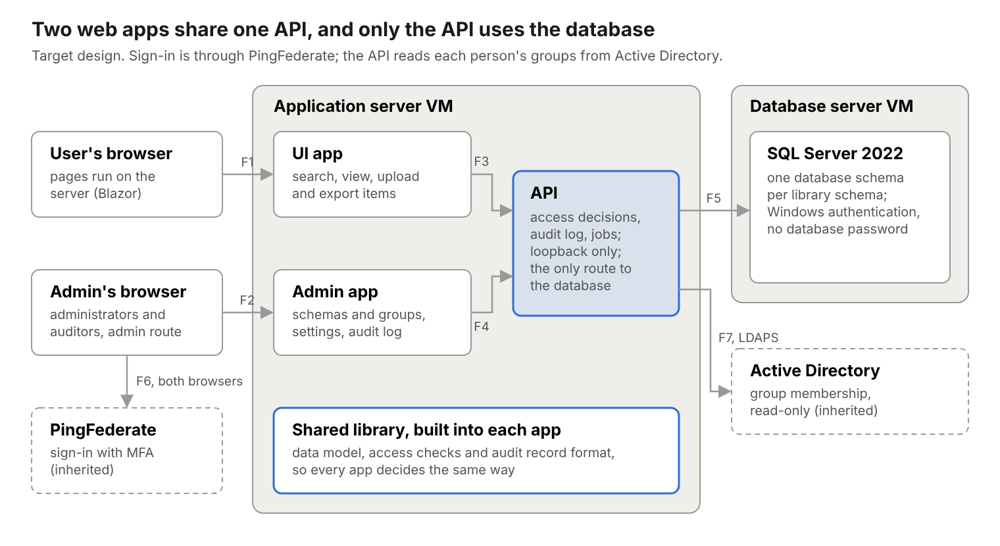
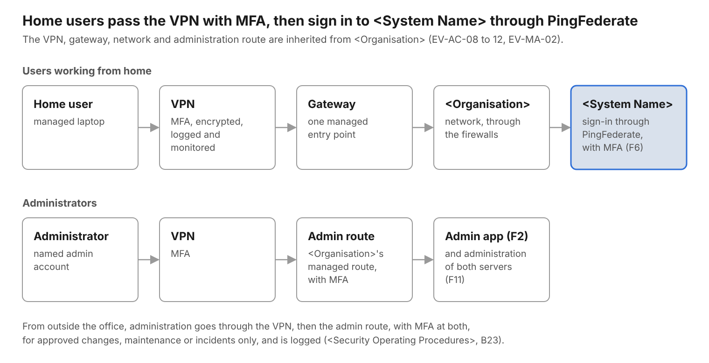

# \<System Name\> System Security Plan

## 1 Purpose and summary

This plan is used by every control family. It describes how \<System Name\> implements its security controls: how it meets each one or does not, at a high level, which are shared, and which do not apply. It covers all nineteen assessed families, listed in section 5, and section 7 gives a brief overview of every control in each of them. PM is \<Organisation\>'s programme, inherited and not assessed for \<System Name\> (\<Tailoring Register\>, TR-PM-01). This plan does not claim compliance.

\<System Name\> is assessed against CSS only, using the CSS assessment procedures and the CSS baselines. Assessment results are recorded in each family's chapter of \<Control Assessment Record\>. The privacy plan is \<Privacy Plan\> and the supply chain risk management plan is \<Supply Chain Risk Management\>. This plan refers to them rather than repeating them. The organisation takes a risk-based approach, so each non-compliance is rated and decided in \<Risk List\>. This plan is a brief overview of each control. The assessment results behind it are in that record, and are not repeated here. In section 7, Status describes what is built, and Gap entry says where any gap is registered.

## 2 System identification

**Table 1: System identification**

| Item | Value |
| --- | --- |
| System name | \<System Name\>, built from the UI application, the Admin application, the API and the shared library (\<Code\>\_Web, \<Code\>\_Admin, \<Code\>\_API and \<Code\>\_Shared) |
| Unique identifier | \<ref\> |
| Organisation's inventory entries | System inventory: \[\<Organisation\>'s reference\]. Personal data inventory or record of processing: \[\<Organisation\>'s reference\]. Requested through EV-PM-02 (PM-5, PM-5(1)) |
| Version described | \[Version, with the commit of each repository\] |
| Purpose and function | An internal digital library: staff store, search and view digital items, kept apart in separate schemas (\<System Description\>, section 2) |
| System type | Internally developed web application on two Windows Server 2025 virtual machines, with a Microsoft SQL Server 2022 database |
| Environment | Production, with a separate, throwaway test copy of the whole system built from a tagged release, and development on developers' computers; test and development hold invented data only |
| Exposure | Internal only. It is reached by browser from \<Organisation\>'s network and VPN, and is not public-facing |
| Criticality | Business critical |
| Ownership | Owned and operated by \<Organisation\>, with the system owner accountable for it |
| Common control provider | \<Organisation\>'s IT services: sign-in through PingFederate, the Active Directory, ServiceNow, network, firewalls, VPN, managed devices, VM hosting, logging, time, proxy, physical security and backup site (section 5); and \<Organisation\>'s security and privacy programme, for the Program Management controls (\<Program Management\>) |
| Operational status | \[Operational status\] |
| Authorisation status | \[Authorisation status\] |
| Security categorisation | Moderate (\<System Description\>, P-01) |
| Control baseline | CSS Moderate; the AC, AT, AU, CA, CM, CP, IA, IR, MA, MP, PE, PL, PS, RA, SA, SC, SI and SR families in this version, with PT and 16 other controls from the CSS privacy baseline: 316 controls. Program Management is inherited from \<Organisation\> and not counted among them (TR-PM-01) |

The key roles are below. Who holds each, and their business contact details, are in \<Roles and Responsibilities\>, sections 2, 3 and 6, so that names are filled in once.

**Table 2: Key roles**

| Role | Notes |
| --- | --- |
| Authorising official | |
| System owner | |
| Information owner | |
| Senior information security officer | The Head of Cyber (PM-2) |
| Data protection officer | Or the reason none is required (PM-19) |
| Data Owners | One for each schema |
| System security officer | The security officer |
| \<Organisation\> security contact | With a deputy |
| Security assessor | |

Other role holders are named in \<Roles and Responsibilities\>.

## 3 System description

### 3.1 Description and boundary

\<System Name\> will be deployed on the corporate network of \<Organisation\>, which holds Cyber Essentials Plus. The boundary is the whole stack: an application server VM running UI application, Admin application and API, and a separate database server VM running Microsoft SQL Server 2022, both on Windows Server 2025. Each application runs as a Windows service under its own group managed service account. CE+ supports inherited controls but does not prove them, so each one names its \<Organisation\> service and evidence.

### 3.2 System interconnections

The planned exchanges are below, and are also recorded in \<Assessment, Authorization, and Monitoring Management\>, section 3.7. \<Organisation\>'s network, VPN, central logging, time service and UK virtual platform are provided by \<Organisation\>, which supplies the evidence for them (\<Evidence Requests\>).

**Table 3: Information exchanges**

| Exchange | Direction and method | Information | Agreement |
| --- | --- | --- | --- |
| \<Organisation\>'s PingFederate and Active Directory | From PingFederate to \<System Name\>, through the user's browser, by OpenID Connect over HTTPS (flow F6); from the UI application and Admin application on the application VM to PingFederate, for its OpenID Connect metadata and signing certificate and to complete each sign-in, by HTTPS on TCP 443 (flow F10); and from Active Directory to API, by LDAPS (flow F7) | A signed OpenID Connect response that names each user, with no groups; each user's group membership, read by API from Active Directory | The interface record in \<Assessment, Authorization, and Monitoring Management\>, Table 6, signed by both owners |
| ServiceNow, \<Organisation\>'s IT service desk | By people only (flow F9). ServiceNow has no connection to \<System Name\> | Access requests and the Data Owner's authorisations; change requests and approvals; names of requesters; incident records and requests for help, which may hold \<Classification\> information and personal data and are readable only by the incident roles (EV-IR-02) | None needed: no system connection (\<Assessment, Authorization, and Monitoring Management\>, section 3.7) |
| Starters and leavers process, \<Organisation\> | To the owners of a leaver's groups, by people only (flow F9). It has no connection to \<System Name\> | Prompts to add or remove access; staff names and leaving dates | None needed: no system connection (\<Assessment, Authorization, and Monitoring Management\>, section 3.7) |
| \<Organisation\>'s central logging | Out from both VMs (flow F8), encrypted; protocol requested from \<Organisation\> | Windows security logs; SQL Server Audit records and error log; the applications' logs and security events, including the daily copy of the newest audit-chain hash | The interface record in \<Assessment, Authorization, and Monitoring Management\>, Table 6, signed by both owners |
| \<Organisation\>'s time service | Into both VMs, by NTP (flow F8) | Time | As above |
| \<Organisation\>'s backup site | Out from the database VM (flow F8), encrypted; method set by \<Organisation\> | Encrypted database backups and system-level backups, encrypted by SQL Server before they leave the database VM | As above |
| \<Organisation\>'s authenticated proxy | Out from both VMs (flow F8), for updates only | Updates for Windows Server, SQL Server and Defender; no \<System Name\> data | As above |
| UI application and Admin application to API | Internal, on the application VM's loopback address only (flows F3, F4): HTTPS, with a signed, short-lived token for each application, naming the signed-in person | Every request for items, files, schemas and audit events | Not needed: inside the boundary (CA-9) |
| Application VM to database VM | Internal, from the API only (flow F5): SQL Server over TLS with strict encryption, TCP 1433, by Windows authentication | Items, their details and files, schema definitions and audit records | Not needed: inside the boundary (CA-9) |

### 3.3 Information types and security categorisation

The information types below are taken from the application profile (\<System Description\>, section 3.4), and each is mapped to its CSS information types. The impact levels follow CSS, and the mapping does not change them. The information owner, \[Name\], owns every information type. The last type is held by every application built on the reference system. The reference categorisation is Moderate for confidentiality, Moderate for integrity and Low for availability (\<System Description\>, P-01), which is why the Moderate baseline is used; an application rated High in any objective is outside the reference system. Availability is Low as in CSS's provisional levels: the business impact analysis allows 120 hours of downtime (P-14; \<Contingency Planning Management\>, section 3.3), so a loss of availability has a limited adverse effect. "Business critical" in section 2 means the system matters to \<Organisation\>'s work, not that it must be highly available.

**Table 4: Information types and impact levels**

| Information type | CSS types | Confidentiality | Integrity | Availability |
| --- | --- | --- | --- | --- |
| \[Information type 1, from the application profile\] | \[CSS types\] | \[Rating\] | \[Rating\] | \[Rating\] |
| \[Information type 2\] | \[CSS types\] | \[Rating\] | \[Rating\] | \[Rating\] |
| Sign-in identities and audit records | C.3.5.5 Information Security; C.2.8.9 Personal Identity and Authentication Information | Moderate | Moderate | Low |
| **System, as a high-water mark (reference value, P-01)** |  | **Moderate** | **Moderate** | **Low** |

### 3.4 Component inventory

This is the intended inventory for the authorisation boundary. Host names, asset numbers and exact versions are to be added when the VMs are built. The software within each component, with its version, supplier and licence, is in \<Configuration Management\>, section 3.5; together they are the inventory CM-8 requires (\<Configuration Management\>, section 3.12). Rows whose location is "Outside the boundary" are \<Organisation\>'s services, listed for reference only: they belong to \<Organisation\>'s inventory, not this one.

**Table 5: Component inventory**

| Component | Type | Version or source | Location |
| --- | --- | --- | --- |
| Application server VM | Virtual server | Windows Server 2025 | \<Organisation\> |
| Database server VM | Virtual server | Windows Server 2025 | \<Organisation\> |
| UI application (\<Code\>\_Web) | Internally developed web application | .NET 10 and Blazor Server, its own repository | Application server VM |
| Admin application (\<Code\>\_Admin) | Internally developed web application | .NET 10 and Blazor Server, its own repository | Application server VM |
| API (\<Code\>\_API) | Internally developed service, the only route to the database | .NET 10, its own repository | Application server VM |
| Shared library (\<Code\>\_Shared) | Internally developed library: the data model, the access checks and the audit record format | .NET 10, its own repository | Built into the applications |
| Microsoft SQL Server, holding the \<System Name\> database | Database | SQL Server 2022 | Database server VM |
| Browser libraries | Third-party scripts and styles the pages need, such as a document viewer and an icon set | Packaged with the UI application and served by \<System Name\> itself; no content delivery service | Application server VM |
| ServiceNow | Access request and approval workflows, in which the line manager approves each request and the group's owner authorises it (the Data Owner for a schema's groups, the system owner for a role group), and the incident records and requests for help (\<Incident Response Management\>, section 3.15), owned by \<Organisation\>'s IT service desk. No connection to \<System Name\> | \<Organisation\>'s service | Outside the boundary |
| PingFederate and Active Directory | Sign every user in with multi-factor authentication, and hold the groups that decide roles and schema access. A critical component (\<Risk Assessment Management\>, section 3.9) | \<Organisation\>'s corporate services | Outside the boundary |
| Starters and leavers process | Raises leaver requests, and prompts the owners of a leaver's groups | \<Organisation\>'s service | Outside the boundary |
| Microsoft Defender | Malicious code protection | Windows Server 2025 | Both VMs |
| Windows App Control for Business | Allows only approved software to run (\<Configuration Management\>, section 3.15) | Windows Server 2025, with a signed policy at each release | Both VMs |
| BitLocker full-disk encryption (XTS-AES 256 with the TPM) | Protection at rest | Windows Server 2025 | Both VMs |
| Key store | Holds the token signing key, the audit chain key, the OpenID Connect client credential and the exported backup encryption certificate outside source code, with a protected copy at the second site. There is no database password | To be chosen | To be chosen |
| Vulnerability scanner | Both servers monthly, credentialed (\<System Description\>, P-30) | To be chosen | To be chosen |
| Backup service | Receives the encrypted database and system-level backups, copies them to the second site and keeps one copy offline or immutable (\<Contingency Planning Management\>, section 3.8) | \<Organisation\>'s service (EV-CP-01) | Outside the boundary: \<Organisation\>'s data centre and second site |
| Bulk export working area | Encrypted working copies for each export job, holding copies of items, deleted as \<System Description\>, P-20, sets and checked each working day (C49) | An encrypted working area written by API | Application server VM |
| Data protection key rings | Keys protecting each app's authentication cookie and anti-forgery tokens | ASP.NET Core data protection, one per app | Application server VM |

### 3.5 Related laws, regulations and policies

\<Organisation\> operates in the UK, and \<System Name\> holds personal data, so the laws in Table 5a apply. \<Organisation\>'s policies, Cyber Essentials Plus and CSS also apply. The first three rows are the laws in \<System Description\>, P-31. The rows are the laws the family policies name, and the legal adviser, \[Name\], confirms each with that policy's review.

**Table 5a: Laws and where they are applied**

| Law | Why it applies | Where it is applied |
| --- | --- | --- |
| UK GDPR and the Data Protection Act 2018 | Items and audit records hold personal data, and items may hold special category data | \<Policy\> (PT), \<Privacy Plan\>, \<PII Processing Management\> and \<Data Protection Impact Assessment\>; breach reporting in \<Incident Response Management\>, section 3.8; rules A23 to A29 of \<Security Operating Procedures\> |
| Data (Use and Access) Act 2025 | The right to complain to the controller, and how far a search for a person's data must go | \<Policy\> (PT), \<Procedures\> (PT) and \<PII Processing Management\> |
| Computer Misuse Act 1990 | Misuse of the system may be an offence, and audit records may be evidence | \<Policy\> (AC), \<Policy\> (AU), \<Policy\> (IA), \<Policy\> (IR) and \<Policy\> (MA); rule A4 of \<Security Operating Procedures\> |
| Copyright, Designs and Patents Act 1988 | Software must be licensed | \<Policy\> (CM) |
| Regulatory Reform (Fire Safety) Order 2005 | Fire precautions at the data centre and offices, which \<Organisation\> provides | \<Policy\> (PE) |
| Rehabilitation of Offenders Act 1974; Immigration, Asylum and Nationality Act 2006; Equality Act 2010; Employment Rights Act 1996 | Screening, the right to work and sanctions, all carried out by \<Organisation\> as employer | \<Policy\>, section PS.6 |

### 3.6 Users

All users are staff or contractors of \<Organisation\>, so all are internal. \<System Name\> has no external or public users (TR-IA-03). The roles are those in \<System Description\>, section 3.3. Expected numbers are placeholders for the system owner to complete (\<System Description\>, P-33).

**Table 6: Users**

| Role | Internal or external | Main privileges | Expected users |
| --- | --- | --- | --- |
| Reader | Internal | Searches and reads items in the schemas whose read group they belong to, and reports a fault | \[Number\] |
| Editor | Internal | A reader's work, and creates, uploads, manages and exports the schema's items | \[Number\] |
| Administrator | Internal | Manages schemas, which groups open each schema (a change only with the Data Owner's approval), and system settings, in the Admin application; opens no item content. There is no separate global administrator. Group members are changed by each group's owner, in Active Directory | \[Number\] |
| Auditor | Internal | Reads and searches the audit log, and reviews it weekly (P-08); holds no administration role | \[Number\] |
| Security officer | Internal | Reads security information, reviews alerts, the central logs and scan results, runs the monthly last sign-in report (P-38), and leads incident response; does not read the audit log; holds no administration role | \[Number\] |
| Business owner | Internal | Approves the disposal of items due under the retention schedule, in the UI application (FR-074) | \[Number\] |
| Legal adviser's delegate | Internal | Searches every schema for one person's items to answer a request under data protection law, in the UI application (FR-073); holds no other role | \[Number\] |
| Data Owner | Internal | Owns a schema's data and its read and edit groups, and authorises who may read or edit it, in ServiceNow | \[Number\] |
| Windows server and database administrators | Internal | Administer the VMs and SQL Server; need no application role | \[Number\] |

### 3.7 Ports, protocols and services

The design on the two VMs is below. Flow numbers are those in \<System Description\>, section 6.5. ServiceNow and the starters and leavers process (F9) have no connection to \<System Name\>, so they have no port. The last two rows are the infrastructure and scanning traffic every server on \<Organisation\>'s domain needs; they carry no \<System Name\> data, so they have no flow number.

**Table 7: Ports, protocols and services**

| Service | On the VMs | From and to | Flow |
| --- | --- | --- | --- |
| UI application | HTTPS, TCP 443 | User browsers to the application VM | F1 |
| Admin application | HTTPS, on its own port or host name; reachable only through \<Organisation\>'s managed route (route R3) | Administrator browsers to the application VM, over the managed route | F2 |
| API | HTTPS on the application VM's loopback address only | UI application and Admin application to API | F3, F4 |
| SQL Server | TCP 1433, TLS with strict encryption and Windows authentication, allowed only from the application VM | API on the application VM to the database VM | F5 |
| Sign-in | HTTPS | User and administrator browsers to \<Organisation\>'s PingFederate | F6 |
| Sign-in completion | HTTPS, TCP 443, from the application VM only | UI application and Admin application to \<Organisation\>'s PingFederate, for its OpenID Connect metadata and signing certificate and to complete each sign-in | F10 |
| Group lookup | LDAPS, TCP 636, read-only | API on the application VM to \<Organisation\>'s Active Directory | F7 |
| Server and database administration | Only through \<Organisation\>'s managed administration route, with multi-factor authentication, using named accounts; tool and protocol requested in EV-MA-02. All remote maintenance routes, R1 to R5, are in \<Maintenance Management\>, section 3.4 | Server and database administrators' managed devices to both VMs | F11 |
| Time | NTP, UDP 123 | Both VMs to \<Organisation\>'s time service | F8 |
| Central logging | Set by \<Organisation\> (\<Evidence Requests\>) | Both VMs to \<Organisation\>'s logging | F8 |
| Updates and backups | Through \<Organisation\>'s authenticated proxy, and to its backup site, encrypted, as \<Organisation\> sets | Both VMs to \<Organisation\>'s proxy and backup site | F8 |
| Browser libraries | Served by \<System Name\> itself, over F1; no content delivery service and no outside host | None outside the system | F1 |
| Infrastructure | DNS (TCP and UDP 53); Kerberos, LDAP, SMB, RPC and Kerberos password change to the domain controllers; the certificate authority's revocation lists \[ports, EV-SC-02, EV-SC-04\] | Both VMs to \<Organisation\>'s DNS, domain controllers and certificate authority. These carry no \<System Name\> data and are not exchanges (rules O8 to O10 in \<System and Communications Protection Management\>, section 3.2) | None |
| Scanning and discovery | \[Ports, from the scanner when chosen and EV-CM-02\] | The vulnerability scanner and \<Organisation\>'s discovery tools to both VMs, from their own addresses only (rules A4 and D3) | None |

## 4 Security architecture

Users reach UI application, and administrators reach Admin application, by browser. Users sign in through \<Organisation\>'s PingFederate, with multi-factor authentication. API reads their group membership from Active Directory over LDAPS (flow F7), and \<System Name\> holds no accounts or passwords of its own. Both apps call API (F3, F4), and only API connects to SQL Server on the database VM (F5), by Windows authentication with no database password; the two apps get their data through it. Access decisions are made by the access checks in the shared library, and each schema's items sit in their own database schema. \<Organisation\> provides the network, firewalls, remote access, user devices and VM hosting, all outside the boundary. The boundary diagram and data flows F1 to F11 are in \<System Description\>, sections 6.1 and 6.5.

The figures below show the target design on the two VMs, not the test environment. Where they show \<Organisation\>'s services, the evidence for them is requested in \<Evidence Requests\>. Flow numbers F1 to F11 are those in \<System Description\>, section 6.5.

### 4.1 High-level architecture

**Figure 1: High-level architecture**

Users reach \<System Name\> only by browser, from managed devices in the office or at home through the VPN, and the application VM reaches PingFederate to complete each sign-in (F10). Both VMs sit inside \<Organisation\>'s network, behind its firewalls. \<Organisation\> also provides logging, time, hosting and the second site for backups.

### 4.2 Application architecture

**Figure 2: Application architecture**

UI application and Admin application are Blazor Server apps, so the pages run on the server and the browser holds a live connection to the app. Both call API, which is their only route to the database. Access checks and the audit record format come from the shared library, which is built into each app, and the API reads each person's groups from Active Directory over LDAPS (F7). Users and administrators sign in through \<Organisation\>'s PingFederate, with multi-factor authentication (F6); the two apps fetch PingFederate's metadata and signing certificate, and complete each sign-in, from the application VM (F10); and \<System Name\> holds the sign-in only in its authentication cookie.

### 4.3 Network

**Figure 3: Network**

Both VMs sit inside \<Organisation\>'s network. Home users come in through the VPN, office devices through the office network, and server and database administrators through \<Organisation\>'s managed administration route (F11). All of these pass the firewalls, whose rules \<Organisation\>'s corporate network team alone sets. The apps use HTTPS, and traffic between the VMs uses TLS.

### 4.4 Storage

**Figure 4: Storage**

Items, their files and audit records are all held in SQL Server on the database VM, with each schema's definition and its read and edit groups. \<System Name\> holds no accounts: they are in \<Organisation\>'s Active Directory. Schema definitions sit in a common schema, and each schema has its own database schema, which holds its items, their details and their files. Only the API reaches the database (F5), by Windows authentication, so no database password is held. The application VM holds only working files: the encrypted export working copies, each app's key ring, and the secrets in the key store. Encrypted backups of the database go to \<Organisation\>'s backup service and second site, with one copy offline or immutable (\<Contingency Planning Management\>, section 3.8).

### 4.5 End-points

**Figure 5: End-points**

\<System Name\> has no client software. It is used through a browser on a device that \<Organisation\> manages. Phones and tablets cannot reach it, and unmanaged devices are blocked by network access control. Managed devices have certificates for network access, disk encryption, a screen lock that hides the display, and USB storage blocked unless approved. \<Organisation\> supplies the evidence for these (\<Evidence Requests\>).

### 4.6 VPN and administrator access

**Figure 6: VPN and administrator access**

The VPN's multi-factor authentication protects the network route. \<System Name\>'s own sign-in is through \<Organisation\>'s PingFederate, with multi-factor authentication. Server and database administrators reach the VMs only through \<Organisation\>'s managed administration route, with multi-factor authentication and named accounts (F11), whose details are requested in EV-MA-02. Privileged access from outside the office is allowed only for approved changes, maintenance and incident response, through the VPN and then the administration route, with multi-factor authentication at both, and is logged (P-54; EV-AC-12).

## 5 Control applicability and inheritance

The controls are those of CSS in the CSS Moderate baseline. PT and 16 related privacy controls come from the CSS privacy baseline. The 316 are the 287 controls of the Moderate baseline and the 29 of the privacy baseline outside it and outside PM. PM is not among them (TR-PM-01): its 37 controls describe \<Organisation\>'s whole security and privacy programme, and \<System Name\> inherits 35 of them as common controls, with PM-17 and PM-24 not applicable. Twenty-four PM controls are in the privacy baseline; they too are inherited and not assessed for \<System Name\>. No PM control is among the 62 Inherited entries in Table 8, which are system controls \<Organisation\> provides for \<System Name\>. The PM controls are listed with their providers, \<System Name\>'s part and the evidence in \<Program Management\>, section 3.3. \<Organisation\>'s programme plan is requested in EV-PM-01. Tailoring proposals are in \<Tailoring Register\>.

Each control is given one of four types. **System** controls are met by \<System Name\>. **Hybrid** controls are met partly by \<System Name\> and partly by the organisation or \<Organisation\>. **Organisational** controls are met by policy, procedure and people. **Inherited** controls are provided by \<Organisation\>, which is expected to supply the evidence (\<Evidence Requests\>). As CSS allows, this plan names the provider of an inherited control but does not describe how that provider implements it.

**Table 8: Controls by family**

| Family | Controls | System | Hybrid | Organisational | Inherited | Not applicable |
| --- | --- | --- | --- | --- | --- | --- |
| AC Access Control | 39 | 3 | 20 | 4 | 9 | 3 |
| AT Awareness and Training | 6 | 0 | 4 | 2 | 0 | 0 |
| AU Audit and Accountability | 16 | 4 | 10 | 2 | 0 | 0 |
| CA Assessment, Authorization, and Monitoring | 10 | 0 | 2 | 8 | 0 | 0 |
| CM Configuration Management | 24 | 0 | 15 | 8 | 1 | 0 |
| CP Contingency Planning | 23 | 0 | 6 | 8 | 9 | 0 |
| IA Identification and Authentication | 24 | 0 | 9 | 1 | 8 | 6 |
| IR Incident Response | 13 | 0 | 4 | 9 | 0 | 0 |
| MA Maintenance | 9 | 0 | 5 | 3 | 1 | 0 |
| MP Media Protection | 7 | 0 | 4 | 1 | 2 | 0 |
| PE Physical and Environmental Protection | 18 | 0 | 2 | 1 | 15 | 0 |
| PL Planning | 7 | 0 | 0 | 7 | 0 | 0 |
| PS Personnel Security | 9 | 0 | 4 | 3 | 2 | 0 |
| PT Personally Identifiable Information Processing and Transparency | 29 | 3 | 2 | 13 | 2 | 9 |
| RA Risk Assessment | 10 | 0 | 4 | 6 | 0 | 0 |
| SA System and Services Acquisition | 17 | 0 | 4 | 10 | 2 | 1 |
| SC System and Communications Protection | 25 | 4 | 13 | 1 | 6 | 1 |
| SI System and Information Integrity | 18 | 2 | 10 | 3 | 1 | 2 |
| SR Supply Chain Risk Management | 12 | 0 | 3 | 5 | 4 | 0 |
| **Total** | **316** | **16** | **121** | **95** | **62** | **22** |

Section 7 lists every control. A control counts as satisfied only when every one of its assessment statements is satisfied.

## 6 Security responsibilities

**Table 9: Security responsibilities**

| Responsible | For |
| --- | --- |
| System owner | This plan, approvals, exceptions, risk within their authority, and coordination with \<Organisation\>, including the yearly review of each external service and the security and privacy line in budgeting |
| Authorising official | Reviewing and approving this plan before it is put into effect, and the privacy plan (D-PL-01, D-PL-02); selecting the baseline and approving each tailoring entry (D-PL-03; \<Tailoring Register\>); accepting the inherited controls, reliance on \<Organisation\>'s programme for the PM controls, and residual risk, and authorising operation on TPL-18 |
| Developers | Security functions built into the application under \<Organisation\>'s corporate SDLC; reviewing each other's changes, running the developer test plan at each release, keeping the guides current and replacing components before their support ends; and fixing POA&M items |
| Administrators | Managing schemas, the groups that open each schema, and system settings, in the Admin application |
| Data Owners | Authorising who may read or edit their schema, in ServiceNow, and owning its read and edit groups |
| Auditor | Reviewing the audit log weekly, comparing it with the server, database, PingFederate and Active Directory records, recording the review, and reporting anything suspicious to the security officer |
| Security officer | Reviewing alerts, the central logs, advisories, scan results and the integrity and checksum check results, leading incident response, reviewing maintenance records and remote maintenance logs, running their checks after maintenance, and reporting monthly on security status. The security officer does not read the audit log |
| Windows server and database administrators | Securing, patching and scanning the VMs and SQL Server, running Defender, the integrity check of the release files and disk encryption, setting TLS, certificates, trust stores, host firewall rules and proxy settings, changing the keys in the register, and carrying out maintenance, in which a supplier only watches their shared screen |
| Change control element | Approving changes: the system owner, security officer and Windows server administrator, with the legal adviser for a change that touches personal data (\<Configuration Management\>) |
| Security assessor | Leading the independent Level 2 assessment |
| \<Organisation\> | Inherited services and their evidence, and the security and privacy programme behind the PM controls (\<Program Management\>) |
| Users | Following the SyOps |
| Security officer, system owner, database and Windows server administrators | Incident response and training records (security officer); invoking recovery (system owner); backups and rebuilding (administrators). See \<Incident Response Management\>, \<Contingency Planning Management\> and \<Awareness and Training Management\> |
| \<Organisation\> | Maintaining hardware, approving and sanitising its removal under its own process, handling disks and backup media, and physical and environmental protection, including a clean shutdown of the servers if power cannot be kept (D-PE-01). See \<Maintenance Management\>, \<Media Protection Management\> and \<Physical and Environmental Protection Management\> |
| Legal adviser | The privacy plan (\<Privacy Plan\>), the impact assessment, the lawful basis, requests and complaints from individuals, and reports to the ICO |
| Business and information owner | The information types, and retention periods for each schema; the business owner approves the disposal of items due under the retention schedule (FR-074) |
| Legal adviser's delegate | Searching every schema for one person's items to answer a request under data protection law (FR-073), named by the legal adviser |
| Supply chain team: system owner, security officer, a developer and \<Organisation\>'s IT service desk | The supply chain plan (\<Supply Chain Risk Management\>), supplier reviews and notices of compromise |

People holding these roles are named in \<Roles and Responsibilities\>. How security is operated is in \<Security Operating Procedures\>.

## 7 Control implementation

This section gives a brief overview of every control in the 19 families, one line each. Each line says how the control is implemented or planned, who is responsible, its type (section 5), its implementation status and where any gap is registered. It does not repeat the assessment: each control's result, and the finding for each determination statement, are in the family's chapter of \<Control Assessment Record\>, and each non-compliance and its decision are in \<Risk List\> and \<Decision Register\>.

**Status** is where the set records each control's implementation status, for the design on the two VMs: Implemented, Partially implemented, Not implemented (selected, but not started), or Not applicable. The family documents point here. **Gap entry:** the NC entry in \<Risk List\> and, where a fix is planned, its POA&M item in \<Plan of Action and Milestones\>; or the tailoring entry in \<Tailoring Register\>.

### 7.1 Access Control (AC)

The assessment plan is in \<Control Assessment Record\> (AC), section AC.4, where the results are recorded. Implementation detail is in \<Policy\> (AC), \<Procedures\> (AC) and \<Access Control Management\>.

**Table 10: AC controls**

| Control | How it is implemented | Who | Type | Status | Gap entry |
| --- | --- | --- | --- | --- | --- |
| AC-1 Policy and Procedures | Policy and procedures in \<Policy\> (AC) and \<Procedures\> (AC) | System owner, Head of Cyber | Hybrid | Implemented | NC-AC-01 |
| AC-2 Account Management | Each person uses their own Active Directory account; access is membership of an AD group, which the group's owner gives once the request is authorised in ServiceNow: by the Data Owner for a schema's groups, and by the system owner for the role groups. Approval, notification and review are set out in \<Access Control Management\> | Data Owners, system owner | Hybrid | Implemented | NC-AC-02, TR-AC-02 |
| AC-2(1) Automated Account Management | Active Directory, PingFederate and the starters and leavers process manage accounts and sign-in; \<System Name\> applies the groups it reads from Active Directory | \<Organisation\>, developers | Hybrid | Implemented | NC-AC-03 |
| AC-2(2) Temporary and Emergency Accounts | Not used; forbidden by policy | None | Not applicable | Not applicable | TR-AC-01 |
| AC-2(3) Disable Accounts | \<Organisation\> disables Active Directory accounts unused for 90 days within 1 working day (P-38), and the API refuses a disabled account within 5 minutes. Each month the security officer runs the last sign-in report (FR-085), and the groups' owners remove members who have not signed in for 90 days | \<Organisation\>, security officer, groups' owners | Hybrid | Implemented | NC-AC-04 |
| AC-2(4) Automated Audit Actions | Account and group changes are audited in Active Directory by \<Organisation\>; \<System Name\> audits sign-ins and its own schema and group settings | \<Organisation\>, developers | Hybrid | Implemented | None |
| AC-2(5) Inactivity Logout | Users must sign out at the end of each working day and when leaving their device for longer than a short break (P-53), with Sign out (FR-084), which clears the cookie and ends the PingFederate sign-in. \<Organisation\>'s managed devices lock an unattended screen (P-03) | Users, developers, \<Organisation\> | Hybrid | Implemented | NC-AC-05 |
| AC-2(13) High-risk Individuals | \<Organisation\>'s service desk disables the Active Directory account within 1 hour (P-41), and the API refuses it within 5 minutes, even while a sign-in is open; the system owner confirms the refusal (PRO-AC-4, PRO-AC-11) | System owner, \<Organisation\> | Hybrid | Implemented | NC-AC-06 |
| AC-3 Access Enforcement | Schema read and edit decisions are made by the shared library's access checks on every page and API function, from the groups the API reads from Active Directory, denying by default | Developers | System | Implemented | None |
| AC-4 Information Flow Enforcement | Only flows F1 to F11 in \<System Description\>, section 6.5, exist, with the infrastructure and scanning traffic in section 3.7; network enforcement is by \<Organisation\>'s firewalls and each VM's host firewall | Developers, \<Organisation\> | Hybrid | Implemented | NC-AC-07 |
| AC-5 Separation of Duties | Separate Administrator, Auditor, Security officer, Business owner and Legal adviser's delegate roles, each in its own group; the system owner or the Data Owner authorises each request, so nobody approves their own access | System owner | Hybrid | Implemented | NC-AC-08 |
| AC-6 Least Privilege | Access through groups and roles | Developers, database administrator | Hybrid | Implemented | NC-AC-09 |
| AC-6(1) Authorize Access to Security Functions | Each privileged function and item of security-relevant information in P-44 needs its role: Administrator, Auditor, Security officer, Business owner or Legal adviser's delegate, or, on the servers, a named Windows or database administrator. Security functions in hardware and firmware are limited by \<Organisation\> (EV-AC-04) | Developers, Windows server and database administrators, \<Organisation\> | Hybrid | Implemented | NC-AC-10 |
| AC-6(2) Non-privileged Access for Nonsecurity Functions | The rules in \<Security Operating Procedures\> require a separate everyday account | System owner | Organisational | Implemented | NC-AC-11 |
| AC-6(5) Privileged Accounts | The Administrator role is membership of the administrators' group (\<Code\>\_Admins), given only to named accounts | System owner, database administrator | Hybrid | Implemented | NC-AC-12 |
| AC-6(7) Review of User Privileges | Periodic review of privileges, by procedure | System owner, auditor | Organisational | Implemented | NC-AC-13 |
| AC-6(9) Log Use of Privileged Functions | The application audits every function in P-44; Windows and SQL Server Audit log server and database administration, forwarded to \<Organisation\>'s central logging | Developers, Windows server and database administrators, \<Organisation\> | Hybrid | Implemented | NC-AC-14 |
| AC-6(10) Prohibit Non-privileged Users from Executing Privileged Functions | Ordinary users are refused admin functions | Developers | System | Implemented | NC-AC-15 |
| AC-7 Unsuccessful Logon Attempts | PingFederate and Active Directory count failed sign-ins and lock the account as P-42 sets (10 in 15 minutes, locked for 15 minutes) | \<Organisation\> | Inherited | Implemented | NC-AC-16, TR-AC-09 |
| AC-8 System Use Notification | A notice, approved by the legal adviser, is shown after sign-in, and nothing else is served until it is accepted; a Windows logon banner on the VMs; whether PingFederate shows its own banner is asked in EV-IA-04 | Developers, Windows server administrator | Hybrid | Implemented | NC-AC-17, TR-AC-03, TR-AC-04 |
| AC-11 Device Lock | Provided by \<Organisation\>: its managed devices and the servers lock an unattended screen (\<System Description\>, P-03); \<System Name\> has no page lock of its own | \<Organisation\> | Inherited | Implemented | NC-AC-18 |
| AC-11(1) Pattern-hiding Displays | Provided by \<Organisation\>: its device lock screen hides the display (\<System Description\>, P-03); \<System Name\> has no page lock of its own | \<Organisation\> | Inherited | Implemented | NC-AC-19 |
| AC-12 Session Termination | The authentication cookie is the application's session: it ends 8 hours after sign-in with no sliding extension (P-02), within PingFederate's sign-in, which is set to at least 8 hours (EV-IA-04); an open Blazor connection re-checks the person every 5 minutes against Active Directory, skipping the cache (NFR-102); Sign out ends it (FR-084); and the API refuses a disabled account or removed membership within 5 minutes | Developers, \<Organisation\> | Hybrid | Implemented | NC-AC-20 |
| AC-14 Permitted Actions Without Identification | Only the redirect to PingFederate, the sign-in and signed-out return addresses, the access-denied page, static files, the API health check and, on the loopback address only, the applications' token request to the API work without signing in (P-51) | Developers | System | Implemented | NC-AC-21 |
| AC-17 Remote Access | \<Organisation\>'s VPN with MFA | \<Organisation\> | Hybrid | Implemented | NC-AC-22 |
| AC-17(1) Monitoring and Control | \<Organisation\> monitors VPN sessions | \<Organisation\> | Hybrid | Implemented | NC-AC-23 |
| AC-17(2) Encryption | VPN encrypted; \<System Name\> uses HTTPS | \<Organisation\>, Windows server administrator | Hybrid | Implemented | NC-AC-24 |
| AC-17(3) Managed Access Control Points | One managed gateway | \<Organisation\> | Inherited | Implemented | NC-AC-25 |
| AC-17(4) Privileged Commands and Access | Allowed only for approved changes, maintenance and incident response, through the VPN and then the managed administration route, with multi-factor authentication at both, and logged with the change or incident reference (P-54; B23) | System owner, \<Organisation\> | Hybrid | Implemented | NC-AC-26 |
| AC-18 Wireless Access | \<Organisation\>'s wireless controls; \<System Name\> has no wireless part | \<Organisation\> | Inherited | Implemented | NC-AC-27 |
| AC-18(1) Authentication and Encryption | \<Organisation\>'s wireless controls | \<Organisation\> | Inherited | Implemented | NC-AC-28 |
| AC-18(3) Disable Wireless Networking | The VMs have no wireless adapter, checked when built | \<Organisation\> | Inherited | Implemented | NC-AC-29 |
| AC-19 Mobile Devices | Managed laptops are the only mobile devices allowed; phones and tablets cannot reach \<System Name\> (P-47) | \<Organisation\> | Inherited | Implemented | NC-AC-30 |
| AC-19(5) Device Encryption | Managed laptops have BitLocker full-device encryption (P-47; EV-AC-15) | \<Organisation\> | Inherited | Implemented | NC-AC-31 |
| AC-20 External Systems | External systems only with the system owner's approval, as a TPL-17 exception, on the terms in P-48; unmanaged devices are blocked | System owner, \<Organisation\> | Organisational | Implemented | NC-AC-32, TR-AC-10 |
| AC-20(1) Limits on Authorized Use | External use is forbidden | None | Not applicable | Not applicable | TR-AC-07 |
| AC-20(2) Portable Storage Devices | USB storage blocked; portable storage only as a TPL-17 exception, using encrypted media issued by \<Organisation\>, used only on managed devices and the external system named in the approval, never on a personal or unmanaged device, and returned for sanitising (P-48) | \<Organisation\>, users | Organisational | Implemented | NC-AC-33 |
| AC-21 Information Sharing | Schema groups control sharing inside \<System Name\>; the Data Owner decides on sharing outside a schema (P-49), recorded on TPL-25 | Developers, Data Owners | Hybrid | Implemented | NC-AC-34 |
| AC-22 Publicly Accessible Content | \<System Name\> has no public content | None | Not applicable | Not applicable | TR-AC-08 |

### 7.2 Awareness and Training (AT)

The assessment plan is in \<Control Assessment Record\> (AT), section AT.4, where the results are recorded. Implementation detail is in \<Policy\> (AT), \<Procedures\> (AT) and \<Awareness and Training Management\>, which holds the \<System Name\> briefing, the role curriculum, the training matrix for AT, IR-2, CP-3, AT-3(5) and PL-4, the training register and the parameter values.

**Table 11: AT controls**

| Control | How it is implemented | Who | Type | Status | Gap entry |
| --- | --- | --- | --- | --- | --- |
| AT-1 Policy and Procedures | Policy and procedures in \<Policy\> (AT) and \<Procedures\> (AT); the design is in \<Awareness and Training Management\> | System owner, Head of Cyber | Organisational | Implemented | NC-AT-01 |
| AT-2 Literacy Training and Awareness | \<Organisation\>'s course, plus the \<System Name\> briefing (\<Awareness and Training Management\>, section 3.3) given when \<Security Operating Procedures\> is signed | \<Organisation\>, system owner | Hybrid | Implemented | NC-AT-02, R-AT-01 |
| AT-2(2) Insider Threat | Briefing part B4, and \<Organisation\>'s course | \<Organisation\>, system owner | Hybrid | Implemented | NC-AT-03 |
| AT-2(3) Social Engineering and Mining | Briefing part B3, and \<Organisation\>'s course; no punitive phishing simulations | \<Organisation\>, system owner | Hybrid | Implemented | NC-AT-04 |
| AT-3 Role-based Training | Role curriculum M1 to M10 and the training matrix (\<Awareness and Training Management\>, sections 3.4 and 3.5) | Security officer, Head of Cyber | Organisational | Implemented | NC-AT-05 |
| AT-4 Training Records | TPL-9 and the training register, kept 3 years; \<Organisation\>'s records of its course (EV-AT-01) | Security officer, \<Organisation\> | Hybrid | Implemented | NC-AT-06 |

### 7.3 Audit and Accountability (AU)

The assessment plan is in \<Control Assessment Record\> (AU), section AU.4, where the results are recorded. Implementation detail is in \<Policy\> (AU), \<Procedures\> (AU) and \<Audit and Accountability Management\>.

**Table 12: AU controls**

| Control | How it is implemented | Who | Type | Status | Gap entry |
| --- | --- | --- | --- | --- | --- |
| AU-1 Policy and Procedures | Policy and procedures in \<Policy\> (AU) and \<Procedures\> (AU); the design is in \<Audit and Accountability Management\> | System owner, Head of Cyber | Organisational | Implemented | NC-AU-01 |
| AU-2 Event Logging | The application events in \<Audit and Accountability Management\>, Table 2, each with its reason, and the SQL Server settings in its appendix A, selected by the system owner and reviewed every 12 months (P-62); the Windows, PingFederate and Active Directory events agreed with \<Organisation\> | System owner, developers, database administrator, \<Organisation\> | Hybrid | Implemented | NC-AU-02 |
| AU-3 Content of Audit Records | Records show the event type and action, the time in UTC, the application, the IP address, the result and the username; SQL Server Audit and Windows records hold the same kinds of content | Developers, database administrator | System | Implemented | NC-AU-03 |
| AU-3(1) Additional Audit Information | Records show the browser, the user ID, the schema and the item | Developers | System | Implemented | None |
| AU-4 Audit Log Storage Capacity | Storage sized for 24 months from the measured records per day and bytes per record, with a disk-space alert and a monthly check | Database administrator, \<Organisation\> | Hybrid | Implemented | NC-AU-04 |
| AU-5 Response to Logging Failures | The security officer and Windows server administrator are alerted within 1 hour through central monitoring, and every action that cannot be recorded is refused until logging is restored (P-61); SQL Server fails any operation it cannot record | Windows server administrator, security officer, developers | Hybrid | Implemented | NC-AU-05, R-AU-03 |
| AU-6 Review, Analysis and Reporting | Weekly review of the audit log by the auditor (\<System Description\>, P-08), defined in PRO-AU-1 and \<Security Operating Procedures\>, section 4.2, with findings to the security officer and system owner on TPL-8; the security officer reviews alerts, the central logs and the auditor's own reads and exports, not the audit log | Auditor, security officer | Organisational | Implemented | NC-AU-06 |
| AU-6(1) Automated Process Integration | The audit page's filters and summary, and \<Organisation\>'s central logging, which raises the alerts U1 to U9 | Auditor, \<Organisation\> | Hybrid | Implemented | NC-AU-07 |
| AU-6(3) Correlate Repositories | The auditor lines up the application records with the SQL Server, Windows, PingFederate and Active Directory records by UTC time and username | Auditor, \<Organisation\> | Hybrid | Implemented | NC-AU-08 |
| AU-7 Reduction and Report Generation | The audit page filters, summarises and exports without changing records or their order | Developers | System | Implemented | None |
| AU-7(1) Automatic Processing | Search and sort by date, event type, result, username, schema and item | Developers | System | Implemented | None |
| AU-8 Time Stamps | Records use the writing server's clock, in UTC to the nearest second or finer; the VMs take time from \<Organisation\>'s time service and stay within 1 second (P-09) | Developers, Windows server administrator, \<Organisation\> | Hybrid | Implemented | NC-AU-09 |
| AU-9 Protection of Audit Information | Only auditors can read records, apart from the usernames and dates in the security officer's last sign-in report (FR-085); only the API writes them, and its database login may add and read records but not change or delete them; records are chained with HMAC-SHA-256 under a key no database administrator holds, and the newest hash is copied daily to central logging; SQL Server and Windows logs are forwarded to central logging as written; a failed chain check alerts the security officer and auditor (U2) | Developers, Windows server and database administrators, \<Organisation\> | Hybrid | Implemented | NC-AU-10 |
| AU-9(4) Access by Subset of Privileged Users | Only auditors read records; the system owner selects the events; the database administrator applies the SQL Server settings by recorded change; the Windows audit policy is \<Organisation\>'s; nobody can change a record | System owner, developers, database administrator, \<Organisation\> | Hybrid | Implemented | NC-AU-11 |
| AU-11 Audit Record Retention | Records are kept 12 months online and 12 months in an offline archive (P-07), with legal holds and incident evidence kept until released | Database administrator, \<Organisation\> | Hybrid | Implemented | NC-AU-12 |
| AU-12 Audit Record Generation | The API writes the application's records, including events the UI and Admin applications send it; SQL Server Audit and Windows write theirs, forwarded to central logging; the system owner selects the events | Developers, database administrator, \<Organisation\> | Hybrid | Implemented | NC-AU-13 |

### 7.4 Assessment, Authorization, and Monitoring (CA)

The assessment plan is in \<Control Assessment Record\> (CA), section CA.4, where the results are recorded. Implementation detail is in \<Policy\> (CA), \<Procedures\> (CA) and \<Assessment, Authorization, and Monitoring Management\>.

**Table 13: CA controls**

| Control | How it is implemented | Who | Type | Status | Gap entry |
| --- | --- | --- | --- | --- | --- |
| CA-1 Policy and Procedures | Policy and procedures in \<Policy\> (CA) and \<Procedures\> (CA); the design is in \<Assessment, Authorization, and Monitoring Management\> | System owner, Head of Cyber | Organisational | Implemented | NC-CA-01 |
| CA-2 Control Assessments | A plan for each of the 19 families, approved by the authorising official before each assessment; Level 1 self-assessment by the system owner, then the independent Level 2 assessment of every determination statement, every 12 months and after a significant change; results in \<Security Assessment Report\> to the system owner, authorising official, Head of Cyber and, for privacy, the legal adviser (PRO-CA-1) | System owner, security assessor, authorising official | Organisational | Implemented | NC-CA-02 |
| CA-2(1) Independent Assessors | \[Name\]'s team, each member with no part in designing, building, running or administering \<System Name\> and no reporting line to it, on TPL-19 accepted by the authorising official | Security assessor, authorising official | Organisational | Implemented | NC-CA-03 |
| CA-3 Information Exchange | The five external exchanges (PingFederate and Active Directory, central logging, time, backup site and proxy) are recorded with their interface, security and privacy needs, responsibilities and impact in \<Assessment, Authorization, and Monitoring Management\>, Table 6, which is the agreement, signed by the system owner and each service's owner and reviewed every 12 months (PRO-CA-2; D-CA-04) | System owner, \<Organisation\> | Hybrid | Implemented | NC-CA-04 |
| CA-5 Plan of Action and Milestones | \<Plan of Action and Milestones\> holds each weakness to be fixed, updated monthly from assessments, monitoring and audits, with fix times by rating counted from go-live or the date raised (PRO-CA-3) | System owner | Organisational | Implemented | NC-CA-05 |
| CA-6 Authorization | \[Name\] is the authorising official and \<Organisation\>'s official authorises the common controls; the package in \<Assessment, Authorization, and Monitoring Management\>, Table 4, and the TPL-18 decision, with the 62 inherited controls accepted and, as one line, reliance on \<Organisation\>'s programme for the PM controls (\<Program Management\>), before real data is held, and renewed within 12 months (P-25) | Authorising official, system owner | Organisational | Implemented | NC-CA-06 |
| CA-7 Continuous Monitoring | System-level strategy carrying out \<Organisation\>'s strategy, with 15 measures, thresholds and re-assessment triggers; reported monthly to the system owner, privacy measures to the legal adviser, and quarterly to the authorising official, from go-live (\<Assessment, Authorization, and Monitoring Management\>, section 3.8; PRO-CA-5) | Security officer, system owner | Organisational | Implemented | NC-CA-07 |
| CA-7(1) Independent Assessment | The independent assessor checks a sample of the monitoring each year, alongside the yearly Level 2 assessment of every control, which together are the ongoing basis (PRO-CA-5, step 3; D-CA-03) | Security assessor | Organisational | Implemented | NC-CA-08 |
| CA-7(4) Risk Monitoring | The measures cover effectiveness, compliance and change, and the Risk List is reviewed monthly (\<Assessment, Authorization, and Monitoring Management\>, Table 7) | System owner, security officer | Organisational | Implemented | None |
| CA-9 Internal Connections | The internal connections F3, F4 (UI and Admin applications to the API, on loopback) and F5 (API to SQL Server) are recorded with their interface, security and privacy needs and information, approved by the system owner, reviewed every 12 months, and ended when a component is retired (PRO-CA-2) | System owner, Windows server and database administrators | Hybrid | Implemented | NC-CA-09 |

### 7.5 Configuration Management (CM)

The assessment plan is in \<Control Assessment Record\> (CM), section CM.4, where the results are recorded. Implementation detail is in \<Policy\> (CM), \<Procedures\> (CM) and \<Configuration Management\>.

**Table 14: CM controls**

| Control | How it is implemented | Who | Type | Status | Gap entry |
| --- | --- | --- | --- | --- | --- |
| CM-1 Policy and Procedures | Policy and procedures in \<Policy\> (CM) and \<Procedures\> (CM); the design is in \<Configuration Management\> | System owner, Head of Cyber | Organisational | Implemented | NC-CM-01 |
| CM-2 Baseline Configuration | Baseline in \<Configuration Management\>, section 3.4: the signed release tag, package checksums, components, settings, CIS Benchmark settings of both VMs and their network placement; reviewed every 12 months and at each release, and updated at each change (P-63; PRO-CM-2) | System owner, Windows server administrator | Hybrid | Implemented | NC-CM-02 |
| CM-2(2) Automation Support | Signed release tags, lock files with recorded package checksums, the release record and a software bill of materials from each build | Developers | Hybrid | Implemented | None |
| CM-2(3) Previous Configurations | The 3 previous configurations kept in the configuration library, each with tag, checksums, settings and bill of materials (P-63) | Developers, Windows server administrator | Hybrid | Implemented | NC-CM-03 |
| CM-2(7) High-risk Travel | \<Organisation\>'s travel device policy for its managed laptops, the only devices that can reach \<System Name\>: the configuration issued for travel to a high-risk location, and the checks on return (D-CM-02; EV-CM-05). Taking a device abroad needs approval first (\<Security Operating Procedures\>, A41) | \<Organisation\>, system owner | Inherited | Implemented | NC-CM-04 |
| CM-3 Change Control | Every change through one route: a ServiceNow change or TPL-6, the security officer's impact analysis, the change control board's decision under its charter, testing, verification and update; the board meets monthly and records are kept 3 years (P-64; PRO-CM-1, PRO-CM-8) | System owner, security officer, Windows server administrator | Hybrid | Implemented | NC-CM-05 |
| CM-3(2) Testing Changes | Each change tested in the separate test environment with the test scripts that apply, before release; a failed test stops the release | Developers | Hybrid | Implemented | None |
| CM-3(4) Representatives | The security officer, as security representative, and the legal adviser, as privacy representative, are members of the change control board | System owner | Organisational | Implemented | None |
| CM-4 Impact Analyses | The security officer analyses and rates every change's security impact against \<Configuration Management\>, Table 8, and the legal adviser its privacy impact where it touches personal data (PRO-CM-1, PRO-PT-3) | Security officer, legal adviser | Organisational | Implemented | None |
| CM-4(2) Verification | After each change, those who made it check that the controls named in the analysis still work, and record it (PRO-CM-1, step 5) | Developers, administrators, security officer | Organisational | Implemented | None |
| CM-5 Access Restrictions | Who may change each item, and how it is enforced, in \<Configuration Management\>, Table 10: repository permissions, Windows and database permissions, named accounts over the administration route; \<Organisation\>'s restrictions on the hosts | Windows server administrator, \<Organisation\> | Hybrid | Implemented | NC-CM-06 |
| CM-6 Configuration Settings | CIS Benchmarks for Windows Server 2025 and SQL Server 2022, and the hosting and application settings in \<Configuration Management\>, Table 5; departures on TPL-6 approved by the system owner; drift checked monthly and at each release (P-29) | Windows server and database administrators, developers | Hybrid | Implemented | NC-CM-07 |
| CM-7 Least Functionality | Four essential capabilities only; prohibited functions, ports, protocols, software and services in \<Configuration Management\>, Table 9: API documentation left out of releases, API on loopback only, database reachable only from the application VM, each app a Windows service under its own low-privilege account | Developers, Windows server administrator | Hybrid | Implemented | NC-CM-08 |
| CM-7(1) Periodic Review | Functions, ports, protocols, software and services reviewed every 12 months, and anything not needed removed (P-65; PRO-CM-5) | Windows server administrator, developers | Organisational | Implemented | NC-CM-09 |
| CM-7(2) Prevent Execution | Windows App Control for Business, enforced on both VMs, runs only what the approved software list allows (D-CM-01) | Windows server administrator | Hybrid | Implemented | NC-CM-10 |
| CM-7(5) Authorised Software | The approved software list and the component list, reviewed every 12 months (P-65); deny-all, permit-by-exception enforced by App Control for Business (D-CM-01) | Windows server administrator, developers | Hybrid | Implemented | NC-CM-11 |
| CM-8 Inventory | Components in section 3.4 and their software in \<Configuration Management\>, section 3.5, with version, supplier, licence and location; reviewed every 12 months and at each release (P-63; PRO-CM-2) | Windows server administrator, developers | Hybrid | Implemented | NC-CM-12 |
| CM-8(1) Updates | The inventory is updated as step 6 of every change, including installations, removals and updates, and the change is not closed until it is (PRO-CM-1) | Windows server administrator, developers | Organisational | Implemented | None |
| CM-8(3) Unauthorised Components | \<Organisation\>'s discovery tools check both VMs monthly; the Windows server administrator removes the component or disables its network access, and tells the security officer (P-66; PRO-CM-6) | \<Organisation\>, Windows server administrator | Hybrid | Implemented | NC-CM-13 |
| CM-9 Configuration Management Plan | \<Configuration Management\> is the plan, approved by the system owner and marked \<Classification\> | System owner | Organisational | Implemented | NC-CM-14 |
| CM-10 Software Usage | Every component's licence recorded in \<Configuration Management\>, Table 4, before it enters the baseline, and checked at each release and every 12 months (PRO-CM-9); \<Organisation\> holds and tracks the licences for Windows Server, SQL Server and the hosting, and controls peer-to-peer software | System owner, developers, \<Organisation\> | Hybrid | Implemented | NC-CM-15 |
| CM-11 User-installed Software | Only the named Windows server administrators can install software on the VMs, and only on an approved request; installed software compared with the approved list every 12 months (P-65; PRO-CM-4, PRO-CM-5) | System owner, Windows server administrator | Hybrid | Implemented | NC-CM-16 |
| CM-12 Information Location | Information held in SQL Server on the database VM, by schema, with working files on the application VM and backups at the second site (sections 3.4 and 4.4); who has access in the approved access list on TPL-5; a change of location recorded as a change | System owner | Organisational | Implemented | NC-CM-17 |
| CM-12(1) Automated Tools | The database lists every item by schema and information type; the export working area is checked each working day (C49); \<Organisation\>'s tools find stray copies on the VMs (EV-CM-02) | Windows server administrator, \<Organisation\> | Hybrid | Implemented | NC-CM-18 |

### 7.6 Contingency Planning (CP)

The assessment plan is in \<Control Assessment Record\> (CP), section CP.4, where the results are recorded. Implementation detail is in \<Policy\> (CP), \<Procedures\> (CP) and \<Contingency Planning Management\>.

**Table 15: CP controls**

| Control | How it is implemented | Who | Type | Status | Gap entry |
| --- | --- | --- | --- | --- | --- |
| CP-1 Policy and Procedures | Policy and procedures in \<Policy\> (CP) and \<Procedures\> (CP); the design is in \<Contingency Planning Management\> | System owner, Head of Cyber | Organisational | Implemented | NC-CP-01 |
| CP-2 Contingency Plan | \<Contingency Planning Management\>, section 3 with appendices A and B, is the plan: impact analysis, objectives, roles and contacts, activation, recovery, reconstitution and coordination with incident response; approved by the system owner and authorising official (D-CP-02), reviewed every 12 months and after each test or activation, shared with the people in its section 1.1 and protected as \<Classification\> (PRO-CP-7; C61) | System owner, authorising official | Organisational | Implemented | NC-CP-02 |
| CP-2(1) Related Plans | The incident response plan and \<Organisation\>'s disaster recovery and business continuity plans, in \<Contingency Planning Management\>, appendix B, with who declares a disaster and the recovery times agreed with \<Organisation\> (EV-CP-01) | System owner, security officer | Organisational | Implemented | NC-CP-03 |
| CP-2(3) Resume Functions | Essential functions (sign in, find and read items) resume within 72 hours of the outage starting, and so within 72 hours of activation, inside a maximum tolerable downtime of 120 hours, from the impact analysis in \<Contingency Planning Management\>, section 3.3 (P-12, P-14) | System owner | Organisational | Implemented | NC-CP-04 |
| CP-2(8) Critical Assets | Listed in \<Contingency Planning Management\>, section 3.3.4: the database, the application VM, the backups and the secrets, including the backup encryption certificate | System owner | Organisational | Implemented | None |
| CP-3 Training | Module M8 within 30 days of taking a contingency role (before it for the system owner, security officer and their deputies) and every 12 months, M10 for the authorising official; content reviewed every 12 months and after a plan change, test or activation (P-24; PRO-CP-4) | System owner, security officer | Organisational | Implemented | NC-CP-05 |
| CP-4 Testing | A restore test every 6 months on a throwaway server at the second site (D-CP-01), and a tabletop exercise every 12 months, the first of each within 30 days of the VMs being built; each with objectives and an after-action report on TPL-11, and actions to \<Plan of Action and Milestones\> (P-16; PRO-CP-2, PRO-CP-4) | System owner, security officer, database administrator | Organisational | Implemented | NC-CP-06 |
| CP-4(1) Related Plans | The tabletop exercise is held with the incident response plan, with \<Organisation\>'s IT service desk and security contact taking part | System owner, security officer | Organisational | Implemented | NC-CP-07 |
| CP-6 Alternate Storage | \<Organisation\>'s second site, reached through its backup service, holding the encrypted backups with one copy offline or immutable | \<Organisation\> | Inherited | Implemented | NC-CP-08 |
| CP-6(1) Separation | \<Organisation\>'s second site, separate from the main one | \<Organisation\> | Inherited | Implemented | NC-CP-09 |
| CP-6(3) Accessibility | Provided by \<Organisation\>'s plans for reaching the second site in a wide-area disruption | \<Organisation\> | Inherited | Implemented | NC-CP-10 |
| CP-7 Alternate Processing | \<Organisation\> provides virtual servers at the second site under its agreement; \<System Name\>'s administrators rebuild both servers there to the baseline, and the security officer confirms equivalent controls before users return, within 72 hours (\<Contingency Planning Management\>, section 3.9) | \<Organisation\>, Windows server and database administrators, security officer | Hybrid | Implemented | NC-CP-11 |
| CP-7(1) Separation | Provided by \<Organisation\> | \<Organisation\> | Inherited | Implemented | NC-CP-12 |
| CP-7(2) Accessibility | Provided by \<Organisation\> | \<Organisation\> | Inherited | Implemented | NC-CP-13 |
| CP-7(3) Priority of Service | Provided by \<Organisation\> | \<Organisation\> | Inherited | Implemented | NC-CP-14 |
| CP-8 Telecommunications | \<Organisation\>'s alternate service, letting essential functions resume within 72 hours at either site | \<Organisation\> | Inherited | Implemented | NC-CP-15 |
| CP-8(1) Priority of Service | \<Organisation\>'s main and alternate agreements. Telecommunications Service Priority is a United States scheme; \<Organisation\> is asked about any UK equivalent | \<Organisation\> | Inherited | Implemented | NC-CP-16 |
| CP-8(2) Single Points of Failure | \<Organisation\> | \<Organisation\> | Inherited | Implemented | NC-CP-17 |
| CP-9 System Backup | The database daily, with transaction log backups between; SQL Server's system databases and each VM's configuration weekly; secrets and documentation at each change; encrypted, written to \<Organisation\>'s backup service and kept as \<System Description\>, P-15, sets (\<Contingency Planning Management\>, section 3.8; PRO-CP-1) | Database and Windows server administrators, \<Organisation\> | Hybrid | Implemented | NC-CP-18 |
| CP-9(1) Testing | Every 6 months, a backup is restored with its certificate on the restore test server at the second site, and checked for row counts, file checksums and the audit chain (PRO-CP-2; D-CP-01) | Database administrator | Hybrid | Implemented | NC-CP-19 |
| CP-9(8) Cryptographic Protection | SQL Server backup encryption with AES-256 before the backup leaves the database server, under a certificate held apart from the backups (K10) | Database administrator | Hybrid | Implemented | None |
| CP-10 Recovery | Rebuild, restore and reconstitution to a known state within 72 hours of the outage starting, with the data, functions and controls checked before users return (\<Contingency Planning Management\>, sections 3.6 and 3.7) | Administrators, security officer, system owner | Hybrid | Implemented | NC-CP-20 |
| CP-10(2) Transaction Recovery | SQL Server's full recovery model, with transaction log backups applied to the last consistent point | Database administrator | Hybrid | Implemented | None |

### 7.7 Identification and Authentication (IA)

The assessment plan is in \<Control Assessment Record\> (IA), section IA.4, where the results are recorded. Implementation detail is in \<Policy\> (IA), \<Procedures\> (IA) and \<Identification and Authentication Management\>.

**Table 16: IA controls**

| Control | How it is implemented | Who | Type | Status | Gap entry |
| --- | --- | --- | --- | --- | --- |
| IA-1 Policy and Procedures | Policy and procedures in \<Policy\> (IA) and \<Procedures\> (IA) | System owner, Head of Cyber | Organisational | Implemented | NC-IA-01 |
| IA-2 Organizational Users | Each person signs in through \<Organisation\>'s PingFederate, with multi-factor authentication, with their own Active Directory account; \<System Name\> holds the sign-in only in its authentication cookie. On each call from the UI or Admin application, the API takes the person from its own signed token, which names them (\<Identification and Authentication Management\>, Table 1) | Developers | Hybrid | Implemented | NC-IA-02 |
| IA-2(1) MFA, Privileged | Provided by PingFederate for every user, including administrators | \<Organisation\>, developers | Hybrid | Implemented | NC-IA-03 |
| IA-2(2) MFA, Non-privileged | Provided by PingFederate for every user | \<Organisation\>, developers | Hybrid | Implemented | NC-IA-04 |
| IA-2(8) Replay Resistant | Replay-resistant sign-in through PingFederate, over HTTPS: the authorisation code flow, with a one-time code redeemed from the application server and a nonce checked in each response | Developers, Windows server administrator | Hybrid | Implemented | NC-IA-05 |
| IA-2(12) PIV Credentials | Not applicable | None | Not applicable | Not applicable | TR-IA-01 |
| IA-3 Device Identification | Users' devices are identified by \<Organisation\>'s network access control before they join the network; \<System Name\> does not identify users' devices. It authenticates the servers it calls, the database server, Active Directory and PingFederate, by their certificates | \<Organisation\> | Inherited | Implemented | NC-IA-06 |
| IA-4 Identifier Management | Each person's identifier is their Active Directory account name, issued by \<Organisation\> and never reused. Membership of \<System Name\>'s groups is authorised through ServiceNow, by the Data Owner or the system owner | System owner, Data Owners | Hybrid | Implemented | NC-IA-07 |
| IA-4(4) User Status | Active Directory shows staff or contractor status, set by \<Organisation\>; the group's owner sees it when authorising a request (PRO-IA-1) | \<Organisation\>, groups' owners | Hybrid | Implemented | NC-IA-08 |
| IA-5 Authenticator Management | User passwords and second factors are managed by \<Organisation\> in Active Directory; \<System Name\> holds none. A suspected compromise starts with disabling the account (PRO-IA-3). Service secrets are held in the key store and changed as P-10 sets (PRO-IA-4) | \<Organisation\>, developers | Hybrid | Implemented | NC-IA-09 |
| IA-5(1) Password-based | Password rules and storage are \<Organisation\>'s corporate standard for Active Directory | \<Organisation\> | Inherited | Implemented | NC-IA-10 |
| IA-5(2) Public Key | Not applicable | None | Not applicable | Not applicable | TR-IA-02 |
| IA-5(6) Protection of Authenticators | User passwords are protected by \<Organisation\>'s Active Directory; the token signing key, the audit chain key and the OpenID Connect client credential are held in the key store, not in source. The API reaches the database by Windows authentication, so no database password exists | \<Organisation\>, developers, administrators | Hybrid | Implemented | NC-IA-11 |
| IA-6 Authentication Feedback | Sign-in feedback is given by PingFederate, not \<System Name\> | \<Organisation\> | Inherited | Implemented | NC-IA-12 |
| IA-7 Cryptographic Module Authentication | Cryptographic modules on the VMs, provided by \<Organisation\>'s build | Windows server administrator, \<Organisation\> | Inherited | Implemented | NC-IA-13 |
| IA-8 Non-organizational Users | Only staff and contractors hold accounts | System owner | Not applicable | Not applicable | TR-IA-03 |
| IA-8(1) PIV from Other Agencies | Not applicable | None | Not applicable | Not applicable | TR-IA-04 |
| IA-8(2) External Authenticators | Not applicable | None | Not applicable | Not applicable | TR-IA-05 |
| IA-8(4) Defined Profiles | Not applicable | None | Not applicable | Not applicable | TR-IA-06 |
| IA-11 Re-authentication | A sign-in lasts 8 hours at most and never longer than PingFederate's sign-in (\<System Description\>, P-02), after which the user signs in again; a change to a person's groups or account takes effect within 5 minutes. There is no inactivity timeout: the device screen lock (P-03) and the sign-out rule (P-53) stand in for it (D-IA-01) | Developers | Hybrid | Implemented | NC-IA-14 |
| IA-12 Identity Proofing | Relies on \<Organisation\>'s pre-employment checks, expected to meet identity assurance level 2 (D-IA-01; EV-IA-02) | \<Organisation\>, system owner | Inherited | Implemented | NC-IA-15 |
| IA-12(2) Identity Evidence | Relies on \<Organisation\>'s HR | \<Organisation\> | Inherited | Implemented | NC-IA-16 |
| IA-12(3) Validation and Verification | Relies on \<Organisation\>'s HR | \<Organisation\> | Inherited | Implemented | NC-IA-17 |
| IA-12(5) Address Confirmation | A notice of proofing to the person's address of record, expected from \<Organisation\>'s HR (EV-IA-02) | \<Organisation\> | Inherited | Implemented | NC-IA-18 |

### 7.8 Incident Response (IR)

The assessment plan is in \<Control Assessment Record\> (IR), section IR.4, where the results are recorded. Implementation detail is in \<Policy\> (IR), \<Procedures\> (IR) and \<Incident Response Management\>.

**Table 17: IR controls**

| Control | How it is implemented | Who | Type | Status | Gap entry |
| --- | --- | --- | --- | --- | --- |
| IR-1 Policy and Procedures | Policy and procedures in \<Policy\> (IR) and \<Procedures\> (IR); the plan in \<Incident Response Management\> | System owner, Head of Cyber | Organisational | Implemented | NC-IR-01 |
| IR-2 Training | Every user: briefing parts B5 and B6 before access and every 12 months; incident roles: module M7 (M10 for the authorising official) within 30 days of the role, every 12 months and after a change that alters their part (\<Incident Response Management\>, section 3.4; P-24, P-56) | Security officer | Organisational | Implemented | NC-IR-02 |
| IR-3 Testing | Yearly tabletop exercise walking through a playbook, the first within 30 days of the VMs being built, with an after-action report on TPL-11 | Security officer | Organisational | Implemented | NC-IR-03 |
| IR-3(2) Coordination | Held with the contingency plan's exercise, with \<Organisation\>'s security contact and IT service desk taking part | Security officer, system owner | Organisational | Implemented | NC-IR-04 |
| IR-4 Incident Handling | Set out in section 3 of \<Incident Response Management\>, with severity targets and twelve playbooks, including physical incidents and a compromise at \<Organisation\>; a suspected account compromise is contained by disabling the account, which \<System Name\> refuses within 5 minutes | Security officer | Organisational | Implemented | NC-IR-05 |
| IR-4(1) Automated Handling | ServiceNow incident records, with notices and reminders (EV-IR-02) | Security officer, \<Organisation\> | Hybrid | Implemented | NC-IR-06 |
| IR-5 Monitoring | Register in \<Incident Response Management\>, section 3.14, and ServiceNow | Security officer | Organisational | Implemented | NC-IR-07 |
| IR-6 Reporting | 1 hour to the security officer; every confirmed incident to \<Organisation\>'s security contact; ICO within 72 hours of awareness; people affected told when the risk is high; every breach recorded (\<Incident Response Management\>, section 3.8); crime to the NCSC or Report Fraud | Everyone, security officer, legal adviser | Organisational | Implemented | NC-IR-08 |
| IR-6(1) Automated Reporting | ServiceNow, where a report raises a ticket that notifies the security officer (EV-IR-02) | Security officer, \<Organisation\> | Hybrid | Implemented | NC-IR-09 |
| IR-6(3) Supply Chain | The security officer tells any supplier whose product or service is involved, from the supplier register | Security officer | Organisational | Implemented | NC-IR-10 |
| IR-7 Assistance | The security officer and deputy advise users; \<Organisation\>'s security contact gives monitoring, network and forensic help | Security officer, \<Organisation\> | Hybrid | Implemented | NC-IR-11 |
| IR-7(1) Automation Support | ServiceNow requests for help, with their progress shown to the user (EV-IR-02) | \<Organisation\> | Hybrid | Implemented | NC-IR-12 |
| IR-8 Incident Response Plan | Section 3 of \<Incident Response Management\> is the plan, approved by the Head of Cyber, reviewed every 12 months and after an incident, given to every role holder and marked \<Classification\> | Security officer, Head of Cyber | Organisational | Implemented | NC-IR-13 |

### 7.9 Maintenance (MA)

The assessment plan is in \<Control Assessment Record\> (MA), section MA.4, where the results are recorded. Implementation detail is in \<Policy\> (MA), \<Procedures\> (MA) and \<Maintenance Management\>.

**Table 18: MA controls**

| Control | How it is implemented | Who | Type | Status | Gap entry |
| --- | --- | --- | --- | --- | --- |
| MA-1 Policy and Procedures | Policy and procedures in \<Policy\> (MA) and \<Procedures\> (MA); the design is in \<Maintenance Management\> | System owner, Head of Cyber | Organisational | Implemented | NC-MA-01 |
| MA-2 Controlled Maintenance | Each job approved by the change control board in a change record (the preventive schedule as one standing change; an emergency by the system owner or deputy), recorded on TPL-12 and reviewed monthly, with the check after maintenance run by the administrator and the security officer (PRO-MA-1, PRO-MA-6). \<Organisation\> maintains, approves and sanitises the hosts under its own process (D-MA-03; EV-MA-01) | Administrators, security officer, change control board, \<Organisation\> | Hybrid | Implemented | NC-MA-02 |
| MA-3 Maintenance Tools | Approved tool list, part of the approved software list and enforced on the servers by App Control for Business (D-CM-01), reviewed every 12 months (\<Maintenance Management\>, section 3.5; P-67) | Windows server administrator, system owner | Hybrid | Implemented | NC-MA-03 |
| MA-3(1) Inspect Tools | App Control for Business refuses a tool on the servers whose publisher or hash does not match; any other tool's version, publisher and hash checked before use (PRO-MA-3) | Windows server administrator | Hybrid | Implemented | NC-MA-04 |
| MA-3(2) Inspect Media | No removable media reach the servers; any file holding diagnostic or test programs is scanned by Microsoft Defender before use (PRO-MA-3) | Windows server administrator | Hybrid | Implemented | None |
| MA-3(3) Prevent Unauthorized Removal | Suppliers see a shared screen and take no copy (D-MA-01); any data sent for support is approved by the system owner, minimised and encrypted (PRO-MA-7); \<Organisation\>'s engineers' equipment follows its own process (EV-MA-01) | System owner | Organisational | Implemented | NC-MA-05 |
| MA-4 Nonlocal Maintenance | Routes R1 to R5 in \<Maintenance Management\>, section 3.4, approved in the change record, with multi-factor authentication on the managed administration route (and the VPN first from outside the office, P-54), logged, recorded on TPL-12, and ended by signing out | Administrators, \<Organisation\> | Hybrid | Implemented | NC-MA-06 |
| MA-5 Maintenance Personnel | Approved list with screening, Part B and named accounts (\<Maintenance Management\>, section 3.6), reviewed every 12 months (P-67); a supplier holds no account and works only through the shared screen of an administrator on the list, who supervises (D-MA-01) | System owner, Windows server and database administrators | Organisational | Implemented | NC-MA-07 |
| MA-6 Timely Maintenance | Support and parts within 24 hours for the hardware and hypervisor, and Microsoft software support through \<Organisation\>'s agreement (P-68; EV-MA-01) | \<Organisation\> | Inherited | Implemented | NC-MA-08 |

### 7.10 Media Protection (MP)

The assessment plan is in \<Control Assessment Record\> (MP), section MP.4, where the results are recorded. Implementation detail is in \<Policy\> (MP), \<Procedures\> (MP) and \<Media Protection Management\>.

**Table 19: MP controls**

| Control | How it is implemented | Who | Type | Status | Gap entry |
| --- | --- | --- | --- | --- | --- |
| MP-1 Policy and Procedures | Policy and procedures in \<Policy\> (MP) and \<Procedures\> (MP); the design is in \<Media Protection Management\> | System owner, Head of Cyber | Organisational | Implemented | NC-MP-01 |
| MP-2 Media Access | Media inventory in \<Media Protection Management\>, section 3.2, with who may reach each place, reviewed every 12 months and before a new place is used (P-69); only editors bulk export a schema's items and only auditors export the audit log; Windows permissions limit the export working area and the logs; \<Organisation\> limits disks and backup media; users share printouts only with people authorised for the schema | System owner, Windows server administrator, \<Organisation\>, everyone | Hybrid | Implemented | NC-MP-02 |
| MP-3 Media Marking | \<Classification\> for all \<System Name\> information, with the item's classification alongside; \<System Name\> puts the banner and watermark on viewer pages, printed pages and export files, a banner stamped on each page or image of a downloaded file, and the marking in export and download file names (FR-020, FR-025; \<Media Protection Management\>, section 3.3); no media is exempt | Developers, everyone | Hybrid | Implemented | NC-MP-03 |
| MP-4 Media Storage | Encrypted, in \<Organisation\>'s data centres at both sites, its approved storage locations, or managed devices; locked storage for paper; the encrypted export working area cleared after download and within 24 hours (P-20) and checked each working day (C49); users' copies kept only while needed, and 30 days at most with personal data (P-69) | \<Organisation\>, Windows server administrator, everyone | Hybrid | Implemented | NC-MP-04 |
| MP-5 Media Transport | Physical transport only by exception, approved by the system owner, encrypted or sealed, carried by \<Organisation\>'s hosting staff or authorised courier with tracking, and recorded on TPL-13 to receipt; the holder of a portable storage exception carries only that media; network backup copies encrypted first (SC-8, CP-6); kept Inherited (D-MP-03) | \<Organisation\>, system owner | Inherited | Implemented | NC-MP-05 |
| MP-6 Media Sanitization | Methods M1 to M6 by media type, to CSS and IEEE 2883-2022 (\<Media Protection Management\>, section 3.6): cryptographic erase for virtual disks; expired backups deleted at both sites, and each retired backup encryption certificate destroyed once its backups are gone; physical disks purged or destroyed by \<Organisation\>; paper to DIN 66399 P-4; recorded on TPL-13, with a yearly sample of certificates checked (P-69) | \<Organisation\>, Windows server and database administrators, system owner, everyone | Hybrid | Implemented | NC-MP-06 |
| MP-7 Media Use | Portable storage restricted: blocked on users' devices unless the system owner approves a TPL-17 exception for encrypted media issued by \<Organisation\> (P-48); none passed through to, or mounted on, the VMs; ownerless devices handed to the security officer and recorded on TPL-13; kept Inherited (D-MP-03) | \<Organisation\>, system owner, security officer | Inherited | Implemented | NC-MP-07 |

### 7.11 Physical and Environmental Protection (PE)

The assessment plan is in \<Control Assessment Record\> (PE), section PE.4, where the results are recorded. Implementation detail is in \<Policy\> (PE), \<Procedures\> (PE) and \<Physical and Environmental Protection Management\>, whose section 3.3 holds the inheritance matrix, which maps each inherited control to the \<Organisation\> evidence that closes it.

**Table 20: PE controls**

| Control | How it is implemented | Who | Type | Status | Gap entry |
| --- | --- | --- | --- | --- | --- |
| PE-1 Policy and Procedures | Policy and procedures in \<Policy\> (PE) and \<Procedures\> (PE); the design and inheritance matrix are in \<Physical and Environmental Protection Management\> | System owner, Head of Cyber | Organisational | Implemented | NC-PE-01 |
| PE-2 Physical Access Authorizations | \<Organisation\>'s list of people authorised to enter each data centre, with individual credentials, reviewed every 12 months and leavers removed (P-70); no \<System Name\> role is on it | \<Organisation\> | Inherited | Implemented | NC-PE-02 |
| PE-3 Physical Access Control | \<Organisation\>'s electronic entry control and logs at every entrance and exit of both sites; staffed reception; visitors signed in and escorted; keys, cards and combinations secured, inventoried and changed every 12 months (P-70) | \<Organisation\> | Inherited | Implemented | NC-PE-03 |
| PE-4 Access Control for Transmission | Power and network cabling in \<Organisation\>'s locked rooms, cabinets and cable trays | \<Organisation\> | Inherited | Implemented | NC-PE-04 |
| PE-5 Access Control for Output Devices | Printing only on \<Organisation\>'s managed printers with secure release, collected at once, never at home (D-MP-01); screens locked when left and placed out of view, and locked by \<Organisation\>'s managed devices after 15 minutes (P-03) | \<Organisation\>, everyone | Hybrid | Implemented | NC-PE-05 |
| PE-6 Monitoring Physical Access | \<Organisation\> monitors both sites, reviews entry logs monthly and after an incident or alarm, and passes the results to incident response; the security officer handles what affects \<System Name\> | \<Organisation\> | Inherited | Implemented | NC-PE-06 |
| PE-6(1) Intrusion Alarms | Intrusion alarms and CCTV at both sites, with \<Organisation\> responding to alarms | \<Organisation\> | Inherited | Implemented | NC-PE-07 |
| PE-8 Visitor Access Records | Kept for 12 months and reviewed monthly; anomalies to \<Organisation\>'s security contact, who tells the security officer | \<Organisation\> | Inherited | Implemented | NC-PE-08 |
| PE-9 Power Equipment and Cabling | Power equipment and cabling serving the hosts protected from damage | \<Organisation\> | Inherited | Implemented | NC-PE-09 |
| PE-10 Emergency Shutoff | Switches near the exits of each data centre room, guarded against accidental and unauthorised use | \<Organisation\> | Inherited | Implemented | NC-PE-10 |
| PE-11 Emergency Power | Uninterruptible power supply; if power cannot be kept, \<Organisation\>'s hosting staff shut both servers down cleanly through the hypervisor and tell the Windows server administrator (D-PE-01); start-up checks when power returns | \<Organisation\> | Inherited | Implemented | NC-PE-11 |
| PE-12 Emergency Lighting | Automatic emergency lighting over exits and evacuation routes at both sites | \<Organisation\> | Inherited | Implemented | NC-PE-12 |
| PE-13 Fire Protection | Fire detection and suppression with an independent energy source, at both sites | \<Organisation\> | Inherited | Implemented | NC-PE-13 |
| PE-13(1) Detection Systems | Detection activates automatically and notifies \<Organisation\>'s facilities staff and the fire and rescue service | \<Organisation\> | Inherited | Implemented | NC-PE-14 |
| PE-14 Environmental Controls | Temperature and humidity within the ASHRAE TC 9.9 recommended envelope, monitored continuously (P-70) | \<Organisation\> | Inherited | Implemented | NC-PE-15 |
| PE-15 Water Damage Protection | Master shutoff or isolation valves, accessible, working and known to key people | \<Organisation\> | Inherited | Implemented | NC-PE-16 |
| PE-16 Delivery and Removal | \<Organisation\> authorises and records hardware and media entering and leaving both sites; host hardware leaves sanitised, with notice to the system owner (D-MA-03) | \<Organisation\> | Inherited | Implemented | NC-PE-17 |
| PE-17 Alternate Work Site | Home only, unless the system owner approves another place in writing, on managed devices and the VPN, with no home printing; a checklist every 12 months for everyone who works from home (TPL-26; P-70); incidents to the security officer | Security officer, \<Organisation\> | Hybrid | Implemented | NC-PE-18 |

### 7.12 Planning (PL)

The assessment plan is in \<Control Assessment Record\> (PL), section PL.4, where the results are recorded. Implementation detail is in \<Policy\> (PL), \<Procedures\> (PL) and \<Planning Management\>, whose section 3.2 holds the register of plans and section 3.5 the register of signatures. The values are in \<System Description\>, P-71. PL-9, from the privacy baseline, is in Table 23.

**Table 21: PL controls**

| Control | How it is implemented | Who | Type | Status | Gap entry |
| --- | --- | --- | --- | --- | --- |
| PL-1 Policy and Procedures | Policy and procedures in \<Policy\> (PL) and \<Procedures\> (PL); the design is in \<Planning Management\> | System owner, Head of Cyber | Organisational | Implemented | NC-PL-01 |
| PL-2 Security and Privacy Plans | This plan and \<Privacy Plan\>, listed in the register of plans in \<Planning Management\>, section 3.2; approved by the authorising official before they are put into effect (D-PL-01, D-PL-02); reviewed every 12 months and after an assessment, a significant change or a problem in use, and shared as P-71 sets, with a plan review record; issued copies in the restricted store, and the master copy in the private records repository until then (\<Documentation Map\>, section 4.1) | System owner, authorising official | Organisational | Implemented | NC-PL-02 |
| PL-4 Rules of Behavior | \<Security Operating Procedures\>: Part A for everyone and Part B for the privileged users in its Table 1, signed before access, every 12 months and after a material change (P-71); signatures recorded on TPL-21 and in the register of signatures, kept by the system owner | System owner, everyone | Organisational | Implemented | NC-PL-03 |
| PL-4(1) Social Media | Rules A25, A43, A44 and A45 in \<Security Operating Procedures\> | System owner | Organisational | Implemented | NC-PL-04 |
| PL-8 Architectures | Security architecture in \<System Description\>, section 6, with its approach, layers and assumptions in section 6.8; privacy architecture in \<Privacy Plan\>, section 8; reviewed every 12 months and after a significant change (P-71; PRO-PL-5) | System owner | Organisational | Implemented | NC-PL-05 |
| PL-10 Baseline Selection | CSS Moderate, with the CSS privacy baseline, chosen from the categorisation in section 3.3 (D-PL-03) | Authorising official | Organisational | Implemented | NC-PL-06 |
| PL-11 Baseline Tailoring | \<Tailoring Register\> \<ver\>, with TR-PM-01 for the PM controls, listed in \<Program Management\>; each entry approved by the authorising official on the system owner's recommendation (PRO-PL-4) | System owner, authorising official | Organisational | Implemented | NC-PL-07 |

### 7.13 Personnel Security (PS)

The assessment plan is in \<Control Assessment Record\> (PS), section PS.4, where the results are recorded. Implementation detail is in \<Policy\> (PS), \<Procedures\> (PS) and \<Personnel Security Management\>, whose section 3.2 holds the risk designation of every role, section 3.3 the screening standard, section 3.6 the time limits and section 3.9 the personnel security register. The values are in \<System Description\>, P-06, P-41, P-71 and P-72.

**Table 22: PS controls**

| Control | How it is implemented | Who | Type | Status | Gap entry |
| --- | --- | --- | --- | --- | --- |
| PS-1 Policy and Procedures | Policy and procedures in \<Policy\> (PS) and \<Procedures\> (PS); the design is in \<Personnel Security Management\> | System owner, Head of Cyber | Organisational | Implemented | NC-PS-01 |
| PS-2 Position Risk Designation | Every role in \<Roles and Responsibilities\> is designated higher risk or standard, with the screening each needs (\<Personnel Security Management\>, sections 3.2 and 3.3; D-PS-01); reviewed every 12 months and when a role's access changes (P-72; PRO-PS-4) | System owner | Organisational | Implemented | NC-PS-02 |
| PS-3 Personnel Screening | \<Organisation\>'s screening, to at least identity, the right to work, employment history and a basic criminal record check, confirmed to the system owner before access; repeated before a higher risk role is granted and every 5 years (P-72; D-PS-02) | \<Organisation\> | Inherited | Implemented | NC-PS-03 |
| PS-4 Personnel Termination | \<Organisation\> disables the Active Directory account at once, and \<System Name\> refuses it within 5 minutes; group memberships removed within 5 working days (P-06); for a higher risk role, a dismissal or suspected misuse, disabled within 1 hour of notice by the urgent route and kept disabled for at least 8 hours (P-41); service secrets changed, exit interview, equipment and exports recovered, items stay with their schemas (PRO-PS-2) | Group owners, \<Organisation\>, system owner | Hybrid | Implemented | NC-PS-04 |
| PS-5 Personnel Transfer | Access reviewed, and the system owner and group owners told, within 1 working day; memberships changed; the new role's training, and for a higher risk role rescreening, before its access (P-06, P-72; PRO-PS-3) | Line manager, system owner, group owners | Organisational | Implemented | NC-PS-05 |
| PS-6 Access Agreements | \<Organisation\>'s confidentiality agreement and \<Security Operating Procedures\>, signed before access; the rules signed again every 12 months and within 30 days of a material change, confirming the confidentiality agreement; agreements reviewed every 12 months (P-71, P-72) | System owner, everyone | Hybrid | Implemented | NC-PS-06 |
| PS-7 External Personnel Security | Contracts require the same screening, agreements and duties, compliance with \<Policy\> (PS), and notice of movers and leavers within 1 working day; compliance checked every 12 months on TPL-16; suppliers' engineers hold no role (D-MA-01) | System owner, \<Organisation\> | Hybrid | Implemented | NC-PS-07 |
| PS-8 Personnel Sanctions | \<Organisation\>'s disciplinary process; the system owner told within 1 working day when a formal sanctions process starts (P-72; D-PS-02) | \<Organisation\> | Inherited | Implemented | NC-PS-08 |
| PS-9 Position Descriptions | The security and privacy duties of each \<System Name\> role are in \<Roles and Responsibilities\>, and \<Organisation\>'s job descriptions refer to them | System owner, \<Organisation\> | Hybrid | Implemented | NC-PS-09 |

### 7.14 Personally Identifiable Information Processing and Transparency (PT)

The assessment plan is in \<Control Assessment Record\> (PT), section PT.4, where the results are recorded. Implementation detail is in \<Policy\> (PT), \<Procedures\> (PT) and \<PII Processing Management\>, whose section 3.3 holds the personal data inventory and section 3.7 the retention schedule. The impact assessment is \<Data Protection Impact Assessment\>. The values are in \<System Description\>, P-22, P-31 and P-73.

**Table 23: PT controls**

| Control | How it is implemented | Who | Type | Status | Gap entry |
| --- | --- | --- | --- | --- | --- |
| PT-1 Policy and Procedures | Policy and procedures in \<Policy\> (PT) and \<Procedures\> (PT) | System owner, Head of Cyber | Organisational | Implemented | NC-PT-01 |
| PT-2 Authority to Process | UK GDPR, the DPA 2018 and the Data (Use and Access) Act 2025 (P-31); the lawful basis for each kind of data in \<PII Processing Management\>, section 3.3, set by the legal adviser; processing limited by schema access and rules A23 to A29 | Legal adviser | Organisational | Partially implemented | NC-PT-02 |
| PT-3 Processing Purposes | The purposes in the application profile (\<System Description\>, section 3) and \<PII Processing Management\>; rule and change check (PRO-PT-3) | Legal adviser, system owner | Organisational | Implemented | NC-PT-03 |
| PT-5 Privacy Notice | \<Organisation\>'s privacy notices for employees, contractors and agency staff, holding what P-73 sets; \<System Name\> links to them from every page (FR-010), and the system owner checks them every 12 months (PRO-PT-3; D-PT-02) | \<Organisation\>, system owner | Inherited | Implemented | NC-PT-04 |
| PT-7 Specific Categories | Special category and criminal offence data kept only in schemas the business owner authorises, marked (FR-035), where schema groups limit who sees it; conditions set by the legal adviser | Business owner, legal adviser | Hybrid | Partially implemented | NC-PT-05 |
| AC-3(14) Individual Access | Through a request to the legal adviser (PRO-PT-1), whose delegate searches every schema for the person's items (FR-073), answered as P-22 sets | Legal adviser, legal adviser's delegate | Organisational | Implemented | NC-PT-06 |
| AT-3(5) Processing PII | Privacy training for every user in briefing part B6, and module M9 for the roles in the training matrix (\<Awareness and Training Management\>, sections 3.3 to 3.5) | Security officer | Organisational | Implemented | NC-PT-07 |
| AU-3(3) Limit PII in Audit | Only the username, user ID, IP address and browser, as the impact assessment sets (P-73); free text, change and deletion records hold no further personal data | Developers, auditor | System | Implemented | NC-PT-08 |
| IR-2(3) Breach | Breach training in briefing part B6 for every user, and modules M7 and M9 for the roles in the training matrix (\<Awareness and Training Management\>, section 3.5) | Security officer | Organisational | Implemented | NC-PT-09 |
| IR-8(1) Breaches | \<Incident Response Management\> \<ver\>, section 3.8: notification decision, harm to people, telling them, the 72-hour ICO report and the breach register | Security officer, legal adviser | Organisational | Implemented | NC-PT-10 |
| PE-8(3) Limit PII in Visitor Records | \<Organisation\>'s visitor records, holding only the name, organisation, and date and time of the visit (P-73; D-PT-02) | \<Organisation\> | Inherited | Implemented | NC-PT-11 |
| PL-9 Central Management | One document set under one owner, checked by one consistency test; issued copies in the restricted store, and the master copy in the private records repository until then (\<Documentation Map\>, section 4.1) | System owner | Organisational | Implemented | NC-PT-12 |
| RA-8 Privacy Impact Assessments | \<Data Protection Impact Assessment\> \<ver\>, completed by the legal adviser | Legal adviser | Organisational | Partially implemented | NC-PT-13 |
| SA-8(33) Minimization | Minimisation rule, covered in the impact assessment | Developers, legal adviser | Organisational | Implemented | NC-PT-14 |
| SC-7(24) PII | Schema access as the processing rules; monitoring at the browser, where views, downloads and exports are audited and large exports alerted, and at the API and the database; exceptions on TPL-17 (\<PII Processing Management\>, section 3.11) | Developers, security officer | System | Implemented | NC-PT-15 |
| SI-12(1) Limit PII Elements | Rule limiting personal data elements | Business owner | Organisational | Implemented | NC-PT-16 |
| SI-12(2) Minimize PII in Testing | Test and development use invented data only, loaded by script | Developers | Hybrid | Implemented | NC-PT-17 |
| SI-12(3) Information Disposal | Retention schedule in \<PII Processing Management\>, section 3.7, with disposal at the end of each period, approved by the business owner (FR-074); backups expire, and media are sanitised (P-73) | Developers, business owner | System | Implemented | NC-PT-18 |
| SI-18 PII Quality Operations | Yearly check by each Data Owner, with corrections by the schema's editors (PRO-PT-5; P-73) | Data Owners | Organisational | Implemented | NC-PT-19 |
| SI-18(4) Individual Requests | Through the legal adviser, with the correction made by an editor of the schema (PRO-PT-1; FR-075) | Legal adviser | Organisational | Implemented | NC-PT-20 |
| PT-5(2), PT-6, PT-6(1), PT-6(2), PT-7(1), PT-7(2), PT-8 | US-only requirements, which do not apply to \<Organisation\> in the UK | None | Not applicable | Not applicable | TR-PT-01 |
| PT-4 Consent | Consent is not the lawful basis for any kind of data, so no consent tool is offered | Legal adviser | Not applicable | Not applicable | TR-PT-02 |
| SI-19 De-identification | No dataset is de-identified or released | None | Not applicable | Not applicable | TR-PT-03 |

### 7.15 Risk Assessment (RA)

The assessment plan is in \<Control Assessment Record\> (RA), section RA.4, where the results are recorded. Implementation detail is in \<Policy\> (RA), \<Procedures\> (RA) and \<Risk Assessment Management\>, whose section 3.6 holds the vulnerability timetable. The values are in \<System Description\>, P-01, P-11, P-30 and P-74, and the threat model and risks in \<Risk List\>, section 2.

**Table 24: RA controls**

| Control | How it is implemented | Who | Type | Status | Gap entry |
| --- | --- | --- | --- | --- | --- |
| RA-1 Policy and Procedures | Policy and procedures in \<Policy\> (RA) and \<Procedures\> (RA) | System owner, Head of Cyber | Organisational | Implemented | NC-RA-01 |
| RA-2 Security Categorization | Moderate, with each information type and its rationale in section 3.3; approved by the authorising official (D-RA-01) | Information owner, system owner, authorising official | Organisational | Implemented | NC-RA-02 |
| RA-3 Risk Assessment | \<Risk List\>: a threat model and its risks in section 2, rated on the CSS method in section 4, including the risks to people's privacy, with the impact assessment; reviewed and shared as P-74 sets (PRO-RA-1) | System owner | Organisational | Partially implemented | NC-RA-03 |
| RA-3(1) Supply Chain | Supply chain risks reviewed as \<Risk Assessment Management\>, section 3.4, sets, against the supplier register in \<Supply Chain Risk Management\>; recorded on TPL-23 (PRO-RA-2) | System owner, developers | Organisational | Implemented | NC-RA-04 |
| RA-5 Vulnerability Monitoring | Both VMs scanned monthly, credentialed and against the baseline; packages checked at each build and monthly by Test-Vulnerability.ps1; the three applications scanned at each release (P-30); CISA's exploited list checked each working day; one timetable in \<Risk Assessment Management\>, section 3.6 (P-11) | Security officer, Windows server administrator, developers | Hybrid | Partially implemented | NC-RA-05 |
| RA-5(2) Update Vulnerabilities | Scanner definitions updated before each scan (PRO-RA-3) | Windows server administrator | Hybrid | Partially implemented | NC-RA-06 |
| RA-5(5) Privileged Access | Credentialed scans of both VMs, with an account approved for scanning | Windows server administrator | Hybrid | Partially implemented | NC-RA-07 |
| RA-5(11) Public Disclosure | \<Organisation\>'s security contact, published with terms that authorise research in good faith (PRO-RA-5; EV-RA-01) | Security officer, \<Organisation\> | Hybrid | Partially implemented | NC-RA-08 |
| RA-7 Risk Response | Assessment, privacy assessment, monitoring and audit findings are rated in \<Risk List\> and decided in \<Decision Register\> by the person the rating calls for, within \<Organisation\>'s risk tolerance | System owner, authorising official | Organisational | Implemented | NC-RA-09 |
| RA-9 Criticality Analysis | Eleven components and five critical functions in \<Risk Assessment Management\>, section 3.9, with their method, including PingFederate with Active Directory, the application server and the export working area; made at design and reviewed at each major release and significant change (PRO-RA-6) | System owner, developers | Organisational | Implemented | NC-RA-10 |

### 7.16 System and Services Acquisition (SA)

The assessment plan is in \<Control Assessment Record\> (SA), section SA.4, where the results are recorded. Implementation detail is in \<Policy\> (SA), \<Procedures\> (SA) and \<System and Services Acquisition Management\>, whose section 3.2 maps the development process to the CSS. The values are in \<System Description\>, P-28, P-68, P-74 and P-75.

**Table 25: SA controls**

| Control | How it is implemented | Who | Type | Status | Gap entry |
| --- | --- | --- | --- | --- | --- |
| SA-1 Policy and Procedures | Policy and procedures in \<Policy\> (SA) and \<Procedures\> (SA) | System owner, Head of Cyber | Organisational | Implemented | NC-SA-01 |
| SA-2 Allocation of Resources | Security and privacy requirements set from the Moderate and privacy baselines; costs raised every 12 months as a separate line in \<System Name\>'s budget request and recorded on TPL-23 (PRO-SA-6) | System owner | Organisational | Partially implemented | NC-SA-02 |
| SA-3 System Development Life Cycle | \<Organisation\>'s corporate SDLC, inherited, whose security practices meet CSS (\<System and Services Acquisition Management\>, section 3.2); six stages, each with its security and privacy check, the threat model and the risk review in each significant change; roles named | \<Organisation\>, system owner, developers | Hybrid | Implemented | NC-SA-03 |
| SA-4 Acquisition Process | \<Organisation\>'s standard contract, with the nine kinds of term in \<System and Services Acquisition Management\>, section 3.4, added (PRO-SA-3). Nothing is yet bought under contract | System owner, \<Organisation\> | Inherited | Implemented | NC-SA-04 |
| SA-4(1) Functional Properties | Section 7 of this plan and each family's design document describe the controls' functional properties | Developers | Organisational | Implemented | NC-SA-05 |
| SA-4(2) Design Information | Security-relevant external interfaces and high-level design in \<System Description\>, section 6, and sections 3 and 4 of this plan; how each control is built in the family design documents | Developers | Organisational | Implemented | NC-SA-06 |
| SA-4(9) Functions, Ports, Protocols | Section 3.7, Table 7, lists the functions, ports, protocols and services, with flows F1 to F11 in \<System Description\>, section 6.5 | Developers | Organisational | Implemented | NC-SA-07 |
| SA-4(10) Use of Approved PIV Products | Not applicable: United States government identity cards are not used | None | Not applicable | Not applicable | TR-SA-01 |
| SA-5 System Documentation | Administrator and user guides (\<Administrator Guide\> and \<User Guide\>, version \<ver\>), confirmed at each release and shared with administrators, the security officer and users; missing supplier documents recorded and chased on TPL-16 (PRO-SA-4) | Developers, system owner | Organisational | Implemented | NC-SA-08 |
| SA-8 Engineering Principles | NCSC principles and privacy objectives mapped to the specification and design (\<System Description\>, section 6.8), and each significant design checked against them (PRO-SA-1) | Developers, security officer | Organisational | Implemented | NC-SA-09 |
| SA-9 External System Services | \<Organisation\>'s services, the source repositories and the package feed, listed with the controls each must employ and its basis of trust, chiefly its signed interface record row (\<System and Services Acquisition Management\>, section 3.7; D-CA-04); reviewed every 12 months on TPL-16 (PRO-SA-3) | System owner, \<Organisation\> | Hybrid | Partially implemented | NC-SA-10 |
| SA-9(2) Functions, Ports, Protocols | Each \<Organisation\> service in \<System and Services Acquisition Management\>, Table 4, states the functions, ports, protocols and services it needs, in its signed interface record row or service description | \<Organisation\> | Inherited | Implemented | NC-SA-11 |
| SA-10 Developer Configuration Management | Code, release scripts, settings, lock files, test scripts and documents in Git on private repositories with a protected default branch, a second developer's review, scans and signed release tags; flaws tracked and reported to the system owner and security officer (\<System and Services Acquisition Management\>, section 3.8) | Developers | Hybrid | Partially implemented | NC-SA-12 |
| SA-11 Developer Testing | Unit, integration, system and regression testing; developer test plan of 15 scripts at each release, to the depth and coverage in \<System and Services Acquisition Management\>, section 3.9, run with kept evidence; verification to the standard in \<System Description\>, P-28 | Developers | Hybrid | Partially implemented | NC-SA-13 |
| SA-15 Development Process | \<Organisation\>'s corporate SDLC and the tools and their settings documented (\<System and Services Acquisition Management\>, sections 3.2 and 3.10), reviewed every 12 months (PRO-SA-6) | Developers, security officer | Organisational | Partially implemented | NC-SA-14 |
| SA-15(3) Criticality Analysis | In \<Risk Assessment Management\>, section 3.9: at design, each major release and significant change, across every component and outside service (\<System and Services Acquisition Management\>, section 3.11) | Developers, system owner | Organisational | Implemented | NC-SA-15 |
| SA-22 Unsupported Components | Each component replaced before its support ends, with the replacement planned at least 6 months before (P-68), checked monthly against the support dates (\<Maintenance Management\>, section 3.8); in-house or extended support only by exception approved by the authorising official | Developers, authorising official | Organisational | Partially implemented | NC-SA-16 |

### 7.17 System and Communications Protection (SC)

The assessment plan is in \<Control Assessment Record\> (SC), section SC.4, where the results are recorded. Implementation detail is in \<Policy\> (SC), \<Procedures\> (SC) and \<System and Communications Protection Management\>, whose section 3.4 the cryptographic and key register, section 3.3 the TLS profile, section 3.2 the host firewall allow-lists and section 3.11 the values chosen for the controls.

**Table 26: SC controls**

| Control | How it is implemented | Who | Type | Status | Gap entry |
| --- | --- | --- | --- | --- | --- |
| SC-1 Policy and Procedures | Policy and procedures in \<Policy\> (SC) and \<Procedures\> (SC); the design is in \<System and Communications Protection Management\> | System owner, Head of Cyber | Organisational | Implemented | NC-SC-01 |
| SC-2 Separation of Functionality | The Admin application is a separate application, process and service account from the UI application, reached only over the administration route; the API is a third, and the database is on its own server | Developers | System | Implemented | NC-SC-02 |
| SC-4 Shared Resources | Windows Server on both VMs clears memory and storage between processes and users; each application under its own account; export copies readable only by the API and fetched only by the person who started the job; \<Organisation\>'s hypervisor keeps the VMs apart from other VMs (EV-GEN-03) | Windows server administrator, developers, \<Organisation\> | Hybrid | Implemented | NC-SC-03 |
| SC-5 Denial-of-service | Limits network flooding, request flooding and resource exhaustion: \<Organisation\>'s network protection; each application's request limit for each client (NFR-046); the upload and batch limits (P-17, P-18) | Developers, \<Organisation\> | Hybrid | Implemented | NC-SC-04 |
| SC-7 Boundary Protection | \<Organisation\>'s firewalls and logical separation, plus each VM's host firewall and listening addresses (\<System and Communications Protection Management\>, section 3.2); no publicly accessible component; external connections only to the \<Organisation\> services in \<Assessment, Authorization, and Monitoring Management\>, Table 6 | \<Organisation\>, Windows server administrator | Hybrid | Partially implemented | NC-SC-05 |
| SC-7(3) Access Points | \<Organisation\>'s managed gateway | \<Organisation\> | Inherited | Implemented | NC-SC-06 |
| SC-7(4) External Telecoms | \<Organisation\>'s managed interfaces, flow policy and exceptions, reviewed every 12 months | \<Organisation\> | Inherited | Implemented | NC-SC-07 |
| SC-7(5) Deny by Default | \<Organisation\>'s firewalls, and host firewall allow-lists on each VM, including the infrastructure rules for DNS, the domain controllers and the certificate authority, and the scanner rules (\<System and Communications Protection Management\>, section 3.2) | \<Organisation\>, Windows server administrator | Hybrid | Partially implemented | NC-SC-08 |
| SC-7(7) Split Tunnelling | Not allowed; \<Organisation\>'s VPN | \<Organisation\> | Inherited | Implemented | NC-SC-09 |
| SC-7(8) Authenticated Proxy | \<Organisation\>'s authenticated proxy carries the VMs' updates, the only traffic allowed outside \<Organisation\>'s network; the host firewall rule O3 and the VMs' proxy settings send it there, and anything else outside is blocked | \<Organisation\>, Windows server administrator | Hybrid | Implemented | NC-SC-10 |
| SC-8 Transmission Protection | Confidentiality and integrity: HTTPS on every app and the internal API calls, LDAPS to Active Directory, HTTPS to PingFederate, and SQL Server TLS with strict encryption, under NCSC's TLS profiles (\<System Description\>, P-26); time by NTP, and the infrastructure traffic protected as Windows and \<Organisation\> set it | Windows server administrator, database administrator, developers | Hybrid | Implemented | NC-SC-11 |
| SC-8(1) Cryptographic Protection | As SC-8, under the TLS profile in \<System and Communications Protection Management\>, section 3.3, which both prevents disclosure and detects changes | Windows server administrator, database administrator | Hybrid | Implemented | NC-SC-12 |
| SC-10 Network Disconnect | Ordinary connections closed at the server and database time-outs; the Blazor live connection closed when the session ends, at 8 hours (P-02), at Sign out or within 5 minutes of the person being refused; network and VPN sessions ended by \<Organisation\> after 30 minutes idle | Developers, \<Organisation\> | Hybrid | Implemented | NC-SC-13 |
| SC-12 Key Management | Register of every key, with its generation, distribution, storage, access, cryptoperiod and destruction (\<System and Communications Protection Management\>, section 3.4; P-10); the token signing key, the audit chain key and the OpenID Connect client credential held in the key store, with no database password, as the API uses Windows authentication; the key rings encrypted with DPAPI and not backed up | Developers, administrators | Hybrid | Partially implemented | NC-SC-14 |
| SC-13 Cryptographic Protection | Each use and its algorithm in the register: NCSC's TLS profiles, XTS-AES 256 disks, AES-256 backups, the key rings' AES-256 with HMAC-SHA-256, HMAC-SHA-256 tokens and audit chain, SHA-256 checksums; user passwords are held by Active Directory, not \<System Name\> | Developers, administrators | Hybrid | Implemented | NC-SC-15 |
| SC-15 Collaborative Devices | Not applicable | None | Not applicable | Not applicable | TR-SC-01 |
| SC-17 PKI Certificates | Certificates from \<Organisation\>'s certificate authority under its certificate policy, with ECDSA P-256 or RSA 2048 and SHA-256, requested and renewed by the Windows server administrator (PRO-SC-2); each VM's trust stores set to \<Organisation\>'s approved trust anchors and checked yearly | \<Organisation\>, Windows server administrator | Hybrid | Implemented | NC-SC-16 |
| SC-18 Mobile Code | Only JavaScript served by \<System Name\> itself is acceptable; page policy sent by UI application and Admin application, allowing no inline scripts, no eval, no WebAssembly and no outside hosts; new mobile code approved by the system owner; monitored by the release check, the monthly library scan and the monthly checksum check (\<System and Communications Protection Management\>, section 3.5) | Developers, system owner | System | Implemented | NC-SC-17 |
| SC-20 Authoritative DNS | \<Organisation\>'s DNS | \<Organisation\> | Inherited | Implemented | NC-SC-18 |
| SC-21 Recursive DNS | \<Organisation\>'s validating resolvers, used by both VMs | \<Organisation\> | Inherited | Implemented | NC-SC-19 |
| SC-22 DNS Architecture | \<Organisation\>'s DNS | \<Organisation\> | Inherited | Implemented | NC-SC-20 |
| SC-23 Session Authenticity | Only PingFederate's signed response is accepted; the authentication cookie is protected by the key rings and checked on the server; the Blazor live connection opened only with a valid cookie and re-checked every 5 minutes; antiforgery tokens; cookie and HSTS settings in \<System and Communications Protection Management\>, section 3.3 | Developers | System | Implemented | NC-SC-21 |
| SC-28 Information at Rest | Confidentiality and integrity: BitLocker on the VMs, encrypted backups, export copies and key rings; checksums and the keyed audit chain detect changes | Windows server administrator, database administrator | Hybrid | Implemented | NC-SC-22 |
| SC-28(1) Cryptographic Protection | As SC-28, on both VMs' disks and the backups | Windows server administrator | Hybrid | Implemented | NC-SC-23 |
| SC-39 Process Isolation | Windows Server on both VMs gives each process its own address space; each application and SQL Server runs as its own process and account | Windows server administrator | System | Implemented | NC-SC-24 |

### 7.18 System and Information Integrity (SI)

The assessment plan is in \<Control Assessment Record\> (SI), section SI.4, where the results are recorded. Implementation detail is in \<Policy\> (SI), \<Procedures\> (SI) and \<System and Information Integrity Management\>, whose section 3.2 the upload checks, section 3.4 the detection use cases, section 3.5 the integrity baseline and its checks, section 3.7 the retention summary and section 3.11 the values chosen for the controls. Flaws follow the one timetable in \<Risk Assessment Management\>, section 3.6.

**Table 27: SI controls**

| Control | How it is implemented | Who | Type | Status | Gap entry |
| --- | --- | --- | --- | --- | --- |
| SI-1 Policy and Procedures | Policy and procedures in \<Policy\> (SI) and \<Procedures\> (SI); the design is in \<System and Information Integrity Management\> | System owner, Head of Cyber | Organisational | Implemented | NC-SI-01 |
| SI-2 Flaw Remediation | Flaws found by the scans, package checks and advisories, recorded on TPL-7, tested in the test environment and fixed or mitigated within P-11 through change control, exploited flaws within 3 days as an emergency change (\<Risk Assessment Management\>, section 3.6); the hosts' firmware by \<Organisation\> (EV-SI-02) | Security officer, developers, Windows server and database administrators, \<Organisation\> | Hybrid | Implemented | NC-SI-02 |
| SI-2(2) Automated Status | The credentialed scan, Test-Vulnerability.ps1 and the Windows Update reports monthly and at each release, and the dependency alerts at each build | Developers, Windows server administrator | Hybrid | Implemented | NC-SI-03 |
| SI-3 Malicious Code Protection | Defender on both VMs, with real-time protection, daily definitions and a weekly scan; each upload passed to Defender through AMSI, and refused if flagged or not scanned; every stored file rescanned monthly and at each release (D-SI-02); detections alerted (U3) and false positives recorded on TPL-10 | Windows server administrator, developers | Hybrid | Implemented | NC-SI-04 |
| SI-4 System Monitoring | Application, Windows and SQL Server logs and \<Organisation\>'s PingFederate and Active Directory events in central logging; detection use cases U1 to U9; the security officer's weekly review; \<Organisation\>'s network monitoring (\<System and Information Integrity Management\>, section 3.4) | Security officer, \<Organisation\> | Hybrid | Implemented | NC-SI-05 |
| SI-4(2) Real-time Analysis | Alert rules in \<Organisation\>'s central logging analyse the forwarded events in near real time | Security officer, \<Organisation\> | Hybrid | Implemented | NC-SI-06 |
| SI-4(4) Traffic Monitoring | \<Organisation\> monitors traffic continuously against the allowed flows | \<Organisation\> | Inherited | Implemented | NC-SI-07 |
| SI-4(5) System Alerts | The nine events in \<System Description\>, P-27: the API's security events and Defender, App Control and integrity check results, with \<Organisation\>'s PingFederate and Active Directory events, raise alerts to the people named in \<System and Information Integrity Management\>, Table 3, through \<Organisation\>'s central logging | Developers, security officer, \<Organisation\> | Hybrid | Partially implemented | NC-SI-08 |
| SI-5 Advisories | Sources in \<System and Information Integrity Management\>, Table 2, including CISA's exploited list each working day and NCSC Early Warning through \<Organisation\>; internal advisories on TPL-7, passed to the administrators and developers | Security officer | Organisational | Implemented | NC-SI-09 |
| SI-7 Integrity | SHA-256 of each release package, installed file and release script in the release record, and of each stored file; the keyed audit chain; App Control for Business; the hosts' firmware checked by \<Organisation\> | Windows server administrator, developers, security officer, \<Organisation\> | Hybrid | Implemented | NC-SI-10 |
| SI-7(1) Integrity Checks | Release files at start-up, at each release and monthly; stored files at each release and monthly; the audit chain daily and at each start-up (\<System and Information Integrity Management\>, Table 4a) | Windows server administrator, security officer, \<Organisation\> | Hybrid | Implemented | NC-SI-11 |
| SI-7(7) Detection and Response | Unexpected changes raise U8 or U2 and go to incident response (PRO-SI-6) | Security officer | Organisational | Implemented | NC-SI-12 |
| SI-8 Spam Protection | Not applicable; \<System Name\> sends and receives no email | None | Not applicable | Not applicable | TR-SI-01 |
| SI-8(2) Automatic Updates | Not applicable | None | Not applicable | Not applicable | TR-SI-01 |
| SI-10 Input Validation | Every API input checked for type, length and range; uploads checked for type, signature, size and name, and a batch's ZIP file unpacked within P-18; parameterised queries | Developers | System | Implemented | NC-SI-13 |
| SI-11 Error Handling | A general error message with a reference; the detail only in the application logs, read by the Windows server administrators, the auditor and the security officer | Developers | System | Implemented | NC-SI-14 |
| SI-12 Information Retention | \<System Name\>'s retention schedule (\<PII Processing Management\>, section 3.7), with disposal approved by the business owner (FR-074); audit, log, export and backup retention as P-07, P-15, P-20 and P-69 set | Business owner, system owner, database administrator | Hybrid | Partially implemented | NC-SI-15 |
| SI-16 Memory Protection | .NET managed memory, and data execution prevention and address space layout randomisation on both VMs | Windows server administrator, developers | Hybrid | Implemented | NC-SI-16 |

### 7.19 Supply Chain Risk Management (SR)

The assessment plan is in \<Control Assessment Record\> (SR), section SR.4, where the results are recorded. Implementation detail is in \<Policy\> (SR), \<Procedures\> (SR) and \<Supply Chain Risk Management\>, whose section 3.5 the supplier register and section 3.7 how components come in.

**Table 28: SR controls**

| Control | How it is implemented | Who | Type | Status | Gap entry |
| --- | --- | --- | --- | --- | --- |
| SR-1 Policy and Procedures | Policy and procedures in \<Policy\> (SR) and \<Procedures\> (SR); the plan is \<Supply Chain Risk Management\> | System owner, Head of Cyber | Organisational | \[Status\] | \[Decision\] |
| SR-2 Supply Chain Risk Management Plan | \<Supply Chain Risk Management\> \<ver\>, with a supplier register and risk tolerance, held in the restricted store (until the store is set up, the private records repository; \<Documentation Map\>, section 4.1) | System owner | Organisational | \[Status\] | \[Decision\] |
| SR-2(1) Establish SCRM Team | Team named, including \<Organisation\>'s IT service desk | System owner | Organisational | \[Status\] | \[Decision\] |
| SR-3 Supply Chain Controls | Controls on how components come in (\<Supply Chain Risk Management\>, section 3.7) | System owner, developers | Hybrid | \[Status\] | \[Decision\] |
| SR-5 Acquisition Strategies | Acquisition strategies in \<Supply Chain Risk Management\> | Developers, \<Organisation\> | Hybrid | \[Status\] | \[Decision\] |
| SR-6 Supplier Assessments | Supplier register, with reviews on TPL-16 | System owner | Organisational | \[Status\] | \[Decision\] |
| SR-8 Notification Agreements | \<Organisation\>'s notification terms; open-source advisories watched | \<Organisation\>, suppliers | Inherited | \[Status\] | \[Decision\] |
| SR-10 Inspection of Systems | Releases checked against their recorded checksums and the integrity baseline; \<Organisation\> inspects hardware | Developers, \<Organisation\> | Hybrid | \[Status\] | \[Decision\] |
| SR-11 Component Authenticity | Software and hardware steps written (PRO-SR-4) | Security officer | Organisational | \[Status\] | \[Decision\] |
| SR-11(1) Anti-counterfeit Training | \<Organisation\> trains its buyers | \<Organisation\> | Inherited | \[Status\] | \[Decision\] |
| SR-11(2) Service and Repair | \<Organisation\>'s process | \<Organisation\> | Inherited | \[Status\] | \[Decision\] |
| SR-12 Component Disposal | \<Organisation\> disposes, after PRO-MP-3 | \<Organisation\> | Inherited | \[Status\] | \[Decision\] |

## 8 Referenced artifacts

The artifacts this plan relies on are below, in the order CSS lists them. All are part of the \<System Name\> document set indexed in \<Documentation Map\>. The master copies are the Markdown files in the document source folder, held under version control in a private local repository that is never pushed.

**Table 29: Referenced artifacts**

| Artifact | Where it is |
| --- | --- |
| Authorisation decision | Recorded on TPL-18 (\<Record Templates\>) |
| Security categorisation | Section 3.3 |
| Policies and procedures | \<Policy\> and \<Procedures\>, with one chapter for each family |
| Rules of behaviour | \<Security Operating Procedures\> |
| Contingency plan, with test and training records | \<Contingency Planning Management\>, section 3; records on the forms in \<Record Templates\> |
| Configuration management plan and change records | \<Configuration Management\>; changes in ServiceNow, or on TPL-6 until it is set up, and the source repositories; the approved access list on TPL-5 |
| Information exchange agreements | Planned exchanges are in section 3.2 and \<Assessment, Authorization, and Monitoring Management\>, section 3.7 |
| Continuous monitoring strategy | \<Assessment, Authorization, and Monitoring Management\>, section 3.8 |
| Incident response plan, with test and training records | Section 3 of \<Incident Response Management\>; records on the forms in \<Record Templates\> |
| Plan of action and milestones | \<Plan of Action and Milestones\> |
| Risk assessment | \<Risk List\>, with the design in \<Risk Assessment Management\> |
| The design, parameter values and registers for each family | Each family's design document, listed in \<Documentation Map\>, section 2.2. |
| Control assessments and plans | \<Control Assessment Record\>, with one chapter for each family, each holding its own assessment plan; results brought together in \<Security Assessment Report\> |
| Privacy plan | \<Privacy Plan\> |
| Privacy impact assessment | \<Data Protection Impact Assessment\> |
| Supply chain risk management plan | \<Supply Chain Risk Management\>, section 3 |
| Architecture and data flows | \<System Description\>, section 6 |
| Concept of operations | \<Concept of Operations\> |
| Administrator and user guides | \<Administrator Guide\> and \<User Guide\> |
| Roles and responsibilities | \<Roles and Responsibilities\> |
| Tailoring proposals | \<Tailoring Register\> |
| Evidence requested from \<Organisation\> | \<Evidence Requests\> |
| Interview questions | \<Interview Guide\> |
| Record forms | \<Record Templates\> |
| Index of the set and document standard | \<Documentation Map\> |
| Test evidence | The evidence store, with a manifest of hashes for each family |
| Sanitisation and destruction certificates | \<Organisation\> issues them under MP-6 |

## 9 Acronyms

Acronyms and terms are in \<System Description\>, section 12. Control family codes, such as AC and SR, are spelled out in Table 8. Numbers such as A43 and C49 are rules and duties in \<Security Operating Procedures\>. Flows F1 to F11 are in \<System Description\>, section 6.5, and routes R1 to R5 in \<Maintenance Management\>, section 3.4.
