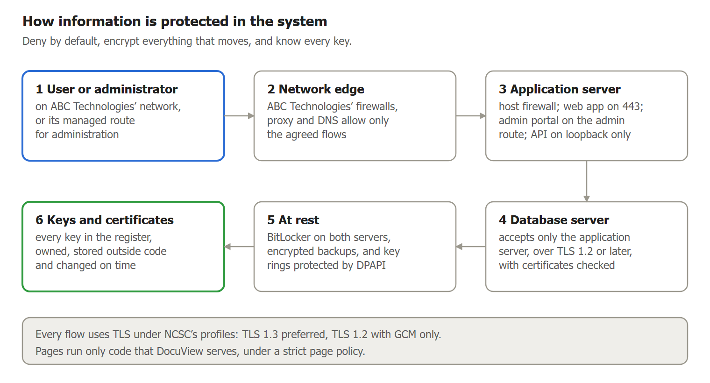

# \<DocuView\> System and Communications Protection Management

**\<ref\> | Version \<ver\> | Draft for the system owner's approval**

**Contents**

[1 Document control](#1-document-control)

[2 Purpose](#2-purpose)

[3 Summary](#3-summary)

[4 The design](#4-the-design)

[5 Each control and enhancement](#5-each-control-and-enhancement)

[Appendix A Parameter register](#appendix-a-parameter-register)

[Appendix B Communications protection controls outside the Moderate baseline](#appendix-b-communications-protection-controls-outside-the-moderate-baseline)

| **SECTION 1** |
| --- |

## 1 Document control

### 1.1 Document details

**Table 1: Document details**

| Item | Detail |
| --- | --- |
| Reference | \<ref\> |
| Title | \<DocuView\> System and Communications Protection Management |
| Version | \<ver\> |
| Status | Draft for the system owner's approval |
| Date | 18 November 2026 |
| Owner | System owner |
| Applies to | System and Communications Protection family |
| Classification | Restricted |
| Next review | Every 12 months, and after a significant change to the boundary, the flows or the cryptography |
| Format | \<Documentation Map\>, section 5 |

### 1.2 Approval

**Table 2: Approval**

| Role | Name | Decision | Date |
| --- | --- | --- | --- |
| System owner | Neil Ramsbottom | Pending | Pending |

### 1.3 Change history

**Table 3: Change history**

| Version | Date | Change |
| --- | --- | --- |
| \<ver\> | 18 November 2026 | Cross-check against NIST's SC catalogue and guidance: the audit chain key and the AD FS token-signing certificate added to the key register; session identifiers set out for SC-23; and the related controls outside the baseline in a new appendix B |
| \<ver\> | 18 November 2026 | Issued into the set as a draft for review |
| \<ver\> | 18 November 2026 | First draft, at the system owner's request (D-SC-09). The communications protection chapter of \<Control Implementation Register\> moved here in full, so that this design is held only in this document, and each control is set out part by part. The boundary, transport, keys, page policy, information at rest, denial of service and name resolution are each set out in full. The design follows sign-in through AD FS (D-AC-23), the single database connection from DV\_API (D-AC-18) and the applications running as Windows services (D-PL-10). Configuration settings are described in plain words. No agreed value is changed |

| **SECTION 2** |
| --- |

## 2 Purpose

This document shows how \<DocuView\> protects its communications, its boundary, its keys and the information it holds, for each of the 25 System and Communications Protection (SC) controls in NIST's Moderate baseline.

Section 4 sets out the design: the boundary and the allowed flows, with each server's host firewall; transport encryption and sessions; the cryptographic and key register and certificates; the page policy for mobile code; information at rest; denial of service, shared resources and process isolation; name resolution; how protection stands today; and what ABC Technologies provides. Section 5 takes each control in turn. Appendix A lists every value NIST asks the organisation to define.

This is the only place this design is held. Other documents point here. The policy is in \<Policy\> (SC), and the steps people follow are in \<Procedures\> (SC). The flows themselves are in \<System Security Plan\>, section 4.7, and the trust zones and layers of defence in \<Security Architecture\>.

Much of this family is ABC Technologies' network: firewalls, the VPN, the proxy, DNS and the certificate authority. \<DocuView\>'s own part is its listening addresses, host firewalls, TLS, keys, pages and the protection of what it stores.

An assessor examines the register, the allow-lists, the TLS settings and the page policy; interviews the Windows server administrator, the database administrator, the developers and ABC Technologies' security contact; and tests the boundary, the encryption and the headers on the servers (NIST SP 800-53A). So for each control section 5 gives:

- **each part of the control**, as NIST letters them, with the design that meets it and the position today;
- **who provides it**, and who is responsible;
- **what enforces it**, the rules and procedures that apply, and the tests run;
- **the records an assessor will ask for**, and whether they exist yet;
- **its status**, the risk decision, and what is still open.

**Table 4: Status values**

| Status | Meaning |
| --- | --- |
| Implemented | The design is in place and working |
| Partially implemented | Some of the design is in place; the open items say what is missing |
| Not implemented | None of the design is in place yet |
| Not applicable | The control does not apply, by a recorded decision |

| **SECTION 3** |
| --- |

## 3 Summary

Of the 25 controls, 1 is implemented, 6 are partially implemented, 17 are not implemented and 1 is not applicable. No control in the Moderate baseline is missing from the design. Every gap is registered in the Risk List (\<Risk List\>) and the Plan of Action and Milestones (\<Plan of Action and Milestones\>).

**Table 5: Status of each control**

| Control | Title | Status | What is missing | Registered as |
| --- | --- | --- | --- | --- |
| SC-1 | Policy and Procedures | Partially implemented | Not yet shared. The later version awaits the Head of Cyber | NC-SC-01; PA-20 |
| SC-2 | Separation of System and User Functionality | Implemented | Nothing | None needed: satisfied |
| SC-4 | Information in Shared System Resources | Not implemented | Export copies stay in a shared folder; servers not built | NC-SC-02; PA-54, PA-86 |
| SC-5 | Denial-of-service Protection | Partially implemented | Rate limits switched off; ABC Technologies' protections not seen | NC-SC-03; PA-50, PA-129 |
| SC-7 | Boundary Protection | Not implemented | Host firewalls and listening addresses not set; ABC Technologies' firewalls not seen | NC-SC-04; PA-83, EV-SC-02 |
| SC-7(3) | Access Points | Not implemented | Not evidenced | NC-SC-05; PA-129, EV-SC-02 |
| SC-7(4) | External Telecommunications Services | Not implemented | Not evidenced | NC-SC-06; PA-129, EV-SC-02 |
| SC-7(5) | Deny by Default, Allow by Exception | Not implemented | Allow-lists not built | NC-SC-07; PA-83, EV-AC-03 |
| SC-7(7) | Split Tunneling for Remote Devices | Not implemented | Not evidenced | NC-SC-08; PA-129, EV-SC-03 |
| SC-7(8) | Route Traffic to Authenticated Proxy Servers | Not implemented | Not evidenced | NC-SC-09; PA-129, EV-SC-03 |
| SC-8 | Transmission Confidentiality and Integrity | Not implemented | Every flow is plain | NC-SC-10; PA-18 |
| SC-8(1) | Cryptographic Protection | Not implemented | No TLS | NC-SC-11; PA-18 |
| SC-10 | Network Disconnect | Partially implemented | The network side is not evidenced | NC-SC-12; PA-129, EV-SC-01 |
| SC-12 | Cryptographic Key Establishment and Management | Not implemented | Keys in source; key rings unencrypted | NC-SC-13; PA-19, PA-93 |
| SC-13 | Cryptographic Protection | Partially implemented | TLS, disk and key ring encryption not set up; MD5 checksums | NC-SC-14; PA-18, PA-52, PA-61, PA-93 |
| SC-15 | Collaborative Computing Devices and Applications | Not applicable | Not applicable | TR-SC-01 |
| SC-17 | Public Key Infrastructure Certificates | Not implemented | Certificates not issued; policy not seen | NC-SC-15; PA-129, EV-SC-04 |
| SC-18 | Mobile Code | Partially implemented | No page policy on two applications; outside scripts allowed | NC-SC-16; PA-34, PA-51 |
| SC-20 | Secure Name/Address Resolution Service (Authoritative Source) | Not implemented | Not evidenced | NC-SC-17; PA-129, EV-SC-05 |
| SC-21 | Secure Name/Address Resolution Service (Recursive or Caching Resolver) | Not implemented | Not evidenced | NC-SC-18; PA-129, EV-SC-05 |
| SC-22 | Architecture and Provisioning for Name/Address Resolution Service | Not implemented | Not evidenced | NC-SC-19; PA-129, EV-SC-05 |
| SC-23 | Session Authenticity | Partially implemented | Cookies not Secure; no HSTS | NC-SC-20; PA-18 |
| SC-28 | Protection of Information at Rest | Not implemented | Nothing encrypted at rest | NC-SC-21; PA-52, PA-86, PA-93 |
| SC-28(1) | Cryptographic Protection | Not implemented | Nothing encrypted at rest | NC-SC-22; PA-52 |
| SC-39 | Process Isolation | Not implemented | Servers not built | NC-SC-23; PA-54 |

Three things matter most. Every flow is plain today: web, API and database traffic is not encrypted (PA-18, rated High). The token signing key and the database password are held in the source code (PA-19, High). And the key rings that protect the session cookies are unencrypted (PA-93, Medium). The authorising official decided that all three must be fixed before production (NC-SC-10, NC-SC-11, NC-SC-13).

| **SECTION 4** |
| --- |

## 4 The design

### 4.1 Principles

1. **Deny by default.** Only the agreed flows are allowed, at ABC Technologies' firewalls and on each server.
2. **Encrypt everything that moves.** Every flow uses TLS, including those that stay inside a server.
3. **Know every key.** Every key and cryptographic use is recorded, owned, protected and changed on time.
4. **Separate.** Administration and the API are kept apart from everyday use.

These carry out the principles and rules of \<Policy\>, sections SC.3 and SC.4.

**Figure 1: The boundary, the flows and their protection**

### 4.2 Boundary and allowed flows

\<DocuView\> has no publicly accessible component and no connection of its own to an outside network. Users reach it from ABC Technologies' network, administrators over ABC Technologies' managed administration route, and everything outside is reached through ABC Technologies' managed interfaces and authenticated proxy (SC-7, SC-7(3), SC-7(8)). The flows are in \<System Security Plan\>, section 4.7, Table 10, and \<Security Architecture\>, Table 5.

\<DocuView\>'s own part is how each application listens and each server's host firewall:

1. DV\_Web listens on TCP 443 only.
2. The admin portal is reachable only over ABC Technologies' managed administration route (PA-83).
3. DV\_API listens only on the application server's loopback address.
4. The database accepts connections only from the application server.

Each server's host firewall denies everything not listed below (SC-7(5)). ABC Technologies' firewalls apply the same flows at the network edge (EV-SC-02). A new flow, port or listening address goes through change control and updates these lists first (PRO-SC-4); a temporary exception is recorded on TPL-17 with an end date, and exceptions are reviewed every 12 months (PRO-SC-8). Split tunnelling is not allowed: ABC Technologies' VPN prevents it on every remote device (SC-7(7)).

**Table 6: Application server, inbound**

| Rule | Port | From | Flow |
| --- | --- | --- | --- |
| A1 | TCP 443 (DV\_Web) | Users' networks, Z1 \[address ranges from ABC Technologies\] | F1 |
| A2 | Admin portal port \[to be set, PA-83\] | ABC Technologies' administration route only, Z2 \[address range\] | F2 |
| A3 | Windows administration \[tool and port, EV-MA-02\] | Z2 only | Not numbered |
| None | DV\_API | Not reachable from the network: loopback only | F3, F4 |

**Table 7: Database server, inbound**

| Rule | Port | From | Flow |
| --- | --- | --- | --- |
| D1 | TCP 5432 | Application VM address only | F5 to F7 |
| D2 | Windows administration \[tool and port, EV-MA-02\] | Z2 only | Not numbered |

**Table 8: Both servers, outbound**

| Rule | Port | To | Purpose |
| --- | --- | --- | --- |
| O1 | UDP 123 | ABC Technologies' time service | Time |
| O2 | \[To be confirmed\] | ABC Technologies' central logging | Logs |
| O3 | \[Proxy port\] | ABC Technologies' authenticated proxy | Updates and anything else outbound (SC-7(8)) |
| O4 | TCP 5432 (application VM only) | Database VM | F5 to F7 |
| O5 | Backup \[method to be chosen, PA-64\] (database VM only) | ABC Technologies' backup site | Backups |

### 4.3 Transport encryption and sessions

Every flow uses this profile, from NCSC's guidance (updated 15 October 2026). It covers F1 to F7, including the API calls that stay on the application server, and F11, sign-in through AD FS, which ABC Technologies protects.

**Table 9: TLS profile**

| Setting | Required value | State now |
| --- | --- | --- |
| Versions | TLS 1.3 preferred; TLS 1.2 allowed; SSL, TLS 1.0 and TLS 1.1 off | Plain HTTP in Docker (N01) |
| TLS 1.3 key exchange | Hybrid X25519MLKEM768 or SecP256r1MLKEM768 where Windows supports it; otherwise secp256r1 | Not set |
| TLS 1.3 cipher suite | TLS\_AES\_128\_GCM\_SHA256 (TLS\_AES\_256\_GCM\_SHA384 also allowed) | Not set |
| TLS 1.2 cipher suites | TLS\_ECDHE\_ECDSA\_WITH\_AES\_128\_GCM\_SHA256 or TLS\_ECDHE\_RSA\_WITH\_AES\_128\_GCM\_SHA256 only | Not set |
| Also off | Compression, insecure renegotiation, export ciphers, 0-RTT | Not set |
| Certificates | ECDSA P-256 or RSA 2048-bit, SHA-256, from ABC Technologies' certificate authority | Not issued |
| Web | HTTPS only, HTTP redirected, HSTS with a maximum age of one year, cookies always Secure, and a page policy that upgrades insecure requests | No HSTS (N02); cookies not Secure (N03) |
| Database | TLS on in PostgreSQL, every client rule requiring TLS, a minimum of TLS 1.2, and DV\_API checking the server's certificate and host name in full | TLS off; 5 client rules allow plain connections; 0 of 4 connections use TLS (N06) |
| API (F3, F4) | DV\_API on the loopback address only, over HTTPS with K2 | Plain HTTP on every interface (N01, N07) |

Sessions are checked on the server on every request. A new session identifier is issued at each sign-in, only identifiers \<DocuView\> issued are accepted, and the session is ended on the server at sign-out and time-out, so a copied identifier is of no further use. The session cookie is marked Secure, HttpOnly and SameSite, and is sent only over TLS (SC-23). These have not been tested with sign-in through AD FS (PA-95). Application sessions end after 30 minutes idle and after 8 hours; ABC Technologies ends network and remote access sessions after 30 minutes idle (SC-10).

### 4.4 Cryptographic and key register

Every key and cryptographic use in \<DocuView\> is listed here (SC-12, SC-13). Cryptoperiods follow NIST SP 800-57 Part 1 Rev 5. Values are never recorded, only where they are kept. United States FIPS 140 validation is not required: NCSC's profiles and these algorithms are used instead (D-SC-P02).

**Table 10: Cryptographic and key register**

| Item | Purpose | Algorithm and size | Stored in | Owner | Cryptoperiod | State now |
| --- | --- | --- | --- | --- | --- | --- |
| K1 Web and admin TLS certificate | HTTPS for F1 and F2 | ECDSA P-256 or RSA 2048, SHA-256; NCSC profiles (section 4.3) | Application VM certificate store, private key not exportable | Windows server administrator | 1 year, or ABC Technologies' maximum if shorter | Not issued (PA-18) |
| K2 API loopback certificate | HTTPS for F3 and F4 | As K1 | Application VM certificate store | Windows server administrator | 1 year | Not issued (PA-18) |
| K3 Database server certificate | TLS for F5 to F7 | As K1 | Database VM, key file readable only by the PostgreSQL service | Database administrator | 1 year | Not issued; TLS off (PA-18) |
| K4 Token signing key | Signs DV\_API's session tokens | HMAC-SHA256, at least 256 random bits | Protected store \[ABC Technologies' store, to be named\] | Developers | 1 year, and when a holder leaves | Committed in source, 57 characters (N09, N11; PA-19) |
| K5 to K7 Data protection key rings (DV\_API, DV\_Web, DV\_Admin\_UI) | Protect sign-in and session cookies and antiforgery tokens | AES-256-CBC with HMAC-SHA256 (ASP.NET Core default) | Each app's own folder, protected with Windows DPAPI at machine level, backed up | Developers, Windows server administrator | 90 days (the default automatic change) | Unencrypted in Docker volumes (N08; PA-93) |
| K8 Database service account password | DV\_API's connection to PostgreSQL, the only one (D-AC-18) | SCRAM-SHA-256 | Protected store | Database administrator | 1 year, and when a holder leaves | Committed in source (N09; PA-19) |
| K9 BitLocker keys (both VMs) | Encryption of the VMs' disks | XTS-AES 256 with the TPM | TPM; recovery keys in ABC Technologies' protected store | Windows server administrator | Life of the disk; recovery key tested every 12 months | VMs not built (PA-52) |
| K11 Audit chain key | Keys the hash that chains the audit records (\<Audit and Accountability Management\>, section 4.5) | HMAC-SHA-256, at least 256 random bits | Outside the database, where the applications' accounts cannot read it | Database administrator | 1 year, and when a holder leaves | Not built: the chain hash has no key today (R-AU-01; PA-74) |
| K12 AD FS token-signing certificate | Signs the sign-in tokens \<DocuView\> accepts. \<DocuView\> holds only the public part, and trusts nothing else (D-AC-23) | As ABC Technologies sets it \[algorithm and size, EV-IA-04\] | ABC Technologies' AD FS; the public part in \<DocuView\>'s sign-in settings | ABC Technologies; Windows server administrator for \<DocuView\>'s trust | As ABC Technologies sets it. \<DocuView\> follows each change of certificate without a gap | Not tested: the tested build did not use AD FS (PA-95) |
| K10 Backup encryption key | Encrypted database backups | AES-256 \[method to be chosen, PA-64\] | Protected store, apart from the backups | Database administrator | 1 year | Not built (PA-64) |
| A1 Password hashing | Not used: \<DocuView\> stores no passwords (D-AC-23). The tested build stored sign-in passwords this way | PBKDF2-SHA512, 600,000 iterations, 128-bit salt | Database | Developers | Not applicable; iterations reviewed every 12 months | In place |
| A2 Audit chain | Shows audit records weren't changed | HMAC-SHA-256 with K11, as the audit design requires; SHA-256 with no key today | Database | Developers | Not applicable | Unkeyed today (R-AU-01; PA-74) |
| A3 Document checksums | Shows documents weren't changed | MD5 today; SHA-256 required | Database | Developers | Not applicable | MD5 is not approved for this (PA-61) |

Certificates come from ABC Technologies' certificate authority, under its certificate policy, using ECDSA P-256 or RSA 2048-bit with SHA-256. They are renewed at least 30 days before they expire, and only ABC Technologies' approved trust anchors are trusted (SC-17; PRO-SC-2).

### 4.5 Mobile code and the page policy

Acceptable mobile code is JavaScript and WebAssembly served by \<DocuView\> itself. Anything else is unacceptable, including scripts from outside services, unless the system owner approves it (SC-18). Each application sends this page policy, and developers check page code at each release (PRO-SC-5).

**Table 11: Page policy**

| Directive | Required | Configured today | Sent today |
| --- | --- | --- | --- |
| default-src | 'self' | 'self' | DV\_API only; DV\_Web and DV\_Admin\_UI send no policy, because their security headers are switched off in the code (N04, N12) |
| script-src | 'self' | 'self' 'unsafe-inline' 'unsafe-eval' https://cdn.jsdelivr.net | As above |
| style-src | 'self' | 'self' 'unsafe-inline' https://cdn.jsdelivr.net https://fonts.googleapis.com (unused) | As above |
| font-src | 'self' | 'self' https://fonts.gstatic.com (unused) | As above |
| img-src | 'self' data: | 'self' data: https: (any site) | As above |
| connect-src | 'self' wss: (same host) | 'self' ws: wss: | As above |
| frame-ancestors, base-uri | 'none', 'self' | 'none', 'self' | As above |
| form-action | 'self' | Not set | Not set |
| upgrade-insecure-requests | Present | Not set | Not set |

The pages load 12 stylesheets and 2 scripts from cdn.jsdelivr.net, with no integrity check (N10, PA-34). Turning the page policy on and tightening it is PA-51.

### 4.6 Information at rest

The information protected at rest is the documents and pages in PostgreSQL, the database files, the backups, the bulk export copies and the data protection key rings (SC-28).

1. **The servers' disks.** BitLocker with XTS-AES 256 and the TPM on both servers. Recovery keys are held in ABC Technologies' protected store, and one is tested every 12 months (PRO-SC-7; PA-52).
2. **Backups.** Encrypted, with the key held apart from the backups (K10; PA-64).
3. **Key rings.** Each application keeps its key ring in its own folder, readable only by its service account and protected with Windows DPAPI at machine level, and backed up with the server (PA-93).
4. **Export copies.** Deleted once downloaded, and swept at start-up (PA-86).
5. **Integrity.** Document checksums use SHA-256 (PA-61), and the audit records are chained (\<Audit and Accountability Management\>).

### 4.7 Denial of service, shared resources and process isolation

1. **Denial of service** (SC-5). \<DocuView\> limits the effects of network flooding, request flooding and resource exhaustion. ABC Technologies' network protections come first; each application limits its request rates (PA-50); and AD FS locks an account after repeated failed sign-ins. When the service slows or fails under traffic, the security officer and ABC Technologies' service desk respond (PRO-SC-6).
2. **Shared resources** (SC-4). Windows Server clears memory and storage between processes and users. Each application runs as its own Windows service under its own account (D-PL-10). Export copies are removed, as above.
3. **Process isolation** (SC-39). Windows Server gives each process its own address space.
4. **Separation of functions** (SC-2). The admin portal is a separate application and process from the user application.

### 4.8 Name resolution

\<DocuView\> uses ABC Technologies' DNS, which provides signed authoritative answers, validating resolvers, and fault-tolerant servers with internal and external roles kept apart (SC-20, SC-21, SC-22). \<DocuView\> runs no DNS service of its own. None of this is evidenced yet (EV-SC-05).

### 4.9 How protection stands today

Test-Protection.ps1 ran on 12 November 2026 on the build tagged v1.0, in the test stack: 12 checks, 1 passed and 11 gaps. Its results, with their hashes, are kept with the SC evidence. The test sent its requests to the sign-in pages of that build, which used \<DocuView\>'s own passwords; \<DocuView\> now has no sign-in page of its own (D-AC-23), so the checks are to be run again on the servers.

**Table 12: How protection is built today**

| Part | What happens today | Check | Item |
| --- | --- | --- | --- |
| Web and API traffic | Plain HTTP on every app and on the internal API calls | N01 | PA-18 |
| HSTS | Not sent (tested on the sign-in pages of the v1.0 build, before sign-in moved to AD FS) | N02 | PA-18 |
| Cookies | HttpOnly and SameSite set; Secure follows the request, so it is off over HTTP | N03 | PA-18 |
| Page policy and headers | DV\_Web and DV\_Admin\_UI send no page policy, no-sniff or referrer policy; DV\_API does | N04, N05 | PA-51 |
| Database traffic | TLS off; 5 client rules allow plain connections; 0 of 4 connections use TLS | N06 | PA-18 |
| Listening addresses | DV\_Web, DV\_Admin\_UI and DV\_API on every interface; the database on the local machine only | N07 | PA-83, PA-18 |
| Separation | The admin portal is a separate application and process | B09 | None |
| Key rings | One key per app, none encrypted; no app configures data protection | N08 | PA-93 |
| Secrets | 6 values in 4 committed settings files (count only) | N09 | PA-19 |
| Outside code | 14 references to cdn.jsdelivr.net, none with an integrity check | N10 | PA-34 |
| Token signing | HMAC-SHA256 with a 57-character key | N11 | PA-19 for where it is kept |
| Request limits | No rate limiter; DV\_Web's and DV\_Admin\_UI's rate limits are switched off in the code | N12 | PA-50 |
| Documents at rest | Pages are stored in PostgreSQL as binary data; bulk export writes unencrypted copies to a temporary folder | Code review | PA-52, PA-86 |

### 4.10 What ABC Technologies provides

**Table 13: Asked of ABC Technologies**

| Provided | Controls | What \<DocuView\> relies on | Evidence asked | State |
| --- | --- | --- | --- | --- |
| Denial-of-service protection and network session disconnect | SC-5, SC-10 | Network flooding is limited, and network sessions end after 30 minutes idle | EV-SC-01 | Not sent |
| Managed interfaces, flow policy and exceptions | SC-7, SC-7(3), SC-7(4) | Only \<DocuView\>'s flows are allowed at the network edge, and the address ranges and ports for the allow-lists | EV-SC-02 | Not sent |
| The firewall rules | SC-7(5) | They deny by default and allow \<DocuView\>'s flows only | EV-AC-03 | Not sent |
| The VPN and the authenticated proxy | SC-7(7), SC-7(8) | No split tunnelling, and outbound traffic from the servers goes through the proxy | EV-SC-03 | Not sent |
| The certificate authority and trust anchors | SC-17 | Certificates with the required keys and lifetimes, and a list of approved trust anchors | EV-SC-04 | Not sent |
| DNS | SC-20, SC-21, SC-22 | Signed, validated and fault-tolerant name resolution | EV-SC-05 | Not sent |

**Today:** no request has been sent, and none of this is evidenced.

| **SECTION 5** |
| --- |

## 5 Each control and enhancement

The controls are in NIST order. Each has two tables. The first takes each part of the control and gives what NIST requires, the design that meets it, and the position today. The second says who provides and is responsible for the control, what enforces it, the rules and procedures that apply, the tests run, the records an assessor will ask for, its status, the risk decision, and what is still open.

### 5.1 SC-1 Policy and Procedures

**Table 14: SC-1 design**

| Part | NIST requires | Design | Today |
| --- | --- | --- | --- |
| a.1 | A system and communications protection policy, shared with defined people, covering purpose, scope, roles, responsibilities, management commitment, coordination and compliance, and consistent with the law | \<Policy\> (SC): a system-level policy, shared with everyone who administers or develops \<DocuView\>. The legal adviser reviewed it on 12 November 2026 | Version \<ver\> approved by the Head of Cyber (D-SC-01). The later version awaits the Head of Cyber (D-SC-06). Not yet shared (PA-20) |
| a.2 | Procedures that carry out the policy, shared with defined people | \<Procedures\> (SC): eight procedures, PRO-SC-1 to PRO-SC-8. Shared with the same people | Version \<ver\> approved by the system owner (D-SC-08). Not yet shared |
| b | A named official manages the policy and procedures | The system owner | Neil Ramsbottom is named in \<Roles and Responsibilities\> |
| c.1 | The policy is reviewed on a schedule and after set events | Every 12 months, and after a significant incident, audit finding or system change | Reviewed on 12 November 2026 after the SC pack review. The first yearly review falls due in November 2027 |
| c.2 | The procedures are reviewed on a schedule and after set events | Every 12 months, and after a change to the steps | Reviewed on 12 November 2026. The first yearly review falls due in November 2027 |

**Table 15: SC-1 responsibility and evidence**

| | |
| --- | --- |
| Provided by | People, following the procedures |
| Responsible | System owner, Head of Cyber |
| Enforced by | Not a system function. The documents are under version control |
| Rules and procedures | The whole policy; all eight procedures (\<Procedures\>) |
| Tests | None. Examined from the documents |
| Records an assessor will ask for | The policy and procedures with their approvals; proof they were shared; review records. The approvals exist |
| Status | Partially implemented |
| Risk decision | NC-SC-01, rated Low: approve |
| Open items | PA-20: share the policy and procedures. The Head of Cyber's approval of the later version (D-SC-06) |

### 5.2 SC-2 Separation of System and User Functionality

**Table 16: SC-2 design**

| Part | NIST requires | Design | Today |
| --- | --- | --- | --- |
| All | Separate user functionality, including user interface services, from system management functionality | The admin portal, DV\_Admin\_UI, is a separate application and process from the user application, DV\_Web, reached only over ABC Technologies' managed administration route (section 4.2) | Separate application and process (B09). The administration route is not yet enforced (PA-83) |

**Table 17: SC-2 responsibility and evidence**

| | |
| --- | --- |
| Provided by | \<DocuView\>: built into the system |
| Responsible | Developers |
| Enforced by | The applications' design |
| Rules and procedures | Policy rule R2 (\<Policy\>, section SC.4); PRO-SC-4 (\<Procedures\>) |
| Tests | Check B09, 6 November 2026: the admin portal is a separate application and process. It passed |
| Records an assessor will ask for | The design in \<Security Architecture\>; the running processes on the application server |
| Status | Implemented |
| Risk decision | None needed |
| Open items | PA-83: limit the admin portal to the administration route |

### 5.3 SC-4 Information in Shared System Resources

**Table 18: SC-4 design**

| Part | NIST requires | Design | Today |
| --- | --- | --- | --- |
| All | Prevent unauthorised and unintended transfer of information through shared system resources | Windows Server clears memory and storage between processes and users. Each application runs as its own Windows service under its own account (D-PL-10), and bulk export copies are deleted once downloaded (section 4.6) | Not assessable until the servers exist. Bulk export leaves copies in a shared temporary folder (PA-86) |

**Table 19: SC-4 responsibility and evidence**

| | |
| --- | --- |
| Provided by | ABC Technologies |
| Responsible | Windows server administrator, developers |
| Enforced by | Windows Server, and the applications' clean-up of export copies |
| Rules and procedures | Policy rule R9 (\<Policy\>, section SC.4); PRO-SC-7 (\<Procedures\>) |
| Tests | None. Not testable until the servers exist |
| Records an assessor will ask for | The servers' configuration; proof that export copies are removed |
| Status | Not implemented |
| Risk decision | NC-SC-02, rated Low: obtain evidence |
| Open items | PA-54: the servers' secure settings. PA-86: remove export copies |

### 5.4 SC-5 Denial-of-service Protection

**Table 20: SC-5 design**

| Part | NIST requires | Design | Today |
| --- | --- | --- | --- |
| a | Protect against or limit the effects of defined denial-of-service events | Limit the effects of network flooding, request flooding and resource exhaustion | Not evidenced (EV-SC-01) |
| b | Use defined controls to do so | ABC Technologies' network protections; a request rate limit in each application; and sign-in lockout, which AD FS applies (section 4.7) | The rate limits are switched off in the code (N12; PA-50). ABC Technologies' protections not seen (EV-SC-01) |

**Table 21: SC-5 responsibility and evidence**

| | |
| --- | --- |
| Provided by | Shared: \<DocuView\> and ABC Technologies |
| Responsible | Developers, ABC Technologies |
| Enforced by | ABC Technologies' network; each application's rate limit, once on |
| Rules and procedures | Policy rule R11 (\<Policy\>, section SC.4); PRO-SC-6 (\<Procedures\>) |
| Tests | Check N12 (Test-Protection.ps1 on the v1.0 build, 12 November 2026): no rate limiter |
| Records an assessor will ask for | ABC Technologies' service description; the applications' rate limit settings |
| Status | Partially implemented |
| Risk decision | NC-SC-03, rated Low: obtain evidence |
| Open items | PA-50: decide and turn on the rate limits. EV-SC-01. PA-129 |

### 5.5 SC-7 Boundary Protection

**Table 22: SC-7 design**

| Part | NIST requires | Design | Today |
| --- | --- | --- | --- |
| a | Monitor and control communications at the external managed interfaces and at key internal managed interfaces | ABC Technologies' firewalls at the network edge, and each server's host firewall, allow only the flows in section 4.2 | Not built. The applications listen on every interface in Docker (N07; PA-83). ABC Technologies' firewalls not seen (EV-SC-02) |
| b | Separate publicly accessible components from internal networks, physically or logically | \<DocuView\> has no publicly accessible component. Users reach it only from ABC Technologies' network | No public component |
| c | Connect to external networks only through managed interfaces arranged by the security architecture | Only through ABC Technologies' managed interfaces, as \<Security Architecture\> sets out | Not evidenced (EV-SC-02) |

**Table 23: SC-7 responsibility and evidence**

| | |
| --- | --- |
| Provided by | Shared: \<DocuView\> and ABC Technologies |
| Responsible | ABC Technologies, Windows server administrator |
| Enforced by | ABC Technologies' firewalls; each server's host firewall, once built |
| Rules and procedures | Policy rules R1, R2, R12 (\<Policy\>, section SC.4); PRO-SC-4, PRO-SC-8 (\<Procedures\>) |
| Tests | Check N07 (Test-Protection.ps1 on the v1.0 build, 12 November 2026): the applications listen on every interface |
| Records an assessor will ask for | ABC Technologies' network diagram and rules; each server's host firewall rules |
| Status | Not implemented |
| Risk decision | NC-SC-04, rated Low: obtain evidence |
| Open items | PA-83: the listening addresses and host firewalls. EV-SC-02 |

### 5.6 SC-7(3) Access Points

**Table 24: SC-7(3) design**

| Part | NIST requires | Design | Today |
| --- | --- | --- | --- |
| All | Limit the number of external network connections to the system | \<DocuView\> has no connection of its own to an outside network. Its only external connections are ABC Technologies' managed gateways | Not evidenced (EV-SC-02) |

**Table 25: SC-7(3) responsibility and evidence**

| | |
| --- | --- |
| Provided by | ABC Technologies |
| Responsible | ABC Technologies |
| Enforced by | ABC Technologies' gateways |
| Rules and procedures | Policy rule R1 (\<Policy\>, section SC.4); PRO-SC-8 (\<Procedures\>) |
| Tests | None |
| Records an assessor will ask for | ABC Technologies' list of managed interfaces |
| Status | Not implemented |
| Risk decision | NC-SC-05, rated Low: obtain evidence |
| Open items | EV-SC-02. PA-129 |

### 5.7 SC-7(4) External Telecommunications Services

**Table 26: SC-7(4) design**

| Part | NIST requires | Design | Today |
| --- | --- | --- | --- |
| a | A managed interface for each external telecommunications service | Provided by ABC Technologies | Not evidenced (EV-SC-02) |
| b | A traffic flow policy for each managed interface | ABC Technologies' flow policy, which allows \<DocuView\>'s flows in section 4.2 | Not evidenced (EV-SC-02) |
| c | Protect the confidentiality and integrity of what crosses each interface | ABC Technologies' encryption, and \<DocuView\>'s own TLS on every flow (section 4.3) | \<DocuView\>'s TLS not built (PA-18) |
| d | Document each exception to the flow policy, with its business need and how long it lasts | Each exception is recorded on TPL-17 with an end date (PRO-SC-4) | None yet |
| e | Review exceptions at a defined frequency, and remove those no longer needed | Every 12 months (PRO-SC-8) | Not yet held |
| f | Prevent unauthorised exchange of control plane traffic with external networks | Provided by ABC Technologies | Not evidenced (EV-SC-02) |
| g | Publish information so remote networks can detect unauthorised control plane traffic | Provided by ABC Technologies | Not evidenced (EV-SC-02) |
| h | Filter unauthorised control plane traffic from external networks | Provided by ABC Technologies | Not evidenced (EV-SC-02) |

**Table 27: SC-7(4) responsibility and evidence**

| | |
| --- | --- |
| Provided by | ABC Technologies |
| Responsible | ABC Technologies |
| Enforced by | ABC Technologies' managed interfaces |
| Rules and procedures | Policy rules R1, R12 (\<Policy\>, section SC.4); PRO-SC-4, PRO-SC-8 (\<Procedures\>) |
| Tests | None |
| Records an assessor will ask for | ABC Technologies' interfaces, flow policies and exception list; TPL-17 records |
| Status | Not implemented |
| Risk decision | NC-SC-06, rated Low: obtain evidence |
| Open items | EV-SC-02. PA-129 |

### 5.8 SC-7(5) Deny by Default, Allow by Exception

**Table 28: SC-7(5) design**

| Part | NIST requires | Design | Today |
| --- | --- | --- | --- |
| All | Deny network traffic by default, and allow it by exception, at managed interfaces or for defined systems | At ABC Technologies' managed interfaces and at each server's host firewall, with the allow-lists in section 4.2 | Allow-lists set, but not built (PA-83). ABC Technologies' rules not seen (EV-AC-03) |

**Table 29: SC-7(5) responsibility and evidence**

| | |
| --- | --- |
| Provided by | Shared: \<DocuView\> and ABC Technologies |
| Responsible | ABC Technologies, Windows server administrator |
| Enforced by | ABC Technologies' firewalls; each server's host firewall |
| Rules and procedures | Policy rule R1 (\<Policy\>, section SC.4); PRO-SC-4 (\<Procedures\>) |
| Tests | Check N07 (Test-Protection.ps1 on the v1.0 build, 12 November 2026): the applications listen on every interface |
| Records an assessor will ask for | Each host firewall's rules against the allow-lists; ABC Technologies' rule set |
| Status | Not implemented |
| Risk decision | NC-SC-07, rated Low: obtain evidence |
| Open items | PA-83: the host firewalls and listening addresses. EV-AC-03 |

### 5.9 SC-7(7) Split Tunneling for Remote Devices

**Table 30: SC-7(7) design**

| Part | NIST requires | Design | Today |
| --- | --- | --- | --- |
| All | Prevent split tunnelling for remote devices unless it is securely provisioned with defined safeguards | ABC Technologies' VPN prevents split tunnelling on every remote device | Not evidenced (EV-SC-03) |

**Table 31: SC-7(7) responsibility and evidence**

| | |
| --- | --- |
| Provided by | ABC Technologies |
| Responsible | ABC Technologies |
| Enforced by | ABC Technologies' VPN |
| Rules and procedures | Policy rule R11 (\<Policy\>, section SC.4); PRO-SC-8 (\<Procedures\>) |
| Tests | None |
| Records an assessor will ask for | The VPN configuration |
| Status | Not implemented |
| Risk decision | NC-SC-08, rated Low: obtain evidence |
| Open items | EV-SC-03. PA-129 |

### 5.10 SC-7(8) Route Traffic to Authenticated Proxy Servers

**Table 32: SC-7(8) design**

| Part | NIST requires | Design | Today |
| --- | --- | --- | --- |
| All | Route defined internal traffic to defined external networks through authenticated proxy servers | All outbound traffic from the servers goes through ABC Technologies' authenticated proxy, or is blocked (rule O3 in section 4.2) | Not evidenced (EV-SC-03) |

**Table 33: SC-7(8) responsibility and evidence**

| | |
| --- | --- |
| Provided by | ABC Technologies |
| Responsible | ABC Technologies |
| Enforced by | ABC Technologies' proxy; each server's outbound rules |
| Rules and procedures | Policy rule R11 (\<Policy\>, section SC.4); PRO-SC-8 (\<Procedures\>) |
| Tests | None |
| Records an assessor will ask for | The proxy configuration; the servers' outbound rules |
| Status | Not implemented |
| Risk decision | NC-SC-09, rated Low: obtain evidence |
| Open items | EV-SC-03. PA-129 |

### 5.11 SC-8 Transmission Confidentiality and Integrity

**Table 34: SC-8 design**

| Part | NIST requires | Design | Today |
| --- | --- | --- | --- |
| All | Protect the confidentiality and integrity of transmitted information | TLS on every flow, F1 to F7 and F11, including those that stay inside a server, under the profile in section 4.3 | Plain HTTP on every application and on the internal API calls, and database TLS off (N01, N06; PA-18) |

**Table 35: SC-8 responsibility and evidence**

| | |
| --- | --- |
| Provided by | Shared: \<DocuView\> and ABC Technologies |
| Responsible | Windows server administrator, database administrator, developers |
| Enforced by | TLS settings on the servers, the applications and PostgreSQL, once set |
| Rules and procedures | Policy rules R3, R4, R5 (\<Policy\>, section SC.4); PRO-SC-1 (\<Procedures\>) |
| Tests | Checks N01, N02, N03 and N06 (Test-Protection.ps1 on the v1.0 build, 12 November 2026): all showed gaps |
| Records an assessor will ask for | An outside TLS scan of the web address; Test-Protection.ps1 results on the servers; certificate records |
| Status | Not implemented |
| Risk decision | NC-SC-10, rated High: remediate |
| Open items | PA-18: TLS on every flow |

### 5.12 SC-8(1) Cryptographic Protection

**Table 36: SC-8(1) design**

| Part | NIST requires | Design | Today |
| --- | --- | --- | --- |
| All | Use cryptography to prevent unauthorised disclosure, and detect changes, during transmission | TLS under NCSC's profiles, with authenticated encryption (AES-GCM) (section 4.3) | Not in place (PA-18) |

**Table 37: SC-8(1) responsibility and evidence**

| | |
| --- | --- |
| Provided by | Shared: \<DocuView\> and ABC Technologies |
| Responsible | Windows server administrator, database administrator |
| Enforced by | TLS, once set |
| Rules and procedures | Policy rules R3, R6 (\<Policy\>, section SC.4); PRO-SC-1 (\<Procedures\>) |
| Tests | As SC-8 |
| Records an assessor will ask for | As SC-8 |
| Status | Not implemented |
| Risk decision | NC-SC-11, rated High: remediate |
| Open items | PA-18 |

### 5.13 SC-10 Network Disconnect

**Table 38: SC-10 design**

| Part | NIST requires | Design | Today |
| --- | --- | --- | --- |
| All | End the network connection at the end of a session, or after a defined period of inactivity | Application sessions end after 30 minutes idle and after 8 hours. ABC Technologies ends network and remote access sessions after 30 minutes idle | Application sessions end as set. The network side is not evidenced (EV-SC-01) |

**Table 39: SC-10 responsibility and evidence**

| | |
| --- | --- |
| Provided by | Shared: \<DocuView\> and ABC Technologies |
| Responsible | Developers, ABC Technologies |
| Enforced by | The applications' session settings; ABC Technologies' network and remote access service |
| Rules and procedures | Policy rule R4 (\<Policy\>, section SC.4); PRO-SC-1 (\<Procedures\>) |
| Tests | The access control tests of session ending (\<Access Control Management\>) |
| Records an assessor will ask for | The applications' session settings; ABC Technologies' network settings |
| Status | Partially implemented |
| Risk decision | NC-SC-12, rated Low: obtain evidence |
| Open items | EV-SC-01. PA-129 |

### 5.14 SC-12 Cryptographic Key Establishment and Management

**Table 40: SC-12 design**

| Part | NIST requires | Design | Today |
| --- | --- | --- | --- |
| All | Establish and manage cryptographic keys under defined key management requirements | Each key in the register (section 4.4) is generated randomly, held in a protected store outside source code, owned, and changed at its cryptoperiod, which follows NIST SP 800-57 Part 1 Rev 5, when a holder leaves, and at once if compromise is suspected | The token signing key and database password are in source (N09; PA-19). The key rings are unencrypted (N08; PA-93) |

**Table 41: SC-12 responsibility and evidence**

| | |
| --- | --- |
| Provided by | Shared: \<DocuView\> and ABC Technologies |
| Responsible | Developers, administrators |
| Enforced by | The key store, once chosen; Windows DPAPI for the key rings |
| Rules and procedures | Policy rule R7 (\<Policy\>, section SC.4); PRO-SC-3, PRO-SC-8 (\<Procedures\>) |
| Tests | Checks N08, N09 and N11 (Test-Protection.ps1 on the v1.0 build, 12 November 2026): N08 and N09 showed gaps |
| Records an assessor will ask for | The register; TPL-6 records of each key change; the key store's access list |
| Status | Not implemented |
| Risk decision | NC-SC-13, rated High: remediate |
| Open items | PA-19: move keys to the key store. PA-93: protect the key rings |

### 5.15 SC-13 Cryptographic Protection

**Table 42: SC-13 design**

| Part | NIST requires | Design | Today |
| --- | --- | --- | --- |
| a | Determine the cryptographic uses | TLS, token signing, cookie and antiforgery protection, disk encryption, backup encryption and integrity checks (section 4.4) | Done |
| b | Use the defined types of cryptography for each use | NCSC's TLS profiles, XTS-AES 256, HMAC-SHA256, AES-256 with HMAC-SHA256, and SHA-256. United States FIPS 140 validation is not required (D-SC-P02) | Token signing in place. TLS, disk and key ring encryption not set up. Document checksums use MD5 (PA-61) |

**Table 43: SC-13 responsibility and evidence**

| | |
| --- | --- |
| Provided by | Shared: \<DocuView\> and ABC Technologies |
| Responsible | Developers, administrators |
| Enforced by | Each use's settings |
| Rules and procedures | Policy rule R6 (\<Policy\>, section SC.4); PRO-SC-1, PRO-SC-8 (\<Procedures\>) |
| Tests | Checks N06, N08 and N11 (Test-Protection.ps1 on the v1.0 build, 12 November 2026) |
| Records an assessor will ask for | The register; the settings of each cryptographic use |
| Status | Partially implemented |
| Risk decision | NC-SC-14, rated Medium: remediate |
| Open items | PA-18, PA-52, PA-61, PA-93 |

### 5.16 SC-15 Collaborative Computing Devices and Applications

**Table 44: SC-15 design**

| Part | NIST requires | Design | Today |
| --- | --- | --- | --- |
| All | Prohibit remote activation of collaborative devices, and show when they are in use | Not applicable: \<DocuView\> has no collaborative computing devices or applications (\<Tailoring Register\>, TR-SC-01) | Not applicable |

**Table 45: SC-15 responsibility and evidence**

| | |
| --- | --- |
| Provided by | Not applicable |
| Status | Not applicable |
| Decision | TR-SC-01 |

### 5.17 SC-17 Public Key Infrastructure Certificates

**Table 46: SC-17 design**

| Part | NIST requires | Design | Today |
| --- | --- | --- | --- |
| a | Issue certificates under a defined certificate policy, or obtain them from an approved provider | From ABC Technologies' certificate authority, under its certificate policy, using ECDSA P-256 or RSA 2048-bit with SHA-256 (section 4.4) | Not issued; the policy is not seen (EV-SC-04) |
| b | Include only approved trust anchors in the trust stores | Only ABC Technologies' approved trust anchors | Not evidenced (EV-SC-04) |

**Table 47: SC-17 responsibility and evidence**

| | |
| --- | --- |
| Provided by | ABC Technologies |
| Responsible | ABC Technologies, Windows server administrator |
| Enforced by | ABC Technologies' certificate authority |
| Rules and procedures | Policy rule R8 (\<Policy\>, section SC.4); PRO-SC-2 (\<Procedures\>) |
| Tests | None |
| Records an assessor will ask for | The certificate policy; the trust store list; certificate records |
| Status | Not implemented |
| Risk decision | NC-SC-15, rated Low: obtain evidence |
| Open items | EV-SC-04. PA-129 |

### 5.18 SC-18 Mobile Code

**Table 48: SC-18 design**

| Part | NIST requires | Design | Today |
| --- | --- | --- | --- |
| a | Define acceptable and unacceptable mobile code and mobile code technologies | Acceptable: JavaScript and WebAssembly served by \<DocuView\> itself. Anything else, including scripts from outside services, is unacceptable unless the system owner approves it (section 4.5) | Defined and approved |
| b | Authorise, monitor and control the use of mobile code | Each application sends the page policy in section 4.5. Developers check page code at each release (PRO-SC-5) | DV\_Web and DV\_Admin\_UI send no page policy, and the configured policy allows inline scripts and outside hosts (N04, N10; PA-34, PA-51) |

**Table 49: SC-18 responsibility and evidence**

| | |
| --- | --- |
| Provided by | \<DocuView\>: built into the system |
| Responsible | Developers |
| Enforced by | Each application's page policy |
| Rules and procedures | Policy rule R10 (\<Policy\>, section SC.4); PRO-SC-5 (\<Procedures\>) |
| Tests | Checks N04, N05 and N10 (Test-Protection.ps1 on the v1.0 build, 12 November 2026): all showed gaps |
| Records an assessor will ask for | The page policy each application sends; release check records |
| Status | Partially implemented |
| Risk decision | NC-SC-16, rated Medium: remediate |
| Open items | PA-34: serve scripts from \<DocuView\>. PA-51: turn on and tighten the page policy |

### 5.19 SC-20 Secure Name/Address Resolution Service (Authoritative Source)

**Table 50: SC-20 design**

| Part | NIST requires | Design | Today |
| --- | --- | --- | --- |
| a | Provide data origin and integrity artefacts with authoritative name resolution responses | Provided by ABC Technologies' DNS (section 4.8) | Not evidenced (EV-SC-05) |
| b | Indicate the security status of child zones, and enable a chain of trust | Provided by ABC Technologies' DNS | Not evidenced (EV-SC-05) |

**Table 51: SC-20 responsibility and evidence**

| | |
| --- | --- |
| Provided by | ABC Technologies |
| Responsible | ABC Technologies |
| Enforced by | ABC Technologies' DNS |
| Rules and procedures | Policy rule R11 (\<Policy\>, section SC.4); PRO-SC-8 (\<Procedures\>) |
| Tests | None |
| Records an assessor will ask for | ABC Technologies' DNS service description and settings |
| Status | Not implemented |
| Risk decision | NC-SC-17, rated Low: obtain evidence |
| Open items | EV-SC-05. PA-129 |

### 5.20 SC-21 Secure Name/Address Resolution Service (Recursive or Caching Resolver)

**Table 52: SC-21 design**

| Part | NIST requires | Design | Today |
| --- | --- | --- | --- |
| All | Request and verify data origin authentication and integrity on the name resolution responses received | Provided by ABC Technologies' resolvers (section 4.8) | Not evidenced (EV-SC-05) |

**Table 53: SC-21 responsibility and evidence**

| | |
| --- | --- |
| Provided by | ABC Technologies |
| Responsible | ABC Technologies |
| Enforced by | ABC Technologies' DNS |
| Rules and procedures | Policy rule R11 (\<Policy\>, section SC.4); PRO-SC-8 (\<Procedures\>) |
| Tests | None |
| Records an assessor will ask for | ABC Technologies' DNS service description and settings |
| Status | Not implemented |
| Risk decision | NC-SC-18, rated Low: obtain evidence |
| Open items | EV-SC-05. PA-129 |

### 5.21 SC-22 Architecture and Provisioning for Name/Address Resolution Service

**Table 54: SC-22 design**

| Part | NIST requires | Design | Today |
| --- | --- | --- | --- |
| All | Make the name resolution service fault-tolerant, with internal and external role separation | Provided by ABC Technologies (section 4.8) | Not evidenced (EV-SC-05) |

**Table 55: SC-22 responsibility and evidence**

| | |
| --- | --- |
| Provided by | ABC Technologies |
| Responsible | ABC Technologies |
| Enforced by | ABC Technologies' DNS |
| Rules and procedures | Policy rule R11 (\<Policy\>, section SC.4); PRO-SC-8 (\<Procedures\>) |
| Tests | None |
| Records an assessor will ask for | ABC Technologies' DNS architecture |
| Status | Not implemented |
| Risk decision | NC-SC-19, rated Low: obtain evidence |
| Open items | EV-SC-05. PA-129 |

### 5.22 SC-23 Session Authenticity

**Table 56: SC-23 design**

| Part | NIST requires | Design | Today |
| --- | --- | --- | --- |
| All | Protect the authenticity of communications sessions | Sessions are checked on the server on every request, and carried only over TLS in cookies marked Secure, HttpOnly and SameSite, with HSTS (section 4.3). A new session identifier at each sign-in; only identifiers \<DocuView\> issued accepted; sessions ended on the server at sign-out and time-out | Sessions are checked on the server. Cookies are not Secure over HTTP, and there is no HSTS (N02, N03; PA-18). Session handling not yet tested with sign-in through AD FS (PA-95) |

**Table 57: SC-23 responsibility and evidence**

| | |
| --- | --- |
| Provided by | \<DocuView\>: built into the system |
| Responsible | Developers |
| Enforced by | The applications' session handling; TLS, once set |
| Rules and procedures | Policy rule R4 (\<Policy\>, section SC.4); PRO-SC-1 (\<Procedures\>) |
| Tests | Checks N02 and N03 (Test-Protection.ps1 on the v1.0 build, 12 November 2026): both showed gaps |
| Records an assessor will ask for | Cookie and header settings; Test-Protection.ps1 results on the servers |
| Status | Partially implemented |
| Risk decision | NC-SC-20, rated Medium: remediate |
| Open items | PA-18 |

### 5.23 SC-28 Protection of Information at Rest

**Table 58: SC-28 design**

| Part | NIST requires | Design | Today |
| --- | --- | --- | --- |
| All | Protect the confidentiality and integrity of defined information at rest | Documents and pages in PostgreSQL, the database files, backups, export copies and the data protection key rings, by the means in section 4.6 | Nothing is encrypted at rest in Docker. The servers are not built (PA-52, PA-86, PA-93) |

**Table 59: SC-28 responsibility and evidence**

| | |
| --- | --- |
| Provided by | Shared: \<DocuView\> and ABC Technologies |
| Responsible | Windows server administrator, database administrator |
| Enforced by | BitLocker, encrypted backups and DPAPI, once set |
| Rules and procedures | Policy rule R9 (\<Policy\>, section SC.4); PRO-SC-7 (\<Procedures\>) |
| Tests | None. Not testable until the servers exist |
| Records an assessor will ask for | BitLocker status on both servers; the backup encryption setting; TPL-11 records of recovery key tests |
| Status | Not implemented |
| Risk decision | NC-SC-21, rated Medium, provisional: remediate |
| Open items | PA-52, PA-86, PA-93 |

### 5.24 SC-28(1) Cryptographic Protection

**Table 60: SC-28(1) design**

| Part | NIST requires | Design | Today |
| --- | --- | --- | --- |
| All | Use cryptography to prevent unauthorised disclosure and change of defined information at rest on defined components | BitLocker with XTS-AES 256 and the TPM on both servers, encrypted backups, and the key ring folders protected with DPAPI (section 4.6) | The servers are not built (PA-52) |

**Table 61: SC-28(1) responsibility and evidence**

| | |
| --- | --- |
| Provided by | Shared: \<DocuView\> and ABC Technologies |
| Responsible | Windows server administrator |
| Enforced by | BitLocker, encrypted backups and DPAPI, once set |
| Rules and procedures | Policy rule R9 (\<Policy\>, section SC.4); PRO-SC-7 (\<Procedures\>) |
| Tests | None. Not testable until the servers exist |
| Records an assessor will ask for | As SC-28 |
| Status | Not implemented |
| Risk decision | NC-SC-22, rated Medium, provisional: remediate |
| Open items | PA-52 |

### 5.25 SC-39 Process Isolation

**Table 62: SC-39 design**

| Part | NIST requires | Design | Today |
| --- | --- | --- | --- |
| All | Keep a separate execution domain for each running process | Windows Server gives each process its own address space, and each application runs as its own Windows service under its own account (D-PL-10) | Not assessable until the servers exist |

**Table 63: SC-39 responsibility and evidence**

| | |
| --- | --- |
| Provided by | ABC Technologies |
| Responsible | Windows server administrator |
| Enforced by | Windows Server |
| Rules and procedures | Policy rule R2 (\<Policy\>, section SC.4); no procedure of its own |
| Tests | None |
| Records an assessor will ask for | The servers' configuration |
| Status | Not implemented |
| Risk decision | NC-SC-23, rated Low: obtain evidence |
| Open items | PA-54: the servers' secure settings |

| **APPENDIX A** |
| --- |

## Appendix A Parameter register

These are NIST's organisation-defined values for the 25 SC entries: 30 in total. They were agreed on 6 November 2026 (D-SC-P01), and those changed on 12 November 2026 in D-SC-P02. **State now** says whether \<DocuView\> meets the value today.

**Table 64: SC parameter register**

| NIST identifier | What must be defined | Value | State now |
| --- | --- | --- | --- |
| SC-01\_ODP\[01\] | Who receives the policy | Everyone who administers or develops \<DocuView\> | Not yet shared |
| SC-01\_ODP\[02\] | Who receives the procedures | Everyone who administers or develops \<DocuView\> | Not yet shared |
| SC-01\_ODP\[03\] | Level of the policy | System level | In place |
| SC-01\_ODP\[04\] | Official who manages them | System owner | In place |
| SC-01\_ODP\[05\] | Policy review frequency | Every 12 months | First review due November 2027 |
| SC-01\_ODP\[06\] | Events requiring policy review | Significant incident, audit finding or system change | Reviewed after the SC pack review, 12 November 2026 |
| SC-01\_ODP\[07\] | Procedures review frequency | Every 12 months | First review due November 2027 |
| SC-01\_ODP\[08\] | Events requiring procedures review | A change to the steps | Reviewed after the SC pack review, 12 November 2026 |
| SC-05\_ODP\[01\] | Denial-of-service events | Network flooding, request flooding and resource exhaustion | Not evidenced |
| SC-05\_ODP\[02\] | Protect or limit | Limit | Not evidenced |
| SC-05\_ODP\[03\] | Controls | ABC Technologies' network protections; a request rate limit in each app; sign-in lockout | Sign-in lockout is AD FS's (D-AC-23); the rate limiter is switched off (N12, PA-50); ABC Technologies' protections not seen (EV-SC-01) |
| SC-07\_ODP | Separation of public subnetworks | Logical | No public component |
| SC-07(04)\_ODP | Review of flow exceptions | Every 12 months (PRO-SC-8) | Not yet held |
| SC-07(05)\_ODP\[01\] | Where deny by default applies | At ABC Technologies' managed interfaces and each VM's host firewall | Not built; allow-lists in section 4.2 |
| SC-07(05)\_ODP\[02\] | Systems covered | The two VMs | VMs not built |
| SC-07(07)\_ODP | Safeguards against split tunnelling | ABC Technologies' VPN prevents split tunnelling on every remote device | Not evidenced (EV-SC-03) |
| SC-07(08)\_ODP\[01\] | Traffic routed through a proxy | All outbound traffic from the VMs | Not evidenced (EV-SC-03) |
| SC-07(08)\_ODP\[02\] | External networks | All external networks | Not evidenced (EV-SC-03) |
| SC-08\_ODP | Protection of transmitted information | Confidentiality and integrity | Plain HTTP and database TLS off (N01, N06; PA-18) |
| SC-08(01)\_ODP | What cryptography prevents | Unauthorised disclosure, and detects changes, using the TLS profile in section 4.3 | Not in place (PA-18) |
| SC-10\_ODP | Network disconnect | After 30 minutes idle, and at the end of a session | Application sessions end at 30 minutes idle and 8 hours; network side not evidenced (EV-SC-01) |
| SC-12\_ODP | Key requirements | Each key in the register (section 4.4): generated randomly, held in a protected store outside source code, owned, and changed at its cryptoperiod based on NIST SP 800-57 Part 1 Rev 5 | Keys committed in source (PA-19); key rings unencrypted (PA-93) |
| SC-13\_ODP\[01\] | Cryptographic uses | TLS, token signing, cookie and antiforgery protection, disk encryption, backup encryption, and integrity checks | As in section 4.4 |
| SC-13\_ODP\[02\] | Types of cryptography | The algorithms in section 4.4: NCSC's TLS profiles, XTS-AES 256, HMAC-SHA256, AES-256 with HMAC-SHA256, and SHA-256. US FIPS 140 validation is not required (D-SC-P02) | Password hashing and token signing in place; the rest not built |
| SC-15\_ODP | Exceptions | Not applicable (TR-SC-01) | Not applicable |
| SC-17\_ODP | Certificate policy | ABC Technologies' certificate policy, with the algorithms in section 4.3 | Not seen (EV-SC-04) |
| SC-28\_ODP\[01\] | Protection at rest | Confidentiality and integrity | Not in place in Docker |
| SC-28\_ODP\[02\] | Information at rest | Documents and pages in PostgreSQL, the database files, backups, export copies and the data protection key rings | Not encrypted in Docker (PA-52, PA-86, PA-93) |
| SC-28(01)\_ODP\[01\] | Information | As SC-28\_ODP\[02\] | As above |
| SC-28(01)\_ODP\[02\] | Components | Both VMs (BitLocker), the backup store (encrypted backups) and the key ring folders (DPAPI) | VMs not built |

| **APPENDIX B** |
| --- |

## Appendix B Communications protection controls outside the Moderate baseline

NIST does not select these at Moderate, so they are not assessed. SC-15 is tailored out (TR-SC-01), and SC-7(24) is a privacy baseline control set out in \<PII Processing Management\>. Table 65 says where the design goes some way towards them.

**Table 65: Related controls and enhancements not selected**

| Control | What it adds | \<DocuView\>'s position |
| --- | --- | --- |
| SC-7(10) Prevent Exfiltration | Stops data leaving by unauthorised routes | Not required. Done in part: outbound traffic only through ABC Technologies' proxy (section 4.2) |
| SC-7(12) Host-based Protection | A firewall on each host | Not required. Done in design: each server's host firewall (section 4.2) |
| SC-7(18) Fail Secure | The boundary fails closed | Not required. Done in design: deny by default |
| SC-7(21) Isolation of System Components | Separates components by boundary | Not required. Done in design: separate application and database servers |
| SC-8(2) Pre- and Post-transmission Handling | Protects information while it is prepared for or received from transmission | Not required |
| SC-12(1) to SC-12(3) | Key availability and symmetric and asymmetric key production | Not required. Keys are recorded with their store and owner (section 4.4) |
| SC-23(1), SC-23(3), SC-23(5) | Invalidate session identifiers at sign-out, unique identifiers, allowed certificate authorities | Not required. Done in design: the session handling in section 4.3, to be tested (PA-95) |
| SC-28(2), SC-28(3) | Offline storage of information at rest; protected key storage | Not required. Done in part: encrypted backups with the key held apart (K10) |
| SC-39(1), SC-39(2) | Hardware separation and separate execution threads | Not required |
| SC-45 System Time Synchronization | Synchronises clocks with an authoritative source | Not selected at Moderate in the SC family. Done in design: ABC Technologies' time service (rule O1; \<Audit and Accountability Management\>) |
