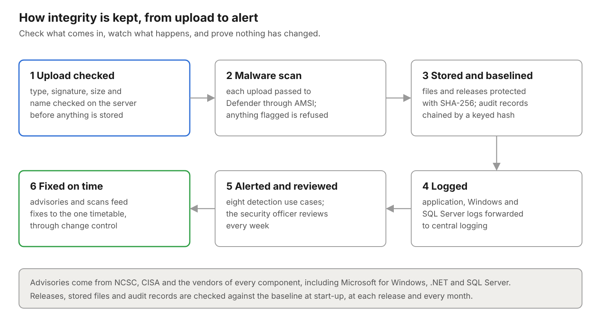

# \<System Name\> System and Information Integrity Management

## 1 Purpose

This document sets out how \<System Name\> is designed and configured to keep its software and information sound, to meet the 18 System and Information Integrity (SI) controls and enhancements in the CSS Moderate baseline.

Section 3 is the design: the upload checks and malware scanning; flaw remediation and advisories; monitoring and the detection use cases; the integrity baseline and checks; error handling and memory protection; retention; what \<Organisation\> provides; email and spam protection; and the policy and procedures. Each subsection names the controls it helps to meet. Appendix A lists the related controls and enhancements CSS does not select at Moderate.

Other documents hold the rest. Who provides and is responsible for each control, its status and its assessment result are in \<System Security Plan\>, section 7.18 (Table 27). The tests, their results and the records an assessor will ask for are in \<Control Assessment Record\> (SI). Each control's risk is in \<Risk List\>, and what is still open is in \<Plan of Action and Milestones\>. The policy is in \<Policy\> (SI), and the steps people follow are in \<Procedures\> (SI). The vulnerability timetable is in \<Risk Assessment Management\>, section 3.6, the retention schedule in \<PII Processing Management\>, section 3.7, and the audit design in \<Audit and Accountability Management\>. The privacy controls SI-12(1) to SI-12(3), SI-18, SI-18(4) and SI-19 are set out in \<PII Processing Management\>.

Values that CSS asks the organisation to define are set at corporate level by \<Organisation\>. The settings in section 3 should match those corporate values. Where one does not, it is changed in this document.

## 2 Summary

The implementation status of each control, how it is met, who is responsible, its assessment result and the risk and plan entries for its gaps are recorded in \<System Security Plan\>, section 7.18 (Table 27).

## 3 The design

### 3.1 Principles

Controls met here: SI-2, SI-3, SI-4, SI-7, SI-10.

1. **Fix flaws on time.** Every flaw is fixed to the one timetable.
2. **Check what comes in.** Every upload and input is checked on the server, and every upload is scanned before it is stored.
3. **Watch and alert.** Logs are collected, reviewed and turned into alerts.
4. **Prove nothing has changed.** Releases, stored files and audit records are checked against a known-good baseline.

These carry out the principles and rules of \<Policy\>, sections SI.3 and SI.4.

**Figure 1: How integrity is kept, from upload to alert**

### 3.2 Upload checks and malware scanning

Controls met here: SI-3, SI-10.

Every upload passes these checks on the server before it is stored (SI-3, SI-10). Files are held in the SQL Server database, not as files on disk, so Defender's file scan cannot see them; the API must pass each one to Defender before it is stored. All API inputs and search terms are validated on the server too, and database queries use parameters.

**Table 1: Upload checks**

| Check | How |
| --- | --- |
| Allowed types | Only the types in P-19; any other extension or declared type is refused |
| Type and signature | The declared type and the file's first bytes must match its extension |
| Size | Within the limit for the person's role in P-17 (reference: 25, 50, 75 or 100 MB), and a batch within P-18 |
| File name | A name containing a path or invalid characters is refused |
| Malware scan | The API passes the bytes to Defender through the Windows Antimalware Scan Interface (AMSI) before storing; a flagged file is refused, audited and reported |
| Proof | The EICAR test file, built in memory in the test environment, must be refused |

Microsoft Defender, which is signature and behaviour based, runs on both servers, with real-time protection, daily updates under configuration management and a weekly full scan. What it finds is blocked and quarantined, and the Windows server administrator and the security officer are alerted (PRO-SI-2). A flagged upload is refused and recorded in the audit trail. Each false positive is recorded on TPL-10 with how it was resolved (PRO-SI-2, step 4). When the upload scan is first turned on, every file already stored is scanned once. Exports and downloads are of files already scanned, so no further scan is needed on the way out.

### 3.3 Flaw remediation and advisories

Controls met here: SI-2, SI-2(2), SI-5.

Flaws come from the package check, the advisories in Table 2, scans and tests. Each is recorded on TPL-7 and fixed to the one timetable in \<Risk Assessment Management\>, section 3.6 (PRO-SI-1). Each update is tested in the separate test environment, then installed through change control (\<Configuration Management\>; PRO-SI-1, step 3). Update status is checked monthly and at each release by Test-Vulnerability.ps1, the repositories' dependency alerts and the Windows Update reports from both servers (SI-2(2)).

**Table 2: Advisory sources**

| Source | What it covers | How often |
| --- | --- | --- |
| NCSC alerts and advisories | UK threats and vulnerabilities | As published |
| NCSC Early Warning | Incidents, abuse and vulnerable services on \<System Name\>'s addresses | As raised |
| CISA Known Exploited Vulnerabilities | Flaws being exploited | Weekly (SyOps C50) |
| Microsoft Security Response Center | Windows Server, SQL Server, .NET and ASP.NET Core | Monthly and out of band |
| GitHub advisories and dependency alerts | NuGet packages | As raised |
| Vendors of the other components | Browser libraries and any other component on the approved list | As published |

An internal advisory is a security officer's note on TPL-7, naming the flaw, the components affected, the deadline under the timetable and who acts. The security officer passes alerts and advisories to the administrators and developers. A directive that applies is carried out to the timetable, through change control; if it cannot be, the issuer is told (SI-5).

### 3.4 Monitoring and detection use cases

Controls met here: SI-4, SI-4(2), SI-4(4), SI-4(5).

Application, Windows and SQL Server logs, and the audit trail events that use cases U5 and U6 need, are forwarded to \<Organisation\>'s central logging \[service\] (EV-SI-01). Alert rules in the central logging service analyse the events in near real time. The aim is to detect attacks, misuse and unauthorised local, network and remote connections. The security officer receives the alerts and reviews the central logs weekly (PRO-SI-3), but does not read the application audit log. Auditors read it and review it weekly (P-08), compare it with the server, database, PingFederate and Active Directory records, and report anything suspicious to the security officer (\<Audit and Accountability Management\>, section 3.8). These events must raise an alert to the security officer (SI-4, SI-4(2), SI-4(5)). The system owner raises the level of monitoring when risk rises (PRO-SI-3, step 3).

As users sign in through PingFederate, failed sign-ins and changes to administrator groups happen in \<Organisation\>'s systems, not in \<System Name\>. Use cases U1 and U4 therefore need those events, including the PingFederate sign-in logs, from \<Organisation\> (EV-SI-01).

**Table 3: Detection use cases**

| ID | Event | Source | Threshold | Alert to | Response |
| --- | --- | --- | --- | --- | --- |
| U1 | Failed sign-ins | PingFederate sign-in logs, from \<Organisation\> | 5 for one account, or 20 in total, in 15 minutes | Security officer | PRO-SI-4 |
| U2 | Audit chain break | Chain check | Any | Security officer, auditor | Incident (\<Incident Response Management\>) |
| U3 | Malware detected | Defender, and the AMSI upload scan | Any | Security officer, Windows server administrator | Incident |
| U4 | Privilege change | Changes to the membership of \<System Name\>'s Active Directory administrators' group, from \<Organisation\> | Any person added to an administrator group | Security officer | Check against the approved ServiceNow request |
| U5 | Bulk export | Audit trail | More than \[number\] items by one user in a day | Security officer | PRO-SI-4 |
| U6 | Administrator sign-in out of hours | Audit trail: a sign-in by a person in an administrator group | Outside \[hours\] | Security officer | PRO-SI-4 |
| U7 | Audit logging failure | Application log (AU-5) | Any | Security officer | PRO-SI-4 |
| U8 | Unexpected software change | Integrity check (PRO-SI-6) | Any | Security officer | Incident |

\<Organisation\> monitors traffic into and out of the network continuously, against the allowed flows (\<System and Communications Protection Management\>, section 3.2). Unusual or unauthorised traffic is traffic outside those flows, and, outbound, unusually large transfers (SI-4(4)). Users are monitored only after the legal adviser's opinion, only as far as needed, and with staff told what is monitored and why.

### 3.5 Integrity baseline and checks

Controls met here: SI-7, SI-7(1), SI-7(7).

Test-Integrity.ps1 records the SHA-256 values of each known-good release in Table 4, from the checksums recorded when the release is made. Later checks compare against these values (SI-7, SI-7(1)). The full values are kept with the release record.

**Table 4: Integrity baseline**

| Item | SHA-256 |
| --- | --- |
| API release package | \[SHA-256\] |
| UI application release package | \[SHA-256\] |
| Admin application release package | \[SHA-256\] |
| Shared library file (the same in all three) | \[SHA-256\] |

Release packages and stored files are checked with SHA-256, and audit records with the keyed audit chain, at start-up, at each release and monthly (P-29). \<Organisation\> checks the servers' firmware monthly and at a change to the hosting. An unexpected change to software, stored files or audit records is handled as an incident (\<Incident Response Management\>), and the item is restored from a trusted copy or backup (SI-7(7); PRO-SI-6, step 3). For firmware, \<Organisation\>'s security contact is told.

### 3.6 Error handling and memory protection

Controls met here: SI-11, SI-16.

Users and API callers see a general error message; the detail goes only to the logs, for administrators and developers (SI-11). Memory is protected by .NET managed memory and by Windows data execution prevention and address randomisation on the servers (SI-16).

### 3.7 Information retention

Controls met here: SI-12.

Information is kept and disposed of under \<System Name\>'s retention schedule, which is held in \<PII Processing Management\>, section 3.7 (SI-12). This table summarises the periods that other designs set.

**Table 5: Retention**

| Information | Kept for | Source |
| --- | --- | --- |
| Items and their files | As in \<PII Processing Management\>, section 3.7 \[periods set by the business owner and legal adviser\] | \<PII Processing Management\> |
| Audit records | 12 months online, then 12 months in an offline archive (P-07) | \<Audit and Accountability Management\> (AU-11) |
| Application logs | 30 days | \<Audit and Accountability Management\> |
| Export working copies | Deleted once downloaded, and always within 24 hours (P-20) | \<Media Protection Management\> |
| Backups | 14 daily, 8 weekly and 12 monthly copies (P-15) | \<Contingency Planning Management\>, section 3.8 |

### 3.8 What \<Organisation\> provides

Controls met here: SI-2, SI-4, SI-4(2), SI-4(4), SI-5, SI-7, SI-7(1).

**Table 6: Asked of \<Organisation\>**

| Provided | Controls | What \<System Name\> relies on | Evidence asked |
| --- | --- | --- | --- |
| Network monitoring and central logging | SI-4, SI-4(2), SI-4(4) | Traffic is monitored, \<System Name\>'s logs can be forwarded, and PingFederate sign-in and Active Directory group change events reach the security officer | EV-SI-01 |
| Firmware updates and integrity checks for the hosting | SI-2, SI-7, SI-7(1) | Firmware is kept up to date and checked | EV-SI-02 |
| NCSC Early Warning and alert forwarding | SI-5 | \<Organisation\> is registered, and alerts that affect \<System Name\> reach the security officer | EV-SI-03 |

### 3.9 Email and spam protection

Controls met here: SI-8, SI-8(2).

\<System Name\> sends and receives no email, so it has no spam protection of its own to set or update (\<Tailoring Register\>, TR-SI-01).

### 3.10 Policy and procedures

Controls met here: SI-1.

1. **Policy.** \<Policy\> (SI) is a system-level policy. It is shared with everyone who administers or develops \<System Name\>. The legal adviser reviews it.
2. **Procedures.** \<Procedures\> (SI) holds eight procedures, PRO-SI-1 to PRO-SI-8. They are shared with the same people.
3. **Owner.** The system owner manages the policy and procedures.
4. **Review.** The policy is reviewed every 12 months, and after a significant incident, audit finding or system change. The procedures are reviewed every 12 months, and after a change to the steps.
5. **Records.** The documents are under version control.

## Appendix A Integrity controls outside the Moderate baseline

CSS does not select these at Moderate, so they are not assessed. SI-8 and SI-8(2) are tailored out (TR-SI-01), and SI-12(1) to SI-12(3), SI-18, SI-18(4) and SI-19 are privacy baseline controls set out in \<PII Processing Management\>. Table 7 says where the design goes some way towards them.

**Table 7: Related controls and enhancements not selected**

| Control | What it adds | \<System Name\>'s position |
| --- | --- | --- |
| SI-2(5), SI-2(6) | Automatic updates; removing previous versions after an update | Not required. Done in part: updates go through change control (section 3.3) |
| SI-3(8), SI-3(10) | Detecting unauthorised commands; analysing malicious code | Not required |
| SI-4(1), SI-4(10), SI-4(11) | System-wide intrusion detection; visibility of encrypted traffic; analysis of outbound traffic | Not required. Done in part: \<Organisation\>'s network monitoring (section 3.4) |
| SI-4(12), SI-4(14), SI-4(20) | Automated organisation alerts; wireless intrusion detection; privileged user monitoring | Not required: selected at High only, or not applicable. Done in part: use cases U4 and U6 watch privileged changes and administrator sign-ins |
| SI-4(22), SI-4(23) | Unauthorised network services; host-based monitoring | Not required. Done in part: Defender on both servers |
| SI-6 Security and Privacy Function Verification | Checks that security functions work | Not required: selected at High only. Done in part: the test scripts (\<System and Services Acquisition Management\>, section 3.9) |
| SI-7(2), SI-7(5), SI-7(15) | Automated notification and response to integrity failures; code authentication | Not required: selected at High only. Done in part: signed release tags |
| SI-10(3) Predictable Behavior | Behaves predictably on invalid input | Not required. Done in design: invalid input is refused |
| SI-13, SI-14, SI-17, SI-20 to SI-23 | Failure prediction, non-persistence, fail-safe procedures, tainting, refresh, information diversity and fragmentation | Not required |
