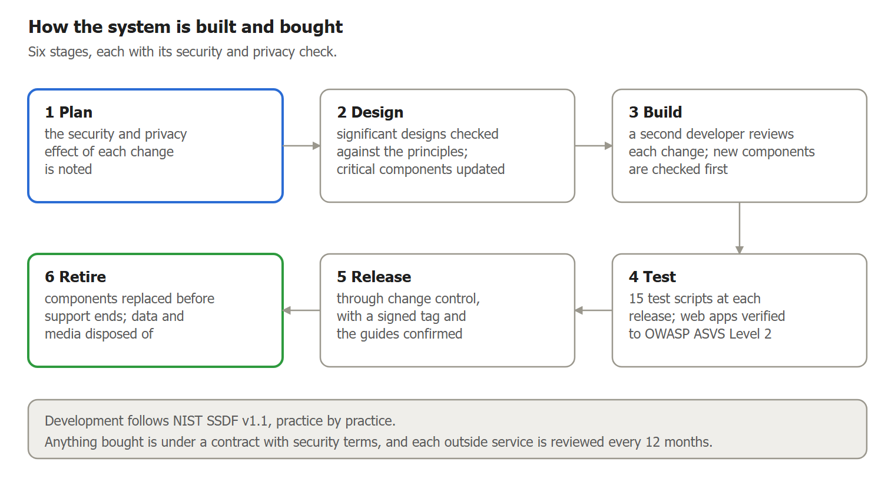

# \<System Name\> System and Services Acquisition Management

## 1 Purpose

This document sets out how \<System Name\> is designed to be built and bought securely, to meet the 17 System and Services Acquisition (SA) controls and enhancements in the CSS Moderate baseline.

Section 3 is the design: the development framework; the lifecycle, roles and resources; contracts and design information; documentation; engineering principles; external services; developer configuration management; the developer test plan; the process, standards and tools; criticality analysis; unsupported components; what \<Organisation\> and the providers supply; and the policy and procedures. Each subsection names the controls it helps to meet.

\<System Name\> is built in-house under \<Organisation\>'s corporate software development life cycle (SDLC), which is inherited from \<Organisation\> (\<System Description\>, section 7.12), so its developers carry most of these duties within it. What comes from outside is \<Organisation\>'s hosting and services, agreed through the interface record, and the packages of the public package registry behind the in-house package feed.

## 2 Related documents

Who provides and is responsible for each control, and its status, are in \<System Security Plan\>, section 7.16 (Table 25). The tests, their results and the records an assessor will ask for are in \<Control Assessment Record\> (SA). Each control's risk is in \<Risk List\>, and what is still open is in \<Plan of Action and Milestones\>. The policy is in \<Policy\> (SA), and the steps people follow are in \<Procedures\> (SA). Four records sit beside this one, each holding what CSS asks the system's own documents to hold: the engineering principles in \<System Description\>, section 6.8; the functions, ports, protocols and services in \<System Security Plan\>, section 3.7; the critical components in \<Risk Assessment Management\>, section 3.9; and the component support dates in \<Maintenance Management\>, section 3.8. The values this design runs on are set out in this document, and approved in \<Decision Register\>.

## 3 The design

### 3.1 Principles

1. **A named framework.** Development follows \<Organisation\>'s corporate SDLC, whose security practices meet CSS \<ver\>, practice by practice.
2. **Known changes only.** Only reviewed and approved changes reach a release.
3. **Test before release.** Every security function is tested at each release, to a stated depth.
4. **Know what you depend on.** Every third-party component and external service is known, assessed and supported.

These carry out the principles and rules of \<Policy\>, sections SA.3 and SA.4.

**Figure 1: How \<System Name\> is built and bought**

### 3.2 Development framework

\<System Name\> is developed under \<Organisation\>'s corporate SDLC, which is inherited and whose security practices meet CSS \<ver\>. A later version of CSS is adopted when final. The table gives each of the 19 practices and how \<System Name\> meets it, through the corporate SDLC or, where the SDLC does not provide a practice, by its own means or a departure recorded in \<System Description\>, section 3.6. The UK Software Security Code of Practice's principles 1.1 to 3.5 align with these practices. Its fourth theme, communication with customers, is for software that is sold, which \<System Name\> is not.

**Table 1: CSS practices**

| Practice | How \<System Name\> meets it |
| --- | --- |
| PO.1 Define security requirements | CSS Moderate and the privacy baseline; family policies; \<System Security Plan\> |
| PO.2 Roles and responsibilities | \<Roles and Responsibilities\>; \<Policy\>, section SA.5; the stages in section 3.3 |
| PO.3 Supporting toolchains | Tools in section 3.10 |
| PO.4 Criteria for security checks | Test plan in section 3.9; ASVS 5.0 Level 2 |
| PO.5 Secure development environments | Private repositories and the build pipeline, under the corporate SDLC; the in-house checked package feed |
| PS.1 Protect all code | Git, in private repositories with protected branches, under the corporate SDLC |
| PS.2 Verify release integrity | Signed tags and SHA-256 checksums at each release |
| PS.3 Archive each release | Git tags for each release |
| PW.1 Design to meet requirements | Security approach and principles in \<System Description\>, section 6.8; the threat model, updated before a significant change is built (\<Risk List\>, section 2.1; NFR-083) |
| PW.2 Review the design | Security officer checks significant designs (PRO-SA-1) |
| PW.4 Reuse well-secured software | Sign-in through \<Organisation\>'s PingFederate; ASP.NET Core data protection; the shared library, which holds the access checks used by all three applications |
| PW.5 Secure coding practices | .NET defaults; parameterised queries |
| PW.6 Secure build settings | Release builds |
| PW.7 Review code | Second developer reviews each change, merged through a protected branch (PRO-SA-1) |
| PW.8 Test executable code | Automated tests, a package scan and a code scan in the build pipeline, and fifteen test scripts (section 3.9) |
| PW.9 Secure defaults | Deny by default; the authentication cookie lasts no longer than PingFederate's sign-in lifetime |
| RV.1 Identify vulnerabilities | Test-Vulnerability.ps1; CISA's exploited list each working day (\<Security Operating Procedures\>) |
| RV.2 Assess and fix vulnerabilities | Timetable in \<Risk Assessment Management\>, section 3.6 |
| RV.3 Find root causes | Lessons in incident records and risk reviews |

### 3.3 Lifecycle, roles and resources

\<System Name\> goes through six stages, each with its security and privacy check. The roles are in \<Roles and Responsibilities\>, and the privacy roles in \<Privacy Plan\>, section 3.

**Table 2: Lifecycle stages**

| Stage | Security and privacy check | Who | Record |
| --- | --- | --- | --- |
| 1 Plan | The change's security and privacy effect is noted, including whether it affects personal data | Developers | Change record |
| 2 Design | The threat model is updated before a significant change is built (PRO-RA-1). The security officer checks each significant design against the principles (section 3.6). The critical components are identified at design, and reviewed at each major release and after a significant change (section 3.11) | Security officer, developers, system owner | Change record; \<Risk List\>, section 2.1; \<Risk Assessment Management\>, section 3.9; the risk and supply chain review |
| 3 Build | Another developer reviews each change before it merges. A new third-party component is checked first, and comes in only through the in-house package feed, or for a browser library with its SHA-256 in the browser library manifest (PRO-SA-7, PRO-SR-1) | Developers | The merge review; the change record |
| 4 Test | The build pipeline runs the automated tests and scans, and the developer test plan runs at each release (section 3.9) | Developers, security officer | Results and manifest |
| 5 Release | The change control board approves the release (\<Configuration Management\>), with the guides confirmed, a signed tag, recorded checksums and its release files allowed by the App Control for Business policy (\<Configuration Management\>, section 3.15) | Developers; the change control board | Change record; the release tag and release record |
| 6 Retire | A component is replaced before its support ends (section 3.12). When \<System Name\> itself is retired, its items and media are disposed of as \<Media Protection Management\> and \<PII Processing Management\> set out | Developers, system owner | Vulnerability and patch review; disposal records |

**Requirements.** The high-level security and privacy requirements are the CSS Moderate baseline and the CSS privacy baseline, chosen from the categorisation, with the privacy plan (\<Planning Management\>, section 3.7; \<Privacy Plan\>).

**Risk management in each change.** Each change records its security and privacy effect on the change record, the threat model and the risks it affects are reviewed before a significant change is built (\<Risk List\>, section 2.1; PRO-RA-1), and the security officer checks each significant design (PRO-SA-1). A change that affects personal data goes to the legal adviser (PRO-PT-3).

**Resources.** Every 12 months the system owner raises the cost of security and privacy in \<Organisation\>'s yearly budgeting, as a separate line in \<System Name\>'s budget request, and records it on the risk and supply chain review (PRO-SA-6).

### 3.4 Contracts and design information

\<System Name\>'s software is written in-house. What is bought, now or later, uses \<Organisation\>'s standard contract, with security and privacy terms added for each of the nine things SA-4 asks a contract to hold: the functional requirements, the strength of mechanisms, assurance, the controls, documentation and its protection, the development and operating environments, who is responsible for security, privacy and supply chain risk, and acceptance criteria (PRO-SA-3). The contract sets them out as follows:

1. **Functional requirements:** the controls of the Moderate and privacy baselines that the product or service must meet, by reference to the security plan.
2. **Strength of mechanisms:** the strength required of each mechanism, such as encryption and sign-in, as the family design documents set it.
3. **Assurance:** the evidence the supplier must give that its controls work, such as test results, certifications or audit reports.
4. **Controls:** the controls the supplier must operate, stated or referenced.
5. **Documentation:** the administrator and user documentation the supplier must provide (section 3.5).
6. **Protecting the documentation:** it is restricted, and handled as \<System Name\>'s own documents are.
7. **Environments:** how the product is built, and \<Organisation\>'s environment it will run in.
8. **Responsibilities:** each party's responsibilities for security, privacy and supply chain risk, including reporting a compromise to the security officer (\<Supply Chain Risk Management\>).
9. **Acceptance criteria:** the tests or evidence that must pass before \<Organisation\> accepts the product or service.

The contract also states how and when the supplier gives notice of support, maintenance and updates, as the CSS guidance on SA-4 suggests. The contract is asked for with EV-SA-01.

Nothing is bought for \<System Name\> under contract today. \<Organisation\>'s services are agreed through the interface record (section 3.7; D-CA-04), its Microsoft licences are its own, and packages come from the public registry under no contract. The key store and the vulnerability scanner, still to be chosen (\<System Security Plan\>, section 3.4), are bought this way if they are bought, and so is anything a later change brings in.

As the developer, \<System Name\>'s team provides the design information CSS asks for:

1. **What each control does** (SA-4(1)): each family's design document, and the security plan, section 7.
2. **How the controls are designed** (SA-4(2)): the security-relevant external interfaces and the high-level design in \<System Description\>, section 6, and the security plan, sections 3 and 4, and how each security function is built, in the family design documents: enough for an assessor to judge each control.
3. **The functions, ports, protocols and services in use** (SA-4(9)): the security plan, section 3.7, the allowed flows F1 to F11 in \<System Description\>, section 6.5, and \<Access Control Management\>, section 3.6.

PIV products (SA-4(10)) are not applicable, as \<System Name\> does not use United States government identity cards (TR-SA-01).

### 3.5 Documentation

Two guides are kept with the code: the Administrator Guide (\<Administrator Guide\>), on secure installation, configuration and operation, the security and privacy functions, and known weaknesses in privileged functions; and the User Guide (\<User Guide\>), on signing in, using \<System Name\> securely, personal data and users' responsibilities. The developers confirm them against \<System Name\> before it goes into operation, and again at each release (PRO-SA-4). They go to administrators, the security officer and users.

**Table 3: Where the guides cover each topic**

| Topic | Where |
| --- | --- |
| Secure configuration, installation and operation | \<Administrator Guide\>, sections 2 to 4 |
| Using and maintaining the security and privacy functions | \<Administrator Guide\>, sections 5 and 6 |
| Known weaknesses in configuring and using privileged functions | \<Administrator Guide\>, section 7 |
| The security and privacy functions users can reach, and how to use them | \<User Guide\>, sections 2 to 4 |
| Using \<System Name\> securely and protecting people's privacy | \<User Guide\>, sections 3 and 4 |
| Users' responsibilities for security and privacy | \<User Guide\>, sections 4 and 5 |

When a supplier's document is missing or does not exist, the system owner records it and each attempt to get it on that supplier's the supplier review review, and chases the supplier for it. If it is still missing at the next review, the system owner raises the gap as a risk in \<Risk List\> and uses the supplier's published documentation meanwhile (PRO-SA-4).

### 3.6 Engineering principles

The NCSC secure design principles and the CSS privacy engineering objectives are mapped to \<System Name\>'s specification and design in \<System Description\>, section 6.8, which holds them. They are applied in the specification, design, development, implementation and modification of \<System Name\>. The security officer checks each significant design against them (PRO-SA-1).

### 3.7 External services

Table 4 lists the external services \<System Name\> relies on. The \<Organisation\> services in it are the services named for SA-9(2) (SA-09(02)\_ODP). Each provider must meet \<System Name\>'s security and privacy requirements, and must employ the controls \<System Name\> inherits or shares from it, as \<System Security Plan\>, section 7, and \<Assessment, Authorization, and Monitoring Management\>, section 3.6, list them (SA-09\_ODP\[01\]). Each states those controls, and the functions, ports, protocols and other services it needs, in its signed row of the interface record (\<Assessment, Authorization, and Monitoring Management\>, Table 6), which is the agreement with each \<Organisation\> service (D-CA-04), or, for a service with no connection to \<System Name\>, in its service description, asked for with EV-SA-02 and EV-SA-03. Any hosting and services agreement is support only. \<Organisation\>'s name resolution and certificate authority carry no \<System Name\> data, and are covered by \<System and Communications Protection Management\>.

**Oversight.** The system owner oversees each service, and reviews each provider's compliance every 12 months on the supplier review, against its signed row or service description, the evidence in \<Evidence Requests\>, its service levels and any problem since the last review (PRO-SA-3; SA-09\_ODP\[02\]). Table 4 and \<Roles and Responsibilities\> say who uses each service.

**Table 4: External services**

| Service | Provider | What it holds or does for \<System Name\> | Basis of trust | Evidence |
| --- | --- | --- | --- | --- |
| Hosting, network and hardware | \<Organisation\> | Runs the two Windows Server 2025 virtual servers and their network | \<Organisation\>'s evidence of its hosting service; its Cyber Essentials Plus certificate supports this but does not prove a control | EV-GEN-03, EV-SA-02 |
| PingFederate and Active Directory | \<Organisation\> | PingFederate authenticates every user with multi-factor authentication (flow F6), and the UI application and the Admin application fetch its OpenID Connect metadata and signing certificate, and complete each sign-in, over HTTPS from the application server (flow F10); Active Directory holds the groups, read by the API over LDAPS (flow F7), that decide each role and each schema's access | The PingFederate and Active Directory row of the interface record, signed by the system owner and the service's owner | EV-CA-02, EV-SA-02 |
| Central logging | \<Organisation\> | Receives the Windows, SQL Server and application logs and security events from both servers, and gives the auditor the PingFederate and Active Directory events (flow F8) | The central logging row of the interface record, signed as above | EV-CA-02, EV-AU-01 |
| Time service | \<Organisation\> | Keeps both servers' clocks within 1 second of UTC (flow F8) | The time service row of the interface record, signed as above | EV-CA-02, EV-AU-02 |
| Backup site | \<Organisation\> | Receives the encrypted backups, copies them to the second site and keeps one copy offline or immutable (flow F8) | The backup site row of the interface record, signed as above | EV-CA-02, EV-CP-01 |
| Authenticated proxy | \<Organisation\> | Passes Microsoft's updates to both servers, and nothing else outbound (flow F8) | The authenticated proxy row of the interface record, signed as above | EV-CA-02, EV-SC-03 |
| ServiceNow | \<Organisation\> | The access approval workflow, in which the line manager approves each request and the group's owner authorises it, and the change and incident workflows. It has no connection to \<System Name\> (flow F9) | \<Organisation\>'s service, used by people only, and its service description | EV-SA-02, EV-IR-02 |
| Starters and leavers process | \<Organisation\> | Gives prompt notice of each leaver, through ServiceNow. It has no connection to \<System Name\> (flow F9) | \<Organisation\>'s service, used by people only, and its service description | EV-SA-02, EV-AC-01 |
| Source repositories, build pipeline and in-house package feed | \<Organisation\>, under the corporate SDLC | Hold all source code, history and release tags; build and test each release; supply every package | \<Organisation\>'s corporate SDLC, which is inherited, and the repository service's own controls | EV-SA-03, EV-SA-04 |
| Package registry | nuget.org, whose packages reach \<System Name\> only through the in-house package feed; builds read only its vulnerability data directly | Supplies the .NET packages. Browser libraries come from their publishers' releases, not from it (\<Supply Chain Risk Management\>, section 3.7) | No agreement. It is a supplier of components, not a service \<System Name\> connects to, so SA-9(2) is not asked of it. Each package is trusted on its signature and the check made before it is used (PRO-SA-7, PRO-SR-1), and the registry is managed as a supplier (\<Supply Chain Risk Management\>, section 3.5) | Package checks |

**Trust and service levels.** Each row says what \<System Name\>'s trust in the service rests on, as CSS asks (SA-9). For \<Organisation\>'s services, the service description should state the service levels, how they are measured, and the remedies when they are missed; these are asked for with EV-SA-02. The public package registry offers none, so \<System Name\> relies on its own checks of what it supplies; the risk of a harmful package reaching a release is R-RA-06. The authorising official keeps the risk of each external service.

### 3.8 Developer configuration management

1. **What is controlled.** The configuration items in \<Configuration Management\>, section 3.3: application code, release scripts, settings files without secrets, the SQL Server settings scripts, the lock files that fix each package's version, and documents; and the test scripts. They are controlled during development, implementation and operation.
2. **Where.** In Git, in \[number\] private repositories provided under \<Organisation\>'s corporate SDLC, each with one protected default branch.
3. **How a change gets in.** On a branch, reviewed and approved by another developer before it merges into the protected default branch.
4. **Releases.** Each release is tagged, the tag is signed, and its checksums are recorded.
5. **Scans.** The build pipeline runs a package scan, a code scan and a secret scan on each change, and the secret scan blocks a merge.
6. **Deployment.** Only a release approved by the change control board is deployed (\<Configuration Management\>, PRO-CM-1).
7. **Recording.** Each approved change records its security and privacy effect on the change record (PRO-SA-1).
8. **Flaws.** Each security flaw is tracked in the Risk List and the POA&M, and reported to the system owner and the security officer.
9. **Environments.** Development, test and production are kept apart. Developers' computers and the throwaway test environment hold invented data only and have no route to production (\<System Description\>, section 6.7; NFR-089).

### 3.9 Developer test plan

This is the developer security and privacy test plan (SA-11). The testing selected is unit, integration, system and regression testing: unit and integration tests at each build, the scripts on the whole throwaway system at each release, and a repeat run to confirm each fix (SA-11\_ODP\[01\], \[02\]).

**Depth and coverage** (SA-11\_ODP\[03\]). Every security and privacy function in Table 6 is tested at each release, in each application and on each server where it applies, with at least one test that it allows what it should and one that it refuses what it should; the other kinds of analysis in Table 5 run at their stated frequency.

Each script runs in the test environment, a throwaway copy of the whole system built from a tagged release with invented data, or only reads, keeps its results with a README and a manifest of SHA-256 hashes in the evidence for its family, and is run at each release. The web applications are verified to OWASP ASVS 5.0 Level 2.

The scripts are one kind of analysis among several that the CSS guidance expects for software written in-house. Table 5 says when each is done.

**Table 5: Kinds of analysis**

| Kind | What | When |
| --- | --- | --- |
| Scripted security tests | The 15 scripts in the table below | Each release |
| Unit and integration tests | Run by the build pipeline | Each build |
| Package scan and secret scan | Run by the build pipeline; a secret found blocks the merge | Each build |
| Manual code review | Another developer reviews each change before it merges (PRO-SA-1) | Each change |
| Static analysis | The .NET analysers or CodeQL, in the pipeline | Each build |
| Dynamic analysis | A web application scan of the three applications (\<Risk Assessment Management\>, section 3.5) | Each release |
| Verification to OWASP ASVS 5.0 Level 2 | The web applications checked against each Level 2 requirement, with the result recorded | Before go-live, then at each major release |
| Penetration test | By a tester independent of the build | Before go-live |

**Flaws.** Each flaw found goes to the Risk List and the POA&M, and is fixed in development. A fixed flaw is accepted only when its test passes on a repeat run (PRO-SA-2, step 4).

The plan, its results and the evidence are protected as the document set is: restricted, and held in the restricted store (until the store is set up, the private records repository; \<Documentation Map\>, section 4.1).

**Table 6: Developer test plan**

| Script | Security functions covered | Evidence kept with |
| --- | --- | --- |
| Test-AccessControl.ps1 | Schema access, roles and anonymous endpoints | The AC evidence |
| Test-AuditAndAuth.ps1 | Audit records, and sign-in | The AU and IA evidence |
| Test-Identification.ps1 | Identifiers and authenticators | The AU and IA evidence |
| Test-ConfigurationManagement.ps1 | The baseline and settings | The CM evidence |
| Test-Protection.ps1 | Encryption in transit, security headers and cookies, keys and secrets, and request limits | The SC evidence |
| Test-IncidentReadiness.ps1 | Ending access, clocks, and the logs an incident needs | The IR evidence |
| Test-BackupRestore.ps1 | Backup and restore | The CP evidence |
| Test-Maintenance.ps1 | Maintenance pages and tools | The MA evidence |
| Test-MediaProtection.ps1 | Exports and marking | The MP evidence |
| Test-PersonalData.ps1 | How personal data is held, logged and kept | The PT evidence |
| Test-Integrity.ps1 | Upload checks, error handling, checksums, the audit chain and alerts | The SI evidence |
| Test-Vulnerability.ps1 | Packages, browser libraries, code and the risk records | The RA evidence |
| Test-SupplyChain.ps1 | Package sources, lock files, signatures, the browser library manifest, the bill of materials, the release's SHA-256 values and suppliers | The SR evidence |
| Test-Development.ps1 | Repositories, the build and component support | The SA evidence |
| Test-PlanConsistency.py | The consistency of the document set | The PL evidence |

### 3.10 Development process, standards and tools

The process is \<Organisation\>'s corporate SDLC, meeting CSS \<ver\> (section 3.2). The standards are CSS, OWASP ASVS 5.0 Level 2 for the web applications, the NCSC secure design principles and the CSS privacy engineering objectives, with the UK Software Security Code of Practice alongside. Every 12 months the developers and the security officer review the process, standards, tools, tool options and tool settings against the security and privacy requirements of the CSS Moderate and privacy baselines, as \<System Security Plan\> and \<Privacy Plan\> set them, and the verification standard, OWASP ASVS 5.0 Level 2, and record the review on the risk and supply chain review (PRO-SA-6). A change to the process or a tool is made through change control, and Table 7 is updated with it.

**Table 7: Development tools**

| Tool | Version or setting | Configuration that matters for security |
| --- | --- | --- |
| .NET SDK and ASP.NET Core | 10.0, long-term support | Release builds, with NuGet's package audit on |
| Test environment | A throwaway copy of the whole system on Windows Server 2025, built from a tagged release and removed after each test run | Configured as production is, including TLS, with invented data only. Each application runs as a Windows service, as in production |
| Git, source repositories and build pipeline | Private repositories under the corporate SDLC | Branch protection, required review and the pipeline's scans, as section 3.8 sets out |
| In-house NuGet package feed | The one checked package source | Packages are checked before they enter the feed (\<Supply Chain Risk Management\>) |
| Package scan | NuGet's package audit in the build pipeline | Turned on in every build; a vulnerable package is reported at each build (PRO-RA-3) |
| Static analysis: code scan | \[The .NET analysers, or CodeQL where the repository service offers it\] | Security rules on, run on each change in the pipeline |
| Secret scan | \[Repository service's secret scanning, or a pipeline tool\] | Run on each change; a secret found blocks the merge |
| Web application scanner | \[Tool, to be chosen\] | Run at each release against the three applications in the test environment, signed in and not signed in (PRO-RA-3) |
| PowerShell 7 | Runs the test scripts | The scripts are under version control |
| \[Repository command-line tool\] | Used by Test-Development.ps1 | Read-only calls to the source repositories |

### 3.11 Criticality analysis

The criticality analysis (SA-15(3)) is held in \<Risk Assessment Management\>, section 3.9, with its method, the critical components and the critical functions. The developers make it with the system owner (PRO-SA-1, PRO-RA-6):

1. **When** (SA-15(03)\_ODP\[01\]): at design, before \<System Name\> is built, and at each major release and after a significant change.
2. **Breadth** (SA-15(03)\_ODP\[02\]): every component in the authorisation boundary, and each outside service it relies on.
3. **Depth** (SA-15(03)\_ODP\[03\]): each component and each function judged against the impact levels, the recovery priorities and whether it lies on the path to the items, down to the applications, servers, stores and keys named in \<Risk Assessment Management\>, Table 6, not to modules within them.

### 3.12 Unsupported components

Each component is replaced before its vendor's support ends, with the replacement planned at least 6 months before. The monthly check covers every component in \<Configuration Management\>, Table 4, and the outside services in section 3.7: it compares each with its supplier's published support dates, and those of the security-critical components are held in \<Maintenance Management\>, section 3.8, with their MA-6 support times (PRO-SA-5). A package or browser library has no vendor support date. It counts as unsupported when its maintainers stop releasing fixes, or it is marked deprecated, or it has a known flaw with no fix. The developers check each one in the monthly package check, and replace one found unsupported within 6 months, or within the flaw timetable if it has a known flaw. If a component cannot be replaced in time, the other support allowed is in-house support, or a supplier's extended support, either by exception approved by the authorising official with the risk recorded in \<Risk List\> (SA-22\_ODP).

### 3.13 What \<Organisation\> and the providers supply

**Table 8: Asked of \<Organisation\> and the providers**

| Provided | Controls | What \<System Name\> relies on | Evidence asked |
| --- | --- | --- | --- |
| The standard contract, with security and privacy terms | SA-4 | Its terms cover the nine things in section 3.4 | EV-SA-01 |
| Hosting, network, PingFederate, Active Directory, central logging, the time service, the backup site, the authenticated proxy, ServiceNow and the starters and leavers process | SA-9, SA-9(2) | Each states its controls, and the functions, ports, protocols and services it needs, in its signed interface record row or its service description | EV-SA-02; EV-CA-02 for the signed interface record rows |
| The corporate SDLC, with its source repositories, build pipeline and package feed | SA-3, SA-9, SA-9(2), SA-10, SA-15 | Its security practices, which meet CSS, and the controls on the private repositories and the pipeline | EV-SA-03, EV-SA-04 |

### 3.14 Policy and procedures

\<Policy\> (SA) and \<Procedures\> (SA) meet SA-1. Who they are shared with is in \<Policy\>, section SA.6. Their ownership, approval, review and records follow the rules common to every policy in \<Policy\>, section 1.1.
